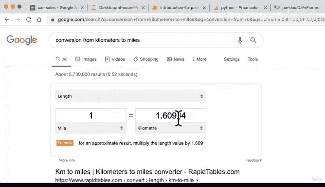

# Bourne《机器学习和数据科学训练营｜Zero to Mastery Data Science and Machine Learning Bootcamp》 - P46：046_06_013 数据操作3.zh_en - GPT中英字幕课程资源 - BV1yhrvBVEv2

ho。We have been through a lot， but we're going to persevere。

 We're going to get through this together。 We've got a few more functions to go through。

So the next one is sample Now this is a great way to shuffle your data frame。

 What I mean by that is mix up the indexes。 So in future videos when we start applying machine learning algorithms to our data。

😊，One of the most important steps is creating a training validation and test set and one of the steps to doing that is randomizing the order your data comes in because what you want to avoid is the order that these samples come in may have some kind of influence on patterns in the data when our machine learning algorithm is learning things we want it to be as general as possible so we don't want it to care about the order。

 Now there are some exceptions to the rule with time series data and whatnot。

 But I'm just going show you this example if you wanted to shuffle rows in a data frame。

 So let's do car sales dot sample。And now sample。Is basically saying take a sample from this data frame with this parameter fraction is the fraction of that sample。

 so it's going to be in an integer form so for example， 0。5 is 50% of the data。

 so it's going to get five rows out of 10， but we in this case want to shuffle everything so we will use one for 100% of the data。

There we go。 So now you can see that the index has been shuffled。

 So this is essentially the same data frame， just with the order mixed around。 Now。

 the important thing to remember with pandas is that the information in a row will stay with its row。

 So row 9， Nissan。It on white，31600 km，4 doors。 So the rows stay the same。

 All that's changing with this function sample is the order that things appear in。

And now let's have a look at the data frame again。Sly may we keep forgetting to reassign。

So we want to reassign here。Equals， there we go。Now it's going to definitely shuffle the car sales data frame or maybe we create a new one。

 shuffled because we want to keep the original one in order。 So we've got car sales shuffled。

 This will return a copy。But car sales shuffled will be in a different order to the original car sales data frame。

 Beaiful。 Now， if we wanted to manipulate this shuffled data frame。

 we could call the same functions we've called before on the shuffled version。

And another handy thing about。The sample function is that say for example you had like a data frame with 2 million rows。

 ours is really small it's only 10， but in practice you're going to be working on datas with a lot more rows。

 sometimes running functions in pandas takes a long time on millions of different rows what you might want to do is practice on only 20% of the data。

😊，Only select 20% of data。 And now this number could be arbitrary， right， In our case。

 we've chosen 20%。 So that's giving us two different rows。If you had 2 million rows。

 maybe you want to practice on 1% of the data so that's still 20。

000 rows and so that will allow you to do lots of different experiments a lot quicker than doing it all on 2 million rows at one time so that's something you'll have to consider in the future in your projects when you're working on larger amounts of data is your computer powerful enough to continually run functions on millions of rows or do you want to flesh out some little experiments on smaller amounts of data first and then upgrade those experiments as you figure out what works and what doesn't。

Now， we look at our car sales shuffle data again。We've got our indexes， but they're all out of order。

 How would we get those back into order， So we can go car sales， shuffled dot reset index。

 This function， as you could imagine， is going to reset the index here。 So we want。Wm。

 and now there's a way here。That you can remove this column。 So maybe we go in place。 Oh。

 let's have a look。Did that do that in place， shuffled， Cause by default， the reset index column。

Adds the。Old index as a new column on the very left。 And so we've got audit numbers here。

 But this is the shuffled index that it's made a column。 Maybe we don't want that。

 I think we can get rid of that， by in place equals。う。🤢，Remember。

 a lot of panda's functions have the in place parameter。Shuffled in place It。 It still has that。

HWell， the way we figure this out is if we look up the documentation for reset index。 Let's do that。

Pandas reset index。I don't want that extra index column there。So， let's see。Drop。

Do not try to insert index into data frame columns。 I think that's what we need。

Is there an example D equals true。 Yep， I think that's what we need。 So we want in place equals true。

And we want drop equals true。Drop is false， by default。Yeah， default false。

 So this is another example of how you can look at what a function does in pandas。

 I just Googled the function name reset index。Again， you won't know these things from the start。

 but it's not about knowing things off by heart。 I don't know everything off by heart。

 It's about researching different ways that functions work and trying things out。If， in doubt。

 run the code， must do that。We still have that there。Maybe we come back up here。

We're going reset this。 reset this。Reset this。There we go。

We had to reset our car sales shuffle data frame， and now we've set drop to equal true。

 we don't have that index column on the left here。Theres one more thing we're going to look at。

And that's how to apply a function to a column。 So let's say well have one more look at our car sales data frame。

 Remember， this is the process you're going to be taking a lot。

 is viewing your data frame and then manipulating it， viewing it， manipulating it， viewing it。

 manipulating it。 So it's looking pretty prime at the moment。

 But we want to convert our odometer to miles。 So how would we do that。 Car sales。 First。

 we have to select it。You can do that by typing in the column name。

And then we're going to reassign it。 We remember to reassign it this time， odometer kilomet， yup。

Now this is the apply function， apply lets you apply some kind of function。

 whether it be nuy or Lambda to a certain column， so let's just type this in and Lambda functions can be confusing to begin with。

 took me a while to learn them， but we're going to step through this one and figure out what it's actually doing。

So if in doubt， run the code。We want car sales to view the whole data frame。 Run the code。

 There we go。Now， what do you think this is just done， These numbers have changed。

We've got 1 hundred50000。 It is now 93776。 Well， let's step through this。 a dominant column， tick。

 ado column， tick dot apply， yep。Lambda now， Lambda is a key word in Python。

 which is short for an anonymous function。 So basically。

 this is saying apply this function to x divided by 1。6。 So that's what this is saying， apply。

Reset x to be equal to x divided by 1。6。 Y 1。6， because conversion from kilometers to miles。

Equals about 1。61 or 09。 but I've just rounded it to 1。6。

 That's going to divide our number of kilometers by 1。6。

Because in this case， X is the values in our odometer column。

 So this little line here is going to look at this column and go every time it's going to pick up this 150000 which is x and then divide it by 1。

6 and then reassign it to that value。 So the first column 94000 thereabouts First row sorry。

 second row 87899 is actually about 55000 miles。 So that's what this apply function is doing。

 And now this is just a simple example of a little lambda function。

 but you can get very elaborate with the things you put in apply。

 We're not going to dive too deep in that for now， so I want you to know that apply is a way that you can assign a function to a column。

 So you might have written another function somewhere else。

 and then use apply to apply it to a column。Who。We have been through an absolute mountain of information here。

don't fret。 You don't have to know all of this off my heart to begin with。 Remember the steps。

 Try it。Run your code。If in doubt， search for it。Try again。And then， if you're still stuck。Ask。

In the meantime before we get into the next section this is going to wrap up the panndas section。

 check out the resources section for a little bit more documentation about pandas。

 some exercises you can try out for yourself， but otherwise if you're with me。

 let's jump in and learn a bit more about some other tools that we can use for data science and machine learning。

