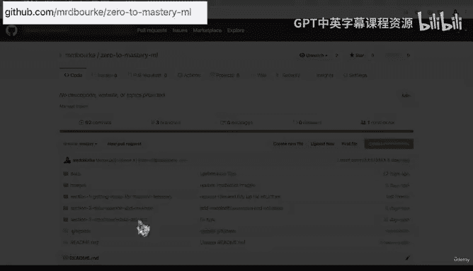
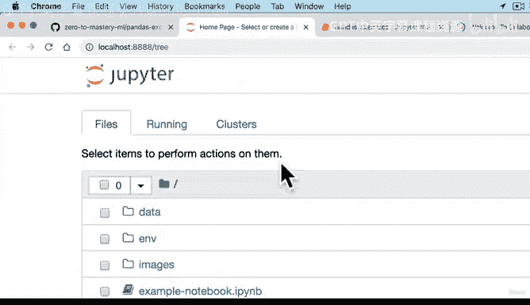
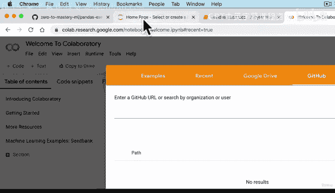
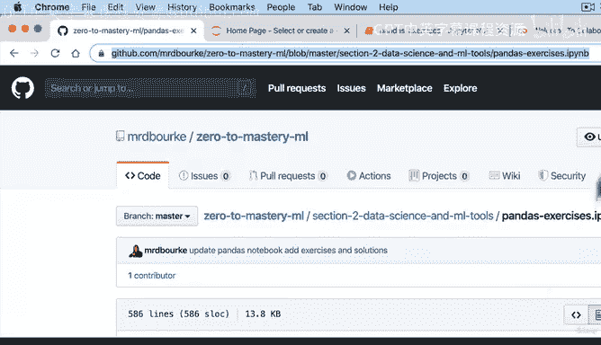
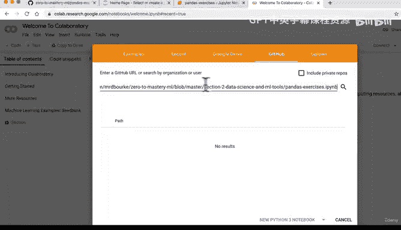
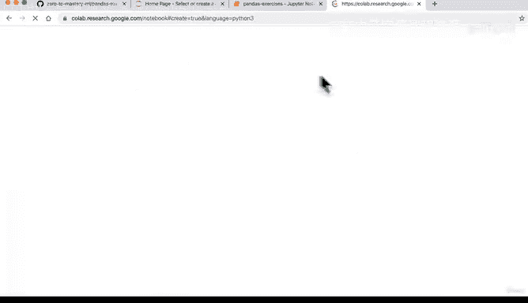
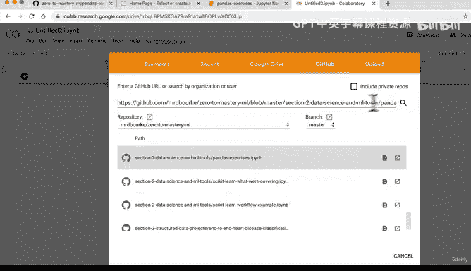
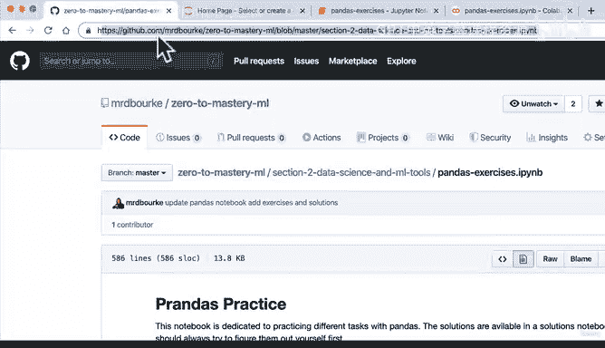
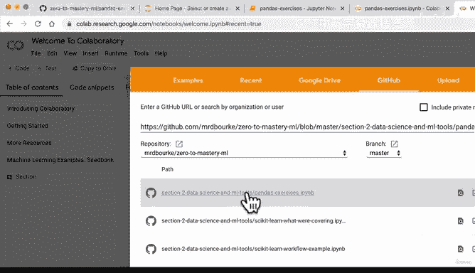
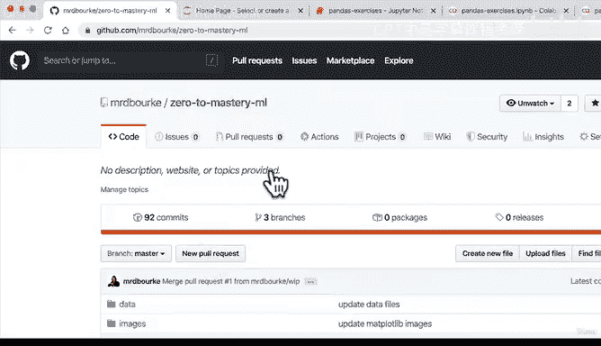

# Bourne《机器学习和数据科学训练营｜Zero to Mastery Data Science and Machine Learning Bootcamp》 - P47：047_06_015 如何下载课程作业.zh_en - GPT中英字幕课程资源 - BV1yhrvBVEv2

Hello everyone and welcome to the zero to mastery ML Github repo Now。

 if you're looking at this in the video that you're watching。😊，And you do visit this URL here。

 Github。com/mrburg/0 tomasteryml you might notice that this repo has changed and that's because this course is continually to be being built and continually developed and so as things get added and changed the folder structure here the readme may change but the work process we're about to follow won't and now the particular work process where we're following is throughout the course you may notice that we use Jupyter notebooks a whole bunch because Jupyter notebooks are the workspace for a data scientist or machine learning engineer。

And so if you wanted to download everything in this GitHub Reer。

 you could follow the clone or download little section here。

 but maybe you want to work on one particular notebook， you don't want everything。

 so you just want to access one notebook， maybe it's part of the exercises or the assignment。

Let me show you how you could do that， let's say we want to do the pandas exercises notebook。

 we want to work on that。So we'll click on this one， pans exercises， we've got this URL here。

If we wanted to download this one particular folder or this one particular file。

 we can go click on this raw button。And then what we're going to do is it's going to bring up all this text。

 but that really doesn't make sense to us so we'll find a way to make it make sense。😊，We'll go file。

 save page as。And I've got a folder on my desktop called ML course。

 and I'm going to save this into my ML course folder where I'm working on all of the course materials you may have some sort of folder like this。

And I'm going to save it into the sample project。Folder' just going to keep it with that file name。

So save beautiful。 that's going to download， and I'm going to open up a terminal。

And let's see how we'd access that one particular Jupyter notebook。So what I'm going to do。

 I'm going to change directory to my desktop。And then， to。

My MLl course folder and then I get to the sample project folder where I just downloaded by press LS。

 I should have pandasexers。ipb。text， which is this text file here。

So how would I access this to work on it But what I'm going to have to do is activate my Ananaconda environment。

 So if I go Conda activate and if you're not sure what this means。

 don't worry we'll cover this as well I'm just showing you how you access one particular notebook。

So another in in a summary， a condo environment is a collection of tools to work on data science and machine learning projects。

 so users mine is stored here， Daniel desktop。ML course。Dot sample project。Slash end。

 So it's this little file here。 This is what I'm trying to activate。Now hit enter there。

 you'll notice it changes from base。To this far path here。

Beautiful and since I have my environment activated， I'm able to access the Jupiter notebook tool。😊。

So if I hit that。This is going to load up the Jupyter notebook server running on my computer and you might notice we've got pandas exercises。

 this is that file we downloaded just before here， pandas exerciseercis。ippyy notebook。

NB is for notebook and we've got some other ones here that are I've got a little different symbol。😊。

Right， so this i M stands for i Python notebook or Jupiter notebook。Now。

 how would we convert that into one of these， Let's see we just open this up。

An easy way to do it is just by changing， removing the dot text extension and clicking OK。

And then hitting command S， or actually we don't even need to do that。

 It's going to update itself automatically。 we come back to here。Beautiful。

 you notice that pandas exercises I Pi and B has now changed to this little book symbol。

 so if we close this and reopen this notebook。What we can see is we've got an individual notebook。

Downloaded from Github。And running on our computer now if we checkck to see if this works。

 I pandas as Pd。Shift and enter wonderful so that cell is run without error so we might delete that because we don't need that Now you might be thinking if you're just gone through this。

 you might be thinking wow， Daniel that's a whole bunch of steps but don't worry as you work through the course you will get more and more familiar with that kind of workflow that we just went through however if you'd like to get started far quicker there is another way。

So， we're going come back。即 he啊。😊，And one way you can do that。Is by going into。

Whichever notebook you want to open。We're going to copy the URL so in this case it's just the exact same one as before。

 panndadas Exercis。ippo and and we're going to go to a little tool called coLab and now this is made by Google。

And so the folks at Google had this problem like we're having now and Jupiter Notes as amazing as they are can be a little bit hard to get started get running and so Google。

 what they've done is they've created a tool called CoLab which is essentially Jupiter Notes in Google Drive so you will need a Google account to do this little workflow but what you can do is go to this website here。

😊。

And what we can see， we've got my Google Drive there， but we've also got GiHub。😊。

So I can copy this URL of this pandas practicee Jupiter notebook， come back to CoLab。

 go to the Gitthub tab。

And enter。

The URL there， and if everything's working correctly。

CoLab should automatically take all of this information from the Jupiter notebook on GitHub。

There we go。 I should have pressed enter when I hit that in there。 So if we come in here。

 this is the one we want。 So there's a little tidbit for you。

 make sure you press enter when you copy the link。😊。

And there we go So now。😊，We've got our Jupiter notebook from here。

In a Google co Lab Jupiter notebook and these run exactly basically the exact same they've got it。

 they look a little different to a traditional Jupyter notebook but this is because they've got Google style so if we go import we run that exact same code import pandas as PD。

😊，Worning this notebook was not authored by Google this notebook has been loaded from GitHub may request to access your data stored within Google or read data and credentials。

 please review the source code before executing this notebook。

So that's something you you might have to， if there are any warnings like that。

 make sure you read through them， but otherwise you can notice that this notebook is working perfectly after just copying the URL from Github and typing it into。

Collabab。research。google。com。And if you want to open something。结合。Copy the URL， hit enter。

 and then click on the notebook you'd like to open。

In this case， we'll just open the exact same one。Then there we go， we can get started running。

 coding nice and easily。So that's just a little tidbit。

 remember if you do refer back to the Ze to mastery ML GitHub and it looks a little different to what you've seen in this video。

 don't worry too much it's just because as we go we're updating and continually adding new and updated content。

😊。

