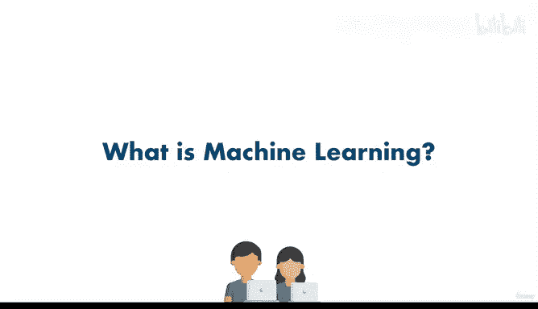

# Bourne《机器学习和数据科学训练营｜Zero to Mastery Data Science and Machine Learning Bootcamp》 - P4：004_02_001 什么是机器学习.zh_en - GPT中英字幕课程资源 - BV1yhrvBVEv2

Here are the big words that are taking the industry by storm， machine learning。Now。

 throughout the course， we're going to explore this topic as well as data science and how it all fits into the tech space。

 But first things first， you need to be able to explain this topic to your coworkers and not look like you don't know what you're talking about。

 So let's start with this。 you see， machines or computers in this case， are really。

 really good at certain things， right。😡，Machines can perform tasks really， really fast。

 and we can control these machines and get them to do tasks for us。Which is what programming is。

 We program computers。 We give them instructions to do tasks， and they do it for us。You see。

 computers came into this world because it allowed humans to do certain tasks really fast that may have required hundreds of workers before。

 I mean， computers used to actually mean people who do tasks that compute。 They computed things。So。

 for example。Let's say I wanted to find out how to get to Daniel's house using Google Maps。Well。

 one option is I could pull out a map and with a ruler。

 measure each of the routes that I could take to Daniel's house。😡，And then do some math。

 do some addition， and find the shortest path。Or I could ask a computer to do this。

 Imagine we had 10 different routes。 instead of me measuring each route 1 by one。

 I could simply program and ask a computer。 hey， can you tell me how to get to Daniel's house。😡。

And through programming， we tell the computer。Can you calculate really quickly these 10 routes and find the shortest one？

That's what programming is。😡，Instead of me taking 10 minutes to figure out how to get to Daniel's house and the fastest route。

 I just click a button and the computer tells me what to do Obviously we have to program it and give it instructions。

 but once we give it a set of instructions， it just like that finds the solution for us。

 it computes solutions。😡，And you know why computers became so popular because computers saved companies lots of money instead of hiring lots of workers。

 well， let's just buy a computer that does the task of 100 workers。 and there you go。

 we saved a lot of money and computers don't complain。 they'll work 24，7 for you。 Now。

 these machines or computers are really good at things that we can describe， right。

 that we can write in code。 If else blocks to do something。By the way， if you're new to programming。

 don't worry， we're actually going to start you off from scratch as well with Python。

 so don't worry this part is just theoretical。😡，So for example， let's say we talk about routes。

 I can say to the computer， hey， if route 1 is shorter than route 2 and if routeute1 is shorter than route 3。

 and if routeute1 is shorter than route 4 and also route 5， well。

 then pick route 1 as the best option， I can describe that through programming to computers。😡。

And computers are really good at working on tasks that have these defined rules。

All the way up to our game of chess。When you play a game of ches against a computer。

 we could technically have these eighth。Else， if then blocks lots of them to see how to move each piece and what the pros and cons are。

 And because computers are fast， we can just do a ton of these calculations。

 but then there's a problem。😡，What if instead of just trying to get to Daniel's house。

 we have to ask。Is this person angry？Let's say somebody left a review on Amazon。

 or we're building a product that detects human emotion。😡。

How can I describe to a computer what angry means。 Can you do that in if an if else block。

 what about。😡，This， what is a cat， How do we tell a computer what a cat is。

Let's say I ask you to program a computer to detect if this picture is a cat or not。😡。

Can you program that？I mean， sure you can technically say， a， yes， this cat has fur。

 This cat has whiskers。 This cat mouseows。But then the computers comes back to you and asks。

 what is a meow or what are whiskers， What is hair。You see， the harder things become to describe。

 the harder it is for us to tell machines what to do。

So we hire humans to do these things that are harder for us。

 So we let machines take care of the easier part， which is， you know。

 things that we can describe and the harder things that are hard to just give instructions to Well。

 we just let humans do it like being a salesperson or being an artist。 computers aren't good。

 So we hire humans。😡，But then there's this new idea of machine learning。

And you've definitely heard of it because it is a big buzzword right now in our industry。

 because machine learning。Has a lot of applications。 We could have self driving cars， robots。

 vision processing， language processing， recommendation engines， translation services。

 stock price predictions。 There are so many applications。

 and this is all because of machine learning。You see things that computers couldn't do before and only humans can can now be done by computers with machine learning。

 Well， kind of sometimes it gets it right， sometimes it doesn't and we'll get to that。

But the idea is this。 The goal of machine learning is to make machines act more and more like humans。

 because the smarter they get， the more they help us humans accomplish our goals。Now in this section。

 we're going to go over some theory to get us familiar with this topic。

 to understand this topic a little bit more， but don't get worried， don't get intimidated。

 We're going to try and simplify things and have fun along the way。

 and in later sections we're actually going to code build our own machine learning models and do that exciting stuff。

 but we have to learn the foundations first。😡，So let's take a break and I'll see you in the next video。

拜0。