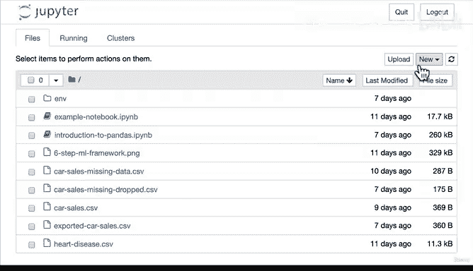
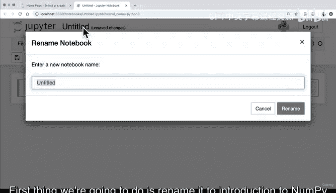
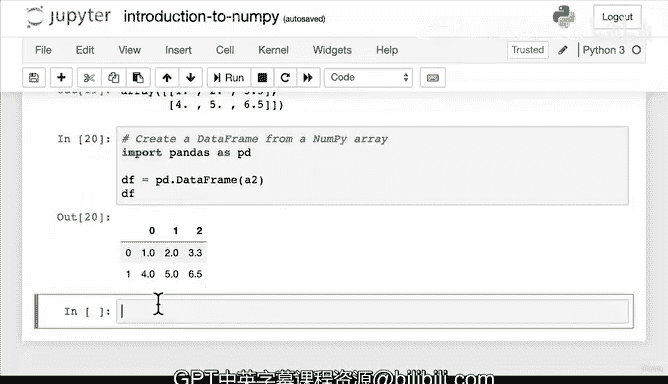

# Bourne《机器学习和数据科学训练营｜Zero to Mastery Data Science and Machine Learning Bootcamp》 - P50：050_07_004 NumPy 数据类型与属性.zh_en - GPT中英字幕课程资源 - BV1yhrvBVEv2

All right。 now we've had a little bit of a conceptual overview of Numpy。

 Let's get hands on and start to write some Numpy code。

So I'm going to follow the little workflow that we we've kind of set up over the past few lessons and sections。

Start off in a terminal and I'm going to change directory into this little folder that I've got on my desktop。

 yours may be stored somewhere else， So Cd s MLl course Now I've got a folder in here called sample project which has my environment。

 You'll want to change into the same folder that contains your environment。

Hit enter now we're in the sample project folder， beautiful。

 and we're going to check using Conda MV where our environments are。😊，So I can see I've got one here。

 I've got a few currently base is activated because I've got the star。

But I want this one because that's in my sample project folder。 So we're going to type it out。

 You could copy this and do Conda activate this here。

 But we're in the practice of writing things for ourselves because I want to get as used to as possible。

Writing as much code as possible。 M， L course。Sample project now remember you'll want to change yours to wherever your environment folder is storedd。

Activate the first thing we notice is that this has changed from base to our active environment。

 now the next step is to create a Jupiter notebook， our favourite workspace tool。 Let's load that up。

😊，Now thiss will open our browser。We brought to the Jupiter dashboard。 It's nice and zoomed in。

 Excelt。 We've got our folders here and files that are within our sample project folder。

 Yours may be a little bit different， but we can see， in my case。

 I've got the introduction to Pada's notebook， the example notebook from before my environment folder。

 We're not worried about these。 We're going to start a new notebook， Python 3。😊。

First thing we're going to do is rename it to introduction to Numpy because that's what we're working on。

 hit enter。

And we'll save that when we come back to the dashboard。

 we've now got introduction to Numpy running beautiful。Now。

 the first step for using Ny is to import it。 Im nuumpy as NP。

Now MP is just short for nupy if you see this abbreviation somewhere you can probably safely assume that it's referring to nupy。

 it's just to prevent us from having to type out nuumppy every single time we want to use a command。

We'll hit shift and enter Beai。 Now， in this section。

 we're going to be focused on Ny's data type and attributes。 So that's what we'll。

 we'll create a little heading because we are in the business of making attractive and communicative notebooks。

 data types and attributes。 We'll hit escape an M to turn it into a markdown cell。 Wonder。😊。

Data types and attributes。 Now， data types as a plural is kind of a lie because nuy。Main data type。

Is ND Ar？It's only really got one data type so everything you see in Numpy is likely an Nd array and this stands for n dimensional array and an array can be almost any list of numbers you can imagine and n dimensions means the list of numbers could be almost any shape that you can imagine but rather than talk about it let's create it So a1 for array 1 will create a sample array now you can do that by going nuy dot array which just means access the array function from nuy which we've imported as NP and to build an array which is a list of numbers。

 we want to pass it a list of numbers so let's do that。And then to see it， we'll type it again。

 shift and enter。Excellent， we've got our first nuy array。 Now， this is exciting。

 Let's check the type of it。😊，Numpie dot N D array。 wonderfulful。 So that's the same as here。

 Remember， this is just n dimensional array now。For some more examples。

 let's create a few more arrays。 MP array。 and we'll type out this one。 This will have two brackets。

 We'll see why in a second。 Now we'll separate it。 We'll go to another line 1，2，3，4，5。 Actually。

 let's make this 6。5。 And this' 3。3。 So we've got some floats as well as integers inside nuumpy。

 And there we go。 We might make another one called a 3 N array。 And this one。

 we might actually do3 brackets。 So we're getting a bit adventurous here。😊，AndWe'll make this1，2，3。

 Let's go all the way up to 18。Bear with me。Type long， if you can。5，6。And then we'll go 7，8。

 we want to make sure it looks all right， nine， and then we'll leave two brackets here or actually。

 yeah， two brackets， that's correct。I'm just counting the number of brackets。

 You'll see why this is important in a moment。Which is typing out the numbers from 1 to 18 in a very kind of cryptic format at the moment。

131415， got a little bit more 161718， my goodness。We made it in the end。

 Let's see if this cell runs beautiful， if， in doubt， run the code。 Now， why would we do that， Well。

 let's have a look at these two arrays， a 2。There we go。

 we can see that we've got two sets of brackets here。And we've got two more here。

 now let's have a look at a3。Okay， now this one， it's kind of come out the exact same way as we've got here。

HNow， before we get any further and check out some of the attributes that these arrays have built in。

 let's have a look at the anatomy of an array。So this is the anatomy of a nuier array， This is a1。

 the one that we've just created， this is A2， and this is A3。😊。

As a reason why I've putting in these numbers here。

 So we can exemplify the kinds of shapes of different arrays。

 Now this is very important in machine learning because oftentimes with a machine learning algorithm。

 your main focus will be making sure the shape of your data that goes into a machine learning algorithm lines up with the other data that you're putting in as well as the output。

 but we'll see that in future sections。 This is just learning the shape of different nuy arrays。

 So we've got one here。 So there's one row and three columns。 So this would be shape13。

Now this kind of data here is referred to as an array or vector。

 a vector is just a one dimensional array。If we go to this next one， which is a2。

 we've got two rows and three columns。 So this one has the shape 2，3。

 it's more than one dimension and can be referred to as a matrix。

 So if you hear something referred to as a matrix， it's probably got more than one dimension。

 So see how a vector is just one row， this matrix has two rows。

 and if we go down to a3 we're starting to get three dimensional here because we've got the access going back here。

 This is where the n in n dimensional array comes from。

It's very hard for us humans to visualize anything more than three dimensions。

 but in nuy and with computers， you could have as many ends as you want so this could go up to4。

 up to5 up to 6 up to 7， depending on what type of data you're working with。

 you may have thousands of different dimensions， but if you hear axis0。

 it's usually referring to rows， axis 1 is usually referring to columns and then axis n is usually referring to dimensions that are beyond just rows and columns。

So this array here or a3 would have the shape2，3，3， because there's two rows。

 three columns and we've got three across here， so that's the final one here and now if n was higher。

 there might be more commas and this little shape would extend out here。Okay。

 so now we've got the anatomy of a Ny array down pat。 don't worry。

 you can take a screenshot of this if you like， otherwise it'll be in the resources section。

Let's have a look at some of the attributes associated with numpy arrays。

 So the first one we'll take a look at is a one。Dot shape。So it's three， comma， something。

 Now this is blank。Now， the way Numpy kind of formats this data is that although we've said that the shape is 1。

3， Numpy kind of stores it。Without the row at all。 So it's just got the three numbers here。

That's just a little tidbit of how nuumpy displays some kind of shapes。

 but if we have a look at the shape of A2。We can see that it's the same as what we've used in our anatomy of a numpy array。

 Then if we go the same for A3。2，3，3。Okay let's have a look at a few more， so if we go a1。enddm。

 which is short for number of dimensions， maybe we do a2。enddm and a3。

enddm and what putting the comma here will do is when the code comes out it'll just print it with comms spacing that are three different variables apart so this is number of dimensions so a1 let's have a look at it again。

A1 has a dimension of 1， we'll have a look at A2。As a dimension of2。An a 3。Has three dimensions。

So this is where the NDRA data type comes in is that these dimensions。

 depending on how complex your data is， could just keep going。

 And now the whole premise here is we'll see some practical examples in the next couple of videos is that whatever data you're working with。

 it somehow gets turned into numbers and then a machine learning algorithm will find patterns in these numbers。

 Now depending on what data you're working with will depend on how many dimensions there are。

 But let's not stop there， let's have a look at。The D type attribute。

 you might be able to guess what data type these are， and let's go here。Shift， enter。

So we can see in our A1 array we've got ints， in our A2 we've got floats as well as ins。

 but it's going to default to float because there can only be one kind of data type so it will automatically just turn the rest of the numbers in here into floats and A3 is also just integers。

We got a couple more a one size， a two size， a3 size。😊，We've got three elements in A1。

 we've got six elements in A2， and we've got 18 elements in A3。 if we have a look at A3。

That makes sense beautiful， so the size attribute tells us how many elements we've got total in our array。

😊，Now've got one last one， which is type。Type。A2。Type a 3， I think we've already seen this。

 but I'm gonna get you to guess what it is before we hit shift and enter 3，2，1。

These are all N D array。 So although they vary in size and shape， A 1。

 A2 and A3 are all of the type N D array。 Now， this is an important concept to remember。

No matter what type or what shape your Nier array is。

All of the functions and different data manipulations that you see throughout this section。

 if it's in an umpI array， if your data is in an NDRA data type。

 all of the things we're about to go through can be used on that。

 So that's a very important point to remember is that the ND array is a universal data type。

 and it's very， very flexible。So now to really exemplify nuie being the backbone of other scientific data packages that is。

 let's put a note here， create a data frame。From。Numpie array。So let's have a look first。

 we'll import pandas as PD。Beautiful， and then we might create one from our existing array。

 So PDd do data frame。 we'm just going to pass it A2。 let's have a quick look at what A2 is。😊，A2。

Wonderful， so there's a2。 Now let's see what that looks like。 Oh， you need to view it。

 shift and enter。There we go。 So this is a pandas data frame， and this is our Ny array。

 So essentially， no matter what's in our pandas data frame， if it's all numbers。

 pandas is built on top of Numpy， So to represent our data as a data frame。

 it's just combining Numpy arrays in a formatted way。😊。

So that's a very important point to remember as well is that once we start to get into the weeds of Numpy and start to work out what kind of numerical computing it can do。

 we can start to think okay， so if we have some data and we import it in pandas。

 it's actually just a different combination of nuumpier arrays。

 so if we want to perform some manipulations on it。

 we're actually just performing manipulations on different lists of numbers。All right。

 that's a brief introduction to Numpy's main data type that's the main thing to take away from this is that ND array。

 whatever array you have in Numpy is of type ND array and that pandas and other machine learning algorithm packages are built on top of Numpy and machine learning is finding patterns inumpy arrays So with that Ben said。

 let's take a little break if you need to go back and explore。

 create an array of your own by trialing it out if in doubt run the code and I'll see you in the next video。

