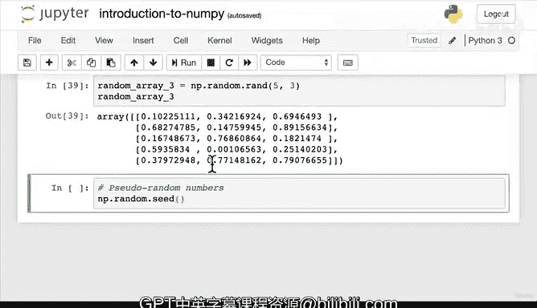

# Bourne《机器学习和数据科学训练营｜Zero to Mastery Data Science and Machine Learning Bootcamp》 - P51：051_07_005 创建NumPy数组.zh_en - GPT中英字幕课程资源 - BV1yhrvBVEv2

Welcome back。 I you've had a little bit of a play around with creating your own nuumpy arrays。

 but if not， that's okay because in this section， what we're going to do now is have a look at how we can create Numpy arrays。

😊，And so in the previous section or video we went through creating some of our own arrays， A2，A3， A1。

 and we learned about different attributes that these arrays had。

 but it was very tedious typing out all of these different numbers。😊。

So let's have a look at some easier ways。 first to begin with， we'll just see it again。

 just in case so sample array， how we did it the first time， MP dot array。

 And we passed it a list of numbers， wonderful。😊，We'll go here andll just so it prints out。

 We'll have sample array here。 So this is going to give us a one dimensional numpier array with the elements 1。

2 and 3 in it。So if we check this array data type。There we go。 Beaiful。 Okay， now， for example。

 what if we wanted to create an nuly array that was already filled for us。

 What if we didn't want to pass any， anything here， Let's have a look at how you could do that。

 Let's make one called ones。And you go MP ones。Actually。What does N dot ones。

 What do you think that will be， Well， I've got a little trick I can show you to get a little preview of this。

 Let's hit shift and tab whilst we're inside the brackets。Oh。What have we got here。

Signature N dot1s shape。Doock string， return a new array of given shape and type filled with ones。

 Beai。 So what shift and tab does。 remember we'll exit out of here。 We'll come back into this。

 If we type in any kind of function。 So N dot something brackets。

 we push shift and tab while we're inside here。 What that's going to tell Jupiter to do is open up the functions dock string。

 So this gives us information。 So this information here comes straight from the nuie documentation。

 This is going to tell us what this function does。 return a new array of given shape and type filled with ones。

😊，Let's see here parameters shape， int or sequence of ints， EG23， let's use that example。2，3。

Shift and enter。 Okay， what does this look like。W。An array filled with ones。

 That's exactly what it said。 Shift and tab。 return a new array of given shape and type filled with ones。

 Now we haven't put in type here， but we have given it shape。Okay， let's have a look here。

 one stop D type。That's D type float。 So if we use ones。

Pretty sure floatat is the default data type now you could probably find that that's a little challenge for you is to find out what the default data type is by reading through the dock string。

Let's keep going。 We checked type of one。We can see that it's our beautiful and favorite data type is ND Ar。

 wonderful。😊，Now let's have a look。 But if we wanted another array， but not with ones。

 we wanted one with zeros MP。Let's see。 in P 0， Does it have this。Doock string。

 return a new array of given shape and tie filled with zeros。 Okay， let's do the same again。

NP do zeros。Zeros。Wonderful， okay。Now you might be thinking， Daniel， why would you want ones。

 Why would you want zeros？ Well， in that case， you could imagine zeros is kind of like a placeholder array。

 Maybe in machine learning， you want to fill an array with some initial data or that data you don't know yet。

 So you create the zeroes just to work out the shapes of data you're working with。

 So before you even implement any data， you could make sure that your shapes lined up by using arrays filled with zeroes。

 But let's keep going， let's see how we could make a few more different kinds of arrays。

Let's go range array equals N P dot A range。 Let's see shift and tab。

 That's what we're p at the moment。 Return evenly space values within a given interval。 Start， stop。

 step。Okay， let's have a look。Start number， stop number， step number。 Let's try it。 If in doubt。

 always try 0，10，2。Now this is going to be start， stop step， What do you think that this will return？

Let's have a look range array。So it's going to start at 0，0。 It's going to stop at 10。

 but it's going to step up by 2，0，2，4，6，8。 wonderfulnderful， let's keep pushing forward。

 Let's go random array。 What if we didn't know what numbers。

 We just want nuie to just fill an array full of random information for us。 N P dot random。

 Let's do random int。 shift and ta。 Let's practice。😊，Doock stringing R low high size。

 return random andtes from low to high， exclusive。Okay。

 return intes from the discrete uniform distribution of the specified D type parameters low。

 int or array of ints， high， int or array like of ints optional。Size， okay， so let's go。0，10。Size。

3 by5。What do you think this will return， Let's have a look， Randnda Muray。Size is not defined。

 what have we done wrong here， We haven't set size equal。Wonderful， so what this is done。

 you will see what the actual dock string return random andtegerers from low。 This is our low 0， low。

 inclusive to high exclusive 10 of size 3 by 5。 So now if we go random。😊，Aray， dot size。 We have 15。

 and we want random array， dot shape。3，5， wonderful。 And we can see that in our array。

 the low is 0 and the high is 10。😊，Wonderful， let's see one more way of creating random arrays R dot random。

 Numpy has a fair few different ways of creating random arrays。😊，YouDon't need to know them all。

 There we go。 So random dot random。 What does this do， Shi tab。

 return random floats in the half open interval 01。 So this is going to return。

 and it takes a parameter size。Let's save this， too。Random array2。

And then we want to show it randomand array 2， wonderful random array 2。 Let's check the shape。

Shape there we go。 Shape is 5 and 3。 wonderfulful。 So that means it's always rows， then columns。

 So 5 rows，3 columns，1，2，3，4，5，3 columns。 And if we check this。

 it's going to be between the interval 0 and  one， wonderful。😊，Got a random array。

 And let's see one more。 So we want random array 3。 Now， this is where Nie can get a bit confusing。

 I that these。Dot R or random and dot random。5，3。Do。Very similar things。嗯。Random。Random。

 we go to shift tab。 We can see what the do string says here。 Return values in a given shape。

 So that's what I've done past D 0 and D1。 So dimension 0 is 5 and dimension 1 is 3。 So remember。

 always goes dimension 0， dimension1。 If we go back to the anatomy of our nuumpy array。

Access zero is the same as dimension zero， which is the row here。

And access  one is the same as dimension 1， which is the columns here， wonderful。Now。

 the thing you should know about the random numbers in Numpy is they aren't actually random。

They're set with something called a random seed。 pie dot random seed。

 What could this mean They' pseudo random numbers and pseudo。Random numbers。

We'll have a look at this in the next video。😊，But this is an important concept to remember going forward is that when Ny generates random numbers。

 they're actually pseudo random numbers， so take a quick break。

 try practice creating some of your own random arrays using the dot random or Rand int。

 have a look at the dock strings by pressing shift tab and then in the next video。

 we'll have a look atmp dot random seed and see how we can generate some nonran random numbers。

