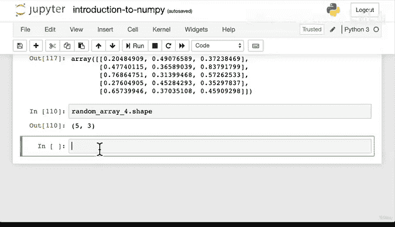

# Bourne《机器学习和数据科学训练营｜Zero to Mastery Data Science and Machine Learning Bootcamp》 - P52：052_07_006 NumPy 随机种子.zh_en - GPT中英字幕课程资源 - BV1yhrvBVEv2

Welcome back。 In the last video。 we saw a few different ways that we can create N arrays。

 So we've got a sample array， which could really just be a simple array by we're using N dot array passing in a list of numbers。

 There's another one。 If we wanted to create an MP array of just ones， we can pass it a shape。😊。

And if we keep going， if we wanted an array of zeros， we can use N dot zeros。

 If we wanted an array that's between a range of different numbers， say starts at 0， stops at 10。

 steps at 2。 We can use a range。 And if we wanted an array of random numbers。

 we've got a few options。 We have R int for returning integers between a certain range。

Or we have random dot random for returning numbers between 0 and 1 of a certain shape。

 And how do we know what these functions do， Well， we can press shift and tab。

 And that's going to return the dock string。 So here we can see N dot random dot random。

 Re random floats in the half open interval 0 to 1。 and it takes parameter called size。

 which in our case， we've done 5 and 3。 So 5 rows 3 columns。 We can see that there。 Wo。😊。

Now we also said in the previous video that nuy generating random numbers。

 they aren't actually random， but you might be running this cell。

 I've run this one about 50 odd times and each time new random numbers have come up。

So what's the idea。 What gives Daniel why， I think these numbers are random。 Well， you'd be right。

 They look random to us， but what they really are is pseudoran numbers。

 And we can see this by using nuy random dot seed。Now throughout your machine learning endeavors。

 you might see this little function at the start of a notebook or somewhere along the lines wherever Ny's random package is being used Now what does this do now rather than talk about it。

 we're going to see what it does in a practical sense。

So let's just comment this out for the time being。And we'll just create another one。

 go random array 4， just so we can make sure it's not the same as this one as before。

 N dot random dot R。 Let's go R int。We want numbers up to 10 of size，5，3， wonderful。

And then we'll have a look at what this looks like Ra number A4。There we go。 Okay， numbers。

 these are between 0 and 10。 We've got 0，5 beautiful of size。 Well this is really shape。

 That's a bit confusing with numpies。Is that the size parameter of this creating array function is actually the shape attribute。

 but that's all right。We can figure these things out。 We're smaller to do that。

 But every time if we ran this， we're going get。What seems to be。A new random array。

 And for what we're looking at， we can consider this random numbers every time。

 But what if we wanted to share our notebook with someone else and we wanted them to run ourselves across the notebook。

 go through from top to bottom and get exactly the same results as what we did so we can reproduce our experiments。

😊，That's when Ny's random seed comes in。It allows us to still generate random numbers。

 but random numbers that are reproducible。 So let's have a look。

If we set random seed at the top of this cell to be 0 so we can go shift tab， takes a parameter。

 seed equals， something。So we can actually set this to any number we want。

 We'll have a look at that in a second， so in this case we'll set it to zero。

Well hit shift and enter。What's happened， by vote。How on。The numbers of。

They've stopped changing on us。And what if we comment this out。They've changed。Okay。

So what the random seed function does is it essentially says ta nu high。

 I want you to create random numbers， but keep them aligned with the seed。 So random seed to 0。

 We're always going to see this combination 5，03。5，03，50，3。 I'm running this cell。

 We can see the numbers going up here。 Now， this works， no matter what your seed is。So，6，3，7。6，3，7。

 We could even set it to9，9，9，9。0，3，1，0，3，1。Ha。Now let's try again with another random function。

 that was Rand int。 Maybe we go here。Let's go random array 5 just to make sure that it's different。

 N dot random dot random and shift tab。 What does this take， size equals something。

 So we want 5 and 3 again。 We out of view。 what's going on here。 Rand array 5。Okay。

 every time we run this， new numbers。Okay。Now， let's put a random seed in here。What shall we do。

 What number you thinking of。I'm thinking of 7。 There we go，7。

The numbers still seem seemingly random to me。 But what the random seed does is remember。

 it says toumpy， hey， generate some random numbers。 But if you see the random seed and it's set to 7。

 make sure they're same every time the random seed is set to 7。So now if we run this exact same code。

In the next cell。Random array，5 equals， MP dot random。Random five。3。And we want to see it again。

 NP 5。Different here。If we kept going with this， we would eventually line up with the random seed。

 but we don't have time to do that。So what's the takeaway here， Well。

 the numbers that you see numpy generate seemingly random， but they're not actually random。

 They're pseudoran numbers。 So whenever we run this function without a nuy seed being run。

 what it's actually doing is setting the seed to be something random every single time you run this。

 But if we set our seed manually we're going to get the same random numbers back。 Now。

 the important takeaway is that these numbers are seemingly random。

 but the main purpose of using random seed is if we wanted someone else to be able to use our notebook and generate random numbers。

 but the same random numbers as us and thus reproduce our experiment exactly。

 we would set a random seed。 So if you see N random seed。 that's what it's doing。

 It's making sure the random numbers in the cell that it's been run are the same every single time。

Time。Okay， now we've seen that， we've seen how to create some arrays。

 we've seen how to generate arrays with random numbers。

 let's look at how we can view different arrays and matrices， so take a little break。

 try to generate some more random arrays， practice around with nuy random seed and I'll see you in the next video。

😊。

