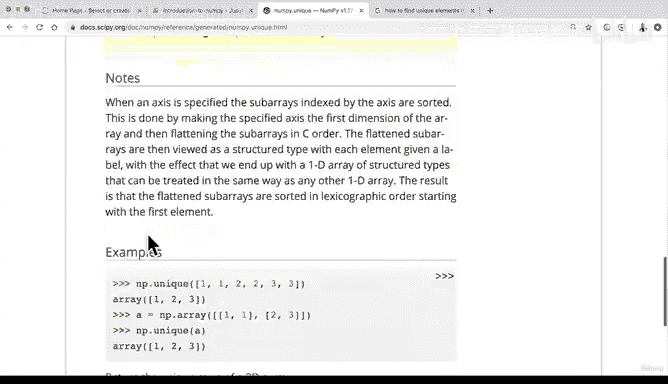
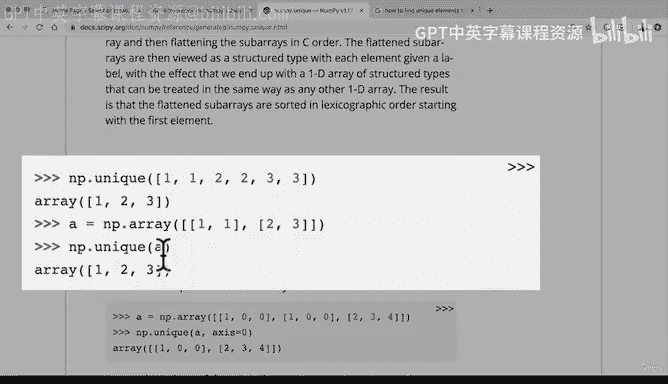
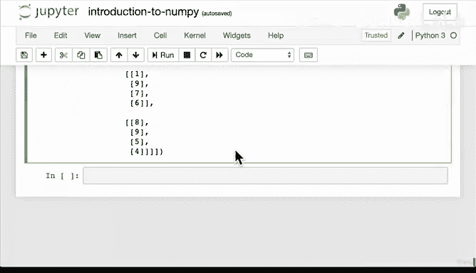

# Bourne《机器学习和数据科学训练营｜Zero to Mastery Data Science and Machine Learning Bootcamp》 - P53：053_07_007 查看数组和矩阵.zh_en - GPT中英字幕课程资源 - BV1yhrvBVEv2

Welcome back。 In the last video， we had a look at Numpy's random number generator and how it's random。

 but we can use Numpeyy's random seed method to make it not so random and create pseudoran numbers。

 Now we're going to have a look at different ways of viewing arrays and matrices。😊，Here we go。

 shift and enter， remember we're making markdown cells so that our notebooks are beautifully formatted。

😊，And actually， before we jump into that。How do you think we'd find the unique numbers in these arrays。

 Maybe this one is a bit better because that's got integers。 These are all floats here。

 and they're way too long。 But how would we find the unique numbers in random array for。

Let's have a practice of how we might do that。 So we'll open up a tab and we'll go how to find unique elements in a numpy array。

 beautiful， That's pre filled。 So this is going to take us to the documentation。Numpie dot unique。

 Find the unique elements of an array。 Wonderful。 That's what we're after。

So if we go down in the documentation， you'll see down the bottom。 there's examples。 Now。

 this is what we're after。 This is the process you can go through。

 Sa someone came to us and was like， hey， you've got your random array 4。

 I need the unique numbers from that。 So we find the documentation。

 We'd come to the example section or we just read it to see if it does what we need。

 Then we'd have a look down here。 So they've got an array， A MP unique A array。

 It shows the unique numbers there。 Well， let's have a look， let's practice MP dot unique。

 And remember， we hit shift and tab。😊。

We've got information here。Find the unique elements of an array。 Woful。 That's what we're after。

 So we're going to pass it random array 4， random array4。😊，Shift and enter。

 And what this has given us is 0，1，3，4，5，6，8，9。 If we come up here。

And that is because we created random array 4 using RAand int past it 10。

 so that means it'll use the numbers between 0 and 9 of size 5 and 3。

 so we can see the unique we haven't quite got all the numbers between0 and9 we're missing two we're missing7 beautiful。

 but that's just a quick little tidbit of how you might find a function using nuy you might come across the documentation。

 stack overflows another resource that you'll often come across。

 but that's the steps you'll take Now let's get into section 3 viewing arrays and matrices。😊。

So we've got our array a1。A2， we created these earlier， A3。

Now viewing arrays and matrices takes a bit of practice in creating them of course too。

 but if what you're seeing in this section how to view them is a little bit confusing to start。

 don't worry I still get confused， the important point is to start practicing so if we wanted to see element0 in a1 we could use zero indexing so let's try that。

😊，Beautiful， let's go the same for A2。Wonderful， now this is going give us this first row here。

Why is that Well， if we go above here， a2 dot shape。Okay， so it's got two rows。

 So that makes sense we're indexing into the first element of the shape。 Now let's try a3。

 a3 dot shape。This is 2，3，3。 Let's get a3，0。Wonderful， but if we have a look at all of A 3。

So it's giving us back。The first row。 So if we see here， too。3，3。An a 3。

0 is giving us back this first matrix or first array。

 remember the anatomy of our arrays and matrices。Although this is still anump array。

 it can be referred to as a matrix。 This is where some of the terminology gets a bit confusing。

 Usually a one dimensional array is referred to as a vector。

 but anything more than one dimensional is referred to as a matrix， but is also of type array。

 So that's the important thing to take away。 is that a array。Is still this。

 but anything with more than one dimension is a matrix。Let's have a look at some more indexing。

 So we go A2 maybe if we wanted index 1。 So we'll have a look at our ray again， index1。

 What will this give us do you think？Shifting enter。 So it's given us。Position 1。So let's try again。

 I' do a bit more of a complicated one。 We can use slicing with the arrays 2， which is beautiful。

 just like Python less。 Maybe we want the first two values of a3。So we want the first two values。

Of age。Row column and array。 So let's try that。 First two values of each shape。

What do you think this will give。So let's have a look。 so we got the first two and the second two。

 which is  one，2，4，5。 so it's this section。And then we got the final two， which is 10，11，13，14。

A beautifultiful Now remember doing this kind of indexing。

 depending on how many dimensions your arrays have will take some p here。😊。

So best to just experiment， create some arrays and start playing around， what if we did？

Something like this， you get an error because there's too many indices。

The reason why we can only do three is because of a 3's shape。 There we go，2，3，3。 Let's try one more。

 We'll create a4 equals random dot R。 Oh no， we need nuie at the front here。 Rand dot R in。

 We'll do 10。 And this time we'll make it a four dimensional all A 2，3，4，5。

 We want to see it shift and enter。Size is not defined。 Oh， we keep forgetting to push es here。

 That's all right。 You'll make some errorsers， too when you're learning to code here。 Okay， so a 4。

 we've got a fair few numbers here。 We can scroll right down。

 So if we did a 4 dot shape and then a 4 dot N dim。The shape is 2，3，4，5。 we kind of knew that。

 so two by three by four by5， yep。And the dimensions is4， so this is a four dimensional array。

 remember， n dimensions can go up to any number you can imagine。

So how would we get only the first four numbers of this vector here。嗯。Let's have a look at this size。

 so numpy displays arrays from the outside integer inwards。😡，So let's have a look at this。

 This might be a bit hard to understand， but with some practice， you'll start to see。

 So we've got five here。 So the furthest element on the right。

 the furthest of the shape gets displayed on the innermost section。 So5， there's five numbers here。

 and then 4。The next section。Is this section here， so there's  one，2，3，4， y。And then three。

 so there should be three， one，2，3。🤢，Yep， so1，2，3， and then 2。 So there should be two in the largest。

 So the outermost brackets。 So this， this is3。And this is3 here。 So there's two there。Remember。

 visualizing these is very hard to understand when you first begin。 so if you're having some trouble。

 try to create some random arrays with different shapes and then start to count backwards from the outermost number。

On the innermost displayed array。But let's say， how would we get。The first four numbers of。

The innermost array。So that's the innermost here， number5。

 So what we could do is slice these first three dimensions and then slice this one。

 We only want the first four。 So let's try that。A 4。Slice all of dimension 1。

 Slice all of dimension 2。All of dimension 3， but only up to the first four numbers of dimension 4 shift and enter。

Wonderful。So that only gives us the first four numbers of the innermost dimension。

And if we got rid of that of3。That to 2。There we go。

 we can start to see how we can really slice and dice our rays and matrices to give us back any kind of numbers that we might want to see。

😊，Al right， now we've seen a few different ways to create arrays。

 we've seen a few different ways to index them and view them and I'm using the term arrayray and matrix independently。

 you can use them independently yourself。😊，What we're going to do next is figure out how to manipulate and compare different arrays。

 which is the crux of what machine learning does to find patterns in numbers， so have some practice。

 take a little break， try out a bit of slicing， create your own array and see different ways of viewing it and I'll see you in the next video。

😊。

