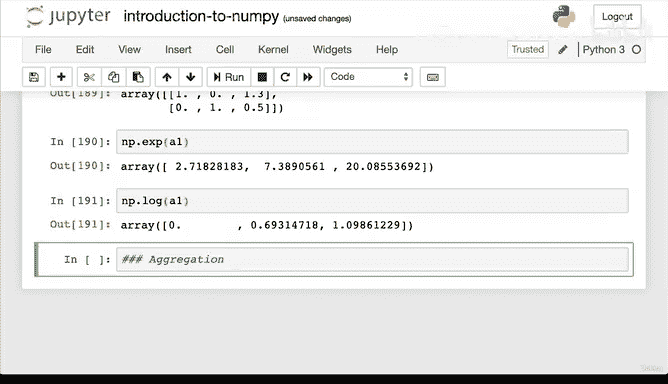

# Bourne《机器学习和数据科学训练营｜Zero to Mastery Data Science and Machine Learning Bootcamp》 - P54：054_07_008 操作数组.zh_en - GPT中英字幕课程资源 - BV1yhrvBVEv2

Allright， all right， all right。

So in the previous few videos， we've had a look at different ways of creatingump arrays。

 We've seen how we can view them。 Now， let's figure out the fun part。

 Let's figure out how we can manipulate and compare our different arrays。

 This is where the crux of machine learning happens， right。

 It's manipulating performing calculations， Find patterns in arrays of different numbers。

 So let's start it off。 We'll put in another heading because we're keeping our notebooks nice and neat。

 manipulating and comparing have I spelt it right。 I usually get typos in these headings。😊。

Manipulating and comparing arrays。 beautifuliful。 We're going to put a little subheading here because like pandas with numpy。

 if you can think of a way of manipulating numbers， you can probably do it。

 So the first one we're going to look at is arithmetic。 we go。

 Luc and coding is a little bit better than my spelling ability。 But arithmetic is a fancy word for。

😊，Basic math equations。 So let's have a look。 Start off by checking out our a1 array we created this earlier。

 A1， wonderful。 We'll create another one called ones。 Actually， we've already got ones。😊，Yep。

 beautiful。 But if you wanted to recreate it， we'll go N dot1s3 just to make sure we know what it looks like ones wonderful。

Okay， first thing we're going to have a look at is nice and simple plus。

 So what do you think this will do if we go a1， which is our array here plus ones。 Well。

 let's not talk about it。 Daniel let's run the code beautiful a1 plus ones。😊。

So we've got one plus one equals 2，2 plus one equals 3，3 plus one equals 4。Excellent。

 so all this is done has just added together the different elements in the same position of both arrays。

 So the zeroth position，1 plus 1 equals 2， the first position 2 plus1 equals 3 and the second position is 3 plus 1 equals 4。

 All right， Well， let's keep going。 Let's see a few more options。 A1 minus1。😊。

Can you guess what' will happen here？0，1，2。 So all it's done is if subtracted ones from a 1。

Let's push forward。 Let's try and multiply。A1 times ones。Yeah， well。

 that makes sense because our one's array is just all ones and it's just times a1 by one。

 one times1 is one， one times  two is two and so on。Let's bring anotherwry。A2， here we go。😡。

Now this will be interesting if we might deploy a1 by A2， what's going to happen？Ha。Let's see。

 Let's work through this。 So we've got one。 This is。

 let's get up a1 again so we can see everything in one place， a 1。1 times 1 is1，2 times 2 is 4。

3 times 3。3 is 9。9。 That makes sense。 But what about this second row here。

Let's see if we can figure this out by looking at it，1， 4，4，2 times 5 is 10， Yup，3 times 6。5 is 19。5。

 Let's use Python to help us out for that6。5。 It's 19。5。 We can get rid of this cell。

 We don't want that。 Actually， never use a toolbar。 E X to get rid of that。

So what this has done is it's taken A1。These three numbers here。Multiply it by this row。

Put it in here。 and then done the same thing again with a1 and multiplied it by this row。

 That's interesting。 Let's have a look at our other array first， A 3。 Let's combine these two。

 A2 and a 3， A 2 times a 3。Oper ends could not be broadcast together with shapes 2，3。2，3，3。

Os could not be broadcast together。 That's interesting。

 remember right at the start at the concept video where we talked about where Numpy is fast because it vectorizes code through a technique called broadcasting。

 Well， this is what's happening here。 but to be that fast。 Brocasting has a few rules。

 So let's look that up。 Numpy broadcasting。😊，There we go。

 We're going to go to the documentation broadcasting Ny click on that。

The term broadcasting describes how nupi treats arrays with different shapes during arithmetic operations which is exactly what we're doing。

 we're trying to use some arithmetic on arrays with different shapes。

 so there's A3 and there's A2 they've got different shapes and that's what the error is coming up。😊。

So let's have a look here。 Subject to certain constraints。

 the smaller array is broadcast across the larger array， so they have compatible shapes。 Well。

 that explains what's happened up here with a1 times a2。

 The smaller array is broadcast across the larger array so they have compatible shapes。

 That makes sense because we've got here， this is a smaller array。

 It's been broadcast across this row and then across this row。

 So that the output has a compatible shape of the larger array， okay。😊。

We'll keep going there some examples here。So these are two arrays multiplied。

 They've got the same shape，1，2，3，2，2，2， A times B is one times 2 is 2，2 times 2 is 4。

 three times 2 is6， aha that makes sense。And then broadcasting rule relaxes this constraint when the array shape meet certain constraints。

 Okay， so this is good。 This is the kind of workflow you want to start getting into， right。

 as if you come across an error like this and you will all the time。 one of these mismatched shapes。

 errors like。😊，Different shapes that are incompatible with each other， a value error。

 These are going to come up all the time in machine learning。

 and part of being a data scientist or a machine learning engineer is reading documentation like we're doing now and trying to figure out how to fix our problem。

So general broadcasting rules， O， when operating onto two a arrays。

 nuumpy compares their shapes element wise。 It starts with the trailing dimensions and works it way forward。

 Two dimensions are compatible when they are equal or one of them is one。 Now。

 to save a little bit of time instead of going through the entire documentation。

I'll leave that for you。 I want you to have a think about try and figure out a way。

 How would we get these two to be of compatibility， How would we ful this broadcasting need。

 So what you may want to look into。Is。How can you reshape a2 to be compatible。With a 3。

So that might be looking at search， put in another comment here。How to reshape nuumpy array。

So check out the broadcasting documentation。Along with searching something like this。

 and then figure out how to make these two shapes aligned。 If you can't， that's entirely fine， right。

 This takes a bit of practice， but we're going to see how to do it in a future video Right now。

 we're going to continue with our arithmetic just to finish things off。 So where were we。

 we've done multiplication。Let's try a1 divided by ones。 so this little slash is for divided by。

 and you can probably predict what's going to happen here。Beautiful。

 it works fine because our arrays are similar shapes。 Okay， let's try a2。

 Let's try some floor division。😊，A2 divided by a 1， wonderful。

But we'll see what non floor division works here。There we go。 So floor division。

 what this means If you do two slashes， you might have seen this in Python。 If not， That's fine。

 floor division。Removes the decimals。 So you can see here， it rounds it down。Branands Dan。So 1。01。01。

01。1。 but that's been rounded down to 1，2。166667 has been rounded down to 2。 Let's keep going。

 What have we missed out on。 Let's go square a2。Square2 this is a power。 so to the power of。

 So everything in here is going to be to the power of 2。 So if we look at a2 on its own。

It's going to be one times 1，2 times 2 is4，1 times 1 is 1，3。3 times 3。3 is 10。89。

 We'll confirm that with Python。Wonderful 10。89， that's just filled it in there and rounded it off。

Actually， nuumpy has a square you can use with this。So all of these functions that you see here。

That we've gone through arithmetic floor division， et cetera。 Numpy has the equivalent here。 Now。

 which one should you use， Well， it's going to depend on what your workflow is best at。

 So if you want to use the math symbol operations， you can use that。 or if you want to use square。

 or you can even go N dot addd， you're going to go shift tab to figure out what it does。

Let's figure out here。 Dock string adds arguments element wise。 So let's try that a1 ones。

Same as just doing。A1 plus ones。Wonderful， I got a couple more a1 modo。

 This is going to show us the remainders。😊，So a1 divided by2。 let's see where that goes。

 A1 divided by 2。Lets go， Mie， modulo。Maud， there we go。Return element wise remainder of division。

 Woful。 So this is， again， I'm trying to exemplify the kind of workflow you go towards。

 If you're not sure what something does， you can always look up the documentation and have a look。

 That's what we do with broadcasting。 we've just done that with modo。

 If we divided every element in a1 modulo 2。 It's going to show us the remainder that's left over。

 So let's do a 2 modo 2。😊，So this is just showing us the remainder of what's left after we've divided everything by two。

And if you wanted the exponential。If you're not sure what this is。

 don't worry for now is's just to highlight the kind of arithmetic that you can do in Numpy this is going to take the exponential of everything in an array and if you want the log you might see this come up in future projects of an array。

 you can use NP。 log。So that was a bit of a whirlwind tour of some of the arithmetic functions that you can do in numpy。

 remember if you can imagine it， you can probably do it。 This is only just scratching the surface。

 So before next video have a practice around creating some of your own arrays and then using some of these arithmetic functions on them。

 remember if in doubt， run the code if you're not sure what something does。

 have a look at thempy documentation， See if you can figure it out。I'll see in the next video。

 we're going to cover a little topic called aggregation。But we'll save that for the next video。

 See you soon。

