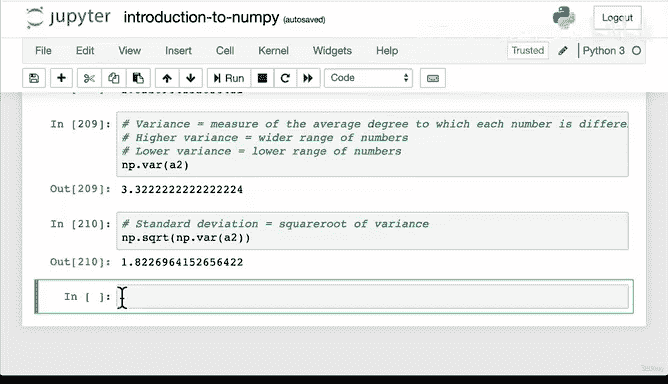

# Bourne《机器学习和数据科学训练营｜Zero to Mastery Data Science and Machine Learning Bootcamp》 - P55：055_07_009 操作数组2.zh_en - GPT中英字幕课程资源 - BV1yhrvBVEv2

Welcome back。 And in the last video， we learned a few little arithmetic tricks。

 and we learned that arithmetic is a fancy word for mathematical operations that we can do on nuumpy arrays。

 And so now we're going to learn a bit more about manipulating nuumpy arrays through aggregation。

 Our aggregation is another one of those fancy words。 Let's Google it。😊，Define aggregation。

The formation of a number of things into a cluster。 Yeah， that's kind of what we're going to do。

 So aggregation performing the same operation on a number of things。 And in our case。

 the number of things is our nuy array。 So let's have a look。You might be familiar with the。

Someum method， So dot sum or Python sum。 So let's make a list listy list equals 1，2，3。

Nice and simple。 And we'll go type V D list。Listty list is not defined。 Of course。

 we're making typos。 There we go。 type Python list。 So if we wanted to get the total of list list。

 we could type in this。Some listed list。 Now that's a python function right there， some。

But Numpy has its own version of these。 So let's see， let's go back to our a1 array。

 which is a lot more trusty。 Well， no， a lot more， but it's just a different type to list list。

 even though it contains the same information。It's in a type nuumpy N D array。 So let's have a look。

 What can we do with a1。 We can call sum on it and we'll get 6， but we can also call N dot sum on a1。

We get 6 as well。 Okay， now， why would there be different functions here。

 And what is the main difference between these two。

 It can get confusing having two different ways to perform the same aggregation on a set of data。

 And remember， aggregation just performing the same operation on a number of things。

 Some is just an aggregation to add up all the elements of a certain array list。 Now。

 the little tidbit you can use here is of which some you should use。

 whether it be Python sum or N dot sum is use Python's methods on。Python data types。And use。

Numpies methods。On。Nampai。A raise。So this is some。Actually， we reminded this one in markdown。

 So that's a bit easier to read。 We don't want heading one。We'll put this in code。

So this is our TDbit。NP dot sum。There we go。Now， let's see this in action。

 So we're going to create a massive nuy array。Her massive array。

This will really demonstrate the power of how fast nuly can be。

 Remember how we talked about right at the start， will'll create a massive of array with 100000 different elements。

 This won't be。Too uncommon for machine learning problems。 So there we go， dot size 100000。

 Let's just view just so we can see what it looks like。Massive array。

 Let's view the first 100 elements。 There we go。All random numbers。 Great。

 We might reduce that to 10。 So we have a bit more space， wonderful。😊，Now。

 we're going to use one of Jupyter notebook bookss or Python's magic functions with remember a magic function has a little percentage sign at the start of it。

 And we've got time it。 And this is going to time how long a particular line of code takes to run。

 We'll try Python sum。 So some across massive array。😊，We'll just put a little comment here。

So Python sum。 and then time it。 We want nu pies， sum。Massive array。

And we'll put a little comment here。 N pies， some。So let's run they and see what happens。

Now might take a little while because it's adding up 100000 different numbers。

 So what have we got here Well， the first line is going to be dedicated towards this line here。

And the second line is going to be dedicated towards nupy sum。

So the first line to sum over using Python sum across 100，000 different numbers took 17。

9 milliseconds per loop。Plus， or minus2。94 milliseconds，10 loops。But nu pies sum NP P do sum。

Put that there MP do sum took 34 micro。 This little symbol here is mu for microseconds。So。

 let's convert that。We want microseconds to milliseconds。Equals 1 microsecond equals 0。

001 milliseconds。 So let's convert。This is milliseconds。 We want to convert that to microseconds，17。

9 milliseconds， actually2。Microsecons。 There we go。So 17。9 milliseconds equals 17900 microseconds。

My goodness， so，17900。Divided by 34。Equals 526， so that means nuump's NP dot sum is 526 times faster than Python's sum。

So going forward， remember the TDbit here if you're working with NyI data。Use nuy methods。

 but if you're working with Python data types， use Python methods， because going back to the start。

 Numpy has been optimized to perform numerical calculations。

 So whenever you want to perform numerical calculations。

 always remember to use the numpy version of an aggregation function。

And speaking of aggregation functions， let's have a look at a few more。 We'll go a 2。

 We'll have a look at our second array that we created。

 ass our trusty two dimensional array from before。 Let's find the mean of this。 So we go N dot mean。

A 23。633。 beautifuliful。 Now， the mean would be if we added these up 1 plus 2 plus 3。

3 plus 4 plus 5 plus 6。5， then divided by the total number of items。 So 6， we won't do that。

 But that's how you find the mean。 if we wanted the maximum， you can use MP dot max。

 if we wanted the minimum， we can do MP dot min。If we wanted the standard deviation。

 we can do STD for standard deviation， remember， we can always press shift tab。

 compute the standard deviation along the specified axis。 If we pass no access。

 it's going to do it over the entire array， which is what we want。Wonderful。

And if we want the variances， we can do NP。 v A2。Wonderful， shift tab。

 Comp the variance along the specified axis。 And now you might be saying， Daniel。

 what the hell is a standard deviation and what the hell is a variance。 Well， variance。

 let's put a little coin here。 What you need to remember is the variant equals the measure of the average degree to which each number is。

Different to the mean。So， we want higher variances。Equals wider range of numbers。Lower variance。

Equals lower range of numbers。Beautiful。And now， the standard deviation。The formal definition is。

 standard deviation。Equals。Standard deviation is a measure of。How spread out a group。

Of numbers is from the main。The standard deviation is actually just the square root of the variance。

 So let's try this out。 So we've got MP。 There's another aggregation function。

 square root of N dot v A2 should be equal to the standard deviation。 So let's write this down。

 standard deviation。Equals。Square root of variance。 shift and enter。 There we go。

 These two numbers are the same。Now， if you'd like to look into a bit more of the math behind the standard deviation and the variance。

 I'll leave some resources in the resources section for you， otherwise in the next video。

 we'll see a bit more of an example of these two in practice。

 They're an important concept to know going forward in any type of data science or machine learning or statistical work。

 So let's take a quick break。 play around with some aggregation functions that you've seen on some of the arrays we've made or create your own。

And I'll see you in a second。