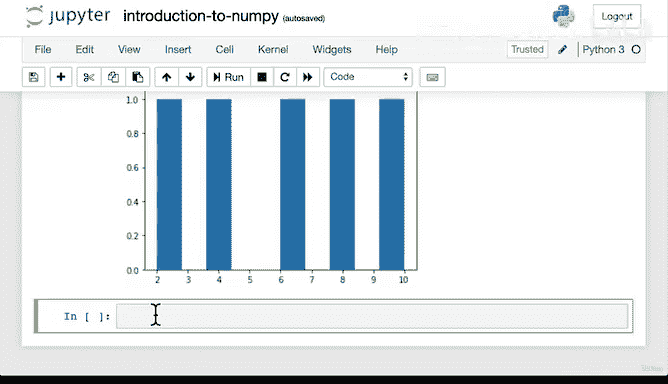
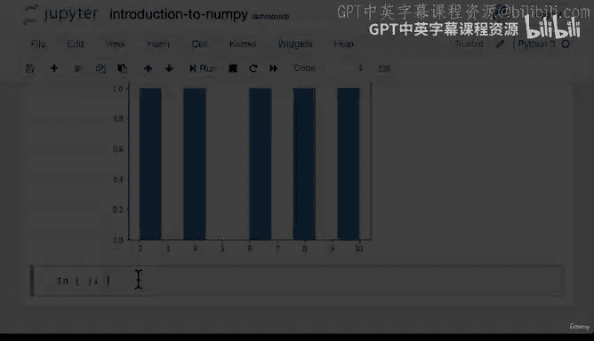

# Bourne《机器学习和数据科学训练营｜Zero to Mastery Data Science and Machine Learning Bootcamp》 - P56：056_07_010 标准差与方差.zh_en - GPT中英字幕课程资源 - BV1yhrvBVEv2

Welcome back。 In the last video， we looked at some aggregation functions with using numpy。

 such as getting the sum of all the elements in array。

 We saw how much faster a Numpy's code is to pure Python code when working on nuy data types。

 So always use nuy aggregation functions on nuy arrays。

 And then we left off with a brief introduction to standard deviation and variances。 Now。

 the main thing to remember about these two metrics is in a word。

 therere just the measures of this spread of data。 But let's not talk about it。

 Let's always focus on running code and seeing practical example。

 So that's what we're going to do in this video。 So we go demo of。😊，Andva。

Standard deviation STD is short for standard deviation， via short for variance。

So we'll create high bar array equals MP array。Not1，100，200，3004000，5000。

Wonderful lova array equals MP array。Maybe we'll make this one。Nice and simple，2，4，6，8，10。

 There we go。Now， before we even run any E code， have a look at the numbers in these arrays。

 Imagine these are actual data。 What would you infer from just looking at these numbers。

 So this one goes starts from 1， goes to 100，200300， then jumps to 4000， finishes on 5000。

 and this one kind of just goes 2，4，6，8，10。So first of all。

 you might look at the difference between the two maximums。 that's what I kind of looked at。

 so this one goes from  one to 5000。This one goes from 2 to 10。So if we looked at this。

 we might say that these numbers， to me， these are more spread out。

 whereas these are pretty close together and the maximum distance is only 8。

 and they have the same step in between each one。 Where this kind of varies。

 it goes up by1 hundred at a time and then up by a few thousand and then up by1 thousand to finish off。

 But let's put in a practice。 Let's run the code。 Let's see what's going on。 So shift enter。

 Let's find the variance of both of them high bar。 and we can compress tab for autocomplete MP bar。

 We want tab for autocomplete。 I know， We need to actually type the start of a variable。

 That would be helpful。 beautiful。 We'll hit shift and enter。

 Now this is an absolutely massive number here。 And this is not too big。😊。

While we're not going to look at the mathematics behind these two。

 what's more important is the concept here and the variance， if we go up here， remember。

 variance equals a measure of the average degree to which each number is different to the mean。

Higher variance equals wider range of numbers。 Yep， lower variance equals lower range of numbers。

 And that makes sense with these two arrays。 This array here， high v array has very high variance。

 whereas lower array， because the numbers are close together。 It has a lower variance。

 So let's have a look。 Let's do standard deviation。 SD。 We want high bar。Allright。

And we also want the lova array。We want standard deviation。Before we do this。😊。

What do you think the standard deviation is here？Is it going to come out similar to what this looks like。

Let's have a look。There we go， and that makes sense the standard deviation is higher for the high variance array than for the low variance array。

😊，And what is standard deviation， A measure of how spread out a group of numbers is from the mean。

 Okay， they've both got mean in their definition。 So let's have a look。 Let's find the mean。Dot hiva。

Aray， and we want N mean。Lova array。Hi A is not defined。 This is why we should use tab autocomplete。

 So what this is saying is a standard deviation。This number here is the average distance a number is away from the mean。

So if the mean is 1，600， that means on average。Any other number in this array in high v array is 2072 away from the next number。

 The same goes for the low v array。Any number in lowva is on average 2。8 away from the mean。

So that means 10， this number is although it's4 away from six because the mean is6，8 is closer to6。

So that's what brings the average down。 All right， now let's check out this spread。

 Remember that's the main crux of standard deviation andvari is just the spread of numbers。

 how they appear。Let's plot them so we can do that by importing mapplot Lib。

 We're going to have a look at mapplotlib in a future section。

 So don't worry too much if you're not sure what's going on here。 mappllib dot pi P as PLT。

 That's what we want。 y， plot。Dot hist， So this is a histogram。 hi。

 we just want that tab order complete。 if in doubt， tab order complete， see what comes up。

Shift enter。No module name Matt plot。We got that wrong。 that plot。 There we go。 Okay。

 so there we got the high v array。 Now， let's do the same for the low v array， plot het。Oh bar array。

And we want plot do show。Wonderful， so now we can see visually if you couldn't see it from these numbers in the number line here。

 now visually we can kind of see the spread of the numbers of highva array is a lot bigger so there's a lot more white space here a lot of the numbers appear towards zero and only two the samples appear up here。

 whereas in our low v array， the spread is kind of similar across the whole thing because there's gaps of two between each data point and the maximum distance here is only 8。

 Allright， so that standard deviation and variance in a conceptual level。

 Now remember if you do want the mathematics behind this， how these two values here。

 the standard deviation and the variance are calculated。

 I'll leave some extra resources but just remember the main takeaway from this is that standard deviation and variance a measures of spread of data。

Now with that being said， we've finished up some of the most common aggregation functions you'll see in Ny。

 let's get into the next section where we can check out some more ways of manipulating array。😊。

