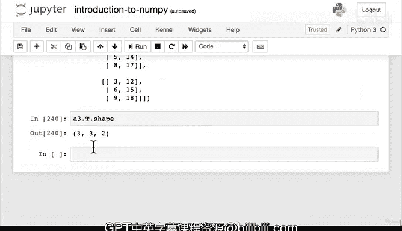

# Bourne《机器学习和数据科学训练营｜Zero to Mastery Data Science and Machine Learning Bootcamp》 - P57：057_07_011 重塑与转置.zh_en - GPT中英字幕课程资源 - BV1yhrvBVEv2

Okay， now we've seen a few different ways to manipulate arrays。

 but most of the ways we've worked with have been arithmetic or aggregation。

 So kind of performing calculations on nuumpy arrays。 Now。

 what if you need to change the shape of your nuy array。 Now。

 why would you need to change the shape of an nuy array。 Well， remember。

 a lot of machine learning is lining up your inputs into a machine learning algorithm and making sure that they come out with the right output。

 one of those ways of lining up inputs is making sure your data or your list of numbers or your array of numbers is in the right shape。

 So let's have a look at how to do that in nuy。 So we'll go reshaping。And transpoing。

 this is this section。Nice little heading there。 So let's have a look。 A2 array， beautiful。

 Let's figure out what shape it is，2 by 3。 Yep， that makes sense。 Now。

 remember before in a previous video， we tried to multiply a2 by a3。😊。

Let's visualize a 3 so we can see it again。 A 3。 There we go。 Let's check out the shape。

 A 3 dot shape。Okay。And what's going to happen if we try to multiply these？

O ends could not be broadcast together with shapes， 2，3 or 2，3，3。Well。

The beautiful thing about nuumpier rays is that they can be reshaped or transposed。

 Let's have a look at reshaped first。So what does reshape do。

 Reshape is a method you can call on any array。So if we type in here， dot reshape shift tab。

Reshape Dock string returns an array containing the same data with a new shape。Beautiful。

 there we go。 We've got some more information there。 but let's see what it requires。Shape。

So one of the rules of broadcasting， we look up broadcasting one more time。

One of the rules of broadcasting。Is here General broadcasting rules。

When operating on two rays nu high compares their shapes element wise。

 it starts with the trailing dimensions and works its way forward， two dimensions are compatible。

 when they are equal or one of them is one。So what this means is that if the shapes of two arrays are equal。

 the multiplication can happen。But if they're not equal， one of them has to be one。

 So that's what we're going to do here。 We're going to reshape。The A to array。From its shape，2 3。

Incompatible here。 And we're going to change one of these dimensions。

 We're going to add a dimension actually， So reshape 2，3，1。 Let's see what happens。Okay。

 so it's shuffled our ray around a bit。 Let's print the shape here。So see our A2。

 we've used the reshape method past at a different shape。So now we've added another dimension here。

Now its shape is2，3， one。 we'll check a3 shape。Okay，2，3，3。

So if we refer back to the rules of broadcasting。Are the dimensions equal， no？Is one of them one。

 Yes， So let's try this， a 2。We'll make a variable A2 reshape equals A2 dot reshape。2，3，1。Beautiful。

So we'll have a look at this A2 reshape。There's our reshaped A2， a2， reshape times a3。There we go。

 Beai。 So that is the benefit of reshape。 Now， this is only a small example here before they were incompatible。

 But because we reshaped it。😊，We reshaped A2 to B within the broadcasting rules of Ny。

 We could then use the multiplier function across these two arrays。Now。

 if this concept is kind of strange to begin with， that's perfectly fine， and it will be。

 it will take a fair bit of practice to figure out how to use reshape properly。

 but what the important takeaway here is is that just because your nuumpier array comes in a certain shape like it begins like this doesn't mean it has to stay in that shape。

😡，So this reshaped version of A2 still contains the same information as the original A2。

 it's just in a different shape， so this is one of the problems you'll come across in many different machine learning problems is making sure that the data that you're trying to find patterns within is the same shape so the machine learning algorithm can run over it like this broadcasting operation as quickly as possible and if they aren't the same shape。

 you'll often get back errors like this which say the data you're trying to find patterns in isn't the same shape so that's when you have to figure out how to use something like reshape to turn them into the same shape so that the compatible with each other。

Now。There's one more thing， which is transpose。 Now， what transpose is。

 Let's have a look at it first。Let's put a little comment here so we know what's happening。

 transpose。A2 actually， we might leave it here， A2 dot T so we can see what's changed here。

Let's get a2 back up。 A2s there， transpose what's changed。 Let's go dot shape。3，2。 Okay。

 now if we go here， a2 dot shape。So what a transpose does？😡，It switches the aes。So now。

A 2 shape was ，3， but if we call transpose and now T is for transpose。

 it's going to swap the axises around。 That's where we can see that now1，2，3。

3 is down here in the column and 4，5，6。5 and is on this column。

So what it's done is essentially just swap the rows and columns。 Now。

 you can do this on a larger array as well。 Let's view a3， a3 dot shape。2，3，3。So if we call A3。 T。😡。

It's going to swap these aes around， so let's see A3。t。 shape。So， now。We've essentially flipped it。

So now， this dimension。So，2。Is right at the end。And3 and 3 have swap to the front。

The important difference here between transpose and reshape is that transpose just flips the aes around and reshape you can create your own custom shapes。

 so for example we reshaped A2 to be compatible with our broadcasting rules so have a practice reshaping some of your arrays and I'll see you in the next video。

😡。

