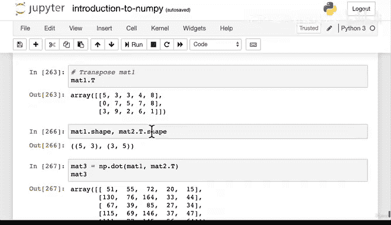
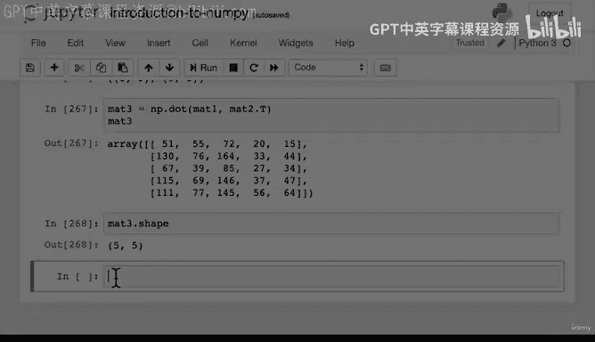

# Bourne《机器学习和数据科学训练营｜Zero to Mastery Data Science and Machine Learning Bootcamp》 - P58：058_07_012 点积与逐元素运算.zh_en - GPT中英字幕课程资源 - BV1yhrvBVEv2

Now that we've covered reshaping and transposing， you might be thinking。

 when would we ever want to use a transpose， It just flips the aes around When is that useful。Well。

 that's what we're going to cover in this video and one of the main use cases。

For transposing a matrix is the dot product。 It might be thinking now， dot product。

 What the hell is a dot product。 Well， let's do what we do。 Dot product， nuumpy。

 Let's have a research。 because is what we're practicing。 Here we go。 Numpie dot。

Dot product of two arrays。 that's not very helpful。 Sometimes you'll get that in docs。

 It will give you a very brief explanation of what happens。Specifically。

 if both A and B are 1 D arrays， it is the inner product of vectors。Okay。

 there's a few text instructions here of what dot product actually is， but let's focus on the code。

 We'll go back to our notebook。 We'll write some code first and then we'll have a little look into what the dot product actually does。

The thing you need to remember with the dot product is's just another way of finding patterns between two different sets of numbers。

 So let's start off with a random seed。 We'll create two more matrices that we can use。

 For an example。 We want this one to be round in。 Let's make it of size 5 and 3。And we want map2。

Beautiful， we'll just make it the same thing。 Rand dot R int。10 size equals，5，3。

 And now we've seen Rand in before。 Do you know what these two lines of code will do。Yeah。

So let's have a look。 as a reminder， we can do shift tab。Returned random intes from low to high。

 beautiful。Let's see these in action， Matt 1。Wonderful。Met 2。Even more wonderful。

 And then we also want to see， we all already know the shape， but let's just do it anyway。

 So we've got the shapes here， Matt2 dot shape。Wonderful。

So in a previous video we've seen a few different ways of performing arithmetic on matrices like this。

 one of the ways that we did was multiplication so we go mat1 times mat2。😊。

Let's bring these down so we can see them because I want to stay nice and zoomed in to keep the code big。

 There we go。 map 1， map 2， wonderful。This aradian here is just going to be the combination of these two multiplied element wise。

5 times 6 is 30，0 times 7 is 0。But this is， I said a little tricky word before。Element， wise。

Multipplication。There's a few different names to this。

 but it's mostly called element wise Hard mard product。' that's how you spell it。 I believe。

 Let's have a look Harda mar product numie。That's what we're off。How to get element wise， Yeah。

 MP dot multiply， which is the same as using this little star symbol。

 So that's element wise multiplication。 Another form of multiplication or product between two matrices is the dot product。

 Let's have a look at that dot product。If we go back actually to our documentation。

The formula for doing a dot product is N dot。 You can use Ny dot， we've imported Numpy as NP。

So we're going to do N dot， we want to form mat 1， mat 2。

 which is just our two matrices that we made。So let's run this。Oh。I didn't work。Damn it。

 Our value error shapes 5，3，5，3， not aligned。3 dim 1 does not equal 5。 Okay。

 we go back up to see the shapes of our matrices。 They're both of shape 5，3，5，3。

 And this is saying shapes 5，3 and 5，3， not aligned。 Well。

 the difference between dot product and element wise。 So we've seen element wise before。

 It's relatively simple。 We've got a。Times E。Goes into this top left square， A times F。 Oh no， sorry。

 B times F。 I just said it simple。 And here I am messing it up。 B times F。

 But if we kept going through that， we'd eventually end up with this matrix。

 But the dot product is a little bit different。Now we've got， say a three by three matrix here。

A three by two matrix here， and we're calling dot on this one with this one。Now。

 what is going on here， The resulting matrix is going to be 3 by 2。And we have a。Times J， okay。

 following along with that。 But then we have B。Times L plus， Okay， then we have C times N。 Allright。

 so it's got the top row here multiplied by the first column and adding up the total。 Now。

 let's look at a little bit more of a colourful demonstration of the dot product。

So here we've got the letters matrix if we go back here， got the same one as here。Now。

 we've got some colour added。 This is the top row of the matrix on the left。

 multiplied by the column of the matrix on the right equals this top left square。

And then if we kept going through。We would eventually get this resulting matrix here。

But there's a couple of rules with a dot product。That numbers on the inside must match。

 So for a dot product to happen between two matrices， their dimensions。 if you put them side by side。

 So this three matches this3。 So this matrix here has three rows， and so does this one。Now。

 the resulting matrix。Is the size of the outside numbers。

 So the dimensions here are 3 by two of this resulting matrix。

 because the outside numbers of these two matrices are  three and 2。 Okay。

 so we've got that for a dot product to happen。 The inside numbers must match。 Now。

 let's have a look with some numbers that have actually been filled in。We've got 5，0，3，468。

 and we're calling dot between this matrix and this one。So we've got5， it's going to come over here。

 be multiplied by 4。 That equals 20。 Yep we've got that5，4。 This is a times j。

Now we've got 0 times 6，0 times 6。 This is B times L。 Y， we've got that。 We're adding that up。

 and we've got three times8。 This is c times n。 Allright， and that's 24。

 And if we added these three numbers together。 So we're going go a times j plus B times L plus C times n。

 y， beautiful， we get 44。 and that's going to fill the top left square of our resulting array。

 Now if we went through these two matrices with numbers full。

 and follow the same steps that we've got in this letters matrix。

 we would end up with something like this。 But this is a static demonstration。 So let's check out。😊。

This little beautiful resource here， which is an interactive demo。

So this is matrixtri multiplication dot X Y， Z。 This is called the waterfall technique。

 what this demonstration is going to do。 and you can change these numbers here to be something similar to maybe what we've got here。

Or just to view the process of what's happening。So if we click multiply。

 it's going to take the matrix that was on the right and put it on top。

 this is where the waterfall process comes in。Now it's going to flow down。So this row 2，6。

1 used to be here as a column。 And if we add these together， multiply them。

 we get 15 in the top left。 What it's done is it's just replicated this step here。

We've got the top left。Now， if we follow it through。Okay。

 we get the top right and we get the middle left。Then we get the middle right， and the bottom left。

And then we finally finish up with the bottom right number。

So have a play around with this if you check it out， you can keep going through。

 it takes a little bit of practice to understand the dot product。😊。

Well let's go back to our notebook。😊，And now that we know a little bit more about the dot product。

 we know the rules。The numbers on the inside must matched and the new size of the resulting matrix is3 by two because it takes the outside numbers。

How would we make this work。With our matrix 1 and matrix 2。

 if their internal shapes are 5 and 3 and5 and 3。Hm。Or maybe we could use a transpose。

 let's try that out。Transpose mat 1。Because what does a transpose do， it flips the aes around。

 So let's go mat 1 dot T。 What does that look like。H okay。

Might look at that and see maybe it'll work， but let's really confirm it map1。t。shape。3，5。

 is that what we need， Yeah， we need to flip it around。 So if we have mat 2 dot shape。Beautiful。

 so now the inside shapes， if we were to transpose mat 1 are matching。 So let's do this。 actually。

 before we did。😊，NP dot mat 1， nett 2， okay。Maybe we transpose mat2， that one dot shape。

Mat 2 to to stay consistent with what we got above。 Let's make map 3 es。NP dot。Mat 1。

And then we want mat2 dot T， so this should work if our shapes are aligned。Matap 3。Beautiful。

 and now if we have mat 3， what is the shape of mat 3。Yes， excellent。

 So now we can see where the transpose might come into play if we wanted to do a dot product。😊。

On two matrices where in our first try， the shapes were incorrect。 we might want to flip the aes。

 Of course， you could do this with the reshape as well。

 but this is just a handy example where transpose comes into play for performing something like a dot product。

 Now， we can see the resulting shape of matrix 3 is the same as the outside numbers。Wonderful。

Now when I first came across Do product， it took me a little while to understand how to actually go through it。

 a great exercise was to write out a matrix by hand and multiply it and figure something out like this。

 or use the demo like matrixtri multiplication。xyz。😊。

The main takeaway from the Do product is that it's just another tool in our arsenal to find patterns between two different arrays of numbers。

 as we've seen before。Now in the next section， we'll have a look at where the dot product might be used in practice。

So have a practice around， create some matrices， transpose them， see if you can do a dot product。

 and I'll see you in the next video。

