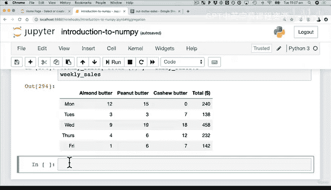

# Bourne《机器学习和数据科学训练营｜Zero to Mastery Data Science and Machine Learning Bootcamp》 - P59：059_07_013 练习：坚果酱商店销售.zh_en - GPT中英字幕课程资源 - BV1yhrvBVEv2

Welcome back。 So hopefully you've had a little bit of play around with the dot product。

 maybe created your own matrices， tried it out。 If not， that's okay。 But remember。

 the best way to learn is to always run the code yourself first。 And then again。

 maybe if you are even doing that， sometimes it's hard to understand。

 like different concepts when you just see numbers on a page。

 So It's always good to try and back things up with a practical example。

 So let's have a look at one where the dot product might come into play。😊。

So this is my Google sheet I'm tracking my nut butter sales for my future nut butter business because my favorite food in the world is almond butter and now this business we create 100% almond butter。

100% peanut butter and 100% cashew butter and so this is just a simple tracker to track how many jars I've sold on each day Friday was a massive day because we sold 15 jars of almond butter and we've got the prices here of each one So almond butter is $10 peanutan butter is 8 in cashew butter。

 cashews is a little bit more expensive。 So cashew butter is 12 per jar。

And now what my goal here is to figure out this total column because that's what I want to know is what days am I making the most money Monday must have been in a slow day。

 But if we click on this cell here and we have a look at this。

 we can see that this formula is relatively the same well similar。

 not exactly the same because there's different letters and numbers to our dot product formula back on our slide here。

 So a times J plus B times L plus C times n and that equals 44， well， if we come back， we've got B2。

 which is 2。😊，Times B 9， which is the price of almond butter plus C2 in the number of jars of peanut butter times the price of peanut butter。

And then we've done the same for cashew butter。And now we've get the total。

 So this is an example of where the dot product can come into place where we want to reduce the numbers we have here and find out the pattern between them。

 So I've got numbers of jars being sold here and the prices。

 And the total price is the pattern between these two。

 And I want to emphasize the fact that this can be replicated in pure nuy and pandas。

 not just in an Excel spreadsheet。 So let's put this to the test。

 What we're going to do is create a little。Title here， dot product example。Not by a sales。

 And we're going to recreate this example。This whole set here from scratch。

 using nothing but nuumpy arrays and pandas。 So let's do that。 Numpie will set a random seed。

 So the random numbers we create are similar to the ones here。 Hopefully。

 that's the idea of random seed。 And we have sales amounts。We got it N dot random dot R It。

 We want it up to 20 is a good amount of sales。 If I'm selling more than 20 jars。

 I need to step up my supply chain。Sales amounts。 So this will be。We'll put a little comment here。

Number。Of jars， sold。There we go，1215，0，3，3，7。 And now we wan to create。A data frame。

 create weekly sales。Data frame。So this is to put it into panda so it looks a bit more presentable than just a nuy array。

 so let's do that weekly sales equals PD。 data frame。We want to add our array sales amounts。

 which we've just created up here。And then， for the indexes。We'll come back。

 Our indexes are going to be days of the week。So let's do that。 index1， choose。

Don right out the days of the week here wed。The abbreviations will do and fry wonderful。

And then our columns， we're gonna。Fix this up。 We've got almon butter， peanut butter， cashew butter。

 wonderful columns equals。阿文巴拉。Pa up about a。It might seem a bit tedious to type this out。

 We could always export this as a CSV and imported pandas。

 but it's always good practice to build your own things from scratch that way you really start to understand what's happening。

 Let's have a look at weekly sales。Okay， wonderful， so the numbers are a bit different here。

From what's going on there， But the process is going to be the same。

 So now we've just recreated this section without the total column。In a panda's data frame。

 wonderful。 So now we want the prices， So we want create the prices array。 We'll keep this the same。

 So what are the numbers，108，12。😊，So we can do that with a simple nuier array。MP array。We want 10，8。

12， wonderful。Let's have a look。So there's a simple nuier array。

 Now we want to put that into a data frame as well。Create better prices。Data frame。

We have butter prices equals P D dot data frame。Prices。AndHere， index equals。

So the index is just this column here。 So we want price。Wonderful price。

 And then we want columns is the same as above。 I might just copy this。

 Usually we want to write it out， but to save a little bit of time of typing this out。

 we've got the same columns because if we go here， same columns。Wonderful， put that in there。 Oh。

 we've got extra bracketet。There we go。 now let's have a look。At our butter prices data frame。Errra。

Wrong number of items past one placement implies 3。 We come back。 shape of past values is 3。

1 indices imply 1，3。 Now that's our problem here。 So this is a weird thing in nuy where we go prices not shape it equals3。

 something。 But what pandas is expecting is three columns and one row。But this is three rows。

 one column， we want to reshape this。To be one， three。There we go， wonderfulful。

 So what we've done is we've recreated this little section in。Paands， beautiful。 So now。

How do we do this， We need to do a dot product of sorts on this and this。Okay。

 then add it to this and this and then this and this and add it up and get that。 Allright。

So let's try。 So let's just do what if we have here。 We've got， where's our total sales。

 sales amounts。Yep。And prices。Let's make total sales equals prices， which is。

We'll have a look at prices， again， prices。Dot。Sales amounts。 What happens here？Not aligned。

 We want to have a look at our sales amounts， actually。H。

And this is saying that the shapes aren't aligned， so we can see that the sales amounts shape。Is 5，3。

 and the price shape is 3，0。 Okay， that makes sense。 We've， we've seen this before。

 We've seen the shapes of dot products not fitting together。The shapes aren't a line。

 We need to transpose。Shapes aren't aligned。Let's transpose。SoIf we go total sales。

 which one do we have to transpose？Maybe if we try to transpose sales amounts。

Total sales equals prices， dot。Sales amounts， dot T。Oh， there we going。 that worked Toal sales。

Wonderful， okay， now I've got something that looks kind of like this。 Again， it's。

 it's with different numbers， but now we've got some total sales， okay。😊。

So how would we get this as a column on the very right hand side， Let's have a think。H。

Let's try something。 Let's just， if in doubt， run the code， create daily sales。

 Maybe I create the same thing as here。 but within a pandas data frame so we can kind of just add the two data frames together。

So， let's。Buttter prices， which is。This。Yep， what else do we want， We want weekly sales。Yep。

 so we want these two， we want to combine these two。So we want shape。 Maybe we get weekly sales。

 not shape as well。Okay， there we go。 So now this is starting to look familiar。

 Maybe if we flip weekly sales， which is our data frame， flip that， transpose that。

 and then dot product of those two。 Because then if we flip these two。Right。

 there'll be three on the inside， and the threes will line up。Daily sales， eagles。

 we should be able to do。A dot product， dot。Weekly sales not tea， so that's a transpose there。

Or that might have worked because let me prove it to you。 weeklyly sales dot T， dot shape。Excellent。

 here we go。 We might be cooking with gas here。 beautiful。 So this should be the totals。 Now。

 how do we get this onto the right hand side of our data frame， We want to put this on there here。

 because that's what we're recreating， right， We're putting this total on there。😊，Okay。

We can do this。How do we create a new column in pandas， We go weekly sales。

 This is our data frame here。 We want weekly sales total。Maybe we'll put a little dollar sign there。

So we know what's going on here equals daily sales。

Daily sales is this little panda's data frame here。We're going to go type daily sales。Data frame。

 And we want to add that data frame as a new column。On the back end of our data frame here。

 So let's see what happens when we do this weekly sales。That didn't work。What's the error here。

Key error， total。Title。Maybe the column title doesn't work。

 Wron number of items past 5 placement implies one because we're getting into another shape error。

So this is a row。But we want that in a column form， so maybe we have to transpose this。Okay。

 let's do shape。And then we want the shape of our weekly sales data frame。Okay。

 so we want our daily sales to have the same number of rows as our weekly sales。

 and then we should be able to append it， okay。We'll put a note in here。Doesn't work。

Not the right shape。But what we can do is come down。 We'll make a new sell。 There we go。

 weekly sales。Total。That's a terrible way of spelling title Daniel。😊，Weekly sales total。😊。

Equals daily sales。Dot T for transpo。 And now this， hopefully。Beautiful， there we go。

 So now we've just replicated with a few steps in between of shifting shapes and whatnot。

 We've replicated this column here， figuring out how much I made from each day。

 Monday was a terrible day。 couldnn't pay the rent without money。😊。

Well in this start at home it's actually a bit better Wednesday was my biggest day on this one。

We've now seen where manipulating the shapes of arrays and performing a dot product can work in practice。

😡，So this video was a lot to take in so I'd go back through and just have a little practice around。

 maybe create your own store， maybe you want to sell your own favorite food product or technology or something like that。

 make a prices array here， make a total column and try to replicate it using nu and pandas see if you can end up with something like this that'll be a good practice exercise don't forget。

 try to run the code yourself if it doesn't work， keep trying。

 search it up and I'll see you in the next video。😊。

