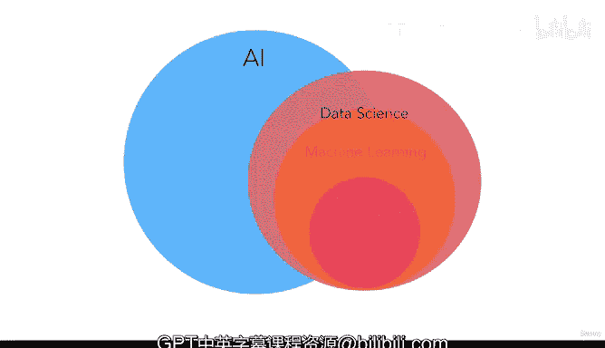

# Bourne《机器学习和数据科学训练营｜Zero to Mastery Data Science and Machine Learning Bootcamp》 - P5：005_02_002 人工智能机器学习数据科学.zh_en - GPT中英字幕课程资源 - BV1yhrvBVEv2

Okay， so we have an idea of what machine learning is kind of。 But then there's other things， right。

 like AI， artificial intelligence， data science， deep learning， neural networks。

What are all those things？Now， let's look at machine learning and how it fits into some of the other words you may have heard。

😡，Now， you have to keep this diagram in mind。You see。

 it all starts with AI or artificial intelligence， which simply means a human intelligence exhibited by machines。

An AI is a machine that acts like a human。And currently in our industry。

 we have something called narrow AI。 That is， machines can be just as good or even better than humans at specific tasks。

For example， detecting heart disease from images or at a game of go or chs or starcraft and other video games。

 but each AI is only good at one task， narrow AI。😡。

That we currently have simply means those machines can only do one thing really well。

 They can't be like humans and have multiple abilities。 That's called general AI。

 And it's something that we're very， very far away from now。Machine learning is a subset of AI。

 and machine learning is an approach to try and achieve artificial intelligence through systems that can find patterns in a set of data。

And actually Stanford University describes machine learning as the science of getting computers to act without being explicitly programmed。

 that is getting machines to do things without us specifically saying， do this， then do that。

 if then， if this， if this， then that。And don' worry， we'll explain that more throughout the section。

Now， you may have also heard of deep learning。And deep learning。

Or deep neural networks is just one of the techniques for implementing machine learning。For now。

 you can just think of it as a type of algorithm。😡。

But then we have this other thing that we've heard of， right， that's also very popular。

 that is data science。And often， the role of a data science and machine learning expert are quite overlapping。

And most job descriptions actually don't even have a clear distinction between what is a machine learning expert and a data science expert。

 The field of data science simply means analyzing data looking at data and then doing something with it。

 usually some sort of a business goal。 So when we talk about machine learning。

 there's a lot of overlap with data science。 and that's why this course is called machine learning and data science。

 If you are a data scientist， you need to know machine learning。

 If you are a machine learning expert， you need to know data science。

So throughout the next couple of videos， we're going to be talking about both of these topics because both of them relate and overlap。

And you can do one without the other because you need to be able to understand data and work with data to do any of these things。

 That's why when we talk about careers， often things like machine learning， data scientists。

 data analyst， they're all similar because they all work with data。 and from that data。

 they want to derive some sort of action for their business， for the company or for their users。😡。

Now， in this course， we're really focusing on the application side of things。

 That is the day to day use of machine learning and data science。

 We won't focus on theoretical academic research， which means you won't need a PhD or be super smart mathematician or statistician to do this course。

 The focus is on using machine learning and data science。😡，To be productive and to get job ready。

 because that's what companies want right now。 Now。

 when Daniel starts introducing data science and machine learning， he'll combine these two into one。

And move this machine learning circle inside of data science。

 That's because the goal of the course is to encompass this entire data science field and teach the machine learning aspects。

 within data science， By the way， you might be wondering， hey， he hey。

 what about the so data engineering thing that I've heard about， That's another term， isn't it。

 What about that， talk about that， Andre， Well， you know what。

 we have a whole section on it later on in the course。 So for now， pretend， like it doesn't exist。

 We'll get to it。 I promise， So now that we have an idea of what these big words are。

 Let's have some fun in the next video。😊。

