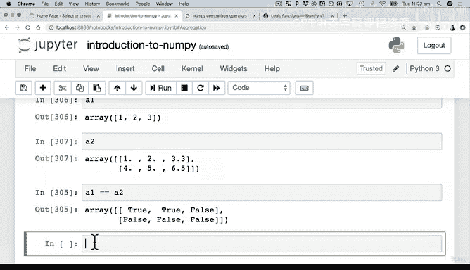

# Bourne《机器学习和数据科学训练营｜Zero to Mastery Data Science and Machine Learning Bootcamp》 - P60：060_07_014 比较运算符.zh_en - GPT中英字幕课程资源 - BV1yhrvBVEv2

We've seen a fair few different ways of manipulating arrays。 But right up the top of this section。

 we're not going to go right up the top because it's pretty lengthy already。

 We called it manipulating and comparing arrays。 So that's what we're going to cover in this video is comparison operators We' make a nice little heading。

Comparison operators， beautiful， that's how we spell operators， change it to markdown。🤢，Now。

 you might have seen comparison operators in Python。 Well， the good news is that in Ny arrays。

 you can use those same comparison operators。 So let's have a look。

 Let's get back our trusty a1 and A2 arrays。 wonderfulnder。😊。

So let's try it out we want a1 greater than。A2。What's this going to return？

It's going to return another array because that's the fundamental data type of nuy。

 basically everything is an array， an endD array It's going to tell us whether。

Each element in a1 is greater than each element in a2。 So you can see one is not greater than1。

 It's equal to 1。2 is not greater than 2。 It's equal to 2。3 is not greater than 3。3 because 3。

3 is higher。 So let's have another look。 Let's go a1。Greater than or equal to a2。

Now we can see we've got some trues。 so we've got some bullying data types in return in this array。😊。

So maybe if we go ball array， equals that。Ball array。We want to see that and then we want to go type。

 you know the type， let's see it anyway， type it's going to be ND array。

And then if we also wanted ball arrayray dot D type。It's going to be data type balls。

 So this array is full of ball lanes here。 wonderfulnder。 So now we can see again， we've got a1。

 let's try another comparison of just a simple integrityteger， A1 greater than5。😊，False， false false。

 Let's go a1 lesson than 5。True， true， true。 wonderful。 We want to see if to aer equal。

 we can use the e then comparison operator。 That's a mouthful for me。😊，True， true， true。

 That makes sense。 We go A1 equals a2。Wonderful， we can see that the first two elements。 Oh。

 let's go back down。 So we're not scrolling all the time。A1。Another cell here。A2。And we can see。

 yeah， element0 is true。 element one is true， and then the rest aren't equal。 Okay。

 now if you wanted to find more of these comparison operators， we've just been through a few。

 you can try out some of your own。Let's look up the documentation， nuumpy comparison operators。

Logic functions。 Yeah， let's have a look at this。All any array contents， there's a fair view here。

Less， less equal， equal。We can use these symbols here Okay。

 so there's a fair few more that we can do， but these are the main ones that you'll need if you ever need to compare raise。

 you can use the exact same symbols that you use in Python with nup。

So that's going to wrap up there manipulating and comparing a array section。

 Let's go have a look at the next part I'll see in the next video。😊。

