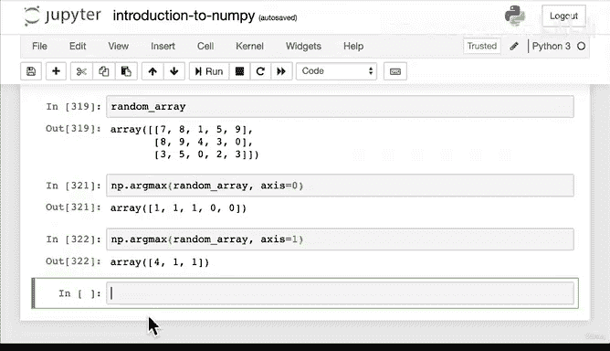

# Bourne《机器学习和数据科学训练营｜Zero to Mastery Data Science and Machine Learning Bootcamp》 - P61：061_07_015 数组排序.zh_en - GPT中英字幕课程资源 - BV1yhrvBVEv2

So we've been through a hell of a lot so far。 We've looked at creating arrays。

 We've looked at viewing arrays。 We've looked at manipulating and comparing arrays。 Now， number 5。

 which is， if you have an array of numbers， sometimes you might need to sort them。

 So we'll go sorting arrays， make a nice little heading here。 beautiful。😊，So let's have a look。

 Have we still got random array somewhere we created this。 Okay， wonderful。 Now。

 if you wanted to recreate this， how would we do that？ So let's go equals N dot random。 Now。

 this is full of integers。 So we want R int。 and we want up to 10。 and we'll give it a size of。😊。

How many？ What's the shape of random array。I believe we could tell this by just counting the row 3 by 5。

 So let's see。3 by 5。Wonderful， three， five， so we'll just recreate that。If you don't have it。

 otherwise， you can just the one that's saved in memory， we recreate it。For completeness， wonderful。

 re ray dot shape。 there we go。 So now what if we wanted to sort the numbers in this array or nu Pi has a function called N dot sort。

 We're going to check shift tab to see what it does。 Re a sorted copy of an array。😊。

This is a is the array。 wonderfulnderful。 So if we pass random array in there。What's it gonna do。

It's going to sort the numbers on each axis。 So we see this first one here and this first array。

1 is now， on the very left。5 comes after that because it' is the second highest， then 7。

 then 8 then 9， wonderful。So now let's keep going。 Numpy also has a method called arg sort。

 and we're going to see what this says， returns the indices that would sort an array。

 So sometimes you might not want to sort the values instead you want to figure out which index has the highest value。

 So let's do that。Or pass it ran a moray。Wonderful。Geting a bit confusing here。

 having all these different arrays。 We'll see random array again。 So we've got random array here。

 We're calling arg sort on it。 So this is going to sort the indexes。

So one is the lower set's got the0 number yep。 then 5 has got one yep。

 and then 7 has got two wonderful。Okay， so this is sorting the indexes for us and telling us what order they would come in。

 So let's see our trust era， a1。We'll see another example of that。 N dot Ag saw， nice and simple。

So we can see this is already an order if we use Arg sort。 Okay。

 so this is the order that the indexes would come in，0，1，2， make sense。

 What if we wanted to find the minimum number where the index， where the minimum number comes from。

 we can do arg min。A1。Is 0。 So the minimum value in a1 arg min， the index it appears at is 0。

 We can do the same with ag max。 when we want the max value of a1。2。

 what if we did Ag Max on our random array？Review our random ray， again。A max random array。

 we want to know where the maximum number occurs in one of these arrays。 So let's see what happens。

Let's do a shift tab first actually returns the indices of the maximum values along in axis， okay。

4 h。 what axis is that on。that doesn't really help us。 let's go access equals 0。There we go。

 So this is going to give us the maximum values along axis equals 0。 So this is 1，1，1。 So index 1。

Has the maximum value， I think axis 0 is going to be for the rows。 Let's figure this out together。

 Arg Max said this is where I get confused as well looking at different arrays and trying to sort them out accesses。

What happens here，4，1，1。 Okay， so this is going in the columns， I believe。

So this is where we're getting confused。So， we have here。This is position 4。

This is the highest number。 Yep， so axis 0。 Then we go on position  one。We have。Number 9 here， y。

In the row 3， the highest is one here。 So5 is in that。So then on the flip side。

 we just went down vertically now if we go down horizontally。Which is what axis 0 is across here。

We have one is the highest in we're looking at these three numbers。 So yeah， position one， y。Then。

 we have。1 again， So 0，1，2。 Yeah， that's position one there。 And if we go here。We have the max is 4。

 aha0， yup，0。So that's where it takes a little bit of practice of just typing out commands like this and viewing them and then working it out for yourself。

 I've been doing this for a while now and I still get confused with different aes of nuy race so don't fret if you're having trouble going oh which axis is this related to which is that sometimes viewing arrays like this gets a bit confusing until you actually type out a command and then go retrace the steps back through？

😊，So what else do we have？Well， I think that， yeah， that'll probably sum it up as sorting arrays。

 Now， the beautiful thing about nuumpy is that all of these functions you've seen can be used across any andD array。

😊，So don't worry if it all seems overwhelming that we've been through in terms of manipulating。

 comparing arrays， sorting arrays， have a play around。

 create some of your own arrays and manipulate them， try to sort them。

 try to do dot products on them and whatnot， I learn the most when I just try to make some things out of numbers and a practical example really helps。

 So before we wrap up the nu pie section， let's have a look at a practical example。

