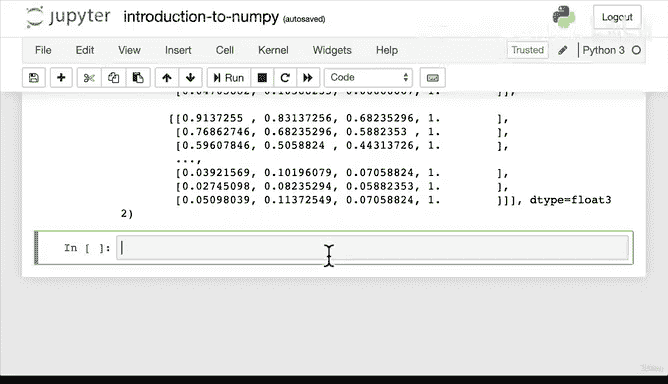

# Bourne《机器学习和数据科学训练营｜Zero to Mastery Data Science and Machine Learning Bootcamp》 - P62：062_07_016 将图像转换为NumPy数组.zh_en - GPT中英字幕课程资源 - BV1yhrvBVEv2

Okay， now we've got some of the foundations of nuie down pat， or maybe not。 All right。

 You don't have to know everything up by heart for now， let's。

Look at a little practical example to finish things off。 Pra example。Numpie in action。

Playve the beautiful action music， the beautiful， wrong word。 Let's go intense action music。

 rock and roll。Now， if we come back here to our Jupyter dashboard。

 I've got a little folder here called images， which I've just created。

 And I've got some photos in here。 So the whole premise。

 remember we talked about it right at the start with Ns in machine learning。

 you take whatever data you have， you turn it into numbers。

 you use a machine learning algorithm to find patterns in those numbers。

 So what if your data happen to be images and you wanted to find out information about those images。

 I'm going to create a little mark down cell here and import。😊。

I've got a panda image that we've used in the panda section。

So we're going to turn our wonderful panda。😊，We can see it there。 Li， He stoked。 Give it a high5。

 I'm high5 in the screen。What we want to do is we want to turn。An image。Into a nuumpy array。

 Because once we've turned this image into a nuumpy array。

 then we can use the functions that we've learnedt throughout this entire section to find patterns in that。

 And we can manipulate it a bit。 We could pass it into a machine learning algorithm。

 The world is our oyster when our data is in numbers。 So we have here， mappot Lib。

 We're going to see mappottlibb in another section。 Iport Emread。

 So this is just a little little package within mapplt Lib called Emread， which stands for image Re。

 What this is going to do。Is Em Reed， we might use our shift tab to figure this out。Oh。

 is it gonna be there。Maybe because we haven't imported it yet。Oh， needs something that's okay。

 We want to go shift tab。 There we go。 Read an image from a file into an array。

 That is exactly what we want to do。F name stands for file name， I believe。

 string or file like the image file to read wonderful。Now， our pandack image。

Is in the file images under panda dot PG so we can pass it a string here。Panda。Dot P And G。

 What we might do is before we even look at it， let's check what type it comes in， Pada。Oh。

 we've forgot the images folder。 That's all right。Class nuy and D array。 Yes， now。

 what does that mean， Well， it means because it's in N DRA format。

We can use all of the functionality that we've learned about NumpI on this array。

 so let's have a look at it。😊，Panda。Wow。There's a lot of numbers there。

Let's check out some of the attributes of it size， pannda dotch shape。The panda dot。And him。

This is pretty big。 What's that number，24465000。 It's got a lot of dimensions here。

 It's a three dimensional array because the three dimensions are colour channels。

 And what what this array actually is， Let's just view the first 100。To these numbers here。

 maybe that's even too many。They one viewed the first five。There we go， first 5。

What this has done is little function Emread， IMread， however you want to pronounce it。

 has taken this picture and then found all of the little pixel value， so if we zoomed right in here。

 you might not even be able to see a single pixel。😊，That's al right。 We zoomed right in here。

 Got the pixels。 Those pixels have colour values。 So red， green and blue。

 And that is what is stored in this array。 So if we did the same， let's have a look。

 maybe for another image。 So we've got。I source。We have another one， images。Tab Autocomple car photo。

This is what I have。 Now you can try this with your own image。Beautiful。

So what we're going to do is we're going to car equals m read。That same images。Carphoto。pNng。

Wonderful， we're going check it again just for the completeness type car。Numpir array， beautiful。

 So now we've turned this car photo。Into。An N D array， wonderful。Okay。

 maybe we'll just only see the first section of that。Let's have a look at one more photo。😊。

Dog echos emraed。Images， we've seen this dog photo before right at the start。My beautiful ppies。

 We're going to turn them into numbers。Actuallyately， we want a view at first， So we'll go。

Time G sauce， eagles， images。Dog photo。If you have a P and G image。

 this Iread function will work with your own so you can try that to start using it。

 you just need to run this from Mapot Leport Emread， then you can use this。

 remember to use shift tab if you want to figure out what it does。So we turn this into markdown。

There's my beautiful ppies， that's seven， that's Bella。😊，So we're going to turn the parpies。😊，Into。

Can you guess what data type？Numpie array， wonderful。 So we got dog。

 So now what we could do with this is we've done one of the biggest steps of all machine learning as we turned our data into numbers。

 specifically a Numpy array。😊，So what a machine learning algorithm would do is because it can't really look at this。

 ask people we can look at this and go， that's a tree， that's a tree， that's a dog， that's eyes。

 that's a shelter。But what a machine learning algorithm needs is numbers and that's what it's got here in the form of a nuy array so what it would do is it could take。

 say this tree is is this section of numbers here probably not but let's just imagine it is what it will do is then go to this image and then look at this section of numbers here and go okay those numbers are pretty close to each other so this item here and this image must be a tree and this must be some grass and then same thing in here。

 this must be some grass because the pixel values are very close together in both images。So。

That's going wrap up the Numpy section。 What the important takeaways from this is to remember that we have covered a lot。

 and you don't need to know all of this off by heart to begin with。 It's just。

 I've gone through some of the major concepts and functionality of the Numpy library。

 the biggest thing is that Numpy handles data types like this arrays very， very well。

 So if you're working with machine learning and you're working with doing mathematical operations you're trying to find patterns in data。

 you're probably going to use Ny And if you don't understand everything right now， that's okay。

 there's a lot to take in have a break。 play around with some of your own images。

 try and turn them into Numpy arrays， go back through what we've covered and I'll see you in the next section。

