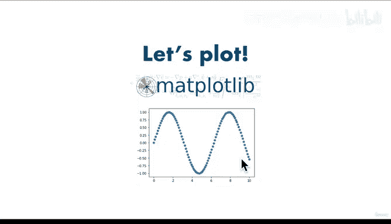

# Bourne《机器学习和数据科学训练营｜Zero to Mastery Data Science and Machine Learning Bootcamp》 - P65：065_08_002 Matplotlib 简介.zh_en - GPT中英字幕课程资源 - BV1yhrvBVEv2

Allrighty then so in the past few section we've been looking at data in the form of lists of numbers and arrays and data frames。

 but in this section we're going to start looking into Matplotlib and so the first question you may have and so fairly good question to have is what is mapplotlib well as you might have inferred by the name。

 it's a plotting library more specifically a Python plotting library so it'll fit in with what we've been using before and what Matpllootlibb does is it allows us to turn our data into some pretty visualizations also known as plots or figures。

😊，So let's get started。If we refer back to our machine learning modeling framework。

 we go through problem definition， data， evaluation， features， modeling experiments。

 Then if we go back to where our tools fit in。We're going to be covering Matplloot Libb。

 which is a part of the data analysis section， but can also。

 as you'll see with all of these tools can also be part of the experiment section we'll get to that in a future video。

 don't you worry。But this is going to complete the trifecta of pannda's Numpy and Mplot Libb。

 and once you start to see these3 in action， it'll really makes sense the synergy these3 provide in doing data analysis and exploring different data sets。

😡，So why Mapl Libb Well， first of all， it's built on Numpy arrays and Python As we've discussed before。

 a lot of data and numerical information are built upon Ny arrays。

 including Pada's data frames and it's the same with Maplot Libb and because all of this is written in Python。

 we won't have to learn another coding language， so now we can work with our data and create visualizations as you'll see shortly with the same coding language。

😡，It integrates directly with pandas through the Maplot Libb Pandas API。

You can create basic or advanced plots。 And again， like the other libraries， right， Matpllibb。

 if you can imagine a visualization， if you can imagine a plot。

 you can probably create it using Matpllib， but we're going to be focused on the most useful types of plots。

 And it has a simple to use interface。 Of course， once you get the foundations。

 But that's what we'll be covering。😊，What are we going to cover？Well。

 it's a little bit of a workflow that happens within MatpltLib。😡，You start with the data。

 you create a plot also known as a figure which is kind of just like an empty square really。

 and then number three is you plot data aes on figure。

 so they're the two main data classes of Maplotlibb access and figure but we'll look into these shortly and so once you've plotted some data you'll have something that looks like this an X and a Y axis with some information on here。

😊，Then you can customize the plot and add in something like a little bit of a title here and another title here and a title here。

 So in this case， we've got the0 to mastery machine learning。 And over time。

 your M L knowledge is increasing。 Oh， that sounds great。

 That's kind of similar to what we're doing now。😊，And then finally。

 you'll save or share the plot because as you could imagine。

 looking at a big table of data full of numbers， they can get quite confusing。

 Humans we're visual creatures， right， we want to see things visually So that's where these plots come in handy so you can save or share them to visually communicate your work rather than just having it in a table full of numbers。

😊，So more specifically， once we've gone through the mappllib workflow。

 we're going to use that workflow throughout all of these little dot points here。

 We'll focus on importing mappltlib and see the two different ways of plotting。

 Yeah I know there's two different ways， but we're going look at them both and then we're going to pick the one that is most useful and most adaptable。

 We're going to plot data directly from Numpy array so that'll build upon the Ny section。

 and then we'll look at how mappltlibb integrates directly with panda's data frames through the Mapottlib pandas API。

And we'll have a look at customizing our plots， so adding a different colour。

 putting in some different titles， naming our things what we want。 and then finally。

 we'll finish up the workflow by saving and sharing our plots so we can communicate our work with others。

😊，Now， where can you get help， The first step is to always follow along with the code if you can。

 Remember our motto， if in doubt， run the code。 So we'll be going again through another Jupiter notebook。

 It will be available for you to go through at the end of the session or in the extra information section。

Always try it for yourself。 If， in doubt， run the code。 Try another thing。 Keep going。

 If you're still stuck， search for it， you'll probably come up against stack overflow。

 We've seen that in the past or the map plotlib documentation， which， again， is very vast。

 So if you have a specific problem， you might try search for it first and then read through the documentation。

 if you don't really understand what's on stack overflow。 Try again， and then finally。

 ask a question。 Remember， if in doubt， run the code。 I have to keep reminding myself of this， too。

 you know。All right， well， if you're ready to plot， give me a wave。😡，yeah。

 I'll start with the jokes now。😊。

I'll see you in the next video。😊。