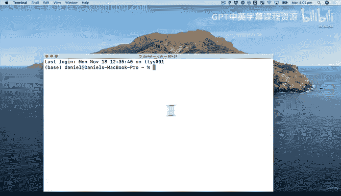
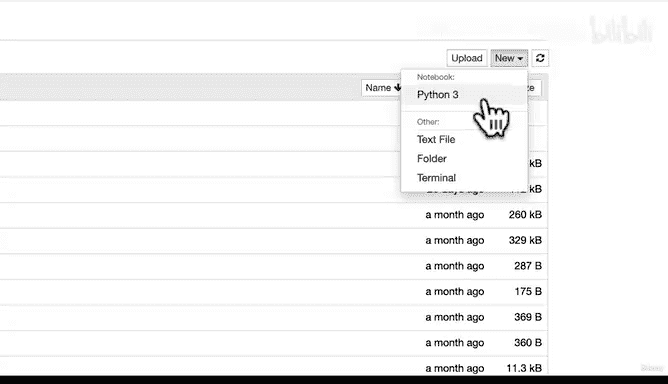
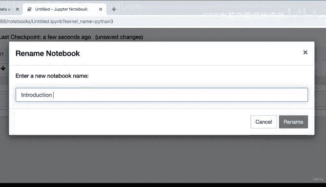
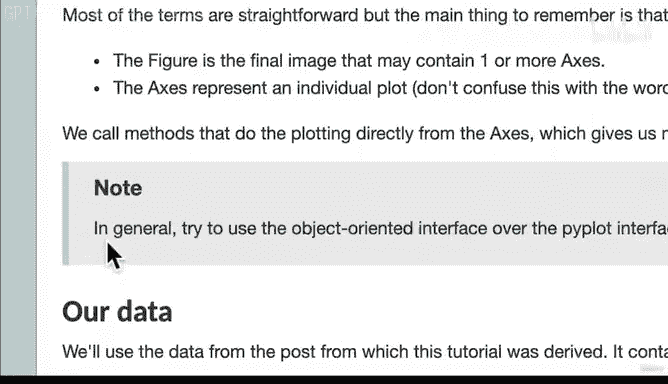
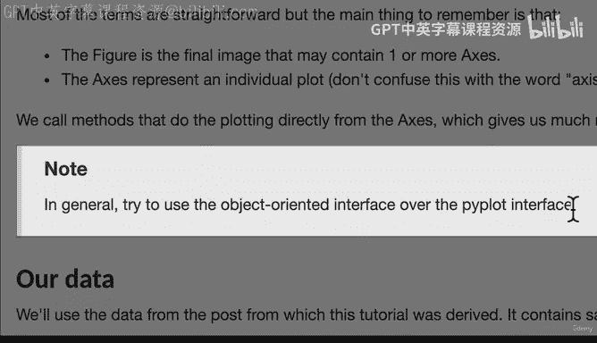
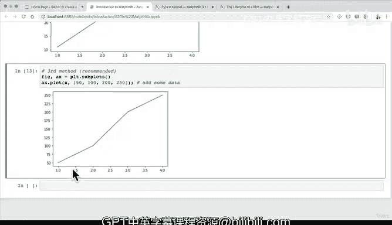

# Bourne《机器学习和数据科学训练营｜Zero to Mastery Data Science and Machine Learning Bootcamp》 - P66：066_08_003 导入和使用Matplotlib.zh_en - GPT中英字幕课程资源 - BV1yhrvBVEv2

So let's get started with Mattpl Libb。 we're going to start on the desktop and do what we always do and hit the terminal。

Beautiful， I'll zoom in a little bit on here。 Excelt。

 Now we're going to go through our little workflow like we always do。

 So we're going to C D for me going to get into the sample project folder。

 which contains our environment。 Now we can always see our environment by using Conda end list。😊。

So this will show me my environments。 This is the one I'm after here sample project。

 the folder we've been working through before， so I' going to CD D I'm on the desktop right now。

 we can see that there， so I'll go into ML course， we can see that little folder up here。

 but we're going to use the command line。And then Cd again into sample project。 beautifuli。

 And then we can run Con， activate。 Now you could just copy and paste this and do that there。

 But remember we're in the habit of typing out code。😊。

That's the best habit you can develop that way you get used。

To writing things out for yourself and practising， seeing what it feels is like on your fingers to write code。

 So if you go con activate， that should be all correct。 Wo。

 And so we've had base change from this to this。 We've seen all this before。

 We're going to load up a Jupyter notebook book。😊，Our favorite workspace。

We've got introduction to Numpie and pan as we've been through those， we're going to start a new one。

So now we're going to retitle this one to be introduction to Matt plot Lib。

Beautiful。We'll have a title introduction to mappl Lib just so we know what's going on。

 We're in the habit of communicating what we're doing。 There we go。 Beaiful。

 And so now we're in a Jupiter notebook。 The first step for always using mappl lib is。

 we might import numpie and pandas as well。 So we'll import all the tools we need right at the top of the notebook。

 This is kind of a regular workflow。 So first one we'll do is mappl lib in line。 Now。

 if you've never seen this before， this little percentage sign you might have in a previous video。

 But this is a magic command。 So this percentage sign is telling Jupiter。 hey。

 we want all of our map plot lib plots， our graphs and visualizations to appear within the notebook。

 So that'll make more sense once we run it。😊，So let's import mappl Lib dot P plot Now P plot is a Python plotting module of mappot Lib and the convenient name is as PLT。

 We'll also get pandas as P and import nu Pi as NP and we'll hit shift enter。

This might take a little while， depending on what's going on。 Beai。

 So now we should have all these tools accessible。 Now。

 simplest way to create a plot in Matpllib is with P L T。Dot plot。So if we go。

 shift tab have a look at what this says， plot X versus y as lines and or markers。H。

What happens if we just run this？😊，Okay， we get kind of that empty box that we saw before。

 that was in the。The map plot Lib workflow。 So this is our creator plot。

 This is our figure that we've just created。 So we'll go back to our Jupyter notebook。

 This is our figure that we've just created。 But for some reason。

 the output it's giving us these empty brackets。 So to get rid of those。

 you can put a semi colon at the end of your plot call。 So let's do that。😊，Same thing。

 we just don't have that nasty little output there。

This is what mapplt Libban line means is that this plot is in the notebook so we can see it visually right here。

 that's all mapplt Libban line means if we didn't call this it would just output something like this with no plot。

 so that's what this line of code is doing。It the ideal scenario to always run that when you want to run mappotlib plots。

 And now if we didn't want to use the semicolon。 we wanted to be a bit more communicated。

 We could go plot and then Plt dot show。 That's going to do the exact same thing。

 We've got a nice and blank plot here。 Now how about we add some data。

 So we go Plt dot plot and then hit shift tab。Plot X versus y as lines and or markers。

 I don if we click the plus sign gives us a little example here of plot X， Y。

 So how about we pass it X as a list of some sort。 So maybe we'll just keep it nice and simple，1，2，3。

4。And we'll put the semicolon at the end and see what happens。There we go。 We've got a line。

 And so this is on the X axis。 we should have 1，2，3，4。😊，Okay。Beautiful， so what can we try next。

 Well， let's create some X and y data， X 1，2，3，4。😊，Wonderful， y equals。 Let's mix it up a little bit。

11，22，33，44。Wonderful， now， let's see what these look like。 plot， Dont plot。X， Y。

 and we'll put a semicolon at the end。There we go。 We notice that our atases have changed。

 So now we've got from  one to 4 on the x and from 11 to 44 on the Y。 Okay。

 let's starting make a bit more sense。 This is looking good。😊，Now。

 this way of plotting in Matpllootlibb is referred to as the stateless way of plotting and if you've ever used MatTlab。

 it works like that， but if you haven't used Matlab before not to worry。

 let's have a quick look at Matplotlibb documentation。

Because in there it tells us a little bit about different types of plotting in Matplot Lib。

What do you want， documentation。Tutorials。Pie plot tutorial。

 So this is the type of plotting that we're using at the moment。 You got Matplot Libb。

 Pi plot is a collection of command style functions that make mapplotlibb work like Matlab。 Yeah。

 that's why we just went through。 Each pie plot function makes some change to a figure。

 create a figure。 So I've been calling these plots。 They're also referred to as figures。

Creates a plotting area in the figure， plots some lines in a plotting area。

 decorates the plot with labels， etc。In my plot Lib5 plot。

 various states are preserved across function calls， Okay， we're just reading the documentation here。

😊，This is the one we're paying attention to。 Note the piepl API is generally less flexible than the object orientated API。

 So remember how I said there's two ways of plotting in mapplotlib。

 Well we've just looked at the pie plot API。 and we're going to look at the object orientated API in a second。

 but this is the one we're going to be focused on most。

 the object orientated API because we want as much flexibility as we can get right。

 there's been one more thing I want to show you。 So if we go mapplotlib life cycle。😊，Lot。

The life cycle of a plot there we go， and you can get to this in the documentation as well。

 so this is just mapplleb。org tutorials。Liive cycle of a plot。 There we go。 This says the same thing。

 In general， Try to use the object orientated interface over the pi plot interface。

Okay， so if the documentation is saying these two things in bold notes， we might listen to it right。

 because the people who write these documentation they really know what they're doing。😊，So let's see。

 this is the first method。We'll go Fig equals now figure short for figure， PLT dot figure。

This creates a figure。Axe is short for axes。 So remember， this whole thing is a figure。

 but these two lines here are axes。 So axe equals Fig don't add。Sub plotot。This adds。Some axes。

 plot do shown。There we go。 So this has just replicated exactly what we did。

 We hitped like a kind of a long version of going PLT。😊，要pl。Same sort of thing here， right？

So this is the first method。And then I've got the second method。So we want big equals。Ploot PLT。

 And when I say plot， I'm referring to PLT， but because there's no O。

 it's just easier for me to say plot。 So create a figure but been communicative here。

 You don't need these comments。X equals Fig dot add axes。And then within here。

 we're going to add some sample data 1，1，1，1。Oh？Sorry， these are going to add a。

 so these add accesses to the figure。 so there we go。You've got another figure。

And if we want A stop plot， let's get our X and Y on there。And then PLT dot show。Addd some data。

There we go。 We're just creating the same plot。 And now finally。

 we're going to go with the third method。 and this is the one that we're going to be using。

 So we'll put in here。Recommended， the reason why I'm showing you all these is because if you look up Macpl Lib online and you find some documentation or some stack overflow answers。

 you might come across these styles of plotting。 So we're going to use a third method。

 And this is recommended。 Of course， you can choose your own。

 But this is what we're going to be going through throughout the rest of the mappott Lib section。

 So this is。Fig comma as this time， so we've saved a line of code equals PLT dot subplots now let's see what this says。

😡，Someub plots。Create a figure and a set of subplots。

 This utility wrapper makes it convenient to create common layouts of subplots。

 including the enclosing figure object in a single call。 Now what is a subplot。

 You can think of a subplot as having more than one plot come out at the same time。

 That's all it really is。 And then we're going to go X dot plot X， Y。Add some data。

And we'll put a little semicolon at the end of city of calling plot。 show this time。There we go。

 We've just recreated the same graph three times with three different methods。

 but we're going to be focused on the third method。

 And you might notice that every time I call something like fig equals or ax equals or fig comma a equals。

 it resets the figure， even though we're plotting the same data， maybe if we went here and we go。50。

100，200。2，50。It's going to change it up。 So every time we call something like this。

 it's going to reset the figure and plot a new set of data。 So let's wrap it up there， but in short。

 the main takeaway from this lecture is that we're going to be focused on this method。

 There's two different types of methods plotting in map plotlib， the Pi plot API。

 but that's generally less flexible。 It is quicker to get plots up and running sometimes but the objectorientated API is going to allow us to do a bit more fancy stuff in the future So that's what we'll focus on。

I'll see you in the next video。

