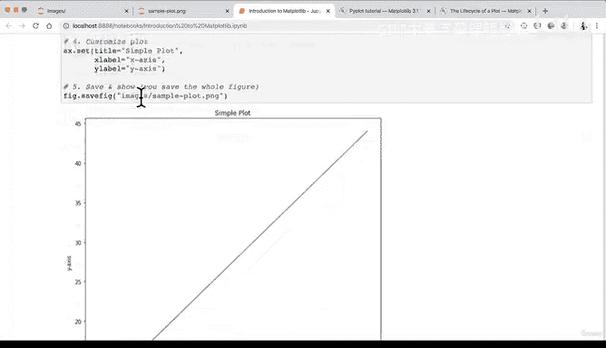

# Bourne《机器学习和数据科学训练营｜Zero to Mastery Data Science and Machine Learning Bootcamp》 - P67：067_08_004 Matplotlib 图形结构.zh_en - GPT中英字幕课程资源 - BV1yhrvBVEv2

Welcome back。 In the last video， we checked out a few different methods of creating mappllib plots and figures。

 That name is kind of interchangeable， same with the name visualization。

 if you hear that they're often referring to the same thing and we looked at a little trick with the little percentage sign to set up mappllib so that our plots appear in our Jupyter notebooks。

 So now I're going to start this video off by checking out the mappl Lib anatomy of a figure。😊。

So let's have a look， as I just said， I've got anatomy of a mappllib plot。

 and I just said we're gonna to check out the anatomy of a figure。

 So this is how I mean these words are very interchangeable。

 So I want you to be aware of that whenever you're looking at map plotlib online。

 if you're go in a stack Oflow or whatever resource。

 the documentation probably is more formal using the word figure， we'll see that in a moment。

 But if refers to plot to a visualization。 They're always meaning kind of the same thing。

 which is this complicated but beautiful mess here。😊，So if we look at it。

 figure is kind of like the giant。Section here， the everything， the blue square。

 So the figure contains all of it。 It's like the blank canvas。

 And then what we're going to do is start to add things as we go to make our plots look beautiful。

 So we've got some data here。 This is heart disease analysis。 This is the centered title。

 Don't worry if this looks a little bit more complicated than the plot we've just done like this is a very simple plot here。

 This one's got a bit of fancy colors and a horizontal line and titles and legends。

 We're going to work towards making something like this。 But by the end of the section。

 So we'll get there in a moment。 But you can see here these two axises。 This is a subplot。

 We've got one plot here。 ax 0。 And this is axes 1。 So this two types of information here。

 But they share an X axis。 which is the age。 we've got an X axis label here。 We've got axes1 title。

 this one's got a legend。 So does this。 And then then we've got two different y axises label。

 So this one is max heart rate。😊，And this one is cholesterol。

 and then we've got a mean line going through here。 And you might want to take a screenshot of this。

 but don't worry it'll be in the resources section。

 This is kind of the anatomy of most mappllib plots that you'll check out at least for 2D plots anyway。

 So yeah， you've got label titles and what all these little things do is that they just add to the communication value。

 Of course you could make a plot without these titles or these horizontal lines or these fancy colours。

 But it would be kind of hard to understand。 So that's why we add these things here。 Let's go back。😊。

Before we jump into the next video。Let's have a little bit of a look where the object oriented comes from。

 So if we go back to this cell here， we might go type。Fig。Type。X。So here we go。

 We've got mappllib dot figure dot figure。 So the formal definition for something like this is a figure。

 And then we have mappllib dot axes dot subplots dot axes subplot。

 So this is what it means when mappllib talks about the object oriented API。

 So we've got the figure object， which is back to our。Anatomy， this is the figure object here。

 this big blue square。And then we have the axes objects and the other axes objects they are always kind of a subplot because this is a subplot。

😊，On a figure， but you can have more than one axes on a figure。 if that makes sense。

 So if we had two more of these over here， this blue box would stretch out to cover those。

 So the figure is the base canvas and the aes are like we're drawing on that base canvas。

Now that we've kind of understood the fundamentals of mappl Lib with the figure and the aes。

 let's check out a workflow and in its entirety。 So we'll type in here， mappl Lib example workflow。

 Now we'll make this a heading。 So it's a little bit separate。 mappl Lib example workflow。

 So step 0 is import mappl Lib。And get it ready。For plotting in Jupiter。Beautiful。

 now we've already done this， but I would just want to do it all in one cell so you can see it happening。

 Matpllib in line。 Im mappl Lib dot pi plot as P L T。Step one is to prepare some data。

Prepare data X equals。 We'll keep it nice and simple just as we did before。

 But you'll see in reality， X and Y can be basically any data or any numbers that you can imagine。

AndThen we're go to number three。We're getting the head of ourselves here。 set up plot。 Now。

 this is where we use the object orientated method， Fig X equals， PLT dot sub plots。

 we're going to throw in a little keyword here that I want to introduce you because you'll see this a lot。

 Fig size。😊，1010。 Now， let's see what this means。 Can we go shift tab， Yes， we can。We go down。

 Is it going to have it there， or it might not。Fig size parameters。We'll keep scrolling through here。

 It's a bit hard to see。Fig size， axe examples。 Well， I'll just tell you what it is。 Oh。

 you can practice looking at the documentation。 But what this essentially means is it just height and width。

And they may be back to front， it's usually x then y。

 so this is probably width and this is probably height， that just means the dimensions of this plot。

So we go here。And we go number3， which is。Ploot the data。 So we want to add to our ax。X and Y。

 What have we done here， We've created a figure and we've created an axes。

 And now what we're doing is adding data to our axes。 Okay， y， this is making sense for。

 and then we want to customize plot。 Now， we haven't seen these， but they're fairly intuitive。

 So I will let you guess， as I'm typing them out， simpleple plot that's a good title。

 I think what they actually mean， So now that we've， we've done just one。

 What do you think we've got。 So we've got a dot set and then a parameter saying title equals simple plot。

😊，X axis will keep the titles for the X and Y， nice and simple。 Y equals Y axes， wonderful。

And then we'll go number5。You probably wouldn't usually do this。🤢。

I'm just showing you all this in one hit。 just for the sake of seeing a map potly workflow running live。

 saveve the whole figure。 That's the word I'm looking for。 That's what I said out loud。

 But that's what I didn't type。 So fig， don't save fig。😊，And then we want to save it to。

 I've got an images folder set up that I already have prepared earlier。

 so you can save it wherever you want。 But this is just going to be the path name。

 sample plot dot P G。 There we go。 So let's stepped through this。 we import mappotlib。

 We tell Jupiter that we want to plot our mappllibb plots in line or figures in line。

 So within the notebook。 We've created some data， X and Y。 We've set up a plot Aka a figure。

 We've given it a size of 10 by 10。 We've added some data to the plot on our axis。

 And then we've customized the plot。 Now can you guess what's going to happen here。

If we look at this， then if we compare it to our anatomy。

We've got a title and we've got X and Y labels。Can you guess what this is going to do here。

We'll see in a second remember， if in doubt， run the code。

 and then we're going to save a figure here。 We could share it out like that。

 Let's see what this does。We got an error。That's all right。 No such directory。That's all right。

 I thought I knew the path of my image directory doesn't really matter。 I。 What if I got wrong。

 Images。 I don't think I need the dot dots。There we go， simpleple plot。So this is a 10 by 10 figure。

 So let's practice this。 Maybe we change this to5。Okay， yeah。 So that was width。 So this is。With。

Height。Beautiful， there we go。 Well that's not looking very good。 So let's put that back to 10。

 Woful。 And so now we can see the title is simple plot。

 The Y label is y axis and the X label is x axis。 Of course， if you had some data on here。

 That was more specific， you might want to label your X and Y axises to tailored to your data。

 But in our case， this is just a nice and simple plot as we've got the title here。

 And if we go back up here， check in our images folder， we've got sample plot dot P and G。

 which if you didn't want to write this line of code， you can also。😊。

Right click and go save image as， but。That is enough。 You've seen a map plot lib workflow。

 You've also seen the anatomy of a map plot Li plot or figure。 So before the next video。

 try to create your own plot like this。 Get as fancy as you like， createate a little bit of data。

 You could try create a nuy array and plotting and see how you go。 Otherwise， I'll see you soon。😊。

