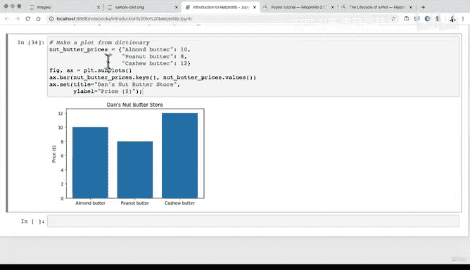

# Bourne《机器学习和数据科学训练营｜Zero to Mastery Data Science and Machine Learning Bootcamp》 - P68：068_08_005 散点图与条形图.zh_en - GPT中英字幕课程资源 - BV1yhrvBVEv2

In the Numpy section， we talked about how many Python data science packages are built off nuumpy arrays。

 the same goes for Maplotlib and one of the beautiful things about Maplotlib is it's about as flexible as Numpy arrays。

 if you can dream up a way to visualize data。 chances are you can do it in Mapl Lib。😊。

But there are some common kinds of visualizations than others or some more common ones you're more likely to come across。

 And these plots are the ones like line， scatter， bar， het and subplots。

 or plotting multiple visualizations on one figure。

 Let's have a look at some of these kinds of plots that you'll see more often。 plots or figures。

 Remember that word's kind of interchangeable。 using pure nuy arrays。 Soll start it off。

 So we go making。Figures with。Numpie， a。We'll make this marked down so it's a little bit communicative and then we'll go import if you haven't already done this。

 we've done this at the top， I will do it again。 I NI as NP。And we'll start off by。Create some data。

 X equals N dot lens space 0，10，100。Might be going hold on Daniel。 we haven't seen L space。 Well。

 in that case， remember， what can you do。Did you get it， Well， if you didn't， it doesn't matter。

 we can press shift tab。And see what L space actually does。So on MP lens space， yep， start， stop nu。

 Okay， so they're the first three arguments。 we've got0 is start10 is stop 100 as nu。 All right。

 well let's have a look。 Re evenly spaced numbers over a specified interval。

Returns numb evenly spaced samples calculated over the interval start stop。

 so it's going to return numb evenly spaced intervals between start and stop。

 So what do you think will happen here well。If in doubt， run the code， let's check it out。Well。

 there's going to be 100 samples。 so if we don't want to see all that。 Let's see the first 10。

Wonderful， well， I' see the first 100。 Why not。I'm into taking risk， aren't you。 So there we go。

 We've got 100 different samples here， or 100 different floats values here between 0 and 10。

 So we start at 0， goes all the way up to 10。 Wonderful。

 We'll reduce this back to 10 to save some space。 Excellent。 Now， let's go Fl。😊，The data。

 So remember， we're going to create a fig and an axe or a figure and axes。

 but these are the common short names for figure and aes。

We'm go plot subplots because this is a method that we're going to be using。

 We go x dot plot X and lets do because plot takes x and y， but we don't have a Y。

 Let's just do x to the power of two。Let's see what happens。We'll put a little semi columnlon。

Wonderful， we get this beautiful curve line。 So the default here。😊，In that plot lid。

 when you call plot is a line plot。 This is a line plot。 So and create a line plot。There we go。

 So as you can see， just a straight line now。😊，Use the same data， let's create a scatter plotot。

Use the same data because these are the most common types， let's write these down。We want。Lme plot。

Scat a plot。Bar plot。Heste。And。His is short for histogram and a subplot。

 They're the main types of plots we're going to be focused on。 Of course， there are more。

 but we could be going all year for the amount of plots you could do a mat plot lib。

 So we'll focus on the baseline ones。 And then you can build upon that knowledge。

So we want use same data to make a scatter plot。see what a scatter plot is。

 So if we want to recreate it， we have to always reset fiigaxe if we're in a different cell。

 equals PLT dot subplots。Wonderful axs。 Now we're gonna use scatter。So up here we use dot plot。

 but if we want a scatter plot， we'll see what that looks like in a second。

 we need to call dot scatter on X。 So here we go。 we want X， and then we want N。

 maybe we'll do the exponential of X。 and remember if you're not sure what Xp means。

 you can go shift tab， read the doc string here。What it says it is， and if it's still not clear。

 you can look up the documentation。There we go。 Well， it's kind of like a line。

 but a scatter plot is just another word for lots of dots on the plot。

 These are really close together。 these dots。 So they kind of look like a line。

 but they are all just dots。 All right， Well， how about another scatter plot。Let's make another one。

Just so we can see Fig ax， I want you to get really used to typing out this Fig X。P L T dot subplots。

 This is going to be our bread and butter for matpl lib， Ax dot scatter。X。

 let's create a wave because we did one of those before。 And that was my joke。Beautiful。

 so we've got a nice little wave here。 And if you're not sure what this is， what this is a sine wave。

 And again， you can always see the dock string or look it up， remember the steps。

 you can search it up if you're still not sure after looking that。😊，We've been using nuumpier arrays。

 and that's what this section is， making figures of nuumpy arrays。

 How about we create a plot directly from a dictionary so。😊，Make a plot from dictionary。

Cause this is just showing how versatile flexible mapp Lib is。

 So if we want my arm and butter a store， we'll bring that back。 So if we want nu better prices。

That's my favourite food。 Do you like it。I like it， too。 So we want here arm and but up 10。

It's quite expensive， peanut butter， not as expensive where I live。

So 8 and cashew butter is the most expensive。 cashews are hard to come by， you know。

 in short supply sometimes。 So if we go here， and then if we want fig x equals Plt dot subplots。

 we're getting really good at this one。 And now we want， let's do a bar plot this time。 So， you know。

 it's to the trend。 We're changing this。 Now I know it's kind of confusing because this is a line plot。

 but it says plot doesn't say line。 you're just going have to get used to the fact that the default map plot Lib is a line plot。

 But now we're going to create a bar plot。 So x dot bar。 And we're going pass it X and y。 So X。

 maybe we'll be a bit more formal X equals。😊，Nut butter prices。 What do we want。

 We want the keys from our dictionary。Because we're using a dictionary now， not an nu array。

 So we want the keys here。And our y value。 So we'll type in Y。

 That's what plot or bar or scatter always take。 X and Y might put that in a little comment。 X， Y。

 not butter prices dot values， beautiful。And now we might see what this looks like。Ah， error。

Missing argument， height。That's interesting。I see this。 This one doesn't take Y。 That's a problem。😊。

Positional argument， key word found。 What if we get rid of this。My bad。 This doesn't take X and Y。

 See， you're learning something new every day。 shift tab X。 whether it is X。X equals that。

That's what we can't have。 We can't have that equaling that， so we're going to leave this at that。

Ax stop R shift tab。 So this is a little python thing。 If you haven't seen this before。

 it's a syntax error where in a python method， if you have a positional argument， say x equals this。

 you need something after it to go like， say Y equals this。

 You can't have x equals something and then followed by that。 But you can have。

At the other way round， so see how we don't have x equals， we can have this bent height equals。

It'll come out with the same thing。 So the first one can't have a positional argument where the second one doesn't。

 but the second one can。 And the first one doesn't have to。

 That's a little bit of a python ti bit there。 So we're getting a lot of value from this map plot lip lecture here。

 Now， this doesn't really make sense。 We've got a few bars here。

 You can kind of infer that that's prices。 Let's customize it。 Let's add a little bit of a title。

 We want Dans nut。Butter prices store and see that little exploration that we just did before。

 That's going to happen， right， You're gonna to make mistakes。

 You're gonna to think you know things like me， and then you're gonna over go。

 that's actually not like that。 And then you'll look at the dock string。

 You'll fix it up and you'll combine your previous knowledge。 You you go。

 that's why that's like that。 So don't worry if it happens to you。 It happens to me。 Why label。

Equals price。 But what we do is we strive forward and we figure things out。 shift enter。 There we go。

 That looks a bit better。 And what can we do to remove that ugly line of text there。

I believe we can do Axdot show。Note， well， that has no attribute called show。

 but we can add a semi colonlon up here， I believe。Or maybe down here。Yeah， okay there we go。

 So we're learning on the fly here。 If you want to remove that nasty line of output code。

 you can add a semicolon to the last line where you call ax。 we've seen this semicolon before。

 but we've just seen where you actually have to put it。

 It's on the last line where you reference as Well there we go。You can create your own store。

 We've just seen how to plot from Numpy arrays we'll look at a little bit more in the next video but to prevent this one from getting too long we'll pause it here。

 so take a little break， create your own plot from a dictionary or a nuumpy array and I'll see you shortly。

😊。

