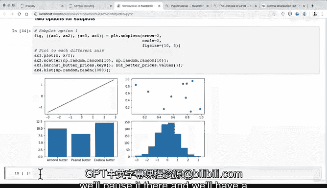

# Bourne《机器学习和数据科学训练营｜Zero to Mastery Data Science and Machine Learning Bootcamp》 - P69：069_08_006 直方图与子图.zh_en - GPT中英字幕课程资源 - BV1yhrvBVEv2

Welcome back。 Hopefully you've created your own graph here out of a plot or figure。 See， again。

 I'm mispronouncing all these different words。😊，Hopefully。

 your prices aren't cheap because the nut butterter game is very competitive these days。

 So the last video we finished off on bargras， there is actually a horizontal bar graph you may have seen this before。

 So if we go fig。😊，X equals plot dot subplots。Then we go ax dot bar H for horizontal。

 We're going to pass it just the exact same thing as above nut butter。

 prices dot keys and nut butter。Because we've got our saved dictionary up there。

 yours might be a different name。Dot values。 Oh， what's happened here。Unhaashable type deck dot keys。

 I actually did look this one up。 in this case， for the bar horizontal。

 we have to turn our values here into a list。How howd I find that。 Well， I did our search method。

 I looked it up。 I prebagged it。 I had to make sure that I was getting things right for this one since we messed up in the last lecture。

 but that's okay。 So we go there。 We've got a horizontal bar。

 same information just presented horizontally。 Now， which one should you use。

 It's more of a personal preference here。 I like this one。 It's vertical。

 Sometimes you'll want a horizontal bar。 There are other plots that look better on a horizontal。

 We'll have a look at some of those And potentially a future video。 Well。

 let's check out what have we done so far。😊，We've done line， we've done Sc， we've done bar。

 Let's do histograms。 What's a histogram。 Let's see it first。 Remember， if in doubt， run the code。😊。

Well make some data。We go x equals and P dot random dot random n。And we want 1000。

 of what is R end do shift tab。 return a sample or samples from the standard normal distribution。

 And what is the standard normal distribution。 Let's have a look。Normal distribution。嗯。😊。

Well go here okay， and probability theory， the normal or Gausian distribution is a very common continuous probability distribution。

 Whoa， that was a bit of a mouthful。 But what you really need to know。Is a normal distribution。

Are these curves here。 So in the middle here， this is the mean and the distance between the mean and here is the variance。

 And So whenever someone refers to a normal distribution。

 they're referring to one of these kind of like symmetrical curves。

 and they can appear anywhere on the X axis like this。

 That's what you need to know about a normal distribution。So if we go in here。

 this is going to make some1 thousand random samples。That would fit within this curve。

 But if in doubt， run the code， let's actually see this in action。 Fig X equals。 because remember。

 every time we want a new plot， we create a new plot， subplots， ax dot het， X。

 little semicolon at the end。 So what we've done here。As we're doing a histogram。

 but oftentimes you'll see it shortened to het。 So if you see het， probably referring to histogram。

So if we do that， there we go。 We've got a bumpy curve。 It's not as smooth as this one。

 but you can kind of see it's got the same shape。That's what we're after。 Just that same shape。

 beautiful。Okay， now we've covered histograms now what if you wanted to get multiple plots happening at the same time。

 we've referred to this before as subplots。😡，Well， the beautiful thing is。

 we can make them with the command we've been using。 Now， again， there's。Two options。否。Actually。

Or histograms， because you want to make this a bit more communicated。And plot it。 There we go。

We're in the habit of being communicative， so we've got to finish off that cell before we start a new one。

 two options for subpls。 Let's do that。 make a little heading。And then we'll go。Sub plotot。

Option one。Wonderful， okay， we're going to create fig。 Now。

 this is gonna look a bit different to what we've been doing。 Actx 1， Actx 2。 And you're like， whoa。

 what's going on here， Daniel， But don't worry。Follow along and we'll explain in a second is remember in the habit of just seeing what happens with the code。

And rows equals 2。 Hol on。 We've never passed a key word argument to this。

 And now we're going to pass 3。 We're living dangerously。 I told you， fig size equals10。5 well。

 my five key is a bit sticky， you know。 So if we look， what is this actually doing？Let's run it。Wa。

Look at that。 Now， can we infer what's happening here without even looking at the do string。

So we've got fig comma， and then a tuple， which is of tuples of x1 x 2 x 3 x4。

 So can you guess what's happening here and we've got some keyword arguments n rows equals 2 n cos equals2 fig size equals 105 What do you think is happening and rows equals 2。

2 rows，2 columns we've got x1， maybe x2， x3 x4。Well， I think that would be pretty spot on。

 if that's what you guessed， that's what I guessed。 So here we go。Let's read。

 create a figure instead set of subpls this utility。 Y， we've read that before。 and rows。

 number of row columns of the subplot grid。 beautiful。 Now， let's see how would we get data on here。

 So let's。😊，Let's do this plot to each different axis。 Let's see this in action。 Act 1， dot plot。

Let's go X。 we've got some X data， I think。That'll probably do。

 Let's see what happens when we do plot it。Ne。Straight line， wonderful， we can do that。Okay， so yeah。

 X 1 is this top left1。 Okay， that's that makes sense because it comes first。

 Can you guess which one is Act 2。Oh， let's see and find out MP， let's make some。

 some more random data， random dot random 10， and we'll do random dot random again。10。As semion。Okay。

 and see we've created a little scatter here。 So that's Acts 2。 wonderfulnder Actx 3。

 Let's do a bar on this one。 We're going to start mixing this up。 You know， nut butter。

 can I do tab complete， nut butter prices， Yes， I can。 dotkeys。 Nut butter。

 We want the values on this one。😊，The values。Wonderful， and let's see what happens。Beautiful。

 we're starting to fill out our sub plot here。 This is wonderful。 Ax off4， we want Hest。

 and then we want MP dot randomt R and normal distribution。 We checked that out before。😊，There we go。

Bm， now we have a subplot with four different subplots。 Now， again， this is just some dummy data。

 except for this。 This is real stuff right here。 This is Dan's arm butter store。

Now you could add some titles to these aes， much like we've done up here with this set command here。

😊，But this is just to exemplify one way， option one we'll do option two in a moment。

 maybe in the next video of how you can get more information on the one figure。

 So if we look back to our anatomy go here。It's still a big figure。 This blue square。

 If we converted this blue square is going to follow around this， but now we've got axes 0。

 axes 1 axes 3 axes 4， but it's actually axes 0，1，2，3。 but we've named them differently in reality。

 we should have probably zero indexes， but I've just gone1，2，3，4。

 But now you're starting to see if you wanted to get more information in just one image rather than having four different figures。

 you can see you can do that with subplots。 The reason why we've been using this command is that you can create single plots or multiple plots with the same command。

 That's that flexibility we were talking about of the object oriented API for matpllib So this is option one for the video gets too long。

 We'll pause it there and we'll have a look at option 2 in the next one。😊。

