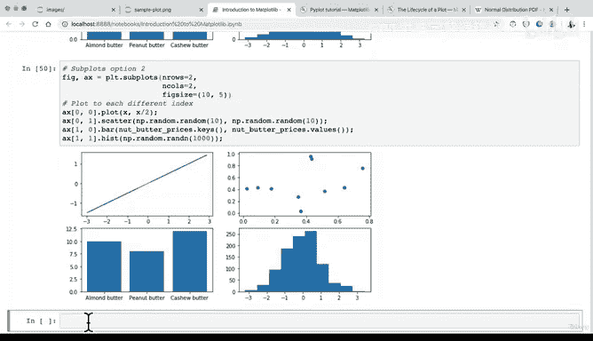
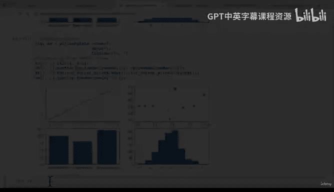

# Bourne《机器学习和数据科学训练营｜Zero to Mastery Data Science and Machine Learning Bootcamp》 - P70：070_08_007 子图选项2.zh_en - GPT中英字幕课程资源 - BV1yhrvBVEv2

Okay， welcome' back。 So in the last video， we said that there were two options for subplots。

 But the beautiful thing is that we can use the same command we've been using for single plots to create subplots。

 So we've seen a preview of option 1。😊，Let's do option 2， just because if you come across these。

 I want you to be aware of it， option 2。In your research， you might see both of these come up。

 So that's why we're checking out two different ways。 Do you have to use two different ways。

 No you don't。 We'll probably stick to using option 1 throughout the rest of the series。

 But this is just so you know what's going on。 So go f and ae。 whoa。

 this syntax looks different already。 This is just like we're making one。 but rest assured。

 We are creating some plots。 and rows。 So N cos equals 2。 and then we want fig size。

 We're just replicating what's here。 you could copy and paste and delete it。 But again。Remember。

 we're always in the habit of rewriting code。And we want here。Ploot to each different axis now。

This is kind of the， I guess you could say the two way and this is the list index way。

 this other option。Yeah， maybe we do that each different index to prevent confusing here。

 So we want ax0，0。Now， can you guess before we even plot anything， What is this doing。

 So if I do this， Fig a equals plot dot subplots and rows equals 2 and cos equals 2。

 If we were to index into this ax for 0，0， Can you guess which one of these4。

 because we're creating the same this code here。And this code here does the same thing except for variableial names。

 What are we going to plot to if we pass these index coordinates，0，0， row 0， column 0。Well。

 let's see and find out。😊，No cheeky reveals here unless we've run the code。There we go。 Okay。

 so it's just the same as this here。 But then if we go， let's do the same thing。 So if we want 0。

1 and want a scatter。And we're just going do the same random dot random。

 I believe it was 10 random dot random。Wonderful。我。There we go。 So again。

 these plots are different because it's it's random。 So these scatter plots。

 same thing numbers between 0 and 10 or 1 and 10。 But because we're calling different random ones。

 they're going to appear randomly。 So each time we run this。Probably have a different。

 different plot。 There we go。 But all this is saying is access row 0 and plot on column 1。

 So column 0， column 1， there we go。 And so now you can probably guess what's going to happen next if we go 1 and 0 dot bar and we want。

Not butter prices， beautiful。All this talk of nut butters is making me hungry。

Might have to do that after this。 Nut butter prices。

 And that's a beautiful thing about owning a nut butter store， right。

 I that you can just eat your own supply。Not too much， though， because we need to still make profits。

 We're going to do two at the same time here， here。Rand N。That's what I want。 There we go。

 But you see what we've done， we've forgotten a semicolon there。Now there we go。

 so we've created the same plot here， same subplot using two different types。

I personally prefer option1 because it's a bit more readable for me if I look at something like this。

 you may prefer option 2 list indexing can be helpful in some scenarios it's all about just trying it out and see how you go。

 but I think we'll stick with option1 for the rest of that poplib section。

So that's just to show the two different ways of doing subplots with the same command here， Plt。

subplots。All right， so now we've seen different ways of plotting directly from nuumpy arrays。😊。

But it's most likely most of your plotting will probably take place from a panda's data frame。

 so we've seen panda's data frames in the past and we know that they're built on top of nuumpy arrays and we know that mappl Lib plots are built on Numpy arrays so let's see how this synergy works I'll see in the next video。

😡。

