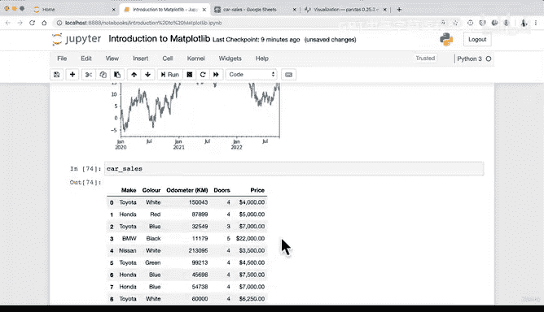

# Bourne《机器学习和数据科学训练营｜Zero to Mastery Data Science and Machine Learning Bootcamp》 - P72：072_08_009 从Pandas DataFrame绘图.zh_en - GPT中英字幕课程资源 - BV1yhrvBVEv2

Welcome back。 So in the past few videos， we've looked at how to create plots like this。

 We've made some line figures， some scatter plots， some bar graphs and some histograms。

 These are more than enough to get started， plotting some of the most common things you want to plot in your machine learning and data science career。

 But more often than not， you're not going to be plotting directly from Numpy arrays。

 you're going to be plotting from pandas data frames。

 And I guess you' kind of are still plotting from Numpy arrays because pandas is built on Ny arrays。

 But as what we're going to focus on in these next couple of videos is plotting from panda's data frames。

 So let's do that。😊，Pands。Data frames， beautiful。So're going to make that into a little heading using escape and pressing M。

 And now first things first， we're going to import pandas because we need pandas to work with data frames。

 We've done this at the top of the notebook but we're going to do it anyway because we like that and now we want make a data frame。

Now we've got up in here， we've got our trustee car sales CSsV， which we've seen before。

 which is just like a spreadsheet that's been exported into a comma separated value format or dot CSv。

 so we've seen this in the pandas section， so we'll go car sales equals Pd。 Re CSsv。😊。

I believe it's called car saless。 car saless。 You can always tar auto complete here。 There we go。

 That's helped us out。 Thank you。Put a comma there and we go here。 Car sales will check it out。

 Lovely， that's our trusty car sales data frame。 Now， before we plot anything from here。

 let's practice looking up some documentation。 Pada's data frame visualization。 wonderful。

 It already knows what I want to look up。😊，It's almost like， I've prepared this earlier。

So if we want to look at visualization in pandas， this is the pandas documentation。

 We use the standard convention for referencing the Maplotlibb API。 Wonder。

 so that means that pandas builds upon mappotlib。 So what we want to do is rather than reading through all of this documentation because there is a lot of different plots。

 hey， there's a histogram。😊，We've done some of these， so we're go back up here。

 and we're going to start off by just writing some code and we're going to try and replicate this in some sort。

 So let's just copy this。 And I know we're breaking the number one rule。 Don't copy code， rewrite it。

 but we're going to rewrite it anyway， but I'm just putting it here。 create a new cell below， E B。

 so we can copy it out。 We don't have to keep going back and forth。

You might see something in a stack overflow question or documentation。

 and you might just copy it straight from here。Put it into your notebook and then go， hey。

 I need this part， but I don't need this part and just write out the parts that you actually need。

 right， But you never want to be just completely copying at P D date range。This is a bit old 2000。

 So we're going to upgrade it to where we are now。 So one， one。2020， wonderful。

 a bit more closer to where we are now， actually。Periods equals1 thousand0。 Now you might be going。

 okay， what does this mean， P D dot date range。 Well， remember our motto if and doubt， run the code。

 So let's see this T S。All right， So what's happening here。 Well we've got dates on the index。 Yup。

 that makes sense。 In equals P D dot date range。 It starts at this date first of the first2020。

 then goes up。 So it's going up by days。 Okay， and these are just random numbers being filled here in this column。

 going up。 But what is。Come sum。 Well， let's type that in。 T， S dot co sum。What can we do， Shi tab。

 return cumulative sum over a data frame or series access。 cumulative sum。 What does that mean， Well。

 let's find out。We run that。yes， actually， let's keep running。 We don't want a negative there。Oh。

What is happening here， This should be adding up。Maybe we go here。 yes。This is interesting。

 This should be adding。T S equals that。HI know what cumul of some0 it doesn't seem to be doing it here。

 What it's supposed to be doing is adding this one to this one and then adding that one to this one and then adding this one to this one。

Oh， that's why T S equals T S。 classic。 Daniel're just trying to get ahead of himself and run the code。

 My own mottos let me down。 Let's see what happens。Okay。😊。

We've got something kind of similar to this， but again。

 remember it's always going to be different because we're using random。 Rand n。

Well this is just demonstrating that when we call plot from a PDd do series。

 we haven't done it from a data frame yet。 it comes out as mapplotlibb doaxes。 subplots。

 So that's what we've seen before with this So really it's straight from a panda series we might delete this cell because we don't need that anymore but it's using mapplotlib。

 that's really handy to know。😡，All right。 now we've seen plotting straight from a series。

 Let's plot from our data frame。 We' got car sales。 It's our data frame。 We'll view it again。

 How about we make something similar to this， but using our car sales data。Yeah。

 maybe we get some dates and the sale price over time。

 We might add a little column to our data frame。 Yeah， that sounds like a good project。

 But before this video gets too long， we're going to do that in the next one。

 So the next video I'll see back。 We're going gonna try and replicate something like this。

 But using our data。 So we'll get a mixture of manipulating data and plotting at the same time。

 That'll be good fun。😊。

