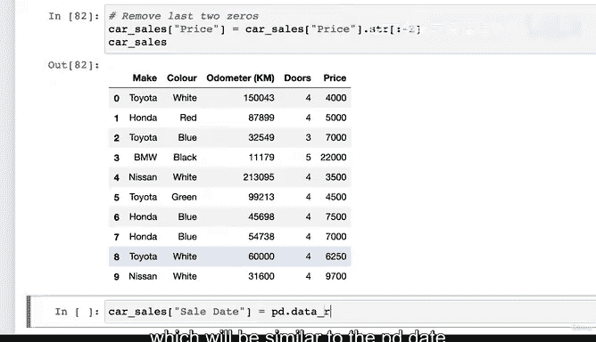
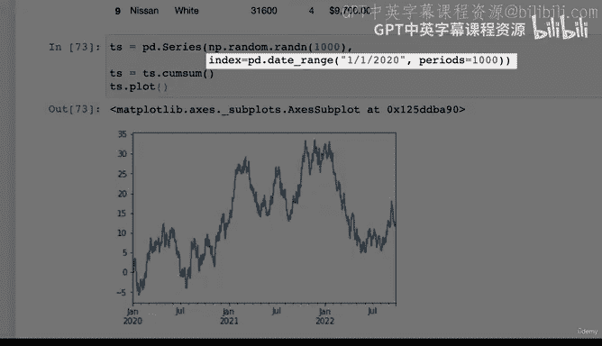
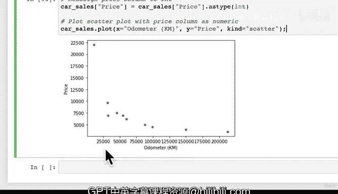

# Bourne《机器学习和数据科学训练营｜Zero to Mastery Data Science and Machine Learning Bootcamp》 - P73：073_08_011 从Pandas DataFrame绘图2.zh_en - GPT中英字幕课程资源 - BV1yhrvBVEv2

In the last video， we created this bad boy here。 Now， let's try and make something similar。

 but using our own data so we can practice a little bit of data manipulation。

 along with plotting and put some of our pandas and mappl lib skills together。

 So what we'll do we'll format the price column first。

 We'll get it into integer format because right now。

 we don't want those dollar signs and columns and comm。

 We don't want those for when we're doing numerical operations。 So to do that， we'll go car sales。

 and then we'll change the price column。 We need to access the string。

 We saw this in the pandas section。 We go string， dot replace。

 And now we want to pass in a little bit of reex here。😊，There we go。 So essentially。

 all this is saying is get the dollar sign， the comma and the dot。

 which is here and here and replace it。 and we're going to replace it with。An empty string。

So we'll see what this does， car sales。We need to。Add car saless there。

So let's see what it looks like now。 Okay， beautiful。 But we've got two extra zeroes on the end。

 So we don't want that。 So we w to go remove。Last two， zeros。Weve got car sales。

We want to access the price column again， we're going to reassign it to car sales。Price。Again。

 it's still a string。 So if we have a look at this， go here。Type。

Just to exemplify what we're doing with the dotch string。As a series。Okay， but that's all right。

 Well， this is still a string。 so that we're accessing it with the dotch string method here。

 maybe if we go。Z string。 there we go。 So that's accessing this little one here。

 And it's telling us that it's a string。 So that's why we have to access it as a string first with dot SR。

And now we want to remove the last two using slicing。Well。

 let's have a look at what car sales looks like here。Oh， no， we've removed too many。

 So what we can do is rerun it。 We're going to have to re importport our data frame to fix that little issue。

That's going just reset it。Cause remember， Jupiter cells are run in in sequential mode。

 So if we run this cell more than once， it's going to continually remove the last two digits of our price column。

As long as we keep running this。 so we don't want that。 So now our price column。

Is in the format that we want， we're going to add。A sale date column。

 which will be similar to the PD D date range。

Function that we used up here， Pd dot date range。

So let's do that。Daate range 1，1。 we want to get past it to date 2020。Number of periods。

 so this is how many dates we want to add。😊，We've got periods here。 So that's a parameter。

So that's going to add this one。 We had 100 periods。

 but we don't want that many for our car sales data frame。

 We actually just want date period for each row here。 so we can do that by going periods equals L。

Car sales。And then we'll check out Carsle's data frame again。Beautiful。

 so now we've got a sale date here， which is sequential。 That's okay。

 Maybe they all won't sold on sequential dates， but we're just making an example of how we can start to manipulate our existing data frames。

😊，So the next thing what we want to do is we want to make a total column。

 So we want to start to add up how much we've made from selling all our cars。

 So if we added 4000 to 5000 to 7000。 So this is where we can use something like come some because it's going to add。

Each of these prices， cumulatively。So let's make a total column。This should be car sales。

 total sales。And then what do we want， We want the price column。 That's right。

 Car sales price dot comes sum。 Let's see what happens here。Car sales。Oh。What have we done。

It's worked。 But because our price column is still in string format。

 it's just concatenated the strings to each other。 So let's have a look， car sales。Price。

0ro dot D type。哦。That's a bit boring。 Let's get it back to it。 exemplifying that It's a string。

There we go。 So our price column is still a string。 So to fix this。

 we have to change it first into an integer and then call the comes sum function。

 So we can do dot as type。Int dot com sum。 So what this is going to do is go。

Reassign the total sales column to be the price column as an integer as type int。😡。

Dot cumulative sum。This should work。In theory， but as always， run the code， then check。Beautiful。

 okay， so this has gone on total sales。4000 plus 5000 is 9000 plus 7000 is 16000。

 And then it keeps going right up to the end so after we've sold all of our cars across these 10 days or so。

 we have 76450。 Bea。 There's some good profit there。 I can use that to fund out。

 I'm a butterter store。😊，And now。Let's。What。The total sales。So we want car sales。

 We want to see what our total sales looks like over time。 So kind of replicating。This graph here。

 but with our own data。Car sales dot plot。X equals。Saale date。

 and now this is where you can call dot plot directly on a panda's data frame。

This is Panda's version of the MapottLi API or the Rapper， Pandas Rapper for the MapottLi API。

So we're just going data frame dot plot and we're passing it our X， which is the date and our y。

 which is the total sales column。So let's see what this looks like。Total sales。

They'll put a semicolon at the end， so it doesn't print out。Beautiful。There we go。

 so this is just an example of how you can take。😊，Some code right from the documentation or some example that you found online。

And we've replicated it up here。😡，But then we've taken the principles from it， or some of them。And。

Put them together with our own data and then created this little visualization here。

 So now we can visualize， okay， so say we sold our 10 cars over the first 10 days of January。 Now。

 our total sales is going up and to the right， which is very pleasing for our boss because that's the type of graph they want to see。

 profits up and the right。😊，And so hopefully you're starting to get an idea of the kind of workflow that you can go about when you're working on your own projects or working on problems you don't necessarily know the answer to。

 it's all about searching up， trying to find some kind of example， taking information from that。

 and then seeing if it works with your own problem。😊，Now， we've seen a line plot。

 How about we try Sc plot。 So we got car sales dot plot。X， let's do it with the odometera this time。

 odomina column。K M beautiful。 Is that the right column name。 Yep， we've worked with this data frame。

 So we're kind of familiar with what's happening。Price。And then。

When you're calling the plot function， there's a little。Forrameter here called kind。

 which we can feed the type scatter to hopefully get a scatter plot here。Well， what's happening。

Scatter requires y column to be numeric。 is our price column not numeric。

 It's still not numeric because here we've called as type int。

 So this is only going to turn the price column into an integer for running this single line of code。

 It's not going to reassign the price column to be an integer。

 These are still strings in the car sales data frame。So what we can do to make this work。

We want to reassign the price column to be an integer。Price。equals。Car sales。Price not as type in。

 because our prices are always going to be integers， right， Money is a numerical value。

 So it's okay to reassign this data type to be integer。This should work。 So we got。

Reassign price column。To int。Ploot。Scatter plot with price column as numeric。

So without this line of code。😊，We'll comment that out we're going to get。😊。

An error here value error requires Y column to be numeric。 but what we're doing with this line here。

 if we uncomment it。To comment and un code， we can do command slash。

 So I'm just pressing command slash here。 We're going to reassign it as a numeric column。

 So we do this。Beautiful， now we have a scatter plot of our odometer column versus price。

 And remember to remove this little piece of code here， you can put a semicolon right at the end。😊。

Excellent， now。I'm kind of seeing a few examples here of how we can start to plot directly from a pandas data frame。

 we'll see a few more but we'll end this video before it gets too long so in the meantime before the next one maybe you'll try plot a couple of these columns together whatever kind of plot you want to do。

😊，You've seen a few a bar graph， a scatter plot， a line plot。

Have a practice of that and I'll see you in the next video。

