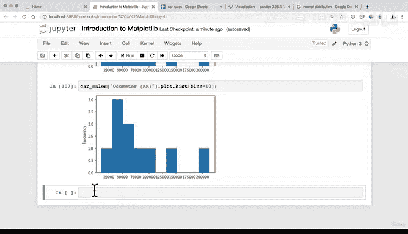

# Bourne《机器学习和数据科学训练营｜Zero to Mastery Data Science and Machine Learning Bootcamp》 - P74：074_08_012 从Pandas DataFrame绘图3.zh_en - GPT中英字幕课程资源 - BV1yhrvBVEv2

Welcome back。 So in the last video we saw plotting a scatter plot or a figure directly from our car sales data frame。

 we also saw making a line plot and doing a little bit of data manipulation。

 like adding a date column and creating a total sales column using the K sum function。

 How about we look at a few different other kinds of plots from our data frames。

 How about a bar graph。😊，Yeah， that's a good idea。😊，Let's make some data， actually。

Because we want to just keep practicing all these different types of ways of plotting。

 creating data and just seeing as many different examples as we can， so we'll create X variable here。

😊，我该。Turn it into a data frame。So we want Df equals P dot data frame。X。Columns equals。

 we'll keep it nice and simple。 We'll just go a。没异议。C。D， wonderful。

 And now we'll have a look at our data frame。 Nice and simple。

 So we've got some random values here between 0 and one。 it looks like。😊。

And four columns that are just simple， A，BC， D。 Now， to get a bar graph。

 we can do there's one way we can do it。 dot plot， dot bar。This is our D F here。

 This is our data frame。 and this is just saying， hey。D F dot plot， make it a bar graph。

 Let's see what this turns out to be。Wonderful， so this has got a legend here。With A， B， C， D。

 And then we've got the different values for each different row。 So this is row 0。We can see。A is 0。

06。 That's fairly low here。But D is 0。95， so it's right up and high。

That's an easy way to make a bar graph using a pandas data frame in a few different columns。

How about？How about we do it a different way， Let's go，ca again。

 there's always many different ways to do the same thing with these libraries that we've been looking at。

 Let's go D F plot。 Remember how with our scattergraph。 we had this kind parameter。 Well。

 you can do the same with a bar graph kind。 because bar put the semicolon at the end。

We get the exact same plot。These are two different ways that you can plot a by graph。😊。

You can also change the kind variable here Which one should you use It's personal preference。

 but to be honest I kind of flip back and forth depending on what kind of graph I'm making。

 but I'm just showing you this so you've got an idea if you see these two out in the wild somewhere。

 you know they're really just doing the same thing。What about next， Let's use our actual data。 right。

 So that was a dummy plot。 Let's use the car sales data frame and make a bio graph。wantant car sales。

 let's view it again。Always good to view your data frames。

 this is the kind of workflow you'll be going through when you're creating visualizations as you'll be checking your data frame。

 making visualization， checking your data frame， making visualization。

 and just keep jumping back and forth so never be afraid especially when you're working through the start of a project to just keep writing code。

 keep trying to understand your data。😊，So we want car sales， do plot。

Maybe we plot the odominar versus the make in a bar graph。We can see that maybe the make or be。🤢。

The X， so we'll have make along the bottom and then odometer as the y。

 So let's see what that turns out to be equals x make。Then we want y equals。Odomatta。うん。Typo。K M。

 beautiful， kind eles。爸爸。🤢，There we go。We can see good our rows here across the bottom。

 we've got different makes， Toyota， that's how many kilometers are on the odometer， Honda。

 that's how many kilometers are on this this example。😊。

What a bit of an extension might be is to group these together to figure out what the average odometer reading is for each different make。

That would be something like consolidating。Cars of the same make and then averaging what their odometer is so maybe that's a little bit of a practice that you could try to create an extra column over here or something like that。

But let's move on to another type of plot that we've seen before。😡，How about histograms。

Histograms are great for visualizing distributions， so that's just the spread of data。So we got。

 of course， there's many different ways to do it， so we got car sales， odometer。

We want to visualize the distribution of the abdometera plot dot hist。

 this is just exactly like we saw before with plot。t bar， but now we're doing hist。

 hist is short for histogram。So we'll have a look at this。😊，Okay， so that's the spread of our data。

 This is that kind of that normal distribution curve around this。 This would range 25000 to 100000。

 And we've got a few here， which are a little bit outside that normal curve here。

 So this might be considered an outlier because of how high it is。 And if we come back to our table。

 our data frame。 We can kind of see that at this Niscent。Which is this one here。

 has 200000 kilometre on its odometer versus the rest of these are barely scratching towards 100。

 So that kind of makes sense intuitively just looking at this。

 But you could imagine if we had maybe 1000 more cars with all different ranges of kilometersmet。

 Most of them would probably appear in this range。 if they were similar distribution to what we've got here。

Now， what's another way of doing it。 So if we go car sales， we'll make the same graph here。

 odometer K M， beautiful。We'll go plots。 we're going to use the kind parameter here。

 kind equals hist， and then we'll do it there。So same graph just a little bit different here。

 we've used a kind parameter rather than just the dot hest method。

So one of the advantages of using the dot hest， it has a little parameter here called bins。 Now。

 bins that by default is 10。 So this is， if you're wondering what a bin is， it's these columns here。

What a histogram plot does is it takes the spread of data here。And then buckets them into bins。

 So we got here 1，2，3，4，5，6，7，8，9。 So this is by default 10 bins。

 If your data doesn't fit into 10 different， evenly sized bins， it might adjust the size here。

 but we can do that manually by passing。A different value to hist to the bins parameter。

So let's see that in action。Let's go dot plot， dot hist。 We're going to change bins。 Let's do 20。

 We'll double it up。Okay， so we can see we've kind of missed that curve there。Now。

 what is the most ideal value for bins， It's kind of like an exploration。

 That's a lot of what data science and machine learning is。

 It's kind of just trying things out and seeing what works。 So these don't really look that great。

 I think 10 is actually probably one of the best values。T's probably all right。

 Well we do have only 10 samples now。What are you looking for here， You're looking for a big curve。

 Like， remember how we looked at the normal distribution。

You want to try and find something like this with your histograms， a curve like this。

 If you can't find exact curve because your data doesn't fit this exact curve， that's not a problem。

 It's just about having a different go and figuring out what is the most ideal number of bins for your histograms。

All right。So we've seen a histogram。 We've seen bar graph。 We've seen scatter plots。 we've seen。

Line plots。On our car sales data set， let's try do something a little bit similar but with another data set just to make sure that we've kind of got these methods down pat。

 So in the meantime。Have a little bit of a practice， make a bio graph。

 make a histogram on the car sales data frame， and I'll see you back in the next video we'll do something similar with another data set。

😊。

