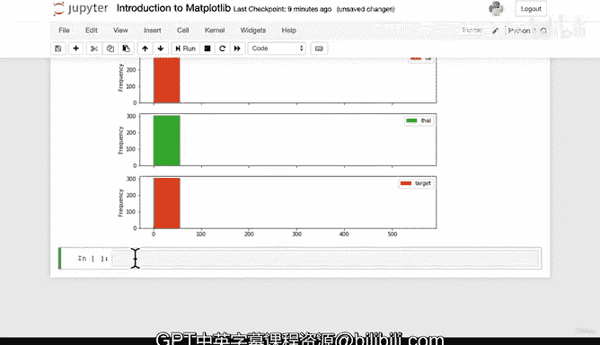

# Bourne《机器学习和数据科学训练营｜Zero to Mastery Data Science and Machine Learning Bootcamp》 - P75：075_08_013 从Pandas DataFrame绘图4.zh_en - GPT中英字幕课程资源 - BV1yhrvBVEv2

Welcome back。 And so we've done a whole bunch of plotting so far。

 And don't worry if you're sort of a little bit confused at the moment。

 like either like Daniel showing me all these plots I'm looking at different data sets。

 how am I going to remember all this。 It's all right。 That's perfectly fine to feel like that。

 It's going to take a little bit of practice to start to understand different kinds of plots what you should use which plot for。

 But that's all part of the process。 right， is's just having a little practice。

 having a go and just trying it out， seeing what it looks like。 Does this make sense。

 So that's why in this video， we're going to do a similar plot to what we've just saw before on the car sales data set on another data set。

😊，Let's try on another。Data set。 And if we come up here。We've got hearttdisease。csv。

 which we've seen before， which is a data set which has different parameters of patients and whether or not they have heart disease。

 so let's import that as PD。read CSv as we're going to call it just heart disease。

And so we'll go heart disease， dot Csv， beautiful。Now we'll have a look at it， just to make sure。

We know what's happening。 We'll only view the first five rows because about 300 in this one。

Excellent， we have these parameters we've seen them before。

 and I've got a target column right on the end。 So what we might do is create a histogram just to see the distribution of the age column。

😊，So heart disease。Age。Dot plot dot hest。 And we might just see the default number of bins。

 Can you remember how many that will be， Shi tab bins is going to be 10 beautiful。

 so we'll just leave it at that。Okay。😊，So this is where we're starting to see that curve， right。

 this is that normal distribution。 it's very common。So we're kind of getting that curve here。

 We would say that most of the patients are around， it's this line here。 So maybe late 50s。

 early 60s thereabouts。 So what if we change the number of bins。 So let's go bins equals 20。Okay。

 we're starting to lose that curve shape a little bit，30。Still relatively there。

 we're definitely starting to see this more pronounced line here right at the late 50s there。

Maybe we jack it up to 50 and see what happens。All right。😊，So that shape is still relatively there。

 Our initial shape that what we got from just having 10 bins is kind of consistent the whole way through。

 And maybe we'd look at this and go， okay， this one's a bit of an outlier。

 These are a bit of an outlier。 Why are they outliers。

 Well because they're so far from the middle When you hear the word outlier。

 That's kind of what it's talking about In sta terms。

 it's about more than three standard deviations away from the mean。 Now， of course。

 that definition will change depending on what data you're working with。

 but this is kind of a way that you can visualize it。So let's take that back to 10。

 that looks pretty good。All right， now these kind of visualizations are the things you'll do whenever you deal with a new data set。

Let's finish。 We have there's one more type of plot we haven't looked at directly from a data frame。

 that's subplots。 So we'll finish that off。We'll go heart disease。Don head。Okay。

 this is our data frame。 Now let's plot every single columns histogram in one plot。

 Let's see how we would do that。😊，Heart disease。 So we've got the age histogram here。

 but let's just make one fill all of these and check the distribution。Don't plot。

So remember this is just going straight from the entire data frame up here we selected the age column。

Dont hearst。And maybe we want subplots equals true。

That makes sense because we want to put it all on the one plot。Keyword a。 So that's part of that。

 Maybe if we could read down a little bit。Examples。

So this is one of those scenarios where if you wanted to use this dot his method and have it all in one plot。

 because the doc string doesn't really have an example of putting it all with the subplots。

 this would take a little bit of research so you might look up a question like how to plot a histogram on subplots from a pandas data frame and then you'd find this little parameter here Only reason I know it is because I've had a little bit of experience plotting subpls from panda's data frames。

😡，So let's see what this looks like。😊，Might take a little while because we're plotting 10 columns or 15 columns thereabouts。

😡，That doesn't look very good， doesnt it？We've got overlapping plots， we've got legends everywhere。

 we've got these things aren't even to scale， so maybe to fix it up， we'll change the fig size。

So what do we want， we want。With height， we want it to be a bit higher， so it stretches。

 it stretches it out because there's hardly any space here。Okay， that's looking a little bit better。

 but still。Youve got columns like this， which are just all clumped up here because what it's doing is it's using the same scale for all of them。

 but in reality。These all have different measures。 That's not very ideal， right。

 It might work out for some like this one。 cholesterol might work out for that column。

 but it doesn't work at all for the other ones， right， So slope， old peak exang。So what can we do？

Well， this code runs， but it's not ideal。Then there's different scales。

 and there's probably a bit too much going on for this plot to even be meaningful。

But this is a good segue， though。 Now， we've covered a few simple plots directly on a panda's data frame。

 Let's have a look at how we'd make some visualizations using the Oo method。 So remember。

 back in a previous video， we talked about Oo method， which is subpls。 Don't worry if it's confusing。

 we'll have a look in a second。 But what we've been using so far is plotting directly from pandas using the stateless method。

So in the meantime， have a practice， keep using the plot。

 make another plot of your own before we come into the next video。

 and I'll see you there we'll practice using the more flexible object orientated Maplotlibb API directly with pandas。

😡。

