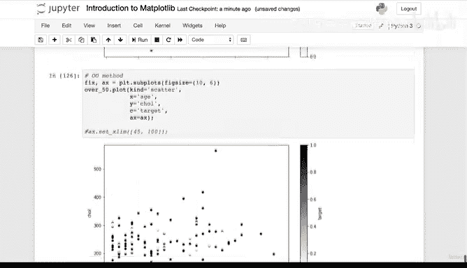

# Bourne《机器学习和数据科学训练营｜Zero to Mastery Data Science and Machine Learning Bootcamp》 - P76：076_08_014 从Pandas DataFrame绘图5.zh_en - GPT中英字幕课程资源 - BV1yhrvBVEv2

Welcome back。 So in the last video， we left off saying that this plot probably isn't ideal。

 We've got a few subplots going on here。 And we've been using the pi plot method。

 plotting directly from a pandas data frame rather than the object orientated method。

 And I'm sure you're wondering， you're going， Daniel。

 you've introduced so many different ways of plotting。

 And you're telling us there's two ways of doing it。

 And you're saying one is less ideal than the other。 Which one should I use。

 And that's a perfectly great question。 So which one should。😊。

You use。Pie plot verse mappl Lib。O， O method。Now。There is no real definitive answer here。

 the documentation on that plot level will push you towards the OO method always， however。

 when plotting something quickly。Okay， to use。The pie plot。Method right。

 so what we've seen up here when you want to get a quick visualization。

 maybe not something like this， but definitely something like this。

 it's okay to use the pie plot method that we've gone through in the last couple of videos。But。

When plotting something more advanced。Use。The O，0 method。

So we're going to see an example of that in this video something a little bit more advanced than just something singular like this。

 but if you're just making a quick plot like this， you just want to see the distribution of a column it's perfect okay to go dot plot now we'll see the OO method in action。

Let's create a subset of our data frame so we can do a little bit of data analysis。

 Let's say we wanted to explore the patients which are over the age of 50。

 We only wanted to look at those patients and we want to create a little bit of a plot and start to do some data analysis on those。

 So we'll create another data frame called over 50， which is equal to our heart disease data frame。

 which willll get a little refresher here。😊，So we know what it looks like this is the kind of workflow you'll be going through is looking at your data frame and going。

 okay， my colleague or my teammates and my boss want to know what's some data analysis of our patients which are over 50？

So let's do that。😊，We can access those by using bulloleline indexing， so we want heart disease。

 Actually， we want to use the age column。Which are greater than 50。Wonderful。

And then we want to have a look at our over 50。えでさ。What if we got wrong here。Age key era。

 I've used a capital A。That's all right。Wonderful， and we might check the length of this。😊，208。

 so we have 208 versus about 300 or so。😊，Of the original data set。 So that's fine。 Dot head。

 wonderful。 And again， we've dropped out these two rows。 So 37，41 using our Booleing indexing。

 So now it goes 0，3，4，5，6。 but the rest of the columns are still the same。😊。

How about we start with a scatter plot of the age and cholesterol。

 but we want to colour it with the flavor of the target column？😡，Well there's a lot going on there。

 let's see the code first and then we'll figure it out from there over 50 dot plot kind equals scatter。

And then we want x equals age。And then we want y equals， we want the cholesterol column。

 which is this one here， C HOL is short but cholesterol。And then we want to cover it using the C。

 So C is short for colour。I have a target column。 So we want plot， kind scatter。 Yes。

 that makes sense。 X， age， Y， Co choll， cholesterol。Kind of a hard word to say， C Joel。

 And the colour is target。 Let's see what happens。All right。

 So we can kind of see what's going on here。 We've got cha on the Y。 that makes sense。

 The X doesn't really show us much， and。C is giving us this colour bar to show us set。

Cause Target has values of 0 or1 for if someone does have heart disease or they don't。

 Does this look O to you。To me， it doesn't look very good。 It's doing what we want it to do。

 It's got different dots on here。 if they're a target value of 0 or 1。

But it doesn't show us anything on the X axis。 And these colour aren't really that great。

 So let's spruce things up a little。 And how can we do that with the O0 method。

 So this is the pi plot method， Aka plotting directly from appendus data frame with plot。 Now。

 let's do。OO method， we're going to recreate this， but using the Oo method。So let's go fig Ax。

 we've seen this before。 P Lt dot subplots。 and we might go fig size just to have some practice adjusting the size of our figures。

 and we'll go 10，6。 We want a width of 10 and a height of 6。 These are an inches， by the way。

 I believe So over 50 dot plot。Now this is going to look very similar to what we've done up here。

 but there's one slight difference。😊，Kind equals scatter。 wonderfulful。 Now， we could copy and paste。

 but we're not going to do that because we're in the habit of writing out code。 Y equals。Co coalle。

See， we use the target column as color。 And then the last part is the axe parameter。

 So when we're using the O0 method with pandas。The plot function gets this ax parameter to tell us。

 hey。We're using the OO method and we want you to plot this data。On this axis。

 the one we've just created。 So let's see that in action。 Ax， I'll put a little semicolon at the end。

Beautiful， so what we've done is we've recreated the same plot。

 but it's already looking a little bit better。 It's bigger because we've put the fig size parameter in there。

 And now， because we've passed the axe method， we've now got this age column。

 which has been labeled beautiful。 Actually， we might give this one a chance and say， hey。

 let's up this fig size and see if it does the same thing。😊，Cos 10，6。

We still don't have the age X label there。Well， the O0 method is already pulling out ahead。 Now。

 what we might do is we set the X limit to be a bit wider so we can have more space on our data frame。

 So let's have a look what that looks like。 We're using the O0 method。 We can access the axis here。

 And remember the axis is just this space that we're plotting data on。

 if we go back to the figure of our。😊，Anatomy of a mappl Lib figure or plot。Access is this part here。

 where we're adding data， whereas figure。Is the entire thing。 So let's go back。We want X dot set。

 X limb。To be。45，100。Can't we figure out what this does before we even look at it。 So set X Li。

 We could do a shift tab， but I want you to just have a think about it。So a set x Li 45100。

So that's all right if you didn't get it， if you press shift T and read it， you cheated a little。

 that's also fine。 that's actually a good thing to do is start exploring what shift Tab does。😊。

But this is going to change the limitations of our x axis to be from 45 to 100 instead of what it is now which is about 50 to 80。

 so let's see what happens。😊，So see how we've got like a lot more white space over here now because we've upped the X limit。

 but if we didn't want to do that， we could comment that out and that looks a bit better。

 just given an example of how you could quickly adjust there。

 The limitations of your aes if they don't look too good but mapprolib is generally pretty good at creating access limits that are suited to whatever data that you're using。

 this plot is okay but it definitely could look nicer。

 So this black and white is kind of hard to get。 This color bar is not really offering much at all。

 So let's take a little break there and in the next video will' make this plot look a little bit nicer and will build off what we've already done here。

