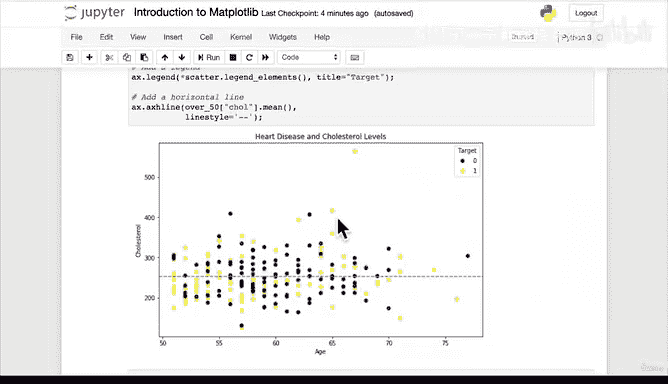

# Bourne《机器学习和数据科学训练营｜Zero to Mastery Data Science and Machine Learning Bootcamp》 - P77：077_08_015 从Pandas DataFrame绘图6.zh_en - GPT中英字幕课程资源 - BV1yhrvBVEv2

Welcome back。 So in the last video， we saw two different ways of plotting from a panda's data frame。

 one with the pie plot method。 and we created this plot here。😊。

And then the other with the object orientated method， I'll be honest with you。

 This is not directly the O0 method。 We've kind of passed it off here。

 but we're still kind of using the pie plot method here。

 but we've tricked it a little in combining it with the O0 method。

 So what we're going to do is recreate this。 but using the object orientated method from scratch。

 and we're going to customize it to make it look a bit more prettiert。Let's start。

 we'll create a new figure。And a new a。We'll put in here。O，0 method from scratch。And up here。

 we might go Oo method mixed with。Pie plot method。So， then we'll go。Ploot dot subplots。

 and we know our fig size。 This is a pretty good size。 so we're we're going to reuse that10，6。

 That was correct yep。And then we want to plot the data because that's part of our map plotlib workflow。

 We'll call our figure。 We'll rename it to scatter。

We'll go scatter equals x dot scatter because we want to scatter plot， and we're going go x。

Which our age column。 So we want over 50。Becauseuse remember。

 we're working with our over 50 data frame now， age。 and then our Y column is going to be over 50。

And we're going to have。Co call for cholesterolly。And then we want to color it with。Over 50。

Which is the sea here。We want to color it with the target column。

 And what I mean by color it is just literally change the color of a dot， depending on what。

The target column value is。And now let's see what this looks like。😊，Okay， groovy。

 we're starting to get a few different colours here。 It's looking similar。

 but it's still missing a few things。 Like we don't know what the X axis is。

 and we don't know what the y axis is。 But that's okay。

 We've got a very flexible method here because we're using the object orientated method from scratch。

 So now what we're going to do is customise。And we're going to go ax dot set。

 we want to add in a title， beautiful。 So we got heart disease。And cholesterol levels。

That's all right。 Keep it nice and concise。 Then we want X label。Equs age。And we'll go。

 we'll add a Y label， which is。Cholesterol。Now you could put the units here I'm not actually sure what the units are of cholesterol that would be something we'd have to look up。

 so we'll just keep that as just cholesterol nice and simple for the time being and let's see what this looks like。

😊，Start to get better。 All right。 So we've got a title now。 We know what the Y axis is。

 and we know what the x axis is。 but we're not sure what these dots are。 right。

 These are just purple and yellow dots。 Or what colour is that to you。That's a purplish to me。So。

 maybe we。Oops。See， that's what happens when you run it without the semicolon and you get this code output。

So maybe we add a legend。So how can we do that， we go x， we call the the legend method legend。

 and then we're going to use this little star， which is kind of like just unpack all the values。Of。

Tidle equals target。 Let's add a legend to our axes， which is this here。

 And this little star is saying， hey， grab the values from scatter。And unpack the legend elements。

 which is going to query this C parameter here and look back up at this data frame and go what values are in this in the target column。

 So we got ones and zeros。 And then it's going to create the legend。Built off those elements。

 so let's see it in action。Path collection has no attribute， Le elements。Oh， there we go， typo。😊。

Beautiful， so if you type it right， that's what it's going to do。

 It just goes into the scatter variable， which is what we've created up here。

And then it's going to find the legend elements， which it gets from this C parameter。

Which it then looks back up into L。We'll put it here， so we can see。Over 50 target dot values。

It's going to look at this target column。And then find that there's ones and zeros。

 And then it's going to color the legend the same as the values on here。

 So now this is looking a bit better。 The object orientated method from scratch is looking far better than what we've built here。

 This is how we've done a few more lines of code here。

 But now you're starting to see how customable this object orientated API is。

 What if we wanted to add a few more things。 Well， the beautiful thing is。 we can do that。

 What if we wanted something like a horizontal line across here to indicate the average cholesterol。

😊，Let's look up the documentation。 How to add a。Horizontal line。In mappl lib plot。Matpotlibb。

tax do a Hline， okay。What will this do？Add a horizontal line across the axis。Well。

 I guess that's what we want to do。 So let's try it out。We want to go maybe back up in here。

Add a horizontal line。So this is the kind of workflow you'll go through like if you wanted to do something that's perfectly fine。

 you look it up， you go the documentation and now we're going to try this out。😊，Axes dot ax Hline。

Let's see what happens。A because this is our axes dot a H line。 wonderful。

 And now we want to give it the value。 So we want over 50。

 So if we go shift tab and see what it takes， Y。 So we need a y axis。

 So we want to give it the same y here。 So we want the cholesterol column。😊，Yeah， beautiful。

 and now we want the line to be the mean of that column。😊，Beautiful， now we've got a straight line。

 but maybe we wanted a dashed line because that looks a bit better。😊，We've got line style。

 So this is this is another one of those keyword arguments， so this one here， keyword as。

It's not really going to appear。In the dock string， maybe if we scrolled right down。

 there we go line style。 So you could also just look up how to style a map plot label line。

Line style reference。 you come across something like this。 but in our case。

 we are to save a little time。I've used this dashed line before。

 and that that usually looks pretty good。 So there we go。 We've added a horizontal line。 Now。

 that's starting to look much， much better than what we had before， Don't you agree。Well。

 I certainly do， but I'm kind of biased because I created this plot。Now this is just another example。

 right， of using a different data set of creating your own custom plot and then working with different kinds of data。

 So you've got cholesterol and then really starting to use the mappl Le API to create whatever kind of plot you want。

 Now you could imagine you could create a subplot of this。😊。

We might actually do that in the next video is create this。

 but we'll work it in with a subplot so we might add another variable from the data frame。

And put it into a subplot of this， So let's see that in action， but in the meantime。

 have a little bit of a play around， maybe you can take a step ahead and see if you can create a subplot of heart disease and cholesterol levels with maybe heart disease and and what's another column that you could use。

😊，And this one fellll A， which is Max heart rate， see what you can do creating a subplot with cholesterol and max heart rate。

 if you want me to go along with you， we'll do that in next video。😊。

