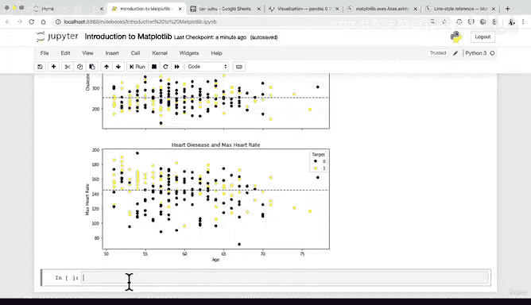
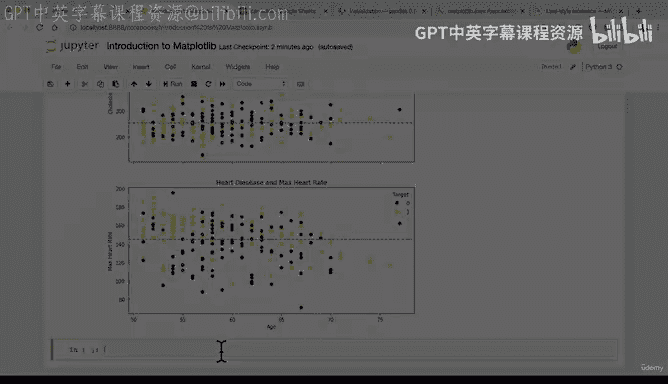

# Bourne《机器学习和数据科学训练营｜Zero to Mastery Data Science and Machine Learning Bootcamp》 - P78：078_08_016 从Pandas DataFrame绘图7.zh_en - GPT中英字幕课程资源 - BV1yhrvBVEv2

Welcome back。

So now we're really going to step it up and notch。 We're going to see the full power of the mapplotlib object orientated method。

 We're going to build upon what we've done here， so we've created this heart disease and cholesterol levels with our over 50s data frame but now we're going to add a subplot to this so we can visualize cholesterol levels and we might get our over 50 data frame here so we can stop having to scroll up。

😡，We're going to combine that with fell ach， which is I'm not sure enough I'm pronouncing that by the way either fellll ach。

 which is max heart rate， so we want to have a subplot where we've got cholesterol in fell archch on the Y axises。

 but they're both going to have age as the X axis， so let's see that in action。😊。

We want we'll title this subplot。Of call age。They'll arch， beautiful。We want to go here。

 We're gonna recreate this。 We could copy and paste this code。 but again。

 we want to practice writing from scratch。 So let's see it in full force Fig。

 we want to use the object orientated method。 Now， if you've had to go at creating a subplot on your own。

 this is the way you might have used。 But if not， this is how I would creating a subplot of these two。

 So remember， we want two different aes。 So fig a 0 and a， this is going be x1， there we go。

 So what this is saying is now we're creating a single figure。😊，But it's going to have two aes on it。

 Remember， aes are。This here。Y and X， where you can add data。

 So let's use the same command as before。 subpls， and we want N rows equals 2。

 We want N cos is going to be 1。 Our previous figure size was 10 and 6。

 but let's make this 10 and 10。 See what that looks like。And now we want to go add data to a 0。

 Actually， let's see what this looks like before we even plot。Fig size。 Oh， forgot an eel there。

Beautiful， so now we've got two blank canvases to start adding our data on here。

 So we want to add data to access 0， which is this one here。😊。

So just going to be this exact same as before， we'll do something like this。

So now we're going to add some data to A0， just like we've done up here。

 we're going to do something similar to this， but again we're not copying pasting。

 we'll do it from scratch so we want scatter equals a0 dot。😊，Scatter。

 and we're going to go X is going to be the over 50 age column。Y equals over 50。

And this is going to be just a electal column， beautiful。 And then we're going to go C equals。

 We're going to color it with the over 50。Target column。Now let's see what that looks like。Beautiful。

 we've seen this before。 So customize Act 0。 and we wantan to go Act0 dot set。

 and we want to add a title。 This is gonna be。Heart disease。And cholesterol。Levels， wonderful。

 And then we want an X label， which is going to be。😊，Age， and then we want to go Y label。

 which will be cholesterol。Nothing new here。 We've seen this before， but now it's only on A 0。

 which is amazing。 Maybe we add。😊，Add a legend to Act0， same code as before， Act0 dot legend scatter。

Dot legend El。And then we're going go title equals。 Ta beautifuli。 What did we have up here。

 We had a mean line。 So that's what we can do with the H line。 So add a mean line。

 So we're just replicating the plot we've done before。 x0 dot x H line。

 Now we need to pass H line of Y。 So we want over 50。It's going to be the cholesterol， so we'll do。

Well。Dot mean and then we'll add a line style as dash dash。And that。Should be。

The same plot is what we've got above。But now it wass on a subplot， so。

I want to challenge you to before we go through it。See if you can replicate what we've done here。

But with the fell arch column。Instead， of the cholesterol column。On this sub plot here。

I'll give you a second。Alright， if you've had a go or good， If not， let's go through it。

 So now we want to add data to Act 1 because remember， we've got x 1 up here。😊，Excellent。

Same thing we've done as before， but this time all we're going to do is change it from Act0 to Act1 and then of course the column will be different。

😊，Or the data that we use will be a little bit different。So in this case， it's1 x。

 the x is still going to be the age column。😊，What's going to change is what's on the Y axis。

 so we have over 50。They'll arch。 wonderful colour is going to be the same because we're focused on our target variable。

 which is whether or not the patient has heart disease。 So there we go。

 Let's see what this looks like。😊，Okay， so we're starting to get somewhere now。

 we've got some data on both our accesses。😊，Let's customize it just like we've done with a 0。

 I'm going do that with a 1。X1 dot set， let's add a title。😊，Titled this one will be。Hot disease。

And Max heart rate。😊，Wonderful， and then we're going to go X label。Can you remember what that is。

 just the ageca we're using the same column for the X and the Y label。 This is gonna to be fell arch。

 So we'll actually put in max heart rate because we want it to be a bit more communicative than just fell archch。

 So if someone came in how to look at our plot and didn't know what fell archch meant。

 they'll know it means Max heart rate。Okay， starting to make some progress。

 Now we still have a couple more things to do。 We want a similar set up to what we've got here。😊。

So let's add a legend。Toax1， Act1， Dot legend。Now， again。

 we're creating quite similar plots here with the subplot that we're making。

 So these two are quite similar。 As you've seen before， you could have a scatter plot here。

 and you could have a histogram here or something like that。 But we're just using this as an example。

 So title equals target。 wonderful。 We'll add a mean line as well。 So X 1 dot X H line。 Now。

 we're going to color it with the Y is going to be this time instead of cholesterol。

 It's going to be。😊，They'll at wonderful dot mean。And then the line style。

 we're going to keep it with our trusty dash， and then we'll add a semicolon here。🤢。

And let's have a look。What have we messed up， We got an error。 Line 2D has no property line style。

 This is classic typos everywhere。 Here we go。 So it's okay to make errors right。

 You're never gonna type out all the code correctly every time the first time。😊，Beautiful。

 this is starting to look really good， okay。😊，What we're starting to see。

 we've got an age X axis label here， but this is also age。

 so maybe we could tell them to share the X， so let's see where can we add that？😊。

Maybe I've been here。 I want to share the X， so share x equals true。

But now we can remove this label on axis 0。So what is this going to do if we put in share x equals true？

What do you think。There we go。 So what this is done is it's telling our plot to go that our subplots here have the same x value。

 So we don't need to put in the age label there。 Maybe you would keep it in there for a bit more。

 So it's a bit more communicative。 That's kind of one way you can start to clean up your plots。

 And now， what we might do。Is add a title to this overall thing。

 So we've got both subplots are titled， but we might want to title the entire figure。

 So let's see how we do that。 Add a title。To the figure。 And this is fig。 because remember。

 we've created a figure， and we've added data and customization to the aes。

 But now we want to start to access the figure directly。

 which is that big blue square on our map plot label anomy。 We filled up these two on our subplots。

 Now we want to title our figure。 So we can do that with fig。😊，Dot Sup， which it stands for。

 I think it stands for super titleit。 I actually don't know what sub stands for。

 I just know that it's subtitle。 And then we go heart disease。Analysis。

 and we'll create the font size。 We want it to be pretty big font size and a font weight of。Bold。

 we'll put a semicolon at the end。😡，Beautiful， look at this。

 maybe we have to zoom out a tiny bit so we can see it all in one hit。There we go。 Now。

 you starting to see what this is kind of looking like。

 Remember right at the start in the concept lecture。

 we looked at the anatomy of a map plot live figure。 We looked at that plot and it was quite complex。

 There's a lot going on。Well， what you've done。Ass you've just followed along and recreated something very similar。

 Now what we're going to do in the next video is style this a little bit better。

 So fix up some of the colour。 The important thing to remember is it looks like a lot of code here。

 and actually is we've got。😊，25，30 lines of code there。

 But what we've done is we've built this figure from scratch using the object orientated mappllib method。

 And so now what seemed at the start to be a very complex and complicated plot。

It's actually just quite simple， right， You create a figure。 You create a couple of aes。

 You add data to the aes。 You add some customizations like titles and a legend in a horizontal line。

 and you start to get something looking like this。 Now。

 that's something that you could put in a demonstration or show your colleagues in a presentation。

 something like that， right？ Now， you're starting to see just how powerful mappl Lib。

 the object orientated API can be。😊，Alright， let's wrap this video up， have a practice。

 maybe create your own subplot without a scatter， try a histogram and maybe a bar graph。

 Can you do that on the same figure？😊，Otherwise， I'll see you in the next video and we'll learn a little bit more customization of these plots。

😊。

