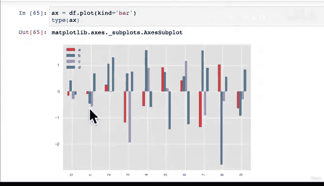

# Bourne《机器学习和数据科学训练营｜Zero to Mastery Data Science and Machine Learning Bootcamp》 - P79：079_08_017 自定义你的图表.zh_en - GPT中英字幕课程资源 - BV1yhrvBVEv2

Alrighty， so we've seen how to create quite a complex plot， but in terms of customization。

 we've kind of glazed over these set parameters and title and X label and Y label and not。😊。

So what we're going to do now is look at customization of plots a little bit more in depth and by the end of this video。

 perhaps the next video， we're going to replicate or transform this plot into something which looks exactly like the one we've got here so the data is still the same but you can kind of see that there's a different style in terms of color line and just the text is a little bit different。

 The font。 the axes are a little bit different so let's get into ity。😊。

So what we're going to do first is have a look at some different styles of mappl Lib。

 So the beautiful thing about mappott Lib is that， again。

 one of its other customizable parameters is the style of plot that you're using。

 So if the default one， which is what we're kind of using now。

 doesn't quite look how you want it to look。 You can try other different styles。

 So let's go down here。😊，We'll make a little section， customizing matpl Lib。Plot， and。

Getting stylish。 Yeah， that's all we're going to do。 We're getting stylish。See the different styles。

Available。Now what this is going to do is if we call PLt。tyle。 available。

 it's going to tell us what kind of styles mapplotlibb has available to us right now。

 by default by just importing Matpllibb right at the top， we're using the default style。

 but as you can see， there's about 20 other styles。😡，That you can use。

 So let's try out a few of these。 But first， we'll remind ourselves of what the default style looks like that way we can compare and see which one we like best。

 because I've tried a few of these， and I kind of know which ones I like。 But again。

 it'll come down to personal preference of what kind of style you want to use。

So this is a default style。 We're plotting the car sales data frame that we've seen a few times now。

 So car sales do head。This is our car sales。Carsle's data frame。 We plot the p column。

 We've got a beautiful line graph there。 Now that's， that's pretty good on its own。

 So let's have a look。 Maybe we want to use。😊，P， L T dot style dot use。 And I'm going choose。

The seaborn white grid。Let's see what that looks like。I'll type that in。Seaborn。White grid。

 wonderful。So that's going to update Matpl Libs style internally。

 So if we call the same plot that we did before， price dot plot。Put a semicolon at the end。

See how it looks a bit different now we've got some grid lines here。

We've got a little bit of a gap here， maybe the Aes limit is a bit higher for the Y axis。

But generally， quite the same as the default mat plot Lib style。 Now， again。

 you might think that the mappot lib default style is perfect for your ears。 And that's okay。

 We're going through these different styles， right。

 because I want you to understand just how customable these plots are。 Let's try another。Ploot。tyle。

 use。 and this time we might just use the default seaborn。 So if we go up here。

Seabornoure on its own。 Now， Seabornourne is another plotting library that's built off mappl Lib。

And now we're going to earn car sales。Dot price。Plot。Wonderful。

 so now kind of a little bit different。 So this is white grid。

 So we've got a white background that kind of makes sense。

 But the default seaborn star kind of has this gray background。 But again。

 we're still plotting the exact same data。Just mixing up the style， mixing up the colors。

Why don't we try another kind of plot。We'll do car sales dot plots now that the style is set to seabornour。

 How about we check the odometer。K M。 and then let's go a dominr versus price。

 We've seen this plot somewhere before。 Ki es will make it a scatter plot。There we go。

 It's a little bit different to the original scatter plot that we've seen before。

 This one maybe look a bit better to you。 I personally prefer。The seaborn style。

 so I might run this line of code when I start a new notebook。

 so run it right at the top under my map plot Lib imports just to make sure all my plots are in the seaborn style。

So we'll save that there as another good habit to get into is just hitting command or control S every so often with your notebooks and we might use one more plot just for good luck。

 plot do style this time we're going to use G plot， which is up here。

Ggi plot is a different kind of style。And so。What do the price graph again， price the plot。

There we go。 So we now we got a bit of a different， maybe a creamy grey。

 I don't know how you would describe that colour， but the line is definitely changed to red。

 As you can see， seabornne kind of comes with。Some access titles by default。

Whereas these don't have them。Okay， now， these are some sweet looking plots。

 And now we've seen how to change up the style。 How about the titles， the legend。

 the aes like this one doesn't have any。 It just has numbers on both aes。

 If a plot is worth 1 thousand words， adding a few more can't hurt， right， So let's do that。

 we'll go。😊，We'll create some dummy data。 createate some data X equals。 We've seen this before。

 nu part。Don't R in。And we go 104。There we go。 We've got an array there。 Wo。

 Now we'll put that into a data frame。 We've created a data frame like this before。

 but we're just going practice， practice， practice。

 reworking some of the things we've already done that way they start to sink into memory a bit more。

😊，Sa。D。Wonderful， now this should give us a data frame。 Yep，4 columns，10 rows of some random numbers。

 beautiful。 And now we're going to。😊，Create a simple plot。 Now this。

 we're going to use a pie plot API because we want to just create a plot quickly if you wanted to create something more in depth like we've done here。

 whereas is there， you would probably use the object orientated API。😊。

But because we're doing some quick and dirty plots at the moment。

 we'll just use thell plot straight from the pandas data frame with the pie plot API。

 So kind equals bar。And then we're going to look at top of X。Beautiful。

So this is a bar graph that we've built just off this data frame here。

 we've got some negative and positive values， different colours for the different columns that all makes sense。

And now， we're going to。Customize our plot。With the set method。So we've got ax。 We'll rewrite it。

 Axe， so we can see it all in one cell。 Do you have to plot kind equals bar， wonderful。

 And now we want to。😊，Add some labels。And a title， So we want a dot set。And we' got title。

So as you could probably guess， this is gonna set the title random bar graph from。Tta frame。

Wonderful， I've spellt graph terribly。 That's all right。 There we go。 And then within this set。

 set has a few parameters here。 So if we go shift tab。 there we go。 Shi got keyword as， so。😊。

This is probably another one you probably want to look into the documentation to start to figure out all the different kinds of customizations you can add to it。

 but we're just going to go through the main ones which are title X label and Y label。

They're probably the bare minimum you'd want on any plot or figure that you create， right？

You want to know what's on the X axis and you want to know what's on the Y axis。

Rather than just at having numbers there。Row number， random number， simple titles。 and then we' make。

The legend， visible。Now this one's kind of confusing because the legend already is visible。

But if it wasn't visible， some plots do have a legend already built in。

 so you can use this axe dot legend dot set visible and then set set visible to true。

 which won't really change our because it's already visible。 But let's see what happens。

What are we got here？Axis plot has no property title。 another typo。There we go。Wonderful。

 so now we've got the same exact same plot as up here。

 but now we've just used a set method to add in an access label on the Y and the X and a title。

 So that's starting to look a lot more communicative right there。😊，All right。 Now。

 what if the style we're using doesn't quite suit the plot we're trying to make。

So that's what we'll probably look into the next video。😊。

We'll change around the style within a set style。 So if that sounds a little confusing， don't worry。

 we'll go through it in the next video。 But in the meantime。

 try out creating some of your own plots using plot dot style dot use and pick one anyone from this list and just start to get a feel for what the different styles look like。

 My personal favorite is probably seaborn or seaborn white grid。

 Seaborn generally just has some great styles down here。All right， let's take a little break。

 write some custom code， and I'll see you shortly。

