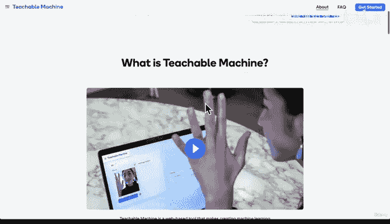
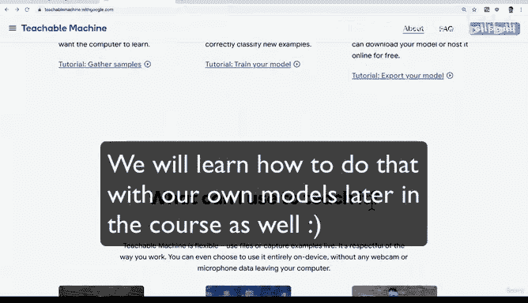
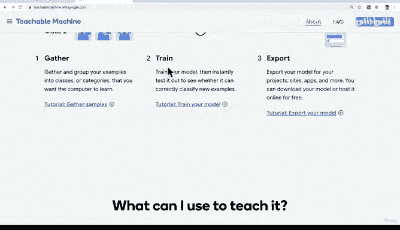

# Bourne《机器学习和数据科学训练营｜Zero to Mastery Data Science and Machine Learning Bootcamp》 - P7：007_02_004 练习：机器学习游乐场.zh_en - GPT中英字幕课程资源 - BV1yhrvBVEv2

Welcome back。 It's time to have a little bit of fun because you've just been listening to me talking for a bit。

 and we want to get our hands dirty and try this machine learning ourselves。

 But even though we don't know much about it yet， we can actually play with it。 For example。

 there's a great website here by Google。😊，Called teachable machine。 And as you can see。

 what it does is， well， it helps you do some machine learning activities。

 So if I click on get started here and by the way， by the time you watch the video。

 maybe they've changed the layout of this website。 It doesn't really matter because this is more for you to kind of understand how things work underneath the hood and even play with this yourself。

 So let's create an image project。

And for now， all we're going to do is say， hey， I want to decide or create a machine learning model that detects faces or cats。

 So let's just say this is going to be faces。And this is going to be cats。

And we have to give it some image samples so that the machine can learn， right？

 So in here on my desktop， I've actually。Saveed a couple of photos。

 I found a nice little cute cat picture online。 So let's upload the cat picture。😊。

So we'll upload the cap picture here。You can see that we're only uploading one。

 and here I will upload the faces picture。 we'll upload the babys picture here。阿松。😡。

So we have faces and cats， and then we train our model。 We essentially tell the computer， hey。

 this is an example of what a face looks like， and this is an example of what a cat looks like。

 so just learn please， so you can see over here it's learning。😡，And there you go。

 It now has created a model。Now in here， I can use my webcam or I can just upload a file。

So let's just upload。😡，A。Snorkel picture that I have of myself。And I click open。😡，There you go。

 This model that we trained thinks that this has a 49% chance。 Let's make this a little bit bigger。

This has a 49% chance that this image is a face and a 51% chance that I'm a cat。What's going on here。

 What if we give it a better picture， I mean， this is a tough picture， right。

 It's a little bit fuzzy。 I have my snorkeling mask on。

 Maybe it's a tough picture for this model to predict。So I'm going to upload a different file。

 let's say this exact same face that I use in the image if I click open。Oh， boy。 That's even worse。

 It thinks I'm 57% cat， and it's 43% certain that this is a face。What's happening here？Well。

 what you've just witnessed is how machine learning works。 We provide the computer。Some data。

 in this case， I provided one image of myself and Daniel's face and one picture of a cat based on those two inputs and data。

 I say， hey， computer， learn， try to understand this picture and try to understand this picture。

 And next time I give you any images based on this data。

 predict for me or tell me how much confidence you have that either it's a cat or a face。😡。

And that's pretty much machine learning， it doesn't have to be just images。

 it just needs to be some sort of data， we train the computer and we create a model that can predict for us based on that data。

😡，Now we see here that it's really， really bad。I mean， this is definitely not a cat， right。

 so why is it bad？Well。Think about this for a second， try to answer it on your own。

AReady for the answer？Well， number one is that we've only given it one image each。

For a computer to really learn and to understand what a face is， what a cat is， it needs hundreds。

 thousands， if not millions of images of cats to detect patterns to figure out， hey。

 this is what a cat is。 Hey， this is what a face is。 Right now， I've only given it one sample each。

 So this model is not very smart。 Just like a human， right， to learn something in school。

 you have to repeat it。 you have to see it over and over。 And then also with the preview。

 Sometimes I give it a really clear image of a face。

 or sometimes I give it the snorkeling picture that's really fuzzy。So that also affects the output。

But at the end of the day， machine learning is just that we give it some input。

 and then we tell the machine to learn based on those inputs and give us an output next time we give it a new input。

Now， I want you to take a break here。 I'm going to link to this resource so that you can actually play with this yourself and see if you can improve this model。

 You can even have your webcam on。 So instead of a file you have your webcam just like in the examples that they provide。

 So if I go to teacheachable machine。😡，You can see here different projects that you can build just by clicking without programming anything。

😡，You can even export your model once you're done so that you can use it in your own projects。 again。

 if this is confusing， don't worry， we're actually going to go step by step and instead of just doing something visually。

 we're actually going code and learn how machine learning and data scientists work。

 but this is a great way for you to just understand on high level how machine learning works。

 So go off and play with this website and I'll see you in the next video。 Bye bye。😡。

