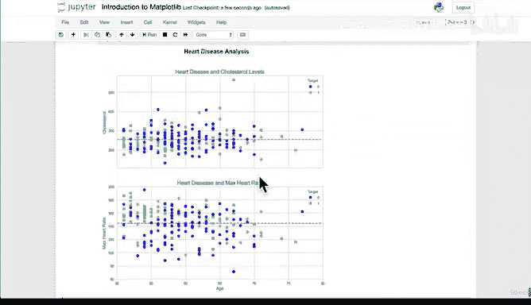

# Bourne《机器学习和数据科学训练营｜Zero to Mastery Data Science and Machine Learning Bootcamp》 - P80：080_08_018 自定义你的图表2.zh_en - GPT中英字幕课程资源 - BV1yhrvBVEv2

Alrighty。 Now we've seen a few different ways of changing the style of our pots and figures。

 What we might do is change the style again。 But from within an existing style。

 let's see what that means， because that's kind of confusing when you hear it for the first time。

What we might do is come back up here and take this code。

 Now this is one of the only times we're allowed to copy and paste because I think we've kind of seen enough for now of writing out this type of mappot lib style plotting。

 so we'll come right down。Because what we're focused on now is just checking out how to change the style from within a style。

 So if we go here。Now we what we want to do。Is at the top of this cell。

 we've probably already set it above， but I'm going to reset the style。 So plant dot style use。

 and I want seaborn white grid。That's a style we're going to stick with for the time being。

Set the style。 wonderfulful。 Now， we've created our over 50 data frame up before。

 That's the heart disease patients that are over 50。

 And this is going to plot out a scattergraph with this data。 It's already got some customization。

 a legend and a horizontal line。 So let's see what this looks like with the white grid style。

 Just for a quick refresh。😊，We'll go back up。 This is what it looks like。 This is the original one。

We've just copied the code from this cell。And so we're going to come down。

Take a quick snapshot of that in your mind， and we're going to see what the seaborne version looks like。

Let's hit shift enter。Okay， so a little bit different。

 We've got the white grid that makes sense because we're using seaborn white grid。 But these colors。

 I think the lines are different colour。 It's red now。 and these dots are black and white by default。

 What happens if you say， I like the seaborne white grid style。

 but I don't really like these colorss that it's putting out。 Well， as you might have guessed。

 the beautiful thing is， now potlib。 It's got a whole bunch of different colour。

 And we can change up the colour， so。😊，If we go in here。Theres a little parameter called C map。

 which stands for colour map。 And there's a whole bunch of different styles。

 I've kind of explored them myself。 I personally like winter or summer。 You thinking Ta。

 this is seasons。 All it's going to mean。Is that this changes。The colours came。

And let's see what happens。Beautiful， so now our black and white dots。Are of a winy colour scheme。

 You can tell the difference a lot more than just pure black and white。 Now， if we have a look。

For go to， I believe it's mappl Lib colours tutorial。Now。

 this should show the Macpotlib documentation where you can see a whole bunch of different colour。

 if we go here， control F， some colors， that's what we're after。

Choosing colour maps in that plot lib。So again， there's a lot of information here。😊，we go down。

So it's got some different patterns here。If we keep going down。

 you'll start to see if you type in this as a string plasma， Let's see what happens here。

 That's going to change the color map。 So let's go back to our notebook。 We might type in plasma。

Okay， so it's changed it back， I personally prefer winter， you can also do summer。

 let's see what that looks like。Okay， that's all right。 But still， I， I think winter is my favourite。

 I've had a practice with these sea maps。 There we go。 That looks great， but。😊。

This is a map plot lid documentation。 So tutorials slash colour slash colour maps。

 and you can keep scrolling down。 There's a whole bunch here。 If you just want green and blue。

 or if you just want a blue and purple， you can use these little color codes P U B U for blue and purple or yellow green blue or keep going。

 There's actually quite a few， right。 So it's all about experimenting in trying to figure out which colors you personally prefer or which colour best demonstrate what you're trying to show in your map plot lid plot。

😊，But this line over here， that's not really offering Marsha， so let's。

 let's check out how we can kind of constrain our plot to certain widths and certain heights on the different axis values using X limb and Y limb。

😊，Let's grab out。Double sided plot from before our subplot will grab that code。Again。

 this is one of the only times you're allowed to copy and paste code because there's quite a lot of it so to save time writing it out。

 we'll bring down the graph because what we're focus on is。Customizing the why。And x。

Access limitations。We'll put that down there。So now we've just copied and pasteed。The code。

From take a snapshot of this one as well。From up here， down to here。 Now， if we run this。

It's going to output。That subplot that we saw before， but with the default seaborne colour。

 So what do we have to do， we have to change the C map， So let's see it in action。 C map。 again。

 this is just in our scatter plot like we've done up here。We've added a CM map parameter。

So we'll do that here， C map equals winter。Let's see what happens。Beautiful， that changes axis 0。

 So the first plot， Now we have to do the same for axis 1。Will add in。See Matt。Equals。Winter。

Beautiful， we'll go down and have a look。 beautiful。

 So now Ive got two really good looking plots right here。

 So if we go back to our anatomy of a map plot lid plot。😊。

Starting to get really close to what we've got here。 But as you can see with ours。

 we've got this line here， this line here， and this one up here， whereas on here it's kind of clean。

 The edge is nice and cut off at 50 there at 200 up there。 So let's see how we would do that。

What we're going to do is come back up to our code。And now in the set parameter。

 we could do it in there， but I'll show you another way of doing it。

 So we'll customize access0 first just to show you what's going on。 Access 0 dot set。Why Li？To be。

 what do we want。Yeah， so we want to cut it off。And about 50， let's try that。 So set X limb。

So we're going to do that 50。Remember， we can always change this。 So this is going to be。

Change the X。Accs。At limitit。There we go。 So let's see what this does。 We go shift enter。Beautiful。

 so now we've cut off。That line that was here before。 So let's do this。Just to see what happens。Run。

So that's what we've done。 We've removed this line because we've changed the x limit of axis 0 to be 50。

 remember both of these are using the same x axis as age。 So let's do it。Let's keep that there。

 We'll change that limitation there。 We're going to add the same thing to access one。

 we'll put it under here。Change x 1， X axis limits。Oh we're going to go x1 dot。Sit。Exce limb。

And we're going to change that to be， I think it's the same，50 and 80， nice and simple。5。80。

 And we're also going change the y limit on here to remove this top line to be a flat 200。

Maybe we go from 50 to 200 or 60。60 to 200， I think that'll be a good range。

 So we'll do that as well。 Actx1， not set Y Li。60200。 And let's see what happens。

 So now take a quick look at what we've got here。 We've got this graph。 We've got this line here。

 We've got this one。 We've got this line here， and we've got this top line here。

 So let's see because we've changed the x limb and the y limb of access 1 and the x limb of access 0。

Hopefully， if we've done it all right。😊，Beautiful， that's what we're talking about。So。Now。

 we've fully replicated the plot that we have here。 We've got the exact same thing going on here。've。

 we've cleaned up the X axises。 We've changed the colour。

 We've changed the style and can't really see it all in one here。 So let's zoom out a little bit。

There we go。So that plot is looking pretty darn good， I don't know if you agree or not。

 maybe you create your own style， maybe some different colour or something like that。

 but to me that looks like something we can share so that's what we're going to look in in the next video who is saving and sharing this plot so have a practice around maybe change the limitations with some different data or change the style。

 change the C map and see if you can create your own version of this heart disease analysis。😊。

