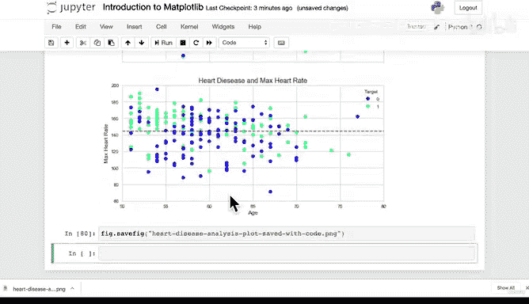

# Bourne《机器学习和数据科学训练营｜Zero to Mastery Data Science and Machine Learning Bootcamp》 - P81：081_08_019 保存与分享你的图表.zh_en - GPT中英字幕课程资源 - BV1yhrvBVEv2

Wa， you've come a long way。 Check out this。 We've created in the past few videos we've worked towards creating our own customised plot。

 Now， of course， the final step in a mappllib workflow is to share this with someone else now。

 of course， if you've been working through your Jupyter notebook。

 You may put some communication up here， like you might create a cell like this plot shows some information about the heart disease。

😊，Data set。Something like that。 Of course， you might go a little bit more in depth than that to communicate your work。

 and then you could share your notebook。 But what if you didn't want to share a notebook。

 youre doing it like a presentation where you can't really just run through the code and show someone what you've done。

 So what you may need to do is just export your figure。 Now， probably the easiest way to do this。

 And it's the way I've done it in the past is just to save the image as。You right click on it。

 you could save it to downloads， or I could save it。In my machine learning course， sample project。

 I'm going to save it there。 I'm going to go， heart disease。Analysis。Ploot。

And let's see what happens going to be a format as a PNG image， we'll click saveve。😊。

So that's going to download it， but then if we go back to here。

 we can see here we've got heart diseasease analysis plot。😊，Beautiful。

 so that's something that you could put into a keynote presentation。

 It's exactly what I've done to do this， but I've just added some of my own custom drawings on the side here。

 So if you had to go into say a meeting or say a project presentation you needed to show what you'd been working on in a visual format because that's often how most people will understand things pretty quickly。

 you can take something like this with you。😊，Another way to do it via code is with the save Fig method。

 So again， when we first created this up here。We've created a fig， A K A， a figure。

 So this figure is going to be stored in partth and memory at the moment。

 And so what you can do is call fig dot save fig on this。 And then we can go heart disease。Analysis。

 plot。Saaved with code。Dot P And G。 So this is going to save it with code。

 So potentially in the future， if you were creating a lot of these style plots。

 you may put this code here instead of retyping it out all the time。

 You may put something like this into a Python function。And that way。

 you could put this line of code at the end of it to export your figure after the code is run after the functions been called。

 So let's see what happens if we call this fig， not say Fig。

 It's not really going to output anything。 but if we go back to here。

We've got heart diseasease analysis plot saved with code。pNG。Beautiful。

 and that is the default style。 So if you export it with save Fig。

 I believe P And G is a default style。 So yeah， save the current figure。All right。

 So I think a congratulations is in order。 You've made it to the end of the mappl lib section。

 We've come a very long way right from the top。 If we go right back up， let's see far out。

 we've covered a lot here。 You've created from creating an empty plot to making a full blownown subplot with customization from a data set that we've manipulated。

 So that's a big step if you've been following along。

 If everything seems a little confusing at the moment don't worry this kind of work takes a little bit of practice a little bit of going through getting used to a little bit of rewriting code。

 a little bit of making mistakes and making errors but don't forget the best way to learn is to play around a practice on your own。

 as a start， maybe you could make a data frame with an nuy array and then start creating some plots of your own and just get as creative it as you can。

 Try a different style， Try a different data really， the sky as a limit In the meantime。

 take a little break if you need。😊。

And I'll see you in the next section。