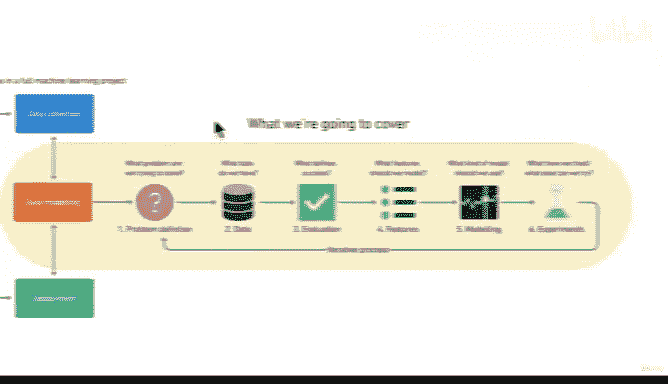

# Bourne《机器学习和数据科学训练营｜Zero to Mastery Data Science and Machine Learning Bootcamp》 - P8：008_02_005 我们如何走到今天.zh_en - GPT中英字幕课程资源 - BV1yhrvBVEv2

One thing that I really like doing in my courses is to actually understand the why of everything。

Everything that we learn， there should be a reason we're learning it， right？

And you might be asking yourself， why do we even care about machine learning。

 how is that useful and how do we get here？😡，Well， if you think about a business。

Because most technology evolves from business needs。We have the advent of computers。

And the ability for businesses to use computers to do things really， really fast and efficiently。

 so that they gain an edge。 And then we got spreadsheets。

 spreadsheets like Excel files and Cv files were amazing because we can store data that businesses generate。

 such as maybe customer data into an Excel file。 And then people got really。

 really good at analyzing these CSv files。 These spreadsheets to make business decisions。😊。

Maybe forecasting that December sales are going to be high because while the past two years we've had really high December sales because of Christmas。

And then as companies got more and more data， we started getting this idea of relational databases。

 spreadsheets were great。 CSV files were great， but we started getting more and more information and data。

 and we needed a better way to organize things。To understand things from our data。

That's when we got things like my SQL。Which allowed us instead of using spreadsheets to use a language called SQL to read information from our database。

 write information to our database， but similar to spreadsheets。

 use the data that we gathered from the business to make business decisions so that our business becomes even more profitable。

😡，And then in 2000s， we had this fancy term of big data。We had big companies like Facebook， Amazon。

 Twitter。Google that started accumulating more and more data。

An insane amount of data that you simply couldn't contain in a spreadsheet。 Use actions， user likes。

 user purchasing histories。This idea of big data meant that we had so much data。

 these companies had so much data， and sometimes unlike relational databases。

 which had to be a structured form of data， sometimes we got really messy unstructured data。

 and that's when we started getting this idea of no SQL。

 where things like Mongo Db came into existence where you can store unstructured data。

And hopefully make business decisions out of that。 Maybe if you are Amazon。

 you can use customers purchasing history to recommend different products。And ever since then。

 this idea of data， getting more and more data has turned us into using machine learning。

Because at some point， we have so much data that as humans。

 we can't just look like we did at spreadsheets。And look at columns and rows and make business decisions。

😡，I mean， we still could， but then we'd be wasting all this data that we've been getting over the years。

 so companies like Facebook and Google that collect massive amounts of data every single day are turning to things like machine learning so that instead of humans looking at the data and trying to figure things out。

 we give this data to machines so that they're better able。

 even better than humans to make business decisions。😡，In this idea。

 machine learning really came to be because of this growth in data that we received from businesses。

 as well as the improvements in CPUus， GPs that is graphical processing units and computer advancements。

 So using the massive amounts of data and massive improvements in computation。

 we can use these machines to give them this big data and make decision for us。

 just like we used to with spreadsheets。Now， this is a simplified version。Of how we got here。

 But I hope it gives you a reason as to why businesses like this idea of machine learning。Now。

 in this course， we're going to be using this framework。

And don't worry， don't get intimidated。 You're going to get really familiar with this framework because。

 well， we're going to talk about it a lot。 But looking at this， just a brief overview。

 What do you think the hardest part is。Can you guess。It's this first bar right here。

Grabbing the data。You see， amount of data is doubling every two years in our world with the internet。

 all the mobile phones and connected devices， we're creating more and more data。

 but this data doesn't mean anything unless we understand it。 Yes， we are producing data。

 but a lot of this data that we generate is unused。😡，And that's what data science is。

 how can we use this massive quantity of data？That is completely useless right now to something that is useful。

And not all data is made equal， right， Some are noisy， Some are messy。

 Where do we grab this data from， how do we find it。

 How do we clean it so we can actually learn from it。

 We need to understand what data is and then apply machine learning to it。

 and the industry is now evolving into these people that we want to be data scientists。

That is people that can turn data from useless to use。

