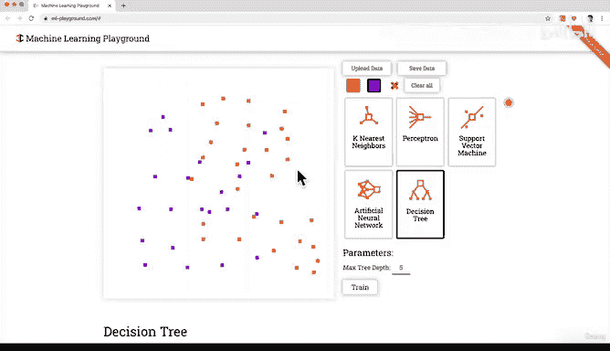

# Bourne《机器学习和数据科学训练营｜Zero to Mastery Data Science and Machine Learning Bootcamp》 - P9：009_02_006 练习：YouTube推荐引擎.zh_en - GPT中英字幕课程资源 - BV1yhrvBVEv2

Welcome back。 It's time to do a fun exercise。 Even though we've barely scratched the surface and we just started the course。

 we're going to build a YouTube recommendation engine， but our own。 Okay， so how can we do that。

 Well， I have here a great website， a machine learning playground。

 And what we have here is a blank box。 I want you to open it up I'll link to this resource and try this out yourself as well。

 Now， let's imagine that on the Y axis here， it represents the length of the video。

 That is the length of the YouTube video。😊，Now， in here。

We have the length and across the X axis that is right here。

 let's say that this represents the likes on the video， so from less likes to more likes。

 from shorter length courses to longer length。And we look at our users data。

 let's say we have a user Bob， and Bob likes to watch videos in this area。

And he has clicked like on these types of videos。 And with the purple， if I click on purple here。

 he has clicked dislikes on all these videos。 Okay， let's think about this。

 So he has disliked a lot of videos that have lower likes。😊。

From others and videos that seem to be shorter in length。

And he has liked a lot of videos that have really good likes， but tend to be longer in length。

So if I clickT here and we can ignore all these little buttons and the parameters， let's just clickT。

😡，This is what a machine learning model does。 It tries to predict based on data。

 So we've given it this information of what Bob likes and what Bob dislikes and we trained it to figure out the pattern so that when we now recommend a video to Bob。

 we know which ones we should recommend and which ones we shouldn't。For example。

 let's say a new video is uploaded to YouTube。😡，And this video， well。

 right off the bat gets a lot of likes and it gets a lot of likes and it's super long。

 so it's right here。Should we recommend this video to Bob， Yes or no， Well， yes， right。

 Because from past data， we've learned that we should recommend any videos that fall into this orange category。

 But let's say there's some new data point。 Let's say Bob starts watching new videos。

 and then we see that， oh， yeah， Bob also likes these videos， these videos， these videos。

 What happens， Well， let's train our model again。😊，And this is the new model that we created。

So now our machine learning model is telling us，" hey。

 recommend any videos to Bob that fall in this orange category。😡。

You see it's a little bit more complicated now， so with each data point。

 we're able to learn about what Bob's preferences are。😡。

And then train the model to decide if we should recommend and add the video to Bob's YouTube feed。

 or we should not recommend it because they're probably not going to watch it。😡。

What we've just witnessed here is us building our own recommendation engine。 Now， obviously。

 this is a simplified version。 But at the end of the day， this is exactly what we want to do。

 We give inputs to machines。And the machine decides and draws a line to figure out what we should predict for a future input。

 That is， a new video comes up。 Should we recommend it to Bob or should we not。Congratulations。

 you just created your own YouTube recommendation engine kind of。

Now I want you to play around with this， play around with the parameters。

 let's say we add five here and we train， we do decision tree and click Tra Now you don't need to know anything about these just to play around and see what happens。

😡。

And I'll see you in the next video。