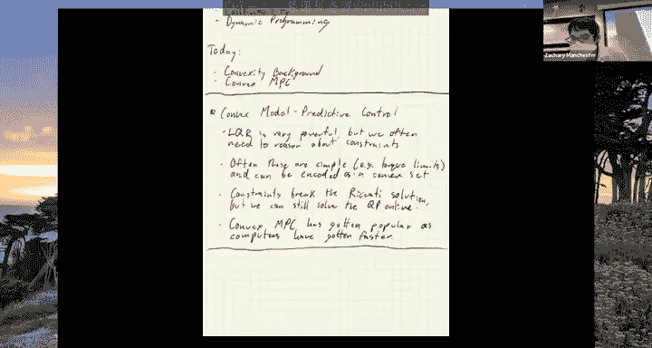
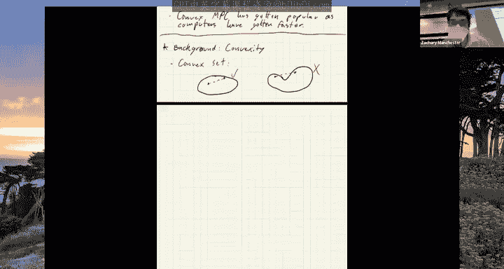
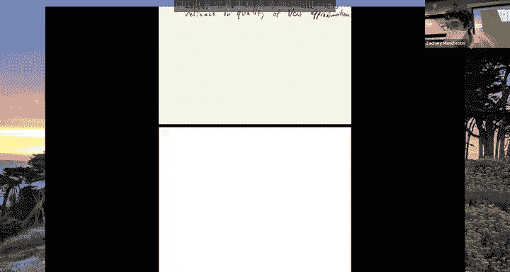
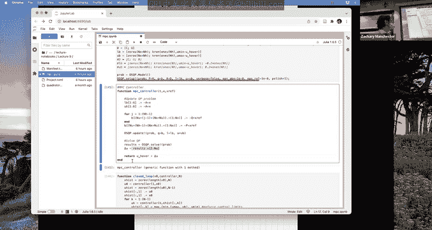
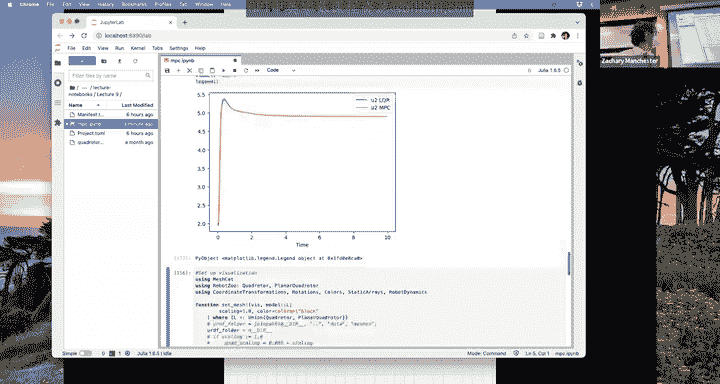
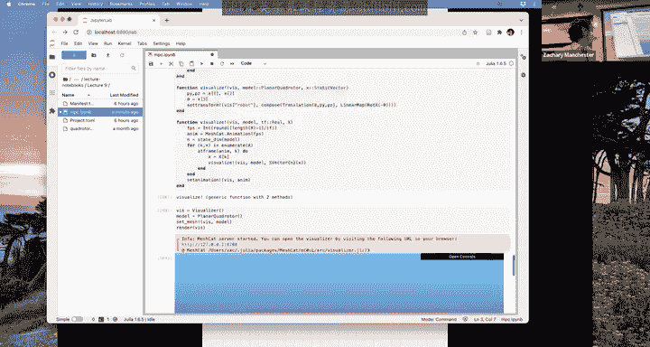
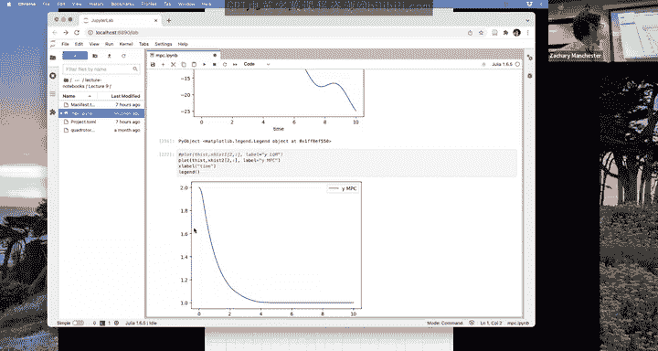

# CMU《最优控制和强化学习｜16-745： Optimal Control and Reinforcement Learning》中英字幕deepseek - P10：[10]Lecture 9_ Convex Model-Predictive Control.zh_en - GPT中英字幕课程资源 - BV1qHwke1EBX

So last time。We sort of finished up some the last little LQR bits， we talked about infinite Hiz LQR。

And we talked about controllability。or LQR， which is kind of this last little bit of kind of requirements on the problem so that you know you can solve it right and we specifically looked at the time invariance case as like a special case。

 but the sort of analysis we did leading up to that holds in the general time variant case as well it's just that last trick where you use the Kyley Hamilton theorem to like shrink that matrix down that is specific to the time invariant case。

Okay， and then we talked about。Dynamic programming， right？And how。That was sort of。

Both another lens through which to view kind of the whole optimal control thing that we've been talking about all along and an alternative way to derive algorithms like LQR right from this approach that sort of looks at just like backwards kind of viewpoint and a thing about cost to go functions or value functions。

 right？I think we talked about how there's a bunch of issues with doing that in general and how the best we can usually do once you get past LQR is approximate dynamic programming where we approximate that value function。

 if you use a neural network it's called reinforcement learning， if you use a polynomial。

 it's called numerical optimal control， but that's really kind of I would say like。

That like how you approximate the value function of the dynamics is really where the differences are between algorithms practically speaking like in here we're mostly going to stick with like tailor approximations and polynomials and things like that and derive you know things liketon Newton and gradientbased optimization algorithms for this stuff if you go take a reinforcement learning class it's basically going to be all about plugging neural networks and this function appxiators for that value function or pro to go function and or Q function and or dynamics function and building kind of。

Methods based on those kind of ideas so neural network it's deep learning deep reinforcement learning polynomial it optimal control but it's really all the same stuff I hope that's like i'm trying to get that across to you guys too that like we're mostly talking about like the fundamentals here but the stuff's super applicable across all these domains and I think it's really good to know the you know sort of just basic fundamentals of all this stuff and you go and do this stuff if anyone wants to talk more about R things i'm happy to chat also in general and it also is a project ideas if you want to do something that sort of blends those ideas and it's totally cool Okay so enough of me ranting for。

😊，I think about nonsense。Today we're going to talk first about some background on so today's really all about making the transition from LQR to constrained problems。

 so we're going to sort of start this out with a little bit of background on convex optimization and convexity。

And then we're going to talk a bunch about convex。Model predictive control or NPC for sure。

 So who's heard of NPC in here just about everybody right so this is like I would say this is the go to control algorithm in modern robotics like almost every system you encounter like autonomous cars legged robots。

SpaceX rockets， like everybody's doing MC。 It is kind of the go to control method in in modern robotics。

 So this is like super practical， super， super relevant stuff that you're likely to see。

In just about any like deployed robotic system today， I would say。

 so it's really good stuff to know about it and hopefully you can kind of get you some good exposure to in this class。

All right， so let's do it。So let's so as just kind of like some bridging the gap here， you know。

 kind of like from LQR， like why are we doing this stuff and why is this useful？

So like just kind of basic convex MPC background。And why would you want to do this over LQR？So。

It's really all about。Handling constraints right so LQR as we saw like it's very powerful。

 it can be applied really well to highly non nonlinear systems actually so you can use LQR on all kinds of things super useful。

But it assumes that you don't have any constraints on the system in particular the most common constraint that you'll deal with in practice where LQR can start to fail on you is when you have torque limits or other kind of actuator limits like torque or thrust limits if you're hitting those limits the controller is not reasoning about them at all。

 so if you if you end up saturating your actuators very often your LQR controller will fail on you and this is sort of trying to get at that。

And so let's see so often the constraints that we really need to worry about they're often really simple so like the most common one right are these kind of actuator things and those can almost always being coded as a convex constrained or a convex set so actuator limits are simple bounds usually right torque limits usually thrust limits are also nice and simple and can often be written down as cone constraints a lot of other things。

So。So that's it and then basically the message is， constraints right break this nice Ricottti LQR solution that we've been talking about。

But。If I'm thinking about this as the kind of the QP formulation of LQI that we talked about before right QPs can have linear inequality constraints right so I might not be able to use the rikati solution and the nice K matrix you know feedback gains but I can still just go solve the QP and as long as I can solve that QP fast enough this is totally tractable and I can run it online and it turns out。

In modern with modern computing， we can often solve those QPs at kilohertz rates。

 so you can really run these things online on robots and it works really well。

And part of the reason this is so common now is just that computers gotten fast enough to actually do it in real time。

Okay， and let's see， basically， yeah。That convex MPC。Has gotten super popular。

And like kind of the story of NPC over the last several decades is basically it getting moved into more and more domains where as the computer gotten faster and it's really like how fast the dynamics of the system are so in the beginning it was used in the chemical process control industry on chemical plants or the dynamics like the control update rate might be once or twice a minute so you have like you know 30 seconds to solve your optimization problem in your QP right now we can do it at kilohertz so now you can put it on a quadruped or a rocket or something right so that's kind of the story。

Okay， so that's that kind of like introductory motivation， let's say。

 let's kind of like dig in now into this convexity set of ideas。

All right， so the first thing to know is。What are they convex set？

And who's got a good definition of a convex set？no不得。Okay， I'm going to draw two pictures， Oh yeah。

 got one。It's a set that's like the conve combination of all elements to being set part。

Okay so that's a slightly circular definition that involves you know the word convex in the definition so I'll draw i'm going to draw you two pictures only with one of these much like is in the set。

😊，Sorry， line between any two points is also our zoom friend just said the thing I'm going to say so basically the definition a good working definition is it's a set such that if you pick any two points in the set and draw a line between them the entire line is contained within the set so in this particular case but I can take say like you know。

嗯。Point。Any two points in here， draw a line， the line still in the set， this shape， however。

 if I pick a point over here and a point over here and draw this dotted line， it leaves the set。

 right？So。Yes， check。Bad X。So okay， the definition is。

嗯。A line。Connecting。Any two points。In the set。Is contained。In the set。Okay， questions about that。

Everyone cool with that you guys have all probably heard of this before Okay。

 so some standard examples of convex sets that are super common in optimization that actually get used in this kind of control context。

We'll list a few for you。Okay， so simplest one would be a linear subspace。So this would be。

 if you wrote this down as a constraint， this is Ax equals B， which is by the way。

 how we write down our dynamics， right our linear dynamics， linear dynamics， equal linear subspace。

 equal convex fit。The next sort of most common one would be half spaces or boxes or polytopes。

 all of which are linear inequalities， so write this down。Half space slash box。Flash polytope。

This would be Ax less than equal to B Does anyone know anyone not know what all those words mean？

We won't give with that so yeah， polytope is the n dimensional like higher dimensional version of a polygon。

It's just a shape that's got like planes on all sides， right？It's just the like。

Hyper you know like once you get past 2 d right polygons in the plane polytopque is in 3 d。

 4 d 5 d et cetera right so it turns out yeah in general an Ax less than equal to B thing like that it defines a polytope in general。

s like the most general shape you can have from that kind of in， does that make sense？Cool， okay。

 and then we've got another super common one or ellipsoids。So these are quadratic inequalities。

 these look like x transpo px sort of things like x transposed px less than equal to1， say。

Where P is。Positive， definite。So that's a good one， so this is like edge shapes right oval things。

 but in n dimensions in general。And then the last one that are super common and super useful。

 it turns out in a lot of control applications are cones。There's lots of different kinds of cones。

 the cone of cone I'm talking about is called the second order cone we'll write this down and it's the one you think it's like the ice cream cone shape that we're all used to。

So it looks like I have a vector X and I take out。The sort of first element。

 and then I take the rest of them。So elements like2 to the end。

 I take the two norm of that and set it less than equal to the first element of the vector。

Turns out that defines a cone。So that cone axis is whatever the X1 axis is basically and then saying all the directions perpendicular to that have to have norm less than equal to how far along that that other axis you are that makes sense You can generalize this。

 you can put matrices in there and other things to like change the direction of the cone and stuff like this。

 but that's sort of like a。Pretty good working definition， this is called a second order cone。

It's called second order because it has a two norm in the definition。

 turns out you can use other norms that'll give you other shaped cones and stuff and there's still cones。

 but this is the normal one that we usually use。And yeah， this is the one you think。Yeah。

It's also called the Lorenz cone， whatever I don't know， there's different names。Okay。

 cool any questions about that sort of standard convex shapes that we're used to that。

End up being useful sometimes。Okay， next thing to define is a convex function。嗯。

We got convex set and convex function。These are the two ingredients。So conx function is。So yeah。

 anyone want to give me a definition of a convex function。Yeah。

So yeah that's a pretty good one I think that works so there's another way of saying that which is maybe the more standard way it's the a function whose epi graph which is everything above the graph is a convex set which I think is equivalent to what you just said right Segan line is taking two points connected right and that's got to be so that's the definition of a convex set so yeah that's a good one too。

Okay， so in particular， this is for。Scalalar valued functions。So it's a function F of x from。

R N to R right so it's a function that eats a vector and spits out of scalar also known as a cost function for us right so we're specifically talking about here like objective functions or cost functions that we're trying to minimize。

An epigraph is the set that's defined by like everything above the graph。So we'll drop up a picture。

 so like the quintessential one is like a quadratic。诶A。

Qudratic that's got a positive definite hessian， right， so stuff like this。

So I take this thing and I think about like。The epigraph is everything up here。

And then if I do the sort of two point test。You know， this is always going to be true， right？So yay。

 check or。Ratherath， that should be a green check。And then if we draw like another you know。

 sort of less nice example would be something like。I don't know， like this that's got sort of。

Wigs in it that does something like this。And this epigraph looks like this。And over here。

 I can pick two points。That when connected are not inside the set， so this is bad。Cool。Okay。

 so standard examples of convex functions。That we'll see。So basically not go ahead， sorry。

I guess Evan haven't really thought about this before till you mentioned it。

 but are convex functions only mapping to scalers， yes。Okay。

 so if you have like one that goes from our entire and it's not convex or like there's no way like even if it's like something like a linear function。

Yeah， so basically like。We don't think like the definitions are for functions from the definition of a convex function is from RN to R。

 so like there's not really a sort of like yeah， the definition just doesn't make sense in the like RN to RN context。

Got it。 Yeah， yeah， I try thinking I't know I couldn't come up with like a similar thing。 Yeah， Okay。

 so convex functions that we'll see linear ones。 So this would be F of x equals C transpose X for some C。

That's a convex function， the kind of classic classic one and optimal control that we almost always use as our cost functions are quadratics。

So this would be F of x equals something like1 half。X transpose Q x plus a linear term。And again。

 positive definite Q makes it the other one that's super common are norms。

 any norm is convex turns out。So like F of x。Equals， you know。Normex and it's any norm。

You want in there。Lots of other ones and you can compose these right so like a sum of convex functions is convex stuff like that。

 just like some other rules for making more complicated ones up but generally speaking there's a handful of like basic building block ones that we use all the time。

 these are pretty much the ones you'll see in like a control context。Yeah。

 so this is a good question， so X cubed is already non complex。So that's maybe not the best example。

But。这是对。はい。It does it does one of these right， I guess you could make one that's sort of。

So I think like it doesn't have to be。I think the definition of convexity does not preclude functions that are bounded away from negative infinity and so if you like study convex optimization there's these like generalizations of minimum and maximum that you'll see like in infium and these kind of things and that's to include。

Like these these possibilities for infinities， so yeah， I think that's I think that's fair game。

Although not useful in practice right so you you would say if you wrote down a problem like of that flavor。

 we would call it infeasible right like if the optimum is at infinity then like you know we don't like that so I would say you don't want to write a problem like that down in a control context。

😊，Anybody else？Okay， cool， so that's convex stuff， convex optimization problem then。Is。

Minimize a convex function over a convex set， so you have a convex function that you're minimizing subject to convex constraints where the constrain set defines a convex set that makes sense。

嗯。Okay， so standard examples of。Of convex optimization problems。

 which we have solvers for in particular there are like good you know solvers for these problems that give you guaranteed answers and things like that。

 so the first one。Our linear programs。Or LPs by the way。

 program is an old word for optimization problem basically you'll hear this all the time right so。

Yeah， that's why these things all say program so linear program is。Unsurprisingly， linear F。

Linear constraint。Many are c of x， one we've already seen is quadratic。Program。

So this is also known as a QP， and this is quadratic F。Linear constraint again。

Okay so the next sort of one up the hierarchy if you like so there's sort of a hierarchy of these convex problem basically an LP is a QP right it's just a QP without the quadratic cost term Similarlyly there's there's sort of the next one we'll talk about our。

啊。Qudratically constrained。啊，QP。嗯。Also known as a QCQP for short。

And this is a quadratic F and quadratic C， specifically a convex quadratic， which is an ellipsoid。

 right？嗯。Think about it geometrically。And then the next one up that so QCQPs show up and twoPs are a special case right again。

 there's another one that's actually super common in NPC applications that shows up quite a bit。

That are called second order。Cone。Programs。Or SOCP。And that is， unsurprisingly。

 the constraints that is a cone， the standard form of that actually technically has a linear f of x。

 but you'll often see them with quadratic f of x as well。

 and it's easy to transform one into the other， it turns out。So yeah。

 it turns out cones end up being surprisingly common as constraints， so these show quite a bit。

Let's see。Okay， so any questions about that stuff， yeah， yeah， so linear program。

 everything's linear， linear cost function。Slash objective function。

 the f of x you're minimizing is linear， and then the constraints are also linear。

CP is the ones we've already looked at， so those have a quadratic cost。😡，And a linear constraint set。

Then quadraically constrained QP is what it sounds like it's a QP that's allowed to have quadratic constraints as well。

 so quadratic cost quadratic constraints convex quadratic constraints which geometrically are ellipsoids turns out and then second order cone is now you're allowing con constraints cone constraints on top of the rest right so each one of these is sort of like a special case of the one you know of the ones above it。

Is it a way to think about this， right？All right。Any other questions about this？

So roughly speaking there's good solvers for all of these and if you can write your problem down as one of these standard forms。

 you can get an off thes shelflf solver to solve it and as long as it's not insanely huge。

 you can probably do it at real time rates and like do this on a robot is sort of a good rough first order way thinking about these problems yeah。

Yeah， so remember the cone it's too norm less than some other element of the vector。

 if you fix the right hand vector， then it's just an ellipsoid basically， right？

Modulula some extra massagegy tricks of like if you want it to be a weird shape。

 right like you have to introduce a matrix in there to morph the shape， but generally speaking， yeah。

 QCQPs can convex QCQPs can always be written as a second or cone problem。

It's not necessarily super obvious， but if you sit down and work at it。

 you can figure it out it not too bad。All right cool okay so that's that so why do we care about this whole convex thing so in general right these are non nonlinear things right we have quadratic functions floating around and stuff like that Why are these useful why do we care about this whole specialization to convex things。

People in the room know。你个秒。Yeah， so the gist of this is and it's kind of obviously we go back and look at this picture。

 so if you look at a convex function versus a non convex function that non convex function has potentially multiple local optima right like that one I just drew has three local optima right that I could potentially get stuck at if I'm doing Newton's method。

Whereas the convex one turns out for a convex function， just the way it's set up。

If any local optimum is the global optimum， so they cannot have spurious local optimum is the deal。

Okay， so。That's why they're interesting and useful。Basically， by construction。

 they only have a single local optima and it is the global optimum。So basically。

 yeah if you use a solver among of these and you find a point that satisfies the KKT conditions。

 you've got the global optimum。So that's nice and then like from a practical kind of control engineering perspective。

The upshot of this is that Newton's method works really， really well。

 really fast and superliably on these problems。So for all the problems we just talked about。

 I can write down a Newton's method kind of flavored solver that will converge in like five to10 iterations max on any problem since you hand me。

 and therefore I can like guarantee that I can get you the solution。

 I can bound the time that's going to take me to get a solution and I can run this stuff in real time at like guaranteed rates。

So for control， online control stuff， right？See， and so yeah， this means。Cool。

 so all that stuff we talked about before with like regularization and line searches and we talk about local optima where you can get stuck and all this kind of stuff when you're doing Newton's method basically none of that can happen on a convex problem and Newton's method will just like barrel right to the solution super quickly。

So that is so they're safe to use online basically the the。

Results of all that any questions about this yeah so I mean like I know how big the problem is right so I know like what the state dimension is I know what the time horizon is so I know how big the problem is。

And I know how many， I know it's not going to take me more than say like。

10 iterations max of Newton to get there so I can tell you with like certifiable guarantees if you hand me this problem and you want to solve it online I can count up the number of floating point operations and I can know the processor speed and I can tell you it's going to take you at most two milliseconds to solve any problem that you of this form right given your system dynamics and your constraints and the the computer you've got on board I can tell you exactly how long it will take max to solve the problem。

That makes sense because in general for a nonconvex non nonlinearar problem that I use Newton's methodthadone I can't do that。

 I can't bound like it could take five iterations it could take two iterations it could take 100 iterations I can't I have no way of knowing that in general right but for these problems if you do it right you can basically say exactly how many iterations you'll need as an upper bound and then you can say you know I know how much each iteration costs and like therefore I know how long does it take to solve the problem。

And then you can say， okay， now I can guarantee you that I can run the controller at 50 Hertz or something like this。

 right， yeah？Did you have something where are youre just generally yawning and stretching， sorry。

 okay， anybody else？对啊。あとち。It is going to be in heavy。one x or。Yeah。

And so the important thing there is we get to pick that right like in control engineering。

 like the objective functions are costs that we're writing down right。

 so we can pretty much always make that convex。The part that we can't are the dynamics。

 which are usually nonlinear。And often the constraints， we don't get to pick those either， right？

So like the physics we don't get to pick the cost function we get to pick right so practically speaking we almost always choose convex cost functions like we almost always use quadratics right they're convenient so that we can help we can do something about that the rest of us we often can't help it's just what it is right so there's a lot of tricks and games that you can play to try to massage the problem to get it to be convex and that's like a lot of approximations right and things like this that you can play the simplest one is linearizing the dynamics right but there's a lot of other games you can play as well。

Anybody else， we keep moving， all right。If you do a second order， tailor approximation of say。

 like a non convex dynamics function。Is that one way you could turn it into a convex constraint？

Sometimes so yeah that's a fun game to play sometimes you can so the question was if you have like a second order Tayloror expansion of your dynamics。

 so that's a quadratic equality constraint， right？So we said you know the only ones that are legal from a convex perspective。

 if they're equalities， they can only be linear equalalities。

 you are though allowed to have quadratic inequalities right like the ellipsoidal kind of stuff。

 the QCQP and the conx stuff， the SOCP， those are quadratic。Inequalities， right。

 So it turns out there are some problems where you can have a quadratic。

Equality constraint like from your dynamics that you can relax into an inequality and then with certain magic tricks you can still get it to converge to the exact answer it's called a convex relaxation and like we can talk about that if you want there's there's some there's this is getting into like research tricks but there are ways of doing that a quick question about that Yeah just you know negate it and then just write like both sides of the inequality like if it's an equal and then just solve it like normally so that doesn't work for the if you you can try that for the quadratic case whatll happen is one side of that will be convex and the other side will be concave at all right doesn't work you can't have both of them that makes sense yeah okay。

Cool， okay， anybody else well until we move on， we get。All right， so let's do it。

 so now we're going to do the MPC story。And just FII yeah。

 so that was like the crash course and convex optimization their entire courses in that so like you know。

Maybe you know， like think about taking one of those if you're into this， but you know this was the。

The half hour introduction。Do something that is usually a whole semester course。

Okay so let's see so the idea here this convex NPC stuff generally speaking。

 the way to think about this is as constrained LQR like generally we're only able to scarce using linear dynamics right because the equalities have to be linear but we can have all these nice constraints on other on states and controls and stuff like that so really think about this as a constrained version of LQR。

What else would we say about this Okay， so here's like kind of I think the right way to think about this in your head。

So。And the reason we did it in this order， so we're going to think about this as really as like approximate dynamic programming so remember from the DP discussion last time。

Basically from dynamic programming like if we have the cost to go if we know the cost to go then to get the feedback policy we only have to solve a one step optimization problem right we just have to solve an optimization problem with the current state the current cost step cost and then the cost to go for the rest of the trajectory right remember this this is how we derived LTR okay cool so let's write that down。

So we can do this one step problem。So UK equals。Argument over U of one step cost。Plus， coststa go。

With the dynamics。Pned in。Also， this whole thing is also the Q function from RL， right？

If you want to call it that。Okay， so this we can if I plug this in for LQR。I would get。

One half u transpo。Are you。Plus， sort of the dynamics， A X K plus。BU willll put some ks on these。

 I guess。Transpose PK plus1， there's a one half up here， sorry。Time， dynamic stuff again。

so that's just that expanded out for the LQR case right where we have a quadratic cost to go quadratic you know everything and then linear dynamics plugged in so looking at that right now。

 I'm taking a min over you if I just cared about input constraints like torque limits right？

I'm solving this one step minimization problem like a pretty obvious move here would be to just put the constraints on you in this problem right and solve this one step problem with my torque limits I and follow that。

嗯。Yeah。So we could do that。But it turns out that doesn't perform super well and in fact。

 may kind of perform very poorly and blow up on you。嗯。Why is that？

Anyone have any thoughts on why this might do poorly？

Yeah exactly yeah that's exactly so the cost to go here from LQR is computed ignoring with no constraints right so the cost to go is ignoring all those constraints so like it's it's totally wrong basically out into the far future right？

Okay。呃。Okay， so that' sort of。Motivates our next move。So。The idea here is like， okay， well， you know。

 if I'm doing this LQR thing， like， okay， that that cost to go is maybe like really bad if I'm just railing against my torque limits。

But assuming that the system is well you know well behaved and stabilizable and that I'm going to you know eventually drive it to the origin and all that good stuff。

 my controls you know out in the future at some point should you know get off the constraint boundary and like settle down right so the idea here is like well far enough out into the future。

I should converge to some a part of the state space where the controls should back off the constraint boundary and then at that point that LQR costti go will be a good approximation。

 right？Okay so the idea here then is looking at this problem I'm doing this one step minimization there's no reason there's nothing that says I can't take that over like two steps or three steps or four steps and then plug in the cost to go right at the tail So the idea here is I'm basically going to take this one step problem from dynamic program I'm going to start adding more time steps ahead of the cost to go and that's called the horizon I can take that out as far as I want and in general the farther I take it the better for performance reasons but yeah like if you take it out far enough you could imagine like basically getting to a place where the long tail is reasonable you know is reasonably approximated by the unconstrained LQR solution everyone cool with that all right。

玩的。Yeah， so the problem with the one step thing is it's like pretty myopic right and the cost to go that I'm using there after the one step to get the rest of the trajectory。

Is not accounting for any constraints， right？But if my system is well behaved and I think I can stabilize it and drive it to the origin and all like that stuff。

 basically like if I go out far enough into the future， if my control policy is working。

It should drive the system towards remember the goal here with like an LQR problem is to drive everything to zero right so far enough out into the future。

 if things are well behaved， I will be able to drive the system to the origin and drive those used towards zero。

 right。And at that point， it'll back off the constraints right so if I have torque limits。

 I have a U min U kind of thing， if right now I'm hitting those constraints。

If the system well behave of like you know 10 seconds from now I should start to see it come down right towards zero at that point once I'm off the constraint then I'm back to like standard LQR lamp right with no constraints and at that point the cost to go is a good approximation right so the intuition is that like if I take this horizon out longer than one time step in this dynamic programming setup。

If I go far enough out before I've use the cost to go by that point。

 if I'm off the constraint then the cost to go is right， does that make sense？😡，后。

So here's the setup。So I'm going to do， it's going to look like a sort of almost the standard LQR problem。

I'm going to have min over x， we're going to call it one2 H。And then u1 to H minus1。

So H instead of n is basically the only。Difference。And then。

Everything else in here is going to look like standard LQR。

And then we're going to have a terminal cost。 and the important thing is the terminal cost here right is basically so that at that H。

 I'm going to plug in the。The LQR cost to go。At the end。And， you know。

 I'll put an h on this I don't know this sort of， but the idea is that this thing is。

You knowApp the long tail of this thing with the LQR cost you go right。

 and then I can now put in you know all the usual stuff so in particular here we'll have our dynamics constraints。

So this is still a standard LQR， right？Yeah。But here's where it gets different right so now I can do Xk。

In some convex set。And then UK in some convex set。And as long as those are convex， you know。

 this is all good and I can solve it。Reliably， and you know， examples right would be so like。Yeah。

Any of the sets we talked about when we talk about convex sets， but like you know。

 the most standard one would be。Like torque limit kind of stuff like this。Right。But you， yeah。好。

Those are the cost weight matrices from LQR， so the quadratic cost terms。

 so x transpose  QX for the state cost right u transpose R U for the control cost and those have to be Q has to be positive semi definite and R has to be strictly positive definite for things to work nicely so。

P is the cost to go from LQR。The quadratic costs to go from the LQR solution right from the Rikati solution。

That we talked all last time。Yeah。Are you sort of forcing it to go away from the constraints at every step？

We're not forcing it， but the cost function is trying， remember right LQR。

 the cost functions are trying to drive everything to zero， right？

But then is it is better to update the contraint after it。嗯。Instead of human。

 all example is render off。Yeah， if you have some you max。

those constraints are we don't get to pick those those are usually coming from like your auators on your real robot right like those are physics so as long as you within those boundary。

Change the constraints to an another side。Why would I do that？Make it更 move faster。

So basically this is like my motor can produce like 10 newton meters of torque right in general I want to use all that torque to like make my robot do cool things right I want to I don't want to like handicap the system。

Unnecessarily， but I the motor can only do so much right you might have other related things for safety reasons right but like generally speaking you want to exploit the full capability。

So I don't want to set those artificially smaller than what the actuator's torque capability actually is。

 usually， right？So those like the way to think about it these constraints are things that you don't get to choose。

 they're things coming from the hardware right that you want to encode in the controller somehow。

Think of them like in the same vein as the dynamics right they're like part of the system model right part of the really kind in the case of actuator limits。

 they're really kind of part of the dynamics， right。Yeah。

If you like were to give it some set point that would。

That like required a steady state input that like was unresonable for your four minutes basically yeah。

 this would probably barfet you and say it's infeasible。

So yeah you want to make sure you don't do that in general so one thing that that I should mention and we talked about all this convexity stuff right and said that like kind of they don't have any spurious local optima they can still be infeasible right if you can write down a non convex problem。

Trivially， right， where the solution is like there just isn't a solution right so like the dumbest version of this would be something where like。

You end up like writing down a whole bunch of mutually exclusive constraints right if I say like you have to be in this half space and in this ellipsoid over here。

 you can't right it's impossible， there's no intersection of those sets so like you can write down trivially and infeasible con problem that has no solution that's still totally possible right all this says is that if you write down a feasible one。

 I can find you the solution fast right you still have to like be a little bit smart about the problem set up Yeah you don't want to like unnecess limit so like dynamically change how long that H is to make sure that you're still being Yeah so in general that' this is a good good thing to talk about actually we're gonna talk about this right now so like generally speaking like you want to make the H as big as you can you get better performance with a bigger H the reason you have a shorter Hs compute limits it's like you need to be able to solve the problem fast enough online and that's it。

Yeah，这个。好。No。Generally not， if you're talking about solver。Iteration converges no， not at all。

 so generally speaking。Modululate some details like for a convex problem。

 like for a given solver implementation， like a given solver type of solver。

 basically the number of newton iterations for a convex problems is roughly fixed。

So like if I write a nice primal dual interior point solver。

Basically it's going to take five to 10 new iterations regardless of the problem size or any of those other details。

 it depends more on actually on conditioning， numerical conditioning than any of that other stuff that might problem size yeah。

外家。AndBut with the with the country， we just flag everything from the finals and then。

With theYeah that's kind of right yeah so yeah in particular right you would be getting this cost to go approximation from a backward rakati solution assuming no constraints right and then in the forward setting you would be doing this with the constraints in there right？

And and theoretically right okay， so yeah， I'll talk more but we're going to talk some about some other stuff I don't want to get to you ahead of us ourselves is that everyone cool。

😊，We keep going all right so let's see things to say here。

 so this is our setup this H that we have in here， I already said the word so that's not a surprise it's called the horizon。

And in general， this is like you， less than the big end， you know。

 that we maybe originally had for the problem。Let's see。

So this is without any additional constraints， so if I don't have any additional like state and input constraints on this problem。

 it is just the LQR problem right and so in that setting this NPC setup exactly matches LQR。

If you're not on the constraint， then it's exactly the same， right？So。对。So this is NPC。

 this is also known as receding Hiz control， by the way。For obvious reasons。For any age， right？

Basically， if you don't have any constraints， the age doesn't matter right because like that cost to go is exact。

 so one step works，10 step works， they allll give you the same answer。Let's see。So yeah。

 and then just to like write down that that like sort of intuitive explanation I was giving for basically。

嗯。So this like explicit constrained optimization。OverOver the first age steps。Is hopefully getting。

The state。Close enough to the reference or origin。So that the constraints are no longer active。Right。

That makes sense everybody I said that a couple times Okay， so yeah， so like what if it doesn't？はい実際。

Is it worse in this case include thatNo okay so you need that term always。

 so you always when you do NPC you always always need some cost to go approximation at the tail of the NPC horizon。

 it can be a bad approximation but you always need something there to approximate the long tail right because you're basically doing this myopic。

Optimal control problem and you need something to inform。

you know what the tail is past the end of the horizon in general you need some cost to go approximation this is sort of the intuitive thing in this LQR context。

 but in general you always have to have something there and this is kind of the next thing to say so。

呃。Here's the sort of a good approximation of the value function or cost to go is always important to have good performance with an MPC implementation。

This depends very much on the problem， so some problems you can get away with a terrible approximation。

 some problems you need a super good one and it just depends。Okay。

 what else so basically the idea here is the better V of x is as an approximation to the true cost to go。

 the shorter horizon you can get away with right because basically if it's in the limit of it being the exact cost to go。

 you only have to have a one step horizon right？And then conversely， the longer you make the horizon。

The better performance you'll get in general and the less reliant you are on the quality of your V of x approximation。

 right？不是。对。Okay。Any questions about that that's fairly。

Okay cool so now we're going do some stuff we're going to do a fun example that first I will take a minute to walk you through the example。

 I think this is probably healthy for people who haven't had a ton of exposure to dynamic stuff so we're going to play around with a planar quad rotor。

And I'm going to write you down the dynamics really quick before we go and look at it。

So this will be， will' have， you know， kind of。Center of Ma。

And then we'll have two little propeller guys over here。

And let's see the we're going to have a mass M inertia J， we'll have gravity， usual G。

 and we're going to call the overall kind of。Length here L。And then our coordinates are going to be。

X， y and theta。Find this way。And if I write down these dynamics。

 this is just fs and my stuff right super simple I'm going to get Mx double dot equals oh and I should say yeah。

 the control inputs are you thrust inputs here so this is going to be。U1 and U2。

Or twoth thrusters right and just like kind of eyeballing that， you'll find the following stuff。

And I'll talk through this in a sec so that's。The X stuff， the Y stuff。Is U1 plus U2。

Coast theta minus Mg。And then the fatest stuff is。J theta double dot equals torque。

 so this is1 half L。U2 minus u1 okay so this is just f equal goes a right so mx double do this is just adding up the u's and then the sine theta is how much of that's tilted right and based on like the conventions I have for the definitions of theta and stuff if u1 is bigger I'm headed to the right and if u2 is bigger I'm headed to the left。

And I think that sort of all lines up， right。Cool and then what else so yeah and then the you know the y double dot stuff it's u1 plus u2 is giving me the total thrust and then if Cotata  zero i'm going straight up so that kind of makes sense and then NG's going down and the last one is me taking like basically that cross product thing right hand roll so if you too is biggerm getting a positive。

Theta right double bot if you one is bigger I'm going the other way so it's got a minus sign for for you one Any questions of all that it's just like really dumb kind of freshman physics stuff Okay。

 so i'm going to do that then i'm going to linearize this about hover conditions。

To get our linear dynamics。嗯。And this is going to so the first thing I need is our trim condition so what is that condition。

 what controls do I need to hover this thing Anyone tell me from looking at this。

What should you one on YouTube be to get me to hover and sit still？电视。Loudder。如果个次过是界开去。

So theta equals zero also right for hover。So theta zero。

 so it's u1 plus u2 has to equal mg right so u1 equals u2。嗯。Es one half mg。

 and this is just doing gravity compensation， right？

And then if I linearize the rest of everything I'm going to get。

 I plug that in and I kind of do the rest I'm going to get。嗯。X。

 so these these will be like deta x is right Dlta is from hover。

 so Delta x double dot is going to be approximately minus G delta theta。We got Delta Y double dot。

 approximately one over M。Delta u1 plus。Delta U2。And then。Delta theta double dot is approximately。

1 over J。L over2。😔，Delta u2 minus deelta u1。Okay。Anything questions about that so essentially this is I think it's important to point out here where the approximations are the approximation the only approximations really that I made in the lineararization were small angle approximations on the coast and sign right so keep this in mind for later right basically this is accurate as long as the angle is small。

Otherwise it should be pretty good， right？And then I can put this in my standard state space form with sort of the A and B matrix stuff。

 which we'll do just as an exercise because I think it's a lot of you guys haven't done too much of this so I'm going to do it。

To belabor it this one time。Okay， so this is my X dot。

And then I've got an a matrix that's going to look like。The following。

So I've got first off is just the velocity kinematic， so this is just。

write down the state vector here is x， y， theta。X dot Y dot。They have dot。

 so the top is just zero identity block the bottom is I look at this。

 the only non zero term in there。Is this minus g multiplying delta theta in the top x double dot equation。

 the rest of this is zeros。And then this whole block is also zeros。So that's a。

 and then the rest of this is going to be in the B matrix。And this stuff's all zeros。

 and then the bottom row is basically just。Sort of。

Here it's one over m for the the Y double dot stuff right multiply I should maybe write this the you vector down first this is going to be。

Delta u1 and Delta u2。And then the bottom row， I've got minus L over two。J。And then L over 2 J， Okay。

 so that's everything written in like standard state space form。This is the A。This is the X。

 This is the B。This is the U this is the X dot right so this is our standard x dot equals a x plus B deal by the way these kind of like cartoonishly simple f equals MA models are super standard in practice and like most of the models that use for things like quad rotors and rockets and stuff basically look like this they're really simple things。

And they work super well turns out for a lot of control stuff what else did I say about this the last thing is。

I'll be a little bit explicit about the cost function。

The cost function we're using is like the standard thing。

 but we're going to use like a sort of tracking cost where we've got a reference that isn't the origin。

 so just to kind of。Do that explicitly， it's going to look like this。

We're going to have like a one half。Xk minus x ref where this is some reference right。

 and that could be a set point or it could be a time vary trajectory that we plug in。

And then the other thing is the cost on the U' is the same thing。

 it's a U minus U ref thing where the U ref is the hover U right the1/ half MG。

 I'm going to just write that using deltas since that's already kind of clear。And then lastly。

 we have the terminal cost， which again， is going to be。Like exit the horizon。Minus x ref。

And then this is our cost to go thing。ok。😊，All good。Questions， comments。

Just trying to make this super clear， Okay， cool， so let's go do it。是。啊。All right。

 so what do we got here。So here's our dynamic stuff， so this is just putting in numbers。

G wont ask1 kilogram。30 centimeter L， whatever kind of， you know。

 is there numbers or not particularly important We'll talk about this in a sec。

 So I have this dynamics Here are my control limits。

 So remember one half Mg for both propellers gives me hover。 I made this06。

 So it basically have 20% more than Mg， which is actually pretty reasonable like that would mean。

You know02 MG positive acceleration straight up which works out to be like two meters per second squared which is pretty fast so this is like still fairly aggressive and then I put some lower bounds on this as well because generally coabators don't can't spend their propellers backwards to generate negative thrust and generally there's also a dead band so you can't actually you basically like usually there's zero and then there's like you know some level above zero which is the minimum thrust you can actually produce because there's Stction and stuff like that this is probably a little higher than what that is but like there's always some you basically don't want to actually run all the way down to zero also in a lot of cases because this dead band sort of situations and then we're gonna run at 20 hertz。

Here's my dynamics， this is exactly what we just wrote down， right？啊。

And then I'm actually going to plug this into the nonlinear dynamics into RK4。

 like we did at the beginning of the class。And then I'm going to be lazy I derived all that stuff for you it's on the homework so you will probably still use that stuff but here i'm going to use forward diff auto diing I'm just going to diff through the RK4 step to get the discrete time A and B for the nonlinearar system right so I'm plugging in the hover conditions so half Mg for the use' and then you know origin for the X's to evaluate this stuff at 20 hertz through RK4 cool that gets to me my A and B matrices。

This is just some bookkeeping to set up the control problems so like sit you know whatever these are just you know number of time steps blah。

 blah that's not interesting cost weights pretty much the same kind if we did last time for Q&R multiples of the identity really dumb stuff。

Cost function， just adding it up。Okay， here's the LQR so I'm going to do LQR and we're going to compare NPC and LQR so this is the LQR controller I'm using the control toolbox that we talked about last time to get the infinite horizoniz LQR cost to go P which I'm going to use in the NPC right for the terminal cost and the infinite horizon K matrix from LQR。

And then this controller like just that kind of the standard linear feedback LQR controller。

 so i've got the hover term right remember this is all deelta X deelta u stuff so I've got u hover is the like nominal u I mean the deelta u is minus K times deta X the deelta X is x minus my reference x that just makes sense to everybody a bunch of extra kind of keeping in there。

Okay now we're going to do the QP stuff so i'm going to walk you through this a little bit we're using an off the shelf QP solver for this called OSQP。

 which is kind of a state of the art like really fast QP solver that's very widely used in online MPC applications like it's on lots of robots。

So here's what this looks like so this is the horizon i'm actually for comparison purpose i'm going set the horizon to one right now。

 so as we just talked about that should make it basically match LqR right state and control and dimension so here's the way I did this which is you know you can do this a bunch of ways but the way I'm doing it is I'm so we stacked up this vector like before when we did the QP where it's got like。

X 1， U1， X 2， U2， x 2，32， blah， blah， blah So what I'm doing here is I'm defining these matrices to pull out。

All of the views from that giant stacked vector。And then another one that we're going to use later that's going to pick out all of the thetas from that giant stack vector for for me to easily write down the constraints right this giant H matrix is the bad notation overloading this is the cost matrix。

 so it's just like black diagonal QR QR whatever like we did before。嗯。

What else is in here and then this stuff is setting up the constraint matrices so these are the dynamics constraints you see like the a minus B stuff like we did before。

And then we're going to also add into this like for example。

 to do de torque limits I'm going to do use this U matrix to pick out all the U's and then set the upper and lower bounds on them so yeah this is just a bunch of bookkeeping like it's the way OSQP interface works。

嗯。Yeah I think that's all there is to say about that so you're going to use this on the next homework and do stuff very much like this it's just the QP that we set up it's just a matter of like kind of reading the OSQP interface。

 building all the matrices the right way。stackacking everything up there's like there's a million ways to stack this up it's sort of arbitrary。

 this is just the way I admit it。Any questions about that？

ll take a look at the code later okay so here's the NPC controller so just like the LQR controller what we're going to do inside here so I'm going to plug in the current state and I'm going to update the QP with the current state as X1 basically and then we're going to resolve the QP that's kind of the general strategy so this is updating that initial state the x1 in the QP to be my actual current state in the righthand side vector in the QP the reason this looks funky is the way OSQP does it is everything's in inequality so it's like AX and then you have lower and upper bounds and if you want an equality constraint you set the lower and upper bounds to the same number and it becomes an equality constraint just。

Qurk of the interface。And then I think that's about it。

So I basically go through here and like update this stuff to match the current state。

They have some special functions for doing this sort of updates to sort of warm start things。

 and then I go ahead and solve the QP。And then I take， you know you1 out of that， the first U。

 and that's the thing that I actually go wrong on the system。So that's cool。

 any questions about that？

Okay， then this is me doing a closed loop simulation， not surprising here， so I like， you know。

 just roll out the dynamics and what I want to mention here is we're doing this on the real nonlinear dynamics that we're not doing this rollout on mill linearized dynamics。

啊。Is that okay cool so let's go do some stuff let's start with something easy so。

I'm going to set my reference point to be one meter off the ground。

 but then everything else zeroed out。And I'm going to set my initial conditions to be like a meter off in the height and a meter off in the X that's what this guy is then I'm going to run both controllers and we're going to look。

At what happens so i'm going to plot a bunch of stuff basically the point here is that these things modular small numerical errors and like solver tolerances they match exactly that's kind of the point with this horizon of one on the NPC right。

So all the stuff's on top of each other。Yes。superuper interesting， whatever。Let's go actually。

So this is the fun part。He some mesh cat。Go look at this。So let me actually， you can visualize this。

So this is like the LQR answer， so we're starting you know like a meter off， you know。

 it's not not very far， so this is not super challenging or anything and both control and work super well。

Okay， so that's that。 That's the straightforward stuff。 Now we're going to try to。

Mess around a little bit。 So I'm going to go in， and I'm going to make。The啊。

The initial error a lot bigger， so let's try like five meters here and see what happens。So yeah。

 as you can see LQR is now failing， let's watch that。

I visualizer so。LQR is like。Yeah， dying。Not dual not cool and then NPC though and keep in mind this is still with only Horiz one right so it's working actually pretty well and this is because the LQR solution right with that big offset it's maxing out the control limits。

And it can't reason about this at all right So it's it's saying， oh， you know。

 give me these big inputs， but the system's not able to do it and hence crashing and dying and bad things。

 So here's what this looks like。 you'll notice right the basically the MPC solution is like。

You know LQR is railing the actuators right on the hardware but it doesn't know how to think about that at all whereas NPC like knows this is there and then is able to reason through it so let me actually show you like if we so I did Horiz one which is terrible right in practice I might do something like horizon of like so I'm doing 20 hertz let's set the horizon to 20 so like one second would be kind of reasonable right so let's do that and let's rerun this and take another look。

So it's still， you know， obviously it works it should work better and in particular。

 if we look at the。At this plot， we should see some like maybe slightly nicer behavior。Actually。

 Cal everyone。Yeah， okay， so it didn't change much。 Nothing surprising there。

 Let's see what else we want to do。 Okay， so let's， let's try to break this。

 let's see how far we can push it。 So I'm going to set the。The initial state error。

 let's set it like 10 meters and see what happens。So re've run。

 so obviously LQR is doing terrible things， NPC is doing pretty well it looks like。啊。

Still doing fine yeah so it's noticed right it's saturating the controls a ton here。

 but again yeah this the MPC controller like can actually reason about that and it does okay。

So that's all good， let's like actually maybe go visualize a little bit。What's doing？

So oh I shouldn't have that let's say LqR just baring so here's the MC controller it starts way out there。

 but it sort of does some crazy stuff， but it's still stable， it doesn't crash in particular。

It's going like it's taking a huge bank there right out the gate and it's going through the floor which is maybe bad right so a pretty obvious next move here would be to put in a state constraint that says the height has to stay above the floor which is you're going to do on the homework on the next homework and play around that there's another thing I can do here though that I want to zoom in on quick that's kind of interesting So remember we said in the dynamics。

 the thing we were really approximating with our linearization was small angle approximation So let's go look at that So here's the angle state I'm going out to like 1。

25 raddiance and that so I'm basically sideways at that point And remember with that small angle the reason we're going into the floor is I'm going basically full on sideways at which point I have no thrust in the vertical direction at all so I fall but the linearized model doesn't have that in it because I made that small angle approximation so the linearized model still thinks I have vertical thrust on on sideways which is kind of intuitively what's going on here and why that's happening。

But here's another trick I can play right I can actually go put a state constraint on this guy that says to keep the theta within a reasonable small angle approximation right so I can actually constrain my MPC controller to stay within the bounds of the linearization like you know error being reasonable so let me go do that I'm going to swap these constraints out real quick。

So there's like another kind of cool trick to know about with these methods， right？

Like I may be making these small angle approximations。

 but as long as I like don't need to do super aggressive stuff to achieve my goal like my behavior I can actually add state constraints to this problem to keep myself in a box of the state space that like is reasonable with respect to the linearization right so you can think so I'm going to do here like 0。

2 radiance so like I don't know like1ish degrees or so right？Something like that。

 and we can now rerun this and see what happens。So super nice so now we're at 0。

2 radant so now I'm staying in like a very reasonable place with regard to the linearized stuff and let's go like visualize this and see what this looks like。

So now right I'm not， I still went through the floor， absolutely。What's my height doing。I' see this。

 yeah， let's get rid this。This should be did I not update things maybe oh yeah。

 I didn't run sorry we're looking at the old old stuff stuff around this。

So that's AQR， we don't care about that。But here's the the one with the updated stuff right so now i'm like doing this i'm only allowing it to tilt you know a few degrees and i'm doing this nice slow gentle thing I'm not going through the floor I'm staying within like a nice region where my linearization is still good all that kind of nice stuff and you can this game is like quite quite you know like nice to play。

As a core trick， okay， anything you want me to try the other fun stuff。Otherwise， yeah。

 that's it for today。I'll hang over。