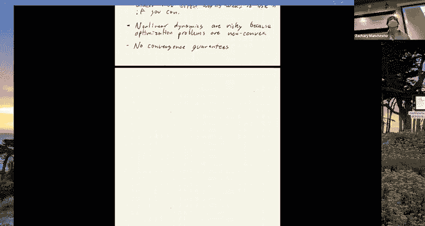
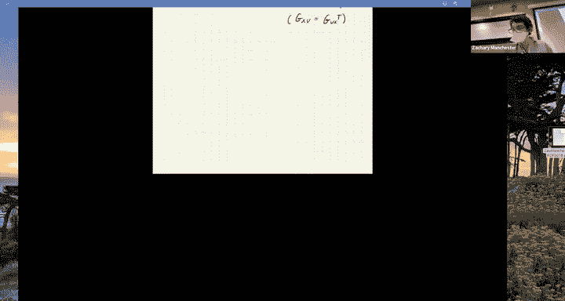
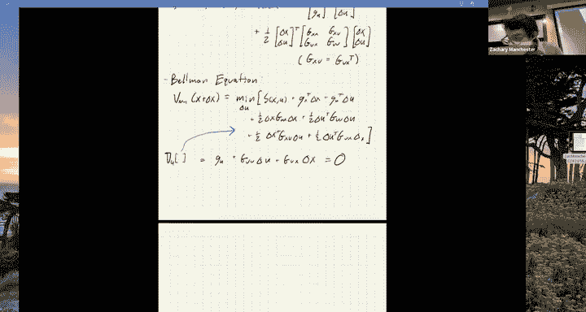
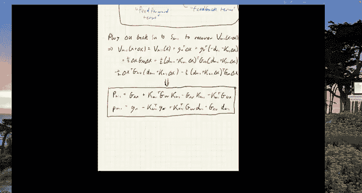
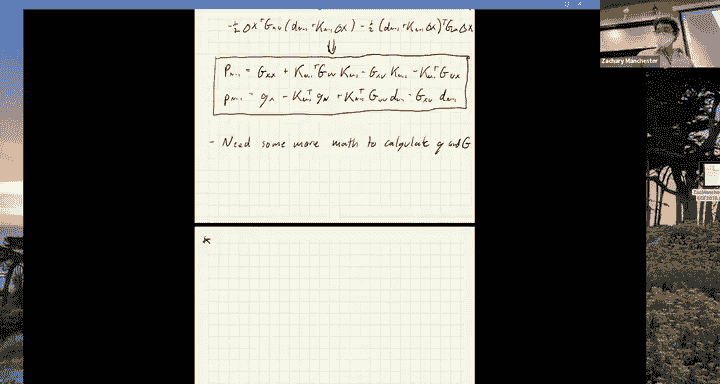
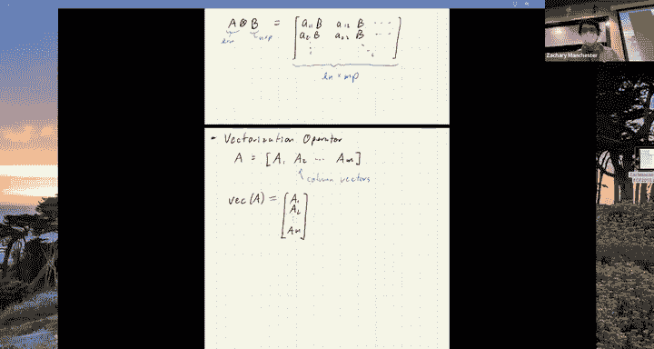
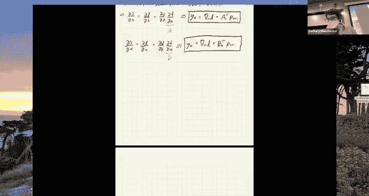
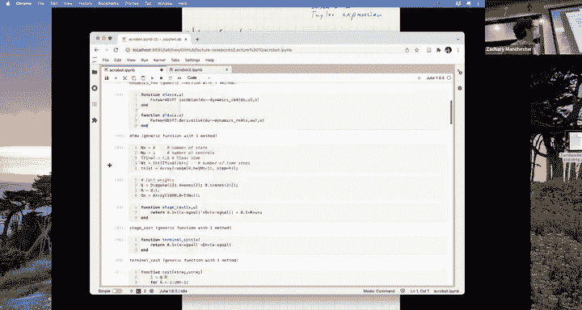

# CMU《最优控制和强化学习｜16-745： Optimal Control and Reinforcement Learning》中英字幕deepseek - P11：[11]Lecture 10_ Nonlinear Trajectory Optimization.zh_en - GPT中英字幕课程资源 - BV1qHwke1EBX

So what did we talk about last time。We kind of did this like convex optimization crash course in about 20 minutes。

 which was a little aggressive。And again， yeah， that's a whole that's a whole field and usually there's nice。

 you know， like semester long course and that stuff that's if you're really serious about this stuff。

 it's not a bad idea of you to take something like that。And then we talked about convex NPC。

And then today we're going to just finish up some loose ends on the convex NC story that I didn't have time to get to yesterday。

So I don't know， it's basically some example things and notes。嗯。

And then we're going to start talking about。Non nonlinear stuff where it gets starts to get。

Interesting and scary。So we'll talk about kind of first off， just kind of general like what。

What nonlinear trajectory optimization looks like？嗯。

And then we're going to get into some of the like one of the one of these standard algorithms that's super widely used in robotics for solving nonlinear trajectory optimization problems。

 which is called differential dynamic programming， also known as iterative LQR。

 and it sort of like builds on the LQR story we've been talking about so far。

Has anyone done this before？ILQR， no heard of it。You people， yeah， cool， all right， awesome。

Just curious。嗯。So yeah， there's some interesting history behind this the the iterative LQR version is。

They're basically the same thing we'll talk about that today。

 but the original DP algorithm was invented in the 60s and then it was sort of like rediscovered or reinvented in the like early 2000s by a robotics person and given the iterative LQR name。

Um，I don't know， weird， okay。So that's kind of the plan we'll see how far we get so just to kind of finish off from last time I wanted to just show you some cool NPC examples so we did the kind of general convex NPC story and we did the quad rotor and I wanted to show you like some cool examples that are sort of prevalent state of the art things right now。

That you've probably seen， so the first one is the rocket landing Aka soft landing problem。

 most prominently SpaceX and JPL landing things on Mars。

This is actually a super cool result from basically the theory of like how to do this as a convex MPC problem was kind of figured out in the like about just about 10 years ago like 2013。

 2014 and like there was like the seminal paper on this by some guys who at the time work at JPL the two authors one is now the GNC lead at SpaceX and the other is now professor at University of Washington so this is kind of a big deal circa you know 10 years ago Ih and the kind of the cartoon thing is basically that。

We'll probably talk about this in some more detail later in the class。

 but basically you can imagine we can linearize the dynamics of the rocket about like an upright hover that's more or less what happens and just like we did with the quadtor and then the interesting part is that the thrust vector。

For the rocket has constraints that are as you can kind of imagine right you can throttle it and then you can gimbble the engine right to point the thrust vector and kind of intuitively that looks kind of like a cone so it turns out that you can write down the thrust vector constraints on the rocket really pretty cleanly as a second order cone constraint。

So yeah， basically rocket。cartoon， terrible cartoon rocket。

 and then you can imagine right like you have your your engine down here。And this thing can gimbal。

 you can adjust the thrust and you can gimbble it so I don't know how to draw it that and see something like this。

And basically， you can imagine like the thrust limit constraint sort of looks like。

This kind of thing。Where you have the height of the cone is basically your thrust limit。

And then the angle。Is your gimbal limit for how you how much you can turn the engine nozzle， right？

カだはい。There's fancier stuff， but at its core， that's kind of the basic idea that you can write the thrust limits。

 you can write the kind of like the limits on the thrust vector as a cone constraint and therefore pose it as a nice second order cone program。

And yeah， again， this is sort of used for Mars landing。Stuff。And SpaceX。Rocket landings stiff。

And this is second order cone。With linear dynamics。

Yeah I think we're going to throw this on the homework and we' i'll talk about maybe some more of the details later in the course Okay so that's one cool example Another fun example is legged robots these are also kind of the standard controllers on quadrupeds right now and humanoids and other things and there's some fun stuff there too。

嗯。So the big one there that comes up is contact forces between the feet and the ground so you have these。

Once again， you end up getting cones interestingly。

 so there they even know what this is called the kind of like。Friction stuff yeah。

 it's called a friction cone yeah， so this is like a 3D version of your sort of like high school level。

 you know， new times the normal force thing。All right。So that looks like norm of the friction force。

 which we'll write as B， like standard two norm thing。

 less than equal to mu times the normal force where this guy is your friction coefficient。

This is the normal force。And then this is the friction force。

And this is exactly the form of a second order cone， right that we wrote down before。

So you get like the picture is like。If it's your contact point on the ground， you have a cone where。

Your normal force is the vertical direction。And then the tangential part is your friction force。

 right？And if you're inside the interior of the cone that's sticking and if you're at the edge of the cone that's when you start to slide。

 that's when you get slip right so that's how you get like cool in friction stick slip behavior。

So basically yeah you can write down an NPC problem with these version cone constraints on each foot to make sure that you kind of like't don't slip this is pretty standard thing to do there's kind of one note on this is so for not necessarily great reasons it's actually standard and legged robots to linearize the cone and when I say linearized a cone I mean approximated as like a foresightd pyramid instead of a round cone and that way you can write it as a linear constraint and you can solve it as a QP instead of an SOCP and they do that because QP solvers are very well establishedlish and fast and good and they're sort of fewer good SOCP solvers this is just kind of a standard thing。

嗯。You shouldn't really have to do this though， as just a。And aside， it's kind of a historical quirk。

But you'll probably see this if you do any legged robot stuff。

So as in like AX less than equal to be what we talked about before QP。

 and so that looks like kind of edge your original cone。

 you'll end up like doing an inner approximation of it。That looks like this。Cool， and again， yeah。

 basically every legged robot you've seen， every quadruped that you see running around right now is doing this more or less。

 this is like MIT Cheeetah does this。嗯。And you know， pretty much every quadrup pad。

 the union tree robots， animal from the ETH guys。Are doing versions of this。对。嗯。

Okay so yeah one kind of point here is like these systems right the rocket the quadrupeds these are highly nonlinear systems right it's just kind of partly to illustrate how far you can take the linear dynamics approximations if you can do it you probably should and it's very very common and you can you can do a lot with linearized dynamics models Okay so let's talk about that for a sec so this is kind of to segue into our next conversation。

What about nonlinear dynamics then？So。Really the linear stuff works incredibly well a lot of the time。

 if you can do it， you probably should and it's probably the first thing to try。All。系。

And even in like the modern era like with all this RL stuff。

 like there's been some really kind of interesting high- profilefi papers that have shown that linear policies are often good enough to achieve state of the art performance on a lot of the standard RL benchmarks。

 this is famous Ben Re paper from a few years ago where they did linear they trained linear policies using like simple stotastic search techniques and beat a lot of state of the art。

Deep neural network results so。It's worth a try。Okay。

 so what if we do put nonlinear dynamics into the problem which we're going to talk about next。

 it's risky because as soon as you do that the optimization problem becomes nonconvex and we can no longer guarantee that the solver will converge in particular you know it may converge it may not we can't bound the number of newton iterations that it'll take to converge right so it becomes scary to do online people still do it and it does work but you really have to be careful about a testing Monte Carlo stimulating everything you know that could possibly happen and all this kind of stuff。

So that's kind of a note。It becomes like sort of a little wild west in this situation。

Like I would do this in a research project in the lab， I might not do it in a real fielded product。

 you know that kind of thing that said yeah， it can work really well。

In practice。If you kind of tune things up and do a lot of testing。In particular。

 the the classic move here is to warm start everything。

 So if you warm start with this is one of the great things about NPc basically from。

Iteration iteration from time step to time step the solution shouldn't be changing that much it's basically only changing due to like disturbances right so it shouldn't change all that much so if you use your previous MPC solve as the initial guess for the next one you're usually pretty close which means it can converge really fast and only a couple iterations so this is kind of one of the reasons you can get away with this still。

对。And yeah， this is kind of active research。And。Somewhat terrifyingly。

This nonlinear PC is actually standard in autonomous driving。

 they're doing pretty much exactly what we're going to talk about next today on the cars with nonlinear sort of bicycle models。

 dynamics models and stuff like this and it works guarantee。So there are convergence。

 there are local convergence guarantees you can get for nonlinear optimization problems。

 so you can guarantee that things will converge to a local optimum， right？

But even that is sketchy like basically in particular you can't guarantee bounded number of iterations and things like this right so it could take a really long time it's also even with those guarantees those all kind of assume infinite precision arithmetic so in practice things can still get stuck for kind of dumb floating point math reasons。

Yeah， exactly， yeah。Yeah yeah you can get stuck in bad spots that are not nice so yeah yeah so that sort of thing you generally try to avoid by regularizing like we talked about before right you can guarantee convergence to a local minimum if you implement everything properly and do all the extra tricks the globalization tricks basically yeah。

How you know来个来。He gets jump。like。官方这边。You just can't know its so so like in general right all we get when we're solving these really big problems we can get the local gradient and kind of hessian approximation stuff and we don't know what the global landscape looks like at all right we have some starting guess we can evaluate those derivatives and then just like head downhill and cross our fingers like that's the best you can do in general right so I really don't know if I find a minimum there it's always a local minimum right that I find with Newton methods and stuff like this I have no idea if there's another better one out there somewhere。

そなフ時代はない。Con next。And you find voice youre not in your event。And find这个 good。有没有更多。How do youYeah。

 so we're going to get more into this basically like the way you solve a nonlinear problem is always is like iteratively approximating it as some kind of convex problem more or less and。

Yeah， I don't know that's that's kind of you're always doing that in a control context adding the nonlinearity in the and the dynamics is always sort of like。

To be done with lots of caution like in the controller in like an optimization formulation。

 I would say like if you don't need it for performance or safety reasons， like you probably don't。

 you shouldn't do it like if you can if the linear stuff is good enough for your application use the linear stuff。

Is the general sort of advice I would give you。Yeah， I mean。

 there obviously are situations where that's not good enough， but you know。

're they're less common than you might think。Anybody else？Yeah。

 so with when around like the NP we talked about a few weeks ago the street about this。

result it showed that there's no guarantees for flood drive。Oh。

 so that's that's not that's not a stability guaranteete。 that's a robustness guarantee。

 So and that's particularly for。LQG which is the stochastic version of LQ bar where you have a common filter and you have noise so that' it's a little bit more in the weeds there we're going to do that later but yeah so the robustness thing is always kind of an interesting other question if you assume full state feedback then things are pretty robust those robustness issues specifically come up when you have a partially observed state。

And you have an estimator hooked up to your controller。 That can be brittle。

And that's what that paper is about。Anybody else before we head out on Okay， cool so let's say yeah。

 and then just like this is。Terrifyingly common in autonomous driving。

But they you know they do lots of testing， they wrap it in lots of kind of supervisor， you know。

 babysitter code to make sure it's not barfing and throwing out terrible things and crashing your car right。

 but yeah， I don't know。Kind of interesting。Okay， cool， let's do some nonlinear stuff。Okay。

 so sort of back to where we started with the whole deterministic optimal control setup。

 we're now going to talk about the kind of the general non nonlinear。Traaw problem。

Let start to actually talk about how to solve it。So that's in discrete time， this guy。

We have a cost function。That can be whatever， but again。

 usually we pick pretty benign cost functions， usually we pick quadratic looking things。

So there's our stage cost and then we have a terminal cost。

And then we're going to have general nonlinear dynamics。And then in general。

 we're also going to have。Kind of arbitrary state and input。Constraints， so x is in subset。

You is in some set。Okay， so let's make some notes on here。So we've got potentially non convex costs。

We've got。Non nonlinearar dynamics。And then we have potentially。You know。

Non convex other constraints。All right， and just as an aside。

 we're basically always going to see some amount of smoothness here。

 like enough smoothness to take first and second derivative so we will kind of。Usually， assume。诶。

Costs are。At least C2 smooth， so we have a nice gradient and nice hessian。诶。And this is again， yeah。

 like basically so we can do Newton's method and then we want to also assume that the dynamics are at least C1 or the constraints in general。

 but yeah。对。Okay， so that's the setup， any questions of all that we did this before right cool all right。

 so let's do let's start talking about DP。Okay。So the name implies this has something to do with dynamic programming there's a few ways to think about this you can actually derive this algorithm I think from at least two or three different perspectives and like the way I like to think about it it it's sort of like it's definitely it's an approximate dynamic programming method。

And it's essentially a mashup of dynamic programming and Newton's method。

I what this is right so we're basically going to use a dynamic programming sort of forward backward iteration where we approximate everything in the dynamic programming set up with a second order Taylor expansion and then do Newton method type things on top of that approximate value function et cea。

 et cetera。So。Ts that down。It's an awful noise。啊，😊，Like。Wet disc brakes or something。Okay， yeah。

 so the gist of this is。Use。Second order。Taylor approximation。Of the Costa go function。In NDP。

To compute Newton steps basically。That's the rough cartoon idea and yeah。

 like you can kind of think of this as like a mash up of dynamic programming and Newton ideas that we've already talked about。

And then kind of the reason this is popular and nice is that this method can have super fast convergence if you implement it well。

Okay。So let's get into it this might be this' is going to be a little bit of a slog to get through all of this today。

 so we'll see how we do so first off what we're going to do is actually write out this cost to go function Tayloror expansion。

Okay， so we got。RV。sub K。We're going to write like this x plus delta x so this is it's going to look a lot like what we have with LQR so we're going to write this Taylor approximation down we've got so just Vk of x the sort of nominal value and then we're going to have a gradient in in the hessian unsurprisingly and we're going to use little P for the gradient。

And big P for the Hessian。Right， and then sort of obviously。苦。And then yeah。

 to be extra sort of clear here。 So then at the at the。End of the trade Act。

 right our boundary conditions as usual， we're going to write down。 We know the the boundary terms。

 So the P N， little P N is。Graient of the terminal cost。And then big P and。Is the Hessian。

Of the terminal cost。So that's that and then it turns out this algorithm is easier to derive and write down in terms of bookkeeping。

 I think in terms of the action value function or Q function。

 so we're going to write that one down as well。You can tell them I'm a controlled guy and not an RL guy because I used Q for the LQR stuff and not for this function。

I use the controls notation。But here you go so this guy we used S for this before right so this guy has x plus delta x and then u plus deelta u going on and we need expansions for in both variables now so this is going to look like。

That it's sort of nominal value。Plus the gradient and we're going to use G's for these guys。

 so we've got G sub X G sub U。Now。And we've got times delta x， deelta u。

 and then the hessian of this guy。So this is going to look like。One half。Delta x。

 Delta U transpose and then。We're going to write this as Gxx。G， X， U。

GUX GUU for the blocks of this hessian。XCool and then it's a hessian so it's got to be symmetric right so just as an aside Gx U equals G UX transpose。

Okay， so that's just kind of definitions， any questions about that。Good， okay。

 so now what we're going to do is basically plug these Taylor expansions into the beelman equation。

 the backward recursion， right， the dynamic programming recursion。

 and just kind of write out what these things do as you go backwards one times step。

All right， so。We've got if we start a VN we know what VN is right we wrote that down so we've got the the PN the two pNs right those are from the terminal cost so we already know those so we're going to now write down the equation for VN minus one。

That's almost the same as the LQR problem。But there's some extra terms， okay。

 so this is min over U over Delta U actually， right？

We're doing this on the Taylor expansion of the action value function of the Q function right so I'm going to write that Taylor expansion down I'm just going to plug it all in。

So the sort of this term is a constant， so that doesn't matter。Then we've got the gradient terms。

Then we've got a whole bunch of hessian terms。And then we got these like little cross terms。Okay。

 that's the whole thing。So what do we do， we take the derivative of that whole thing。

With respect to Delta u and set it equal to  zero right just like before it's a quadratic function right so it's it's all nice that all kind of works out so i'm going to take。

Partial of this thing。So I guess I'll do。With respect to you。And if I do that。

 it turns out it's not too bad。Gu。Plus。GU U times deelta u。

I guess I'm actually taking the column version of this。Bad， bad zach。Should write it this way。

 right I should write it as grad。With respect to you of。This guy。Okay， so。Keep it straight。

 And then we got the cross term。 So we get a G U X delta X， and we set this all equal to0， right。

 That's the recipe， yeah。有。你说不。The Gs， the little G's are the gradients。

And the big Gs are the Hessian blocks。Of the action value function or Q function。

 which is the value function， I'll just write down Okay， so this guy。

So maybe like we should write a little aside here。

Remember the Bellllman thing says that。So we start with Vn， which is just the terminal cost right。

 and then we get Vn minus1 of x。Equals。Min over you of the one step cost。Plus。

 the cost to go evaluated at the next time step where you plug in your dynamics。

So saying if I know VN， I go back one time step and I can minimize the one step cost plus the cost at that last time step。

By you know， passing things through the dynamics， right？

So this is the Belman equation and in this term here inside。

We just call this whole thing the action value function and we're calling it S。

 if you take out an RL class， this is the standard name for this is the Q function and they call it Q of x and U。

Yeah， why do you dont have a derivative term to the 1 half deelta x times those GS'？

So there's two of them at that bottom line right so here there's two of these guys right and the whole functions of scalar。

And those terms are symmetric， so the scrs are equal to each other。

 so when I take the derivative I just add them together and take one of them。Does that make sense？哦。

O，'s。The one half， no， there's one halfs on everything。

The whole thing has one hs on it right so like when I take it's one half x squared it's derivative of that x right so it's because they' they're squared so what I pick up a factor of two when I take a derivative that's like x squared right so this is you know one half it's roughly speaking that's one half G X X x squared right So I pick up a factor of two from the x squared when I take a derivative does that make sense。

I think I'm off my back two somewhere my head still。Okay， so no that's okay。

 I mean there's no so okay， if I write down this， if I write down x transpose Ax and I ask you what the derivative of that is。

 what's the derivative。Sure， okay， so if I write you down this。那实在不。There's two terms of those。Okay。

 so what I have there， right？So are you good with the deelta X Gxx delta x term Okay so this should actually this should have transpose on it my that Okay so you're happy with the U term okay so it's the X U UX terms so do both of them they're just transpoes of each other right all I did was add them together。

So because they're just transpos of each other and because the whole term is a scalar I can transpose those all I want right and they're symmetric they're each other's transpose so all I'm doing is I could rewrite this whole thing as like I could get rid of the I could basically add those together right now if I wanted to in that line right that's all I did does this make sense yet？

Should I write it out all the way okay okay basically those terms are each other's transpose and when I take the derivative I just add them together。

It's like literally what's another way to talk about this， so it's basically this。嗯。If I had。

 I should write like say this。It's that right， and so this equals。This is equal to just having like。

X transpose AU。I could just add the both together because I can the whole answer is the scalar so the transpose of the scalar is the same number okay。

 cool。对。All right。No problem。😔，This stuff is unfortunately not taught in any real classes in like the matrix calculus stuff is not taught in a coherent way anywhere。

 so I don't know。It's a thing Okay， cool， so we got that Okay。

 so now I'm going to take this line and just solve it for Delta U。So we get。Delta U。N minus1。Equals。

Minus GUU inverse。Gu。Minus。GUu inverse。G U X， Delta X。What does that look like？So in particular。

 I'm going to call these， I'll label these terms a little bit so this is。This is a constant vector。

 right？So we're going to call this guy。D and minus1 and this。Is a feedback term on Delta X， right？

I'm going to say that， so we're going to call this K and minus1。And in particular。

 it turns out that K term， that's the same as LQR。So this whole thing looks almost exactly the same as LQR。

But you now have in addition to the feedback term， this feed forward D term。

The feedback term is coming from the quadratic part of the cost function and the feed forward term is coming from the linear gradient term in the cost function。

So let's say what's a good way to think about this basically like with standard LQR。

 you're saying I already know where I want to be。I want to stay at the origin right so I just get a quadratic term in the cost function that's trying to keep me at the origin。

And so I get this just a feedback term pulling me to the origin right here， the idea is。

I'm not near where I want to be'm away I'm far away from the goal state so I have a non zero gradient that's pushing me towards the goal state and that's where this feed forward D is coming from does that make sense。

😡，was sortr of a hand wavy。Hopefully this will make more sense as we go。Okay。

 so then the final kind of version of this is。They should move this whole thing down。切。

And then this thing。Equals dn minus1。Mus k。And minus1 delta x， so we get。Feed forward term。And。

Feedback。Tm。Cool， so put a box around this， this is sort of important。Okay。

 now just like the LQR derivation， we have this deelta U。

 we're going to take the deta U and plug it back into the tail expansion for the cost to go or the action value function to recover the next value function at Vn minus1 in terms of just right here we have Vn minus1 that we want to be just a function of x right and it's in terms of action value X u on the right yeahs so just in terms of the math that D is it's a vector that' it's really the gradient term。

So。The deter is coming just from the gradientding of the cost function， basically pushing you down。

 the feedback term is coming from the hesian。So if you were doing like gradient descent version of this。

 you would just have the Ds， basically the the Hessing terms， like the Newton term is the K term。

I don't know， if that helps at all。That's sort of what's going on。

 you can think of it like gradient and hessian。Okay， so let's keep trucking。So just like before。

 right， we solve for Delta U from this min over Delta U and we plug the deelta U back in to get the next V。

对。So if we'd go ahead and do that。So a bunch of these terms are fine this this thing's fine it's already just an X term。

 but then you know the u term we're going to take。What we the Delta U and plug it right in there。

And that gets rid of the U' and makes it just a function of x now， right the delta xs。

And then we just keep doing that with the quadratic terms。So we've got a the again。

 we should plug this in everywhere there's a。Everywhere there's a Delta U。And the cross terms。

You can kind of simplify these down if you want to。

Okay that's the whole thing so now if I stare at that right we're going to massage all those terms so it looks like the P and the the big P and the little P just like with the LQR derivation。

 so we're going to write this down now。As P and minus1 is going to be G X X。 And again。

 here I'm just collecting terms， right， I'm collecting all of the。

The quadratic hessian looking terms and all the linear gradient looking terms and just grouping them together and calling them big P and little P。

And then a little P。呵。Al right。That's it。So now you have the recursion right so this is just like the rikati recursion。

But it has a few extra terms， essentially。So the ridi recursion would be just the ks right so now you have the K terms and these D terms。

So there's a bunch of bookkeeping， but it's pretty much。

It's extremely similar to LQR right hence the sort of iterative LQR name for this。

Any questions about this before we do the next thing？So these k defined as this。

 if you scroll up a little bit， that G times the G。GU times GUX or the inverse there， yeah， yeah。咁。

Okay。So next move， so we have this nice recursion in terms of these Gs。

Which are again， like Hessian gradient of the Q function action value function thing。

What we don't know how to do yet is actually compute the Gs。So if I hand you the Gs， you can do this。

 So right now I'm going to tell you how to calculate the Gs， which is a little bit of a。I don't know。

It's going to be a little weird boondoggle， but。It's a。Here we go。This is not a standard topic。

 this is a weird zack topic。

That is something I think is useful， so I will now teach you。

That is somewhat obscure but useful Okay， so inside these G the big Gs in particular are terms that required like computing third rank tensors in particular there's terms in there that are second derivatives of the dynamics。

And if you have a dynamics function right like RN to RN。

 the first derivative of that thing is a Jacobian matrix。

 the second derivative is the derivative of the Jacobian matrix with respect to the state again is going to be a tensor and there are nice toolboxes for doing tensor math now thanks to all of our machine learning friends but。

It's often sort of glossed over the details of this。I want to show you how to actually do it。

 so here we go。Okay， so let's say we have a function like that。😊，That's， you know。

 think about this like a dynamics function。So this is Rn to RM， say。

Let's look at a second order Taylor expansion。Of this thing。Okay， so in the case that M equals1。

We're in our usual。Our usual like gradient Hessian situation， right， so we'll have something like。

F of x plus delta x is approximately F of x plus。Partial F， partial x times deelta x plus。One half。

Delta x transpose。Hesian here of F。s Delta x right and in particular here right this is a gradient thing。

 so this is。1 by n。Because M is one， and then this is your Hessian matrix， so this is。N by N。

So now what happens if M is bigger than one？So now it's actually a vector case， so if we do this。

Same thing。I get F of x and then I get now a Jacobian matrix right so this is like our a matrix that we're used to doing and we have dynamics。

So this would be right in the case we're talking about this is。are。M by N now。

And then you're going to get a term that's。You're going to get the second order term and I'll write it in kind of a weird roundabout way。

Right now， so I know how to do the Jacobian。And I can take the Jacobians product with。Delta X。

 and then I can di it again with respect to X。 So think about this like a Jacobian vector product kind of saying right if you're used to doing autoDP stuff。

And then I can multiply this by deelta x again so if you have an auto automatic differentiation toolbox that lets you do nice。

 yeah， just quick going back lower。What is the subscript on that second floor feet？呃。G yeah。

 that should be a you， right？Here's code， I'll give you code it's not yeah my handwriting is not the best I understand this hence lots of code examples and Jupiter notebooks。

😊，At some point I have you visions of like late checking all of this stuff and making some kind of book out of it。

 this has not happened yet， stay tuned。If anyone wants the help with that？That would be great。Okay。

 so this basically this this second derivative term is super ugly right that's kind of the。

The message。And usually in derivations of this stuff。

 you'll see like weird kind of made up tensor multiplication notation and I don't know。

 stuff like that。So let's do this a slightly different way Okay， so but the point is yeah。

 for M greater than one， this hessian thing， D squared F D X squared。Is actually a third rank tensor。

Who knows？ Yeah， the on that。not no yeah so this is a weird this is a weird thing I wrote in a very weird way basically to avoid ambiguity with black tensory stuff so you can do that weird nested derivative thing if you have access to a good auto diing toolbox that'll do it for you but in general this is kind of nasty and that d squared fX squared thing is right like if DfDX is a matrix and I want to di that matrix with respect to a vector again it's this third rank tensor idea which you kind of think of as like a 3D matrix right if you like。

So the reason this is problematic is if I have a normal matrix and I'm doing like a matrix vector product。

 there's two ways I can multiply it right I can basically do AX or X transpose a。

Aka like a transpose x right so I can do I can do basically like Jacobian vector product or Jacobbian transpose vector product and in general the answers are different right so similarly if I have a third rank tensor think of it like a 3D matrix I now have three different ways I can multiply a vector on and get three different answers right so you have to be careful keeping track of like basically which side of that tensor you're multiplying on and if you don't do this。

Carefully， you get lots of bugs and par stuff so we're going to kind of。

Introduce some new notation tricks to do this。And there's lots of ways of doing this like physicists use this Einstein summation notation right with all the little IJK subscripts to keep track of this' a bunch of ways to do it this way is kind of the I would say the hacker engineer way that lets you kind of do everything in terms of regular matrices in like Numpy or Matlab or Julia Okay so tricks we need the first trick is this thing called the Chroner product who's here of this。

Okay， decent number， that's good。Curious， where have you seen this before。

 people who've seen this before？I've seen it in physics like quantum physics。 Okay， yeah。

 shows up there。Okay， so this is what it looks like， so if I have two matrices A and B。

You write it as this like little circle with the times inside it。

 this is called O times in latex fun fact。And what you do is take。

Every element of a and multiply it by the entire matrix B。 So if I write this out， it's like a 1。

1 times B。A1， two times B， blah， blah， blah。A21 times B， A2，2 times B。You get the idea。

And so to be super clear about this right it's like blowing up the dimensions right。

 so if A say is like L by M and B is N by P。Then this thing is。L。N by MP。

 it's like the the dimensions of both it's the product of the dimensions of the two matrices right I like kind of created this giant expanded matrix。

 right？Okay， so thats that's one piece of the puzzle。

 the next piece of the puzzle is this thing called the vectorization operator。Yeah。Aka Vec。

 so the idea here is if I take a matrix。And I look at it as a bunch of column vectors。

Then just a Vck of a。Is just a column stacked into one big vector。

And it is called Vec in MatLb and Julia and all other same matrix libraries。

So yeah， like before if we say this is L by M， this is going to be L M by one。Okay。

 everyone call those two things。Here's where it gets fun。So we're now going to。

I'm going to tell you this thing called that I call the Vck trick。

 I don't know of any other name for it。And it makes all of this stuff work so if I have。

The product of three matrices like ABC。Vck of that equals。嗯。The following thing。

 so I take C transpose。Cron a。Times V of B。So。I'm not going to like prove that。

 but I'll show you like a kind of the。What you can do with this。

And it's not too hard to kind of like understand what's going on here。

 so in particular here right I can I can make any of those A， B or C an identity matrix， yeah。

The card dispro clarity information on Jack E。That that。Yep， yeah， so if I have three matrices， ABC。

And I want like if I multiply them together and then take the V。

And stack that answer it's equal to this other thing that involves a chronicer product and stuff the reason this is useful is it lets me take the derivative of matrix expressions So if I want if I have like three things multipied together and I want the derivative with respect to the middle thing this is how I pull the middle term out of a matrix sandwich if you like and so I can also throw identities in for any of the A B or C use that I like so。

If I have say just A B， I can write that as。B transpose Chon I。Times V of a。Or I can write it as。

I cron a。Vec B and that last one really kind of shows you what's going on intuitively So I think of if I think of a matrix times matrix product you think about what you're actually doing there one way to interpret it is I'm doing a matrix vector product with each column So if I have a times B right you can think of it as a times the first column of B a times the second column of B right So if I vectorize B and I stack all the columns。

I really just need to do a times each one of those column vectors so I stack all the columns up what I want out front then is a big block diagonal matrix that just has a whole bunch of copies of a right to multiply each one of those column vectors taken from B that's exactly what that last one does right iconron a is just taking the A and copying it into a big block diagonal matrix。

Each block of which is multiplying one of the columns from B that's stacked up， does that make sense？

So that's kind of the intuition and you can drive this trick like pretty easily from that idea。Okay。

 cool， so now if we want to do calculus。啊。We're going to kind of have this convention。

So if I want to take the derivative， say of some matrix A， that's a function of some vector x。

With respect to X， all I do is。Do partial Vck a。Partial x。

 which now that that if I do the vectorization thing。Now it's just a vector。

 right so now we're just back in normal like vector Jacoban stuff that we already know how to do。

 right？And so by convention， we're going to have like an implied V in the derivative anytime I'm differentiating a matrix。

对。Okay， that cools everybody。Yeah， are we going to end up to be like。Third dimension of tensor stack。

 That's exactly what happens。 You can think of this as flattening the tensor。

 So we're basically taking like that third dimension of the tensor and flattening it out and stacking it up。

 That's exactly right， yeah。So yeah， like this guy will be。L M by N。

 if a is you know L by n like before， and x is n dimensional。Okay。

So if we now look at the second order Taylor expansion of F of x that we originally wanted to get。啊。

So we have this thing。And we already know how to do this part。

And if you think about this as like our a matrix， I'm doing dynamic stuff。

 then the next thing is just the derivative of that a matrix。

 and we're going to use the vector to do that。And I'm going to write down sort of what this looks like and then we can talk through it。

So this is。So sort of right way to write that。Second derivative term。Using this notation and stuff。

 so let's see I talked to this right this is a like our a matrix from our dynamics。And this thing。

It's really partial Vec。诶。Partial X， right？嗯。And then let's see what else is interesting about this I can think of this whole term。

As。啊。I'm doing basically Vc of。I a deelta x right， so Im I want to di with respect to a。

 so I get that deelta x transpose Chon I。D A， D， D， X， right， does that make sense。

 So it's just the ABC trick。Applied to like the A matrix。Okay。

That's almost the whole story is one last trip。There's a lot of。Weird linear algebra tricks。

We're almost to the end， okay， so last thing is sometimes and in particular we will next。

We need to actually di through a transpose， we need to diff like a transpose。

 right with respect to X。And for that， we'll add one more little trick。Okay， so I have。

Say this situation。Which we will have in a sec， Okay， so I can write this as。Be transpose。Cron eye。

And then I'm going to introduce this matrix here that I'll call T。Partial a， partial x。

 and this thing is defined such that t times V of a equals V of a transpose。

And we're going to this matrix is called the commutator matrix。

 it's just a permutation matrix that takes。That stacked version of A and morphs it into the stacked version of a transpose。

Okay， any questions about this stuff？Sorry over that what's thatator matrix it takes so if I vectorize the matrix A。

If I vectorize the matrix a transpose， right， those are two different vectors。

This commutator matrix transforms the vectorization of a into the vectorization of a transpose。好。耶稣。

Or the the Taylor expensive please， so。Is that for BFBS。你听个。

It says the vectorization of I times so what I'm doing there is it's like think of if D we're going to call DfDxA because that's like what it usually is called in dynamics right and that second term is like the Hessian thing there is really just DDX right？

If a is DfDX。I want D D squared FD X squared like that's D A D X。 Okay， so I basically that term。

 what I want there is D A D X。 I can rewrite that term as。

It's that term is a times deelta x right and it's a of x times delta x and I want， you know。

 it's driven in respect to that。So to get that， I'm going to pretend there's an identity out front。

And then that gets me into that ABC situation。That I had before and lets me play the vector。

So I can write down vector of i times a times x equals。X transpose Chon I times vector of a， right？

I I'm putting it in the form of the ABC trick up here， right like we said， where did I do that？

This V trick with the ABC， and I said， you know， I can pretend that either the A or the C is an identity whenever I need to。

And that's what I get down here right so I pretend there's an identity in front of。

DFDX so I can play that trick。Because I want to I want to di a right so I pull the I need just stick it in the middle so I can pull it out with that that trick and that's all that is the second term is just doing the ABC trick。

On that guy。Okay， there's a lot of like weirdo。Weiro linear algebra Step。

I will now use it to tell you how to get the Gs that you needed to do this。ね。Yeah。Okay， here we go。

 so we have this situation。Just again， action value function is this thing that one step cost。Plus。

Value function。AKA cost to go function with the dynamics plugged in。Okay。

 so let's go ahead and write down these second order tail expansions and that's that's really all this is。

 I need to take the second order tail expansion of that thing， just write it all out， right？Okay。

 so here we go。The x1 is。We'll do the gradients first right is。Partial L， partial X。Plus。Partial V。

 partial X。Times partial F， partial x。Just doing a chain rule and then remember this guy's a from our dynamics。

 right， So I put that all together。And to some transposing， I can tell you that G subx。

 which is this thing， right， that's this gradient。It's the column vector version of it。

 it's just going to be grad。Of L with respect to x plus。A transpose。PK plus one。

So Pk plus on right we defined before is partial v， partial x， or it's gra grad V， right？

So that's where that comes from。So there's one of them。So now we can do the U1。And it's， you know。

 chain rule again。And this guy now is our B matrix from our dynamics。

So I plug that in and transpose everything， I'm going to get。G subU。Is。Grad U of L plus B。Okay。

 transpose。Pk plus one。Okay。That's not bad。Now I'm literally just going to take the derivatives of these little Gs to get the big G's right。

 so I just need to take one more derivative。It's just a lot of messy bookkeeping stuff。

 so'll like I'll make it quick and write it down and we can talk about it。

And then we're almost done。Okay， here we go， so Gxx。Is partial little G X， partial X。

So I'm going to get Hessian。Of the one step cost。With respect to X。Then I'm going to get。

If I do the sort of the simple version， right， I'm going to take。嗯。The easy term is this one。

Can everyone see how I got that？I di the P again， so I have partial V partial x。

 or I basically a times grad V。And I'm just going to take another derivative of grad V。

 so I get Hessian of V， and then I chain rule that with the a matrix again， partial lot of partial X。

 Okay， so that's the easy term。The annoying term is。

So to be clear right I'm taking the derivative of this guy， so the one I just wrote。

The first one is is the Hessian term from this guy the next term where it's a transpose。

 you know Hessian thing a that's the derivative of this this term here with respect to。

The derivative of a P with respect to x。The last one is the derivative of that term through chain rolling through a。

 which is where we get this tensor stuff。Okay， so that looks like。🎼P， K plus 1。Transpose Chon eye。

Comutatory thing it's a transpose。And then partial A。Partial x。Okay。And I'll just write these down。

 I don't think there's any real value in like。Talking through them a ton anymore， I mean。

 it's just mechanics of like doing chain role and playing this trick。

So if anyone has any serious questions about this， I'm happy to talk through it。

 but for right now I'm just going to。Okay， there's the u ones and then we get these cross term ones and it turns out。

These guys are transpos of each other， like we said before。

 so you really only have to write down one of them。So this one would be。

The cross term from the hessian of this guy。And then。Okay。I think that's it。Yeah。So yeah。

 the ones on the right hand side and that chronicer product， you think， those are all little peas。

I will write a note。And do you say earlier that that commutator T was a transpose？

That commut tell T thing is like letting me di through the transpose。

Because the A's and B's in this line here。Are transposed， right？嗯。😊，So I need to take the derivative。

 I'm taking the derivative of A and B there， right。

 because those show up transposed in that equation， I' get that matrix there。Okay。

We're going to call it good。And one note on this， though。

 that's going to maybe irritate everyone after I just spent all that time。So okay， so this is it。

This is we'll talk through the。The rest of the algorithm。

 but I'm going to sort of put a box around these guys。Okay， so we're going to call these things the。

Tensor terms。Okay， so here's the。The story， those tensor terms。

Often are ignored or left out of the algorithm。Because they're super annoying as you just witnessed。

They're also kind of expensive to compute， although there's more to say about that。

 if you leave the tensor terms out， it's called iterative LQR。

If you keep the tensor terms in it's called differential dynamic programming that is the difference between these two things that is it someone got a highly cited paper in 2004 by leaving those terms out of a paper from 1967 go figure。

So the story here， if I leave those out， if everyone remembers back to our discussion about Newton's method。

What do you think this is？Yeah， exactly， yeah， so if you have them in it's full Newton。

 youll leave them out as equivalent to Gaus Newton。Yeah。Okay。这儿子。P for other gaps。Yeah， yeah。

 so what's going to happen with if we keep them in， maybe。Do you remember from before？

So in particular， if you keep those terms in， they can make your hessians， which here are the P's。

 the big P's， indefinite or negative definite， which is annoying and makes you have to regularize。

 whereas if you do just the Gaus Newton approximation。It always shows up symmetric in there。

 so it stay symmetric and if PN is positive definite， it'll always stay positive definite。

 so that's kind of nice or at least semi definite。Modullo some annoying details of floating point round off there that can still cause you problems。

 but yeah。So the dirty secret is that basically no one in robotics does the legit DDP algorithm。

Pretty much everyone leaves those terms out and does ILQR， whether they say it。They're not。

Because yeah， they're annoying to compute and just like the Newton versus Ga Newton story。

 it's not a huge win to have them in there usually。

But at least now you know how to actually write them down so hey， I did my job。Okay。

 let's write down the rest of the algorithm and then maybe I can show it to you before we all have to leave okay。

What we do is。嗯。Like like with LQR kind of before， when we talked about the whole ricottti thing。

 we're going to do a Ford rollout。We're going to。Sort of I'll write this down pseudocode style and we can talk through it so we're going to start at you know。

 time step one initial conditions。Go to the end。We're going to get our u already as u prime the new U is going to be the old U。

啊。Minus our feed forward term。With a line search on it。

And then we're going to have our feedback term。And I'll write some more details in here in a sec。

And then the new x is going to be xk plus one as you run this through the dynamics。

And then this Delta J thing， I'll talk about this in a sec， this is me computing。

The expected cost decrease for the Armiho line search。诶。Okay， so let me， so this is the rollout。

Let me write some notes in here。This is a line search parameter。And we do our meho on this thing。

 which we'll write down the sec。This is sort of the primes mean。new。😔，This one's the old one。

From the old iteration。And then this is。From the Armyho thing， this is the expected cost decrease。

From the first order Taylor expansion and this kind of makes sense for us so that G subuxX is the gradient of the cost to go with respect to the U and the D is the feed forward U gradient thing that multiplies those together I get the first order tail expansion of the expected cost decrease and I just do that on my way back to and add up。

Okay。Questions about that。Cool， and then I'll write just to be super clear， the line search。

So we start with alpha equals one you。X prime。You prime。Delta J。We get this and we do a rollout。

Right， given the XU。二。K and alpha。Then we do。Alpha gets some C times alpha where this is just like before。

We do this while。J of x prime。U prime is greater than。The last J。

Minus this tolerance thing times deelta J。 So this is the standard Armyho thing just sort of written out in the details of this guy。

And the sea is。Back tracking parameter。It's usually like a one half。And then this guy is the Army Ho。

Tolerance from before。And this is usually， you know。

 like 10 of the minus two or three or something like this。

we'll use 10 minus2 and then you repeat so we the whole thing we did before right with all that math。

 that was the backward pass to get the P's and k's and stuff and then we do this forward rollout and line search and that's the whole algorithm。

Okay。We're out of time， I'm going to pull up the fun stuff and tease it and we can do more of it next time。

So here's the fun stuff。诶。We're going to do。An acrot， does everyone know what an acrobat is？

The double pendulum the two ins with one motor at the elbow joint and a passive shoulder joint Okay。

 so it's one of these kind of things and the goal is to swing it up。Let's write this down。

 here's dynamics。We have the dynamics in a Julia package。We'll do more of this next time。

So let's see states five seconds cost function that I just made up。Actually。

 computing the class function， initial guess is just hanging straight down and not moving with some random noise put in as an initial guess on the use on the torques。

嗯。And I'm going to run this algorithm that we just talked about。

Basically exactly what I just wrote down on the pseudocode， this is actually the ILQR version。

The version over here has the extra terms。We'll look at both of these， but yeah， this one。

So that's what we wrote down right with the extra terms we're going to compare them。

 but I'll run this real quick just to sort of。You know entice you to come back next time so here's the swing up。

You can see this probably wasn't quite long enough。

 so I should probably give it some more time and we can watch it do its thing。Yeah。

That's kind of cool。And I don't know， we can play around with this and do all kinds of fun things。

 but I'll let you guys go since it's the end of our time。

