# CMU《最优控制和强化学习｜16-745： Optimal Control and Reinforcement Learning》中英字幕deepseek - P12：[12]Lecture 11_ Differential Dynamic Programming.zh_en - GPT中英字幕课程资源 - BV1qHwke1EBX

Okay， cool， so what did we do last time？Last time we did a little bit of like。

 we just kind of finished off talking about some convex MPC examples。right。嗯。Convex MC is awesome。

And what else we then we went into sort of nonlinear trajectory optimization。

And then we talked about DP and ILQR。Kind of got through just through the derivation of that right last time。

 So today we're going to pick up on that and kind of go into。嗯。

Some more details and sort of extensions and also do lots of code demos because they're fun。

So sort of D details。And kind of extensions。Specifically， things like handling constraints and。

Free final time， minimum time problems， things like that so。Which show up in a lot of applications。

Is the vector like the main way that you solve those tensor terms？y i mean得你叫咩。

That's how I do it for sure that is I mean there's like you know three or four completely equivalent ways to write those things at the end of the day。

 you know the actual operations on your computer are all the same right no matter how you write it。

 they end up being these like you know like you know lots of vector matrix tensor multiplication type things and like you know doesn't really matter a ton how you write it down as long as you implement it correctly。

 I find that the vector stuff is kind of the easiest way to write it down personally but there's no wrong way as long as you get the answer right。

Yeah， and you said it was analogous to the Gille student method last time is that like？

Does that mean that you don't use it that much in practice in favor of ILLQR Yeah so I would say like probably 90% of implementations and in 90% of situations people just do ILQR and leave out those extra terms and so just do gass Newton。

That is the common there。And we'll talk more about that today anybody have any questions about anything from last time？

No， good， okay， cool so as a quick recap。Just going to write down kind of the D thing again since we。

We were very sort of in the weeds last time and driving it and just to kind of like。

Summarize DEP is a you know， is a method for solving kind of the following。

 we'll call it unconstrained trajectory optimization problem。So it looks like this， right。

 we're doing min over our state trajectory。And our control trajectory。Of the sort of standard。

Additive cost。So we've got a stage cost。And a terminal cost。Subject to just the dynamics。

And sort of one way of thinking about the whole like DP ILQR thing is it's a very efficient sort of。

 you can think of it really as just an efficient sparse matrix sort of。

Technique for solving this specific problem， which has some really specific structure to it， right？

Okay， so we have the problem and then the the kind of the first piece that we did last time was the backward pass。

Which is basically Riickati， basically the same thing you see in standard LQR。

 but with some extra terms。So that looks like。We do this sort of value function or cost to go function approximation using a second order tailor approximation。

So we get something that looks like this。And we start things off at time step N by just using the tailor expansion of the terminal cost。

So we get PN equals the hessian of the terminal cost。And we get a little PMm， the gradient。You。

 green of the terminal cost。Cool， and then we do the standard bein recursion thing。

 so we do Vn minus1。X plus deelta x。Is men。Over Delta U。Of the action value function。

Of the second order tailor expansion of the action value function right and we specifically we' doing this over the delta sort of we're minimizing that second order Tayloror approximation and last time we kind of derived all this out in terms of sort of this block matrix set right where we did the second order tailor expansion of the action value function in terms of both X and U got like this block matrix with the hesian the gradient kind of massage that around and we got the following conditions。

For Delta u， So Delta u and minus-1 is going to be。Minus D。N minus one minus。

 so that's the feed forward term， and then we' got the feedback term。On Delta x。

And then we sort of plug this back in to get our next big P。I guess I should write。

These should be if we're being general， these are ks， not ends。For this recursion。And then PK minus1。

Is and these Gs， which are the。Action value function。Hessian blocks。This is the K we just solved for。

So that's the Hessing term and then the gradient term。Okay， that's the whole thing。

And so once we do that， we've now bootstpped ourselves and we've got the next time steps and now we can do k minus2 and just keep going all the way back so we get to time step one。

 right？And then at that point， we've got the D's and the Ks for all the time steps along whole trajectory。

 and then we do the forward rollout。With that stuff with a line search。So we do。

 we're going to sort of。IDo the pseudocode thing， so this Delta J is going to be our。

Expected cost decrease according to the Taylor approximation that we're going to use in ourEho。

And I'm going to use primes for the new updated trajectory just because I'm using subscripts already for the time steps and stuff so we're going to say。

Ex。Prime our new updated trajectory at time step one is equal to x1 our original initial state so these are just the initial conditions right the current the state of time one then we're going to roll out from there。

So for。K equals， this is time step K， which is maybe。Hopefully not ambiguous。1 to n minus1。

 we're going to do the new U， so u prime at time K is the old U。Minus our alpha。

 which is our line search parameter times the feed forward correction。

 the D minus the feedback terms， so this is our K time step K。And it's the new x minus the old x。

 so the delta x。And then we plug this into the dynamics to get our next。State， they updated one。

And we also。

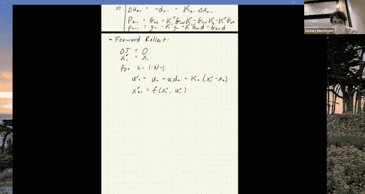

Computer cost。Correction。This is awkward。Okay。So that's the rollout。

And we do this sort of line search thing sort of around this。

 which is the standard armmiho thing that we've talked about before， just applied in this context。

So we start with alpha equals one。And we do the following thing。

 we do the rollout with alpha equals  one。And we get this new X and U trajectory and this expected cost decrease。

From that rollout。Then we sort of。Shop the step size down by some factor C like before with armmiho。

You do this while。The ourmiho condition isn't satisfied， so that would be the new cost。

I is greater than the old cost。Minus some tolerance times the expected decrease。

And then once that's ourho condition satisfied， we。Set the。

Nominal trajectory equal to the new updated one。And we repeat until we converge。

And as you'll see in the code in the spec， the convergence tolerance we're going to use。Is the norm。

 some norm on the D's， and then we're going to use the infinity norm。

 Aka largest magnitude value is less than some tolerance。

So what this is saying is the Ds remember are the feed forward corrections on the use and they're coming directly from the they're basically the gradient of the cost to go with respect to the controls so when those go to zero it means you can't improve anymore by updating the controls right so basically go until that that feed forward correction on the use is small。

You know， with respect some tolerance。And then we call it good we say we're not really moving anymore。

 we must be close to the optimum right so it make sense everybody so any questions on this whole setup。

Yeah so。This was makes Americantrain is it the。呃对对对然。No， so when I said unconstrained。

 specifically what I mean is it's only that problem right there。

 there's no additional constraints like torque limits or keepouts or obstacle constraints on the state。

 so there's no state or input constraints in addition to the dynamics。

That's right yeah it's only can handle that exact problem formulation right there so you have cost additive cost function and dynamics constraints that is what it solves if you do anything else it breaks right so it basically really what it's it's doing like one way to think about this is it's。

Ittererative LQR like it's basically going to linearize that and turn it into an LQR problem and apply the LQR stuff to it and then iteratively relinearize and re it using an LQR approximation。

 so just like LQR can't handle constraints right？That's the way to think about it。

 does that make sense everybody？Anybody else have any questions？Cool， okay， so let's see。

 I think it's time to do some stuff。 so let's let's do some code and stuff。

That's what we talked about last time kind of the stock algorithm。Here's some code。

And then talk about it so don't see that okay。All right， so let's see first we'll do a cartpool。

 Does anyone know what a carpool is？Yeah， anyone not know what a carppool is？

Cool so we have an animation in a second so here we go so this is coming from our dynamic dynamics library so you know we didn't I have to write this down by hand 20 hertz times steps。

We're going to use RK4 like you've been doing and i'm specifically here what this is i'm using4 di which is automatic differentiation right to get the A and B matrices that's what these guys are right to give the dynamics respect to x and u and then i'm also going to get the。

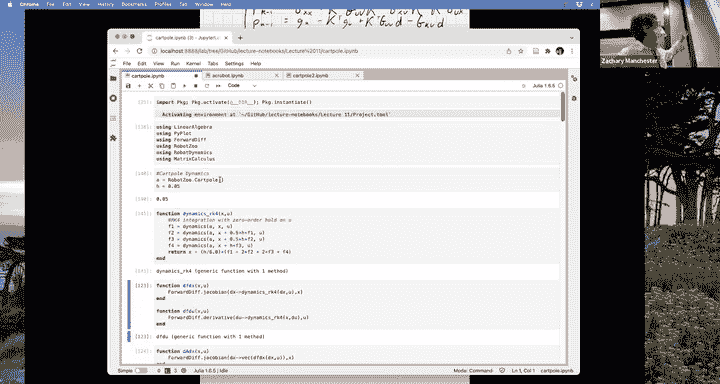

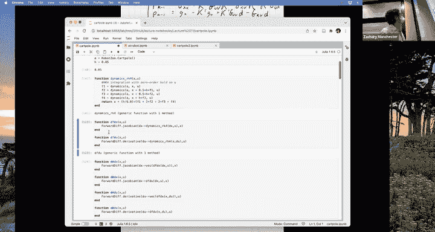

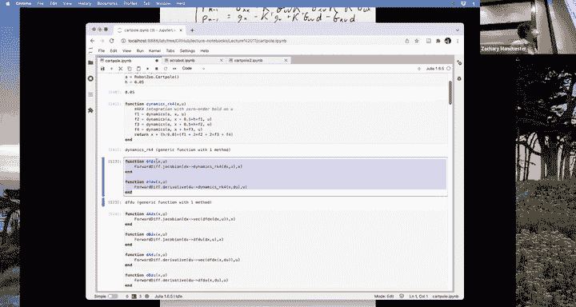

Second derivatives of the dynamics by just nesting the four if calls so this is like the derivative of the a matrix respect x with respect to U B matrix etctera。

 I these are those tensor terms right that are kind of flattened out I'm using the vector trick。

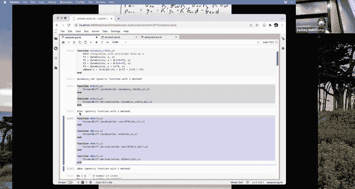

Stuff that we talked about before， right？

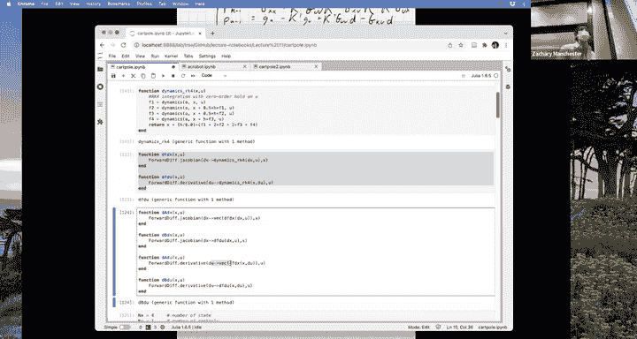

Cool， so that's that。This is sort of uninteresting step so five second horizon。

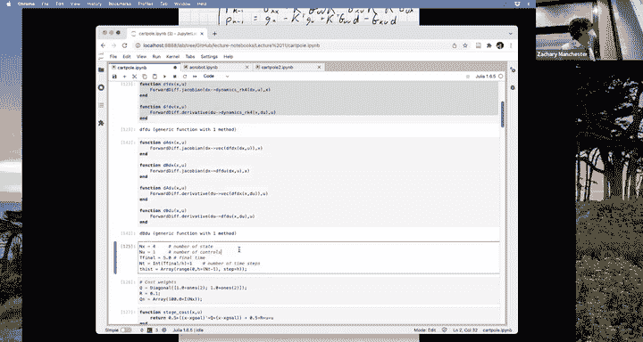

I don't think that's interesting at all cost function quadratic costs that I made up yet so numerical differentiation absolutely this is not numerical differentiation this is automatic differentiation which is a totally different thing so this is exact yeah so have you have you you know does everyone know how automatic differentiation works anyone would not know about this Okay this is worth yeah。

Hi， thank you。

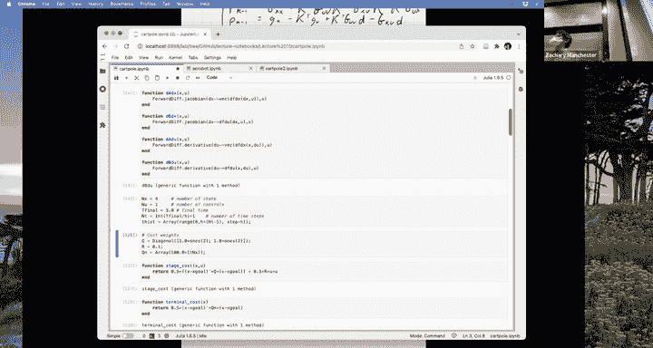

so maybe this is worth it so this is like the heart of modern like machine learning like pitorrch in all these toolbox they're all they really are are sophisticated automatic differentiation frameworks what automatic differentiation means so numerical differentiation like finite a different thing is like I compute some delta right I evaluate the function at some delta and then I divide by the delta right and I get some approximation so that's noisy and sort of nesting that is bad there are good ways to do it but it's not trivial and that's always going to be sort of inex and have round off fair issues and all kind of stuff right okay so this is a different thing this four different thing and what's things like packages like piytorrch do they basically。

😊。

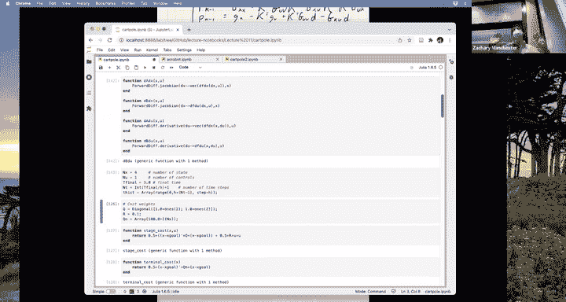

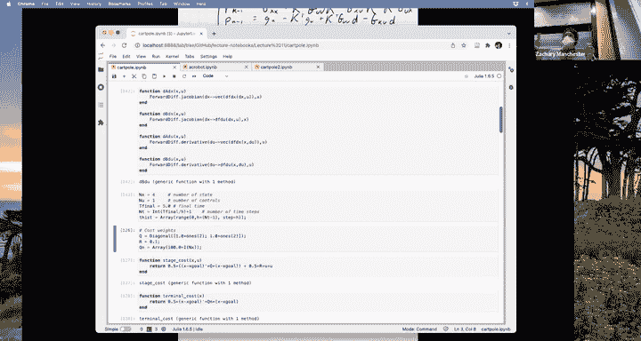

They overload the numeric types in the language so here like instead of a double I'm passing in like a what's called a dual number type and basically all that is is as a numerical it's like a little type that you can define that's overloading the standard number type that has both the value and the derivative value in a littlestruct or class right and then what you do is overload all of the standard operators in your language so like multiplication division addition et cetera。

 and overload all of the functions you care about so all the trig functions right so all these functions that I use when I write down dynamics or any other type of function I know all the derivatives of all of those little individual functions right signs cosines whatever you want like pick a standard function right so I overload all of the standard library of functions in my language that I care about。

With their derivatives as well and I define you know those derivatives on these dual number types and then I just implement the chain rule and now basically when I go call a function on these dual number types。

If I implement this kind of in the standard way， I'll get both the value and the derivative essentially for free by just calling the functionist and it's exact to machine precision。

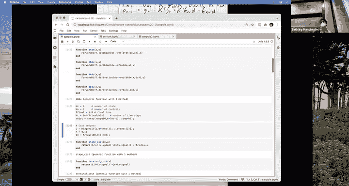

So literally all you're doing is writing down implementing all the derivatives of all the functions you know the base functions and the chain rule and then it all just kind of magically works it's pretty slick it's kind of awesome there's a bunch of cool things about those two there's this really cool result called the cheap gradient theorem has anyone heard this。

It says that。Basically， to paraphrase the cost of evaluating a gradient is a constant factor more expensive than evaluating the function itself。

 So essentially like evaluating derivatives is almost free。

 It's only like some small amount more expensive than just the original function call。

 if you do all this。AD stuff correctly， This is why machine learning works basic。

 this is why like all the deep learning stuff。Sort of as a thing now because you can do this stuff really efficiently。

Anyway， is that cool everybody it's worth a look， it's actually like surprisingly straightforward and you can code it up yourself like surprisingly easily。

 it's worth a Wikipedia it's cool。It's also one of the like， you know。

Big ideas behind machine learning and why it works and stuff。 Okay， so that's worth a look。 Yeah。

 so in here you know， I can I can most of the packages will let you di twice double di but there are weird quirks often like you can double di in pie torques but it has issues and it's sort of quirky and you have to be careful so you can always do one derivative you can usually de tutor of this of these toolbox but maybe some caveats and you pretty much can't do more than that usually okay step stuff cost function cost function cost function and stuff we did before okay I broke this out So here's the backward path that we just throw it down。

😊，Start up time step in with the gradient inhesion of the cost and I just woke out my hand and then I just this is exactly what we wrote down before right start at the end kind of value my derivatives。

And then I've got here I have the IOQR Aka Gaus Newton version and the full Newton version with the tensor terms over here where I wrote them down using the Chvex stuff so this thing that's the commutator transpose matrix thing right and that's all kind of it so what I'm going to do and'm first all we're going to compare kind of the standard。

We're going to compare full Newton and Gaus Newton or IQR DP here。

 so I'm going to start out with just IQR just this stuff we'll talk about this later。呃。

Initial guess is just like almost hanging down， you know in the。

UDoes anyone know why I put in some initial u that's pushing it to the right I don't have any。

 why why wouldn't I just put zeros？Do you have any thoughts on that。Yeah， yeah， but in principle。

 if I just threw zeros， all zeros and let it sit there like why have any thoughts on why that would be a bad initialization for this？

Yeah， yeah， so it turns out right it's there's。This problem symmetric right and so going left or going right gives you the same cost and so it's sort of like it's a weird flat spot at the bottom where you have this arbitrary choice of going left or right so I put in a tiny tiny torque to push it one way to basically break the symmetry so it like sort of has a good gradient in one direction and doesn't get stuck at that initial point which is kind of a weird there's all kinds of weird little you know quirks that you will' find in doing this stuff an initial rollout of the cost and whatever and then here's the rest of the algorithm so backward pass and then this is the rollout stuff we just talked about we just wrote this down。

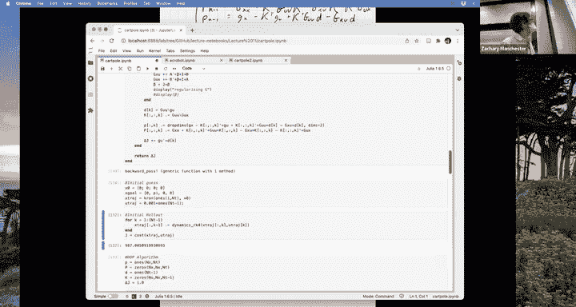

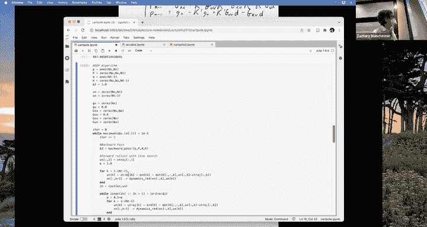

And then this is my line search stuff， I have a little like extra little kind of checking stuff in here because there's situations where things can blow up on you like check fors。

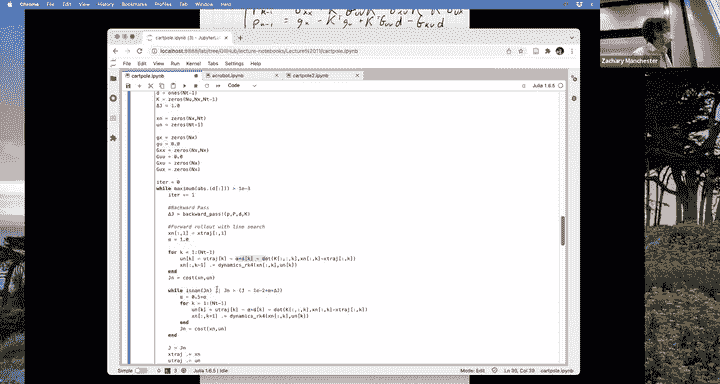

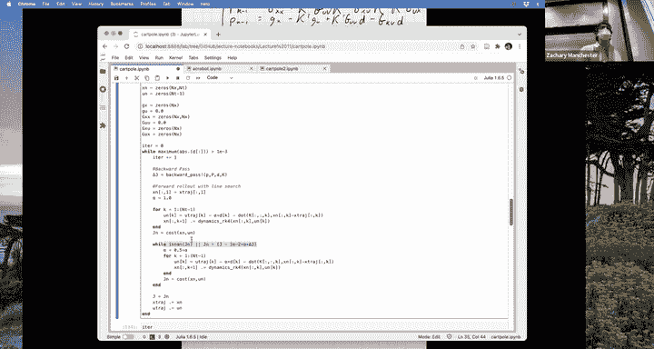

Otherwise， it's exactly we just wrote down right， so there's that。Okay。

 so this is actually going to run now。And it took， it looks like 691 iterations with standard LQR is basically instantaneous。

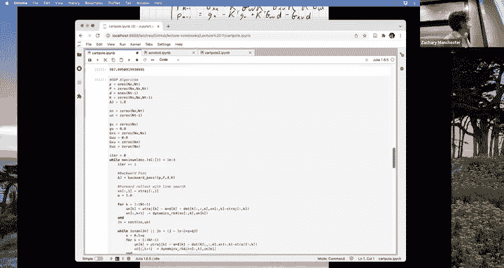

And then here's the trajectory that comes out， that's the states that's the controls and like let's go watch it and see see what it looks like。

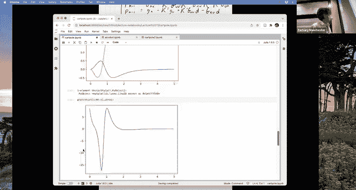

啊。Yeah。Okay。Now we're not cooperating， okay we got to do this。

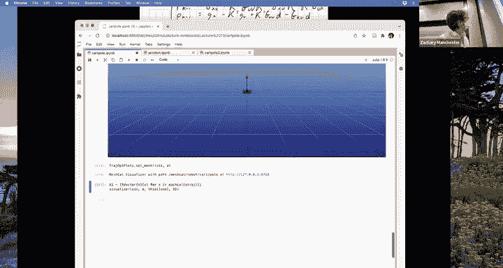

There we go。Okay， so that sort of seems reasonable right， let's do one more times this kind of fast。

Thiss just a little five second trajectory I didn't put any torque limits on it or whatever and it kind of figures out how to swing up and then the goal is to get it upright and the cart at the origin right so that all worked out cool so let's see super fast。

s up quick。So remember this and this， so the cost it finds is 6363 something。691 iterations。

 I'm going to now go in and do the full D with the extra tensor terms and let's see that that does so here's all those second derivatives。

Which are kind of expensive to compute。Like we talked about。Stup staff。Okay，'s comment this there。

Com of this staff。All right， rerun， oh I need to keep it off here。

So get my initial guess in there again， backward pass。Inial gas， roll out， same stuff。

There's going to be a lot slower just because those terms are expensive， but oh yeah。

 this is we need to talk about this too in a sec。

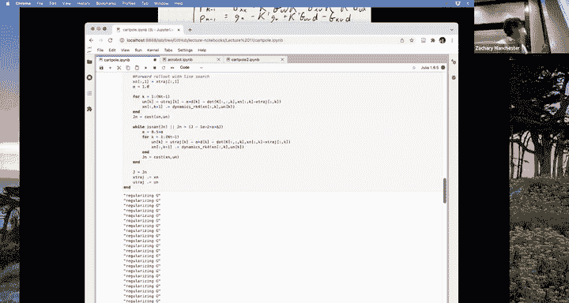

嗯。And yeah， okay， so last time it was at 691， so this time 552， so it took less iterations。

But as you noticed right in terms of wall clock time a lot slower that's mostly down to my bad implementation like if you were careful about implementing this there are smarter ways to do this right like code is not great like not optimized super well but like you can it's always going be slower you know there's extra stuff in there and in general in terms of wall clock time the Gaus Newton thing pretty much always wins and everyone pretty much just does that because the the reduction in iteration count is like a little bit。

But it's not huge right it's not orders of magnitude， this was maybe like what I don't know。

 20% less iterations， but the iterations are like several x more expensive so it ends up wall clock times still losing you basically find the same solution it's like same same cost。

 same trajectory I didn' didn't do anything different that way and watch this again。

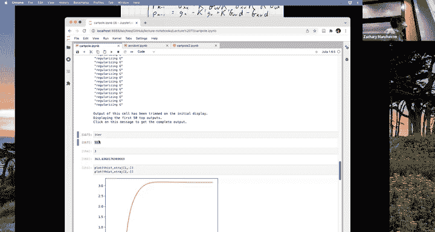

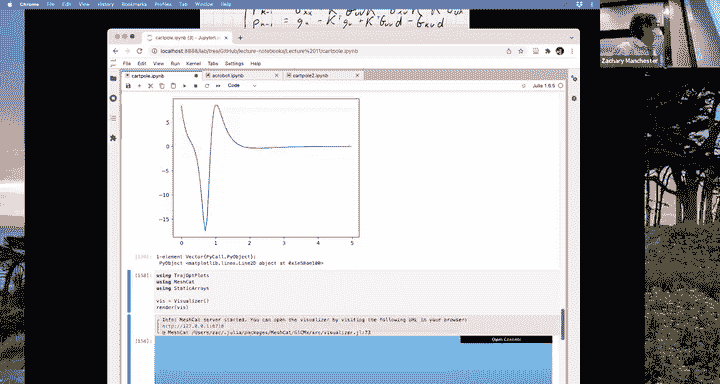

Exactly the same right so that's not that cool。What else is there about， Okay。

 the other thing we're going to talk about is？No， I put this in here on purpose so I have this regularization block where I check positive definiteness。

 so remember when we did this in the sort of Newton versus Gauss Newton story we talked about this back at the beginning of the class。

These tensor terms。So this whole thing。All these terms like this is the hessian of my action value function right and that's the thing I'm minimizing as I go backward right so I need that hessian to be positive definite to have a welldefined local minimum which is what I'm trying to do so I build that block matrix here kind of explicitly and I check if it's positive definite again is not the most efficient way to do this you shouldn't do it this way in practice should be a little smarter about this but you know for educational purposes that's what you want to do right and we need to be positive definite I'm doing the same sort of thing I did before。

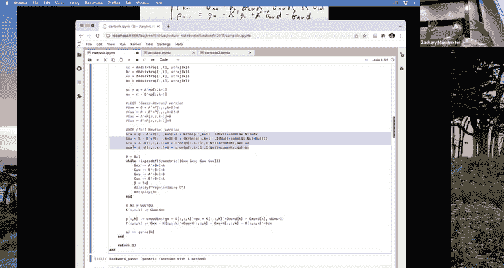

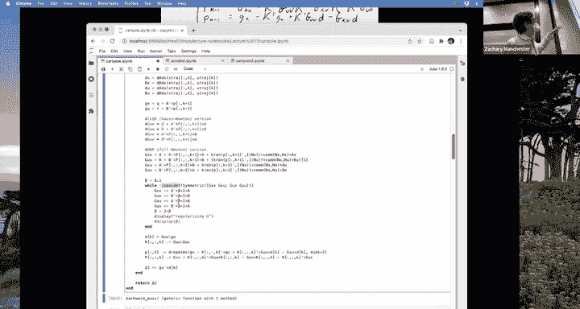

Where I like pad this thing with a multiple of the identity。

 here what I'm actually doing is padding P K plus one。

 does that make sense to everybody doesn't see that。So this is like you know。

 where this this would have shown up added on Pkpon， right is what I did here。

To pad this up and then I kind of do standard things notice I when I did the ILQR Aka Gaus Newton version。

We never got these regularizing things right it didn't need to regularize and that should be the case with Gaus Newton we'll talk a little bit more about this you still might need a little bit because of numerical roundoff stuff。

 but in general with full Newton and with DP you're gonna have those tensor terms can make your hessian indefinite like same story is when we did this for standard Newton optimization so we have to regularize in general when we do this full DP thing so that's more complicated on but I' let you say about this Any other questions about this just cool to everybody。

So save a few iterations need to regularize generally not worth it is sort of the full full story some problems might be worth it okay so that's the carpo now we're gonna to look at some other stuff this is the acro robots so I showed you this one at the end last time so this is like your double pendulum where you have two joints and only an actuator on the elbow right and a passive shoulder joint and the goal is to kind of swing it up similar sort of deal these two are both like some of the most classic benchmark problems in like robotic motion planning optimal control etc class total classic。

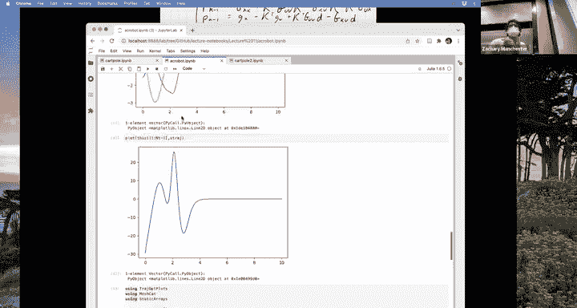

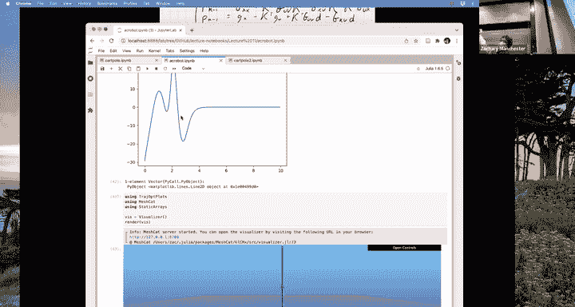

So let's do this one， same kind of deal we have a package for giving us this RK4。

 same derivative stuff as before 10 second horizon and then cost weights that I made up。

 not interesting。

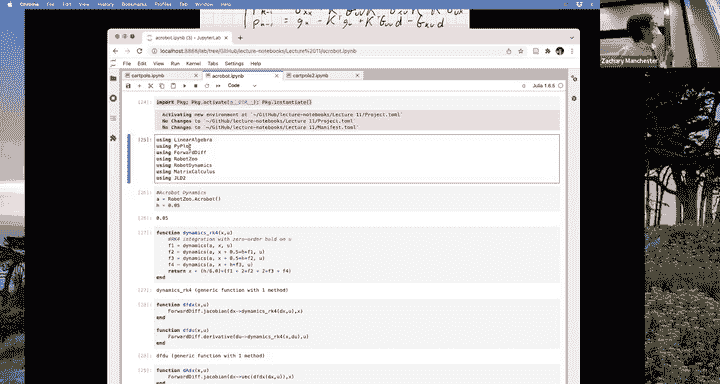

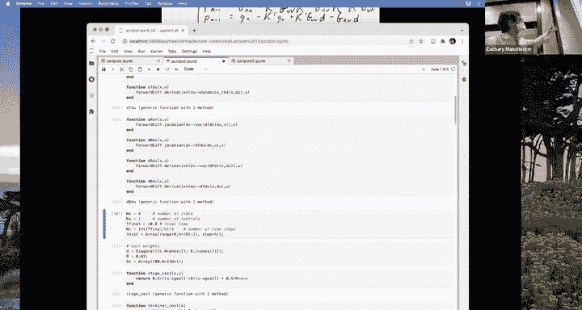

Blah， blah， blah， okay， same stuff as last time I'm going to do the same same thing we're going to do backward pass I've got。

Both the Gaus Newton and full Newton will do Gauss Newton first。That's sort of the baseline。

I's see what happens， I'm going to comment out those second derivatives and all the stuff regularization stuffs in there。

Which you need in general on the full version。We're going to start this out just hanging down with some random noise on the use。

This is for later we'llll do something fun so that's the idea hanging down a little little bit of noise again for like symmetry breaking purposes if you start getting into this stuff you'll find you usually you want to try to be a little bit clever about how you initialize these things and it's often in a good idea to not use like all zeros for example it's often better to either do something a little bit smart or put in random noise like small white noise is usually better choice。

So that's what's going on there。Miial rollout， bottle the bluff。

So here's the same thing as we just looked at。I don't think there's anything different in this code。

 the same code。And let's see。300 or so iterations。That's what the cost is。

 that's what the state looks like。That's what controls look like let's watch the video。

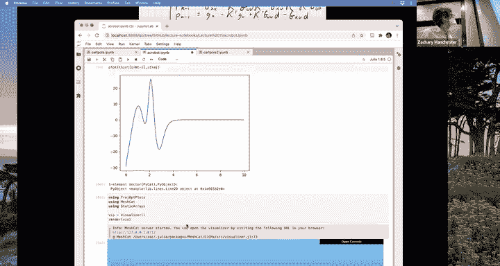

Any I mention anything？对。

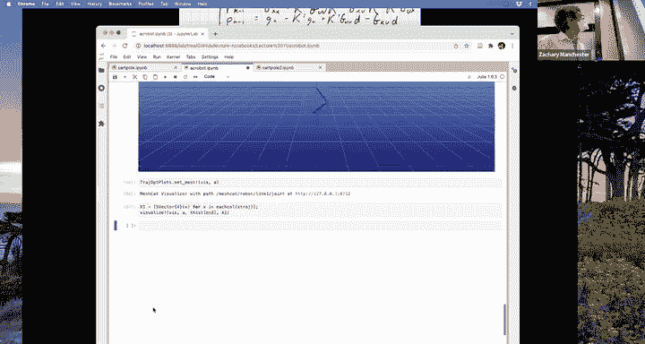

So yeah， little bit so it's doing this sort of like single pump。

Not of thing right so it's sort of pumping once twice and then then swinging up and that's sort of we're minimizing we're effectively minimizing control torque in the cost right so it's and if I play with the cost function and weighted a little bit differently you'll get you know different numbers of pumps basically to swing up right so if I like for example put a bigger cost on you and like maybe less cost on the states it might take more pumps which would be you know less torque to get to the top right so you can play games like this kind of cool okay so now we're going remember these numbers so like 300 durations552 whatever we're going go do the full newton version。

I look at that。I I'm going to try you guys。On public comment。我。And what's go on same stuff。

 same stuff。It's going to take a while。So in particular， last time right， it was。

Definitely fewer iterations， even though it took longer。You'll see in this particular situation。

It's probably going to take more iterations yeah so 960 versus 300 so this is to say that。

I could probably do better than that if I dialed in in particular the regularization here。

 what is ending up happening is it's regularizing a lot。

And that's perturbing the Newton step a lot so i'm not getting great Newton steps and it ends up doing like strictly worse here it's like way more it's three x cinema iterations right so this is to say that like。

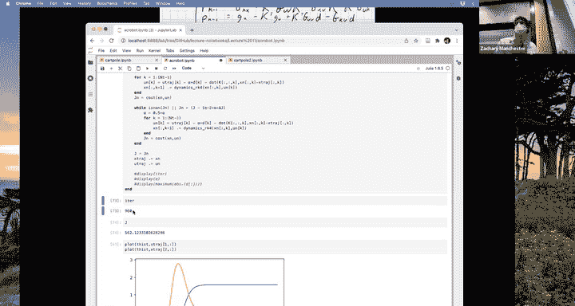

Whether or not it wins in terms of iteration count is also dependent very dependent on the problem and very dependent on your implementation being good in particular your regularization strategy needs to be good for it to actually win and for you not to just like waste a lot on your your regularization so but yeah comes out with this exact same solution once again right so kind of cool whatever this double pump thing here's the last thing I want to do which is kind of fun so i'm initializing this up here。

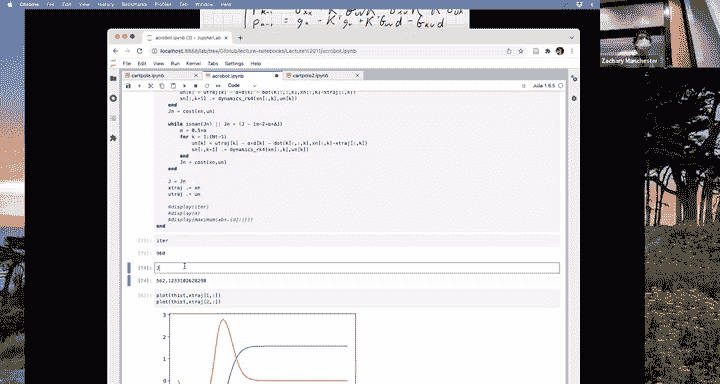

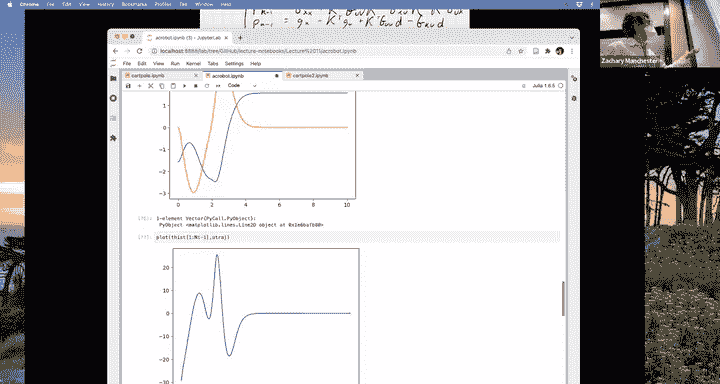

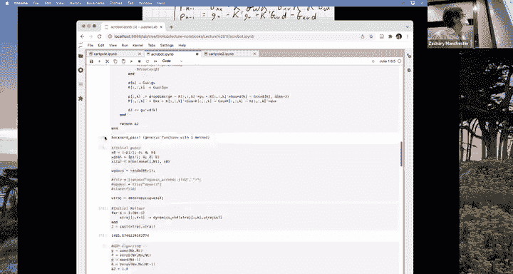

With like random white noise， just like a little bit of white noise， I'm going to actually。

I still I did this a bunch last night and you'll find well I'm going to un comment this is just a saved initial guess from when I was doing this last night and this happens every I don't know like five or1 times you try this with random inputs you'll find the following thing happening so let's do this we'll just run one more time。

Wai for this thing to converge。We about the same as last time being the form thing。Okay， okay。

 so that was a little better， 600 something look at this though。

 look what happened to these trajectory this a quite different trajectory。

Right so what's going on here， let's watch the video。So this has， like， oh。

 it's a different trajectory， was like a weirder pump behavior， what happened。

 Why did I get it a different answer？That's exactly right。

 so I'm initializing this with random noise。It's a non convex problem。

 there are potentially multiple local optim on， so notice like the cost that this converge to is almost the same。

It was 562 point something something about5 or 63 it says almost the exact same objective value。

 almost the exact same cost， but it's a like qualitatively very different looking trajectory right so this is telling you there are multiple local optima here and which one you land in is purely you know based on your initial guess so you can end up yeah。

No yeah in general not at all it's total crap shoot there's like basically nothing you can do to control this it's just like fact of life when you're doing like nonlinear nonconvex optimization there are going to be multiple solutions like local opttia you don't get to pick which one you land in it's totally dependent on the initial guess here we're using like a random initial guesses so if I runmin this 10 times potentially I could land in different local opttia every time。

So fun fact I don't know something to keep an eye out for for sure and the cost could be wildly different you could find yourself in bad local opta where the costs a lot higher than you might like and there might be you know much better ones there could be a bunch of them nearby each other right you can even get into situations where they're continu of local optima where you have like a subspace of local optimma that you can like sort of move around in lots of solutions there's like a continuum of them so all of these are possibilities。

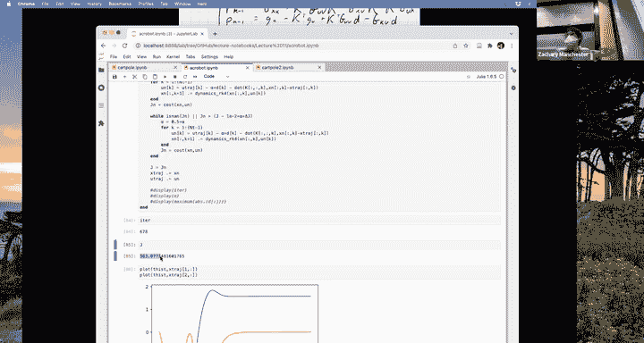

Yeah。嗯。ically what do you do try try different starts and see things Yeah so it depends like in a lot of situations like we don't even care right so in a lot of robotics problems we just care about getting to the goal and not looking stupid so often like the cost functions we write down are kind of just made up nonsense that don't really matter so being like globally optimal like I just made up that quadratic cost function right it just completely made up。

It doesn't matter if I hit that optimum or not right like all I care about is obeying the dynamics not like violating constraints like torque limits and like getting to where I want it to go。

😡，Do I really care if it looks like this or the first one I found practically probably not right so in a lot of the cases you just don't care and like just finding a local optimal solution is good enough for most applications is actually like historical examples from back in the day where people like found solutions to these problems that like they published and stuff to random problems that ended up being like extremely suboptimal local optima that they found and like later people like oh yeah。

 there's like a solution that's like5 x better than this but like that became known and popular and whatever and stuff like this right so these problems are hard in general and just finding any solution is usually good enough for our purposes if you're in a situation we really care then there are lots of things you can do random lots of random restarts is a good idea。

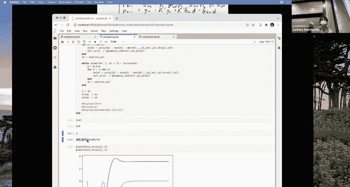

There's often like heuristics you can use so so but once you like。

Go down the path of trying to find better local optima and like this turns into a global search or global nonconvex optimization situation which is NP hard like you just can't do it without like exhaustive search basically and it's a hopeless sort of thing to try usually so it's usually not a good idea to even attempt that and usually you'll like try this a few times come up with something that looks good enough and just be happy with it practically yeah。

Did you have something I mean just Yeah in this case， yes。

 here we find a convex quadratic objective right the cost function is nice and usually you want to do that right like I get to make that thing up and like we just said I usually don't really care about the cost function that much it's usually just designed to like come up with something that doesn't look stupid and I can kind of tune it and play with it a bit right but like usually it's a good idea to just make that simple and nice and convex because we usually don't really care about the details in some other applications you might really care but in our sort of like robotic motion planning applications it's usually like and some energy term some you know tracking term whatever and it's not a big deal。

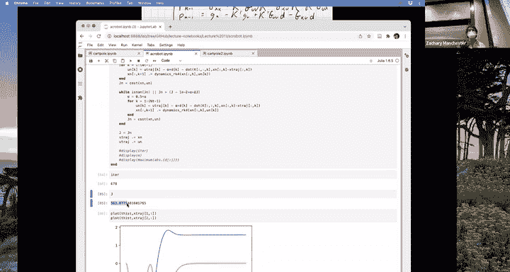

Yeah， the dynamics you can't help though that's physics you got to obey the physics right so you have to live with that and that's nonlinear and therefore。

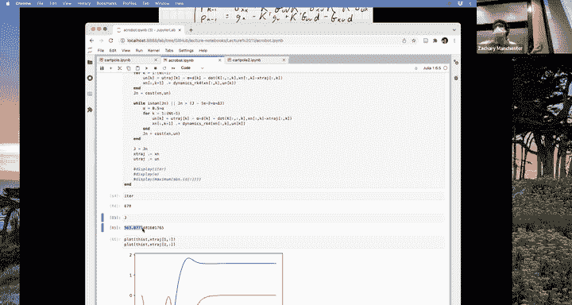

Hard。

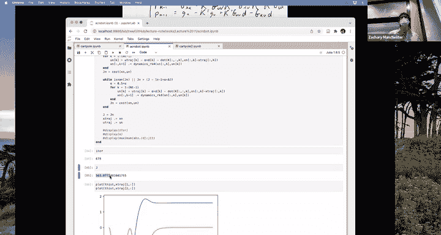

These are facts of life。Anybody else？Yeah， so with the realization rather。

Adding in this term and like trying to push it towards a positive sound definitely produce sotract out。

诶识你。DP or the term yeah， you absolutely could yeah。

 so like maybe a smarter way to do this is to just。Check and then say oh， if this is bad。

 maybe I won't even bother with the tenor terms on this iteration。

 Maybe I'll just do Gauss Newton and then try again next time and in general like。

Early on in the solve process when you're far away from the optimum that's probably just the right move so generally speaking the faster convergence of like the full Newton with those extra terms doesn't kick in until you're really close to the optimum and then the other kind of practical thing is usually。

Just like we don't really care about being globally optimal we usually don't care in most robotics applications about being super close to the local optimum either like getting it in the ballpark and being accurate to like a couple decimal places is usually good enough because our models aren't that good and again we usually just care about the robot not face planting and look stupid so as long as it gets there and looks decent like cool so achieving super tight tolerances is also not a thing we usually care about and therefore again once again Gaus Newton it's totally fine for getting you two or three decimal places that fast tail convergence that you get from the full Newton stuff we don't even really care about either like here I'm doing this to  one0 minus2 just super coarse right so here it's not going to make a big difference。

一er。Cool， any other questions so local optima regularizing and that was all I wanted to talk about here we did。

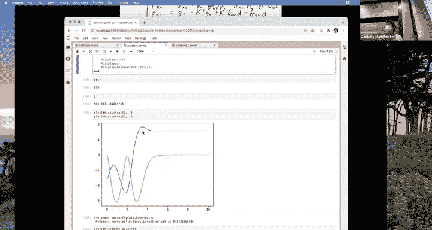

All right， more notes and stuff。Let's go talk about some sure you。Actually， sailing。

Yeah so like saying so from here if I wanted to play around and do that kind of thing what I probably do here is stretch the horizon out a little bit and then put a higher cost on the on the use and that would say like use less torque right which will make it take lots of swings probably and then we're gonna do that in a little bit in a slightly different way but yeah so basically from here if you want to engineer the behavior to get it to do weird or different things that's costshaping as you go in start playing with the cost functions maybe you start playing with initial guesses to get it yourself into different local optima right but generally speaking it was just a game of like cost shaping to get know the behaviors you want。

And yeah， you can get this probably to do like weirdo， many pump things and stuff like that。

I call add's that。Okay， that a little back to the notes。

Some things to say about these things let's see。

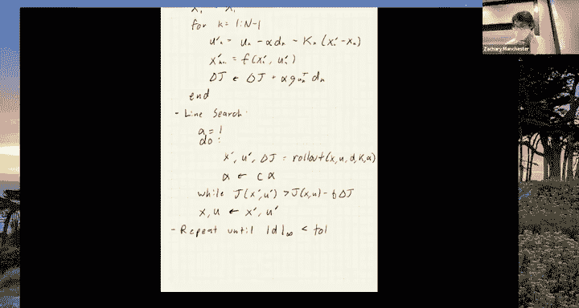

You we got。Cartpo and acrobo。Swinging up。Basically， takeaway things， DP can converge。嗯。

And fewer iterations。嗯。But the iterations are more expensive。And then just in terms like ILQR。

Often wins。In wall clock time。And is what you'll see 90 plus percent of the time in practice。Cool。

 and then the other note that we just saw was that in general， these problems。Are non convex。

So there are multiple local optima that you can end up in。AndAs just some of you aware of。

And I would say generally， just don't stress out about that too much。啊。Usually it's a big deal。

And this is also all of machine learning is non convex and with lots of local opta in it。

We still do it and it still works so seems okay okay。

 so stuff to talk about then let's talk about regularization really quick。

So I had to do it in those DP examples right and saw that where it kicked into the regularization stuff。

So some notes on that， so just like standard Newton。You want。You can have right our。RV。And or。是的。

Action value， these guys can become。These hessians can become non positive definite。

And we don't like that。So we want to keep and to keep things。

Keep things going downhill in the descent direction， we've got to regularizer， right？So。

Other comments we saw， it's definitely necessary。With the full D。And in fact， like。

How exactly you regularize can have a huge performance impact and means that like actually winning with the EDP really means you' got to dial that in pretty well。

And then also though， it's often a good idea。With ILQR as well。And more complicated。

Settings where you potentially can have ill conditioning and round offph errors。

 drive your hessians indefinite。Nummerically。We'll talk about that。So。

There are lots of ways to do it in this context， so in standard du right cut and dry。

 you like pad the hessian， you know with a multiple the I here it's less obvious what to do。

There's a few different things you can do and that you'll probably see in practice， so here we go。

So the first most obvious thing is you can just add。A multiple。Of the identity。To the cost session。

Just like Standard Newton。Right。对。We usually don't do that here。

 though usually we do some other things。 So one thing that we see a lot is you can regularize。The Ps。

 the capital P cost to go Hessians。As needed。In the backward pass。

So you can like basically check the cost to go Hessians or action value hessians on the way back。

Actually， I you should say both of those， right？So the P's or what I did。

 so you can recognize the P's or the G's。Like the cost of gohessian or the action value hessians。

 right kind of。Check them at each time step and if they're not positive definite regularize them until they are at each time step kind of individually so that's what I did in the examples I showed you that's a pretty common way to go。

😡，Another option is you can just regularize。So those those will work on sort of the in all cases。

 you can also think about just regularizing the GUU block。

 so just the one block of that action value hessian。So， this sort of。Bing。嗯。Why is that a good idea？

Or why not any thoughts on that？OkaySo the reason you might do that is that that is the only block that you have to invert。

In the ricottti equation， so I'll write that down。So remember when I solve for the ks and the Ds。

 I end up doing D is GUU inverse little GU and K is。G U U inverse。

G UX so strictly like to solve for the control updates。

 the only matrix I have to actually make sure is' inverible is that GU so this one is a good choice and this is what this one's super common in ILqR implementations。

Because there things are supposed to stay at least positive semidefinite on their own without needing regularization。

 but due to small numerical roundoff kind of things you can end up with an ill-conded situation and so if things are ill condition you you want to make sure when you solve the linear systems you're regularizing a little bit to help with ill conditioning so if this helps you with that we're just when you try to solve these linear systems aka invert the matrix you can help the conditioning by padding that block a little bit but it's not going to fix any indefiniteness in the cost to go hesian in general right so this is a good one for just helping with numerical roundoff things and I you are but not for really bad truly indefinite things that happen in the full GDP。

Okay， let's see。And then the last comment is， you know， strictly speaking。

You shouldn't need regularization。嗯。For IOQR， but often in practice， you do。Because of。

Floating point， roundoff staff。嗯。Okay， so that's the regularization story， any questions， comments。

 thoughts about any of that's stuff？These are sort of like practical。

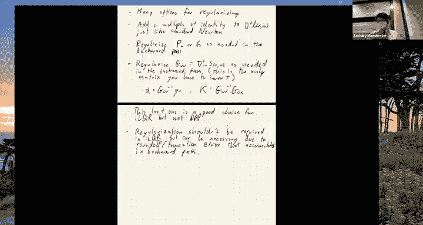

Practical tips and tricks。Okay， so then sort of some like summary DP notes。Sort of pros and cons。

 if you like because we're going to kind of move into some other methods next and so。

The kind of the good stuff， DP is known for being extremely fast in general。

 it's one of the fastest trajectory optimization algorithms out there。

Both in terms of iterations and wall clock time。So if you write a good implementation。You know。

 it can be really good and often these are the methods of choice for online real time applications for that reason and for one more reason we'll talk about a sec。

Okay， yeah， so it's very efficient。It's really kind of the key reason why it's efficient is because it's exploiting that like dynamic programming structure sort of approximate dynamic programming kind of thing。

Let's see other cool things about this this can go either way though it is what we would call any time dynamically feasible what I mean by that is it always obeys the dynamics because at each iteration of the algorithm we always do a forward rollout right so by construction every single iteration of one of these methods always obeys the dynamics what that means is you can stop the solver early before it's converged to an optimum and you can still run that trajectory it'll still work on the robot so even if it's suboptimal it still obeys physics and it's still a perfectly like feasible trajectory that you can execute on hardware so it's yet another reason why it's a good kind of maybe good method for realtime stuff。

Okay another cool thing about this that we kind of mentioned in passing but I haven't really dug into and didn't do any examples yet is that you get a TV LQR tracking controller for free so we talked about how the backward pass of LQR and DDP the cases you're getting there and like most of that backward pass thing is the same exact ricottti equation as LQR so at convergence。

So what happens at convergence of this algebra， remember we have like in the background class we compute these feed forward D's and feedback Ks at convergence the D's go to zero。

And you're left with just the ks right turns out at convergence there of one of these methods。

 the ks are the exact same ks you would get from an LqR tracking controller So not only do you get a an open loop trajectory out of one of these methods at convergence you also get for free a time varying LqR tracking controller and this is sort of thinking about this more deeply。

 it's actually kind of。Kind of tells you one of the like deep reasons why LQR is so good we kind of talked about before how LQR is really hard to beat in practice and it's sort of super super good and generally the first thing you should try one of the reasons for that is what we're doing here remember these DP things it's approximate dynamic programming we're doing dynamic programming and using like a second order tailor approximation and what LQR is if you think about it it is the local first order Tayloror approximation of the optimal feedback policy so if you can imagine like if I had magic infinite compute and I could solve the full dynamic programming problem and find the globally optimal feedback policy。

The LqR policy would be the local small deviation version of that so for small deviations LqR is the optimal thing is you know as good as the fully optimal dynamic programming solution。

 so that's kind of like a you a cool deep result that's like。

LQR is good and you get that for free out of these things。And so all of these are to say。

 this stuff can be。Very good for online。Online stuff where it's fast。

 comes with the tracking controller for free。

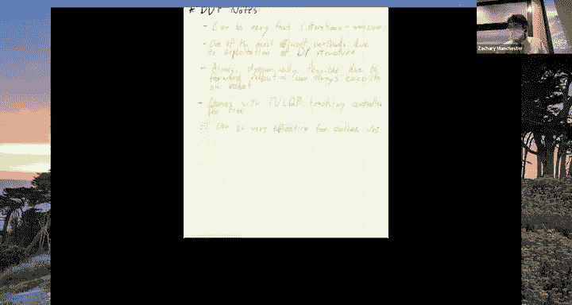

Dynaically feasible all that good stuff okay some cons now like why might you not want to do this yeah so。

I was the tracking controller， so I remember for LQR， it was a stationary point。

So there's two versions， there's the sort of time invari， which is a set point。

 and then there's time varying LQR， which is for tracking a trajectory and so。

The k matrices that you get out of DP or LQR at convergence are the exact same K matrices you would get from a TVLQR tracking controller。

Yeah。😊，你觉的什么。Before emergence， the trajectory of black would not be done。

But here you mentioned that it's always done。So in cases where we do like backward class first。

 in those。So because you were always doing forward rollouts。

Anything that comes out of a forward rollout here is going to be dynamically feasible。

So any of these algorithms will give you dynamic anytime dynamic feasibility algorithms that are based on colocation and like direct transcription which we're going to talk about next。

 they work a little differently， they do not have an explicit forward rollout they only obey the dynamics constraints at convergence so intermediate iterations if you stop early don't obey the physics and that could be a problem。

So that's what we're talking about that's the contrast here So anything like IQ our GDPP always has this rollout and always has the dynamic feasibility property which is sometimes good it's bad for other reasons that we'll talk about later so in particular okay so here's some negatives about these methods that we just talk about and we'll get more into this they do not。

They do not natively handle constraints。So we just kind of talked about， you know。

 like these methods only really address that。Unconstrained tra problem I wrote down before where it's just dynamics and cost function if you have torque limits if you have obstacles。

 stuff like that that's going break these algorithms that doesn't fit you have to do some hacky stuff to sort of smush those in people do lots of hacky things we're going to talk about it in a sec but you know constraints are not necessarily a great thing here the other thing that's the other side of this anytime dynamic feasibility thing is that these methods don't natively support what's called an infeasible starch or infeasible initial guess so what that means is I can't just make up a random state trajectory as a guess that doesn't obey physics。

Wwhich you can do with the other methods， these colocation methods。

 you can make up a random like made up state trajectory that doesn't obey the dynamics and kick the solver off with that as a guess that can that can be super powerful actually like if you have like a sample based planner or some heuristic for generating guest trajectories that are just kinematic feasible say that don't obey physics。

You can use those in a collocation method and they might be really close to the right answer right you can't do that here。

 which can be a huge disadvantage sometimes。These are particularly bad for like maze or bug trap problems。

 so problems where you have like complicated you know obstacle situations。

 these can be these can fail at and have a really hard time。

And then the last one is that these methods。They're basically like， you know。

 kind of very similar is to like backpro and sort of similar to those methods。

 they can suffer from numerical ill conditioning if you have really long horizons。

 really long trajectories because you're doing backpro。

Way it's like having backpped through a very deep neural network right you have lots and lots of stages and any kind of roundoff truncation stuff and ill conditioning stuff is going to accumulate as you go。

 so you can end up with what is in machine learning called the vanisheding gradient or exploiting gradient problem in control it's often called the tail laing the dog problem you could basically get like compounding numerical badness as the trajectories get longer and I can eventually get you and become a problem。

Yeah。And yeah， there are ways to deal with that but。Yeah， that's a thing。Okay， cool。

 any questions about any of this stuff？And some of these， yeah。

 what kind of problems can they give be not soil？A lot of problems。

It can't solve any problem except for the one that I wrote down at the beginning of class。

That's the only one it works on right so I mean like not to be super you know like you know。

 I don't know but it's basically like yeah， the common you know motion planning type problems that you would like to solve that it doesn't necessarily handle out of the box or things involving torque limits its constraints。

you know， keep outs obstacles safety constraints， that kind of stuff and there I mean。

 there are lots of scenarios where this will break。It only handles that。

Sure cost dynamics sort of setup up。With appropriate smoothness and all the other conditions we talked about。

嗯。😊，So okay， so let's talk about some extensions then the first one that's worth talking about is how to handle constraints in this DP setup。

 what are the standard hacks that people do。Which are very common。And some are better than others。

 and some of them are really bad and I don't know。It's worth talking through some of these。Some of。

You know， you might see these， you might be tempted to do these things。

 you probably shouldn't here's here's some some okay。Some thoughts on this， many options。

Depending on like the type of constraints。So the first one that shows up all the time in robotics or torque limits or thrust limits like actuator limits。

 those are fairly easy to handle and there's lots of ways to do it the first thing you'll probably see that's super hacky but can work。

Is a so called squashing function？Let's write that down。The the most common one of these is like Tch。

And how this looks is you take。The the actual you that you're solving for and you run it through a T function before it goes into the dynamics so you basically like nest nest the Tch sort of with the dynamics and the idea is。

This thing saturates， right， So you can set up the tanch so that it saturates out at your。Sort of U。

And you min。So you you do something like this right so this would be the the you on the input and this would be this like utilda that's gone through the squashing function and you'll have something like utilda equals。

U max。Times T。Of。You over you， Max。That makes sense to everybody？

So like when you're near the origin well within the limits。The T is approximately linear。

 So what goes in comes out。 And then as you get towards saturation。

 it's going as you get towards the torque limits， the function is going to saturate out and as you know you goes to infinity use utilde just goes to the Uax value right So this works its it's effective。

 but it adds。It adds a big nonlinearity into the dynamics。

 which can make the algorithm take more iterations to converge。So I don't know， a quick question。

Yeah， are you dividing by U inside the 10 inch。Because I'm normalizing it so that it saturates at。

U max。That makes sense。O here。Does that make sense， everybody else here？Yes， so like I don't know。

 we can talk offline about that if that doesn't make sense to you。Okay， so that's one option。

Not the best option a better option is these are simple box constraints right if you remember when we do the backward pass of this thing at each step in the backward pass we're solving a QP basically or right we're minimizing that quadratic cost to go or action value approximation so why not just each step we're minimizing that quadratic function with respect to you。

Why not just throw some torque limitss on there and solve a box constrained QP？So I can do that。

 I can actually just instead of that unconstrained solve。

 I can solve a constrained QP at each time step going backwards with the explicit constraints in there。

So that's sometimes called control limited DP。So I， you know， when I solve for Delta U。

 it's going to be。Arg min over Delta U of my action value thing。And that's what I'm doing right now。

 right， and it has a closed form solution， I can just tack on these constraints now。

This should be U plus Delta U in here。嗯。Cool， there's some more details there。

 but like that's the basic idea。If you're into that。

 there's a paper from Emo Toorrov's group from like， I don't know。

 six or seven years ago that does this， happy to share。Okay。

 so that's for input constraints strand those are pretty easy you can handle them in you know these kind of easy ways。

😊，State constraints are a little harder。A question on this one。

So like we can have boss constraint on the U if we're having this constraint in the backward path。

 So we can also have whatever other linear constraint on the U here。 Yeah， yeah。

 any U constraints are pretty， pretty easy to deal with like， like this， yep。Cool， thank you。Yeah。

Okay， so state constraints， state constraints you'll often see done with penalties。

 so you just throw a penalty in the cost function that penalizes。State constraint violations。

This is you know fine if you only care about very coarse tolerances。

 but in general it's going to lead to ill conditioning and it's going to take you huge really stiff penalties to get good constraint tolerances so if you're satisfied with really coar tolerances。

 maybe this is okay。嗯。A better option here。Is like we talked about when we did general optimization I can add a quadratic penalty to this thing really easily。

 I can also do wrap the entire D algorithm in an augmented lagrangian method。

 remember in the augmented lagrangian method we have quadratic penalties that fits super nicely into our quadratic action value thing and I have a lagrangrange multiplier term which is a linear term right so linear plus quadratic that's exactly what I've got in my action value approximation and cost to go approximation So it like fits in perfectly and it you know makes makes it。

Kind of very naturally work。So this is， in fact what our lab's kind of fast custom solver does。

And I'll show you some of that。So the AL method。Like it just said。Addds。

Linear Aka Woodron multiplier。And quadratic。Make a penalty。Terms。To the cost。U。

So this is like a super easy fit。You can handle that exactly in the DP method right。

 you don't have to tailor approximate it。So that's kind of cool。And I'll show you some stuff。

 this is basically like very effective。For fast convers。To like coar constraint tolerances。

Which is what we usually care about in real robotic control applications， right。

 like as we were kind of just saying。But can break down if you try to push towards really tight tolerances。

啊。If you have any questions about this idea talk to your T Brian who is the lead developer of our solver Yeah much better than it does yeah so it's absolutely unequivocally better than the penalty method but basically like the penalty stuff is going to make the conditioning strictly worse right than like an unconstrained problem and these DP slash IOQR methods already have some conditioning issues due to the long un long trajectories especially because of the sort of。

Backpropy， you know backward pass stuff strictly speaking that racottti backward recursion is numerically unstable。

 So that means like error accumulation due to floating point round often and stuff just gets worse and worse and worse as you go backward farther So it's already kind of has some issues with this。

 So we're making worse by adding these penalty terms and yeah augment ground' definitely better in the penalty method。

 But if you have a really long trajectory and you try to crank towards like really tight constraint tolerances。

 you're going to have problems basically So we have some tricks for dealing with this in our stuff that's kind of be on the scope of this discussion。

 but there are ways to deal with it， but it's sort of。requiresquires fancier tricks。

 and it's not trivial。I don't know， that was unsatisfying， but yeah。

 we can talk more after if you care Okay， any other questions on this？😊，Okay， there's some。

Should we go into this？And there's a few other little things so there's some other things that are worth like just mentioning real quick so what if we want to have a free initial state what earth if like instead of a like xO given what if we have like what if we can pick our xO or something like that right which is not an uncommon thing。

Or the the other version of this that shows up is what if you actually have like parameters in addition to the controls you want to optimize like what if you're doing like design optimization like what if you could pick the leg lengths of your robot or you have other design parameters you want to co optimizetimize all kinds of things you could imagine doing there right So if you want to do that there's sort of a。

Some tricks。Those all look basically the same as this， by the way。

So anytime you want to have like some additional handful of system parameters in addition to the controls。

 you can sort of tack those on as a sort of fake。Sort of like you not that shows up before the initial time step。

So you add a fake like k equals zero step。That looked like this。Where this is going to be。

Like zero and thiss going to be an identity。And now U not becomes X1。

And you can basically you know throw anything you want in there actually so you can throw like literally any problem parameters system parameters etter。

 in this and you can like optimize those along with the trajectory which can be useful can be kind of cool the last one to mention is this like free final time kind of stuff。

Qu question on that。 Does this only work when X and U are the same dimension。

 Like otherwise what do you you can you can actually so there's nothing in here that says the dimension of U can't change So actually you can like stuff a whole bunch of extra things into U1。

That aren't in the other views， like the dimension of U does not have to stay constant along the trajectory。

 which is kind of interesting。Okay， yeah， that't make sense。The previous only the next only on yes。

 so like how do you get a U not to affect like parameters that you not to。

They only affect the next state and the state after but yeah so there's a sequential in time thing right so if you want to optimize some other weirdo parameter it has to go in it you not because then it can affect the whole rest of the trajectory right so like basically what you do is。

Take it and then bury it in the dynamics model from then on right so it can be anything you want any other parameters that you care care about you can throw in there yeah。

Trying to take an initial condition that often a problem also Yeah。

 so why doesn't it just say the initial condition。我经。はい。

I don't know exactly what you're getting out there。

If you're trying to get through a specific position。

 why is it saying the optimal solution is to start that？So I mean， I'm not saying start it。

 so if I want to just start it at some initial state cool done。

 this is like I don't care about starting at some exact initial state。

 maybe I have some other parameters like maybe I can start anywhere within some bounded region。

Is legal also it can be things like optimize some other system parameters other than the state like parameters of the model right like could be design parameters of the robot。

 how much fuel you should carry like I don't know what masses。

 inertia is like all kinds of weird things that you can imagine like literally anything you want。

Anything you want to optimize in addition to the control trajectory。

 you can step into this UOT term and optimize。啊，对呀。Cool， anybody else。

Are there problems you having the way back your whole oh yeah absolutely yeah。

 it's the same problems we always have it's the same tail liking the dog you know sort of problem。

So it's not any worse than like U1 would be。Right。These parametersers might have a bigger effect on local problem they might yeah。

So yeah， you can get like ill conditioning， absolutely yep。

It can happen yeah so this is always a problem like there's this sort of thing always shows up it's always something you have to like kind of finesse a little bit。

And worry about a little bit there's all kinds of fun games you can play with that trick though we have some games like this where we like。

 for example， bury a neural network inside the dynamics to do cool things and then you can optimize the neural network weights like this right it's kind of cool Okay so last thing。

😊，And I can't write or should we just call it yeah， we got one minute left so okay。We'll skip this。

Maybe I'll do it next time， but the last thing I'll show you them is fun code again before I send you on your way so here's a carpo。

Carpool part two。So we're going to do this， this time it's everything's the same， five seconds。

 whatever same cost function， blah， blah， blah， now we're going to do with constraints using our labs custom solver that Brian mostly developed called Ulro。

 which stands for augmented Laangian trajectory optimizer。

 which is DP or IOQR wrapped in an augmented Lagrian method with a whole bunch of fancy tricks。

To make it go fast and stuff。 So here's what we're going to do Everything this is all the same。

 but I'm adding in。 So if we go back and look here。I did like a one pump swing up on this guy。

 but look what the controls did this was like you know minus 20 plus I don't know1ish I'm going bound the controls at three plus minus three so way tighter than what I had before and in particular it's so tight that I can't do a one pump swing up。

So it's going to force it to do lots of pumps to get up， so let's look at this。h， blah。

 blah solver stuff you can see I don't know 97 iterations 20 milliseconds to solve this is what a good implementation looks like I solved this problem from scratching 20 milliseconds right so you can do this stuff online let's watch。

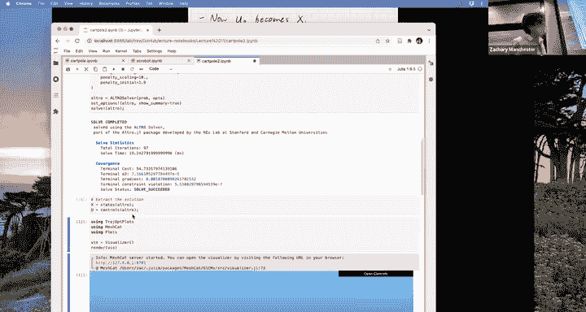

Let's watch it。So yeah you can see it's like way less control authority so it has to do this like many pump thing here's what the controls look like for that you can see it's doing it's basically railing right at the torque when it's you know back and forth this is what we classically call like a bang bang control policy right where it's hitting the torque when it's repeatedly anyway that's it。

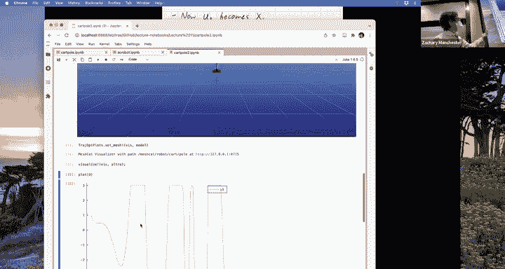

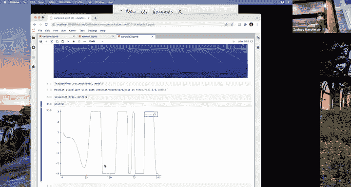