# CMU《最优控制和强化学习｜16-745： Optimal Control and Reinforcement Learning》中英字幕deepseek - P13：[13]Lecture 12_ Direct Trajectory Optimization Methods.zh_en - GPT中英字幕课程资源 - BV1qHwke1EBX

Last time we talked about DP， some kind of details there and how to deal with constraints。

 we didn't quite get to doing minimum or free time stuff with DP so we'll finish that off today and we're going to start talking about direct trajectory optimization today。

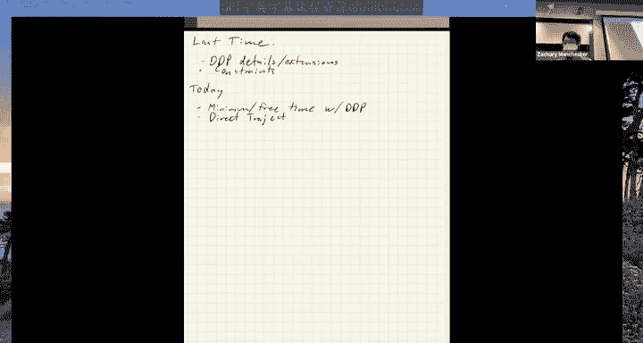

And along with that， kind of the standard method for solving those problems or one of the standard methods is called。

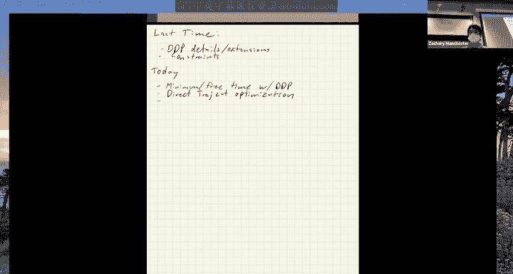

Sequential quadratic programming。And then we're going to talk a bit about direct collocation。

 which is kind of a very classic and very standard algorithm。

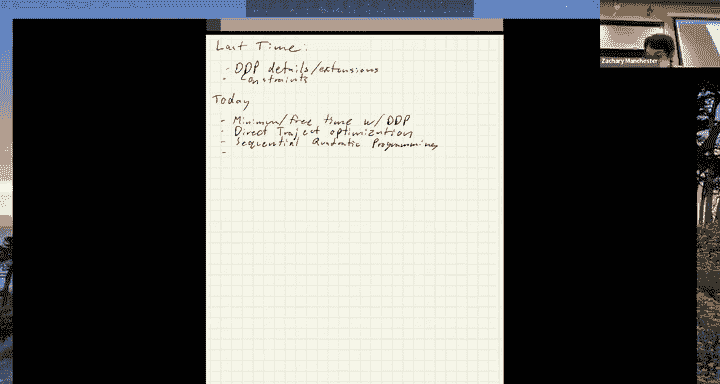

That's used for lots of things in the aerospace world。

 like this is how you kind of like design trajectories to fly to Mars and the moon and stuff like that。

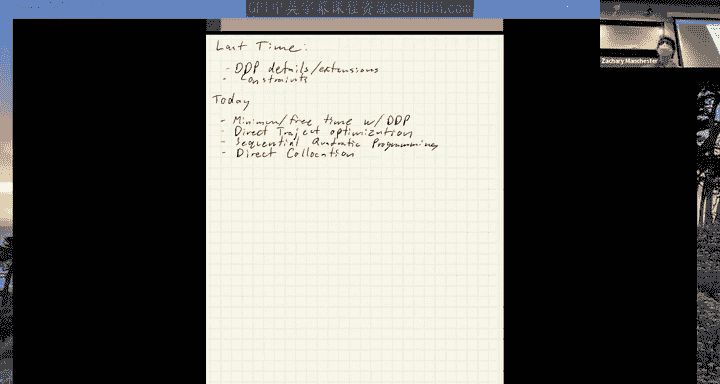

Cool， so any questions about anything before we kind of get into things？

Nobody everyone get so a couple things that have been coming up in office hours that I wanted to kind of just hit really quick。

Notes on like linearizing in the context of LQR and NPC。

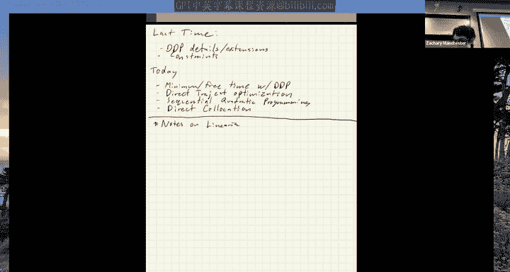

Yeah。

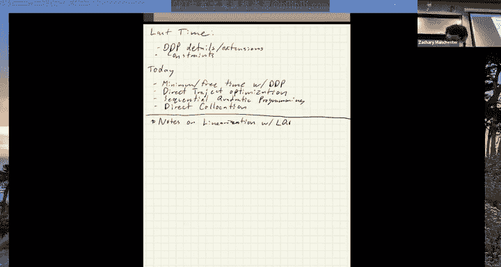

So when we use linear dynamics models， right， we're taking something that。

Looks like say x K plus one equals F of x K UK。 we're finding some nominal sort of trajectory or nominal state that we want to keep things in and we tailor expand this whole thing。

 So we we turn this into。

Say。Xk plus1。Plus， Delta X， K plus 1 is approximately F of X K。UK plus a。Delta X， K plus B， Delta UK。

 right， And what we then do is say， okay， well， this term。

This guy here is the same as as this from the original dynamics。

 So we're left with this Delta system right that says。

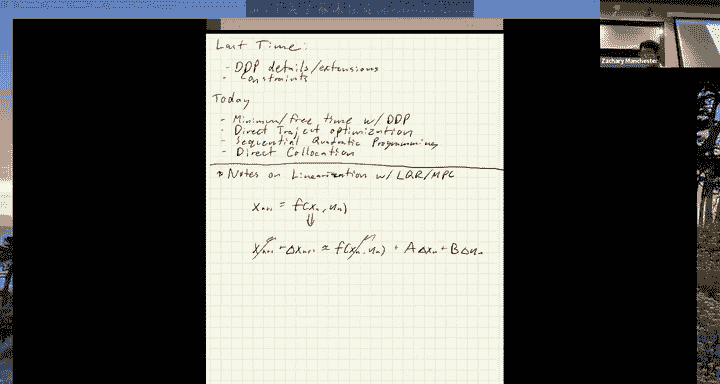

嗯。

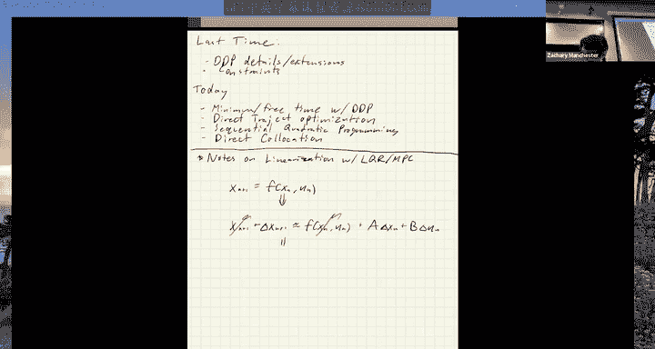

Delta X， K plus1 equals a， Delta X， K plus B， Delta UK。 And to be super clear， right， this a is。

Partial F partial X and this B is partial F partial U And then we get this sort of canonical you know A X plus B linear system that we talked a whole bunch about that is kind of the dynamics that we use when we do LqR for sure and also the dynamics that we use in a lot of NPC stuff when we do conx NPC in particular right so this was this apparently came up a bunch of office hours and for this homework So just wanted to like keep it sort of。

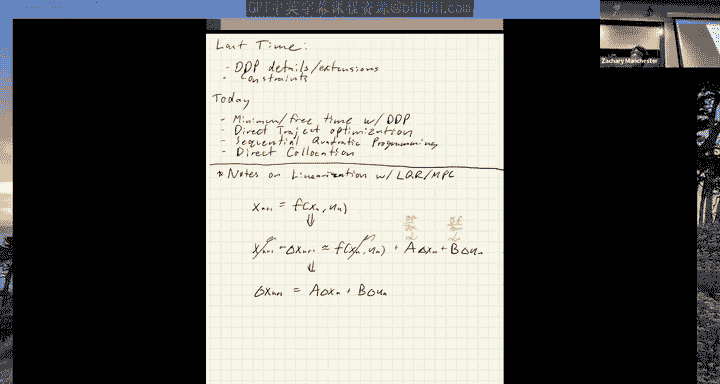

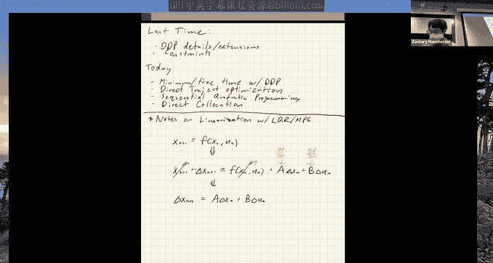

Extra clear to go over this。 So the thing to know here is when you're doing Lqr， for example。

 we're computing a feedback matrix based on these deelta dynamics。

 So when you get that K matrix out what you're really going to do is。You're going to have。

Delta u equals minus k delta X right so when you're running this on a nonlinear system that you've linearized you might have a a nominal u like a U not that you're applying to the system and you might have a non zeroro X not as well right so when you're doing this on a nonlinear system in general you're going to take this compute the delta U but the actual U you apply is really going to be U。

Is some u not the nominal U right that was the feed forward you say。

 the U that was in there before we added the Delta U。

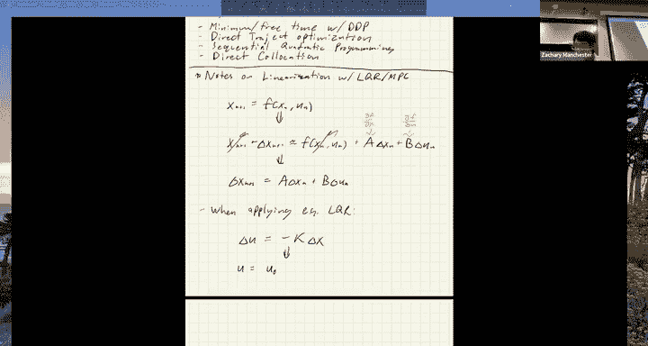

Minus k and this deelta x right is going to be whatever the nominal x was。

Sort of minus the it's the actual x minus the nominal x， right？Does that make sense， everybody？

So like， you have to。

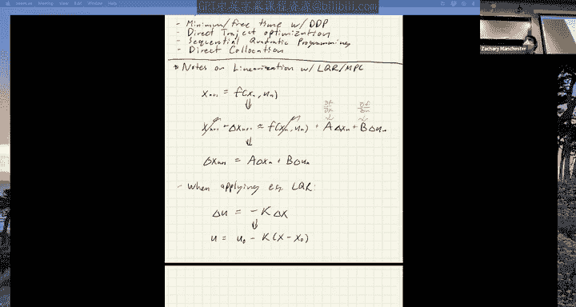

Tack on or deal with the reference or nominal values of both UNX and these things， right？

And this applies on the homework in particular right this will you want to think about this when you're doing LQR and you also want to think about this in the NPC stuff when you're doing NPC if you're using a linear model like this。

 youve got to think about sort of there's probably a reference value right so in particular think about the rocket stuff there's a nominal reference U that's you know sort of canceling out gravity and stuff like that and you're really computing these delta values。

好。Any questions about this？Okay。

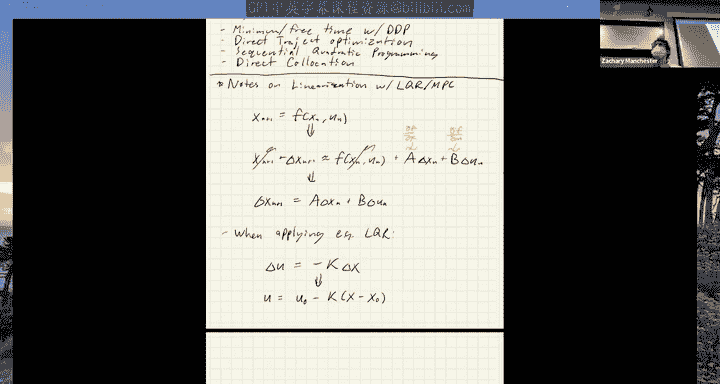

Okay， that's。Clear， okay， so to sort of just finish up the。

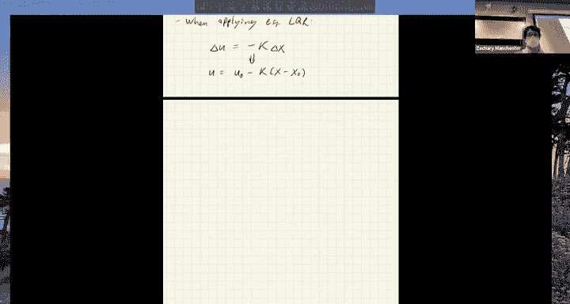

Dcussion we're having last time。Let's do the sort of free slash minimum time thing really quick。

嗯。So these show up in quite a few applications， so anyone have any thoughts on where you might see something like this？

Nobody no ideas is okay so minimum time is get some get to the Gulf state as fast as possible and usually that's classic bang bang optimal control that's saying basically what you want to do is full gas and then full breaks and you'll get out this kind of bang bang policy so that's minimum time in practice those aren't used a whole lot because they do tend to do crazy things that are difficult to track in practice basically run the system right up to its limits you probably don't want to do that in real life for various robustness reasons and safety reasons but the free time thing does come up a lot so it comes up in for example situations where like。

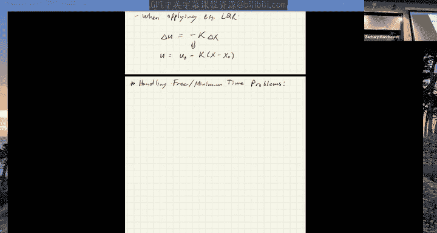

You care about getting to some goal state？

At the end of your trajectory， but you just don't necessarily know how long it's going to take。

Or or when you might get there right and so I mean you can imagine all kinds of scenarios where this could happen and is a fairly common thing so in that case what you want to do is not necessarily have you know prespecified length of the trajectory pre specifiedified time steps instead you want the solver to kind of figure that out for you right。

So the classic minimum time problem is actually。

The following thing， we'll just write it down， I guess， so you'd have like in continuous time。

 which we don't usually talk about。You'd have this kind of deal。

Your cost function would actually just be integral from zero to big t of one。立体。

So as you can see and then your T， your big T， the limit of the integram is a decision variable that you're optimizing over now。

 right？And so this thing will just integrate up to T。

Subject to you know the usual stuff dynamics。

And then like maybe some goal state。And then maybe， in fact。

 definitely you're going to need control limits on this。

What happens if I don't have any control limits on this？

Yeah you'll get like you so it's very easy to set up ill posed problems like this where there's not a finite solution right you can get garbage pretty easily so this is kind of the classic minimum time problem。

不。And sometimes you can actually get these answers in closed form。

 like if there's linear dynamics and things like that。Yeah yeah。

 you can totally do that I mean so this is just an example right I can easily throw whatever I want in that cost integral in addition to time right and weight it and so yeah yeah it can absolutely do that。

Yeah，So let' this trip on the X of equals。

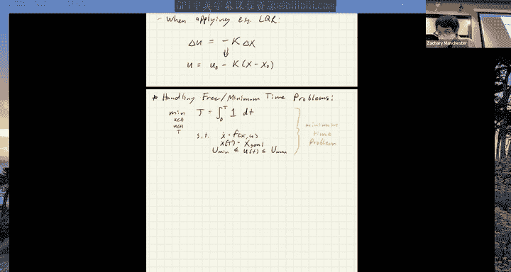

X of oh x goal， yeah， sorry。

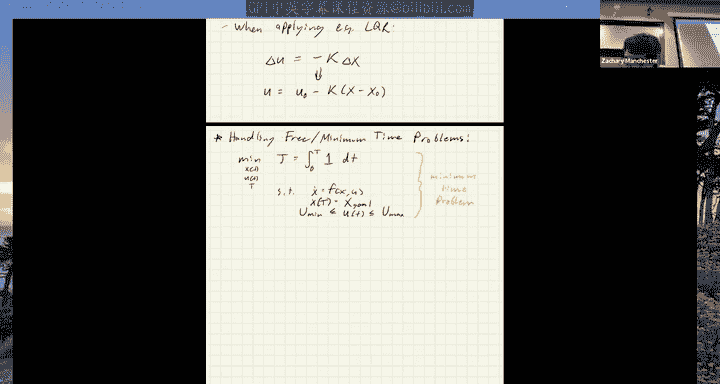

Okay no time cool okay so here's kind of the idea right if we solve this numerically in a computer so like the way we kind of do it now we have fixed time steps right so if I wanted to do something like this right now I would be actually wanting to like minimize the number of time steps which would mean like the size of my decision variable vector and my optimization problem is changing which is bad I don't want to do that right。

So we don't want to change the number of knot points。

What should I do instead？We don't have any thoughts。How would you do this if I said， okay。

 I want to use the same number of plans like what do you have to do then it's kind of the。Yeah。

 we've got to change the time step so like in the kind of current optimal control setup we've been playing around with like the DP setup like how do you think you would you would set that up then？

嗯。😊，嗯。No this is a variable horizon you know we're going to have fixed number of time steps we want to make basically what we want to do is change the Hs right and let the solver figure that out yeah do you have an idea yeah so not pretty much yeah so what I'm going to do is I'm going to make the H's the individual time steps at each stage or each knot point i'm going to make an input in the U and then i'm going to add a state on that integrates up the total time。

So the dynamics， does that make sense？好。So basically the H in your RK method。Becomes a control input。

So you end up with something that looks like X K plus one equals F of。X K， and we'll call this。

 I guess utilda subk where this utilde。Is the original U？It's okay。And then the age at that time did。

And then you can sort of do， you know， you can rewrite that like that F is still your runga kind of step。

 it's just now that H is also an input and then you probably also want to scale the cost by H if you're using some multi objectiveive cost。

 yeah。Did time of reasoning affect the dispartization like A and B？Yeah， every you changeYeah yeah。

 so this is exactly yeah， so even if your dynamics are linear。

If you set it up this way and you solve a minimum time problem。

 it's non convex like the disretized dynamics with the H as a decision variable are no longer linear。

 yep absolutely so this is always a nonlinear thing。

There are some caveat staff， if anyone's really into this and you want to there's actually a convex reformulation of the linear dynamics minimum time problem。

 fun fact， we could talk about it offline if you're curious。You can also， yeah。

 so the other thing here is also can scale the。The cost。

So you could do something like this if you had other terms in the cost function。

 so you could do J of say x tilde u tilde would be。

Sort of HK times your whatever your original one step cost was。

So this is basically doing like classic rectangle rule integration of that integral cost thing。

Okay， so yeah， like we just said， this is always going to be nonlinear non convex。

 even if the dynamics are linear。啊。是。There's one more quirk to this is anyone to have any any idea what can happen here？

So。I'm using this like discrete runga kta thing and as we kind of saw。

 right weird stuff can happen in a rungacutta method as a function of time step， right？

So we saw how you know you get artificial energy， weirdness happening as you make the time step really big and all this kind of stuff。

 so if I let the solver pick my time step，Weird things can happen right in particular here too not only do you have to worry about making them super big。

 super small， they can even if I don't do anything if I just set this up and do standard D with this like we've been doing。

 there's nothing to stop H from going negative either which would be extra weird and terrible so generally speaking you need to do this you need constraints on the Hs to make this work at all and for it to not just give you garbage and usually what you want to do is bound H within some limits that you think are reasonable given your system dynamics and from a cutta method you're using and stuff like that otherwise basically what'll happen is the solver will exploit sort of errors in the dynamics right it'll for example make one time step gigantic and then one super tiny and one negative or something I guess and exploit discretization error to like get lower cost。

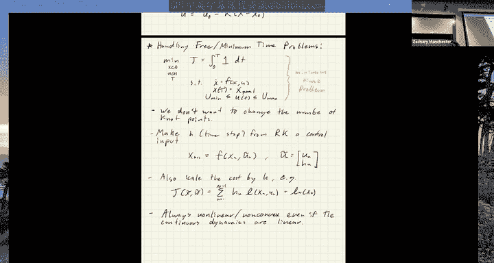

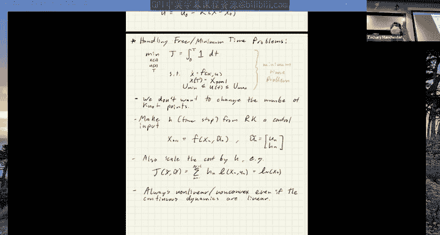

啊。So you don't want that。

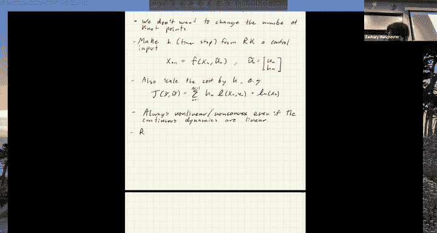

So yeah， you can call us like cheating physics。Okay。

Any questions regarding any of this stuff is there a whys？

So pretty much because I want to optimize it， so in DP I have x0。

And that's all I get to pick right and I get to then like I'm finding the U trajectory right so if it's something I actually want to。

 you know。Play with I kind of have to put it in the U。 There's one other option。

 which yesterday when we talked about this whole idea of like。

Putting random parameters into some UO that you sort of tack on ahead of the trajectory and that lets you do parameter optimization you could go that route where you basically pick one fixed H for the whole trajectory and then like backpro it through the whole trajectory and then optimize it in that UNot it turns out like we kind of talked about yes two days ago that gets pretty ill condition and it turns out this this setup where you let it vary at each time step separately works a lot better is like just numerically the better way to go。

All right， cool， and bring on this， yeah。😊。

So in this message， we'll optimize that each individual time so is that。I guess。

So is the goal of this just kind of maximize like machine effort like to faster or does it like improve it makes it so you mean basically letting each time step have its own age versus just having one global H yeah so if you do one global age which you can do with kind of stuff we talked about last time where you kind of tack on this additional fake you at the beginning you do it that way you get this kind of like ill conditionditioning vanishishing。

 exploitloding gradient tail wgging the dog kind of effect because it's affecting the entire trajectory and it's this one parameter all the way at the beginning so you have to backpro the gradients and hessians of that stuff all the way along the trajectory whereas if you do it at each time step individually it's you know one time step at a time right so you're not getting the same sort of error you know sort of ill conditionitioning sort of thing happening where you're back propping all the way along the whole trajectory because that makes sense so it's basically this way is numerically better practically better mathematically they're totally equivalent right and if you had some magic。

Infinite precision computer， maybe you'd want to do it the other way。

 but if you're doing this on a real computer with floating point arithmetics。

 this is kind of a better way to go。All right， everybody good。Yeah， all right。Next up。

 we're going to start talking about direct trajectory optimization。

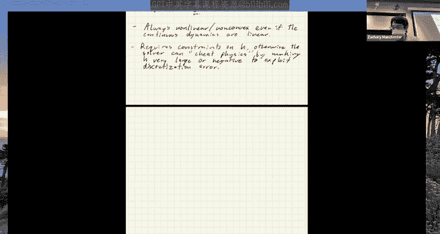

So this is basically the other way to do trajectory optimization like we did all this indirect ILQR DP stuff that stuff super widespread super common in robotics then the other way to go is this direct stuff which is also super common and super widespread Finally enough most organizations that do this stuff like labs in academia or companies whatever have like a culture of basically preferring one over the other and you'll find a lot of labs are either direct labs or like DP labs and have their own inhouse solvers for doing stuff and kind of stick to one or the other so I don't know。

Okay， cool， so the basic idea here in a lot of ways this is。

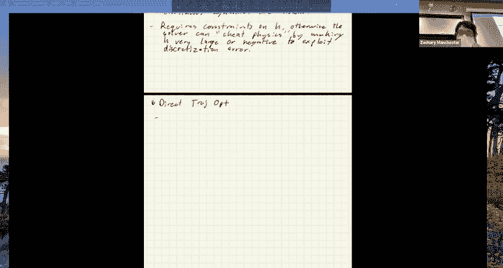

More it's easier to like conceptualize and it's easier to kind of write down a lot of this stuff。

In this setup and it makes a lot of sense， but implementation wise it can get a lot heavier so the basic idea here。

Is to just。Take the original optimal control problem we wrote down with the cost function of the dynamics constraints。

 just discretize everything and feed it to a solver。

So that's sometimes called transcription， you'll hear that called direct transcription sometimes。嗯。

Still， let's write that down。It。

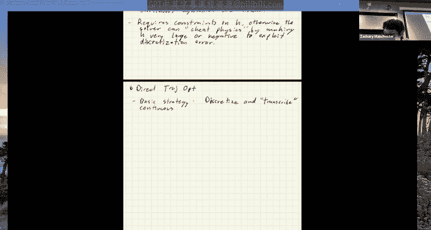

Yeah。So yeah， you take the original problem you had and in the most straightforward direct way possible。

 you just like discretize it and then feed it into a computer。あ。

And these are going to be what are called nonlinear programs or NLPs， this is not for the CS people。

 this is not natural language processing， is yet another overloaded acronym。

Non nonlinear program which is just just stands for like a generic non nonlinear smooth optimization problem so there's no convexity or any of that's nice stuff generally these have the forms so here's what an nLP looks like in general。

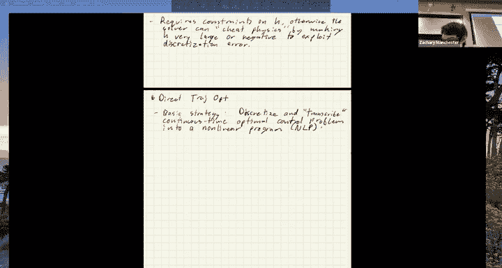

Min over some X。F of x， subject to。Some constraint equality constraints， c of x equals0。

 and then some inequality constraint， say d of x less than equal to zero。

So that is it that is a standard form NLP， so we're basically just take our optimal control problem and like discretize do whatever we got to do to get it to look like this。

 just some notes。

This is called the objective function。

Or cost function。嗯。And then these are for us， these will be the dynamics constraints and the equalities。

 maybe a goal constraint if you want， but generally this is where you're going to put the dynamics。

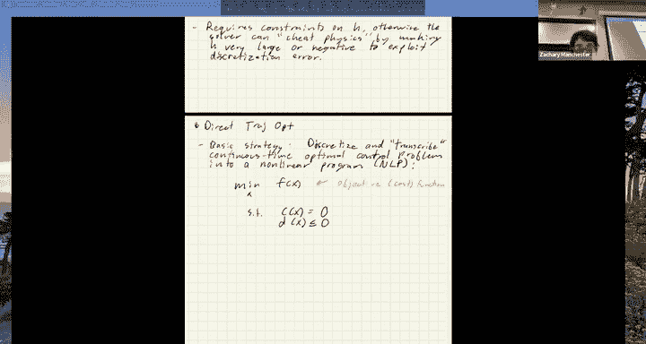

对。嗯。And then here is going to be maybe， you know， like other constraints like torque limits。

 obstacles， that kind of stuff。

对。Okay， so the point of this is that standard form。

Is what the solvers will take so you find there's lots of NLP solvers we'll talk about a couple we'll use a couple of them they basically all take problems that look like that and have a few requirements on the functions like they basically have to be generally speaking C2 smooth so you have to be able to take gradients and hesians。

 but as long as they look like that and they're smooth and you can get the derivatives if you can hand that to a solver it'll solve it for you pretty much。

Okay， so。

嗯。What like off the shelf？So the other thing about this is the large scale part so when we do this optimal control stuff like usually we're doing stuff with thousands of decision variables not uncommon to get into tens of thousands or even hundreds of thousands so they're like they're not large by machine learning standards but they're like pretty big they're big enough that like your own cartoon you know MatTLb or Python version of one of these is probably not going to cut it so that's why they are these kind of large scale off the shelf you know commercial solvers and stuff like this。

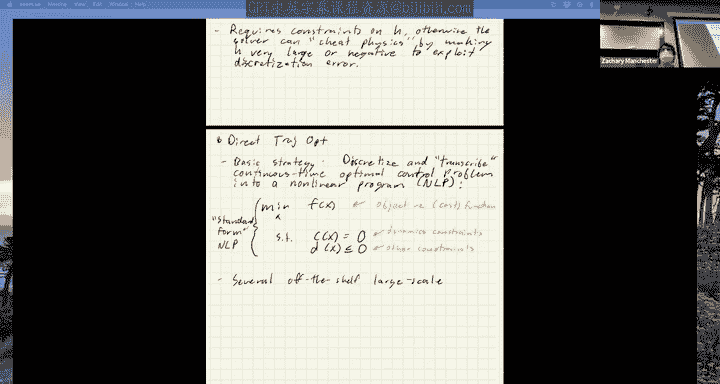

And theres a few common ones in particular。So has anyone done any of this stuff before？Yeah。

Like what have you used IP Yeah， interestingly， IPOs from CMU。

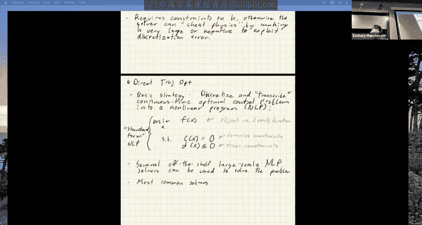

Yeahrobi Garrobi is a convex one， not an NlP solver so the big ones are yeah definitely IP opt which is。

Is open source？So that's kind of the main free one that you can just download and again it's from a lab here at CMU。

The other really popular one in optimal control， at least is spped。

Sometimes pronounced Sn opt I've heard people say it that way， which is commercial。Okay。

As in not free， and there's another one called Nitro that's also kind of popular。

That's also commercial。

So these are things like you buy it or you install it right and they'll solve things with like 100000 variables for you as long as you can set up the problem kind of hand it the derivatives and stuff like that okay so。

That's the way this is typically done， the way most of these solvers work， or you know， there's many。

 many details， but like a common strategy that's used in a lot of these solvers。

Is something called sequential quadratic programming， which we'll talk about now。

 which kind of is not surprising at all when based on the name。So let's see。

Also known as SQP so we've already seen quadratic programs right we I'll give with that quadratic objective linear constraints。

 linear equality and inequality constraints， so what do you think sequential quadratic programming means。

When we have a nonlinear program like this， basically what you're going to do is take the nonlinear program and take a second order tailor expansion of the cost and linearize the constraints to get a QP。

 solve the QP， use that to get it like effectively a newton step right and then like do it again so yeah general。

Or I guess what is the。So this is another kind of class of algorithms for solving the optimal control problem so when we we looked at the optimal control problem right which is like minimize some costs you got your dynamics whatever and we looked at you know we did if it's linear you have LQR right all that good stuff and then we did if it's nonlinear we had this iterative LQR DP stuff right it was based on these dynamic programming sort of forward backward ideas here instead。

We're not going to do anything dynamic programming。

 we're not doing forward rollouts backward recursions。

 we're literally going to take the optimal control problem and like write it down in this form。

 this like standard NLP form and we're going to get into that next like how to actually set it up like that and then you're basically going to take it and hand it to a solver like generic non nonlinear programming solver and that's going to get you an answer。

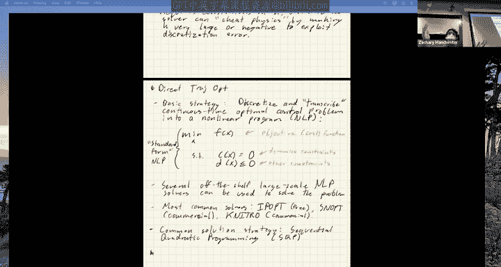

So that's kind of the and the details here and how you discretize and there's a few standard algorithms that are based on like the details of the discretization。

 which we're gonna to get into basically you know when we did it before we just said RK4 you know that's probably what you want here it's a little more subtle you generally don't want RK4 here There's other things to do that are called colocation which we're going to talk about and that's really it like basically there's some tricks in how you set it up like this how you discretize it once youve got it to look like that then you just use off the shelflf large scale solver。

That sort of。Make sense cool。

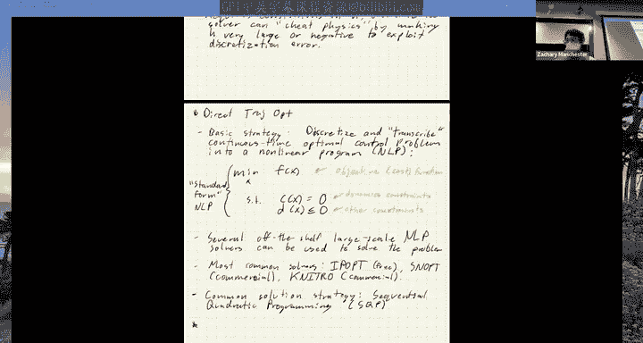

All right。Okay， so let's do this FTUP thing。So basic strategy。

Is to use。A second order。Taylor expansion。Of the cost。Or really of the。Have the Lagrangian。

And linearize the constraints。So。So linearize C of x and D of x。To approximate that NLP。As a QB。

So local， you know QP approximation and it's going to end up looking like。

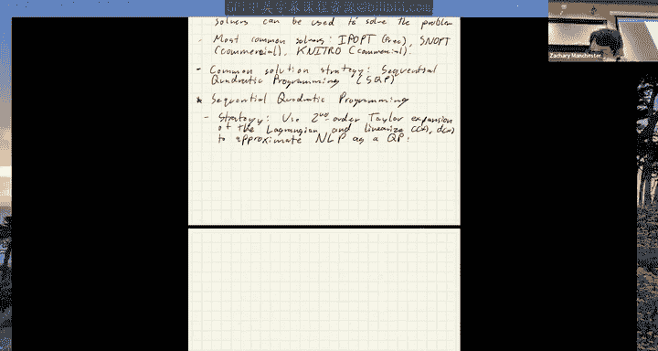

This kind of deal。And again， these are Dltas just like we had this whole discussion before about when you linear you're really talking about Dltas。

 so we're going to do this Tayloror expansion in terms of some deltas。

And we're going to get something that looks like this。う。

So we'll have like whatever our original C of Xil is plus， this big C will be the you know。

 the linearization， the Jacobian。

And then the D similar thing。Where， you know， all those matrices are sort of。What do you expect。

 so this thing is the Hessian。Of the lagrangian。This thing is the gradient of Vilagrangian。

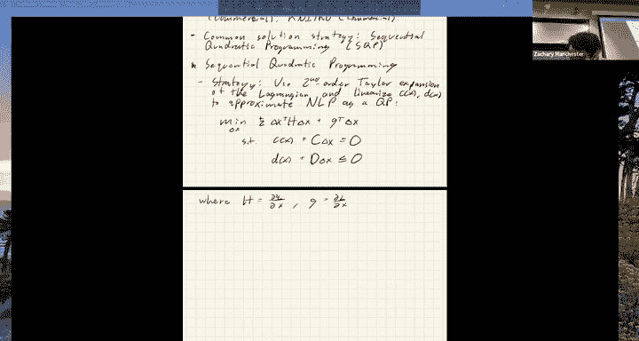

This is the Jacobian of the equalalities。And then the D is the Jacobian of the inequalities。And for。

有。For complete here， the laggrine is what we wrote down before where you've got your cost function。

And then， your're。LaGe multiplier for your equalalities and then your Larrange multiplier for your inequalities。

So。

You do that， you sort of have some guess， take your big tail expansion， linearize， quadraize。

 get a QP， solve the QP， and now you've got a search direction just like we did Newton before。

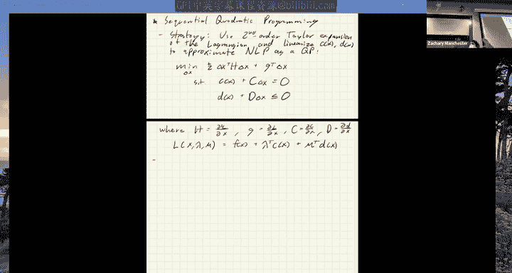

So you'll solve that QP， you'll get some some search direction thing that looks like this。

 where you'll have like you know a Delta X， a Delta lambda， a Dlta mu。

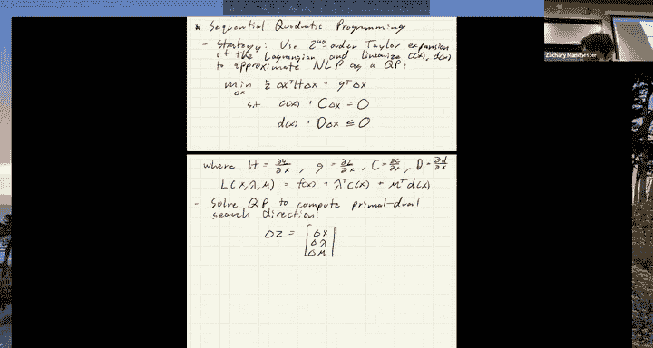

And then you're going to do a line search。On using that search direction。

 just like we talked about before， with a merit for function。

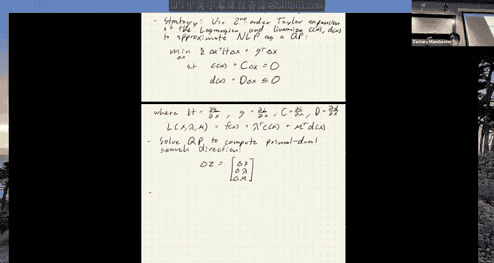

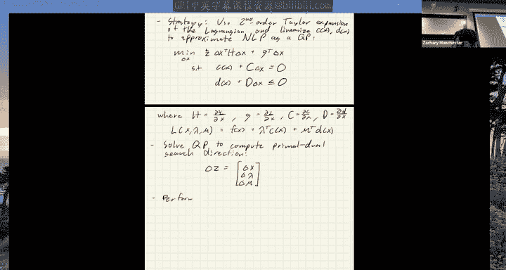

Okay， question。

嗯。What is different about this than like the Newton stuff we did before？

This looks pretty much exactly like the whole Newton thing we've been talking about all along。

 what is the difference？Why is this sequential quadratic programming when the stuff we did before was just mutantton's method where we solve for like a。

 you know。

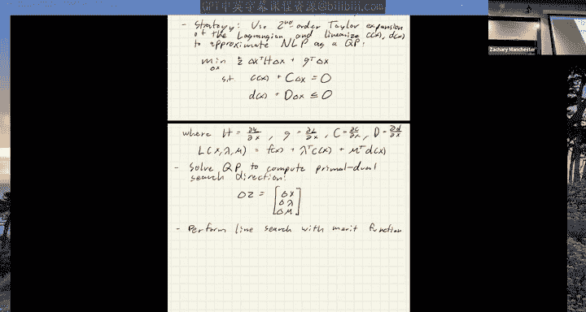

A Delta x and a Delta lambda。Rele yourize every。Which we did before right yeah。

 so what's different here？

we don't do these pass and then forward so yeah， that's true I mean。

 but this i'm talking about in the very beginning of the class we were just talking about optimization and you know Newton's method and how to you know。

Solve things with merit functions and regular that whole conversation about generic optimization stuff。

What's different up here versus that like Newton KKT stuff we did before？Don don't have any。

Any ideas？So when we talked at the beginning of the class we talked about like inequality constraints and how that was kind of hard right and we talked about augment laggrian methods and we did this KkT thing and whatever。

Only with。Equality constraints so the difference here is this has inequality constraints so and you know we said at the beginning kind of how inequalities were a lot harder to deal with than equalalities and that's kind of spawn this whole conversation about interior point methods and augmental laggr method right So here what you're basically doing is saying I can linearize everything and when I linearize those inequalities like I just get a QP and I have some other method for solving the QP with the inequalities that I like could be anything right and we have a remade one right we made a QP solver So if you have a QP solver then you can take an NLP approximated as a QP like this and and make progress and solve it。

 So the difference here is this has inequality constraints in addition to the equality constraints。

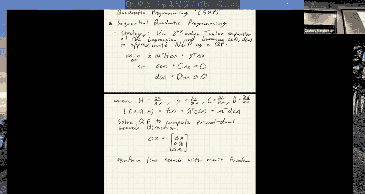

Does that make sense， everybody？Okay。And there are some sort of subtle gotchas as you can imagine in like actually implementing one of these things。

 but this is kind of the general story， if I take away the inequalities and just have so if D is if there's no D it's only the C。

 then it is exactly it reduces to what we did before。

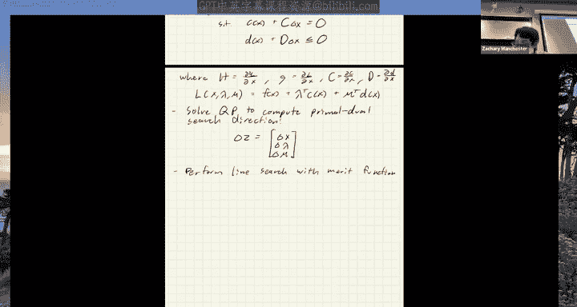

Yep。😊，If the lack you able to make a quality。

And put this lack in the objective function to minimize。

is exactly the same as。那你是DK。

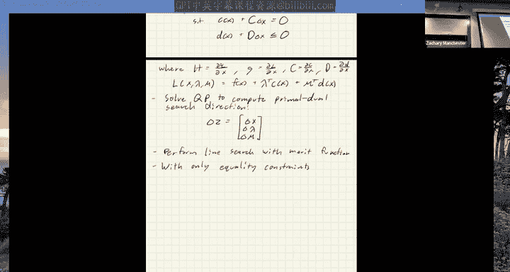

You can do stuff like this， so you want to be a little more specific。

 like how would you make that happen？If you want to you want to turn the inequalities into equalalities by introducing slacks is what you're saying right so there are ways to do this how yeah do you have an idea？

Pick。Small， like a slack variable， which is positive or like， yeah， which is positive。

 How do you do that。

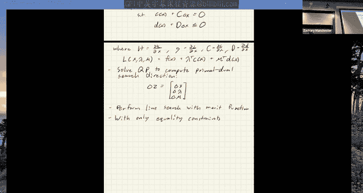

If I need to enforce that the slacks are positive I have an inequality again， right？Yes。

 so that's him help。Yeah there you go that works so it turns out that。

Doing it what you're saying is actually one of the classic ways to derive the KKT conditionss and prove them is by introducing a squared slack and turning the inequalities into equalequalities it turns out practically if you want to write a solver it's terrible it doesn't actually work numerically very well but there are places where it does work and people do on the margins you can do things like that yeah so that's not a bad idea it's actually very clever and there are ways that's useful it turns out if you're implementing like real industrial strength stuff it doesn't work very well。

But yeah， good question。Okay， cool。So yeah， basically。

 if you just have the equalize is what we did before。Sod like you get your classics like， you know。

 KT system thing。With the deelta x and the deelta lambda。And sort of those gradients over here。

So we did this the beginning of class， right？As a refresher。And this is the KKT system。

So it's just that so if I only had dynamics constraints， it would just be what we did before。

 the thing that makes it harder and the reason it's sequential quadratic programming and not just Newton's method is the inequality constraints that get sort of passed down that make it a QP at the lower level and not just this sort of classic cake if eating。

Okay， so。To be at that point and more， you want to think of this。Think of SQP as。

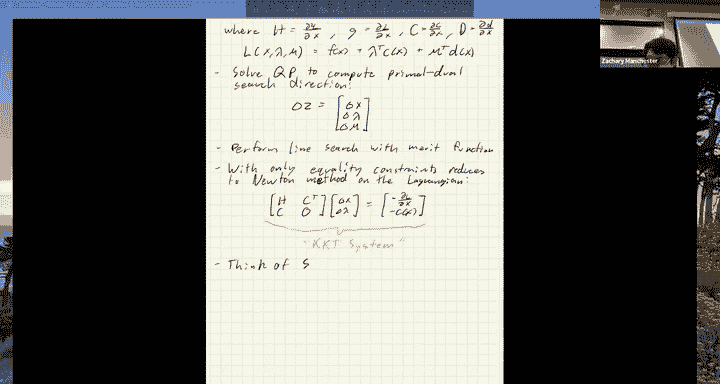

Basically， just a generalization。Of Newton's method。To two inequality constraints。And in principle。

 you can use any QP solver you want to solve that sub problem， that QP subproblem。

But most good implementations have a lot of kind of。U。😊，Fancy。

 basically in good industrial strength SQP solvers， the QP solver。

 the low level QP solver and like the upper level SQP stuff extremely tightly integrated and there's lots of tricks to make them work well。

嗯。And in particular， good implementations usually use。Active set strategies for the QP。

Because that lets you play lots of tricks with warm starting so like we talked about this in the you know back in the beginning。

 like the active set thing is you're trying to guess which inequalities are active and treat them as equalalities and then throw out the inactive ones。

And if you can guess really well， then this is really good。

 the reason this is good in an SQP solve is you can imagine if you're doing this。

 you're iterating a whole bunch and re linearizing。

A lot of the times on a lot of problems the active set doesn't change much at each iteration and when you get towards the end when you're almost it doesn't change at all。

 so if you do this active set of stuff it lets you warm start to keep piece silver and to converge faster and stuff and there's lots of good tricks。

😡，Okay， what else is there say Okay， so the other thing to say about this is to get。

Any kind of like reasonable performance using these kind of things。

 you have to take advantage of sparsity in the KKT system that is essential sort of DP and ILQR really like implicitly are already doing this stuff。

 they're really like harnessing the structure of the problem if you kind of treat it this way as a generic no nonlinearar optimization problem。

If you do this naively like you just can't solve the linear system it's too big。

 so you really need to worry about the sparsity stuff and most of these commercial solvers are set up to try to like automatically figure out that sparsity stuff for you and do a good job。

嗯。Okay。So yeah， spped in particular is good at this。It stands that stands for。If unsurprisingly。

 sparse。On linear your optimizer。And that's kind of why it's popular for this stuff。

What else is there say so there's some other things you can do here so we do SQP if it happens that the inequality constraints are convex like non nonlinearar but convex or likeic。

 for example， would be you know the main one that we would talk about。

 you can actually just pass those down into the subproblem and do instead of SQP。

 you know SOCP or whatever you can do sequential convex programming where you can basically anything that's convex you can just throw into the subproblem and then linearize the rest。

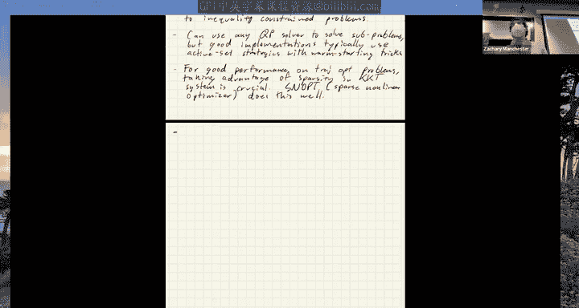

So that's a thing now that people are into。So maybe here if you read any of the literature you'll see SCP a lot。

 sequential convex programming is kind of a hot thing the last few years。In optimal control。

And as an idea， that's sort of a recent thing， it's that's kind of an active research area right now or the last like five years or so。

 I'd say。And。Probably not so common like any industry at this point。Okay。

 cool any questions about any of this stuff yeah。Something that you have to specify or just like solve yeah。

 it's definitely something you at this point， it's definitely something you would have to manually kind of specify yeah。

I don't think there are any like large scale off the shelf SCP solvers in the same vein as like IPop S at this point it's like a research thing so generally these are like homebrew things that various research labs have built or they're using some off the shelf convex conx solver and then wrapping around it the infrastructure to do the linearizing and approximating stuff。

Yeah。对。Can you what what do you mean in the you said where inequalityities are directly to the？

In this generic setup like where everything's assumed to be nonlinear like the SC and the B like so if D is like say D' is a cone that's convex right and we already know that that's convex and there's nice conx solvers that can handle that directly if you're doing SQP though it doesn't it's not able to do that so a if D was a cone if I'm doing SQP I would end up linearizing that D constraint and like approximating it whatever。

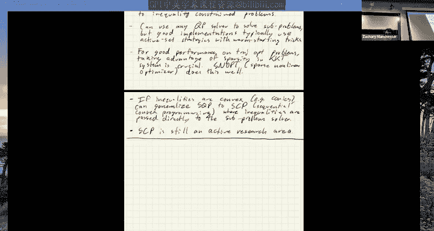

If theses a cone though we know it's convex there are good solvers for that right that can solve the cone directly so what I could do is you know if Cs my nonlinear dynamics but dies a cone I can actually just linearize C and then keep the exact cone D in the sub problem right because it's convex exactly yeah yeah so if these convex if if these nonlinear butt convex then we can keep it we don't have to linearize it right that's the idea that makes sense。

Cool， anybody else？Okay， so thats sort of high level overview of this stuff Now we're going to talk about。

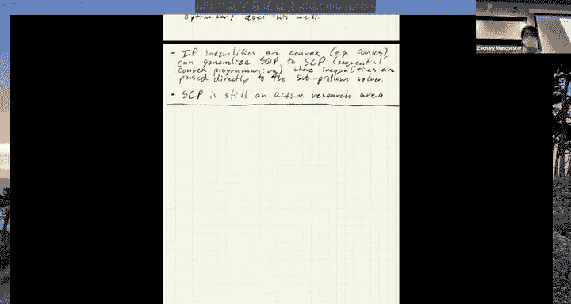

Kind of basically besides DP， the other like main super classic algorithm， yeah。

before how common is it to like have problems like this space where you don't have a good like feasible emission guess or pretty always have a good feasible no that's pretty common I would say I mean it's it's very common you know in robotics motion planning etc cetera so yeah have situations where。

It's's even if you could generate a feasible initial guess it's actually not always a good idea either we're actually going to do that today。

 let's say part of this deal these methods are really good at doing infeasible starts that's one of the main advantages。

😡。

So that answer yeah cool， Okay， cool， so here we go direct co location has anyone heard of this before？

Nope， I already asked this， didn't I？Sleep proud。Okay， so what is this all about？Okay。

 so basically so far we've used explicit runakkata methods。Like RK4。To discretize our dynamics。

And what explicit really means is there's some function。Thats sort of， you know。

 I plug into and I get x K plus1 out of it directly。

So I have stuff that looks like this right that's what happens when I do R So these methods we also I had you play around with on the first homework some implicit methods to right we did like implicit midpoint and you saw what that looks like and you have to use Newton's method to sort of figure out what the Xk plus one is。

 which is maybe annoying So the punchline here is。

These explicit methods are probably what you want。 They're at least computationally you know nicer if you're doing a forward rollout or you're just trying to simulate forward in time right because if you're using an implicit method。

 you have to sit there and do new iterations just to get the next time step So explicit is nice for doing a rollout However。

 if you're doing this direct stuff。

There's not really any advantage to using an explicit over an implicit method。

 computationally speaking。Because I'm going to just take everything and treat them as generic equality constraints in some big NLP solver I'm doing that I can write down those equality dynamics constraints as implicit Rkata or explicit and it doesn't matter it's all kind of all the same and the big trajectory optimization solver can take care of the Newton stuff for me to find the solution to those implicit dynamics constraints。

So let's talk about that。So。The direct method。

You have your dynamics。Enfored as equality constraints。

Ret not points。There's no real advantage。

So in particular， right in one of these。Coallocation type methods。

 I can write down a dynamics constraint。CK， say that looks like this X K， UK。

Xk plus1 UK plus1 equals0 right my constraints look like c of x equals0 so I can just write something like this down where you know xk is in xk plus ones and whatever are all buried inside this nonlinear function。

 like in an implicit method， and I just hand that to the solver as is。

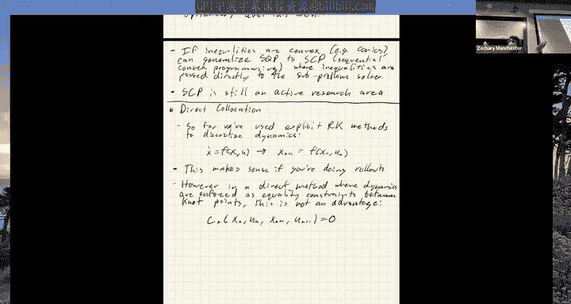

And it takes care of it， right， so there's no， there's no advantage， you know。

For being explicit in this context and in particular like because of that， right？

The implicit methods actually have a lot of things going for them， they tend to be more stable。

 they can have better energy behavior and they can generally be more accurate for the same order and there's even more fun tricks you can play which we'll talk about now。

So okay， what collocation methods do？啊。Is represent the trajectory as a bunch of as polynomial splines。

 so in particular the super classic version that we're going to talk about right now uses cubic splines so at each you know between xk and Xk plus one you're going to fit a cubic spline。

Between all the hot points。

And then enforce the dynamics within think equality constraints。嗯。哦。

So basically if I write a cubic spline down between xk and x equal plus1。

 I can take that cubic polynomial， I can take its time derivative right in closed form。

 and then I have some spe for x dot， and then I can just enforce my dynamics on that derivative。

 right？

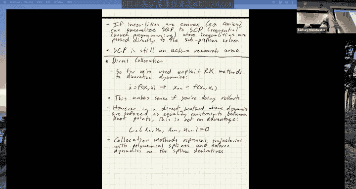

So we'll do this out the classic。

What's called Dir call。Alrithm。The direct colocation。呃Use。Cub explains。On the states。And。

Turns out uses piecewise linear interpolation AK first order hold。For the use。

I don't know that's just what it is there's some commentary on this in the original paper it's hard graves in Paris in the mid80s and this is first invented and yeah they have some comments about like they tried other stuff and like using higher order on the use didn't didn't provide any advantage so they did this so this is the classic you can use whatever order splines you want。

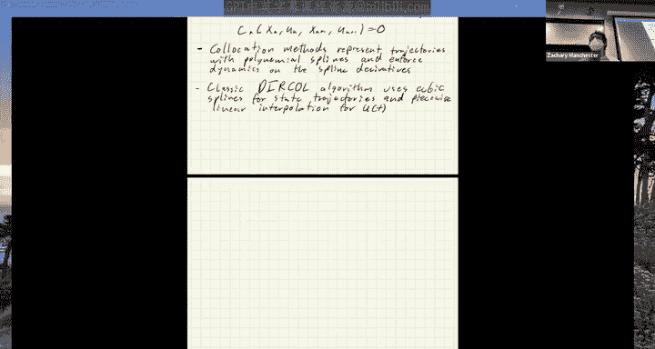

I would say in robotics。D call is extremely common you'll see that a lot。

 but I don't see really people doing high order stuff so much in robotics applications in aerospace applications though you will see sometimes super high order polynomials for doing long space trajectories and the reason is really those trajectories are super smooth so using polynomials high order polynomials works really well a lot of robotics applications you've got like impacts and friction and non-sth stuff using really high order polynomials to approximate that stuff doesn't work super well its kind of my take on why that's probably not a thing。

So。

Yeah。This is the one you will see the most， so here's how Drkol works。

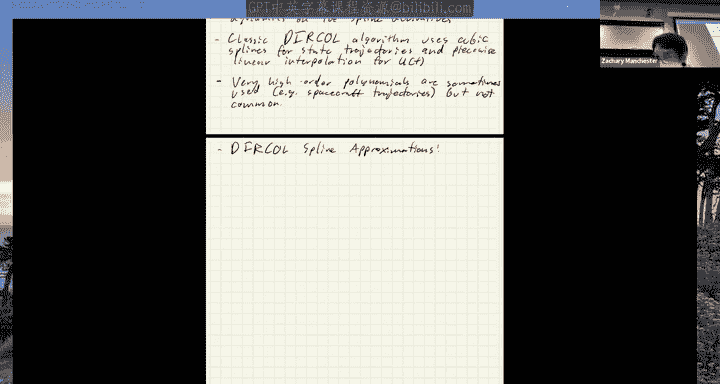

You have your state trajectory。We'll draw some like cartoony X of T。So say you've got， I don't know。

 something else like this。And let's say this is Xk over here。So this is TK。This is Xk。

And then let's say over here is。嗯。Xk plus one。

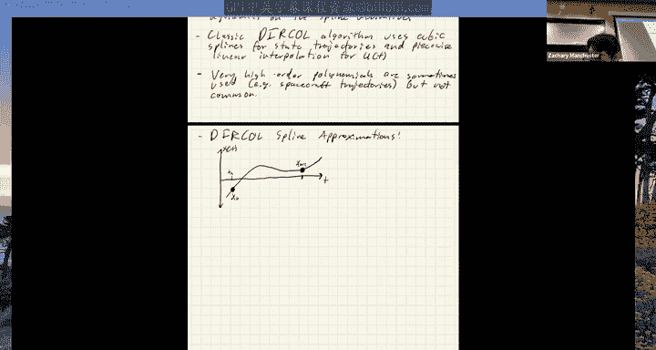

And this is Tk plus one these are what we're going to call not points this is the where that lingo comes from。

 by the way， that I keep using。So not points， and then we're going to have also sort of the midpoint in the middle here。

 which isn't going to be part of our decision variables at all。

 but we're going to compute it as part of the constraints。So we'll call this like， I don't know。

 Tk plus a half。点我家。This thing is called the colocation point。

Basically the midpoint on the spline and we can evaluate it using the spline。Function。

 and then we can enforce the dynamics at that point， that's what it's called the co point。Okay。

 so that's how that works。And we're going to write out the math for that in a sec and then you also。

 you know， on the use， you're just going to have kind of the。

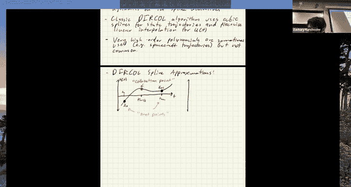

Peace wise linear things you'd have something like， you know。

This， say。Thats super interesting cool Okay， so let's write out a cubic spline so we have。

Over a given time step， you're going to have something that looks like this。

 we're just going to write out kind of a generic cubic function。

The kind of unknown coefficients。And in general， right like if I have a big state vector with。

 you know， you just do one of these for each element of the state， right？Okay。

 so I can write this down and then I can just differentiate this also in time so I can get a similar thing for x dot of T。

And it's just the unsurprising thing。

You can still do basic calculus。

I think。Okay， cool so we get that and now the gain here is now I can I can write both of these as matrix equations in the coefficients so I can take。

 for example。😊，嗯。IfIf I'm writing both like my typical dynamic stuff with both x and x dot。

I can stack all this up。In a matrix equation that looks like this if I have。The season here。So。C not。

 C1， C2， C3， and I did that wrong。嗯。What I want to do is evaluate these things at the end points。

 so I want to evaluate both x and x dot。At time at the knot point， so I've got xk x dot k。

And then xk plus1， x dot k plus1。So I can evaluate this stuff， you know， I just plug in。You know。

For Xk， we'll use t equals  zero for xk pluss 1 and use t equals H。

 I can plug all that stuff in and evaluate the coefficients on the polynomial and kind of just write that down here。

And then I can actually just solve this linear system the other way。

For the seas so what this is telling me is you know。

 given if I know the state and the state derivative at the knot points。

 I can solve for the polynomial coefficients and get the polynomial splineme that interpolates these guys。

So。Allll right that up quick。It's just inverting this matrix。

Which you can do in close form isn't too bad。And that spits you out these coefficients and then you can do whatever you want on the polynomial。

 that's kind of the idea。So this looks like。inus3 over h squared。😔，H。こ。去。

Okay， so you do this。And now once I've got those coefficients， I can evaluate that spe。

 don't worry about copying down all my scbblels， by the way。

 I' post the list of and I'll post the code so that's kind of I don't want you guys。

Trying to review my novel handwriting in real time it's not a good thing， I apologize， but yeah。

Okay， cool， so now we can evaluate this stuff wherever we want。

And in particular， we can evaluate it at this time Tk plus a half now that I have the coefficients。

 right？So I plug in the knot points， fit the spline， then I evaluate the spline in the middle。

So I get stuff that looks like this。

え。Okay， so that's what I get if I just plug into the splinee。This is an eight。

And now what I'm going to do is plug in the dynamics for the X dots。So I'm going to get。

The following thing。Yeah。

。And then similarly， I can evaluate the X dot stuff at that colocation point。

And I'm going to get。Just right off the spline， I'll get something that looks like this。Okay。对。

And then again， I plug in the dynamics。

。Plus。Okay， so that's the dynamic stuff。Evaluate at that colocation point in the middle of the linee。

And then the controls we're doing linear interpolations， so that's super easy。

 so I get U plus a half。Equals sort of U at TK plus H over2。

 and this is just the average of the UK is right？Because it's linear interpolation。Okay。

 so now I have all the pieces that I need。So。

Here's the dynamics constraints。嗯。

So this so each of the we'll call these CIs， each of these dynamics constraints and the big C that's going to go in our nonlinear program are going to look like this。

 they're going to connect pairs of knot points。

So Xk UK， Xk plus1， U plus1， and we're going to have like n minus one of these， right。

 they're going to connect each pair of time steps。

These are going to look like。The following thing。F x。K plus a half。U plus a half。 So the stuff。

You know， evaluated it appropriately there， which is this is coming from here。

 right this is Xdot at the midpoint。

Which is our dynamics at the midpoint。I'm just going to plug everything into that equation， right？

So that equals， we're going to write at minus。ItThree over two8。Okay。And to be super clear， right。

 this is the x out， these are all the continuous dynamics functions。These are not like discrete time。

 whatever coming from Rakcutta， these are the original continuous dynamics functions。

So to recap what we did here is we assumed there was a cubic polynomial connecting you know xk and xk plus1 I analytically diff the cubic to get like what x dot should be right so I have x and x dot at both knot points uniquely fits a cubic right I give you x and x dot at two points that's four four numbers and that's how many undetermined coefficients there are in a cubic so I use that to go fit the undetermined coefficients on the cubic now that I have that I can go I can plug in t equals h over two and get the midpoint on the cubic and I just evaluate the dynamics at the midpoint of that cubic。

That's how I get this stuff and then I just plug everything in so what I'm doing is like enforcing the dynamics constraints。

Basically I'm forcing the ends to be connected between the successive splines and I'm forcing the derivatives to match right between pairs of splines。

 that's kind of how you set splines up you match the value in the first derivative so they connect nicely and then I'm enforcing the dynamics at the midpoints。

That's the whole deal， and that gets me kind of a unique thing。

And it turns out that that gets me。

A third order accurate integration， like a third order run the cut method。

So this we drive this in a weird way， it turns out this is totally equivalent to a third order implicit runakatta method。

 these are rungaatta methods at the end of the day they're just kind of weird ones。

So some more notes， let's see。

Only the sort of Xk。

And UK are decision variables。Not the sort of。Calification point things not the。The halfway values。

We kind of compute those on the fly inside the constraint function from the spline。

 but we don't actually， they're not actually decision variables of the problem。

So this whole integration scheme is called Hermeat Simpson integration。

For reasons that I don't think are very important， basically these cubic blinds are called hermeit polynomials for some reason。

 and the Simpsons rule is basically when you integrate a cubic。

When you when you integrate a cubic polynomial in closed form and use that to like approximate integral it's called Simpson's rule so some old guys 300 years ago came up with these things and their names are forever attached to optimal control even though they died long before any of this stuff was done so you know cool good for them this is third or accurate。

And the big reason this is a whole the whole reason this is a thing in optimal control is that this requires。

Fewer dynamics calls， it turns out， than explicit runakatta and we'll talk about that and hopefully you can see this in a sec。

This is actually pretty slick。And maybe not obvious based on how we wrote down。

 so if I wrote down like explicit RK3。I need three dynamics calls per time step like we've seen。

 you know， this is not a surprise we do something like F1 equals you know。

Okay UK this looks I mean I don't know if we did RK3 explicit we did R4 right and that's four calls and that's not a surprise this looks pretty similar。

All ready for fun， why not？F3。Okay， so you do this and then you kind of do this weighted something。

Oh， you kind of like。Average all these dynamics calls， right？This looks a lot like RK4。

 its the details is a little different， so that's three dynamics calls。

Okay， let's look at this thing now， the Herme Simpson thing that we just did。

We have this one equation。

That does involve three dynamics calls。But if we look at this carefully。

These two calls。

At the endpoint， get reused。Between this time step and the next one， right and the previous one。

嗯。So it turns out like asymptotically， there's some endpoint things that happen right that are extra but。

Asymptotically， this only requires two。dynamicnamics calls per time step。

So this is like half the computational cost ish or 50% savings right overdoing the kind of one of these explicit classic explicit methods and it turns out they work better anyway。

 there's sort of other advantages。And usually these dynamics calls and the associated Jacobbians are the dominant computational cost in these methods。

 so this is a big win。Okay。Any questions about any of this crazy stuff。 Yeah。

 so so doing it at the midpoint is kind of what lets you。Yeah。

 but the reason is basically when I define a spline。

We didn't talk maybe I should have like gone into more background on spline so like the deal with the spline is I have a bunch of points I want to connect with a smooth interpent。

And to make it smooth what I do is I enforce that the points match and that the first derivatives match right so in this situation I'm enforcing the xks match at the two splines when they connect and that the X dots match and that's just the matching condition from the spline right so there's no dynamics there and mean I already have like a condition that the x dots match at that at the no points just from the sp definition so I can't really enforce the dynamics as well right so what I do is I enforce the sp matching conditions on x and X dot and then I enforce the dynamics in the middle。

Does that make sense yeah and basically like if you start with like a initial state and a goal state then that takes care of the boundary conditions as well so basically the you know then then you've only got sort of like n minus one dynamics you know sort of things。

但是。The number of unknowns and number of constraints works out is basically what I'm saying， yeah。

 yeah， does that make sense everybody？Yes， okay。

This was a lot hopefully that some of that stuff okay now we're going to do phone stuff does anyone have any other questions on this before we like docode things yeah no so the states are the decision variables the X's which typically in robotics applications includes you know position velocity whatever right so that's what your decision variables are the X dots get computed as part of the constraint stuff。

They're not like they're not explicitly in there we did we wrote them down as part of this whole sping thing。

Because the standard spline stuff is you make the x dots you make the x's and the x dots match across where you glue to get the splines and then I did it because the x dots are also what our dynamics constraints are right so what i'm basically doing here is saying at the endpoints of each cubic sp segment。

The X's and the X dots have to match between neighbors and I can compute those x dots implicitly based on the x's right and the dynamics that's kind of what's happening So I enforce those matchingshing conditions and then I enforce the X dot computed at the midpoint of that cubebic sp has to equal my dynamics function evaluated at that midpoint。

So that's it， that's everything it's basically matching X and X dot matching at the at the knot points and then dynamics enforced at the colocation points。

 that's where those namesves all come from。😊。

Is that good everyone agree with that now？It turns out this is more efficient。

And also like more stable and more accurate than using a standard run kind method when you do direct co。

 when you're doing a direct big NLP solve as opposed to the dynamic programming stuff。

Okay， yeah。都非常多我你回到那个。So。Basically you can't say anything about the dynamics at other points what we're doing here is it's similar to so really every rungaatta method that you write down is doing something similar to this it's a little more explicit here。

 but actually every rununggaatta method is implicitly basically fitting a spe to the dynamics over a time step and then evaluating the dynamics to get like X dot and you're really fitting a polynomial like RK4 actually fits a cubic polynomial as well over the time step so they most of these methods are doing something like this。

And you can only really enforce the dynamics at a finite number of points in some interval and what you're doing is basically assuming that the solution to the ODE is somewhat smooth and that it's well approximated by a smooth polynomial inter tupent over this。

Time step right that's what all run kind of methods are doing they're all assuming that over some small time step you know that things are smooth enough that it looks roughly like some polynomial and you fit a polynomial。

Have you ever seen standard runga cutta methods derived like RK4 from any of these things before？

No yeah so I mean I did it in my class last semester in the dynamic simulation class but like they all kind of have this flavor of like fit a polynomial over the time step here we did it very explicitly and you see it's a cuic sp and all this stuff it's less explicit some other times but like this is kind of always there and。

😊，You know， you have to make some choices and some approximations because these are at the end of the day。

 these are nonlinear。Differential equations that don't have exact solutions， you know， blah。

 blah blah， so this is kind of what we have to live with。That， I don't know， help。

Okay， let's still get some code and stuff before we get out of here。

Our favorite acrobat yet again Oh wow that's really out Okay cool so here's here's what we're dealing with we're going to do the acrobat again10 hertz samples。

😊。

5ive second horizon。Here's the dynamics constraints that we just arrived。

So we've got sort of x two neighboring knot points， both the states and the controls。

And then inside here， I'm not doing this the smart efficient way。

 I'm doing it the dumb inefficient way because it's easy write down。

 but basically I'm just plugging into the equations we had before。

 so I'm evaluating the midpoint according to like the sp rules。

 the X dots I'm getting by evaluating the dynamics， this is X dot at the midpoint。😊。

And then you know this is the dynamics evaluate at the midpoint so really what we're doing is right we're like basically evaluating X dot at the midpoint according to the sp and then evaluating X dot at the midpoint according to my dynamics function and saying those have to equal each other at the end of the day that's what this is right that cool even cool that。

😊，Okay， so that's that dynamics constraint。Costs same kind of stuff we did before。Qudratic， whatever。

I'm actually you know going to use these this time unlike last time。

 this is the entire dynamics constraint now so。I have to make this work I'm stacking up all the X's and U's into a giant vector of decision variables。

And I'm going this is basically just looping through that giant thing and writing down。

 stacking up all of the dynamics constraints across all the time steps now。

So that's， yeah， evaluating over the whole trajectory。Here's the constraint function。

 this is just for the solver interface basically but this is just dynamics constraints and then this is initial state constraint and goal state constraint。

So actually one difference between this and DP and DDP I was using a terminal cost to get it to stand up here I'm actually going to put in an explicit goal equality constraint at the end of the trajectory to get it up to the top。

This is all solver interface stuff that is not important but annoying and you know whatever we're using IPO I should mention here。

 which is one of the standard solvers this is just the interface in Julia that。

Is how you have to talk to the solver， I think particularly worth looking at the only I guess thing that might be kind of interesting here is so you basically pass up the cost and then the gradients and passions and stuff here we're using auto Ging to get all that stuff as usual yeah I don't think there's anything worth talking about in here。

Slver tolerances， whatever。

So there anything we're saying here I don't think so okay cool so initial in goal states we write them down and in this case they become constraints。

 right？嗯。Initial guess nothing smart like zeros。Ones something like that。

 now we're going to call a solver。

And let's go take a minute。And I think I ran this before， so we can probably just look at it。

Kind of slow。Is that but what point of was doing this direct emission method in the first place is that it's more stable or trying to optimize agents。

 right？So that's one of the reasons these are basically like this is just like one of the major two options you can do like DP stuff。

 you can do direct allocation location stuff and there's some tradeoffs we'll get into the details of the tradeoffs this is one of the standard standard algorithms like theres reasons to just do this that you in general like the DP stuff and this stuff are kind of on par with each other and depending on your application and what you're trying to do like one of the other might be preferable。

Yeah I don't know you should know about both of them and you should kind of know which one to pick you know when okay so we just solved this that was kind of slow generally these do kind of better than that I don't know I probably gave it a bad initialization and stuff so here's the trajectories。

I don't know， not too dissimilar from the stuff we were doing before。We can animate it。

For。Oops。

So this looks pretty much like exactly what we got last time with DP because I have the same cost functions and stuff basically so here's where this kind of gets interesting so we talked about infeasible starts and things like this here and I mentioned this last time but it wasn't maybe super obvious so I have a good solution right now right if I go ahead and just run this again from this solution like it should basically converge instantly。

And take like no time because I'm handing it already a good solution so we can do that real quick。

Let see what happens， hopefully that does what I think。

 but then what we can also do is which I'll try to sec。This is going really slow。啊。

I can do things like。So right here I gave this a guess that was kind of dumb。I can give it。

 for example， a guess where let's say I don't know， for some application， some robot。

 let's say I'm able to draw some cartoony， okay， so there it went。If this still took a long time。

 I don't know what that one do， I don't know anyway， let's say for whatever reason。

 I know like one element of the state vector。Oh I didn't yeah okay let's say magically you know I know like so what I'm going to do here is give it an initial guess that is my solution only for the first element of the state vector plus some noise so i'm not giving it the whole state I'm not giving it a dynamically feasible guess either right like this doesn't obey the dynamics anymore'm just randomly giving it you know stuff but。

This is obviously in some kind of like norm distance sense closer to the answer right getting it in the ballpark that kind of thing。

 but it totally violates the dynamics， constraints， ettera， but now watch this if I do this。

It just finished like instantly。啊。24 iterations took like a second right and we can plot what that looked like。

I gave it this guess and I zeros for everything else so I only gave it like one component of the state but that was enough to warm start it to get it super close to to the right answer such that convergely fast so this is one of the major major advantage of this over D methods D rolls out so I have to give it basically an initial state and initial controls and let physics do its thing to get my initial guess here I can hand it whatever I want as the initial guess and the dynamics are all represented as these equality constraints in the problem set up but that initial vector that I give it of states and controls could be anything that I make up doesn't have to obey the constraints necessarily and the solver will figure it out and like。

At convergence it will obey the constraints so here I can just draw some cartoon you know guest trajectory that I can make up that I can get from a sample based planner or some other algorithm entirely that gets me close gets me in the ballpark and you can just throw it in here and let this thing go and often that can be a big big advantage on complicated problems where you may have some heuristic or you know intuition or other algorithm like kinematic planner that can get you some somewhere in the ballpark that's。

Cool questions， comments， yeah。打看们。5 start。So我 just get。

Yeah so this is the that's the counter to what I was just saying yeah like GDPP。

 if you stop early before it converges， you' still got something reasonable that you can maybe execute even if it's suboptimal here if you stop early。

 it doesn't necessarily obey the dynamics constraints it only here it only obeys the dynamics constraints at convergence so if you stop early。

 you might have something that's completely unphysical garbage that is not you know able to run on the robot。

He's bad。

