# CMU《最优控制和强化学习｜16-745： Optimal Control and Reinforcement Learning》中英字幕deepseek - P14：[14]Lecture 13_ Dealing with 3D Rotations.zh_en - GPT中英字幕课程资源 - BV1qHwke1EBX

Any questions about， I don't know， last time homework， life in general， et cetera？你公。Yeah so。Okay。哦。

我 we啊。Or it still。How we handles of people。あ那个。啊，稍的。那要。

So you're saying when you get to the end of the reference trajectory， yeah。

 so what I would do there is put the sort of desire basically what you're always doing there in the reference is you're putting in where you want the thing to be at that time。

 right？So at the end of the trajectory， he wanted to be at the goal state， right？

So pretty much of what you should do is just put the goal state in to fill out the rest of the horizon if you're past the end of your reference trajectory。

 because that's where you want it to be， right？不是你该。什对。From that thanks that we。Yeah。

So so there's a few things going on So you have a reference trajectory right that takes you from your like initial state to some goal state that's a certain like I mean you have an NC horizon right which is like some shorter time horizon so what you want to do right is like the NPC thing is looking ahead so it might be taking a chunk out of that reference you know that it's moving as you move forward in time and so cool you're just indexing into that reference trajectory pulling out whatever you know piece of it is at the time you're currently at and like looking ahead when you get to the end as the NPC horizon is longer than the end of that reference like the idea is you want to get to the goal at the end of the time right so you know if thempC horizons now shifted past there like you still want to be at the goal right so you just kind of can pat it out with the goal state for the whole rest of the horizon if it's past the end of the reference right。

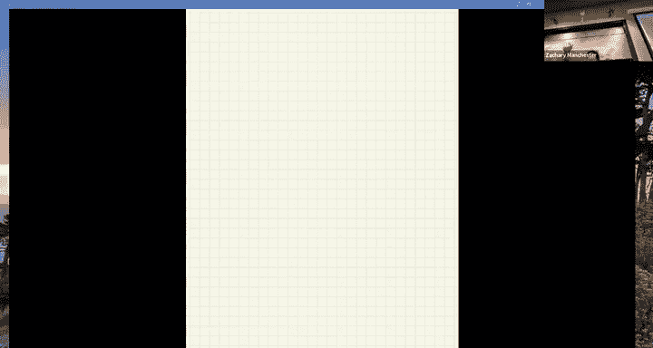

Does that make sense？错。Yeah。到边都好我佢是。我系一前嚟一。It one of the stars。Yeah。

 so you you have this whole prediction horizon and that's you're computing a whole control trajectory over that horizon。

 you actually only execute the first one on the system。At each time step。

 and then you recompute at every step yeah， so that's how it works。Yeah。Yeah。

 I mean like basically the whole idea is you know it is computationally way more expensive than a simple like you know feedback policy but generally can achieve if you can do things with MPC that you can't do with you know more simple feedback policies。

 namely you can explicitly handle constraints and there aren't too many good other ways to do that and you know it comes down to if you can solve it fast enough online and cool go for it if you have there are many。

 many games that people play to try to reduce the computational cost of MPC so you can run it on larger systems longertime horizons。

 things like this and there are a lot of games you can play various approximations there's a whole like literature on this kind of stuff but it all comes back to the fact that like you know if you had infinite compute you would just solve the whole problem every time but like the length of your horizon and all these other details。

 they end up being constrained by how much compute you have。

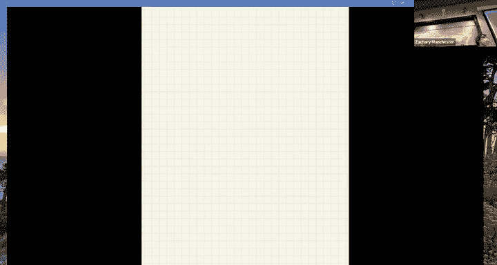

Yeah， if you had infinite compute like you wouldn't even bother with the receding horizon right。

 you just solve it all the way at the end every time， if you could， right？Okay， anybody else？

On that kind of stuff。Thank you I。You could do that too yeah so the idea that Brianstein there's this idea called explicit NPc。

 which is like in principle， I could compute。The MPC solution for like every possible state offline ahead of time and just cash it and like a giant lookup table this is called explicitmpC it turns out like you can actually do a pretty good job of this for linear for the sorts of problems you would solve at a QP like linear dynamics linear constraints turns out the solutions of that are piecewise linear or piecewise ane and so you can actually build a giant like lookup table thing。

Explicitly for for like linear systems， but the size of the lookup table blows up pretty quickly。

 which is why you don't do it and often it's better to just use the QP solve but there's lots of in between ideas you know that sort of like。

Do a little both。Anybody else。So I know is able to anticipate things yeah， better than other。Yeah。

 there's one in the rocket problem on the homework if you got try it out， there's some fun。

Specifically you'll see like there's instances where you can anticipate things and sort of like wind up ahead of time to know anticipate rather than purely reactive behaviors。

 so you'll see this again in this example like specifically when you get to the end of the horizon where you should be sort of like staying at the goal you'll see some weird stuff happen there with LQR where it's sort of you know overshoot undershoot behavior kind of stuff because it's purely reactive right it doesn't have this look ahead whereas NPC will like anticipate that and do a better job so yeah good good call all right anybody else。

All rightCool so we'll get into it Oh yeah apologies also about like missing flakking out on my office hours this morning had a little bit of a crazy day with multiple power outages in my house and two year old childca issues that compounded the power outages so if anybody still wants to catch up who I missed this morning let me know and we can set something up this week。

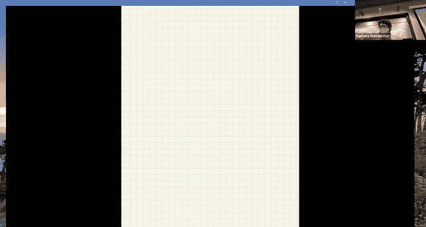

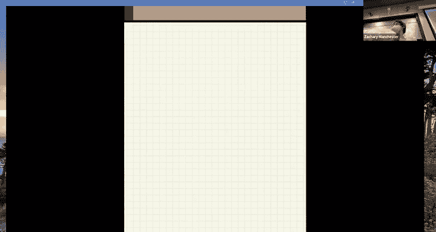

Okay， so let's get into it so last time。We kind of talked about。嗯。

Like sequential quadratic programming， direct colocation， the set of ideas pretty much， right？

And those are sort of。The other。Major family of offline nonlinear trajectory optimization sort of techniques that get used a lot。

 the other one being like these DP IQR type methods。Today。

I want to do a couple things so the first thing I want to do today is kind of do a little bit of a recap of like all the algorithms we've talked about so far we're kind of reaching the end of that sort of chapter in this whole discussion I think at this point where we've talked about we started you know talking about generic optimization stuff and then we went into what we call deterministic optimal control and talked about know LQR and PCC and then this no nonlinear year step so we're kind of reaching the end of that like classical deterministic optimal control conversation so we're going to kind of do a。

Recap。Of all the stuff we've talked about so far。嗯。We'll call it like algorithm recap， maybe。好。

And then we will do yeah sort of like some pros and cons and decision tree kind of stuff about that and then we're going to start a new thing which is a little bit quirky and very much robotics slash me thing we're going to talk a bunch about attitude 3D rotations and like how to optimize things and you have floating base robots flying robots underwater robots space robots。

 anything that has like a floating bass and can rotate in 3D which does all kinds of weird things and we're going to talk about that in some depth next。

嗯。Which is not necessarily a classical optimal control thing。

 but it's a very practical thing that shows up a lot in robotics。Yeah对。

So specifically things like you know rotation matrices。And。Qutturnians。

Who's played with Queternians before， show hands， like most of you。

 is this stuff that gets covered in KDC？Some to some extent a little bit yeah so at least youve you've heard of this stuff and like seen a little bit of it so we're basically going to talk about how to do Newton's method on Quaernians is kind of at the the root of it。

Okay， cool。So here we go。So。Basically， yeah to kind of。I had some questions about like kind of。

The decision tree of when to use the stuff we've talked about so far。嗯。So here's kind of， I guess my。

 we're going to split this up into two sections。The first section would be problems that are have linear dynamics or。

You're trying to do some local control where you can linearize the dynamics。

So this comes down to like， you know， either it really is linear， which is kind of rare。

 but has happens occasionally or you have some kind of local。You know。

 thing where you're trying to track a reference or you know。

 stabilize a system near equilibrium point。 So we'll call this linear or local。Control problems。

And what I mean by local is， you know。Lization works。

Okay so in this setting this is kind of the first stuff we talked about and we can I think for this we can do a little kind of decision tree thing so the first question is do you have constraints and we'm going to say constraints not the dynamics right anything besides the dynamics or control limits。

Obstacles， that kind of stuff。So first question you ask is， do I have constraints？

And depending on the answer to this question， so if the answer to that is no， then you can use LQR。

 which is basically a closed form solution。If the answer to that is yes。

You have to worry about some sort of constraints online that are important。

 then you're talking about doing NPC。And then from there。

 there's a couple other sort of things to ask。Are you solving a tracking problem meaning you have a trajectory that's you're trying to follow in time or are you trying to stabilize an equilibrium point or a fixed point so if you ask that question then on this on this LQR side。

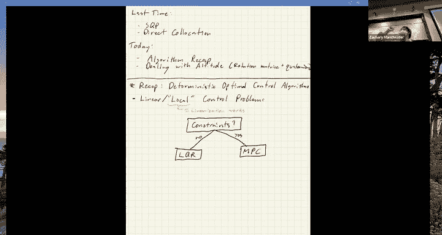

So if you're tracking， that's time varying LQR。And if you're doing sort of stabilization or just trying to stay。

 you know， in one spot。That is classic time invariant LQR with a constant game matrix。

So I'll just call that， usually we just call that。LQR。

But we'll call it T LqR for now so that's where you know the difference there is if you're tracking a trajectory you have a time vary K that's following the trajectory basically if you're trying to just stick in one spot and stabilize then it's just a fixed K right we're going good with that。

Okay， and then on the NPC side， this lets you handle inequality constraints like your torque limits and potentially you know other state constraints safety constraints and here the big deciding factor is what your constraints look like so if they're linear inequalities you have a QP which is super nice and convenient。

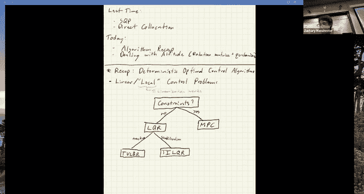

对。This is sort of bad。So then here you have a QP and this is you know basically I would say like the bread and butter of like modern control on robots like basically everyone's doing QP based emC on all the cool robot demos you see now so that's like very well understood very fast very easy if you have。

Did the other option are like things that are less common but doable and kind of currently interesting are if you have chronic constraints or kind of the other major type of constraint that you can handle in this kind of setting。

And this is would be like a second order cone program that we talked a little bit about and there are lots of applications for that from like rocket soft landing to you know friction cones on like in robots and stuff and it's like still kind of research and people aren't really doing it too much mostly people do QP stuff but those are kind of the things you can do any questions about this setup up its sort of like if you have a problem where you have linear dynamics or you're linearizing the dynamics to do tracking control。

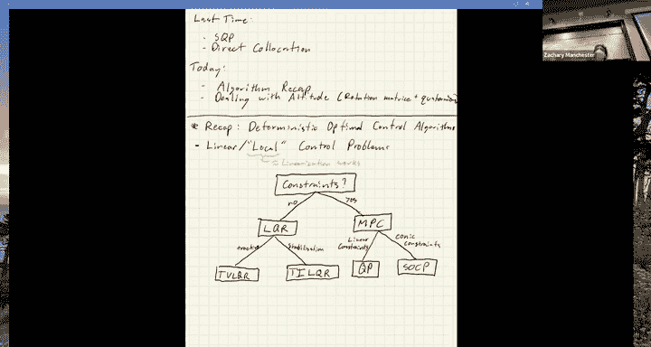

This is basically the decision tree to go through and probably one of these four things is the answer for online。

Control。Okay， so then the other category of stuff we talked about is yeah。

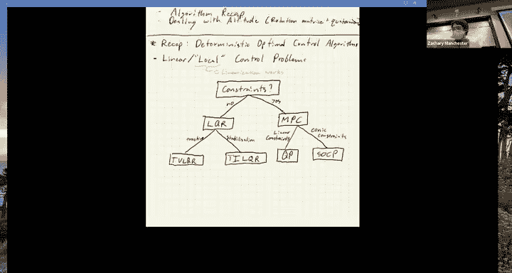

Are you looking at James and。有点是。我 are呢边嘅。嗯追正单这个。

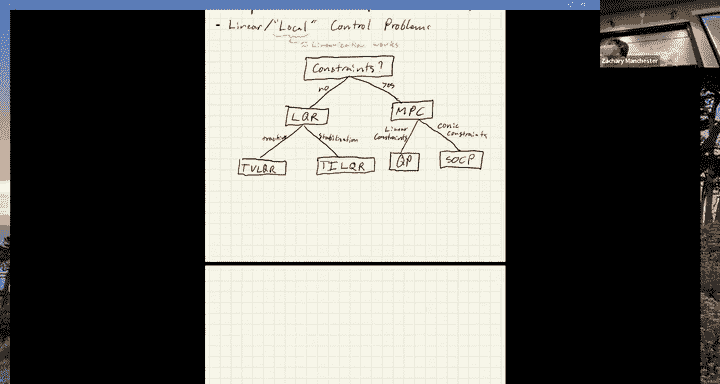

What do you mean by that？

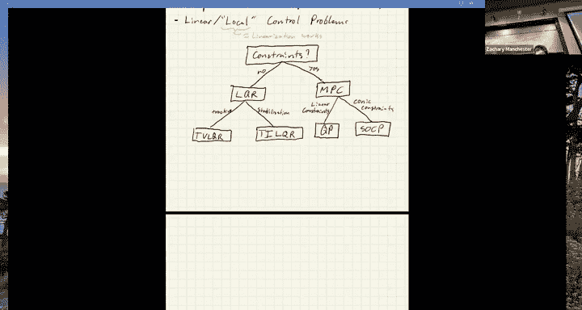

That X would be a different。But let's say you do not have a meeting which appears on the list。学制だて。

这 equation question。Then that should be like， and I。

So can you make that distinction for me in like the problems we've been doing in the class？This is。

I the。ok。Basically， every problem we have， we have states and controls。Right， and that's it。

I don't think there's any other， I mean， you can do other things。

 but generally speaking for these optimal control problems。

 your decision variables are the states and the controls。And you control。

 you can put constraints on any combination of those you want to。

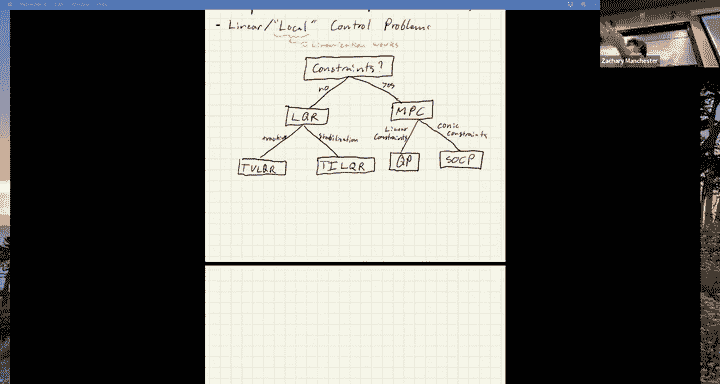

And if they're linear or conic， you can do this sort of nice convex MPC stuff if they're more general and weird then you're in sort of a more general nonlinear constrained setting where it's harder potentially。

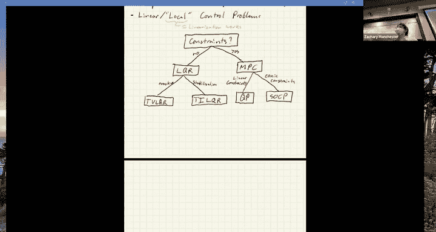

I don't know if you have。There's something else that I'm not getting。No。Apointで。

They start out that way， but they don't have to be so like in particular everything we've done in this class is this very kind of generic discrete time dynamics model like x K plus1 equals F of xK UK。

That's what we've been using for all the control algorithms right so that is super generic it can be literally anything can be you know。

Can be derived from a set of ODEs for like you know a rocket or a robot or a chemical process or I don't know whatever you want。

 or it can be from something that actually is discrete like there I'm plenty examples of that too it can be anything so there's it's super generic it doesn't necessarily it doesn't even necessarily correspond to some ODE that we disretized it could be some inherently discrete process as well。

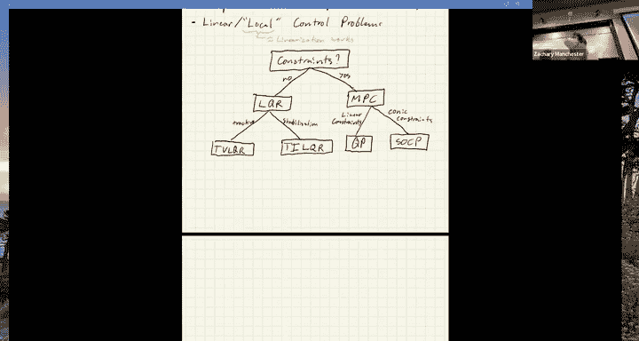

So it's pretty broad。And there are lots of processes that like can't quite be written down as ODEs that can be actually dealt with in that discrete time framework。

So I don't know。

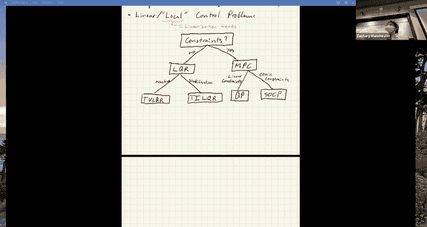

Yeah， I mean I think just think about it as states and controls and don't worry about too like the details of like if it comes from an ODE or not。

 it doesn't really matter for us。

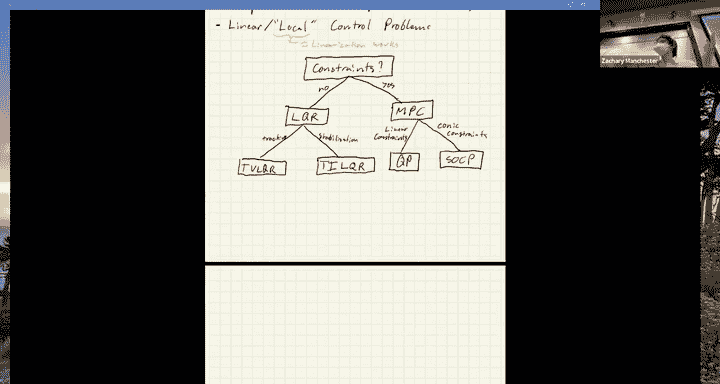

Okay， so there's this linear stuff or tracking or local stuff。

 and then the other stuff we talked about next after we did MPC was sort of non nonlinear trajectory optimization。

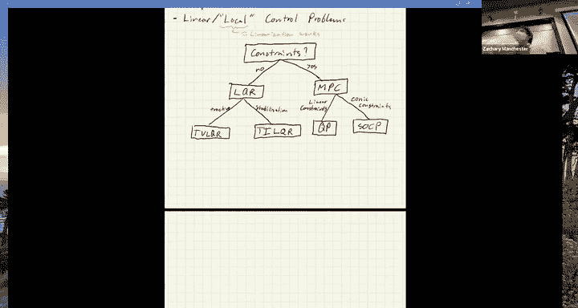

诶。

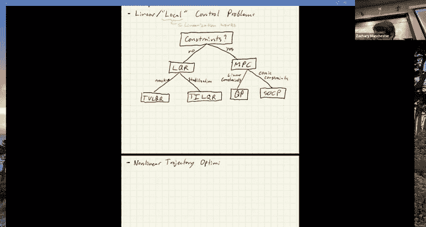

And this could be， you know slash planning， maybe。If you're doing it offline。

 it's called planning if you're doing it online， it's called NPC， you know。

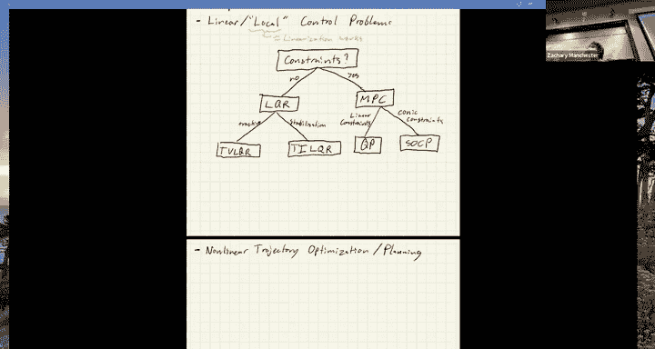

Fuzzy。嗯。Okay， so we're going to be and basically for us。

 this comes down to the two main types of algorithms for this that we talked about were DP。

And dirt call or direct colocation， you might hear people talk a lot about in this field like classically for sure。

Direct methods and indirect methods and honestly no one quite knows what that means and it's a little the definitions are fuzzy and I kind of hate those terminologies because they like they're a ambiguous B no everyone disagrees on what they mean exactly and C most of the algorithms can be derived from either perspective anyway so I feel like it's a terrible。

Taxonomy。Other people will disagree with me on this。

 but you know there you go So instead we're just going to talk about direct collocation and D because those are like the two most popular most widely used algorithms direct collocation classically is a direct method and DP is classically considered an indirect method but the lines are blurryian so we won't really worry about that distinction too much so we're just going to compare。

嗯。Beer call and DP and this one is a lot fuzzier than the nice decision tree story that I had for the other one。

 so here we're just going to kind of make a table of pros and cons because I don't think I can do the decision tree thing。

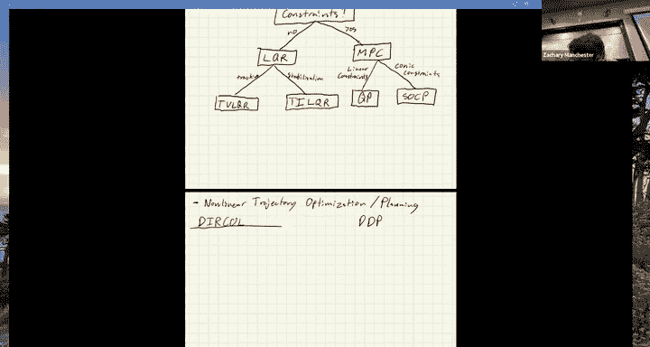

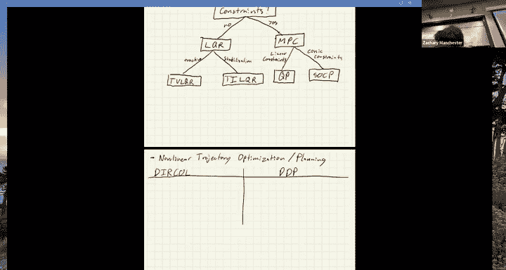

So here we go。Some comparison so first。

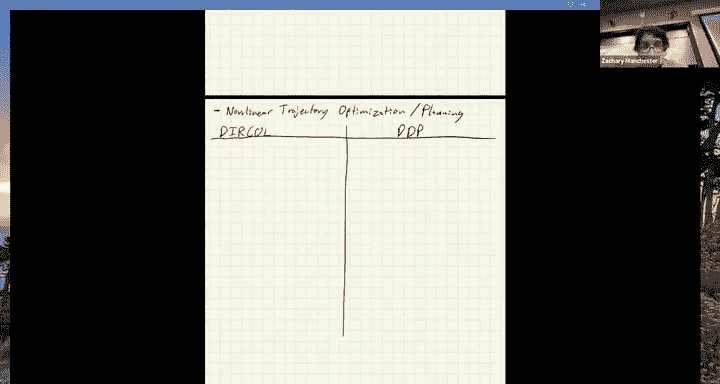

Direct locationation， as we kind of talked about you're writing down the dynamics as equality constraints in the optimization problem rather than doing a forward rollout so in Dul you're only going to respect the dynamics at convergence of the solver at a solution right if you're not converged to a solution to the KKT conditions you're not necessarily obeying the dynamics。

So that's one。And then DP， as we talked about， you do this rollout so you're always。

Tynaically feasible。

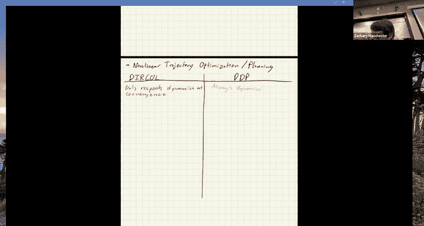

So the other side of that is that because of this sort of dynamic feasibility thing spun it the other way。

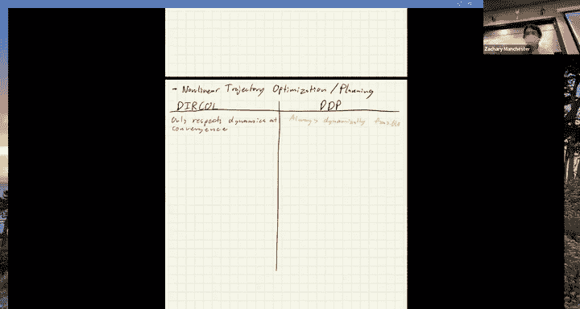

With D call like we saw last time you can supply a made up dynamically in feasibleas guess like cartoon trajectory that doesn't obey dynamics。

 but that might get you closer to the solution and therefore you can use that to warm start and get yourself you know potentially faster convergence and things like that。

 so that can be an advantage as well。Whereas with the DP stuff， you can only。

Provide an initial guess on the controls and then you have to roll it out with the dynamics and that you know doesn't necessarily。

Works super well。If you have， particularly if you have like a really super nonlinear high dimensional you know。

 dynamical system， it can be really hard to get yourself like a reasonable initial guess this way。

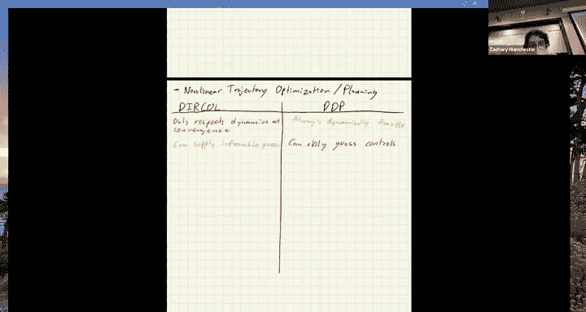

Okay， so then on the Dual side， we can basically handle。

Arbitrary constraints like anything you want you can just throw in there。

Whereas with DP you have to do some extra stuff to do constraints so we talked about this you can use like hacks like squashing functions and things like this on the controls and you can do penalty things for state constraints or you can wrap the whole thing and augment with dging which is a reasonable thing but you got to do something kind of extra。

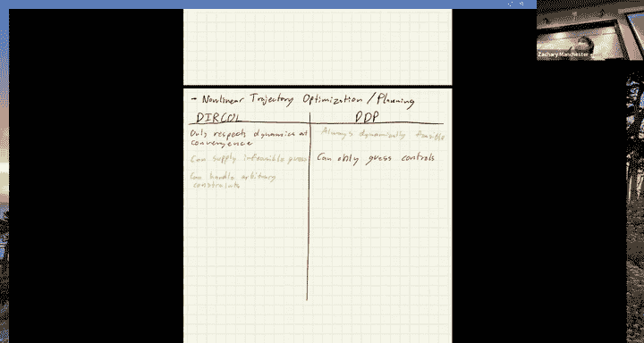

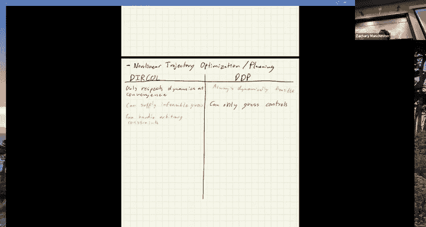

So it's a little more difficult and potentially numerically challenging。

Okay what else so on the DP side， remember when we do the backward pass of DP we're doing basically a rikati recursion so when you get these feedback matrices and we talk about at convergence of DP the K matrices that come out of that backward pass like your last backward pass are the exact same cases you would get from time varying LQR so you basically get a tracking controller out of it for free。

 which is pretty cool and really nice actually in a onlineline setting where you maybe can't solve yourmpC problem fast enough you can basically use the K matrices in between solves to sort of fill in the gaps between like if you tried to dompC but it took say like 10 seconds to solve in between solves for that 10 seconds you could do tracking with the K matrices from the last one right so that's kind of a cool thing。

It。You you have this free tracking controller with DP， you have to do that separately。

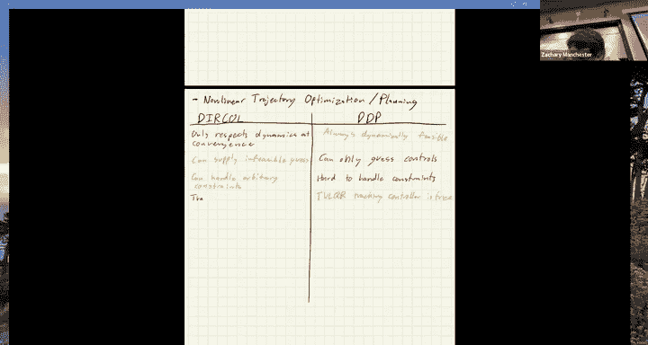

Although theres some it's not completely true。There are some tricks to be played there as well。Okay。

 so then back to so DP generally is known for being really fast。

 that's the main advantage and why you might like to use it， it has super fast。

 at least local convergence。

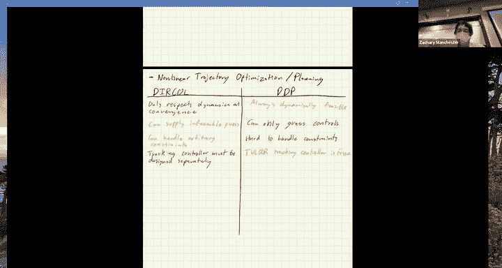

The direct stuff also can be fast， but typically it's not as efficient or fast。

Let's see then sort of similarly， the DP stuff super efficient and。

Also very memory efficient and pretty relatively easy to implement on an embedded system。

 so this is the kind of stuff that's like nice to do online。

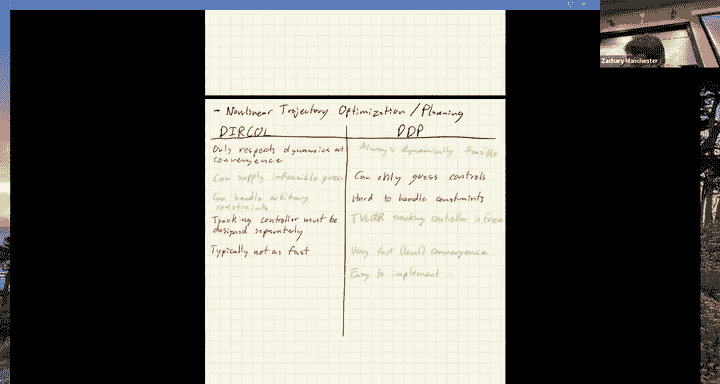

And yeah， then on the like dirt hall side， it's it's difficult to。

Do that sort of thing mostly because you need a sort of large scale SQP solver and those are hard to do well it's hard to implement those well and there's it's like it's just harder to do in general to do that on an embedded system。

And then lastly， so Drk call you're using these large scale nlP solvers like Spped and IPop that we talked about these are sort of industrial strength solvers they're really new robust they have like very good numerical properties so they tend to be you know。

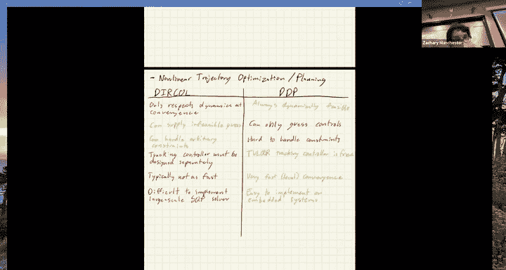

Pretty solid。And sort of numerically robust。They do lots of smart rescaling tricks under the hood and things like this to mitigate like roundoff air with floating point math and stuff like that。

 whereas the DP stuff can like as we talked about it has ill conditioning issues potentially if you don't scale your variables well and particularly if you're doing some kind of like hacky penalty based constraint thing it can get really bad really quickly。

 also it becomes numerically unstable with really long horizons。

 Allah you know vanishing exploding gradient tail w of the dog you know kind of issues。

So not as great there。By the way， it might not have been super clear from from before like we we talk about these like taillagging the dog you know kind of issues those issues basically。

Are not present in in these direct methods like they use large scale sparse matrix factorizations that are stable and stuff like this and because of the way they're set up you're not back propping through the whole trajectory so they don't actually have they don't have those issues they're like way better for like long trajectories and you know poorly scale problems stuff like that Okay so then some final like kind of summary points。

Like we've been saying， DP is often a good choice for like fast online real time kind of stuff。

Where you can do a bunch of， you know， tuning of your problem formulation and stuff like this and just get it to go really fast。

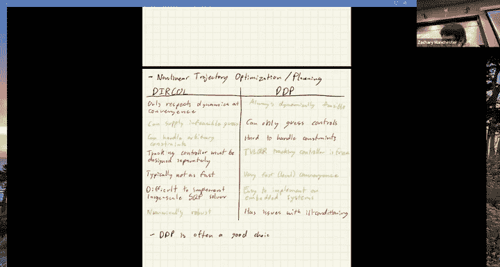

You know where you where speed is kind of critical。

And maybe you don't care so much about super accurate constraint tolerances。

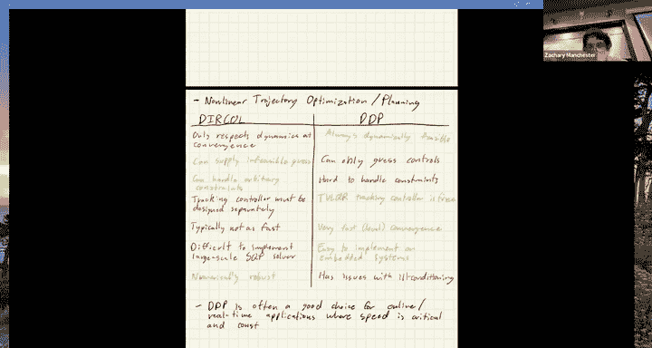

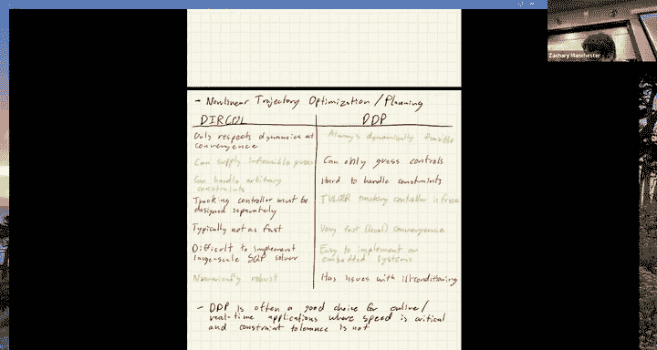

So that and then Drk call this large direct methods they're probably a good they're often a good choice for offline trajectory design kind of problems。

 especially if you have。

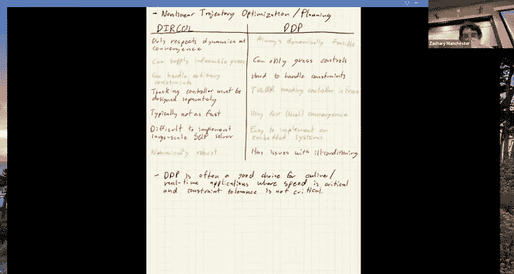

Long horizons， super nonlinear constraints， things like that that are hard to do with D methods。Okay。

I think that's kind of the summary of stuff we've done so far and like when to use which things anyone have any questions on this sort of general set of topics。

Yeah， so those are indirect methods and actually DDP is a shooting method。

So DP is actually technically speaking， DP is a single shooting method。

 right bit shooting refers to the four of rollout。That's what shooting means。

Has everyone anyone heard of this these ideas single shooting， multiple shooting before。

 and so that just means the that's the old old school optimal control word for what we would RL people now call rollout。

 same thing， shooting， I guess because they were aerospace people think about rockets and stuff like that。

I think Ro that's kind of a generally friendlier word。Anyway， yeah。

What is a good of the problems you can tackle？The linear stuff。

 I mean it's really really useful because you can linearize any nonlinear system so usually what you do is online closed loop real time stuff。

The real， like。In the loop online stuff is usually linear。

Because you can do it really fast and you can guarantee that the solvers will converge on these convex formulations。

 you basically want to do the linear stuff if you can get away with it because it's usually more reliable。

 more robust and faster and and you can get away with it a lot of the time like it's surprisingly good and like work surprisingly off I would say like almost any situation like literally anytime you're doing reference tracking like if you have a trajectory that was designed ahead of time which can be anything from like a rocket landing or like for walking robots。

 it's a gate so you can design a gate for a quadruped offline and then online you're just tracking that reference so anytime you're doing reference tracking where there's some nominal thing you're trying to do and you're just trying to stay close to the reference and track the reference you just linearize around the reference and as long as you don't get not too far off the linearization stays pretty good and the reason this works right is at the end of the day the controller is trying to。

Keep you on the reference right so the controller is pushing you towards the reference where the linearization is good。

 So if the controller is working well， you will stay within the kind of neighborhood of the reference where the linearization is good。

 So that kind of works out。 So yeah linear control is surprisingly effective Like it works incredibly well LQR is great NPC is super great and a lot of the stuff you see you know awesome compelling things on robots。

 the online realtime part of it that's running on the robot is probably linear It's probably some it's probably today it's probably like a QP based NPc that's what like basically what SpaceX is doing。

 that's what Boston dynamics is doing。 that's whatT sheet is doing like name a cool looking robot demo' what you've seen is probably doing linear NPc So it。

Yeah， so when you can't do that is like getting the gate， getting that rep。

 so if I want to make Atlas do a back foot。If I already have the backf trajectory and I want to go run it on the robot and I just need to track it I can linearize about that backflip reference trajectory and do linear stuff but if I'm starting from scratch and I need to figure out how to like generate the backflip trajectory from scratch given the robot dynamics and whatever that's super nonlinear and I can't like I have nothing to linearize about right so now you're in nonlinear territory and that's when you do this nonlinear trajectory optimization stuff and that's pretty standard pipeline like for trajectory design like reference design gate design whatever you want to call it that phase is typically done offline and using lots of nonlinear kind of stuff then you go online it's usually a linear thing where you've linearized about the reference。

Anybody else yeah？Can can really like to show people。好。Yeah， I mean， like let's see so。

What are good examples of this， I mean， most often for like our kind of applications and robotics。

 the nasty stuff is usually in the dynamics， but there are lots of examples like like a very trivial one would be if you had like a。

Like a bunch of obstacles that you needed to avoid hitting like say you want to fly a drone through a forest and you've got like a whole bunch trees right those are non convex so for the for our purposes right the free space has to be convex so as soon as you stick like a cylinder in the middle of the room that you have to avoid that's a non convex constraint and if you put a bunch of them out there it starts to get pretty ugly。

Like imagine the free space looks like Swwiiss cheese right with all these you know places you're not supposed to go so that's like I don't know pretty trivial example that shows up fairly frequently that's those are non convex constraints that you couldn't handle at least out of the box easily with with convex NPC。

You'd have to do some。No， massager， what else？嗯。I don't know there's sort of you can you can invent you know complicated goal region constraints you can invent complicated like safety constraints that involve you know like actuator saturation in certain situations or like one that shows up in our lab we do aerospace stuff so we work on one of the projects we have as entry vehicles for like landing on Mars and there you have actually really complicated constraints having to do with the heating of the vehicle as it goes through the atmosphere which is a very nonlinear function of like the state and stuff like that so yeah I mean it can be but yeah like safety constraints you know keep out regions can be weird。

Um that's sort of the flavor， I guess， where it can be like stuff that isn't linear or conic， right。

 basically。Yeah， have two questions so the is can you go over again。

 sorry the patient your conditioning。Basically， like so the technical definition is like a matrix that has a large condition number。

 which means very close to being singular or non invertible。嗯。So this happens often if you're。

So when you solve like all these things we do Newton's method where we have to like solve all linear your system and like invert a matrix basically that matrix can become ill conditioned and what that means is it's like numerically close to being singular and like non inverttable when that happens。

 your answers are really bad like not accurate I don't know what that word means in this context I don't know about a good technical definition for that。

And the other question I had is， can you go over an example of multiple sharing。

Yeah so we haven't really talked about it basically what multiple shooting is is sorry just to go back to the ill conditioning thing really quick is it clear so like if you have a matrix you can talk about its rank right and we say it's rank deficient not full rank then it's noninvertible right so what ill conditioning is all about is when you do stuff with floating point arithmetic。

You can't actually give a sharp rank because everything's a little fuzzy because of floating point round off and stuff like this。

 so ill conditioning is basically a soft version of like the idea of being ranked deficient or singular。

It's a soft number that measures how close you are to being singular does that make sense so if your ill condition means your matrix is like。

Close to being singular， which means it behaves badly in a computer with footage point roundoff。

 Yeah， I think at the same time， because you know， when you do S on Yes。

 and you see how the last the middle of the matrix with those like。

Yeah I know that you can know yeah so what the way you measure this ill conditioning thing the technical definition of condition number is the ratio of the largest to smallest singular value yeah so basically it's saying you know they're never exactly zero and floating to arithmetic but if they're close to zero。

You know， it means you're close to being singular right So yeah good so I think you get that Okay so then multiple shooting we didn't really talk about it。

 it's kind of an older thing that isn't super popular right now anymore What it basically is is we talk about you know DP and these indirect methods shooting methods whatever will call them you do this forward rollout for the whole horizon then you do back propagation and we talk about direct method like direct colocation you are every time step you have dynamics constraints gluing you know the time steps together So there's actually a continuum there in between so direct colocation you have a dynamics constraint across every single set of knot points DP you have a long rollout of the whole horizon。

Multiple shooting is the in between where basically you can do DP style rollouts over subsections of the trajectory and then glue those subsections together with equality constraints like you do in your call so's basically in halfway between you're doing like rollouts for subsections of the trajectory and then gluing the rollouts together at the boundaries so why might you want to do that。

Anyone know。I cannot think right now。 There is a blue that。So with this ill conditioning story。

 you get worse and worse， the longer the horizon length is。

This this whole story so if I make the horizon shorter I have less ill conditioning so if I do multiple shooting I basically take my DP rollout say and I break it up into say 10 pieces now my condition number is much better like by a factor of 10 probably so that's why。

That's one reason why the other reason you might do this instead of just going to direct collocation。

Is that your problem size can be smaller because in direct allocationlocation。

 all the states and all the controls are decision variables whereas in DP you're only optimizing over the controls right Yeah。

 so it lets you basically tune there's a knob in between direct colorlocation and sort of DP that's what multiple shooting is。

But yeah generally speaking， people don't do this so much anymore you sure anybody else yeah yeah it's really fast。

My kind understanding is the L condition usually slow happen。

Yeah it usually makes things worse so so this is modular like if it works it works really fast if you're super ill conditioned it's not going to do well obviously so it's basically incumbent on the user to like set their problem up and scale variables well in order to make it work well。

I don't know if that hopefully answers that question yeah if it's super real condition it's not going to be well obviously yeah。

All right， anybody else？Everybody good。 Okay， cool。 So now we're going to。

Take a bit of boondoggle through like a very different topic。

Which I know won't be useful to be like Chemi ECE types， but this is a robotics class I guess so。

You know。This is actually closely related to like complex phaser ideas though。

 so it's got some like there's something there。You might get some use out of this if you you think hard。

 okay， so why are we doing this well， tons of robotic systems you know， have large rotations。嗯。

Like they do this， you know， as part of their normal operation， so like some examples would be。

Qud rotors。Which we kind of talked about a little bit， airplanes。Spacecraft。

Which is where most of these ideas originally kind of were developed underwater vehicles。

And legged robots。So these things basically anything floating base anything that isn't an industrial arm that's like bolted to the world some way。

 so you know it is useful you will see this anytime you kind of do these kind of floating based things and then sort of my own personal Pee is like lots of people use very naive methods for dealing with this stuff in particular people often use oiluler angles and things like this and those are terrible and you should not use them。

And I'm going to teach you how to do it the right way。So like angle based things are bad generally。

These things， people have seen this board don't even know like what I mean by singularities with oiluler angles。

Anyone want to give us a good definition of what I mean by that。

 when I say ouler angles have singularities。You guys talked about this before。

 anybody anybody know what I mean？第一。When you come就。这是间 house。

Yeah there's a few ways to think about it so specifically the singularity thing refers to the kinematics。

 so when you talk about wheeler angles， right？If you're trying to like integrate the equations of motion for something。

 you have to go from angular velocity into oiler angle derivatives right and as's some Jacobian kinematic Jacobbian that does that mapping that Jacobian becomes singular in a bunch of places is one way that this shows up and that's specifically what the singular thing refers to is the orre kinematic singularities where the Jacobian that maps oil angle derivatives into angular velocity sort of does bad things there's also in some of these parameterizations the definitions actually blow up there's infinities floating around like divide by zero issues so that kind of stuff。

嗯。And this is a real thing， like people often try to hack this stuff， but they're like。Many。

 many engineering examples on real systems where it's like things crashed and blew up because of like these kind of angle singularity issues。

So oiler angles bad， don't do oiler angles。The summary then like kind of the alternatives right that everyone you know in here probably knows about are rotation matrices rotation matrices are good they always work the reason we don't always use them is that they' are super over parameterameterized there's like nine numbers or at least six unique numbers you have to keep track of for only three degrees of freedom so that's like a lot of overhead。

嗯。And then the other option are quaternians， which are the ones that are super common in computer graphics。

 aerospace， robotics， et cea， and the reason they're sort of more popular for dynamic E things than rotation matrices because they only have four numbers instead of nine and therefore only one constraint to worry about to do your three degrees of freedom。

But these guys are both singularity free。But optimizing over them。

 like having a rotation as a decision variable and an optimization problem。

 like a trajectoryor optimization problem， you got some extra weird things to worry about。

 so we'll talk about that。Yeah。Okay， let's see。Any questions so far？Good， okay。

 so first question is what is attitude？So when we talk about a， I mean like kind of， you know。

 in a robotics context， say it's the rotation part of a robot's pose， right？

Can anyone give me a tight definition for attitude。

 like a nice distinct mathematical definition for what attitude is？I're going to give it a try。

So it's it's something involving a rotation you can parameterize it by quaernity rotation matrix or learningangle whatever。

 but what rotation is it specifically got a pick it's a rotation from some frame to some other frame right that whatever it is so there's sort of a standard definition in robotics and aerospace engineering in most engineering fields that's pretty you know anyone have any thoughts on this no okay so the standard definition it is the rotation between a body fixed coordinate frame i。

e。 the torso of your robot say and some inertially fixed lab world。

Kind of frame so that makes sense everybody it's the rotation from the body of the robot to the world frame。

So let's see， I'll draw a cartoon for this， so let's say we have some world frame。

Looks like this and it's got we're going to use ends for the world frame unit vectors so we'll have like。

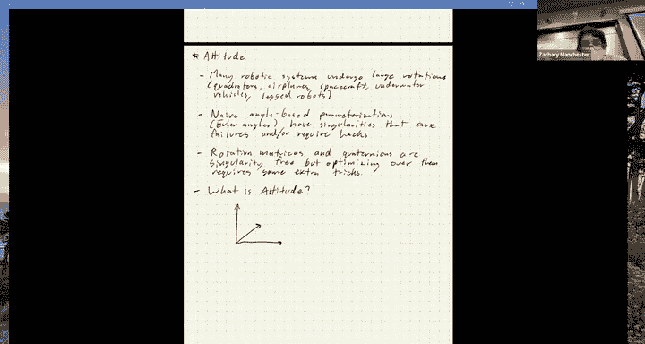

Say x in。Y N Z N， and I'm going to use left superscript to keep track of frames that's sort of a fairly standard convention and then say we've got some you know some robot thing over here with a frame attached to it。

And we're going to use bees for that for body。So X， B， Y， D， Z， B， and by the way。

 the n for inertial frame is Newtonian n for Newtonian。

 so the rotation between this that rotates a vector from that B frame to the n frame is our rotation is say a rotation matrix we'll call Q。

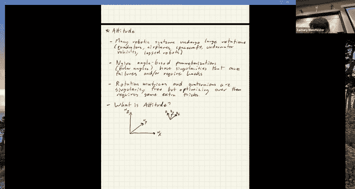

And that is the attitude of the body， that's what we call attitude。

And it's specifically such that VN， some random vector equals Q times Vb。

So let's say have I don't know like say have a sensor that's on the robot body at a certain spot right I have some vector that I measure let's say I have a camera and I have some something that I measure in the camera frame that's bolted to the body that's you know some point out in the world and I measure this vector in the body frame of the robot from the camera I want to then figure out what that is the in the world frame I apply this rotation to put it in the world frame right from the camera frame cool and there be there would also be an aline term on there right like yeah you get the idea so it is this this rotation。

And this is obviously an arbitrary convention， I could have defined it the other way。

 right like world to body， but the body to world convention is pretty standard across robotics and aerospace and stuff。

mostly because we think about you know sensors on the robot and stuff like that。

 the opposite convention of world to body is more standard in physics。

 I think because they think about you know I'm standing here looking down at my experiment and all of my sensors are in the world frame。

 say， but I don't know。Okay， so this thing has three degrees of freedom， like we said。

But you can prove actually quite easily， there is no global non singular three parameter representation。

Of attitude， so you can't write it down with three numbers without having singularities。

Even those are only three degrees of freedom。So in some sense， quatronneions are like， you know。

 the most compact one that you can have because they have four parameters， right？

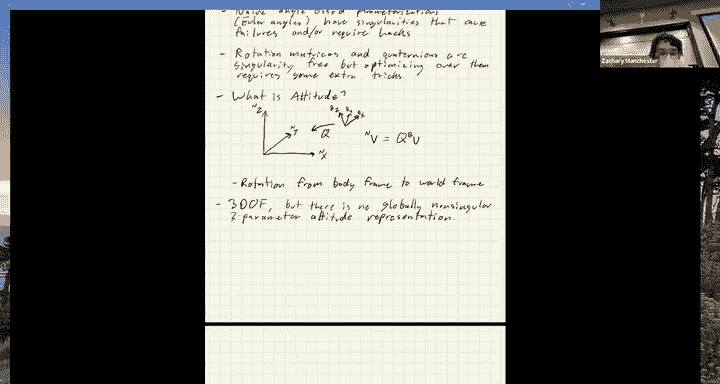

Okay， so next thing to talk about our rotation matrices， which everybody knows about and somehow I。

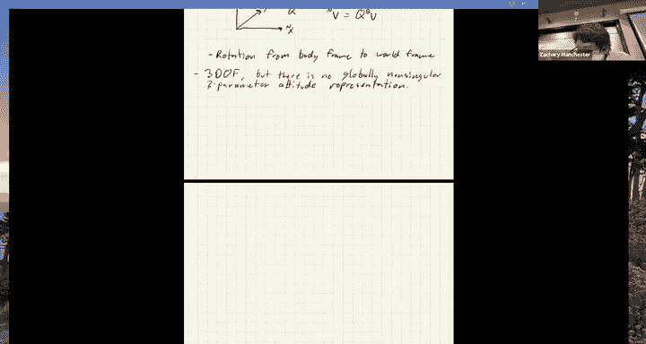

Stupid thing。Crepped out。pologies。All of the technology things are。Are problematic。

This thing takes awkwardly long time to connect also。Hes working again， Hu。ok。Okay。

 so rotation matrices everyone's seen these before in their lives， I'm sure so we'll do this quick。

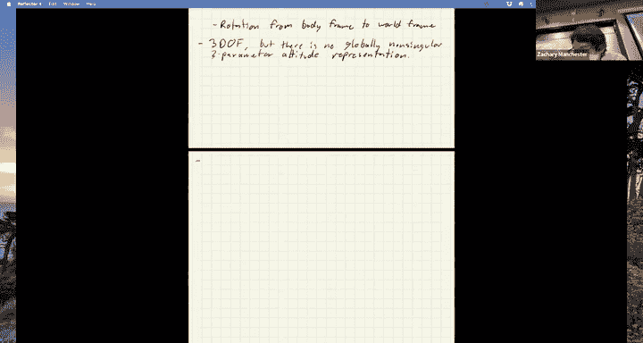

These are also sometimes called direction cosine matrices， has anyone heard that term before？

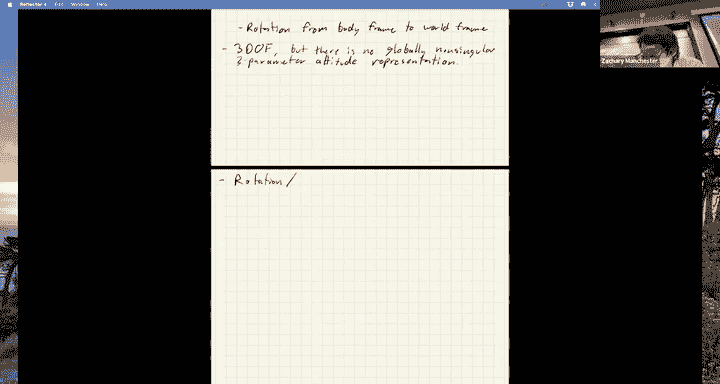

F hands， yes， okay。Okay， some fun facts about rotation matrices that you may not have seen before unless you like really dug into these so when we talk about the attitude thing we're talking about。

And I'm going to use this kind of one， two，3 notation for the basis vectors now。

 so this is a matrix that's going to map。你。嗯。Sort of x in the B frame to the x in the N frame。

 like we said。傻逼。And cool， okay， so looking at this。

 can anyone tell me what the rows of this guy have to be？

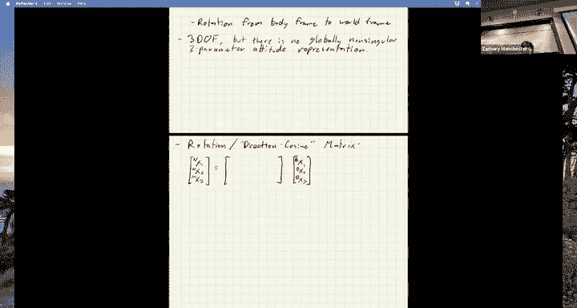

So think about it this way when I think about matrix vector multiplication。

 what I'm doing is really taking the dot products between the rows of this Q matrix and the the x over here right okay。

 so if I look at this like in terms of its rows， I've got three rows。Each one of these rows。

 if I take the first row， I'm taking the dot product between the first row and Xb， and it gives me。啲。

N1 component of x like it gives me the one component of x in the n frame right so if you think about the definition of like basis vectors and components and stuff like that it's the thing that gives me the sort of n one component。

So what does it have to be？对我。It has to be unit norm。

 that's absolutely true if we think about basis vectors and stuff like that， though。

So the rows have to be mutually orthogonal that's totally true。

 but they're actually a set of basis vectors that's sort of another way of thinking about that right So they all have unit norm。

 they're all orthogonal totally true which means they are a set of three basis vectors and it turns out the rows are a very particular set of basis vectors if you think about this So when I'm doing right as I'm taking dot products and I'm getting out the components in the Mframe right the first row gives me the first component in the endframe second component gives me thus you know the second row gives me the second component in the endframe etc etc so。

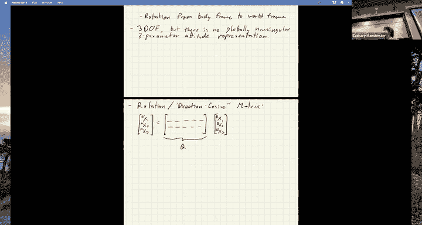

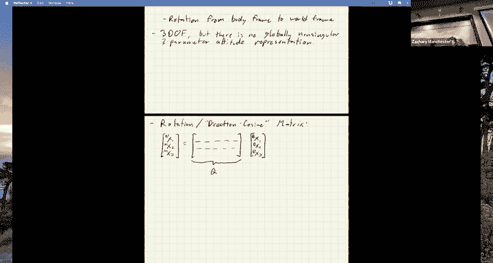

Thinking about it that way， they the rows have to be the end frame basis vectors that makes sense to everybody。

 So this is basically， you know， it's like n1。Transpose N two。

 transpose N3 transpose and specifically they're the n frame basis vectors written in the body。

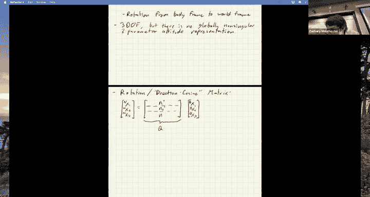

In body in written in body frame components so it's basically how I translate back and forth right so the the rows in order for me to like legally take that product with the B frame you know components of x。

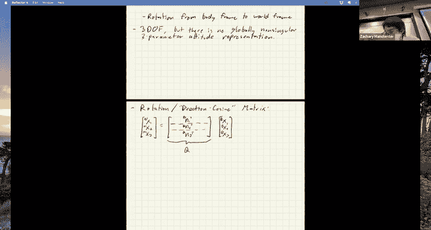

They have to be expressed in the Bframe， and they're the N unit vectors expressed in Bframe components。

Okay， does everyone follow that does that make sense， okay， and now sort of similarly。

 if I think about it the other way。

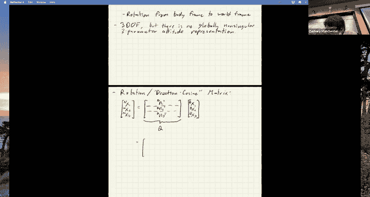

The columns of this thing。啊。

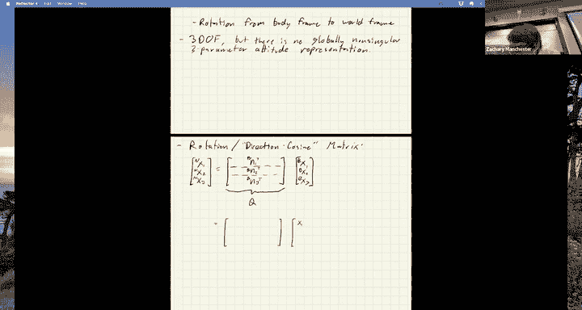

Sort of， if you kind of think about what's going on a little bit。

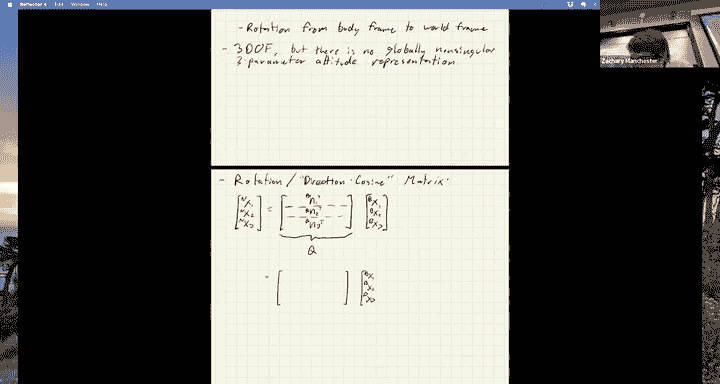

The columns are the B frame。Basis vectors。Expressed in N components。

And the way to think about that is like you're multiplying each column here is multiplying one of the elements of the right hand side。

Okay， so。Maybe that might take a minute to think about there's one very obvious conclusion to draw from this fact which we already talked about basically because of this。

 the columns are sort of the Bframe ones， the rows of the nframe runss and if I think about what this things transpose is if I transpose you know if I do Q transpose Q I'm taking the mutually orthogonal basis vectors and taking all of their dot products with each other right so therefore because they're mutually orthogonal。

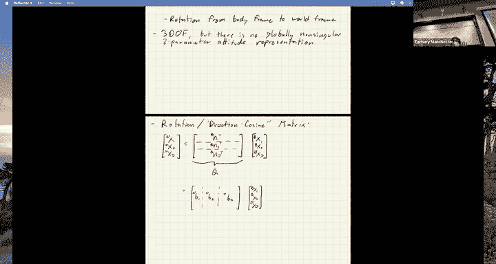

Only the dot product of one of them with itself is going to be non zero。

 it's going to be one because they're a unit norm， all the only ones going to be zero。

So that means that。Q transpose Q equals the identity。

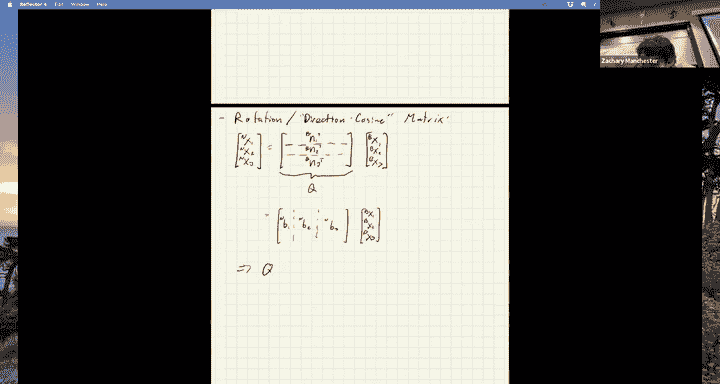

Very call with that。Also， by extension， then this tells me that。Q inverse。

Eals Q transpose because that's the definition of the inverse right Q inverse  Q equals identity。

 so therefore Q transpose equals Q inverse， this fact where the inverse of a matrix equals its transpose。

This is one definition for an orthogonal matrix。The other one is that the columns or rows are all mutually orthogonal unit vectors or whatever。

Okay， so that means orthogonal other so the other thing we can take away from staring at this is we can actually infer the determinant of this matrix but from just what we have here also does anyone remember like the geometric interpretation of the determinant？

But it means exactly yeah it's signed volume right it's the volume sort of stand by the column vectors okay so。

We already said the columns of this are all unit norm unit length are all mutually orthogonal。

 so what does that volume have to be one right one cubed right okay。

 so knowing that what's the determinant of one of these matrices always。

Determinate one， right， okay， cool。So。

You can also say this and this so it didn't have we said it signed volume right so specifically it could have also been negative one would have been an option so it turns out when you define sine volume it's the signed part is sort of referring to having a right-handed coordinate system with the righthand rule So if we flipped one of these around and made a left-handed coordinate system it would come out to negative one and in terms of like what the operation of this matrix is that would correspond to having a reflection So if you have reflections you get determinant minus1 if you have a pure rotation is determinant positive one So the fact that it has determinant plus one。

Is called special。If you。And sort of。Mattrix slash group theory lingo。

 So you put these together and you have。The rotation matrices are form a group that is called the special orthogonal group。

 and in 3D it's the SO3 group for a special orthogonal group in threeD dimensions。

We've heard of this before？Cool， what of you， maybe。Okay， so I don't know， fun group theory。

That's where that comes from Okay， so that's sort of basic sort of facts about rotations rotation matrices。

诶。The next thing to talk about that's relevant for us because we're interested in dynamic C things is rotation kinematics。

 which is specifically how we integrate angular velocity which is well defined right we all know what angular velocity is it's what I get out of a gyro that's bolted to my robot how do I take that。

Gyro measurement and integrated over time into a rotation matrix or in this case， rotation matrix。

Okay， so let's talk about this。It'll be sort of like a roundabout。Way of doing this。 So Okay。

 so I think a couple things we can start out with would be。

Like the picture to think about here is like imagine I have like a record。

And it's spinning with some omega， and imagine I have some vector that's fixed on the record。

So we'll imagine the record is the body frame， so a vector Xb。

That's sort of defined in the body frame and then if I look at it from above like in the inertial frame。

 X n is spinning around right and is time very cool。So we have x n equals。

Q of T times x B， right？So Xb is a constant fixed in the body frame right draw I drew a line on the record it's spinning around so x in the B frame in the record frame not changing x in the end frame in the inertial frame what I'm looking at it from above is time bearing so that Q is time vary right？

Cool， so can anyone tell me from like basic you know， mechanics ideas what this thing is？不行。

What is the velocity of that x in the end frame when I'm looking at it from above？

Not a kind Oome cross。Yeah， omega cross x， right？

And。So be legal， all these frame things， these guys all have to be in the same frame。

So it's omega cross x right is this velocity of the the tip of that vector everyone's good with that Okay。

 so now。Equivalently this guy right so I'm writing X dot in the end frame， I can also。

 if I tack the rotation matrix on here， I can rewrite this part in the B frame。

That's perfectly legal， so I can do the omegaross， whatever omegaros X in the B frame。

 and then I can stick the rotation matrix on it and transform it into the n frame。Okay， so that。

 I think is。こふね。We're going to need one more little thing。 So okay。

 so now what I'm going to do is I'm just going to apply the chain rule。

So if I take the original sort of definition， x in the nframe equals Q times x in the B frame。

And I just differentiate the whole thing。I will get。X dot in the endframe。Equals。

Q dot times x in the B frame plus。

Q times x dot in the B frame， and we said by definition from our setup that that x dot in the B frame is zero right。

 so we're going to get rid of that。Okay， so now we have。

If I now take this and I plug in the X dot definition I had from just above。I'm going to get。

X dot in the n frame， so I'm going to take this right so I have x dot in the n frame equals Q dot times x in the B frame。

And I'm going to take my the line above this where we just talked about this whole ome cross thing。

 I'm going to plug that in and I'm going to get Q。Times omega in the B frame cross。X in the B frame。

Right I' going follow that I just took。This line。And。

This line and set these guys equal to each other。Okay。

 now what I can do is there's an Xb on the right hand side of both of these。

I'm going to basically pull the Xb out。To the right and then what I have left is going to be the kinematics of。

Of Q Q dot equals something involving omega， that's the game plan in order to do that。

 I have to define one more thing。Which is this matrix that is。

Variously called the Ha mapap or the cross product matrix or whatever。

Probably some of you have seen this before， so it's a matrix that's equivalent to the cross product so if I do omega cross x it's the same thing as having the following matrix。

So this we're going to call this thing。我咩嘅下。So this is so basically omega cross x equals omega hat times x or omega hat is that skekusymmetric three by3 cross product matrix or hat matrix or whatever。

 so if I now plug that in，I get。Q dot。

Times x b equalsq times omega hat times xb。And now I just pull the XBs arbitrary， any XB I want。

 so for that to hold， I can just take those off and say that Q dot equalsq times omega hat。

And that is the answer。If you want to integrate a gyro and you have some measurement of omega。

 if you have some initial attitude Q n that you start with at time zero。

 you just do this and integrate your gyro up and that should give you your Q of T assuming your gyro is pretty clean and not super noisy。

This is basically how you do like you know dead reckoning or oometry on a gyro， right yeah a？Sorry。

 sorry was it a few。Q Q times x dot in the body frame because x dot in the body frame by definition here。

 we said it's like draw the line on the record。It's。Fixed in the body frame。

 It's just pick any fixed vector in the body frame that you want。

 and it's kinematics in the inertial framer I'll make cross， you know that thing。

 right That's what we're talking about。 So if I just kind of product rule that out。

 I get that X dot in the body frame term， which has to be 0 by definition。

I' going to give it that Okay， cool okay， so that's how you integrate Drill。

呃。So now like from this now I can write my dynamics of my robot with a rotation matrix in the state。

 I could do that using that equation right so I have my robot dynamics that give me like omega dot right in terms of various things and I can take that omega dot and integrate that and then I can plug the omegas into this and I can do everything in terms of rotation matrices。

So we could stop there， but in practice， people don't usually use rotation matrices when they're doing dynamics and optimal control because they're so over parameterametized。

嗯m。对。So this has a lot of redundancy。

So we don't like that， so basically quaternians。Are just kind of more efficient。这个。

And they're the go to thing in most areas of computer science when you're dealing with rotations。

Okay， so here's how we're going to do this。 We're going to define an axis of rotation that's going to be a 3D unit vector that we're going to call a。

For access。And we're going to find an angle of rotation that is the angle you're spinning about that axis。

嗯。And this is a scalar。With units of radiians。肥啦。😊，Okay。Everyone good so far。

 so with that we can define this thing that's commonly called an access angle vector or sometimes an euler parameterization or something。

 I don't know people call these different things， but basically if I just take that axis in that angle and multiply them together。

e times data。I get this， we're going to call it fee。

So it's just a it's a vector whose you know direction is the axis of rotation and whose norm is the angle with which I rotate about that angle so that make sense to everybody defining these things。

And so this is yelling。3D vector。And it's defined such that。Norm of this thing equals theta。

And if I were to do like this， the normalized you know access here。We would get A back。Okay。

 so like one way to think about this is if I have a constant omega or a very short time。

 this is basically like the integral of omega in some sense， right？We said you can't really do that。

 but like actually within within some approximations， it's kind of true。

 so that's a reasonable way to think about it。So like approximately for a short time horizon。

You have this kind of thing。嗯。But in general， you don't want to do this because all the singularity nonsense we talked about sort of holds。

 so this is like for very short DT， this is sort of a reasonable approximation though。

Or very short age rather。

It is true if omega is constant。Okay， so in terms of this axis angle stuff。

We can define the quadraneium pretty easily。So we're going to call these quaernneions little cute。

And rotation matrix can be big Q。And we're going to read it like this。

 so it's a 4D vector and we're going to think of it as having a scalar part and a vector part。

 which is in analogy actually with complex numbers， we have a real part and an imaginary part。

So the scalar part is cos theta over  two。Then we're going to put that on top and then on the bottom。

 you're going to have the vector part， which is a 3D vector， and that's a， the axis times sign。

Theta over2。Okay， so。Scalar part。And。Seect your part。

Remember the whole thing is 4D okay if I'm just looking at this really quickly。

 you can kind of infer。A few things。One is that from looking at this。

 can anyone tell me what the norm of this thing is or thought about another way。

 what does Q transpose Q have to equal？嗯，犀利。Well what's a A's norm one right so this thing basically you can look at and say A's norm one and it's sine squared pluss cosine squared which has to be one so this thing has unit norm always。

So what you can say is you know valid rotations for this thing to be a real correspond to a physically real rotation has to be unit norm。

And this is really easy to normalize numerically， so this is like one of the pros of this doing the same kind of normalization thing for a rotation matrix is way。

 way harder and more expensive。Okay， the other thing you can get straight from this is。

Think about what Q and minus Q look like。So it turns out if I think about Q and I think about minus Q like and I think about sine and coine。

Minus Q corresponds to if I like flipped the sine of theta and the sine of a。

So it turns out like Q and minus Q give me back the same rotation。They're the same， okay？

And you can kind of figure that out by looking at the signss and cosines and thinking about this for a second。

Another way to see this is by adding， if I add2 pi to theta， I get the same physical rotation。

 but because the theta is divided by two in the co and the sine， I plug a two pi mod two pi in there。

 right， I get I pick up a minus sign。Everyone see that？Co。So yeah。

 and just kind of like add two pi to this and take a look。So this has a name in group theory， lingo。

 this is called a double cover， so there's two quaternions for every rotation。

For every physical location。

And that does kind of。Do weird things occasionally。

It's something you occasionally have to think about in a control context。

Okay， and then basically the last thing I'm going to say about this is you can more or less think about Queternians。

The way to think about them is just think about them like their rotation matrices so we're going to write a bunch of math involving quaternians where we're going to multiply them and stuff like that whenever you see like quaternians getting multiplied and stuff happening them just pretend in your head that the rotation matrices and all the math will work out fine。

And that's kind of the right way to think about them。And some in some deep sense。

 that has to be true because they like represent the same underlying physical thing if they're just like sort of alternative parameterizations of the same thing。

Okay， so let's see how much time we got we got some time， okay， so we'll do quatrini multiplication。

And people write this all kinds of weird ways。I'm going to do a star for this。

And we're rarely you'll see also people use like the O time symbol for this。

 which I don't like because it's also chronic or product。Um， so whatever， okay。

 so if I have two Crernions Q1 times Q2， I'm going to write them in terms of their scalar and vector parts like this。

I can write this out in terms of the sckealar and vector parts as。S1， S2 minus v1 transpose V2。

Is the new scalar part and then the new vector part is S1 V2 plus S2 v1。Plus V1 cross V2。

 where that cross is the standard R3 vector cross product。As you can kind of see looking in there。

 like the Quaternum product kind of combines。Into one thing like the classic vector dot and cross products。

 And in fact， this was invented first。 And then this was invented by Hamilton and then like。

A few years later， Gibbs invented the standard like three R3 vector do and cross product stuff as a supposed simplification of quaternium algebra because people were freaked out by four dimensional vectors。

In the 1800s apparently okay so we're going to write this， so that's what it is。

 that's the definition， and it turns out that corresponds to multiplying two rotation matrices。

So if you do this with two Cotneians， they're going to get the same result as if I took big Q1 times big Q2 where those were rotation matricaces。

We are going to write this a couple different ways。

 which is going to become useful when we start talking about Jacobians and derivatives and optimization。

 so we're going to write two different sort of matrix versions of this i'm going to make a matrix。

That we're going to call L by pulling out。So if I look at that definition and I pull out S2 V2 to the right as a vector。

I can get the following thing。Okay， so everyone's see how I got that。

 so if I take that definition and pull out the S2 V2 terms to the right。

What's left over is this matrix that's a function of。You know， Q1。That when multiplied by that。

 you know S2 V2 vector gives me that the multiplication operation， so we're going to call this。

L of Q1。For like left multiplication。No surprise there。

 I can do the same thing where I pull out the S1 V1 terms to the right。And get a similar matrix。

That's going to look like this。And this one we're going to call R。Of Q2 for right multiplication。

Question， how do I get the bottom right block of that？Why is it minus V2 hat？😡，What happened？

Yeah I flipped the order of the cross product which I pick up a minus I right I cool of that that by the way。

 the fact that the cross product flipped sign when I flip the ordering that's called being skekusymmetric right and that's why the cross product matrix up here is a skekusymmetric matrix where it's transpose equals minus itself that's the same thing。

Okay， random fun facts then as we finish up here， we're just about done。

Quternian identity。

Okay， so。The thing corresponding to like the identity matrix， looking at that definition。

 what happens when theta equals  zero， do I get？

Y， you got it， so that's the identity Queterion。Um。Okay， what else other fun thing。

 there's this thing called the quatturnian conjugate that corresponds to with matrices with rotation matrices the transpose gives me the opposite sign of the opposite rotation gives me the inverse of the matrix right with quatturnians it's called the conjugate。

Instead of transpose。But it does the same thing。So the way to think about this is plug in minus theta。

To that definition and you'll find what you get is。嗯。And by the way， it's written as Q dagger。

 it's that little， I don't know。Superscript dagger thing。

This gives you the same scalar part right because cosine if I flip the sine on theta cosine doesn't change right。

 but if I flip the sine on the sine the bottom it flips sign so I get the same scalar part。

 but I get minus the vector part。

And that's going to give me the opposite rotation or like the effectively the inverse if there were rotation matrix or like the transpo and we're going to also define a little matrix version of this called。

Capital T for obvious reasons。That looks like one and then a minus identity block down here。

Such that you get know that it gives you that conjugate operation， okay。

So let's see， almost there。How to rotate a vector？

So this， it turns out， looks like the way you rotate a matrix with a rotation matrix。

If I have a vector， say， in the end frame， I stick it in as the vector part。Of a quatraneion。

 and then I multiply it by Q。And then。Q conjugate。And you can also write this right if I remember these definitions。

 I can write that it says L of Q。R of Q transpose times。X，b。Or as。

R transpose of Q L of Q doesn' the order doesn't matter。

The transpose there because it turns out those LNRs if I do the dagger on the quaternium。

 it corresponds to transposing the corresponding matrix no surprise and this by from this definition。

 this is how you you get。

The rotation matrix in terms of the quadronion。啊， let's see。What else last one。

 and then we'll call it a day。

Oh yeah， there's sort of one little thing here so I this thing。

We're going to define another matrix H。That gives such that it sort of does this。

So this would be so this basically promotes a three vector into a four dimensional vector with zero scalar part。

 which is what you would use to do this stuff last thing is quaternion kinematics。

Which is。Q dot in terms of mega and it's almost the same as the rotation matrix version。

 but you pick up a factor and it's easy to derive and we can do it next time but。

I'll throw it in there， it's the following thing。So remember with rotation matrix。

 it wasq times omega hat where that was the cross product you think here it'sq times。

Pure vector sort of promotion of omega， which it turns out does the same thing as the hat because if you go back to the definition here。

 if I just have a pure vector Quetturnion， it basically looks like a cross product。

In that product definition， and we can write this using our notation as one half L of Q for left multiply。

Times that H matrix that promotes the omega。

Times omega。And this whole thing here。This L times H thing is going to be4 by3。

 right so it's mapping the 3D omega into a 4 d Q dot。

Okay， that's all you need to simulate dynamics with Boranians， so we made it to the goal for today。

And we'll do some more sort of cleanup on this next time。

，对。

Okay， that's it for the day。Hang out a little bit you guys are free to go next time we'll kind of finish up this story and like talk about optimization over patronernnis。

