# CMU《最优控制和强化学习｜16-745： Optimal Control and Reinforcement Learning》中英字幕deepseek - P15：[15]Lecture 14_ Optimization with Quaternions.zh_en - GPT中英字幕课程资源 - BV1qHwke1EBX

Last time。

We talked about。What， what did we talk about so we did。哦。

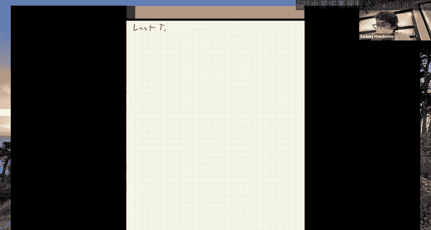

We kind of did a recap of all our deterministic optimal control stuff， right？

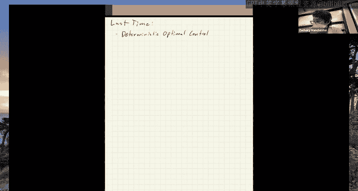

And。UWe in particular， we did like a sort of LQR versus NPC。

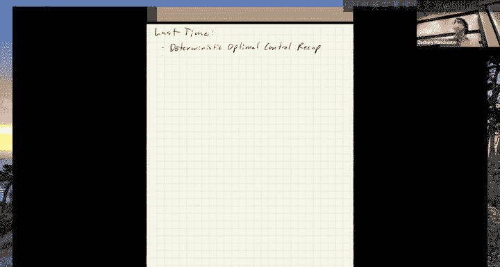

And then like。A DP versus Dr call kind of comparison， right？

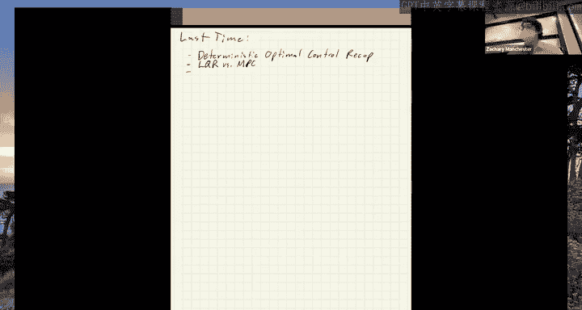

And I would see like the the stuff we've done so far is basically like the bread and butter of kind of like。

Practical optimal control stuff that you'll see in like robotics nanoerospace applications and like the stuff that's probably most useful that you're likely to see all the time in particular like LQR andmpC are you know kind of very standard and the nonlinear trajectory optimization stuff is also super super common stuff and basically putting those two things together will solve I don't know probably 90% of like robotic motion planning and control problems like it's it's super useful stuff so we're kind of now and then also but the last time we started talking about。

Sort of like。Quernion sort of stuff we kind of did the quaernian intro let's call it and so now we're going to get into like kind of extension some extensions of the most kind of stock classic algorithms that we talked about already and then kind of start veering into I guess more interesting sort of extensions and kind of side topics that are。

Occasionally useful and interesting this being one of them like how do you extend these things to deal with attitude large rotations soO3 Crternions kind of things and we're going to kind of do a bunch of those offshoots for the rest of the semester and then kind of like talk about a bunch of case studies and stuff like that if you guys have any particular topics that you want to hear about by the way in terms of like case studies of like state of the art robot things that you've seen you want to dig into or I know just topics in general you want to hear about definitely。

Send me a message on Piazza or whatever we can talk about， you know。

 you could check out what's already in the syabus， because there's anything you don't see there you want to hear about send me message。

All right， so today we're going to basically go in depth into。

into sort of optimization with qualuternians and basically how to start doing， you know。

 aerobatic backf kind of crazy things that involve large rotations using all the tools we've talked about so far。

So this is basically the like how to do backflips with robots topic。嗯。Which is super fun。

So first off， just as a quick recap of kind of the stuff we've already talked about with Crternnaians。

So。

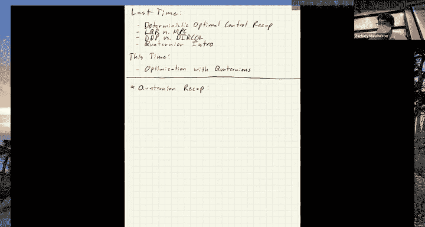

To be so i'm going to basically do the five minute version of last time's lecture just to kind of make sure that stuff sticks and refresh the memories so first off right we think about these things as 40 unit vectors。

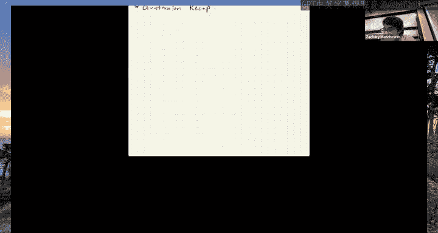

Yes。And they have a multiplication rule that we talked about last time。

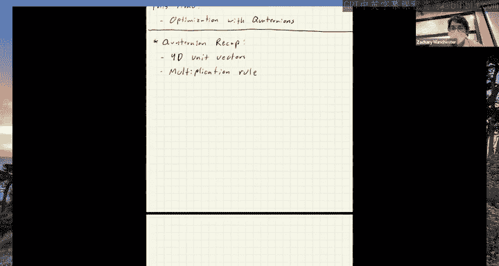

m sorryrry， zoom guys， I'm trying， I have my volume turned on can you are you guys trying to say something？

I see the chat。Yeah I just had a quick question。So last time you mentioned that there's sort of this formula for quaernian velocity is there。

A nice way to express like acceleration in quatturnion so do we not need to do that when we're doing this type of problem you don't need to do that basically you'll for acceleration stuff so generally for velocity and acceleration you're going to use like standard angular velocity vector and then you know derivative for angular acceleration the quaternian stuff you really just want for representing the pose or configuration and then what we're going to do here is what we call like quaternian kinematics which is the mapping from standard angular velocity omega the kind of thing you measure with a gyro how you map that into a Q dot like quaternion derivative to the kinematics but yeah generally you don't want to write your dynamics down like your accelerations down in terms of quaternians it's sort of unnecessary right it's got like extra an extra variable in there that is constrained in weird ways and it's sort of not convenient。

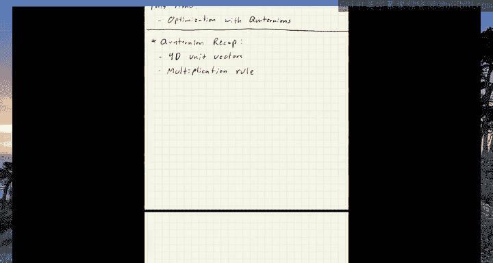

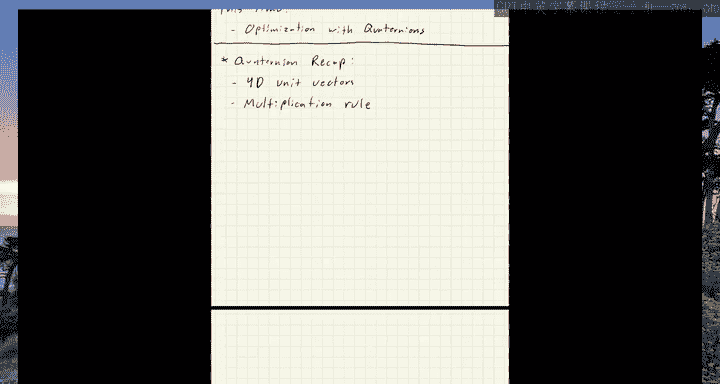

That makes sense Yeah， that makes sense yeah， we're going to talk a little bit more about this today and hopefully it starts to click。

Okay， so we got multiplication rule for these guys。

 which we're going to use a star to write down and it looks like this we got sort of scalar vector part。

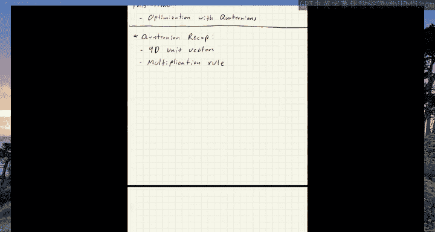

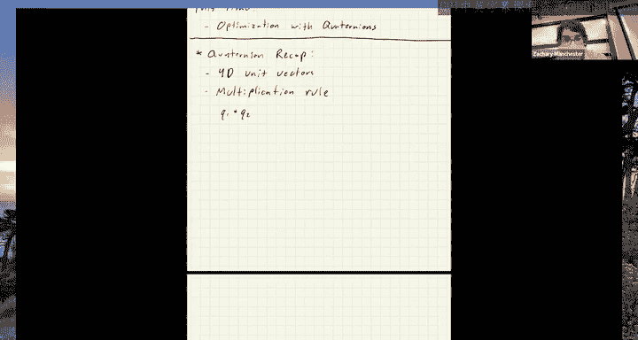

Salar vector part。And when we multiply these， the answer is。

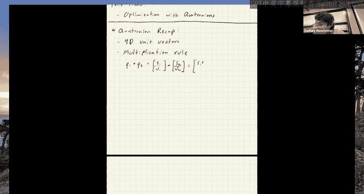

The following thing。

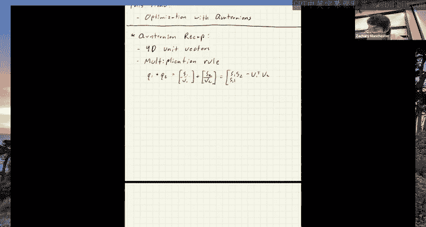

And you can see how this kind of。Looks a lot like a cross product， but like generalized to Fort。

4D in some ways and kind of the right way to think about this is just think of quaternians as rotation matrices and think of this quaternion product as equivalent to the matrix multiplication of rotation matrices product Yeah guarantee all the properties okay so this is not a vector space I think that's one quick thing to talk about when you say multiplication operation on a vector space。

 what do you mean because there really isn't a canonical multiplication of vectors right so what this actually Yeah so it doesn't commute it definitely doesn't commute right so the way to think about this is like matrix multiplication if you want to get into it this is an example of a lead group So it has all the properties of a lead group it has an identity element and inverse a product that's closed it's closed under this multiplication operation just like the group of rotation matrices right so just think about it in your head as matrix multiplication and it looks like this。

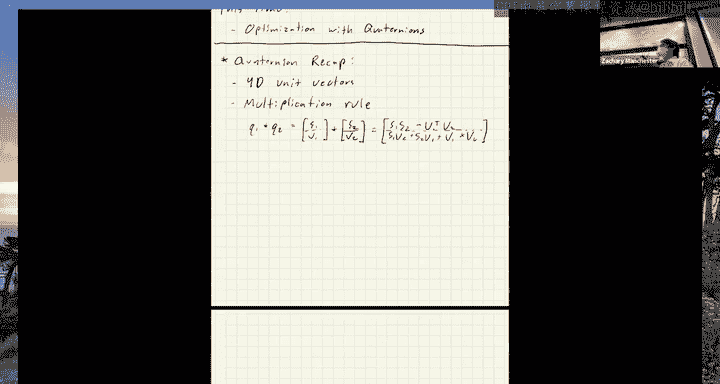

In all the kind of like standard algebraic waves， it acts exactly like multiplying matrices right you've got your inverse you've got your identity element like all the stuff you're used to from so just think about them like matrices and it'ss totally equivalent to matrix stuff like we can map this into those left and right multiplication matrices we talked about you can actually rewrite all this stuff in terms of matrices and it acts like yeah matrix stuff。

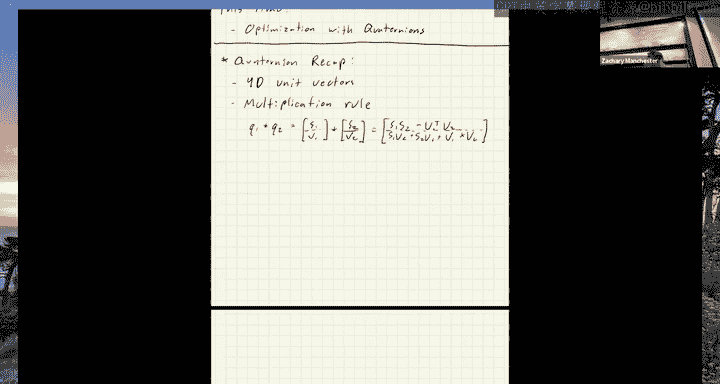

Right， so then we defined this stuff right such we had the like the L。

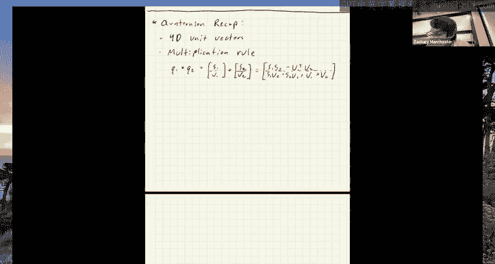

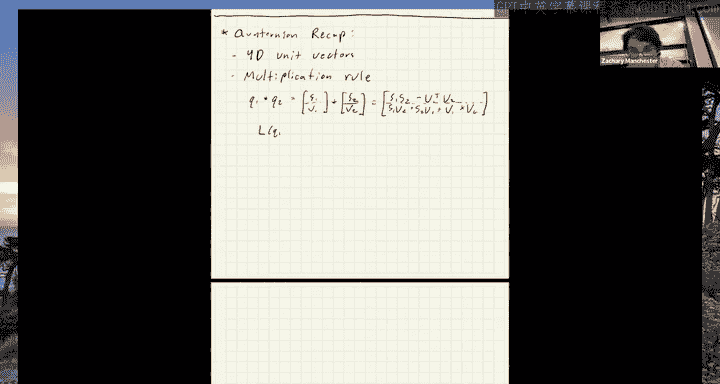

Thing that looks like this。

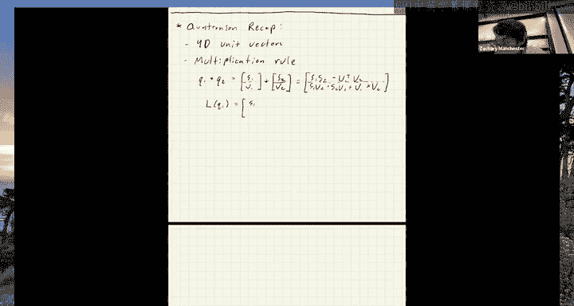

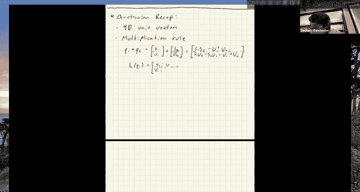

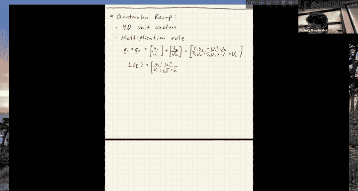

Such that。This multiplication。

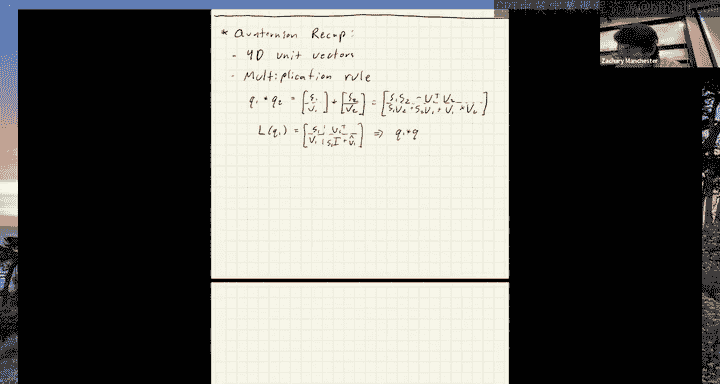

Is equal to L of Q1 times Q2 so you can turn this into like matrix vector multiplication we could define the other one right the right multiplication matrix like we did last time although we don't need it today and then we've got all these kind of other operations that kind of finish off so we've got。

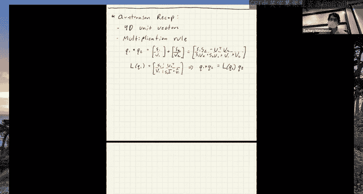

Quernian conjugate。Which acts like the matrix transpose。And gives us like the opposite rotation。

 so it's called Q dagger and you keep the scalar part the same and you negate the vector part。

And we can write this as a matrix operation as well。Where tea is。A one and then a minus identity。

We have a Quaernian identity。

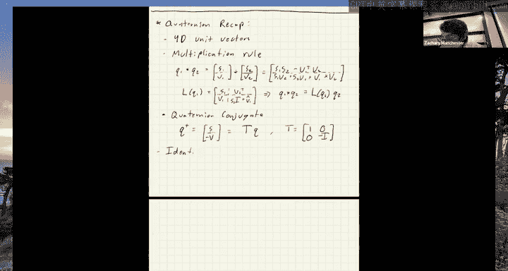

That is just， I guess we'll write it like Q subi or something。

 which is just a one and then a zero vector part。

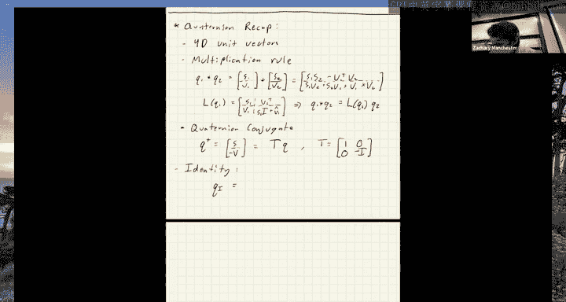

And then we have this other thing that we are going to call the hat mapap for Quitturnians because it does the same thing as the sort of cross product matrix thing。

 the ssymmetric matrix that we talked about before。

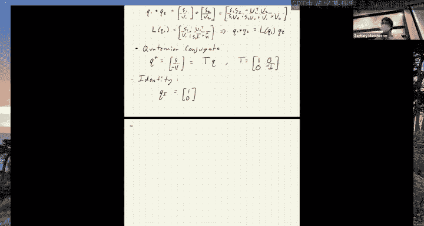

Alderbraley。I don't know of another good name for this。That's what we're going to go with。

And so we're going to congra it like this， right where it's a zero scalar part。

And then just pure vector， and we're going to use this H matrix to represent that where the H is。

A zero row and then an identity block， so it promotes the 3D vector into a 4D quaternium vector with zero scalar part。

ok。Any questions about this stuff this is all the stuff we did last time it just kind of like algebra things and like how to write them as matrices。

 how to multiply them， how to invert them， yeah everybody good about this stuff。Okay。

 so now we're going to talk a little bit more about like geometry and kinematics and stuff like that and how to like differentiate these things kind of a basically a recap of last time。

 but like with more geometry flavor and kind of explaining these things in a different way that may make more sense to some of you may not I'm not sure toll have to see how it goes。

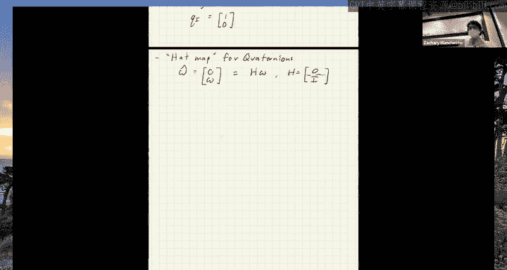

Okay。So。

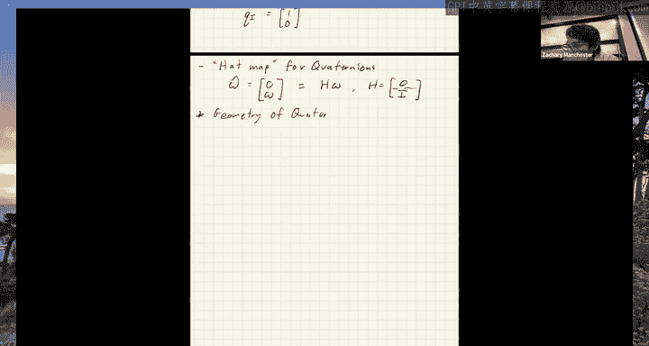

Yeah this goes pretty deep and it's kind of I think it's interesting personally I don't know so the sort of first thing to say here is that quatturnians they're 4D unit vectors right so just thinking about that right like what is the set of all like in 3D if I took all all 3D unit vectors that defines what shape？

A sphere right So it's a hollow sphere right in 3D So just the same way the set of all 4D unit vector unit quaternions defines what's called a three sphere in R 4 So it's it's called a three sphere because the surface of the sphere is three dimensional right just like the surface of a sphere in 2D is two dimensional so like the tangent plane to that sphere is 3D that's the way to think about it right just like the tangent plane to like a globe it's a 2D plane。

Okay， so cartoony drawings， we're going to draw this like Quaternian units for your thing。

So here's like a particular cu， say。So Q lives on a sphere。In R four now next question based on that。

just from like basic geometry kind of considerations， where does Q dot live？So if I have this Q。

 this my you know living on this sphere and it's moving around and it's tracing out some curve on the sphere at any instant in time。

 if I like pause and I look at that Q of T and I take its time derivative Q dot。

 where does Q dot live geometrically？Speaking。On what surface？Yeah。

Nope that's right yeah so that's the right answer it doesn't live on the sphere it lives so if I'm moving around on the surface of the sphere instantaneously if I take that derivative it's like tangent to the sphere at that point where the Q is right it's not on the sphere it's on that tangent plane to the sphere at that point right okay does everyone get that。

It's the standard kind of like you know， tangent derivative idea just sort of like in this So if I sort of like。

Taw then at this point， the Q dot will look something like this， and it lives in this。

3D tangent plane。Or hyperplane or whatever you want to call it。Okay。

 so the kind of key insight to like keep in mind here is Q is four dimensional a four dimensional vector right talked about。

 but has this unit norm constraint Q dots though at a given point。

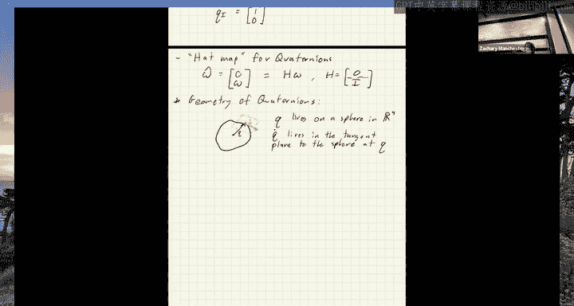

They live in this 3D tangent plane， right？So in some kind of like deeper sense。

TheThe derivatives are 3D right and that corresponds to the fact you have three degrees of freedom right and like the derivatives are related to like your angular velocity that know these are all 3D quantities so like the important like key geometric fact here is that the Q dots are really  three dimensional things and they should be 3D things and not really 4D things and this is kind of why we talk about how you want to write your sort of pose as this quaternion thing that's 4D with this constraint because it doesn't have singularities but then the rest of your dynamics you start taking derivatives and you write it down angular velocities and an accelerations and all that stuff that stuff all lives in this tangent space and is all kind of should be 3D。

That makes sense so we're going to have basically the whole game here is we want to keep the pose stuff 4D。

 but then all the dynamic stuff that are higher derivatives should all be 3D。Mi we used to basically。

Okay， so here's sort of some more on this。

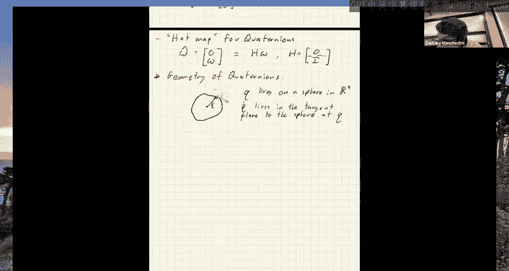

So we have this Q dot thing that's sort of in R four。And we have omega。The angular velocity vector。

 the thing coming out of your gyro， right， and that thing is in R three。

And we have this kinematics thing that we derived last time for Q dot in terms of mega that looks like this。

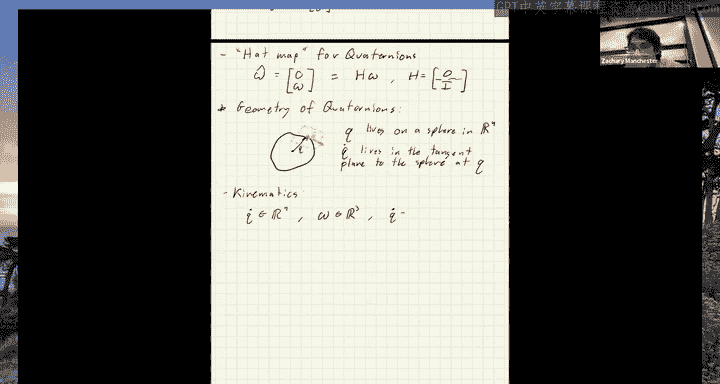

Q times this like omega hat thing。

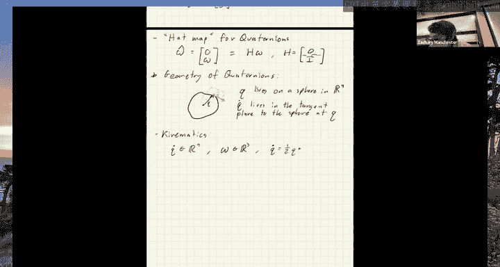

Which is equal to1 half our L matrix times our H matrix times the omega。

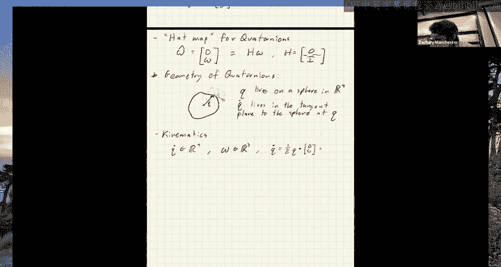

Okay， so like。The question here is。Knowing this like omega is 3D thing。Q dot tangent plane thing。

 geometrically， where does Omega fit into this picture？

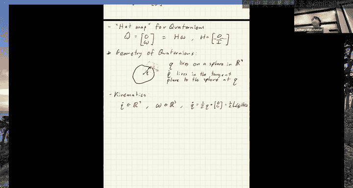

That's the question。So like there's some kind of version of this like tangent plane idea going on here right and the Q dot as I've written it here is a 4D thing。

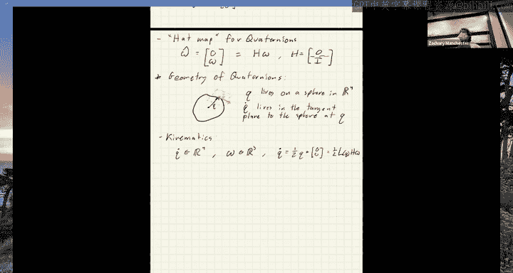

And then this omega is a 3 d thing sort of right it's only three numbers if I look at this kinematics thing for a second kind of like。

Stre it a bit and think about this whole idea of like these things being like matrix multiplication and if you think about back to when we did this kinematic thing for the rotation matrix。

 we had like Q dot equals Q times this omega hat thing right？

Thinking about that and like what that does when I multiply by a Crraternion' it's probably not obvious here so i'm just going to write it down we can talk about it。

 but think about like。Geometrically， what's going on here is basically we have， say Q over here。

We have Q dot is like you know， kind of rooted at Q in this particular tangent plane here。识。😊。

So Q dots in this tangent plane turns out what omega is here is basically。

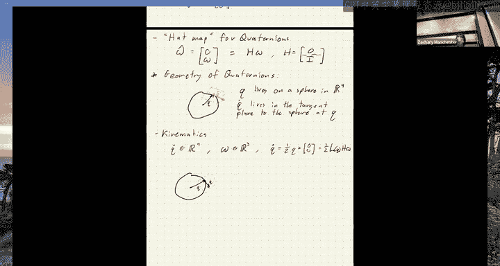

It's the derivative written in one particular tangent plane。

 it's written in the tangent plane at the identity。

And then what this kinematics is doing is taking that tangent plane at the identity。

 think about it like the North polele if you like。And it's rotating it down to where the current cu is。

 so that's kind of the idea， let's see， so let me write this。It'll do like this。So here's mega。

And it's living in this North Pole tangent plane。And then， Q。TheThe Q in this， so this equation here。

 what this is really doing。Is taking omega from that North pole tangent plane。

 and it's multiplying it by Q to rotate it down to where。Your current cu is。

And that's going to give you like the actual Q dot in the correct tangent plane based like centered it at the current Q Does that make sense everybody So that's and the kind of the way to think about this is when we have a gyro that's this omega the gyro is bolted to your body frame So you're kind of always measuring it in the body frame and this Q is kind of like rotating you from body to inertial and sort of somewhere else right not at that identity element So if you if your body frame is instantaneously lined up with your inertial frame then your Q in this kinematics is the identity right and then it really basically  Q dot really basically is that omega does that make sense。

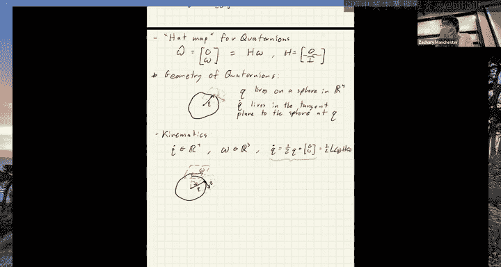

Okay， so that's a bunch of kind of weirdo geometry。

 I don't know if that's insightful or helps at all。But that's kind of what's going on。

Any questions while I write this down？Okay。So。All good so far。

 so to sort of maybe give you a little more intuition for what's going on here and maybe make the the ECE types here。

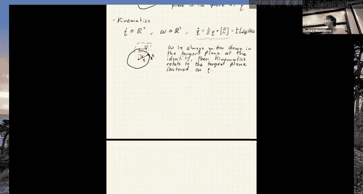

Fel a little more at home we're going to now talk about this in analogy with complex numbers and 2D AKA complex phases which hopefully everybody's heard of and seen before。

 so the quaternion stuff we're just talking about is all basically the 3D sort of generalization of complex numbers。

And all the same kind of stuff applies there， and maybe that makes more sense。

 so we'll do that real quick。Okay， so here what's going on， let's say I have you know， my complex。

Its sort of X Y。

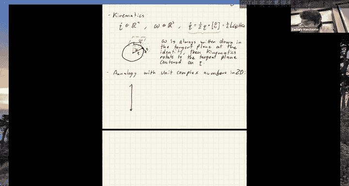

呃。Unni vectors and let's say I have a particular unit vector up here， we'll call V。

And then I can write down its sort of x and Y components。And I have this angle theta。

 let's say we measure it from here。

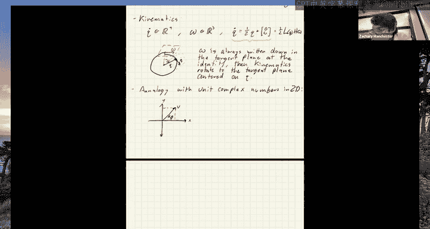

And if I write this down。Or let's call this。Yeah， so we've got V equals， say cos。飞得。Plus。

 I s theta if you're doing kind of the standard complex stuff。And this is kind of your X component。

Or real component， right， and this is your Y component or imaginary component。

And if we stack this up and write it as a 2D unit vector。We would get。You know just。This。

This is going to be you know sort of coast。Theta sine theta for the xML components notice the like closeness to this versus the quaternion kinematics that we wrote down right with the scalar vector part stuff it looks almost the same。

But there's this weird factor of two things。

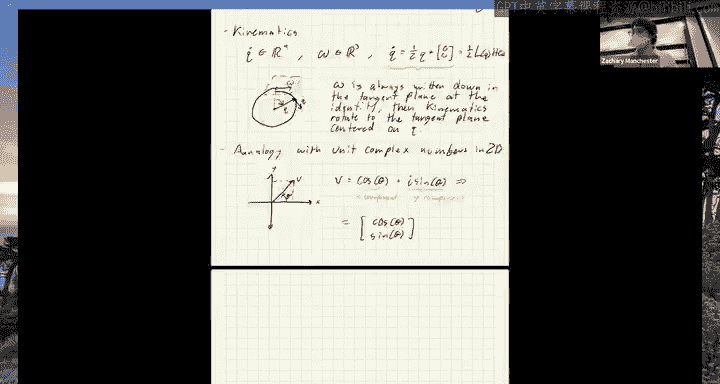

Okay， so if I just take this and also the other note here is sort of just like the quaternneion right。

 you get v transpose v equals1， its unit norm。

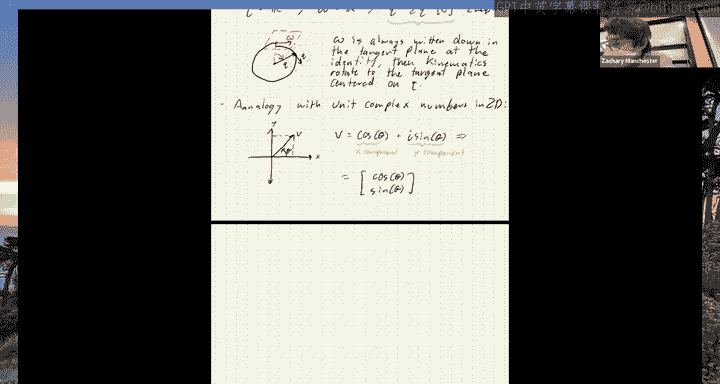

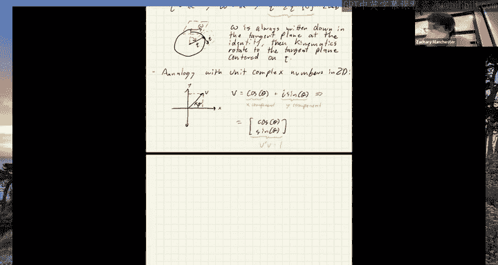

Okay， so。If I take a V dot here， the time derivative。It' I can write this as partial V。

 partial theta times theta dot。

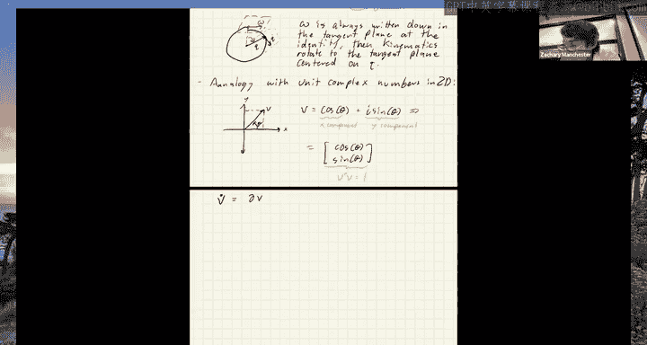

So I just chain rule through that definition。If I do that。

 I'm going to get the following thing right so I'm going to get minus sine theta for the derivative of the coast and then co theta for the derivative of the sine。

Times fade a dot。And I can write this down if I kind of stare at this for a second。

 this is equivalent to me writing the following thing like a rotation matrix。Coast data。

Minus sine theta。Sine theta。Coast data says it's like 2D rotation matrix。Times。

Zero theta dot so like。系啊。Theta dot written as a like pure y component sort of like tangent vector at a particular center at theta equals zero at the identity。

 right， which here is like。On the X axis over here， so the picture of what this is doing。

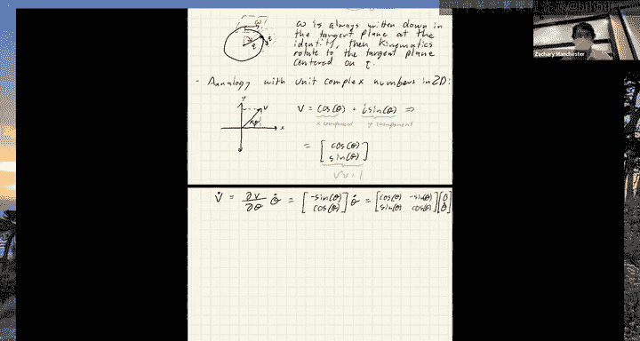

This is a rotation matrix。

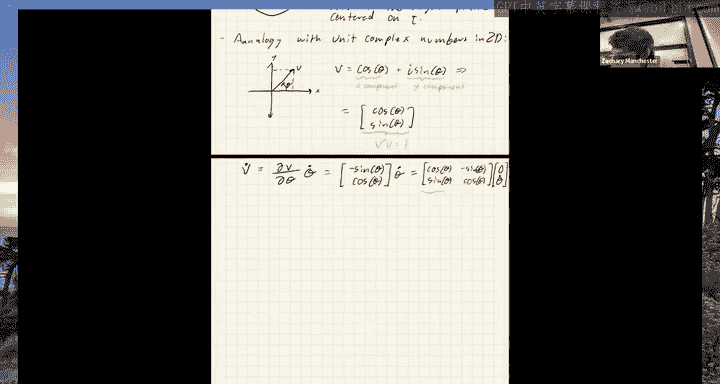

2D rotation matrix， right？

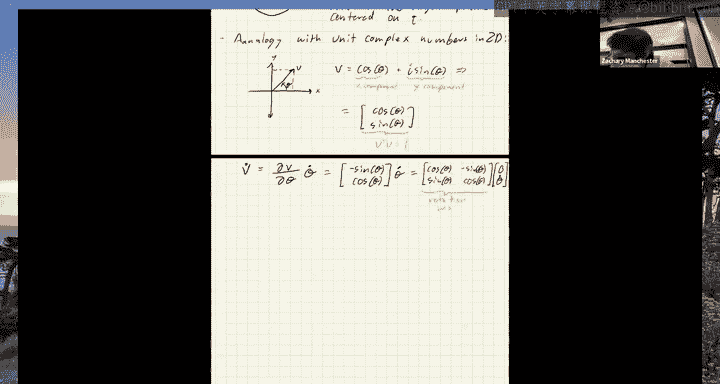

And then this thing where I've you know got zero scalar part and just y component or zero real part。

 pure imaginary， this is like the 2D version of our our Quaternian hat map thing right it's promoting the scalar into a 2D vector with zero real part。

Or you know， pure imaginary or whatever， this is sort of 2D。Hot map。

And if I draw the picture of what's going on here， it's taking。

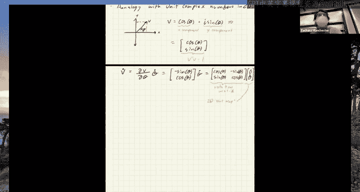

So that vector that's got。So let's say here's my V。This zero theta dot thing。Drawing the。

Tent so this whole thing is a unit。 this is like the unit circle and the complex plane kind of deal。

 And I'm writing the derivative here。 it's got。0 y component。 and then just a。Just a Y component。

 so it's actually over here。So this is like my theta dot。

 and then this rotation matrix is rotating me over here。So this tangent plane。To compute the V dot。

Does that make sense to everybody， So this is what the this is like what the quaternneion kinematics or rotation matrix kinematics are doing。

 they're just kind of like。Up up a dimension like the 3D version of this complex story and so here right like with these complex phases we're using a 2D unit vector a complex phaser complex number thing to represent planar rotation instead of just a single angle actually this also gets at a bunch of the reasons why oiler angles are worse than kind of quaternions in a bunch of ways right so here one of the things you'll run into right with using a twist an angle for planar rotation is that it has wraparound issues and if you've ever tried to finite diff these things there's like ambiguities because it's like actually modular2 pi and all this kind of stuff and all that goes away if you write it using the 2D phaser unit phaser thing instead of the angle so there's a lot of similarities。

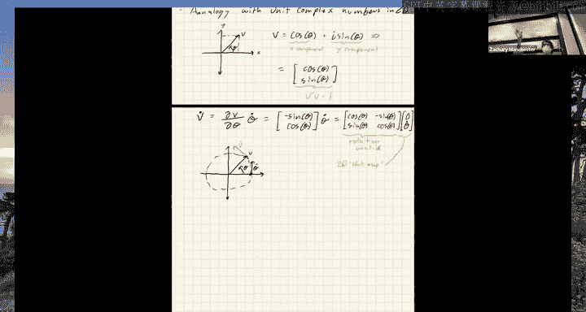

啊。😮。

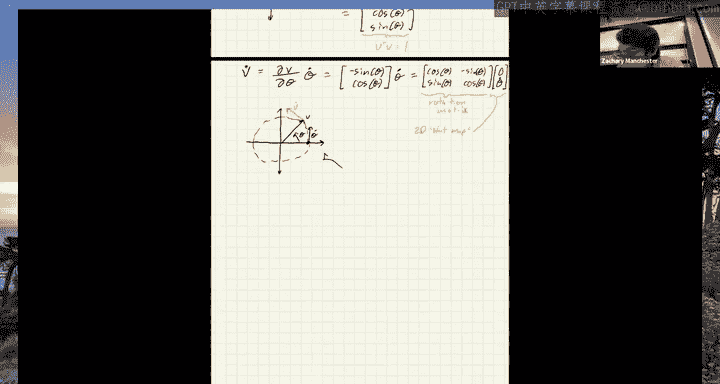

ok。Write some stuff down。

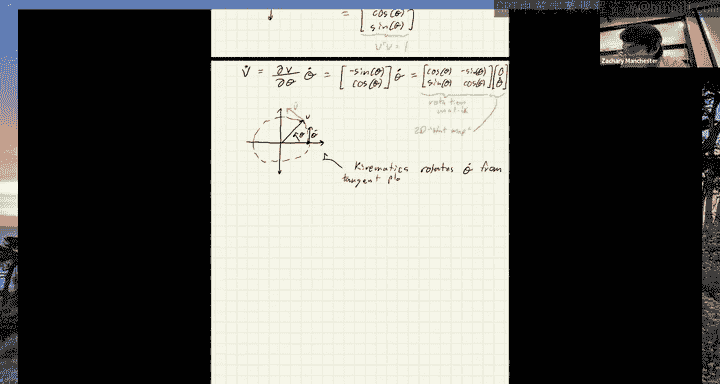

嗯。Cool， everybody get that any questions about any of this stuff so far？Okay。

 so that's sort of velocities and kinematics of like rotations and this is what it looks like in 2D and then 3D the stuff we already did。

So now we're going to start talking about differentiating。Quernians。

And so the reason we just did all that discussion， right， is like。

Hopefully now it's clear like this idea that derivatives of these things live in this tangent plane right and even though the quaternion itself is like 4D just like angular velocity as the time derivative of a quaternneion。

 we really don't want to use the Q dots we want to do the omegas right which are 3D most of the time so when we start differentiating like more general functions with respect to quaternneions。

The derivatives always live in this tangent plane and we actually want the derivatives to be 3D not 4D that's sort of the whole reason for all this baggage that's the key idea。

Is that the derivatives live in a different space than the cues themselves。Okay。

 so key key ideas number one。Derivatives。A really。3D like tangent vectors。

Rather than 4D Quetturnians themselves， right？And then two is that rotations compose through multiplication of quadronion multiplication or matrix multiplication。

 not by addition， so like this goes along with the fact like that they're not vectors。

They're not a vector space they don't act like vectors they don't commute right like vectors if I add to vectors v1 plus v2 I can also do v2 plus v1 order doesn't matter if I multiply two rotation matrices the order definitely matters right so that all this stuff is kind of why this is weird and a little different so these are the two things you have to keep track of。

Okay， so if you keep these two things in your head and you kind of like turn the crank on the mat。

This stuff will all work out so here's sort of the first step is we're going to talk about infinitesimal。

嗯。Rotations。Or sort of like differential delta rotations yeah yeah so like。Okay。

 so if I have say I want to do if I compose two rotations， so like let's say I have a 90 degree role。

And then a 90 degree pitch。If I do 90 degree roll， 90 degree pitch， I end up here。

 if I change the order and I do 90 degree pitch and then 90 degree roll I end up up here completely different answer right so that corresponds to multiplying the two rotation matrices in the different order。

So that's saying they do not commute with each other。

 you can't flip the order and get the same answer， whereas if if this were translations。

 like if I have you know V1 plus V2， if I do V2 plus V1， I get the same answer。

 I end up in the same spot so translations add like vectors rotations multiply like matrices。

So this is a very different thing and it takes it takes people a while to like wrap their head around this it's weird。

 but like it it's really not like this is 3D spatial stuff you can think through in your head really easily like don't get too hung up on the mat like whenever that gets like try to think about pictures like so you know I like the roll pitch versus pitch roll you know thing totally different right so this is and that's just the fact that the matrices when you or the quaternians the order matters right so you have to think about this when you do this stuff you can't just flip orders and and you have this kind of like 3D4D weirdness happening where the derivatives or sort of these 3D tangent things。

Even when the you know the pose representation is like a 3 by3 matrix or a 4D unit fraernnium。

 the derivatives are still 3D like omega， right？In the kinematics Okay so very similar to the kinematics we're going to talk about this like idea of infinitesimal rotation so I'm going to write this down like an infinitesimal tiny just think about a tiny delta quaerion deltaq small rotation if I write that down like a little deltaq。

For some small angle think about small angle approximation kind of ideas right so if I write that down I'm going to get like co theta over two and then axis of rotation times sine theta over two like we talked about last time so when we say small rotation remember the a the axis is still a unit vector still 3D unit vector we're talking about small theta so if I make a small theta small angle approximation of this thing what do I get。

有咩啊。你好有些。I'm going to get a one up top because coast when your eyes is to one。

 I'm going to get just one half。A theta down bottom， right？And then this thing。

 remember what we said the a theta thing is last time that's an axis angle vector right if I multiply them together and we call that phi。

So that's just the axis times the angle。And so。This is， so if we kind of like。

This is you know where fee here has small norm， right the norm is theta。

And then I can write this thing down if I kind of expand that out， right， this also is equal to。

An identity Quiternion where it's 1，0 on the bottom plus。呃。This thing。

which is equal to identity quaternion。Plus。Are like promotion matrix hat thing times fee。Okay。

So that's what's going on when I like linearize a rotation。

 I can then kind of think about this as if I were to if I wanted to like。

Taylor expand or perturb a quaternion like if I you know like if I if I compute a Tayloror expansion and I get like an x plus delta x going into a function。

 remember when I compose the quaternions I'm not going to give you Q plus delta Q what I'm going to do is Q times deelta Q because they multiply they don't add remember okay and the order matters and all that stuff so we've got to do that now instead。

So when I compute like a Q prime equalsq times delta Q。

 which is the equivalent of like you know x prime equals x plus a delta x。

 but I'm going to multiply now， this is equal to L of Q left multiply。

Times I'm just going to plug in the stuff from before。Identity。Plus。One half H fee。Right？

And this is equal to。So if if I like， you know， kind of like do this out now， it's huge。

 this is equivalent to doing。

Q plus。嗯。One half。LFQ。HC。

So kind of the end of this exercise is that we're going to end up getting instead of like Q plus deltaq you end up basically if you actually follow this through and Tayloror expand and everything。

 you're going to get Q plus this weird extra Jacobian times phi that's basically the result so like if you want to do normal differentiation kind of stuff and like have little deltas hanging around。

You want to multiply not add and if you multiply and then do the Taylor expansion you'll get like basically the original Q plus this delta term that has this extra Jacobian so the whole idea is basically at the end of this you're going to pick up this extra Jacobian and we're going to call this thing。

In here。We're going to call it G of Q。It's。4 by three matrix right because it's mapping the 3D little feehi into a 4D delta cube and we're going to call this the attitude Jacobian。

And so what we're going to now do is basically all you need to know is whenever you see a quaternion that you want to like diff in a function。

 essentially you're going to take the derivative as normal and then slap on this attitude Jacobbian and things will generally work out the way you expect。

Let's see some notes so one more note here before we get into that is that we used a particular choice for the representation of fee like we used this access angle representation so far。

 it turns out you can use any three parameter small delta rotation representation you want and the math basically works out the same so this could be access angle it could be the vector part of a quaternneion it could be these things called gibbs parameters it could be even oiluler angles if you're a sadist and basically this Jacobian is the same no matter which choice you make which is kind of slick。

Except for possibly a factor of two depending on you know like there's a factor of one half floating around in there so depending on which choice you make like I think if you choose oiler angles it's it's not a one half anymore so like some of the choices might have a different cost than out front but generally speaking it looks the same。

Okay， so some examples of these just as aside， which you may have seen before， so so far we did。

Access angles， which look like this。

So we do like sort of norm。This is the theta， right？

This norm of that guy and then down here we have something like fee over norm fee to get the axis and then。

Theate over two， so this is what we have right now right so far axis angle。

You can also do a bunch of other things so。

You could also do， for example。Just use the vector part of the quaternion as your fee。

 so that would be。

You know that and then what would the upstairs look like to make it normalized to one？

嗯。So it's going to look like this。 I want the whole norm to be one right so to make that work I just do。

This guy appear for the scalar part and now it normalizes to one， right？Okay。

 another choice so this is。Just vector part of Cotraneion。嗯。You I should put。And basically。

 if you actually kind of look at this， you'll see like basically if I linearize all of these。

 they end up being the same。Right for small fee， that's kind of the point。

Another one I can do is what we called Gibbs vector or Rodriguez parameters。

 has anyone heard of this before？

Yes， okay， some people have。This is more of an aerospace thing。

But looks like this。Okay， so these are like a bunch of options， like I said。

 you can also use boiler angles。Don't recommend it。嗯。And then we're going to。

 for the purposes of this class， we're going to just use the vector part of the quaternion。

 that's kind of the easiest most straightforward option。

So that's what's going to be on of the homeworks， but you can plug in any of these that you feel like。

Okay。So， now on to。So this basically this whole machinery is to let us differentiate quaternian functions by just kind of slapping that attitude Jacobian on in the right places。

And here's some examples。Okay， so if I have some F of Q。That is a scalar function。

 a scalar valued function of a quaternion i。e like a cost function right。

 so this thing eats a quaternion。

And spits out a scalar。So this， by the way， the Blackboard bold H is for Hamilton。

 this is the notation for Quaternians。After Hamilton。So this is。

The gradient of a scalar valued function。So this looks like。Grad F。

What we're going to do is basically one way to think about this is we're going to just chain rule the composition of like the original F of Q with the definition of like the。

诶。

This like access angle stuff。So it's going to look something like。

What you're really doing is basically partial F， partial Q times partial Q， partial C。

And if I do that， I'm going to get。Partial F， partial Q times the G attitude Jacobian matrix。

That's it。So。And then again， we'll go through I'm going to write these down and then we'll actually do an example of this that's like a very practical example。

 so so that's gradients。

Now we're going to talk about Jacobian。 So if I have like an F of Q that maps from Queternion。

Toquaturnian。When would this happen？And like our kind of stuff so the first ones like the gradient of a cost function right that depends on your attitude。

 how about here when would I have a function that eats a quaternneion and spits out another quaternion and like control。

anybodybody。Yeah。Well like specifically in the pieces of our optimal control problems that we've been solving right like the first one would be like your cost function。

 this is your dynamics right it's like Qk likeqK plus one equals f ofqK stuff right it's like E a state spit out of state right so if you got a quadinion in your state this is what you're dealing with right？

So Jacob being of a Queternion valued。Function。

So here， yeah， think about dynamics。And the idea here is you want to。

m you want to basically do this attitude Jacobbian trick on both the input and the output right basically you have to do it on both ends because it's。

I got to do it on the input side and it's spitting out of quaternion。

 so I got to do it on the output So what this is going to look like is。

Like， basically。Phi prime on the output side is going to be like a。

You're going to basically smooush the。Kind of original Jacobbian of F just treating it like basically what you do in all of these examples is you take the Jacob you take the derivative just treating Q like a normal vector and then you smushsh it with these Jacobbians so here you're going to get a transpose。

And then here you're going to get kind of the regular feel， so this whole thing times phi。

And we're going to call this thing in the box。诶。The Jacobian。 And this is going to be。What dimension？

第一个。Three by three， yes right。So because you want to。

Basically eat and spit out these tangent plane vectors， right， that's the idea。

And kind of the weird quirk here right is remember we talk about G is basically rotating the tangent blade into the right spot。

 it another way to think about this if this thing's eating one quadtrineion and spitting out another one。

These tangent vectors are actually living in different tangent planes right ones living like if this is a dynamics function on the input side it's the tangent plane at QK and on the output side it's the tangent plane at  Qk plus1 some other spot so that's why you see on the right hand side it's G ofq like the input one on the right hand side it's G of F ofq like it's the output side right so it's the G evaluated at the output the original output of the function。

And yeah， I guess we' write。Yes。Q prime assuming we have this kind of setup。诶。And yeah。Okay。

 any questions about this？下。D have much sense， but I thought we said that the key prime was in theQ was tooQ。

But when we do what GFDQ guidance D D， we just say it's GQ。So basically yeah， like this。

 what's kind of going on here is this part， this like。

So maybe this will make let me write this thing down， so when I think about this。

Like one way to think about it is remember we want to have like multiplicative kind of stuff going on rather than additive。

 So the right way to think about this is like one way to so let's say I start out with a function that's Q prime equals F of Q。

What I want to do is like。The following thing I want to have like the delta is so this is like Q prime times delta Q prime equals F ofq times deltaq this is like what I want to get right？

And I want to solve for like the deelta Q prime as a function of the deltaq like small small change on the input。

 what's the small change on output just like normally we do with derivatives so then if I do that what'm what I'm kind of doing as Q prime。

I want to assume small deelta Q。And do my like access angle trick， so that looks like Q prime times。

This access angle thing。 So like。Yes。Where this is like the fee prime， right？

And then same thing on this side。And so what I'm really doing here is I'm doing this。

 And then I'm asking， what is。Partial fee prime。Partial fee。

That's what I'm really doing right so i'm like putting on a multiplicative perturbation on both sides and I want to ask like what's the first order Taylor expansion anything that's going to give me the 3D perturbation on the output as a function of the 3D perturbation on the input right so i'm basically asking you know the first order what is that fee prime going to be is a function of fee that's what this is telling you thats start to make sense yeah so it's like multiplicative delta on both ends and then ask what's that that Jacobian thing。

Yeah。

It's weird because they have to be multiplied rather than added and because one's 4D and one's 3D。

Okay， I' agree with me still。好 so。ok。嗯。

So yeah， this is like basically。Yeah。でね。

And it's just doing the chain rule through that whole thing， right？

Okay。So last one we got to do so we've done gradient of a scalar valued function。

 Jacobbian of a quaternne and valued function and that's pretty much that gives us， you know。

A lot ofThe last one we need for for doing like the Newton method stuff is the hessian of the scalar of the cost function right so that's the last one so here we go。

So here's we're going to write this as Dell squared f of Q。And。嗯。The first term。

 this is again like the Gauss Newton versus full Newton story kind of thing。

 so the first term is going to look like this。Which looks exactly like the Jacobian thing， right。

 but with a the。D squared FDQ squared inside and then we're going to get a second term that looks like。

Yes。So this is a。Three by three identity。

And this is a scalar。And this whole thing。Comes from。Be like。Derivative of G。Itself。Okay。

 so and similar to our other story， basically the first term is like the Gaus Newton term and the second term is like this the full Newton term so if we're doing Gaus Newton you can throw out the second term basically。

 which we're going to see in a second。Okay， so that is all you need to do anything optimization that you want to do with patronraernians that gradients。

 Jacobians and Hessians。Cool， that's the those these are all the kind of the recipes you need and basically now we can do。

Gradient based， you know Newton style optimization。Yep， so like the upTQ。

 when you do that are you basically like。

as if is likeYes exactly right yeah so wherever in this stuff wherever i've written like partial f partial Q and any of this stuff。

 it's just vanilla like treated as if it's a vector。

Yeah， so I think like this is kind of getting at the heart of what you want here。

This stuff which I kind of sloppily wrote out this is basically like telling you what's this is algebraically if you want to mechanically think through this this is what's happening basically I'm saying I want to apply some multiply by some delta rotation on the input to the function and then I want to you know figure out what the resulting like multiplicative perturbation would be on the output and so if I like write it out like this and then literally just evaluate that with the chain rule like partial fee prime partial fee that's what this is right and it turns out has this nice wai where you just basically treat it like the standard derivative and just slap on these attitude Jacobians on input side or output side as needed。

Wherever there's a quaternion。

Okay。Okay。So now we can do Newton's method。

嗯。

嗯。And sort of。t d p。And SQP， all the stuff we've been doing。With Quaternions。

You can do super fun。Super fun things okay。

Let's do an example， so the example we're going to do is something called Waabba's problem has anyone heard of this before？

Anyone not in my lab？Oh not okay so so this is a very classic estimation problem it's a problem of doing pose estimation doing attitude like estimation from a set of like given a sense of like。

Feature vectors that you know in the environment and then given observations of them in the body frame like from a camera it's basically if I have a bunch of features in the environment and then I have like measurements of them like camera measurements where I measure them in the body frame and I want to figure out what the rotation is between the inertial frame and the body frame。

So that's the problem。

So。You got a bunch of。Vectctors to。Kown。Features。In the environment。

Determine the。嗯。Robot's attitude。this problem has a fun sort of side note history this was posed as a challenge in a journal in like the early 60s this is a very like space age is so this originally comes from is on spacecraft doing attitude determination from Star Ters so you a camera you have a map of the Star field and you like see the stars in the camera and you want to match the stars up to your map and figure out what the satellite's orientation is in the inert frame and it was originally posed as a challenge to the community in a journal by someone named Grace Waabba whos a professor at Wisconsin in statistics for a lot of years and like this problems named after her and I think she did it like I think she was like a grad student maybe even when she originally did this back in the early 60s and like it's like a total afterthought to her career and like it's got her name on it as famous and like aerospace engineering it turns out this problem has a closed form solution which is kind of fun but we're gonna to do the Newton method version。

Okay， so。Here's what we're going to do。 We're going to take the。嗯。The min over Q。

So it's basically least squares， so we have a min over cu of some loss function。

JFq that looks like this。And thiss what we're going to just write is。R ofQ。The residual Okay。

 so here's these are sort of known known vectors or known features in the inertial frame in the end frame。

So， like。E G from a map。And then these are the measured。Vectctorors in the body frame。

And let's say these are all unit vectors， by the way， right， they're directions to features。

E G from a camera。And then yeah， this thing is is the residual right from like kind of your。

Classic like least squares kind of stuff。嗯。Okay， any questions about the setup？

So if that's the rotation matrix from the body frame to the inertial frame that's how we defined all this stuff so and we're going we want to optimize the quaternion the unit quat here that's we're so we're going to plug in there we talked about how to convert a quaternneion to a rotation matrix that's all we're doing you could also write it down as just like the quaternion matrix sort of multiplication sandwich version of this but yeah that's it so like what we're doing is we're saying we're measuring all these XBs to the camera the all these feature vectors and then we know what they are from a map say like where they are in the inertial frame that's the XNs and I want to figure out the rotation matrix Q or quaternion little Q that maps these things into each other right that tells me what my pose is in the so and that we it's an attitude so it's always by convention the rotation from the body frame to the world frame like you said right this makes sense to everybody this loss function that we're gonna minimize。

Okay， so we're going to now write down what this what this residual function looks like then is going to be。

R ofq equals， we're going to stack up all of these x's。To down to like X M。

Used M there because I used n for the frame so this is。This is the residual vector。

 so it's just stacking up all of the errors， right？So this has size 3 m by one。

Becauses each one of those， there's M of them and each one's a 3D vector， right？

And if I kind of like do my my chain rule thing， what I'm going to get is。

What I want is like the Jacobian of this thing。As a function of Q。And this is going to be。

 we're going to just do the chain rule and we're going to get。Partial R， partial Q。

 the standard treating it like a 4D vector times the attitude Jacobbian。

And if we kind of like eyeball the dimensions， this kind of all makes sense， so this will be。

This thing is going to be 3M by3 is what we want， and this thing is going to be 3M by4。

Treating Q is a 40 vector。 and then this thing is going to be。

Four by three and so when I sandwich that all together， the dimensions work out。Okay。

 everyone good so far， so that's the residual。And remember。

 I'm minimizing the sum of the squares of the residual that's like we squares， right？

So we're going to do this with the Gaus Newton method that we've talked about a whole bunch。

So let's write that down。Okay， so we're going。Do the following stuff。

 so we're going to take this Jacobian。We're going to make a guess for Q。First。

 then we're going to evaluate。Actually， maybe we should do， yeah， actually before I do this。

 let me how many people have done Lee squares before with Gaus Newton？

Only a couple people， okay， so let me let me do the background Gauss Newton Lee Squares thing first then。

Before we get into this。So。Apologies。

Let's do that first。

So this is actually where Gauss Newton originally came from， by the way。Lase squares problems， Okay。

 so classic least squares problem would be like min over x of some loss function J。Which is。

alwaysways the least squares thing is always， it means you're minimizing the sum of the squares of the residual aka2 norm squared of the residuals。

 the residuals or like whatever your errors are， right？And this is equal to1 half R transpose r。

So that's where least squares comes from。The thing you're minimizing is the square some of the squares are the residuals。

 so if I write down the derivatives of this thing， I'm going to get say partial J， partial x。

 the gradient。If I kind of just dip through the definition， right， of this least squares objective。

 it's going to be R of x transpose。Partial R， partial x， right？If I take the hessian now。

 I'm going to get。D squared J， d x squared is going to be so I if I differentiate that that line above。

I get the product rule thing， so the first term is going to be if I just differentiate the R on the left。

I'm going to get partial R， partial x， transpose， partial R， partial X。

And then if I now I have to also di the second term right so I have to get like this D squared R thing and for this。

 I can use the matrix calculus trick。

So this looks like。Ikon。Our。Transpose。D squared， like this is our V trick stuff that we talked about。

Okay， so unsurprisingly， we've already talked about like Gaus Newton versus full Newton a whole bunch so。

That's what the Hessian is and then what's the Gaus Newton approximation。As we talked about before。

 like with DDP and stuff like that。I'm just going to throw out the tensor term and keep the one on the left yet。

And this is the original Gaus Newton actually， this is where it。This is where it comes from。Okay。

 so I'm going to get then like my。My Newton step， Gauss Newton step is going to look like then。

We're basically just。So the Newton step would be this。And we're going to approximate it as。

Just the first terms it's going to look like。Partial R， partial x transpose partial R， partial X。

That's our approximate Gaus Newton Hessian， right because we threw out the other term inverse。

Times grad J， which we already wrote down above， which is going to be partial R。Partial X transpose。

R of x so that's the whole that's the Gauss Newton step Does anyone recognize that equation does that look familiar to anybody？

anyone who's done these squares， yeah， yeah， that's the pseudo inverse of the like residual Jacobian。

 right？

Cool， so that's where the pseudoinverse comes from blah， blah， blah。

 it's all connected so it's basically doing linearly squares right that's what you get when you do a linearly squares problem here you're just going to iterate it So like Gaus Newton equals doing like the pseudo inverse linearly squares thing and just iteratively on the nonlinear problem using the Jacobian。

😊，So you convert your nonlinearly squared problem into a linearly squared problem。

 solve the linear one， get an updated step， repeat， repeat， cool， okay。

So now that we're good on that， everyone good on that yeah sorry I'm trying to work so our of X is like。

R of x is this yeah this residual vector that is yeah basically whatever your loss function is like it's it's the sums of squares of some errors right so the residual is just all the errors stacked up in a big vector yeah。

So it's n by one， and then DJD EIS。

佢置。Anybody。Nope， so it's so。

You've got two different vector floatinging around， so you have this residual vector。

 which is say size。M。And then you've got it's a function of some parameters x which are a different size in general right so some that could be you know so let's let's use different letters because you're not going to be human So like let's call the let's say that r is dimension p and x is dimension  Q So okay so now partial J partial x is going to be dimension a row vector of dimension  Q it's the x dimension wide right and then the Jacobian is going to be like p by q and then we want to when we do this squarey thing in there where I take the transpose and multiply that's going to give me a square matrix now that's size q by q so I can invert it and like solve for the x's right that'll make sense。

Ibody give it that， anybody else have any questions about this？Cool， yeah。Okay。

 so now that we know like kind of the standard Gaus Newton thing。

 which is literally just doing linearly squares using a linearization。

 we're going to do it with the Quaturnian。

对。

And I always forget how to spell this。

Okay， so。嗯。We're going to first like have some guess for Q。And then we're going to do。

First， we're going to like evaluate our residual Jacobbian thing using like the recipe we had before。

Then we're going to compute our Gaus Newton update。

And we're going to use all the standard stuff to do that。And we're going to compute this fee。

 remember， it's like multiplicative 3D thing and that's going to be。this guy。

And then I'm going to update my quaternion。By doing the multiplicative update thing。So I'm gonna。

Plug convert the fee back into a full quaernion。And multiply it on to my previous quaternion。

So this is like。And in general， you would have a line search in here we're not you't turns out for this problem。

 it's a very benignns problem and you don't need a line search but in general。

 like all the usual regularization line search stuff would apply here。

So do the stuff until you basically until you hit your convergence criteria。So in this case， right。

 fee is the correction thing， so norm fee is like the thing we're trying to drive to zero。Okay。

 any questions about that？Yeah。不行。Oh yeah， my bad， that should be our。O。Anything else？

You can just scale fee by alpha but right and it looks that fine。

You mean like to do a line search yeah， so you would literally do the line search on fee in the normal way。

 but you would do it in that multiplicative update right so just like in normal Newton we do like you know add on the Dx right like you do x plus delta X here like as we talked about multiplicative update right and the reason is if I just added it say I computed if I did naive Newton on this and I like computed some update queue and added it on。

In like just supernively Q plus a deeltaq it would not be a unit quaternion anymore right you have no way of guaranteeing that that Q plus deeltaq thing has unit norm。

 whereas if I multiply it on like this， I'm multiplying one unit quaernion by another unit quaternion because I。

Set that up so that when I plug the fee into that definition it stays unit norm so by doing that I'm guaranteeing that it's a valid Uniquatran。

 that's kind of part of why this works out and turns out if you do the naive Newton on this it works horribly like it just straight up doesn't work so you have to do this you can hack the naive Newton to kind of work by putting a bunch of normalization hacks in all over the place but it ruins the convergence rate and it does very poorly。

啊 ok。Is thatum why。We're sort of like driving this speed to zero instead of the residual as we would in the previous like normal noon。

Yeah， I mean， you can also check the residual that's fine too。They're actually kind of equivalent。

Right like if R goes to zero like norm r goes to zero， this thing will also go to zero。

 so maybe I should write it that way actually to be consistent with our other stuff。

Let's go with that。That's probably better。Thanks。你有咩对。

Yeah that's the standard Newton thing right like if I write yeah you like it always has a minus sign in Newton's method right because basically you're doing like Taylor expansion equals zero and then you like move it over to the other side right and whatever and that get a minus sign。

Okay， everyone good， so we're going to now like do this。Some code staff， here's the code。

嗯。Okay， so what's in here so this is the hat cross product matrix thing that we talked about。

 this is the left multiplication matrix operator thing for like representing the Quaternian multiplication。

This is the right version， although we don't use it， I don't think in here。

 this is that T matrix that does the quaternian conjugate， This is the H matrix that does the。

Promotion hat map thing to make a 3D vector a。Quternion with no scalar parts。

This is the attitude Jacobian， so the four by three thing， right？Here's the actual fun part。

 so we're going to generate a random quatronion like a random rotation。

 we're going to do that by generating a random。For vector and then normalizing it turns out this is a perfectly reasonable way to generate random rotations if you care actually yeah。

 sampling sampling rotations is a fun other conversation like if you want to generate random rotations like how do you do that like how do you generate a random rotation matrix that's a fun conversation to have。

😊。

Turns out this works fine for Quaternians， so we're going to do this。

To get the random unit quaternion， then we're going to convert it to a rotation matrix using the recipe we talked about yesterday。

Or two days ago I guess so now we have a random rotation matrix now we're generating some data。

So here's a bunch of random vectors， like 10 random vectors in the world frame say。

I'm then going to normalize them to make it sort of， you know， work out with the。

The wva setup and then i'm going to convert them into the body frame by taking our our truth rotation is rotating everything at this point I could also if I wanted to make this more realistic I can add noise here to the body frame measurements like as if you were measuring with the camera we could do that next if you want actually。

Cool。Here's the residual function。 This is the so called wba loss function is's exactly what we just wrote down right。

 so I'm taking that I'm doing the you know convert to rotation matrix thing in here subtracting。

Cool， and that should be zero， right？Okay， so I'm going to make a random initial guess quaernion unit quaernion again and no clue this is totally random and here's the Gaus Newton that's it so yeah probably should write this on the residual next time。

 but this is easier。嗯。So okay， we compute the residual。We compute the Jacobine of the residual here。

 this is as if it's a four dimensional vector， right I just use four auto difiit。

Now I do my attitude Jacobbian tricks。 So here's my sort of。Jacobian with the attitude Jacobbian。

 here's my Newton stuff like we just wrote down， which is pseudoinverse solution basically。

You shouldn't do that in real life that's bad you probably know that you should really use a QRD composition。

 but for now this is fine and then we have our multiplicative update like we just wrote down so let's do it。

So five iterations and here's some potentially interesting stuff， okay。

 so you can see this is like machine precision。

嗯。For the residual or this is you know me checking it we're going to do this like a couple more times because I want to show you something interesting so okay。

 any questions about that that like what's about right yeah that's like a big R somewhere where Oh yeah yeah so that's me that's just converting the quaternion into a rotation matrix it's doing this thing which I wrote kind of like slightly that was maybe a dumb thing to do so。

It's this。So here I wrote it with a pair of H's on either side。

 which just indexes in like to a three by three block and that four by four matrix so here I just indexed in and pulled it out instead using the Hs。

 which is probably dumb of me。Slightly confusing but you know okay so let's run this a couple other times we can also try like adding noise and stuff if you want so random stuff random stuff blah。

 blah， blah run it converges in seven iterations last time Okay that one didn't do it so let's try a couple more times。

There's something I want to happen。It might happen in the sec we do this a couple more times， nope。

 still hasn't happened。Okay， so the thing that I'm going to try to get to happen is。

We choose。It hasn't happened Okay， so I wrote this because what will happen eventually if you try this a handful of times and statistics are not working out for me right now is that occasionally。

We'll get。This will evaluate to something big。And this one will actually be close to zero。

And it hasn't happened yet， can anyone tell me why？It will happen， I promise it should be about 50。

 50 odds on that and's we're really like。

喂。Seeing a serious statistical anomaly here okay。

So we talked about this whole double cover thing and how in general。

 there's two quadronneions like  Q and minus Q that correspond to the same rotation。

And so if that were if you got the minus Q you know， Q true out as the answer。

 then this one would be zero and this one would be something not zero and again basically the story is Newton's method。

 local method。

You're going to converge to whichever one is closer to your starting guess and you can't say a prior which one that'll be both will minimize the residual right so both are the right answer but this is a thing that you basically always are going to have to worry about when you do practical control stuff like basically you have to think about this for example when you write down your cost function you have to make your cost function have local minima at both Q and minus  Q you have to be a little smart about this otherwise you can get stupid behaviors the classic example of stupid behavior is this thing called the unwinding problem essentially if you write down a cost function or something that。

Only has a minimum atq and not at minusq you can get into situations where the system will wrap around2 pi for no reason So if you're like epsilon away from minus q but your cost function says minus q is bad and only q is correct you'll actually do a two pi rotation to get yourself to Q which is like again you're just rotating around 360 for no reason right so that's something worry about at some point maybe otherwise I think I about it。

And we're right about at time。Questions， comments， I'll hang out。

 but otherwise you guys are free to go。

