# CMU《最优控制和强化学习｜16-745： Optimal Control and Reinforcement Learning》中英字幕deepseek - P16：[16]Lecture 15_ LQR with Quaternions and Quadrotors.zh_en - GPT中英字幕课程资源 - BV1qHwke1EBX

We're going to continue with this quatneion story and do LQR with Quetraneians。

And that's pretty much where we're going to stop and like basically from there it's pretty obvious how to do like iterative LQR DP with quaternions and like anything else control flavor that we've talked about can pretty much slot the quaternion tricks in all the usual places that you know and all the other techniques we've already talked about so we're going to do that today and do some cool quad rottor stuff with that。

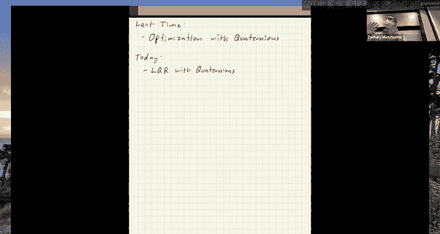

And then hopefully you know we have some time after that we're going to start getting into hybrid methods for reason about contact so getting into like legged locomotion kind of stuff and the extra tricks you need to be able to do that so yeah now we're kind of in this mode of。

Adding on all these tricks on top of the standard methods that we， you know。

 DP direct colocation LQR is kind of the。The usual stuff and now we've got sort of weirdo quaternion tricks for handling that stuff we're going to next do weirdo hybrid system tricks for doing walking and manipulation stuff so that's kind of the next thing to talk about。

Yeah。Okay， so any questions about any of that， what we did last time， kind of where we're headed。

Everybody good。All right， so let's do the LQR story then。

So hopefully it was like kind of clear last time there's there's a bunch of issues with just kind of naively linearizing stuff involving quaronneians in particular。

 if you start looking at control systems， where you have like， you know x dot equals f of xu。

 if you naively linearize a control system，Something bad happens。嗯。

So does everyone remember we did this whole controllability thing a few times ago we ended up getting this result on this controllability matrix and you can check the rank and tell if LQR is going to at work if the rikadi equation will converge so。

What do you think happens with a quaternion in there。So it turns out。

 remember we have this whole discussion， Quaternion 4D。

 but there's really only three degrees of freedom。Not super surprisingly。

 it turns out if you linearize a dynamics model with the Queternion in the very naive way and get the like 4DA matrix。

 it's always singular， it always has rank3 because there's only actually three degrees of freedom so so that's always going happen and then not surprisingly if you then take those A and B matrices and plug them into the controllability stuff you're going to get always a rank deficient controllability matrix so like officially the linear system is always going to be uncontrollable if you naively linearize and do like the 4D stuff in the A and B matrix it turns out and therefore strictly speaking like what that's telling you that controllability result is telling you that actually the ricottti equation does not converge and you can't actually compute like the infinite horizon K matrix from LQR in this situation if you do this naively。

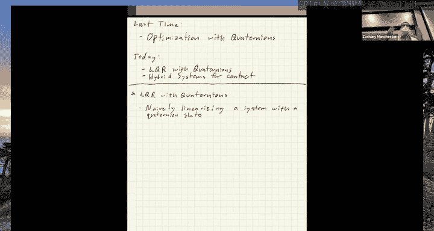

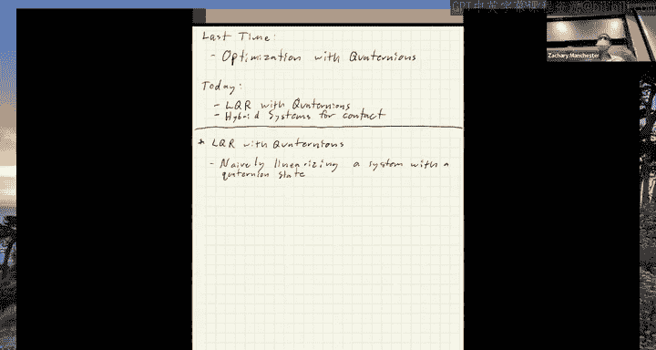

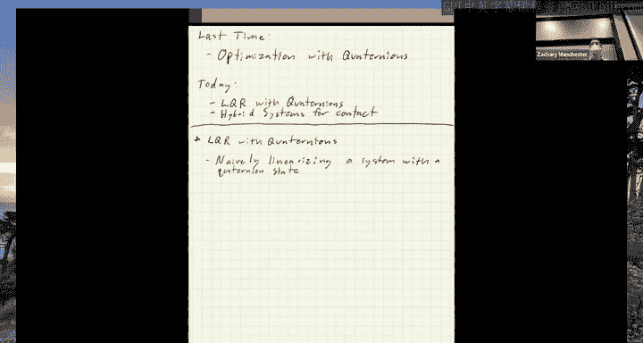

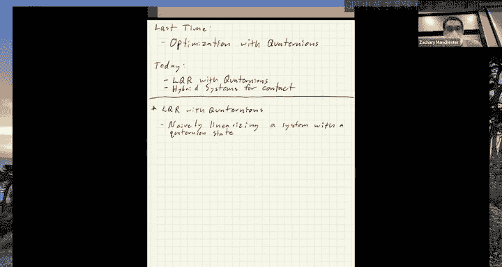

U。同意。And we'll see that numerically when we get to the code part later in today。Okay。Okay。

 so that's that story so basically the move is we're going to apply all of the quaernium differentiation tricks that we learned last time。

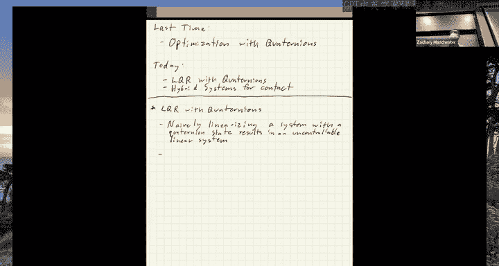

To the dynamics。And that's going to get us from like a 4D thing to a 3D thing。

 which is controllable and then everything works that's basically the story。

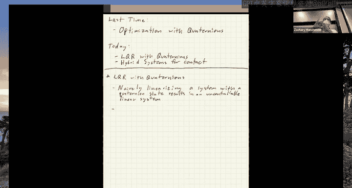

。Okay， so here's kind of the。How it's going to work so the first thing is we're going to assume a reference trajectory I could also be just a you know a stabilization problem with a fixed point。

 but we'll do the general time bearing case， I guess so。

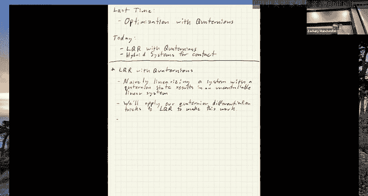

We're going to call the reference。X bar。And you bar so in general， this could be a trajectory。

 you know that you computed offline somehow。Computer with trajectory optimization or some other way。

And right， we're assuming。A discrete time system， as always。So we assume we have like an F of x U。

 so we're going to linearize this thing and kind of in the standard way you have something that looks like this。

 right？And then the usual next move here is we do the Taylor expansion of F right。

 So we say this is approximately。F of X bar。You are。😔，Plus。A deelta X。And B Delta u。

 where the a is partial F， partial x。And the B is partial F， partial U。So this is the usual thing。

 assuming like everything's additive， right？But we have some quaterion weird stuff。

 so we're going to now kind of deal with that。

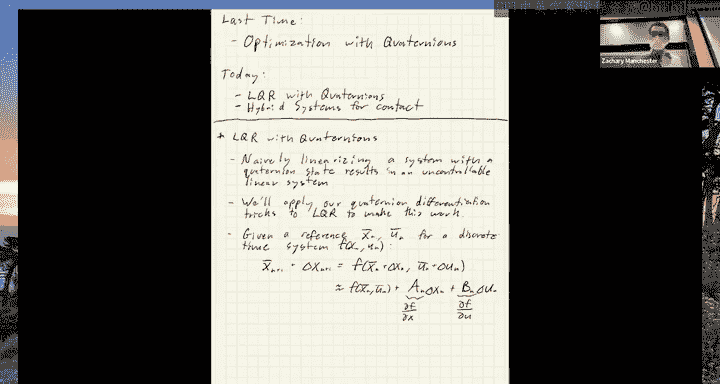

So。Basically， if we assume that there's in our X in our state vector。

 if we're doing like so think of a quad rotor， which is the example we're going to do。

 but in general kind of anything， we're going to assume that you have a state vector such that you've got like a position like a floating- base position and then a quaternion and then the rest of the state。

 whatever it is so it could be the velocities in general could be like joint angles if you're like a humanoid or something that you'd have maybe the center of mass position and like quaternion for like the torso and then all the joint angles for the limbs so whatever the rest of the state vector is this is kind of a standard convention that you'll see so it's center of mass or floatingbased position quaternion and then whatever else underneath。

算了吧。But then then the idea is we we want to do the attitude Jacobian tricks on the quaternian part of the state vector。

 but then the rest of it we can leave alone and just kind of do the normal thing right so we're going to write down some matrices to help us do that。

嗯。And yeah， the idea is we want to convert。Like a deelta Q。

 like Quatturnian error into one of these three parameter phi things。

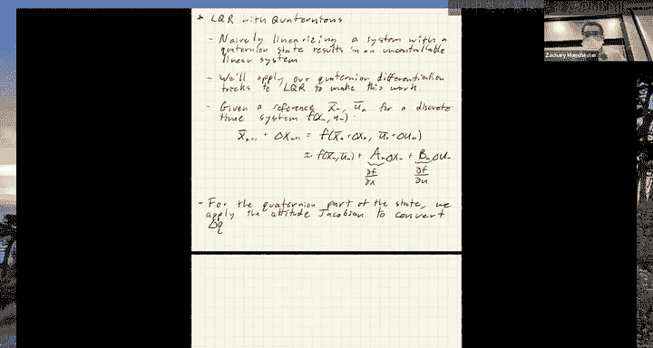

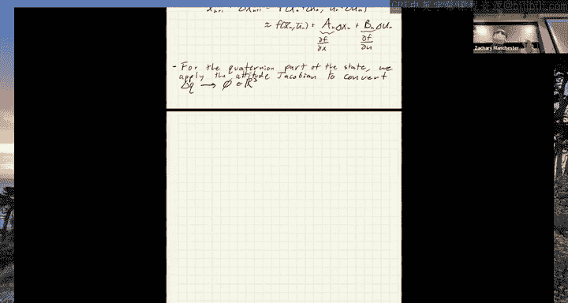

Aa quaernion thing， you don't want that， you want to do this like three parameter error thing so we talked about last time。

 right？

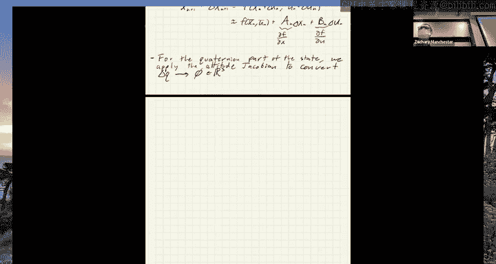

So here's and we talked about the attitude Jacobian thing last time。Okay。

 so here's what hell is it going to look。 We're going to have。

We want to make this error state that looks like the following thing we're going to have say I'm going to use like mat Lay index notation or Julia index notation for like。

This is our error state， so Delta x K plus1， say we're going to index into it and pull out say。

One to three， which will be the position。Then we're going to have where the Quaternion would be。

 which would be like the next four indices， we're going to what we want in there is this。B城。

Instead of the quaraneion。And then underneath that， we're going to just have the rest of the stuff。

Whatever it is。Soveloc， joint angles doesn't matter and this is going to be like indices。A to。

 and whatever。

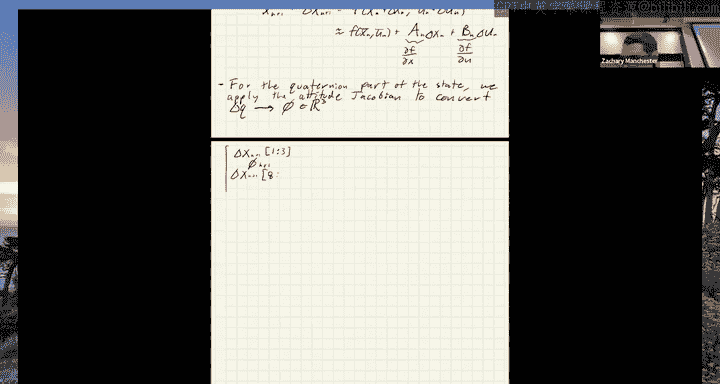

So this is the error state that we want。

And this thing is going to be called we're going to use for these a statess， we're going to use。

Tilda's， I guess， so this is going to be we'll call this Delta X tilde。K plus1。And this thing。

 the way we're going to get this is。Basically， we're going to do the normal thing to get normal linearization right to get A and B。

 just like we wrote up here。

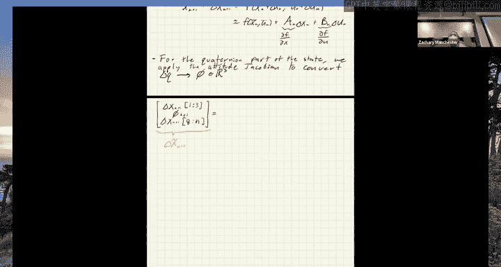

So partial life partial x， partial life partial you like normal treating them like vectors right。

 then we're going to do the attitude Jacobbian thing。

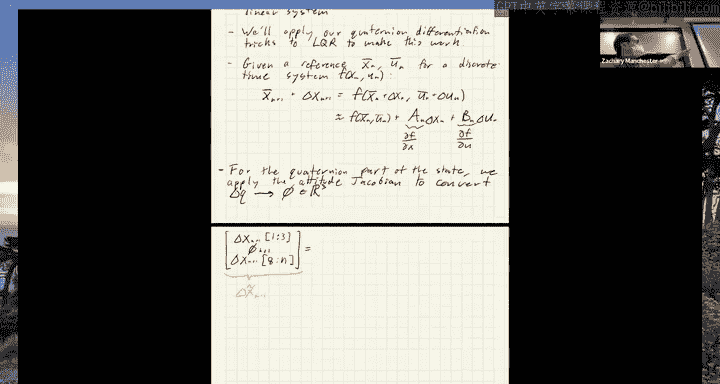

But we only want to do the At Jacobban thing on the Quaternium part of the state vector and the rest we want to leave alone so're basically going to make these block matrices that have identity blocks and then the at Jacobian in the right spot and that's going to look like this。

Nothing， you know， super surprising， so identity block up here for the position。

 then the attitude Jacobian thing。Over here and I'll write this we'll talk about it a little bit and then add an identity block for the rest and then this is the a that you computed sort of the naive way before。

This gets transposed， and then we're going to do same thing over here on the other side of a matrix。

Identity， so that's。And then the B matrix is going to look like。It's very similar， but we only。

have to do it on actually， let me， let me write this first。 Okay。

 so this thing we're going to call this just to give it a name， we'll call this E。Of x。Bar K。

 and then this one is transposed。And is evaluated at。Time step K plus one。

 So what's going on here right。 Remember the a matrix it's taking in。

A deelta X K and it's spitting out a deelta X K plus one。 so we need to map the inputs， you know。

 from like three parameter to four parameter。At time K。

 and then we need to map the outputs from four parameter to three parameter at time K plus one。

So we need add few Jacobians smoshing it on both sides。

And then we also need to evaluate that attitude Jacobian at the reference at the correct time step on both sides。

 so the input is a time K thing， so you see it's got a G ofq K bar that's the reference a time K and then the output。

Is it time K plus one and we're evaluating it at the reference quaernion at time K plus one in there and it's all transposed it's like mapping it the other way right so the a matrix is eating 4D stuff and spitting out 4D stuff and I want to map it to 3D things on both ends at the correct time steps So it's got a G on the right So it takes a 3D thing and maps it to a 4D thing and it's got a G transposed on the left to take the 4D output and map it back down a 3D So after smooing this。

The input and output are both 3D that's what we want in the quaernion spots and then the rest we don't have to care about it's all all fine Does that make sense everybody that's what we did last time right。

I'm just kind of like sticking it in the right spots and then on the B matrix。

We only have to transform the output of the B matrix because the input is a U， which is fine。

 doesn't have any quaernion stuff， but the output is a deelta x K plus one thing。

 So I'm going to transform the output of the B matrix in the same way I transformed the output of the a matrix。

 So we got an E transpose。

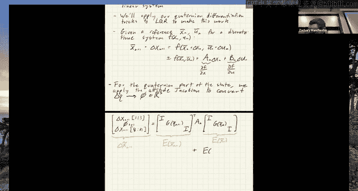

Sing。On the output to make the output the right the right thing。

 right I want the output to be a fee thing。A 3 d fee thing okay， so yeah。

 this is the same stuff we did last time is just sort of applying it to like linearized dynamics and the right putting these ateckeicco into the right spots。

Okay， any questions about this？This sort of clear it's been a while。

 but hopefully doesnt make sense if you do it a little bit it's like fairly straightforward once you get the hang of it。

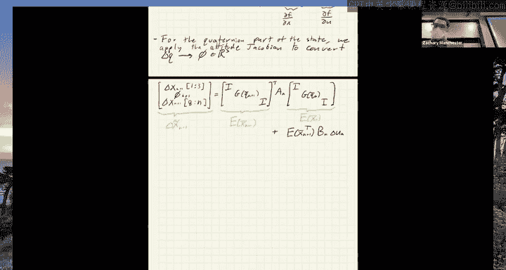

So once we sort of do this， we basically sish everything with these attitude Jacobians in the right spots。

And I guess。嗯。We'll call these like reduced。Jaobians。

And let's call these like consistent with everything else， we'll call these things。

A tilde for the reduced stuff。And B Tilde， so these are like the reduced state is x tilde。

 reduced Jacobians or A and B tildas， we'll throw a tilda's on there。And these are just a。

Sort of belabor this， we're going to get something that looks like this right it's basically E。

E transpose original A。Times e。And then。B Tilda is。Just on the left with the e transpose。

RightOnce you've done this， now you can just do regular LQR and everything's fine and it's controllable and I'll make it' stiff。

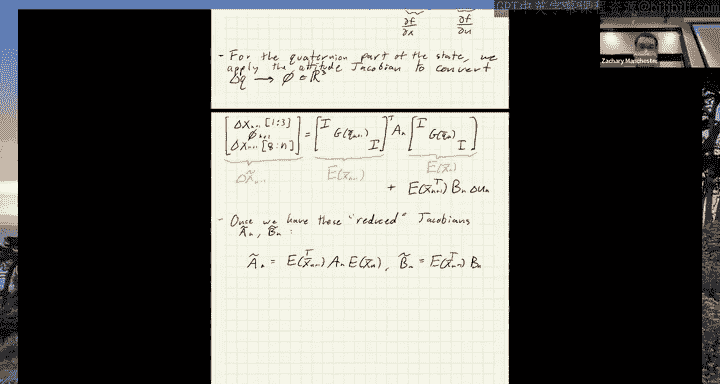

Assuming the actual system is controllable， right？

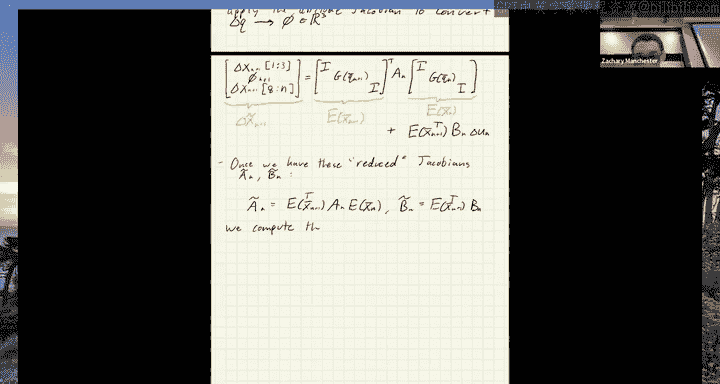

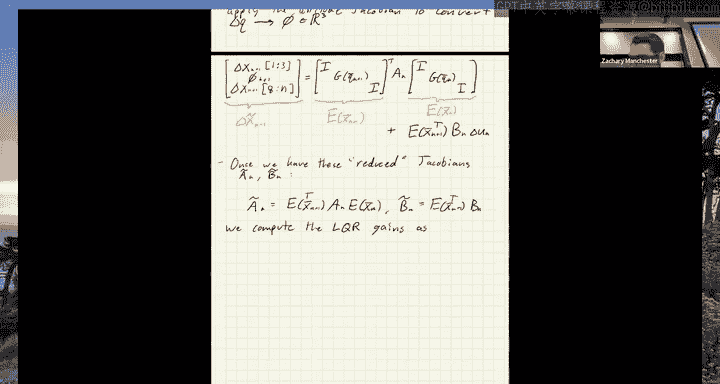

Okay， questions there's that makes sense to everybody basically we smsh everything with attitude Jacob Obbians。

And now it's like one dimension less and there's no weird stuff and it's controllable and full rank and all the good things。

So the only other piece so now you've computed your K matrices say or done whatever your usual LQR thing is。

 now when we go run the feedback controller， there's one more thing we have to do is remember we computed the feedback aims on these reduced Tilde states so online we have to compute the reduced Tilde state from the actual state to plug it into the K matrix so that's the next thing。

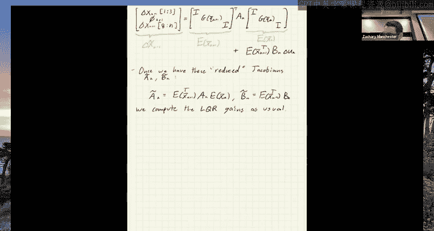

So。And we run the controller。Okay， so here's how that looks。 So like given。Xk。I want to compute this。

Delta x。Till the K thing。 And that is going to look like。no real surprise it's going to be。

 so we've got the positions we leave alone。Or so that's just regular you know a state kind of thing where we。

Take the difference from the reference。In the usual kind of expected way。And this is the weird part。

 so for the quaternian part， what we're going to do is a quaternian multiplication to compute the error。

And that's going to look like。L of。Q bar K。Transpose。Q K。

 and we'll talk a little bit more about this。 So Q bar is a reference， right。

 And we're going to do a left multiply by the like。

Conjugate of the reference whatever This is like doingq inverse q with rotation matrices or whatever which we'll write this out in some more detail and talk about a little bit So you're going to do that that's going to give you the delta quaternion right remember we like this is basically quaternion subtraction but it's multiplication same way you would do matrix multiplication for rotation matrices by like the inverse of the matrix right so that's what that is then we're going to take that delta quaternion thing which is still 4D and we're going。

Compute this error 3D error thing using the 3D error thing of your choice。

 which we're going to write with this fee this could be again。

 you know we talked about this last time could be just the vector part of the Queternion could be these Rodriguez parameter things could be oiluler angles really doesn't matter You just need pick your favorite one that's 3D and you map the quaternion into that using whatever function you like。

And then the rest of the state vector， you can just subtract off as usual。ok。

So is that this thing is。Whatever 3D thing you want。是。And then once we've done this。

 we're going to do kind of the usual LQR thing， it's just UK is going to be。UK bar， the reference。

Minus K。Times deelta x tilde。Okay， so that's what you do online to run the controller I want to talk through this rotation error business that like。

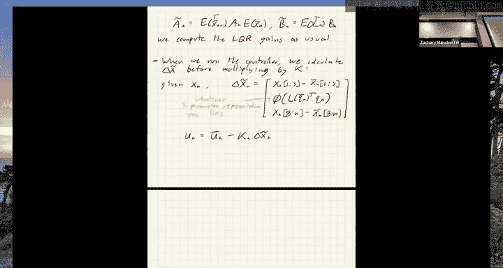

What this the line with a green arrow actually is and like where that's coming from in a little more detail make sure this makes sense to people so and yeah definitely speak up if this is weird it doesn't make sense。

So。So how do we compute like so like one way to think about this is how do I like difference rotations right and like one way to get at this that we kind of think about it first is like let's say I had two attitudes at different time steps like I had a Q and a Q plus1 let's say I had those things and I wanted to like finite di then to compute a angular velocity like how would I do that right that's like maybe one way to think about this like if they were just positions I would just take subtract and divide by the time step and I would have the velocity right what if they' rotation matrices how do we do the equivalent thing and get like a finite di O mega from like rotation matrices at different time steps that's kind of where this is coming from So let's think about that a little bit So if I just do this with rotation matrices。

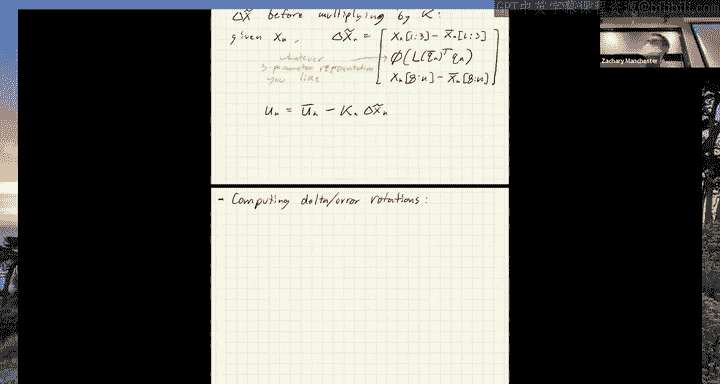

Let's say have the attitude at time K and I'm going to decorate these a little more to be super pedantic about it so what this actually is remember by definition the attitude is the rotation from the body frame to the inertial frame so I'm going to write that on here。

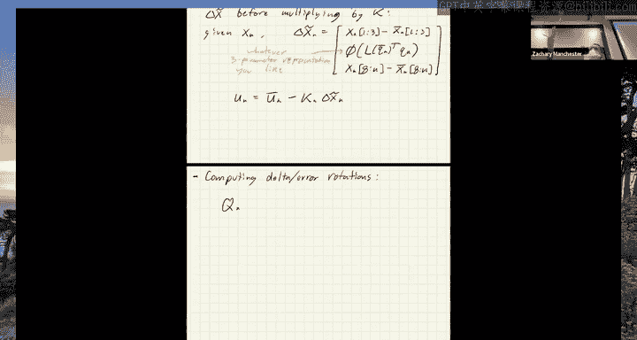

So it's really like body frame at time K to like fixed inertial frame that's what that matrix is。

 right？

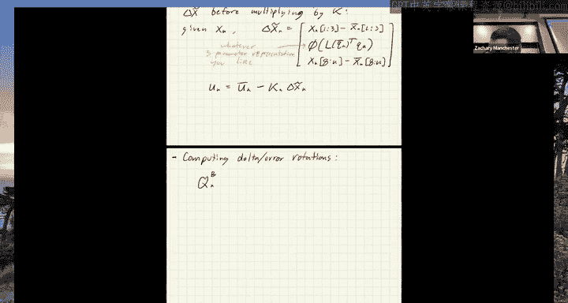

So let's say I have that at time K， then at time K plus1。

I'm going to have the same thing body frame of time K plus1。To inertial frame。

so the thing I actually want here if I wanted to like finite di these things。Is。

The rotation from the body frame at time K。To the body frame at time K plus one right that's the thing like if I wanted to like finally I di used to get an approximate omega or something like that。

 that is what I'd be after right the rotation from the body frame of time K to body frame at time K plus one that's like that deelta rotation right I'm just looking at the definitions of things。

This thing is equal to。If I just kind of think about it a little bit， it's going to be。Q K plus1。

Which is like this right， like body frame K plus one to n thing。 it's this guy inverse times。Q。系系。

Right， for equivalently that thing transpose。 Does that make sense， everybody。

 So what that's going to do， right， if I。This is equal to。Q from。And。To B K plus1。And this is。BK。

To N so when I change those together， I go from Bk to n then m to b K plus one。

 So the like net thing there is Bk to bk plus one。 that makes sense everybody So and this is again。

 this is if I like sort of make simplify this as Q K plus one transpose。QK。

 is that cleared everybody？So and then in Quatturnians， it would be that Q transpose thing is。

Left multiply by Q。Daager or that left multiply matrix thing transpose time time Qk， right。

 So similarly， right， So like the the gist here is in general， if I want to compute some deelta Q。

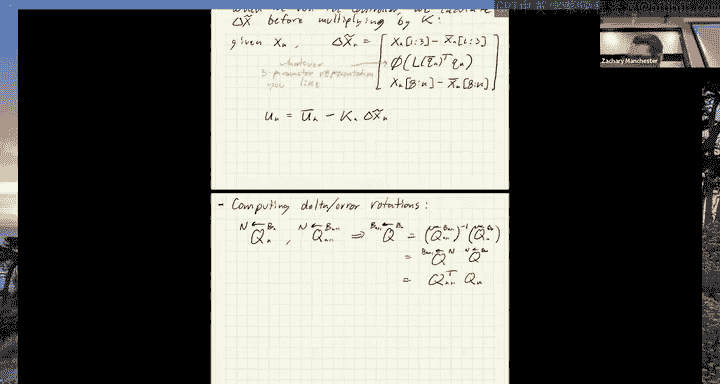

Like some error thing， what it's going to look like is the reference queue transpose。

Times the actual Q or in Quatturnions would be。The equivalent quaternion thing would be like Delta quaternion equals。

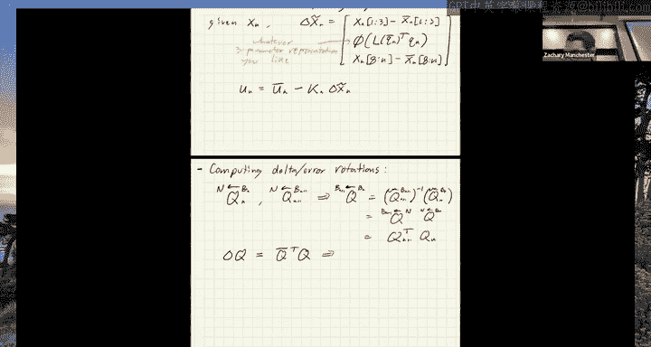

嗯。

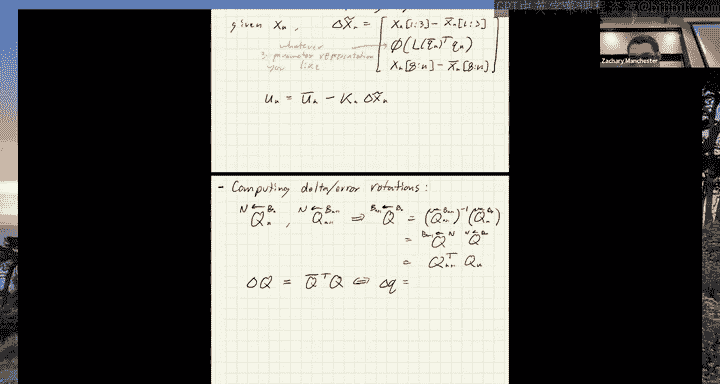

Q bar dagger times Q equals that left multiply matrix。Transpose times Q。

So this is like computing an error quaternion where we have to do multiplication things instead of subtraction things。

Okay， hopefully that makes some sense， that's like the equivalent of doing subtraction。

But you get like a multiplication by the inverse or whatever question。

What would happen if I did that the other way around？So what if I did like Q？Q transpose times Q bar。

What if I flip the order， what's going to happen？Yeah。

 I would be flipping the direction so like right now i'm doing like。

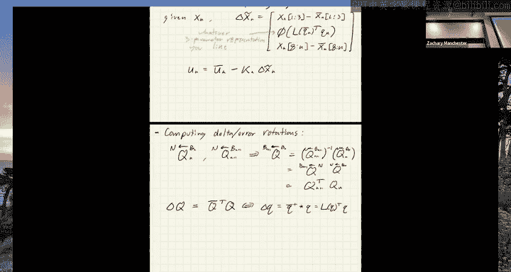

The error is the rotation from like Bk vk plus one。

 I could write it as the error between bk plus one and bk like equivalently right doesn't really matter so。

It would be flipping in the direction， another way to think about this is you can choose which frame to write the error in。

So if I read it this way， it turns out like in general in this LQR thing like I'm computing some deelta Q error thing。

 I can choose to write the error relative to the body frame or the inertial frame like is another way to think about it there's like conventions you can choose and as with everything else like attitude flavored。

We're going to choose to basically always write everything in the body frame everywhere。

 so this is consistent with how we write angular velocities in the body frame we're also going to write down like errors in the body frame and it turns out that's like。

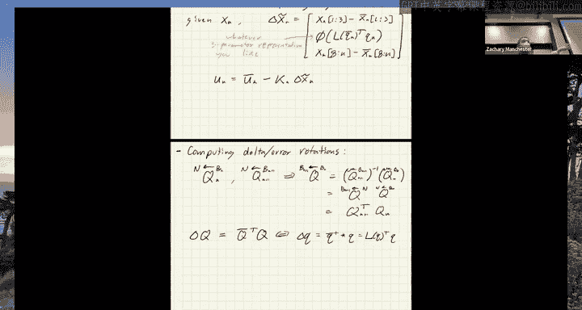

I don't know that's generally the convention and robotics and engineering more broadly and it tends to work out better for doing control stuff for a few reasons that hopefully will become clear when we sort of like yeah do more of this and this then this thing here。

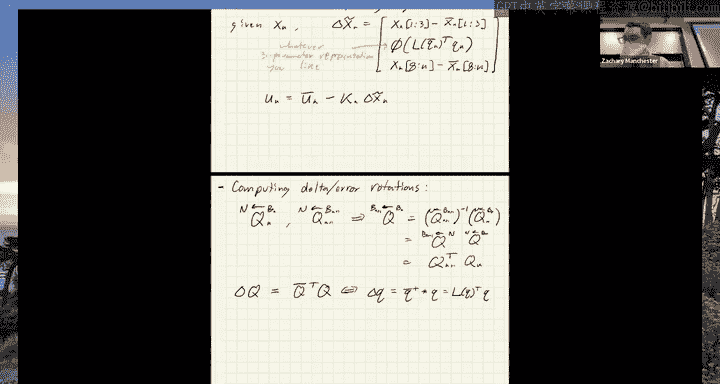

Is what's in this this guy。Is what's in。Here。呃。

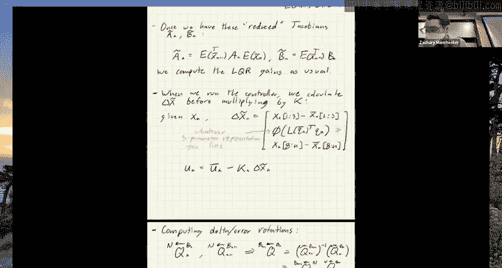

Step clear now that so that's what's going on there we're like。

Computing an error by multiplying by like a quaraernion inverse kind of thing。

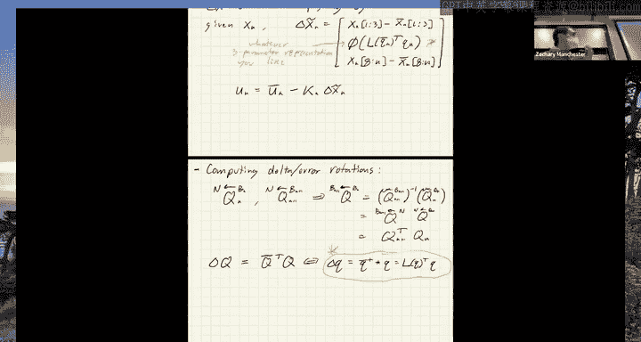

Okay， questions about any of that yeah。

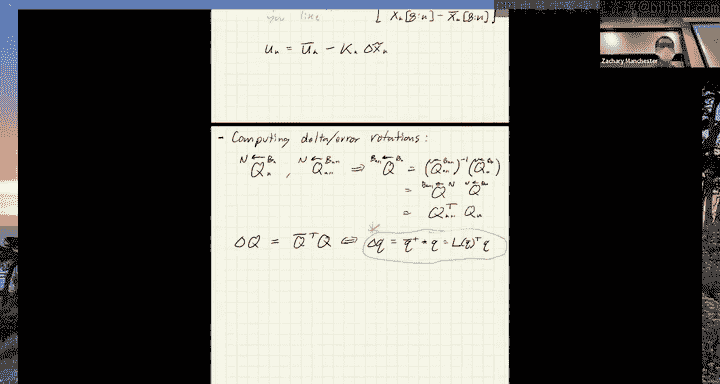

Even if we do two transport three， we would just be like going from Bk plus one to Bk。

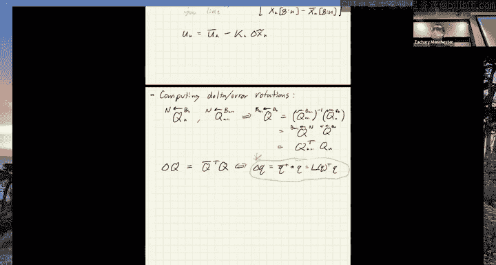

So there's many choices essentially that would just be like a sign flip you can I guess the broader point is you can choose to write this in a number of ways and it's a product of like just arbitrary convention。

If that makes sense so yeah this way would be if I just flip that around it would be like the opposite it pick up a minus sign basically it's like the opposite direction you can also choose to write it in either frame there's like four different options at least based on like how you permute those things right so I can write it。

Q bar transpose  Q I can write it as Q transpose Q bar I can write it as Q bar Q transpose right there's like four different plate if I flip and put the transpose on different ones there's four ways I can do it。

 that's kind of what i'm getting at right' yeah so there's many options and this is the one we're going do because it's sort of this one is writing it in the body frame and sort of in the sense that kind of is equivalent to。

To this subtraction here。If that makes any sense。Okay。It's kind of weird。

I think it's one of the things you just have to try it and do it a little bit to get the hang of it。

Okay， so。We're going to use as kind of the motivating example for this stuff， a quad rotor。And。

I'm going to just in case like some people haven't seen this， these are super， super common。

 obviously。I'm going to write out the quadator dynamics and talk about them a little bit before we just go to the code。

To hopefully， you know， I know a lot of you have probably seen this before， but。You know。

 I think it's probably worth doing it so。If you know this， you know， super well。

Feel free to tune out for the next。5 or10 minutes， I guess。Okay， so quad rotor we got。Obviously。

 a bunch of propellers。And let's see， we've got a mass M inertia matrix J。And then we've got。

 we'll assume this thing's symmetric and that this。The distance from the center mass to each rotor。

 we're going to call L。What else？ And then we've got from each motor， we're going to get a。

A torque or moment M。And then a thrust。手考题。So we'll have four moments and four thrusts。

 that's what's kind of coming for the motors and the propellers。And we're going to write。

 we're going to assume a linear on of motor model， which。You can get fancied in this。

 but this is kind of the simplest version。 So the thrust we're going to assume is。

Proportal to you for that motor。And then the moment or torque is similarly going to be proportional。

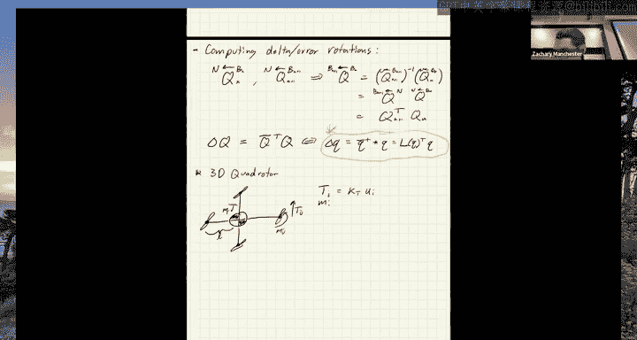

With some other proportionality constant。And then U is obviously is four dimensional here。

For four rotors， right？Okay， so that's kind of the cartoony picture。The state vector for this guy。

Is going to be the following thing。So， we've got。A position in the inertial or world frame。

This is 3D。Okay， so world frame position， then we're going to have our attitude quaternion。

Which by convention reads always body to world frame。Then we're going to have our velocity。

And this one， there's a。There's sort of a choice I can choose to put the velocity in either the body frame or the world frame。

It turns out that for control purposes， it works a little better to put it in the body frame。

Does anyone know why？It's kind of fun。Nobody knows has anyone heard of SE3 kind of control。

 anyone here work on quadruators？Couple of you I know at least a couple of you do so yeah。

 if anyone's ever heard of like Se3 base controllers whatever， this is kind of the Se3 thing。

That's related to it， I don't know。That's at all informative。

 there's kind of some intuition for why this is the case。

That we can get into or you can just you can the code i'm going to give you you can try both and see what happens so I kind of suggest doing that if you're curious about this。

 it turns out you do a little better in terms of like basin of attraction where you can stabilize if you're right it in the body frame。

Okay， and then this is。Anangular velocity。Which is always in the Bframe。Pretty much。

So that's our state vector position， attitude， linear velocity， angular velocity。

 you can pick and choose which frames those kind of are all in but this is I would say there's basically two common conventions。

 there's this one which is consistent with all the Se3 stuff you'll see in the quadator literature。

 or you can make V in the world frame， which is also fine。

 but kind of doesn't work quite as well for feedback control。

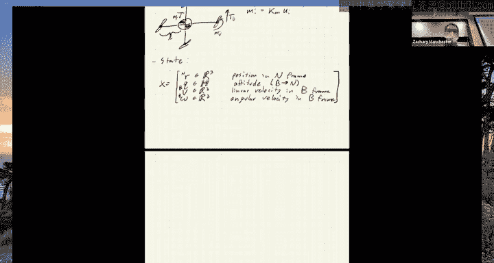

Usually okay， so that's the state vector then next we got to talk about kinematics， which is easy。

Okay， so specifically here， this is how we map the velocities into the configurations。

 so here we've got we wrote the position in the end frame。

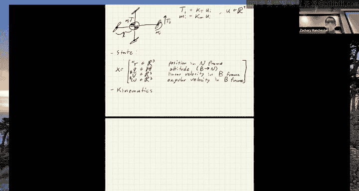

So this guy， when we want to write the velocity kinematics， this is equal to VN。

 we chose to write V in the body frame though， so in order to make this work。

 we've got a slap a rotation matrix on there。So that's our position kinematics。

 we have to rotate the velocity that's in the state into the Mframe to integrate position up and then the quaternion part is the usual quaternneion kinematics that we already know。

And this is like kind of this。Stuff we wrote down。Before with these all these weirdo matrices and stuff。

So that's kind of you have omega b in the state vector， that's all good。啊， cool。Okay。

 any questions about that that's straightforward stuff we did last time pretty much so now we've got to write down the dynamics and this is going to get a little weirder。

So this is really just f equals MA it's newton Eer。

 F equals MA for the positions and then oil's equation for the rotational part。

 but there's some weirdness having to do with the different frames essentially， so F equals MA。

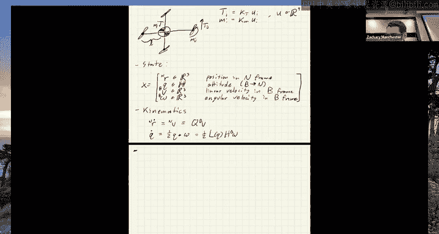

Is only valid in an inertial frame right but here we've written down the velocity in a body frame which is rotating in general。

 so we basically have to like tweak f equals MA and get an extra term to handle the rotating frame stuff so the way that works。

对。Okay， so we're going to start out writing vanilla f equals MA。Which looks like this。

If I put the frames in the right spots， and this is the total force。

So this would be like gravity plus the actuators right and then this is in the end frame。

 but I really I need to convert this to the body frame because that's what's in my state vector。

 right？Okay， so that's what we're going to do。And the way we're going to do it is we're going to write out first。

 we're going to start with the kinematics so we've got。

V in the N frame equals Q times V in the B frame。And then we're just going to di this so we got V dot n equals。

Q dot times v in the Bframe。Plus。Q times。V dot in the B frame and then if we remember from doing all our attitude stuff two weeks ago。

Q dot equals。

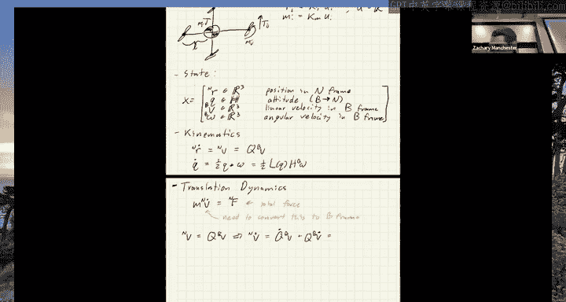

Q times that omega hat thing。The skesymmetric cross product matrix evening times。

 so we're just going to plug that in for Q dot。

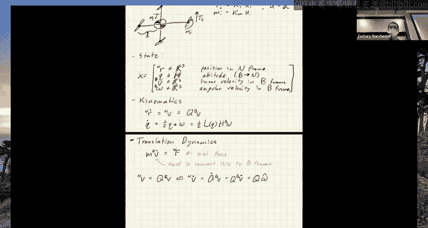

Maybe I'll put a little note。

Heres so Q dot equals Q omega hat right？Okay， and now if we kind of simplify that down。嗯。

We can basically like pre multiply everything by a Q transpose and get。The dot in the B frame。Equals。

AQ transpose V dot in the end frame。Minus omega cross V and this stuff's all on the body frame。Okay。

 so。What we basically have is。This is basically just rotating f equals M from the inertial frame into the body frame。

And then this is an extra term。That accounts for the rotating frame。Velocity stuff。

Okay， so putting that all together， I get。

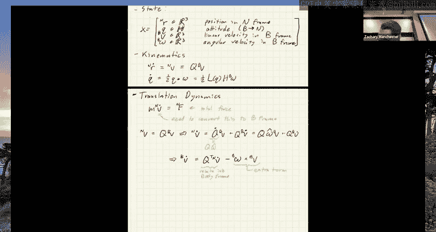

For like F equals M， I'm going to get V dot。The B frame equals1 over M。

F in the B frame， which is just， again， I just rotate the forces into the body frame and then the extra term。

嗯。And this is。F equals M in a rotating frame。 and then for finally。

 if we write down the forces in the body frame。

This is actually more convenient because all the forces are sort of like at least the motor related forces are all in the body frame anyway。

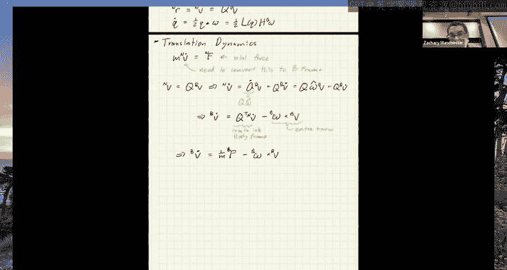

This looks like。So the first term we get gravity， which is naturally defined in the world frame。

 so we got to rotate that so we get like a Q transpose times gravity。Where we've got like kind of 0。

00 minus Mg， right？So it's just rotating on minus MG in the Z direction into the quad rotor body frame and then we're going to get sort of all our actuator related stuff and it turns out for forces at least we've got all the rotors are pointed in the same direction。

 they're all basically pointing in the positive Z direction。

So this is just like the thrust coefficients。For each rotor and you sum them all together。

They're all pointed the same way right， does that make sense， everybody。Okay。

 that's translation that's f equals M in a rotating frame that's。

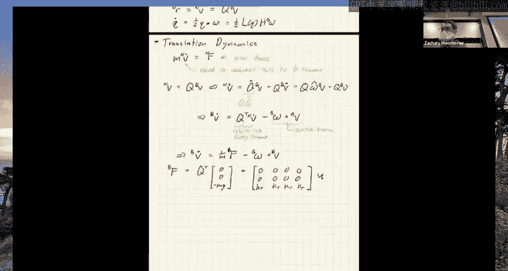

K of how that looks and then the second piece is rotation dynamics。

And this is Euler's equation for rigid body dynamics， which I don't think we've talked about here。

 but who've seen this before， hopefully。Decent number of you a lot of you have not seen this。

 is that。And thought， okay， so this is what it looks like， you I should write down first。😊，And then。

Okay， so this is。嗯。This thing is the total torque。And this， this whole thing is called。

Oilers equation。And you know what the other side is Jay's inertia matrix， mega。

 as we know what those are who's who's never seen this before show of hands？

Because have everyone seen this before？I got the opposite reaction asking that question two different ways。

 So I don't trust you guys at all now。诶。Okay。嗯。😊，I don't know you don't know if you've seen it do you know what this equation is like that's the question so a lot of you like shake on this right I don't know this is the dynamics this is the attitude dynamics of a rigid body that's what this equation is it's like not that hard to drive it's very common in robotics this is like every floating based thing will have this in there somewhere basically。

So I don't know for those of you who are not robotics people or CS people。

 you get a pass on this if you're like a Mey or you care about hardware robots you should know what this is。

 you don't know it， maybe go take a look in a dynamics book。😊，And then yeah。

 what we need now is that the torque stuff， right。

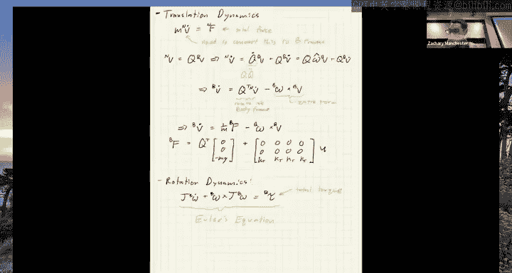

Turk。I don't know I think this stuff's kind of important even though it controls not a dynamic class I'm going sort of force me do this so you see it once so we can actually talk about quadrus and not just have magic voodoo dynamics functions for quadrus that you don't have any clue where they came from I don't like doing that so I don't know。

You can disagree with me on this。Okay， so there's the the total torque。

 so we got to get the total torque so next where this is coming from。

 I'll write it down maybe then we can talk about it。So these are like they are cross F， you know。

 things for the thrusts right so this。It's， you know。

 the L is the moment arm from this inner mass and then this the thrust from each motor right kind of。

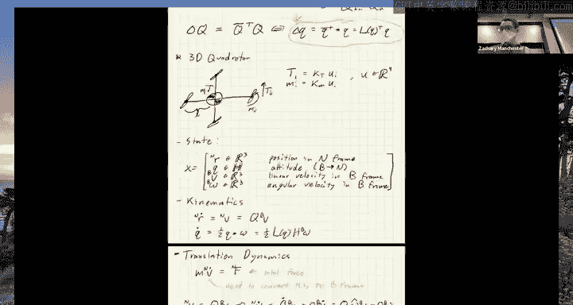

So if I you know have more thrust on this one than this one I'm going to torque this way and vice versa that's what these two first two lines are and then the last one is the yaw torque in the Z direction and that's coming in from。

TheThe moment coefficients and these are just kind of arbitrary sign conventions。

That you get to define when you pick your coordinates， but this is kind of。How it looks。Okay。

 so yeah each propeller right it's going to give you a thrust and then there's a drag torque associated with the propeller right so because of drag I actually get a yaw associated with with the propeller as it spins as well and that's how that last one is。

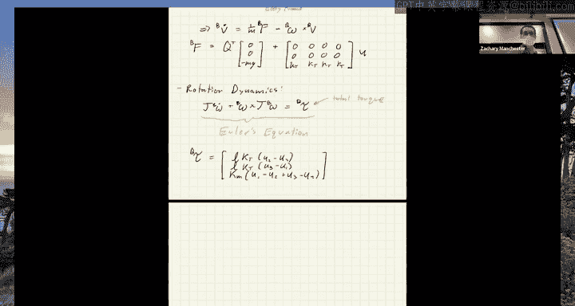

Okay， so that's the dynamics of a quad rottor this is like kind of standard quad rottor dynamics you can get fancy in than this。

 but this is like you know pretty pretty stock。

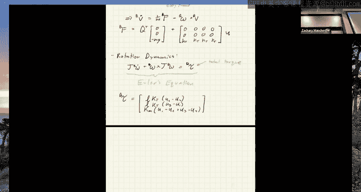

诶。Okay， any questions about this at all before we go， okay， so now we'll do fun staff。As long as my。

Laptop decide to yeah actually I have to relaunch all of this。

 so it's not going to take a little bit。Which is annoying。对。

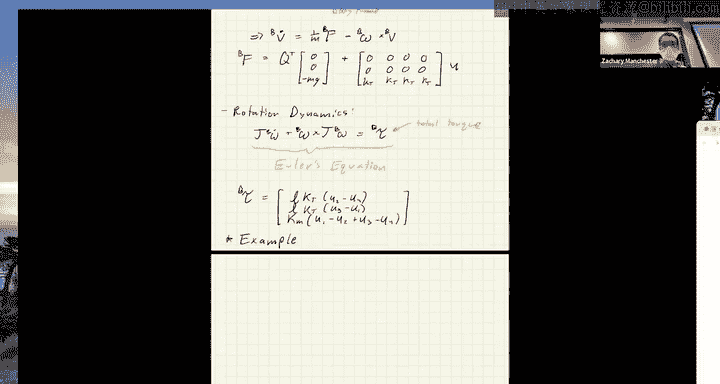

All right。Here goes。

暂点。Thank you， I know my computer crashed。

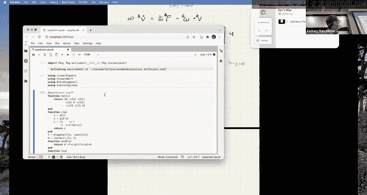

All right， so it's going to be super slow now because I usually run it before class。

It did， but now I have to re it all， Okay， so here's all this paternion stuff that we did last time。

 This is like that hat map thing with the skeometric matrix left multiply matrix E thing。

I don't know， quaternion to rotation matrix， attitude， Jacobian。

This is my chosen three parameter attitude representation here。

 so this is like that P thing which is I've chosen to use Rodriguezs parameters which we I briefly mentioned last time this is not important you can use anyone you want this is just the one I chose this time here's my quad rottor stuff this is just like defining the model so mass。

The length of the arms to the motors， the inertia I'm assuming it's a diagonal matrix here which is you know kind of reasonable then gravity thrust coefficient moment coefficient these are just kind of like vaguely representative reasonable numbers for like a standard quad rotor 20 hertz sample rate so this is like if I naively write down the state vector it's 13 dimensional right i've got three positions for。

Pern in and then six for the velocities。This is kind of the a tilda sort of like reduced state dimension。

For inputs I don't know yeah you can figure the rest out so this is that that e matrix we define where it's got the attitude Jacobian in the Quaternian spot and then identities in the other spots we leave the rest alone。

Here's the actual dynamics， so this is exactly what we just arrived。

I'm picking out all the different pieces of the state vector。

 I'm going to compute the rotation matrix from the quaternion because it's convenient。

 it turns out in this case。Kinematics for the position。

 I rotate the velocity and from the body frame into the world frame to integrate it。

Attitude stuff is the standard stuff。Here's my V dot this is my f equals MA right we just talked about so I rotate gravity into the body frame and then this is my。

Sort of the the matrix we just wrote down with the thrust coefficient stuff on zoo and then here's that little extra piece so this is。

F in the body frame one over am， and then this is the extra omegacarrosity term for the rotating frame stuff。

 this is Oy's equation that we just wrote down。Just solve for  mega right and then here's all the the moment coefficientient stuff that we wrote down that's the dynamics let's see okay this is maybe worth talking about real quick so I'm doing RK4 on those dynamics。

Um。Integrating dynamics with a quaternion get a little weird there's very fancy things you can do。

 but the sort of simplest hack thing to do， which is not unreasonable is to just do the usual aK4 step。

 which is all of this that we've seen before and then at the end just renormalize the Queternion because if you don't do that the Queternion。

Right so the Quetraians should stay unit norm at the dynamics actually preserve the you know the continuous time dynamics preserve the unit norm。

 but if I integrate because of numerical error round off blah， blah。

 blah it'll drift off of the unit norm constraints if you don't do anything about it so this is kind of a really simple quick hack to fix that it's not the best thing in the world to do but it's like pretty benign and fine and this is like quick and dirty if you're just co this up this is like a reasonable choice so we're just going renormalize at the end of every runka cutta step to make sure it doesn't start drift off and go nutss on us。

Initial conditions i'm going to just make this be like so this is hover so I'm just doing MG over four for each of the four propellers so I'm just canceling out gravity with my thrust and then here's I'm going to start like one meter off the ground。

And like you know identity quaternion for the attitudes that's straight level1 meter off the ground something elses zeros so now we're going to get into some of this fun stuff so if I so here's my discrete time dynamics right run through the ring to cut it I'm just going to linearize in the usual way with four di and get the sort of naive A and B matrices remember these are 13 dimensional right so a is 13 by 13。

Kind of interesting if I now take the rank of a。It's always going to be ranked 12 even though it's 13 by 13 so it's always ranked deficient。

 that's because of the quaternion stuff you know kind of being confined to that manifold that's sub manifold with a unit norm。

 similarly now if I go and compute this controllability matrix that we talked about a few times ago。

For this system because it's 13dial state in order for this thing to be officially legally controllable。

 this needs to have rank 13 and obviously does not right it's ranked 12 so this is telling you if I go and do Rikaati on this Rikati will not converge to a constant steady state cost to go it'll like kind of keep blowing up on you so you can't actually get a steady state K matrix out of this for that like time andvari。

LQR thing， so this is all bad， don't do this。

So here's our like reduced system， Matilda stuff and again all I'm doing is。

Smushing it with these eases。Here it's the same quaternion on both sides， y。

Why is it legal to do the same one on those sides？嗯。Yeah， so here I'm linearizing about a hover。

So exactly， time K time K， I'm linear has about a fixed point not that trajectory， so it's the same。

So this does all makes sense so I do it on the input and the output of the a so it's going from 13 by 13 to 12 by 12 on the B matrix this was four it was 13 by4 I am applying it just to the output to make it now 12 by4 right so that's what that is so now if we go and check all this stuff again controllability。

Mattrix。Is now。R ranknk 12 the state's 12 now so this is like all legal and this version with the reduced de matrices works and you can do rikati infant Horizon LqR all the usual stuff all works so we're going to go ahead and do that is just made up Q's identity Rs 0。

1 times identity for LqR gains i'm going to use the control toolbox and just do the sort of discrete time LqR thing we've done before to get a K matrix。

And this is going to be。12 by four， so it's multiplying that tilde reduced state thing a state and spinning out of four dimensional sort of control。

Here's the controller， remember it's officially， this is actually now technically a nonlinear controller because what I'm doing is I'm taking my state。

 I'm computing this quaternian attitude， which is a nonlinear function。

And I'm computing this like 3D attitude error C thing and then I'm stacking this up into my x tilde that we had in note so the position errors you know just subtraction。

 the velocity errors are both linear angular velocity just subtraction right those are just vectors but then in this spot i've got this weird quaernity multiplication error calculation that we talked about and then it's like sort of the hover u the nominal u minus k delta x in the usual way here。

After you do that so here we're going to go actually go simulate this thing so here's what I'm going to do so I've got this feedback controller kind of baked in。

Here's my。Feedback controller for the use and I'm going to just take some random initial conditions where I give it like some position error。

Samples from a Gaussian right， and then I'm going to give it some。

Attitude error as well and we're actually going to put in some pretty huge attitude errors and kind of watch what happens and then yeah here just zero velocity i'm starting it out like random attitude like random pose errors right。

And then we're going to simulate it for like five seconds and kind of watch what happens。

I guess will take a minute。This doesn't take forever the punchline is that this this setup。

 this LQR setup with the proper quaernion stuff is。

Kind of incredibly robust， it actually works for huge attitude errors。

That you might not expect see if you get this to work。Okay。So let's run guy。啊。There you go。

 so that was not that impressive because the air wasn't super huge on the attitude that's kind of a big attitude error。

 actually。You can see it kind of ass almost sideways， that's kind of good。

Let's run this a couple more times and try out some other random stuff。嗯。Yeah， I don't know。

 he aren't that insane looking。Can get brilliant。Maybe run it a couple more times and you guys can try this out yourselves too。

Yeah。系啊。Yeah， these are。These aren't too too bad。I'll try this just a couple more times。Yeah。

 that was a pretty aggressive one sounds like almost upside down or something， right？

I'm not still recovereding in crash so I guess the takeaway method this works really well this is。

Pretty much if you've heard of Se3 kind of controllers in the Quad River literature this is actually that but LQR sushed into that Se3 stuff as opposed to naive PDD control with Se3 stuff which is what most people do in the literature it's actually pretty good this works really well it's kind of the thing to do this is like the punchline for the whole quaternity discussion quaraernity is good no attitude singularities you can recover from large attitude errors and stuff like this and not crash。

Whi we like okay any question anyone wish or anything else。W do you have to like。Is a other function。

 like why it just use the。So the original Queternion error is 4D。

Thats that's why right so basically the issue with all that is that the Quation is 4D and has this like unit norm constraint thing and it's therefore like has all these issues uncontrollable a matrices are singular like all this bad stuff so and that's because it's actually 4D plus a constraint right which means it's really only 3 degrees of freedom just like there's only 3D angular velocity vector and stuff like that right so in order to make it play nice with all the classic linear control stuff。

We have to like come up， it has to be written in like a 3D， you know。

 in order for like the a matrix to be full rank。Because it's only 3d do。

 we have to write it with some kind of 3D representation doing it this way what you're really doing here is you're using a global 4D representation that's nonsular the quaternion for like the state and then we're only computing a 3D error where exactly where we need to to plug it into the feedback controller but everywhere else we're using the 4D stuff so it's like the issue with the 3D stuff the reason we don't use 3D stuff all over the place like why we don't use oil angles when we simulate this stuff is because they have singularities where the math blows up right？

So the idea here is you want to use 4D stuff wherever you can and then only use the 3D stuff in a couple places where you absolutely need to for like mathematical reasons。

Does that help at all yeah so like basically LQR stuff will only work with a 3D attitude representation because of that linear algebra stuff。

 so we only do it there and we compute this quaternneian error and then map that into the 3D representation rather than using a 3D representation globally for everything。

And turns out works really well this will go singular by the way。

 so these all these three parameter representations have singularities。

 but here it's going to go so here it's singular at 180 degrees， which literally means。

Upside down100% upside down And if you're in that kind of situation you're pretty screwed anyway。

 So that's kind of the idea is that like this is gonna to go singular when you have an error of 180 degrees So like as long as your errors are relatively small from your reference So here if I want to do crazy aeratics and like fly a barrel roll or something I can absolutely do that as long as my tracking controller is good enough that my errors from the reference are not 180 degrees right so the reference can do crazy upside down stuff and here it'll work in track rate as long as the errors are relatively small Yeah no actually this is all good yeah。

Oh it's no it's 180 degrees in any direction yeah yeah so if there're 180 degree yw error would also kind of be unhappy with you。

And that's because that error representation is going to go singular Yeah， yeah。

 so anything as long as your error in any your total error attitude error is like less than 180 degrees。

 it stays happy。Got a bad idea。So okay， any other questions about this stuff？All right。

 Im happy about this Okay， so yeah there's going to be some flavor of this on the next homework not on this homework I don't know。

 I think this stuff's kind of cool and kind of important。😊，Unless you do back flips and stuff。

 so it's fun。

Anybody else， Yeah， okay。Cool。

So that is basically the end of the discussion on flying things and back flips。

The next part of the discussion。We will transition to now is all about。Walking and manipulation。

 I guess。

But I mostly have worked on walking and not so much manipulation so we will focus on walking because that is what I know how to talk about。

All right。this will yeah， the next couple lectures will be on this kind of like contact dynamics。

 like locomotion flavored topics。Sa。

So if you have any lingering doubts about attorneyerns or whatever， now's the time。Okay， so。

This is like yet another so the clotronion stuff is kind of a common robotics thing that's a little weird which's why we talked about it this is another common robotics thing that's weird that doesn't fit into the standard recipes for optimal control where you need some hacks and some tweaks so to get some intuition for like what's going on here why it's hard by the way yeah just curious show of hands anyone work on manipulation and or locomotion in here seeing this stuff so decent number of you guys okay cool。

Okay， so。You will all be familiar with this， Dan。So to like motivate this。

 let's think about a bouncing ball。So here's what we're going to。Sort of。So if this thing is。

At first flying through the air。 So we have like the ball， M G， and we have the floor。

If I plot this things。say let's spot the z component versus time the height。

Falling， falling， falling， that's all did。嗯。And let's see what else， you know。

 I can plot the time derivative z dot。And this maybe， you know。

 I threw it up in the air so it's initially positive velocity and then it's negative or something like this。

So in the air， as I just drew it， this is described by， you know， smooth ODE。

 the usual f equals MA stuff life is good， right？

And this is sort of your so this would be you know specifically mz double dot equals minus g right in this particular case and then whatever in the you know the x moment that's fine Okay。

 so now it's think about what happens when it hits the ground。

So。Let's draw some cartooni pictures。 So like at the instant of impact。Let's say。

So I've got my ground， I've got my ball just like just touching the ground at that instant where it touches down so there's some like in some some kind of。

 you know， if you could zoom in on that instant right in some idealized world。

 you'd imagine like there's some instant where it hits and right before that its velocity looks like this right it's like。

Want it down。And then right after that instance。You know， it's headed back up。

So I have like this right before contact。Falling right after contact bounce， you know。

 it's going back up in the air kind of thing， if I imagine plotting this。You know。

 like the Z trajectory。Would look maybe something like this。Right。

And then if I think about differentiating that and writing down the velocity。I've got something like。

 you know， it's falling， falling， falling， and then all of a sudden。It bounces and it's， you know。

D this。So this is that v minus and v plus， right？So I have this like velocity discontinuity。

At like this impact time where it， you know， it basically flips from being negative to positive right around that impact time。

Has anyone seen this before？Yeah， so all you like locomotion manipulation guys have probably heard of this stuff。

 right？Okay， so the the kind of like heart of why this is annoying and weird and hard from a control standpoint is that。

You have these discontinuities and as a result you can't write down the dynamics around these impact events as continuous ODEs。

 at least not easily， there's like ways to do it， but they're gross。

 basically there's just badness around those impact things。Okay， so。Yeah。

 there's there's bad stuff happening there that like certainly right just looking at that velocity plot with that big jump like that's problematic for an ODE right you're going to have some some issues there。

Like if I take one more derivative of that， it's even worse， right？Okay。

 yeah actually that's a good question what's the if I take one more derivative so i've got position there I plot it a velocity what about the acceleration so if I wanted to write down f equals M what does the the a and the f have to look like。

这没有是。Not a step function， but is it？啊，关份。Someone said it it's a direct delta yeah it's a delta function so it's an infinitely tall infinitessimally skinny spike is what the impact force looks like right it's got like some giant force at this really short time to make it bounce so you get these like and so obviously if I write that down at a computer you're talking about like giant values over tiny times that is bad right you're gonna get like infinities Ns this kind of stuff starts to happen bad news okay so you have kind of two general options that are common in the robotics world for dealing with these issues。

So the first one is the one we'll probably focus on the most we'll talk a little bit both these The first one is like probably the most common。

 I would say in control is called sort of either event based。

That's kind of the simulation word that people use or hybrid is kind of the control word。

And the idea is that we。Away from impact， we can model this with smooth ODs， so we use the ODEs。

When we can。嗯。And then we check while we're integrating， we check for。

Impact events or contact events。And the sort of checking function that you use so in this case for the bouncing ball you basically check the Z height at each integration step looking for a zero crossing right so z equals zero you're at the floor and that's when you're going to have to do something right so the function that you're checking in the lingo is called the guard function so here right bouncing ball is's just the Z height in the state。

So here at EG。Z greater an equal to 0。

When you detect a transition event， so like a zero crossing of this guard function。

You execute what's called a jump or jump map which is another function that says what to do add an impact and so in this case if you want to do perfectly elastic condition impacts for a bouncing ball the thing to do would be to flip the sign on the Z component of the velocity for example or right that would get you just bouncing forever with no losses。

 if you wanted to do sort of。Some kind of you know elastic collision where it loses a little bit of height each time you could flip the sign and multiply it by some constant less than one right to make it bounce a little less high each time which would be kind of more realistic maybe so that's kind of the idea that would be your your jump map。

And that's sort of modeling that instantaneous discontinuity。啊。

So you do that and then after you've executed the jump map， you then go back to integrating your ODE。

。

Okay， so yeah this this setup you're basically like trying to explicitly detect these discontinuous events and then like model them as some instantaneous discontinuous thing with some function and then kind of go back to doing the smooth stuff so that's option one。

Whos steam messs before？

Oh bunchun of you guys， right， Okay， so the option two is called in simulation La is often called time stepping。

And then in control land， it's often called contact implicit。

And this is actually exactly what you guys did on the homework with the falling brick and the QP that was a contact implicit simulator for the brick so the idea there is you try to set up a constrained optimization problem to model the dynamics or the inequality constraints like account for the impact and the laggre multipliers end up being like the contact forces and things like that。

So。

So at each time step， you're going to do some kind of constrained optimization problem。

That sort of enforces through inequalities。嗯。No interpenetration between。Objects。

And usually we write this down with something called a sign distance function。

Which looks like this usually。

So it's like the distance between all objects has to stay non negative。And let's see。

So this was exactly the falling brick on homework one was an example of this and actually quite representative of like the sorts of things that these methods do。

嗯。So yeah， basically you set up an optimization problem where you've got like the states and the dynamics。

And the contact forces as decision variables and you say you know find me contact forces blah， blah。

 blah such that at the next time step I'm not going to violate these inner penetrationration constraints that makes sense so the following brick example right that you ended up solving for the normal force from the ground so such that you had a constraint that the brick wasn't allowed to go through the floor right so that's what these methods do。

Okay， so basically these are kind of the two main ways of doing this stuff and both are pretty widely used。

In simulation。And they have various kind of pros and cons。

And we can talk about these。A little bit。

I would say in control right now， the hybrid formulation is probably the dominant approach。啊。

And there's kind of reasons for that。Basically。This hybrid sort of mode thing。

Is easy to apply within standard algorithms like DP and direct collocation。嗯。And the reason is right。

 like basically what you do here is you remove the discontinuities from the problem。

 except for these isolated times。where you kind of have these you know impact events and then in between you're dealing with a standard smooth system with an ODE right so with with this setup like you can apply basically DP and Dr call like as usual for all those smooth sections and then you kind of just have to add some constraints to handle the impact events so it's a very kind of minimal tweak on the classic stuff。

Let's see。The downside of this approach in the control situation is that it pretty much requires you to pre specify the contact mode sequence ahead of time。

 so like in the case of a legged robot this would be the gate say。

That's probably the best way to think about it there's some flexibility in the exact timing like you can optimize the time with like a free final time kind of setup like we've talked about。

 but basically you have to specify the like if it were a quadruped you'd have to say choose like a walker trot or a gallop and specify the ordering of the touchdown and lift off of each foot explicitly ahead of time。

So that's kind of a downside。Yeah。So you got to do that ahead of time。

But these so kind of despite this， these hybrid methods have been very successful in locomotion。

 they're kind of the standard thing to do。嗯。Okay， let's see so the other way to go these so-cal contact implicit methods。

 they don't require any of these kind of prespecified contact sequences so they can like discover gates and things like this。

 but the optimization problems that you get associated with those are super super hard and it's kind of like an active research area is something my lab works on a lot。

The kind of insight into why they're super hard like as kind of intuition is like in that context the dynamics just the dynamics are a constrained optimization problem right so now that's my dynamics constraints for my trajectory optimization problem so I now have like essentially what you could call a by-level optimization problem I have the dynamics which are constraints in the trajectory optimization problem are themselves another optimization problem so I've like a two tiered optimization problem where I have a like a control problem with lots of little dynamics optimization problem like nested inside it and I have to differentiate through those to get gradients for the upper level solver and all kinds of stuff right so it gets really reallynly。

Yeah， that's kind of。O。I think that's probably about it for today so i'll hang on chat anyone have any thoughts or questions about this stuff we're going to dig into this next time and do some little walking hopper robot stuff it'll be fun。

Yeah。嗯，我烧口办得。啊，觉是这个。Would it be the same。Yeah， so its so very we're just talking about simulating the dynamics。

 right， that's just the dynamics。The contact implicit version is exactly what we did on homework one with the falling brick。

In that case we could allow the the slide on the。Yeah。😊。

Yeah so you can tweak that QP to do bouncing We didn't do it in the homework we did perfectly in elastic collisions this would be an elastic collision where it bounces right so it's we didn't do it on the homework but it's not super hard to add that to that setup and there's lots of papers on this that contract implicit so so-called time steppingping simulation method is actually extremely standard in simulators that's for example that's what bullet Pi bullet that's how it works that's how dart works a lot of the simulators do that actually it's very very common So there's a lot of papers on it it was invented in the late 90s the original papers by two guys sttuwart andkle and there's a bunch of follow papers basically look for Jeff Tle and then there's another one after that Anaesco and pora and these are called time stepping or sometimes called LCP methods。

They're like super standard like most of the robot simulators do some version of this。Yeah。

 happy to talk more about this and I can post some references on。On the piazza。Yeah， anybody else？

Nobody， all right， yeah， you guys can go we're down， I don't know。到。嗯。护的。Yeah。Hey。😊，Okay。Whats this。

