# CMU《最优控制和强化学习｜16-745： Optimal Control and Reinforcement Learning》中英字幕deepseek - P17：[17]Lecture 16_ Hybrid Systems and Legged Robots.zh_en - GPT中英字幕课程资源 - BV1qHwke1EBX

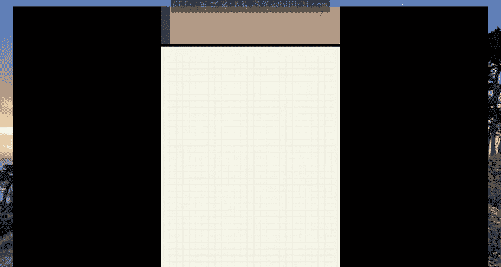

Okay， so last time we did。嗯。We kind of finished up our whole like Quatturnion discussion and did LQR with Queternians and as I mentioned last time like from there it's pretty easy to imagine doing like DP ILQR and also collocation methods with that same set of tricks so should be good on that stuff now。

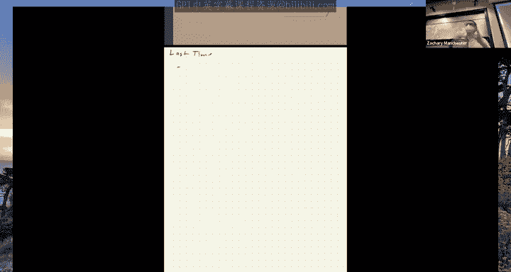

So now you can do back flips and aerobatics and stuff on that superf。

Okay so what we're going and then the other thing we did at the end last time with our little extra time there was talk about start talking about contact stuff。

 which is you know one of the other I feel like there's a few weird quirky things that show up a lot in robotics that aren't classical optimal control topics that like I kind of want to cover when was that paterion stuff and this is kind of the other major thing that shows up a lot of robotics that isn't part of kind of the classical canon of optimal control but that is important I think so we're going to do that stuff。

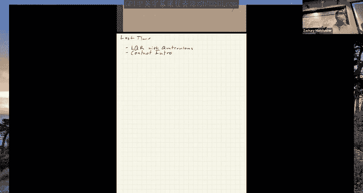

So today we're going to kind of really flesh out that story a lot more。

 so the first thing we're going to talk about is。Contact modeling with kind of within the sort of hybrid systems framework。

 which is one of kind of the two main standard ways to think about this stuff in robotics。

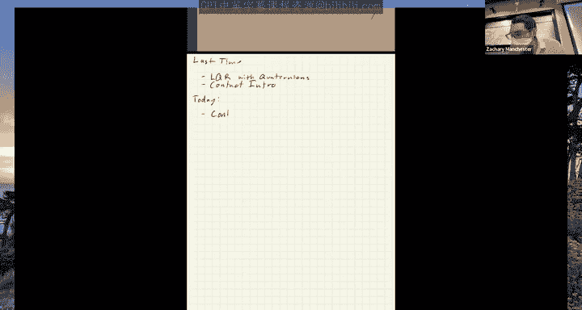

And for those who aren't necessarily robotics people like our electrical engineer friends。

 this stuff does show up in other areas as well this basically comes in whenever you have switching systems right so this is not you know purely a robotics thing。

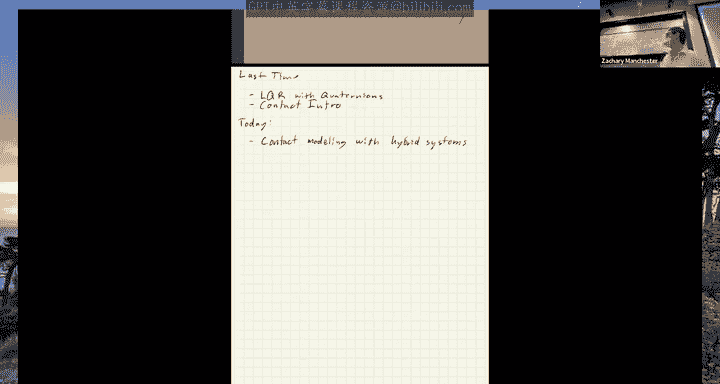

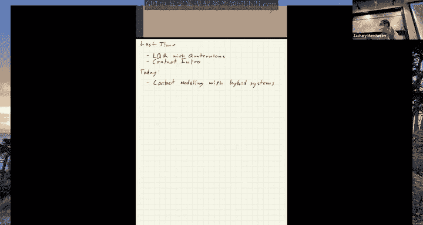

Okay， so。

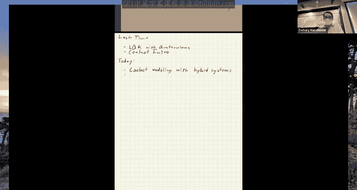

And then we're going to take this stuff and try to apply it to to start thinking about legged robotic systems。

 so in particular today by the end of the day， we're going to have a hopper hopping around。

 which is kind of fun。

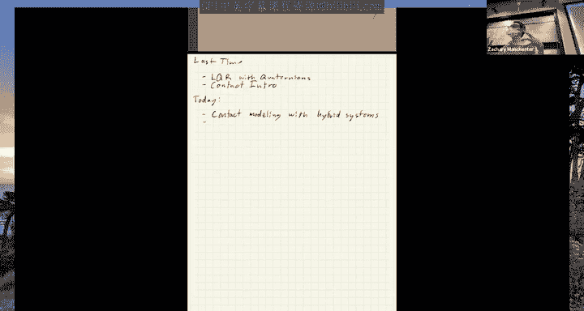

And that's kind of the easiest legged system there is to think about， so we're going to do that one。

And then I think we'll probably have you do some slightly harder stuff on the homework。

 I think we'll get you to do like a little like compass gate like too likeged walker on the homework and stuff。

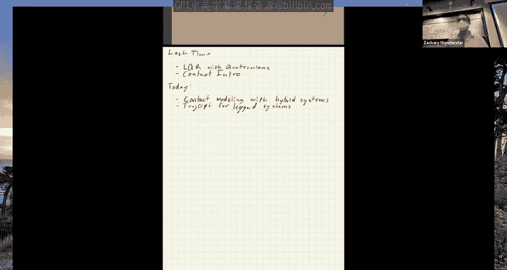

Okay， cool， any questions about that？

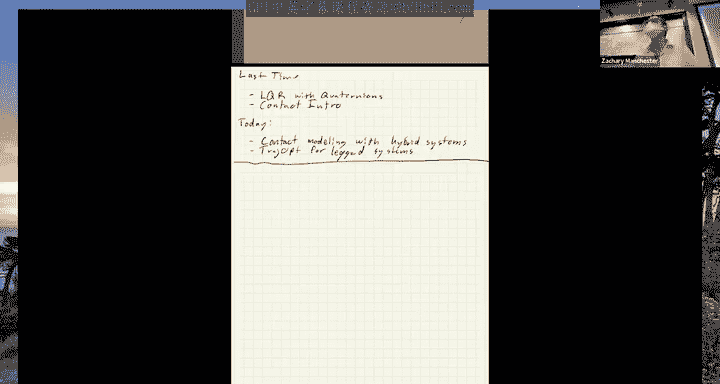

All right here it goes so we're going to start out today with we're going to revisit question it was a question on the first homework this QP falling brick thing that had you guys do。

 which is foreshadowing some some stuff so we're going to kind of go back to that and talk about that a little bit。

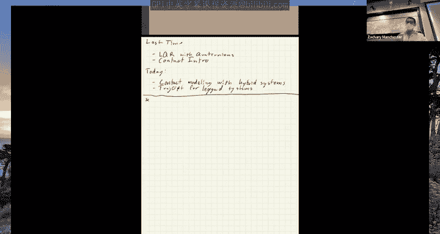

So we're going to do the falling brick problem。Two ways。

We're going to do it that way and then i'm going to show you kind of this other viewpoint。

 which is kind of the hybrid one that we're going to talk about today more and these are basically the two kind of ways of dealing with contact generally in robotic stuff so let's think about a brick。

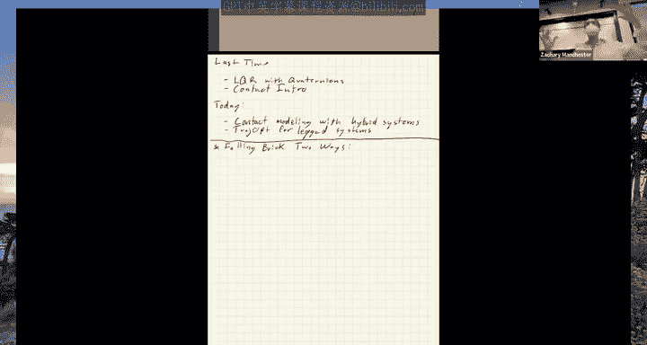

So here's the ground。Here's the brick。And let's say， you know。

 you throw it with some velocity of v knot and it kind of falls。And then hits the ground。

And then slides or something right so you can imagine I' a brick falling on ice say and so it's got to slide on top of the ice when it hits the ground and we're going to leave out friction for now。

 but it's not hard to include that。

Just to make this conversation。You know nicer and easier so we're going to talk through the details of what was on that QP question on the first homework where I just threw it at you and told you to make aqP solver now we're going to actually talk to you the physics of that so。

Here's what a time stepping method looks like， which is kind of what was that QP thing was all about。

And this is one of the standard ways of doing this stuff that's actually the one that's in most of the robotic simulators。

So here's the basic idea so you're going to take so in this case， right this little brick。

 we're going to write down f equals MA for this guy。

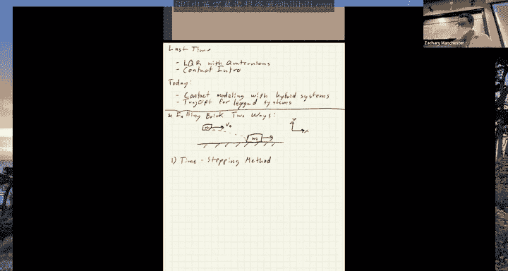

So。MV dot， so MA and you've got gravity。A minus Mg。And then you've got a contact force。

 which we're going to write like this。J transpose， which is a Jacobian that I'll write in a sec and then times lambda。

 which is going to be our contact force and the fact that I'm writing this a lambda is supposed to be I don't know foreshadowing of things to come it's going to end up being a lagrrange multiplier。

 So here we go This is called the contact。

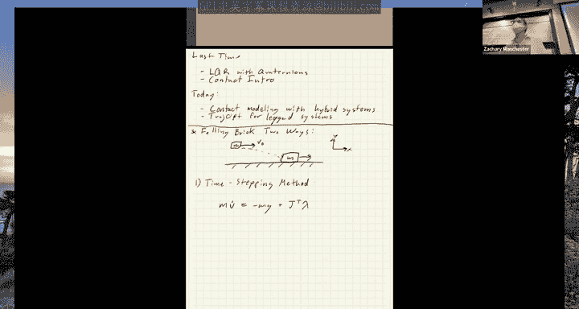

Jacoian。And this is called this is going to be the contact force。

And then I guess I should write these other guys down so we've got。

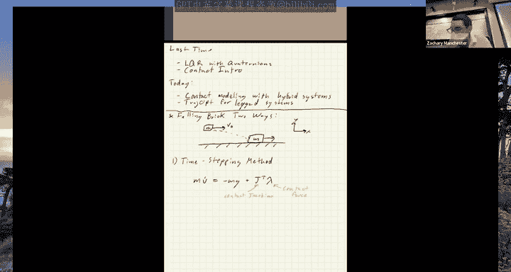

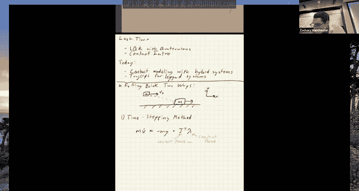

G is going to be kind of the。Thing you would expect 9。8， whatever down here we doing。

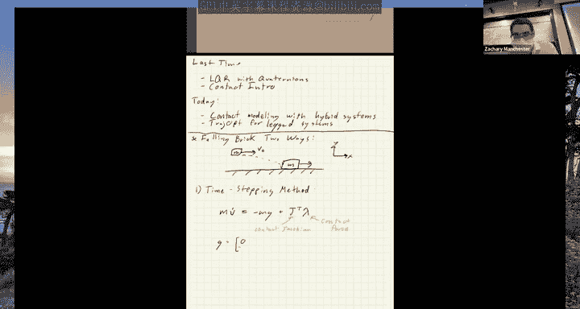

MKS units。And then the state。Is going to be sort of Q and V here， the position and velocity。

 so Q is 2 d V is 2 d right the whole state is 4D。

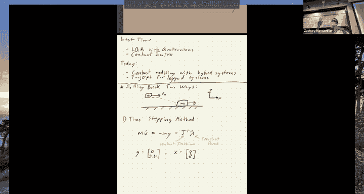

And then we've got， so this is the dynamics， and we've got this other thing that's going to go along with this。

It's a constraint that we're going to write down in terms of this function that's the standard notation here is fee for this thing called the sign distance function。

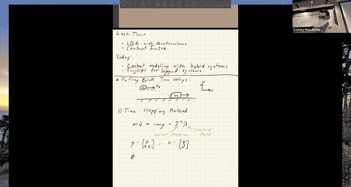

And I'll just write it down real quick for this problem if you talk about it。So if I have Q。

 which has the x and Y components。This things actually are Jacobian J。This thing is called a。Signed。

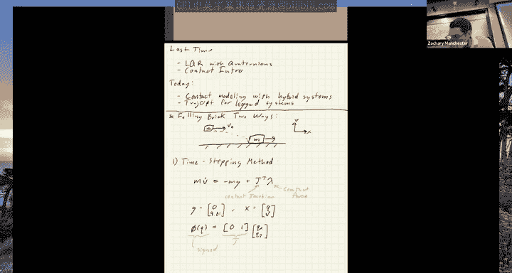

Pistance function。So this thing， the sign distance function， you set this up such that。

It has to be greater than equal to zero and what this is just saying here is that the brick's not allowed to go through the floor。

 to say this function which evaluates to zero when you're in contact and is negative when you're through the floor。

 this thing has to be greater than equal to zero。

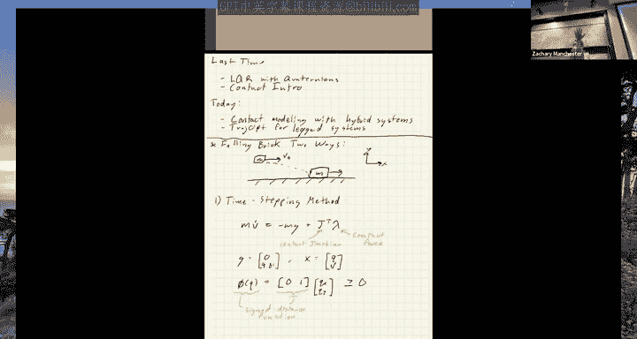

So this whole thing that says sine phi greater than equal to0。

 sine distance function greater than equal to zero， this is called an interpenetration constraint。

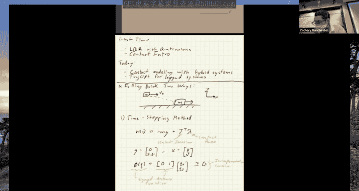

Okay， so we set this up we've got f equals ma and basically our inner penetration constraint once sm these things together into an optimization problem。

 the first thing we have to do is discretize this in time。

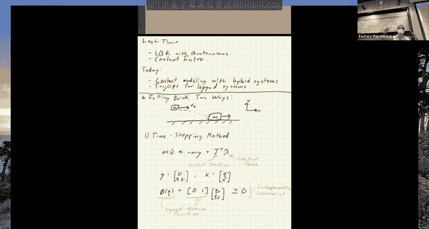

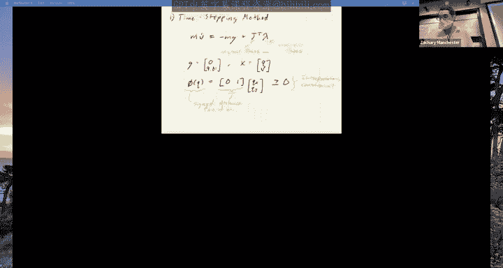

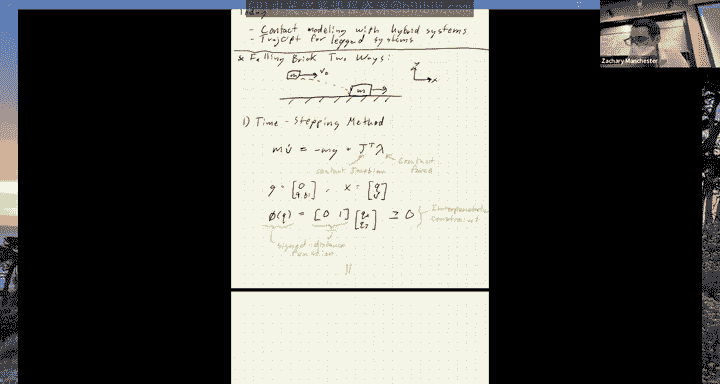

And we're going to use for this particular problem。

 the standard thing is to use some kind of backward or implicit oiluler。

 which we talked about back at the beginning right， so we're going to go ahead and do that。

So what that looks like now， if I basically go ahead and disretize the F equals MA equation。

 I'll get something that looks like this。

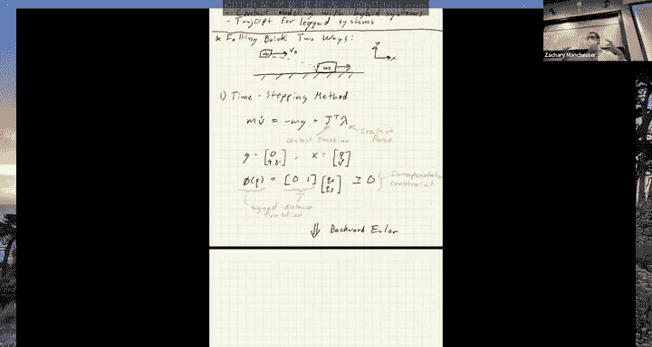

the V dot is going to become Vk plus1 minus VK。Over a time step H， so just a discrete， you know。

 like discretized finite approximation of V dot。And then the right hand side。

 we can pretty much leave alone here because these are all constants or whatever。

And we're just going to put a time step on the lambda there lambda K， so that's the dynamics。

Then we also have the kinematics I。e integrating the position from the velocity。Yeah。

So that just looks like this。And because it's backward Oer， right。

 we use the future time value of V in there to integrate the position。

So dynamics with the contact force in there on the right hand side， kinematics。

 now we've got our sine distance function。In this inter penetrationration constraint thing and we enforce the constraint at the next time steps。

 the idea is I plug in where I am right now QK VK and I'm solving this optimization problem for qk plus1 VK plus one。

 so the next state and Lada K and the contact force subject to this constraint that's saying basically I'm not allowed to be through the floor at the next time step。

So this guy greater than equal to 0。 There's a few other things that show up in here。 Let's see。

 So also the contact force has to be greater than equal to 0。 So that's saying that。

So we got can't go through the floor， Lambda positive says the normal force that the floor is exerting on the brick。

Can only push your not it's not the floor is not allowed to pull on the brick。

 right so that makes sense。And then the last one is。This thing。

 So this is phi times Lada has to equal 0。 And this one says that you can't have any force at a distance that's saying。

You can only have lambmbda B non zero， you can only have a nonze force if p is equal to zero。

 if you're actually in contact and if p' is positive， if you're in the air。

 then lambda has to equal to zero， so this is saying no force at a distance。

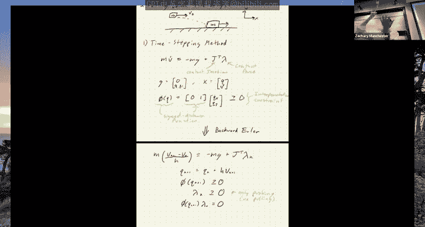

Which also makes intuitive physical sense， right？

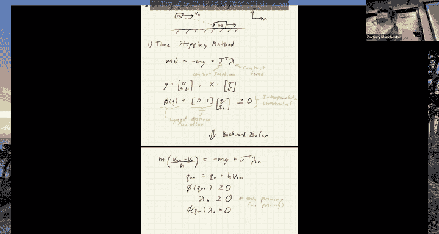

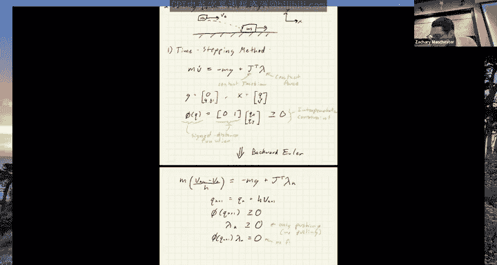

Yeah。

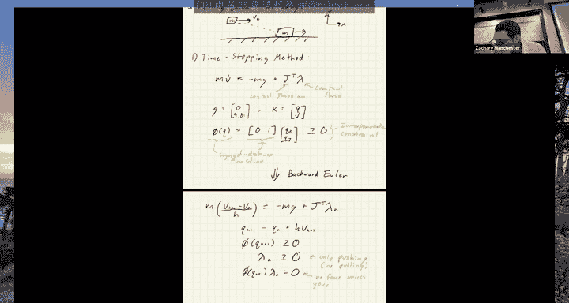

Okay， so now， so I wrote all this down this whole stack right， we got dynamics， kinematics。

 interpenetration constraint。

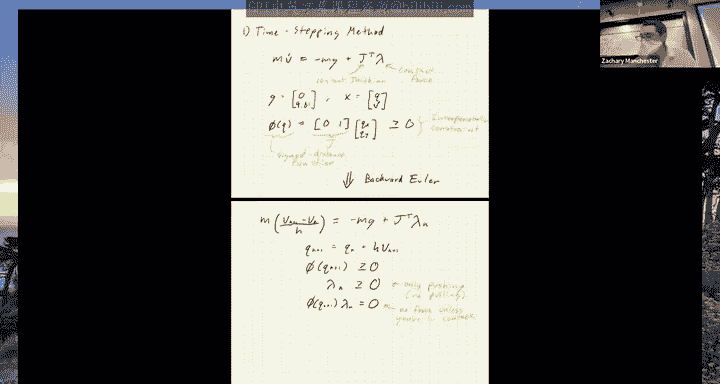

啊。Only pushing no pulling forces constraint and then this last one that's this no force at a distance constraint does this look like anything we've seen before？

This is a set of KkT conditions right this is basically a QP in disguise I basically from like from kind of physics I wrote down these conditions and then if I kind of look at these carefully I'll realize that these are KkT conditions for an inequality constrained QP。

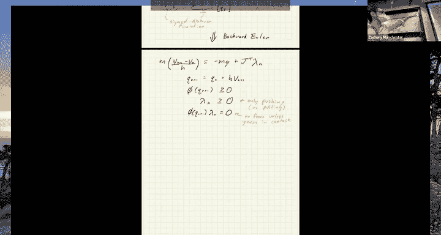

And this is what was on the first homework right I basically just gave you the QP though。

 so this is kind of how you get there。So。Yeah。So here's the QP that gives you those conditions right so it looks like。

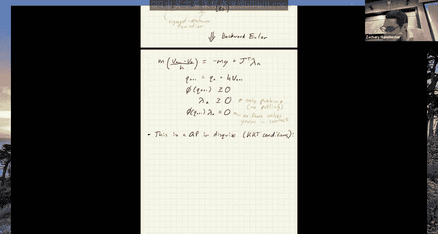

Min over VK plus1。One half。

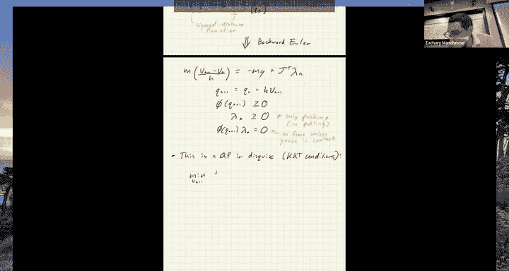

ちっと。And what I'm doing to get this， I'm basically pre multiplying that whole first equation by v K plus1 transpose from the left。

Such that it's gradient with respect to E K plus1 gives me the first line Ive really found before。嗯。

So this subject to。So this is the interpenetration constraint rewritten sort of so it's just in terms of VK plus one you can also write this in terms of QK plus one and it'll be a little bigger with more conditions this is actually the standard thing to do is just write in terms of the velocities and then after you solve this smaller QP plug it back in to get the positions。

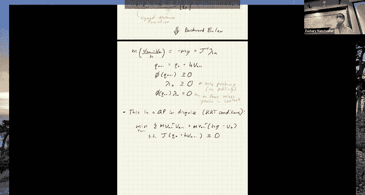

So does everyone see how to that work？

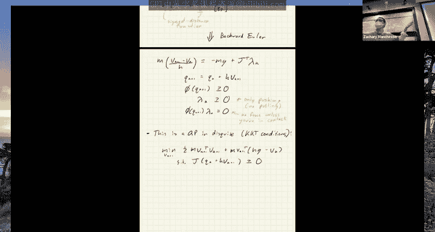

I basically pre multiply on the left of the first line with Vk+1 transpose to get the objective function。

Suchuch that that objective functions gradient with respect to VK plus sign gives me the first line of the physics and then this constraint is really just the Pq K plus1 constraint。

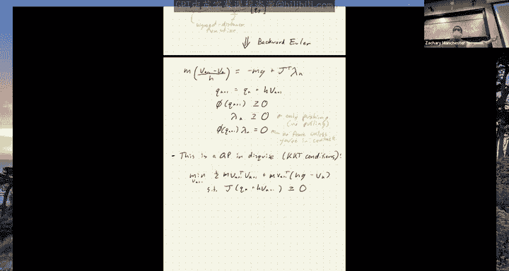

Where I've evaluated QK plus one from the kinematics up here。

 Qk plus1 equals qk plus HVK plus one right and then if I take this setup right here and write down the KKT conditions for this problem when I introduce over multiplierer I'll get that whole set of conditions up there basically。

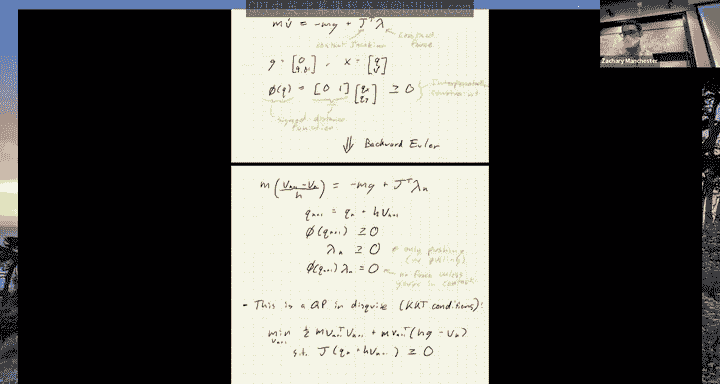

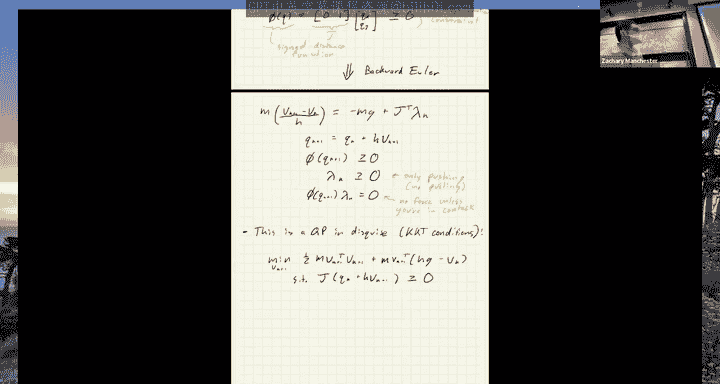

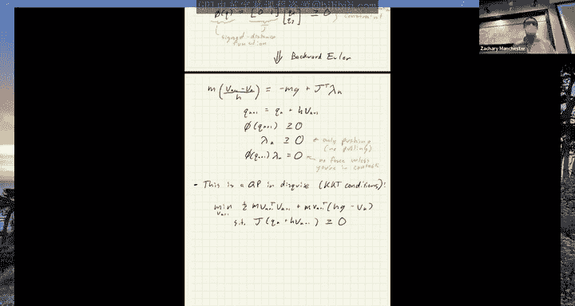

Kind of like。Okay， so let's talk about this for a sec so this is like I said a very standard way to simulate dynamics there's some weird quirks of this one is interesting thing is that when you solve this thing you never actually resolve the exact impact time like you get the contact forces。

 but you don't know like if you're imagine this brick touching down and hitting the floor all you know is。

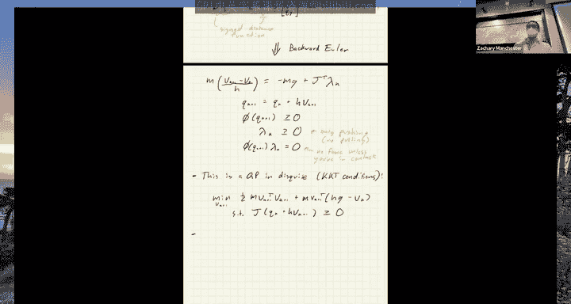

Over which time step it hits the ground， you don't actually have any clue。

 nor does this like tell you or resolve where in that time step it actually hits the ground so you don't get impact times。

Which may or may not you may not or may not care， and it turns out a lot of cases we just don't care。

I been not for that times through velocity。You can try。

 but this actually makes it kind of hard to do that what this is kind of doing is smearing out。

So one way to think about this is you're kind of like zero order holding the contact force here so that lambda is actually a contact impulse sort of it's the integral of the contact force over a full time step and that's kind of smearing out the impact event over the time step and so like I don't think there's a super straightforward way to actually figure it out it's actually like and in this case you probably could because it's really simple but in general for like a big robot it's got super nonlinear dynamics it would be very nontrivial to actually try to do that calculation just because the way thiss kind of inherently smears out。

All those contact things over a time step。Yeah。啊， okay。Let's see what else here。

 obviously the contact forces are explicitly computed you get them in those Ladas。

So that's often useful in robotics applications。

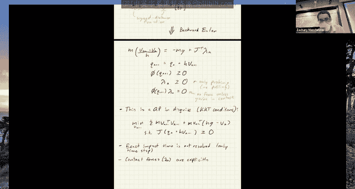

Let's see one other thing here so when we set this up right I did this backward Ouler discretization to get all this stuff。

 it turns out these so-called time steppingping methods or contact implicit methods。

 they don't really generalize to higher order integration methods like RK4a you're kind of stuck with like Euler ish maybe midpoint ish like first or second order integration with these guys。

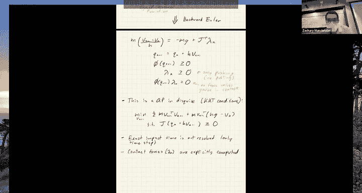

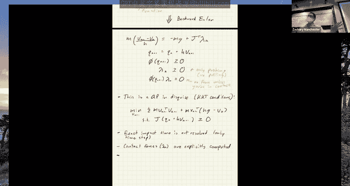

Yeah， which has the kind of sometimes unfortunate side effect of needing to take pretty small time steps to get reasonable simulation accuracy。

So this is often why if you ever use like Joko or bullet mostly is bullet does pretty much exactly this。

 so pi bullet dart they all do this， you often have to take like kilohertz or even a couple kilohertz time steps and those simulators to have them not barfit you and that's kind of because of this they're taking they're basically doing Euler and as a result the integration accuracy is not great and you need really tiny time steps。

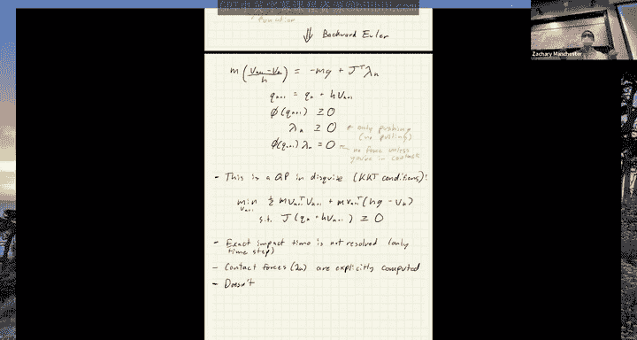

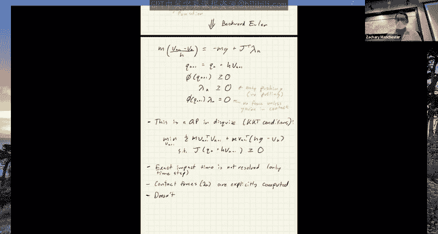

对。嗯。

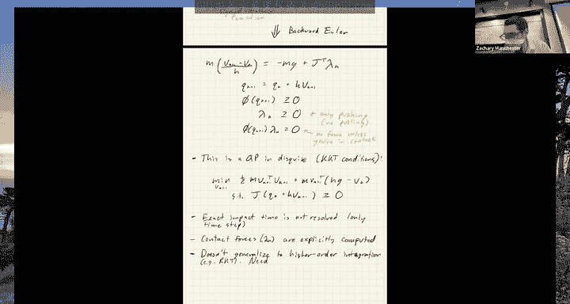

。What else did say about this yeah basically this is this is I would say pretty much the standard setup this is a very simplified you know kind of this it gets a lot more complicated when you do bigger robots but this is the core idea and this is sort of the standard thing I would say。

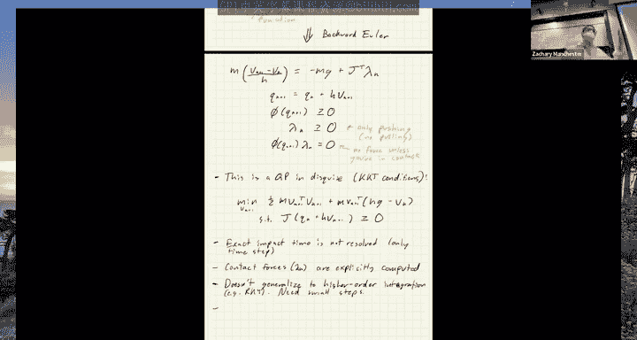

So for example， probably the most popular one would be like pie bullet。Pybola does exactly this。

 dark does this。What else gazebo？I then also Mujoko does a kind of hacky smooth approximation of this。

 so is also kind of vaguely in this category， I would say。

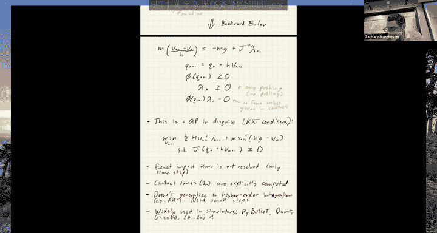

Okay， so。Any questions about this， yeah？

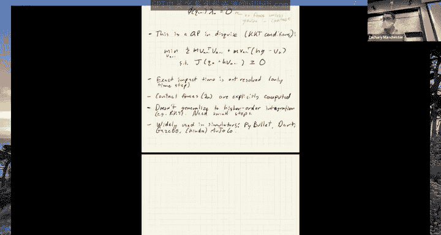

对啊他都。

So it's pretty much in。If you well basically try it so I have the continuous ODE there and then I like discretized it to write down this QP I use backward oiler here you can。

😊。

You kind of can do it， but it gets really weird and messy and not fun like one way to think about it is like inherently what I'm doing when I do like an RK method is approximating the dynamics over a time step with some higher order spline right like Ouler I'm basically like zero order holding or like using a linear interpolation between the two time steps。

And here， like I only need to get a single lambda and I can easily write down this， you know。

 don't go through the floor kind of condition。There's a few ways to think about。

 One is that like these dynamics are inherently non-sth right and these impact events are doing discontinuous things。

 So like in some sense， approximating the trajectory over a time step using a smooth high order sp is a bad approximation when you hit one of these discontinuities like trying to fit that cubic spline from R4sa to like this giant impact event doesn't work very well So that's like one way to think about it。

 you can kind of force the issue and try to do it I've kind of done some of this。

 what you end up having to do is actually introduce more lagge multipliers and more impact conditions because not only now are you thinking about not going through the floor at the Q K plus1。

 but now here it's a linear interpoent right So okay if you write down do with the floor kind of works out。

 if you have a cubebic spline that can wiggle in the middle if I say don't go through the floor at the end point it still could wiggle underneath the floor somewhere in the middle of the time step right so you have to introduce like now more。

Don't go through the floor type conditions and it gets harder you have to have more lage multipliers it just gets really messy and it turns out it's not a big win because at the end of the day the smooth spline is not a good approximation for the discontinuous trajectory so that was a long winded。

Answered， hopefully that， yeah。好行个月。嗯，Because it's just so， then it's longer。ok我。就这样啊。

So it turns out this tends to do the opposite。It tends to introduce artificial damping。

So if you remember in the very beginning in class， we did like we did Euler and showed that that had this bad blowup behavior on like the pendulum。

 then we did implicit or backward oiler and showed that that had this like artificial damping effect。

This is implicit or backward Oer here， so this tends to do artificial damping for what it's worth。

Rather than the opposite effect so yeah， I mean， in general yeah。

 it doesn't have great accuracy and it and not great。

 you know kind of energy behavior and stuff like that。

But one of the reasons to choose the backward oiler here is exactly for these kind of stability properties。

The other reason is that it naturally lets you look at the you're evaluating everything at QK+1。

 which is how you also have to evaluate the innerpenetration constraint。

 so it kind of naturally fits into a backward oiler setup here。

Yeah you an example of when you would the exact I mean。

 I've never cared in anything I've ever done so yeah， I mean I would say like。

I don't think many people in robotics care because this is the standard simulation set up in robotics and like if I'm running this like same pie bullet。

 it runs this at like a kilohertz say so you know within a millisecond of when the impact happened right and if you care more than that like I don't know you're probably doing something weird。

啊。Yeah， I don't know that。I can imagine someone might care， but I've never had the care。Ever so。

I would say it's there's probably some applications， but I don't know of any else about my head。Yeah。

 how easy is it to like or is it not possible make this like an elastic collision so the brick bounces Yeah。

 you can， it's possible， but not great in this setup。 It's very easy in the other version。

 which we're going to talk about next and we'll actually do it in a sec。

 we're going to do a bouncing ball So you can do it in this framework。

 but it's kind of cllugy and not very natural。This naturally does perfectly inelastic conditions is kind of what comes out of this and it's kind of easy to see why basically if you look at the thing we're minimizing up top。

 we're basically minimizing kinetic energy。subject to not going through the floor。

 so that like naturally produces inelastic things right like if you had bouncing you would not be minimizing that v squared term with the front right？

对啊。Cool， anybody else。

Okay， onward。Oh yeah okay next fun question so this is like the dynamics right and you can imagine like if I want to solve a trar problem to make my robot walk or whatever these are the dynamics constraints now for my my you know like before I would have like I don't know my acrobot or something and I'd have some nice algebraic conditions from like taking theodeDs and applying RK4。

Now， my dynamics constraints are this whole set of KKT conditions。

In principle， I can do that does anyone have any thoughts on why that might not work super well？来是个。

No。There's one line in there that's bad。Or for doing optimization。

Yeah this the last one the top yeah it's the last one so everything else there's time to find right like the first lines fine that's normal dynamics we do all the time second line's fine the next two are totally fine the linear inequalities that last one if you actually plot that out and look at it and think about it a little bit here's we'll plot this。

Like， if I imagine having like a。A fee axis and a Lambda axis fee versus Lambda kind of thing。

What is the set that satisfies that condition in this plane？さ。

Like so it's actually basically the y axis and the X axis right or all the places where that's true。

And this is like a super nasty， like I don't know， it views it as like a set。

 it has no interior at the origin， it does super weird stuff right so it turns out in particular at the origin it's non differentiable。

And then it's sort of， yeah， it's just bad from like a gradient based optimization perspective like a small perturbation and curve。

 you can do that。That's sort of not the worst idea， what's that？

So what do you what do you do mathematically to get that to happen So you add like instead of equal plus Yeah so what is that and then you'll have to add another I guess Yeah so what is do you know what that is though if you stick a slack on the right where I don't know what it' it's literally what prim do interior methods so so what you're doing there is essentially Yeah。

 that's exactly so that trick of relaxing the complementarity condition is what interior form methods and it does I mean。

 obviously it can work it works in that context right so yeah， you can do things like this。

And they can work， it's very hard to make them work and you have to be very careful by how you do it and this is like pretty much like research state of the art stuff。

Okay。So yeah。So this stuff is you can do it， people have done stuff like this we've done stuff like this a handful of labs have done stuff like this to do what's called contact implicit trajectory optimization Aaron Johnson's lab here has also done some of this stuff the last few years。

 but' it's super gnarly and basically standard optimization solvers like we've used like the op just can't do this very well so this is not a very common way to go。

嗯。Common for stimulation， but not common for like optimal control。Okay。

Any other questions about that？Cool， so on to the next thing。

 so this is like kind of one of the two ways， the other way。

W which we haven't talked about yet is this so called hybrid approach or hybrid method。

 it's called hybrid in control， it's sometimes called event driven simulation and simulators that work like this。

And this is the more common approach in robotics and most control applications and the idea here is。

Most of the time the dynamics are smooth， or that's an assumption we make or if you know we would like that to be the case。

 if that's case like this stuff kind of works。

Pretty well， so we say we have some smooth dynamics。

F of x， like the usual thing。 And in the case of the brick， this is going to be， you know， like。

This stuff， the flight phase dynamics look like this。

And this is called a smooth vector field or smooth dynamics， whatever。

。And then。What we're basically do is we're going to simulate these smooth dynamics using like RK4。

 pick your favorite integrator， and while we simulate it at each time step， we're going to check。

What's called a guard function， in our case， it's the same size distance function。

So we're going to check this guy。

And in this context called a guard。So we check this as we integrate the ODE。

 and then if this guard condition is violated， basically if we take a step and we go through the floor。

What you do in practice is backtrack until you hit the exact you know fee equals zero condition。

 so here you're resolving the exact impact on basically to whatever tolerance you care about。

And then once you've done that and you've gotten exactly to the impact time。

 you execute this other function that's called the jump map。

And that's sort of a function that captures whatever instantaneous discrete discontinuous thing is happening right so here we'll call this。

Like x prime equals g of x and in our case， in this impact case with the falling brick。

This is going to look like。Following so we're going to not change the position at all。

When it hits the ground， the position is not changing。

 what is changing instantaneously during this impact？

So specifically the vertical component right the if it's smooth， you know。

 like a ice that it's hitting the also the the X component doesn't change either right so we leave everything else alone。

 but we zero out。Vertical component of the velocity this is by the way。

 if I zeroed out its a perfectly inelastic collision。

 which is what we had in the QP version you can also easily add what's called a coefficient of restitution here right where you flip the sign multiply it by some constant less than one and get it the bounce this is how you would do bouncing we'll do that in a sec so this function is called the jump map。

😊。

诶。And yeah， what we're actually doing in here， right is。

And that would be perfectly an elastic ocean， right， Okay， so that's kind of the recipes you have。

Your smooth dynamics， your guard function and your jump map。

 They basically stick these things together and the like sort of。

Simulation loop would look something like this like in pseudocode， you basically do something like。

You， some kind of while loop。Well t less than say T final。If you're not。Violating your。Your guard。

Condition here， then you just do your usual thing， you integrate your ODE。

And you can use any integrator you want for this。

So like RK4 is fine。Then basically。Yeah。You know， like else。You know， say you are。呃。Getiing your。

Guard condition， now you're going to execute the jump map。And。

That's kind of it。And in general here。In this， you know。

Usually right you're never going to hit this perfectly with your integrtor so you're going to generally always step a little bit past it right and you'll detect that you've gone through and like officially you should backtrack and do sort of a line search type thing to find the exact instant to within whatever tolerance you care about we're not going to do that today because it's you know you can figure that out it's not that bad so。

Ad function detects impact。And then the jump map。Simulates whatever your non smooth thing is。Okay。

Any questions about that yeah ignore the。So why， what do you think would be bad here。

 I guess case fri or preserve have to。Y so so basically this story gets a lot more complicated in general in this particular setting like you would actually end up being so sliding versus sticking are two separate modes so co on friction is also discontinuous right you have to have you'll have a bunch of modes and you'll have jump maps between every pair of modes so this is getting at the whole this other thing to talk about where is this hybrid setup one of the the major disadvantage of this is that it has this kind of combinatorial explosion in the modes so you basically have to define a ton of modes to cover every possible sort of switching scenario and then jump maps for all of those pairs of modes that can transition between each other and it can very quickly blow up on you so this step is really useful and really common and legged locomotion where you can imagine like a byped it's like left right both none there's like four modes essentially for a quadruped is a lot more right you can have all。

The possible combinations of feet on or off the ground all of them none of them blah， blah。

 blah exactly and now you've got also on top of that sliding and sticking for all of those so just counting those up it's a big number it's like you know I don't know what it is I haven't added it up but it's like probably order 100 for just a quadrup pad right if you want to consider stick slip friction as well so that gets nasty basically pretty quickly。

Anybody else on this stuff？Okay， so I kind of summarize the quirks up here or whatever the pros cons of this stuff。

First， these do resolve the precise impact time， unlike the other stuff。What about contact forces？

So these things do not give you the contact forces explicitly。

 you can calculate them later by doing some kinematic E stuff。But they're not。

 they don't come out of this for free。What else pro here is you can use you know high order integrators here because it's just。

 you know， during the smooth part， it's just an OdeE， you can use whatever you want。

And then this is。Probably the standard thing in optimal control and robotics。Quly used。

For trajectory optimization and NPC kind of stuff。And this is basically all all the cool robot demos you've seen on legged robots。

 like all the Boston Dy stuff， all the MIT G stuff they're basically all doing。This kind of stuff。

And the kind of the key reason why this works well for TraO。

 assuming you can manage the number of modes and it doesn't explode on you。Okay。

 so the reason this is kind of attractive for Tra drop is that basically if we know or basically assume or pre specifyify the impact times。

Then。We can basically like not worry about them in the optimization problem。

 they end up being like constraints。That we prespecify for like left foots in contact at these time steps。

 right foots in contact with at these time steps you kind of throw them in there as constraints and then the solver just figures it out and it looks pretty much like a standard trajectoryor optimization problem at that point it basically just ends up being an extra set of constraints on like which foot is in contact at which time steps that you add to the tragic problem otherwise its it's standard。

So yeah， basically， if you do that， you don't need the guard functions， right？

You also don't need all the complementarity stuff。

So you just need these guys and these guys are differentiable。

嗯。

So like one way to think about this is if you assume the touchdown on lift times or the feet and bake them in to the problem statement that you hand the solver。

 if you're really only optimizing then over the smooth arcs between you know the impact and that's nice and smooth and that's all differentiable and life is good。

 right？Okay， let's see。I think this is a good time to do some。Cos。Duff， oh， no， definitely not。

 Joe Payne， I'm not。

Nothing saying that。Sorry。😔，Soom joke， Okay， where's the code。

 Here's the code So the first thing we'll do。

Is。啊。

So this is actually straight out of the homework one solution is just the QP stuff that you guys already did so we'll just run this real quick I think i'm running exactly what was in the homework so it's one meter off the ground one meter per second initial velocity throw the brick。

Solve the QP at each time step and you get this like this is showing you the x and Y component right so balllistic kind of trajectory hits the ground slides and is the this is the velocity。

So negative， negative， negative。Discontinueuous jump on the velocity at the impact time right cool you guys everyone's just done this before。

 so we all know that so let's go look at the hybrid version now。

So here's。

The dynamics， which is just you know f equals MA actually you know and it's just gravity right there's no impact for stuff in this setup right we're going to use our K4 on that the guard function is just returning the height。

So when this thing crosses zero， that's when I have an impact。The jump map。

Is going so right now I'm going to zero out but what we'll do bouncing next so I'm going to zero out the vertical velocity component right the last component of the state。

 just like we said before。

Same initial conditions。

We're going to go ahead and simulate this like we just wrote same rate 100 hertz。

 same exact parameters as we did in the QP， and you can see exactly what we're doing so we're going to you know time step through RK4 and then if we hit the guard。

We're going to do the jump map normally like I said。

 you would interpolate this back to this is just detecting a crossing and i'm just going to be lazy and do the jump map if you were being legit about this you would do a backtracking kind of thing。

After you crossed to get to the exact zero crossing time going out in the bottom of that right now okay and then I plot everything so positions you know velocities and this exactly matches what we got in the QP sort of unsurprisingly so so you can do it with both methods and they kind of and this very simple problem they look pretty similar and you know kind of you could pick either one as we talked about a second ago this setup it's a lot easier to do stuff like bouncing or you know kind of elastic collision so if I say set this to 09 now what i'm doing here is taking this vertical velocity component。

And instead of zeroing it out which would be perfectly inelastic I'm going to flip the sign on it so I'm going to go from negative to positive and I'm going to multiply it by this gamma which isn in the parlance it's called a coefficient of restitution this is basically saying I'm taking out a little bit of energy taking out like 10% of the energy kind of thing every time I hit right so it's going to get you kind of the behavior of bo a little lower right every time so let's run this version oops。

Yeah。Okay。Oh b， here you go， bouncing ball。Interestingly， this is not without itsquirks。

 standard heard of Xeno's phenomena。Okay， so if I set this。

Like I can make this happen by setting this kind of low and see what happens。谢 that。

Coing on the fly can get sketchy it's not going to happen here So one of the things that can happen here is when does this if I do this。

 when does the ball actually come to rest。Never right it in theory bounces like the bounces get smaller and smaller and they actually get higher and higher frequency and they never actually get to zero it's called a xenos phenomenon and it becomes a problem with these methods sometimes and you'll find in a lot of control work on this kind of stuff。

You have to make assumptions about this， you have to basically say I'm assuming that we don't have xeno phenomena and like a few other things。

 this can get weird。Anyway， okay， any questions so what'll end up happening is basically the bounce frequency is going to get you know go up and up and up as the bounces get smaller and you'll basically like if you're using a good like variable step run to cut a method like you would get in like differential equations side J or RK45 or something the integrtor is going to have to take tinier and tinier and tinier steps right if you do what we're doing here and you're just being dumb and using a fixed step integrator you're going to get actually get aliasing and stuff like this basically you're not sampling fast enough to capture all those switches and so it eventually like kind of just does weird gross things。

Yeah。Anybody else， yeah。More of a zero question， but is there ever a situation where you want to put a constraint on the contact？

人阿祖伟诶。So you would have to basically bolt that on separately and write some more math to calculate those explicitly and then。

Do something with them， but yeah you're totally right like I don't know examples you could like say you know I dont want to break my robot so like I don't want to exert like gigantic forces you know contact forces or break whatever i'm manipulating right like there's definitely lots of instances where you might want to do that。

And so yeah， in that situation the contact oflic is definitely we talked about before where those Lambdas are explicitly in the problem。

 I can put whatever constraints I want on them and it's kind of easy and natural right here you'd have to actually go and compute those some other way。

And I had constraints on them that way， which you can do， but yeah。Extra work， okay。

 anybody else on this stuff？Okay， onward。

嗯。

Weir did。Okay， cool tablet， please wear it。

Al， so now。We're going to go ahead and do the trajectory optimization thing。

Using this hybrid setup and we're going to do this on the simplest legged robot there is。

Which is kind of the monopod hopper。嗯。Has anyone heard of a Raybert Hopper？

Maybe kind of this is like a dumb down version of this is like a dumb down 2D Rayber Hopper。

Okay， so here we go， one legged。Harpper。Here's the cartoon。At a ground you've got。

A body with M sub B。We've got a foot。M sub F， you've got a prismaticotic joint connecting them together。

And we can exert a force here。F through that prismatic joint。

 and then we're also going to assume that you can exert a torque。To swing the leg around。

You's got the F and you've got a tau up here。And that's， yeah。

 it's basically what the Rayber Hopper looks like， except the Rayber Hoppers in 3D。

So this is kind of a simplified version the state for this is going to have。诶啊。Body position。

Which is2 deep。And a foot position， which is 2D， and then a body velocity。And foot velocity。

So this thing this whole state vectors in is eight dimensional。And then we have two control inputs。

The force in the prismatic joint between the body and the foot。

And then the torque that I can exert sort of。Between the body and the foot also。So that's 2D。

And what we're going to do to do this hybrid thing is define。

Two different smooth dynamics models basically we're going to end up defining a smooth dynamics model for the stance phase where we assume the foot is pinned to the ground and we're going to define another smooth dynamics model for the flight phase where we assume that the robots in the air not touching the ground。

This is kind of a standard thing to do in these hybrid methods。

嗯。

Okay， so if I write both of those down。We're going to call the first one。F1。

And this is going to be our stance。 So and effectively。

 what you're really doing here is sticking a pin joint。Between the foot and the ground。

And again yeah like i'm also here i'm assuming no slip right so that's something if you were trying to be legit about this and you know not have the robot face plant you would then want to add some extra conditions on the tangential force at the foot to make sure you're not violating the friction cone conditions。

And then we'd have our flight phase dynamics， which are the ones we already kind of wrote down。So。

Cool。

Okay， so weve got those dynamics， we then need our jump maps。And in this case。

 we only really need one。

嗯。So we're going to write down here。We'll call it G21 to mean that we're transitioning from mode to aka flight phase to mode1 aka stance phase and that transition is an impact right and we're going to do the exact same thing we already did for the flow brick we're going to write down an inelastic collision。

Conditions， so we'll have。

bodydy。Foot position， we're not changing the body velocity and if the bodies can keep moving。

 we're going to zero out the foot velocity and here we're actually going to zero out the foot velocity both in the vertical and tangential directions where we're going to assume sticking contact。

Yeah。

Okay， and then the reason kind of we don't need another one is the liftoff transition。

Go the other way。Is just the identity， so you when you lift off you're not actually there's no discontinuous stuff。

So that's easy。

And then the game here is it's actually really simple once you have all this machinery to turn this into a trajectory optimization problem where we're going to do and again it's easy for a simple robot like this where there's only a couple modes。

 I'm just going to alternate sets of time steps。So like let me write this down。So assign modes to。

Altterernating groups。Of not points。呃。By enforcing kind of the right constraints。

And here's what that would look like in like kind of pseudo code， right， so let's say。For。

K equals1 to， we'll call it n1 for like mode one。We're going to do our discrete dynamics。

We'll say we'll start in a stance phase， so we'll start with F1。And then at the end of。

And also in here， we're going to enforce a constraint that the foot has to be on the floor。

During the dance phase to make this work so we'll have。Also， this constraint。

For all of those knot points。Then we'll have a flight phase。 So we'll say the next set of not points。

 So K equals。N1 plus1。To N2。 so this would be like。You know， then we're going to just have our。

Flight phase dynamics。And here we'd have to have。

你啊。This guy would have to be positive， right？And then at the next set of knot points。

We're going to have an impact event。So we'd have something like。X at that N to time step。

Is going to go through the jump map。And then we'd set this guy equal to zero again。

And then we basically repeat this now we'd have a new stance phase and bh blah blah。

 we can kind of keep keep alternating just groups of knot points。And then， you know。

 we'll have a nice。Standard trajectoryor optimization problem that we can solve with whatever method you want。

 you could do this with constrained DP， do this dirt call。

 kind of whatever you like question here is so I'm putting these constraints in does this mean that I have to prespecify the exact times of the touchdown and lift off of the robot that's exactly what I was just going get yeah basically so while this seems very restrictive in the case of a hopper it's not at all actually because I can put in I can do the free final time thing where I make the hs for each time step variable so I can let the solver stretch out and shrink the actual times between these mode transitions and generate at a more interesting things what I can't do though is if I have say a quadruped where I can have like walk trot gallop kind of different gates。

The thing that you are pre specifying here is basically the gate。

 so if I do this I can make the exact timing vary， but I can't change the ordering of the of the feet touchdown lift off so'm if I start with like a gallop kind of gateit。

 that's what I'm going to get。Yeah try every combination so you just nailed it like that is so that idea is basically what this T stuff does I mentioned at the beginning of lecture you can absolutely do like basically discrete search over these mode variables like these modes are really like discrete integer variables basically right so there is absolutely a version of this where you can set it up as a mixed integer optimization problem we have like a set of discrete variables and instead of continuous variables and you can try to flip around try various combos of discrete variables modes and there's smarter ways to do that than just brute force the smart way to do it is with branch and bound kind of techniques if you know what those are basically you can kind of do treese over the discrete variables and so for each set of discrete variables you're solving a continuous try job problem right and there's kind of intelligent ways of like pruning that search tree where you can say oh this branch is going have higher costs and this branch so I'm going。

Just cut off the rest of that section of the tree and focus over here there's smart ways of doing that I don't know I don't know what that is。

Okay， yeah， so in in like this mixed in optimization land there's yeah this branch and bound technique。

 which is very standard that's yeah basically intelligent research。

Cool， anybody else？Okay， cool， in that case， we will do fun things again。

Okay， here's the code。So we're going to use IP opt and do this with like a colocation style setup。

 you can also do it with DP type methods as long as you have a way of handling constraints in your DP method。

 so like our Utra solver in my lab can do this we showed have before。

There's just a bunch of problem setup stuff， states， controls， time， 10 Hertz。

This is something I'm basically what I'm going to do here is assign a mode switch every five knot points。

 so you're going to have five knot points stance phase， five knot points。

 flight phase vice versa just alternating。And the rest of this is just me sort of calculating random things that are useful。

Yeah， I'm basically like figuring out here which indices are going to be stance and flight phase and that kind stuff ahead of time。

Okay， hopper dynamics， here we go。We're going to make a body。

 you know mass five the foot and mass one， and then the prismatic joint we're going to put inequalities in there for the length of the prismatic joint as well so it's got a minimum distance of like half a meter。

 maximum distance of one and a half meters for the prismatic joint。

Flight phase dynamics so this is just f equals ma and then like j theta double dot equals tau kind of stuff the I guess the weird thing here is this B matrix which is what this is really doing is mapping the force and torque into the sort of like accelerations for the body and the foot masses so that's like this bottom section here is basically like a cross product E thing to map the torque into those guys and the rest of this is very standard stuff。

Yeah， I think it was that my stuff。Stance dynamics。

 basically the only difference here is I've zeroed out all the stuff for the foot and it's only affecting the body now。

RK4 for everything and then here's my jump map i'm just zeroing out the velocities both vertical and horizontal for the foot。

This is， yeah， exactly the stuff we wrote down， cost weights。

 these are just totally made up like identity stuff or the cues and ours quadratic costs like we're used to doing。

Here's where we'll talk about this a little bit， it's an LQR style quadratic cost。

 but I'm having a reference trajectory in here for the X's and use。

So I'm actually writing down like some kind of like reference tracking style quadratic cost。

 I'll talk about what the reference is in a second。

 but that's important it turns out to get this to work。

This is sort of the vooooy you know art of doing this stuff so here's this reference trajectory so I want to make it hop I'm going to right now the first thing we're going to do is make it hop in place so to get it to hop in place what I'm going to do is just write down a sinusoidal reference trajectory that I'm going to apply to like the Z axis positions of everything。

So that's that。Here's what it looks like and this is going to go in the cost function as the reference that it's going to try to track。

So what this kind of lets me do is draw a cartoon of like the motion of this thing and then what the Tra solver is going to do is try to track that cartoon motion that I just wrote down while actually respecting the dynamics right so it's going to do like the best job I can attract this。

Stupid cartoon trajectory with the real physicss。嗯。

Dynamics constraints okay so this is looping through doing the thing we just talked about so looping through stance phase dynamics flight phase dynamics jump map stance phase dynamics flight phase dynamics blah blah blah jump map right like we said applying them to the groups of five knot points。

 five knot points。

Stans constraint is just saying it actually has to be in contact with the ground。

Once it instance stance phase， length constraint， that's the prismatic joint length constraints we put in there。

This is just stacking up all the constraints。And then this is yeah， this。

 all this is just interfacing the IP so it's ugly and it's a lot of boiling play code but there's nothing。

Interesting or deep there。It's just。Crarap to call the solver。So there's that。Yeah。

 nothing worth're talking about that I don't think。Uh randomandom， I'm putting in like a dumb， dumb。

 random initial guess。And then I'm going to call us Alder。

And this is kind of slow because I've been really naive and dumb about how I set the problem up and not done any smart sparse matrix stuff。

 which you guys should do on your homework for extra points。Okay， so yeah， I don't know。

 it took like 20 seconds to solve。Optimmal solution found Hooray so we can plot this stuff。

This is the body height and this is the foot height， so you can see the foots you stance face。

 white face， blah blah， blah。This is basically zeros， 20 minus seven， that's just noise。

And let's go animate this thing， none of this is interesting。Okay， here we go， visualize me。Yeah。

 hop and up and down。That's kind of cute Okay， so now so we can make it hop up and down。

 let's now make it actually move and hop somewhere So to do that what I'm going to do is go back to this reference trajectory thing。

And instead of just hopping straight up and down。So this is the Z coordinate right signoid I'm going to now add a linear。

Reference。To the X coordinate， just like linear interpolation right from like minus under one and。

What is this oh yeah same thing for the foot linear interpolation on the foot and then putting in like you know linear velocities that are consistent with that linear interpolation on the position so we're going to make that the reference down and try to track that。

Instead。And I guess I'll just kept good from this crap。Yeah also's solve that。And by yeah。

 that whole like reference tracking costing， that's like。

Yeah that's like kind of the art of doing this stuff I mean I've done this a lot so I know how to get this to work kind of like you know within the first couple tries but that's definitely like when you get into this stuff being able to like set up cost functions is sort of an art form and you kind of get good at it Okay so this is like you know the exposition showing its moving sideways let's just go watch the animation。

So cool。You can move to the right that's kind of fun。

 And yeah it's pretty easy to go nuts with this like you can make this do you know with some pretty basic ingredients now I can make this do whatever I want by just going in there and drawing cartoon reference trajectories I really I saw actually a conference I was just at last week this lab from UW bet of chick mache who's awesome optimal control guy they made a tablet interface to their Tra job solver so you could draw reference trajectories on the tablet and like put in obstacles and then it would like automatically solve and fly the quad rotr through I thought it was super slick it's like you know like I'm you know people in my lab like you get good at like doing this reference trajectory stuff and like writing code to do this stuff but like you know all I'm doing here is really dumb stuff like drawing cartoons basically and then asking the solver to make a robot follow the cartoon and you could imagine easily doing this with like a tablet interface with your finger something be super fun I always wanted to do that and this other lab kind of did it for quad rots but you can imagine doing it for all kinds of things anyway。

So yeah， and you can kind of go nuts with this， this is literally this set of ideas and this basic setup is pretty much how Boston Dynamics make the Atlas do in parkcorre moves and stuff。

Yeah， okay and when we try anything yeah it would probably do not converge to anything smart I mean you can try it what do you want to do you want to put like linear interpolation on the on the height or something you want to lets set the height constant。

My guess is that it would not figure out how to hop and it would just sit there and like try to slide sideways and not do anything good and barf att you so we can try it though。

So you want me to set this？Should we we want to just set this to ones basically。not'。这个。

This is the the head when we said it's you can go between half and one and a half。

 this is just a reference that i'm putting in a quadratic cost though this is not a constraint or I right it's just saying like you know be there is right but I'm pretty sure if I do this it's just going to。

嗯。I think he's just going to sit there and try to slide sideways。

 which it can't do and then not do anything。Because like the optimization that unit the。

Yeah so this is again yeah it goes back to the fact that this is all local optimization and essentially you know with all these methods you're going you're going to go downhill into the in the nearest basin of attraction kind of thing and by so the initial guesses matter a lot in this kind of stuff right so here。

So that's the reference now for the body position， I'm guessing the solve is just going to barf。

I sit there and not not do anything that's probably what's going to happen， but yeah like。

It's not it's usually not hard to come up with reasonable initial guesses though like this kind of stuff is it takes like a little bit of intuition for the problems what did it do often we'll see what it did I have no idea what's going to sp out。

I did figure out how to hop， is there something else in there， there might have been some。

 I might out of actually。Yeah， no， this is too sketchy。

 I don't think that actually did what I wanted。Now， this is just spinning back what we had before。

I probably messed up。Where does this go？

Reference。I almost certainly mess this up or it's somehow warm starting。Without me telling it to her。

Istand what's going on。Anyway， but yeah i'll post the code you can go nuts and try a lot of things you can you can definitely like。

Make cool things happen with this stuff。make theこ not的。

So let it slip yeah so not easily with this setup because we're doing this hybrid thing right and I what I would have to do to make that happen is actually introduce a new mode。

To the hybrid thing with a sliding mode and like extra constraints and extra jump maps for stick split and this kind of stuff so it's you could do it absolutely but it it's a lot more work and a lot more code you right so we're not going to do it Yeah sorry I don't know it's I might have to like there's probably some kind of global variable thing in here that's。

Messing me out。Yeah so。

所の就是。's like， yeah， doing like just motion。But if you wanted to use something like this it's similar to the question kind like。

 how do you handle like over the different？我就是。Yeah so you kind of don't at this level so there's remember this is basically planning this is like offline generating like a template motion kind of thing online you have some kind of feedback controller that's trying to track this on the real robot and that's kind of generally treated as a separate thing usually practically on most of these robots right now people are doing NPC and so usually you'd have something like this and then youd track it with one of these like QP based NPC controllers and。

In that controller you'd have a bunch of stuff to handle you know disturbance rejection。

 like if the foot slips you know push recovery， there's a lot of stuff like that in these online feedback controllers so that's kind of does that answer your question。

This time is a higher level and then I got a similar much question related to that so。

Does you have like a reference predictor？没意思。What do you mean by more precise？

That that sounds pretty easy to。我加岁。Something that's just a。

Like where precise emotions kind of go of specific like or something on the。

 I'm just thinking like it is like。Yeah， I mean you definitely can So here like what I'm doing here right that like reference thing is it's in the cost function So it's not a hard constraint so I'm not actually exactly following it is what I'm written down in this problem is basically like here's this random sinusoidal thing I just cartooned out try to track that while obeying all the physics constraints right so it's it's not exactly following that it's going to like do the best I can whatever and not really worry about it too much if you made those things hard constraints instead of soft cost things then you can definitely get into situations we get infeasible problems where it can't satisfy the constraints。

So yeah， it's often like。The difference between a constrain and a cost and like where to put things is part of the art of doing this。

 I would say generally speaking what you want to do is encode behavior in the cost function and encode physics in the constraints。

That makes sense。Anybody else。I't want to try anything else。No all right， in that case。

 I think we're we're pretty much done for today I'll write some like little summary notes。

 I guess on then stuff。

But yeah。他用。Yeah seems like。然儿吗。喂 it just not。Oh yeah。

Yep so yeah doing this on like rough terrain and stuff like that can get very messy generally speaking like what most of the current stuff does is so either like the Boston dynamicss demos you see they're in a lab so they know exactly where everything is and they can characterize it perfectly some of the more impressive like robust locomotion things you've seen from like the MIT cheeah you know kind of people and stuff like this like what they're basically doing is assuming the ground is flat and then anything else is a disturbance。

As far as the controller is concerned。对。It's not。So they're not doing a lot of there's no vision typically in these control loops sometimes there's like foot pressure sensors in there in various ways。

 usually it's just propception it's just like measuring joint angles and motor torques and stuff like this to figure out if you're in contact or not and yeah usually it's surprising but yeah those  QP-basedmpC controllers I kind of like said a lot you know about this earlier but they they were work incredibly well and they're really robust and like basically all the walking robot stuff you see right today is all doing some form of QP- basedmpC with like linearized dynamics and stuff and it works really really well it's like surprisingly robust so yeah pretty much what they're all doing they might have a couple of canned gates in there for like flat ground and sometimes they'll have another canned gate for like stairs。

And anything else， like as far as like terrain variation stuff is all just kind of treated as a disturbance。

And then you design a like pretty robust controllers that can handle large disturbances and you're pretty much good to go。

Anybody else？Yeah。あ分です。Oh yeah for sure yeah we can make us do your backf I just have to sit here and play around with the cost function a bunch。

 but yeah you can definitely do a backf bonus points if you take take this code and they could do a backf you definitely can do it yeah it's actually not even that hard on this one。

It's pretty easy， you would basically give it a reference where the angle goes around like two pi。

and like set up the， you know， stance and flight phase stuff appropriately with the constraints and hit go。

 and it would definitely work。Yeah， that was not too bad actually。only constrain the body。

That's actually kind of what i'm doing here I think like so the hopping reference I was actually only only giving that sinusoidal reference on the body and it just figures it out you know it's like it doesn't have to be very good right it's kind of like a very cartoony thing。

That sort of gets it in the ballpark right， and then the solver can kind of dial it in all the way。

All right。

Oh， all right guess， yes。系页。

