# CMU《最优控制和强化学习｜16-745： Optimal Control and Reinforcement Learning》中英字幕deepseek - P18：[18]Lecture 17_ Iterative Learning Control.zh_en - GPT中英字幕课程资源 - BV1qHwke1EBX

Hi， everybody。Let's get into it。Last time。We talked about hybrid methods like hybrid trajectory optimization。

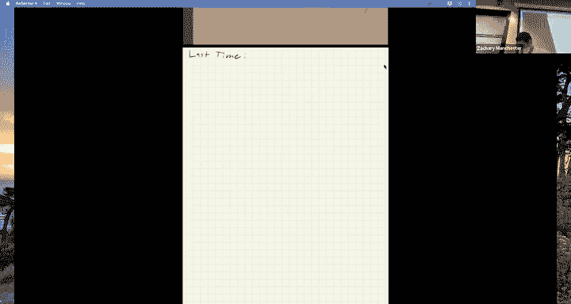

Methods for dealing with contact and specifically kind of focused on legged locomotion stuff and did a hopper at the end of class。

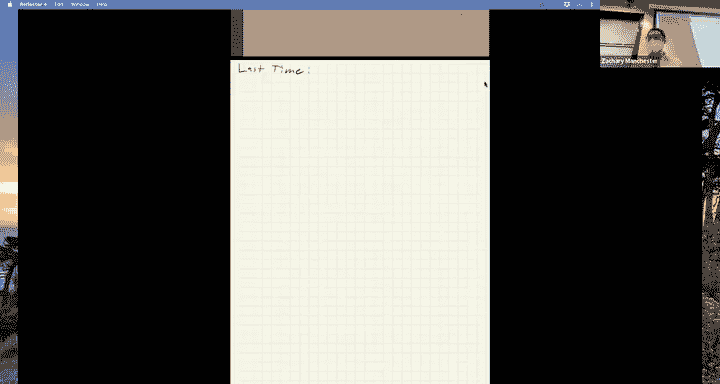

So。There's。Lots more to that story， and we'll talk a little bit more about that stuff today。

Those things are useful for more things than just locomotion， obviously。

 even more things than just contact and robots， also super useful in manipulation。

 obviously that lots of other applications for things like that。

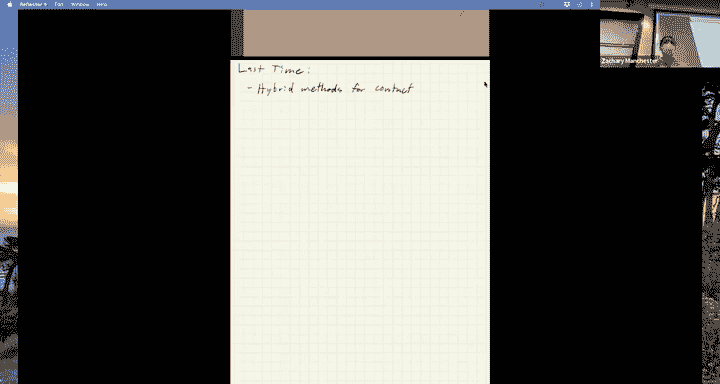

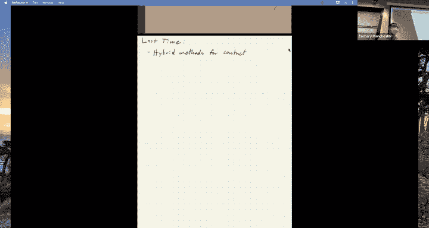

So it's good to know about。

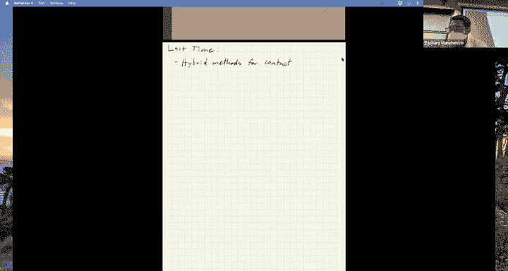

Today。We're going to kind of finish up the story from last time。

 and I'm just going to give a quick kind of overview about what it looks like to do that stuff。

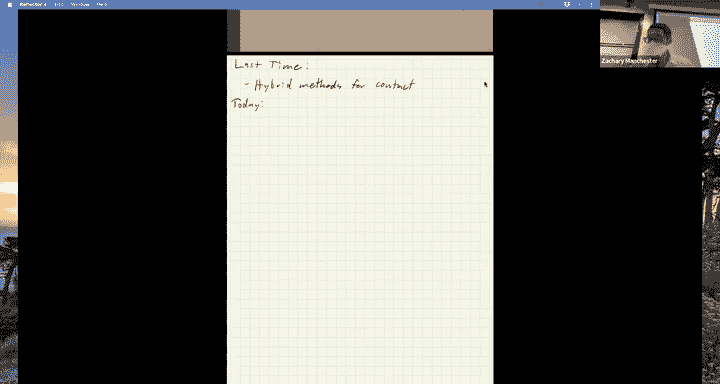

When you have have to worry about friction。Which shows up in lots of robotics applications。

 manipulation， walking， obviously， but also you know some other。Other things。

 so we'll talk about that briefly because we kind of glossed over that last time and then we're going to switch gears a bit and talk about。

We'll give a like like a big picture talk about know what to do in general in this kind of with these kind of tools that we've been talking about when you have model error or model uncertainty。

 how to do with bad models， and then specifically we're going to talk about an algorithm called iterative learning control。

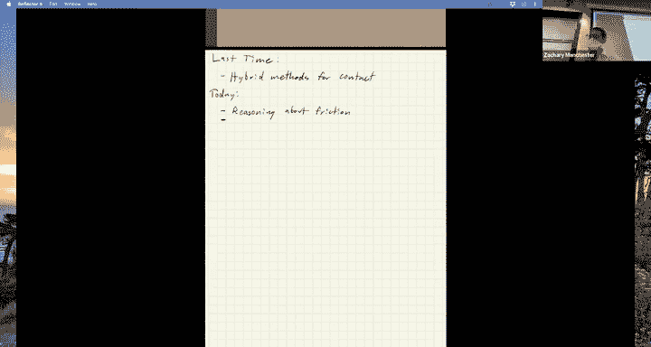

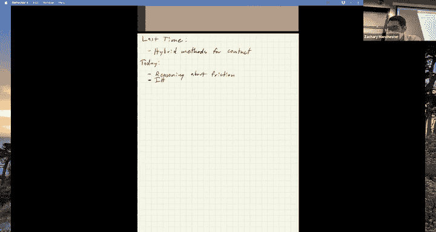

That is one sort of pretty like surprisingly effective algorithm that works really well it's been around for a long time。

 it's not super new but is super super effective in dealing with kind of like if you have a reasonable nominal model but there's some model mismatch model error this's basically a technique for mopping up the errors in your model using rollouts or trials or whatever on the real system so as you kind of do some nominal stuff like we talked about then go do a handful like usually order five or 1 rollouts on the real system and just dial everything in perfectly basically。

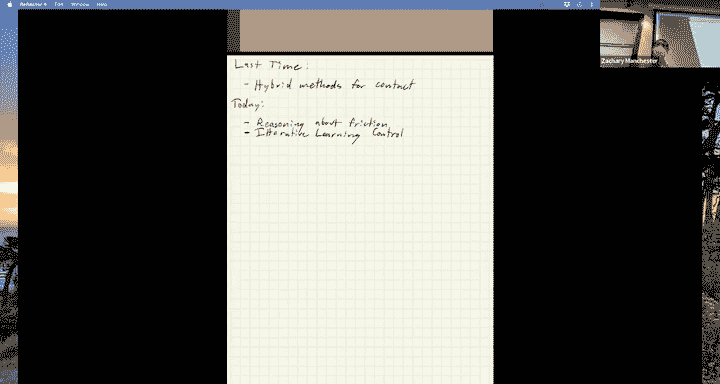

Okay， so any questions about anything at all， like anything we've talked about， any of this stuff。

 what we're going to talk about。Some feel good？Okay， so let's get into it so the friction story。

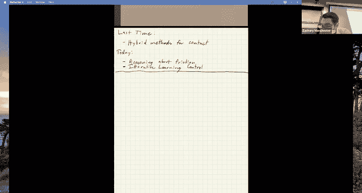

嗯。

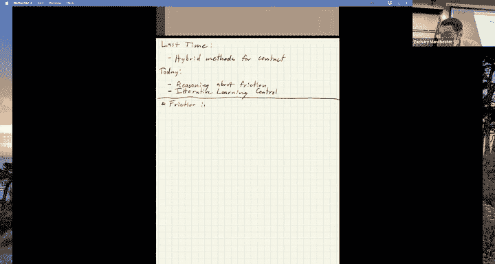

This is kind of a very roboticy topic， but。

Just a kind of。Give you a little bit more flavor for what's going on here because if you go do any of this stuff on legged robots or maybe you're going to see this stuff so kind of to give you taste before in the stuff we did yesterday or last week。

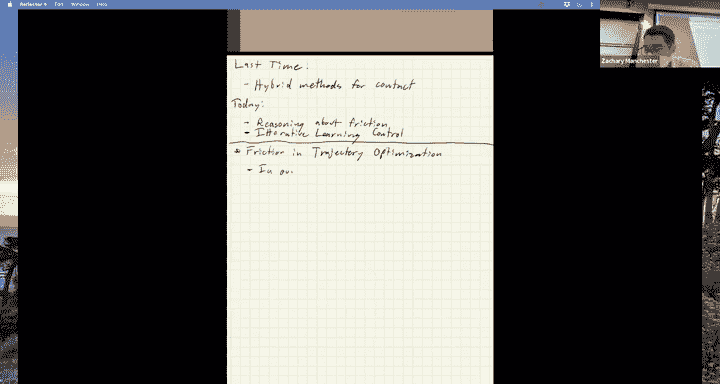

嗯。In this hybrid setup。We basically assumed like with the hopper。

 we assumed sticking contact right so we assumed as soon as the foot touched the ground that was it and it was basically pinned to the floor。

 this is basically like you can think of this like an infinite friction no slip kind of assumption。

 right？嗯。

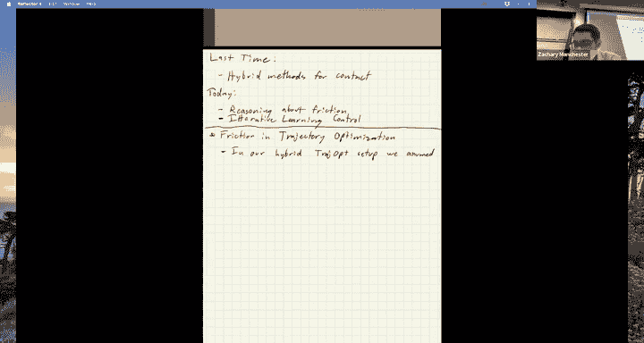

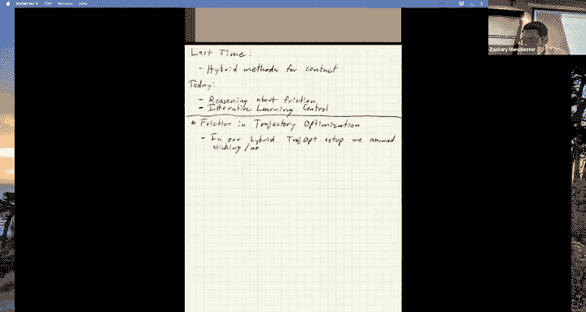

And that's not necessarily a realistic assumption as you can imagine right like if you push too hard in the tangential direction with your foot。

 eventually you're going to break stack friction is going to slip right and this can obviously lead to face planting if you're not careful about this。

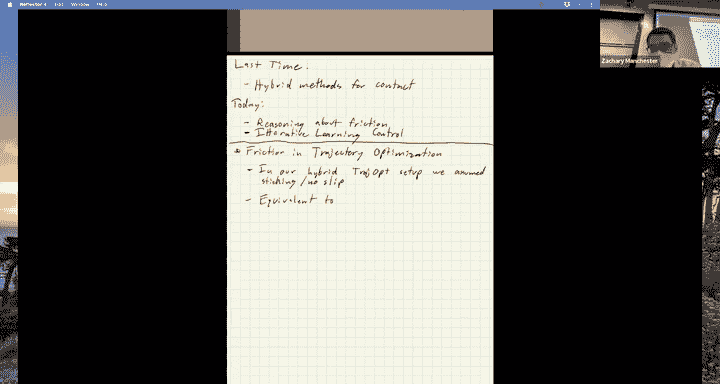

So there's a few ways of dealing with this and I should say also like we talked a lot about impacts last time and that's sort of obvious to think about slamming into the ground velocity discontinuity。

 nonsmooth turns out this friction step is also non-sth so context just bad all around and in particular in the friction case the stick slip transition is non-smth it's basically like if I'm pushing on a brick push push push at a certain point it's all of a sudden breaks free and start sliding right and if I imagine if it's sliding sliding slid all of a sudden that just stops right and so how do we get at that it's very similar in a sense to the impact story non-smooth gradients are not nice blah blah。

 blah so we have to play similar games to reason about friction as with impact and there's some standard tricks we'll talk about a few of those tricks right now。

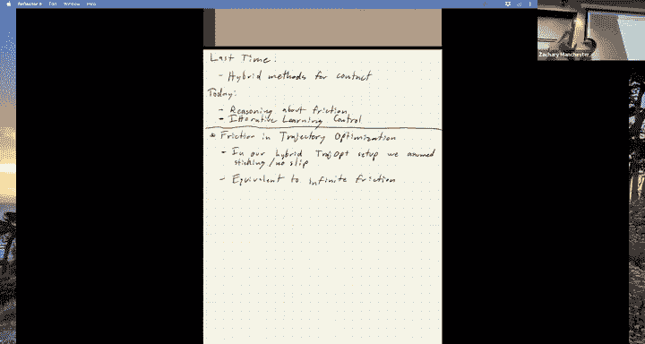

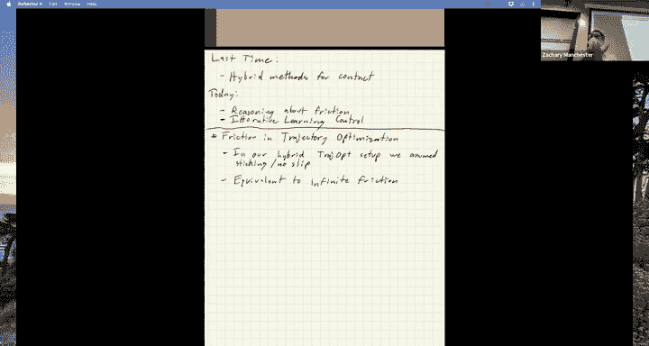

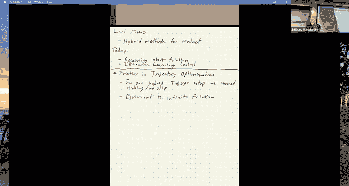

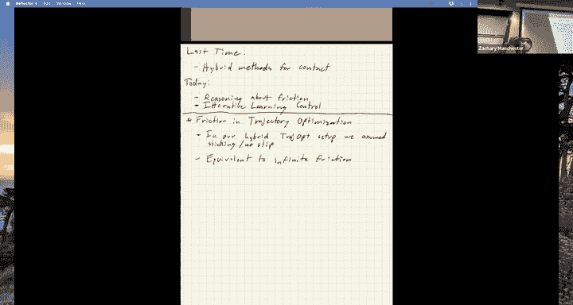

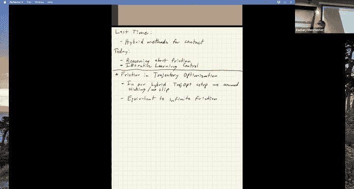

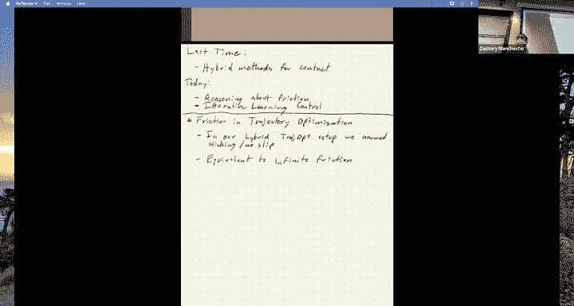

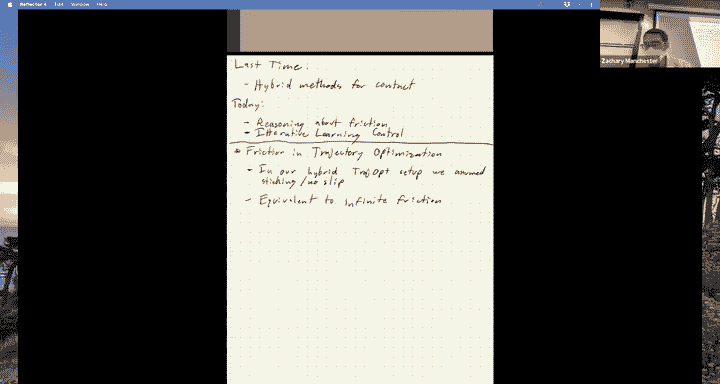

So the first kind of thing to do is just talk about how we model this standard coulom friction stuff and the standard thing is like the most basic coulom friction model is something called a friction cone and we can write this down as a set of constraints so in the problems we did last time like a very simple thing to do is to say okay I don't have infinite friction I'm still going to do my hybrid thing。

 but now what I'm going to do is when I'm in contact。

 I'm going to add additional constraints that say a friction force。

 the tangential force has to be inside the friction cone cannot violate coulmb friction and as long as I put a pretty conservative inner approximation there like a conservatively small coefficient of friction this will basically generate trajectories that won't slip so that's like the first thing to do。

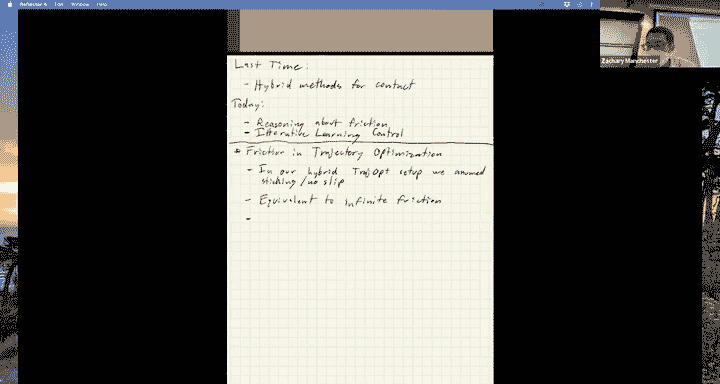

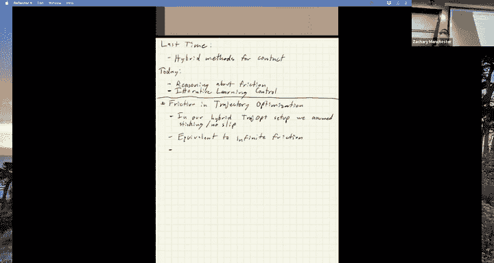

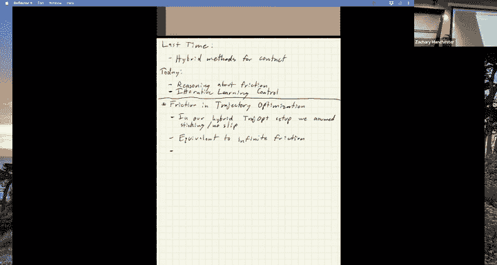

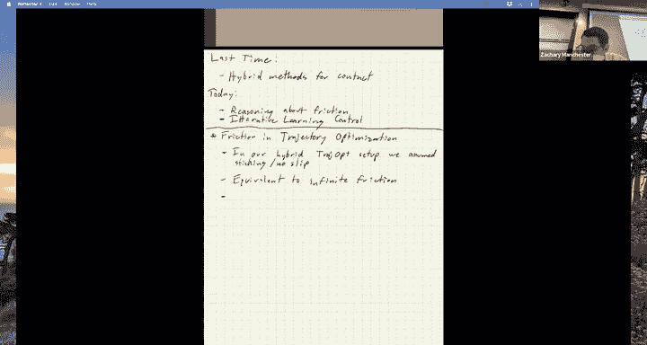

And that's what most of these methods actually do。Let's write that down。So for each contact point。

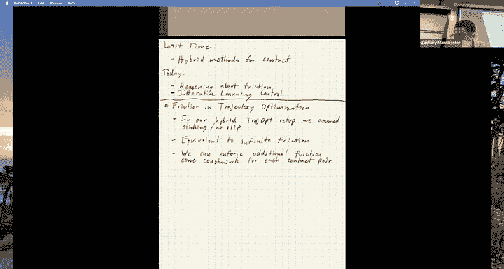

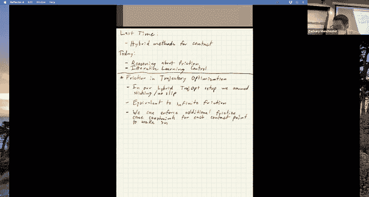

You would do something like this。

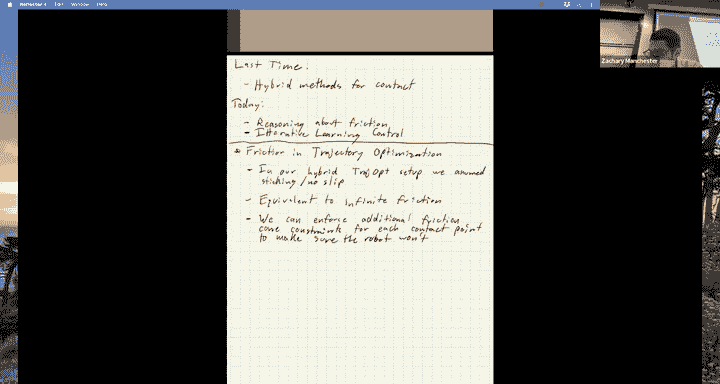

So we talked about this I think briefly before， so if the friction。

 the tangential part of your contact force， the friction vector we call that B。

 so that's a 2D vector。

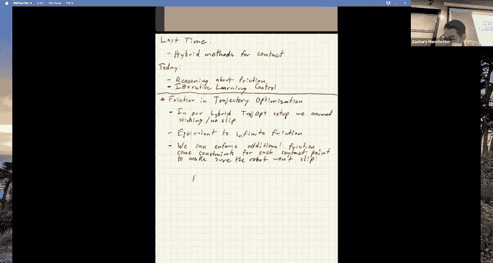

The two norm of that thing has to be less than equal to friction coefficient u times normal force n so this guy is。

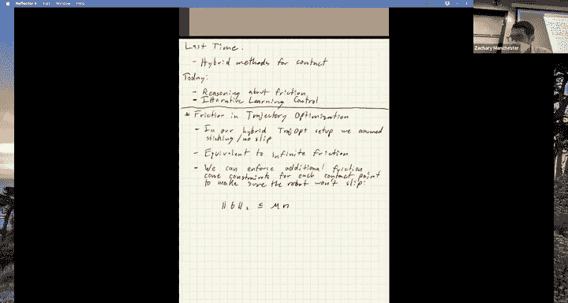

Friction。

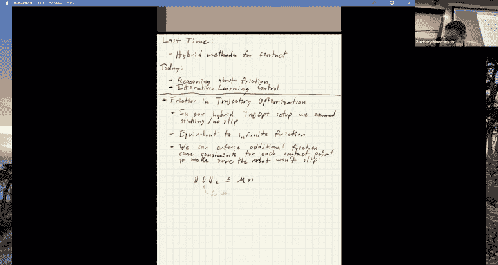

Force。And this is a 2D vector。And then this one is the。

Friction coefficient。So positive scalar and then this one is the normal force。

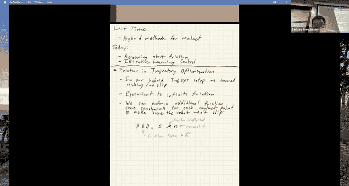

And we've kind of done this before， but basically what this is doing is the what that math says is if you imagine your contact point on the ground。

And the normal force in the vertical direction。

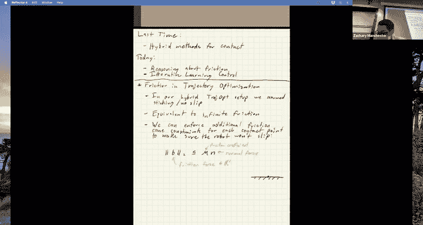

And the friction force in the tangential direction， those things have to。Lhy inside a cone。

So if this is like。N is the height of the cone then B is sort of a vector that has to lie inside the cone and so when we talk about stick slip behavior。

 the way this is working is if I'm sticking。

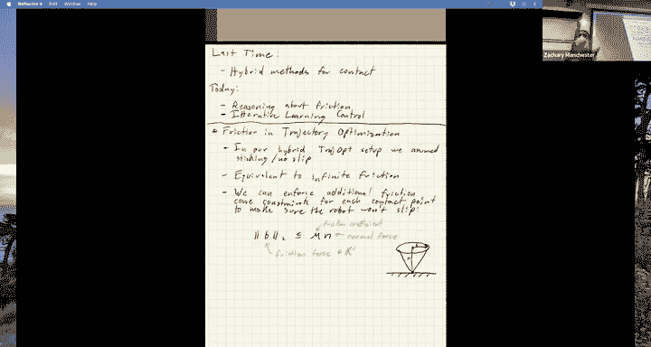

It means the friction vector B is in the interior of the cone。

 means that I have enough friction to keep it still。

 and then basically what happens if I imagine pushing， pushing， pushing，on my brick or whatever。

 eventually so the friction force is going to counteract my pushing force， right？

Up until I get to the boundary of the friction cone and when I hit the boundary of the cone there's no more friction to be had so at that point when I hit the boundary of cone if I keep pushing the brick harder there's not enough friction anymore because I'm at the boundary and that's when I start slipping so essentially interior of the cone corresponds to sticking friction。

Boundry of the cone corresponds to sliding or slip behavior and that's kind of how you get at the non-smooth stuff So in principle we could write this constraint down it's a conic constraint。

 which is convex we could write this down in ourmpC controller or whatever and just do it as is but for kind of historical reasons and computation reasons that's not what most people do in practice Most people do QP basedmpc as we've discussed many times so there's a standard trick that I'll tell you about right now that effectively linearizes this friction cone so that you can stuff it into a QP instead of having to solve a second order cone program which would be the kind of nominal thing with that cone so here's what that looks like。

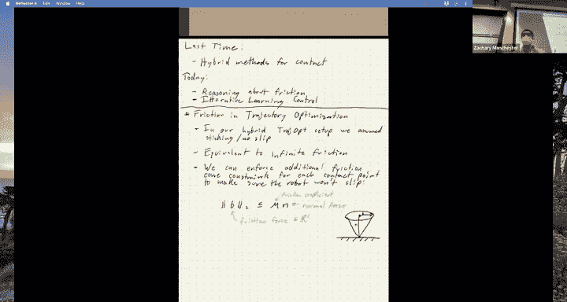

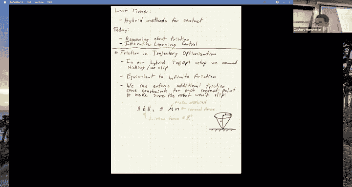

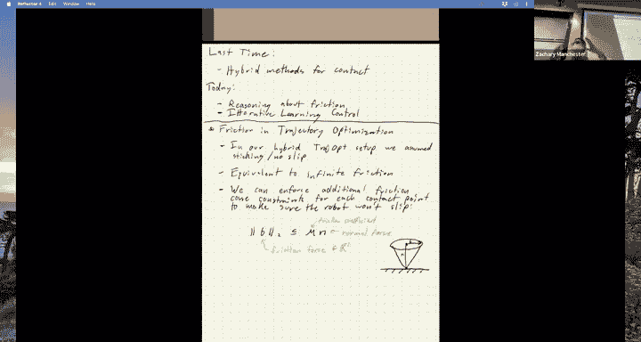

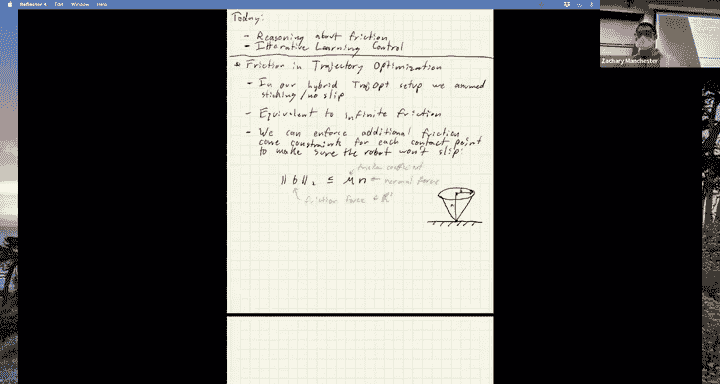

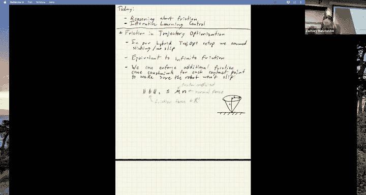

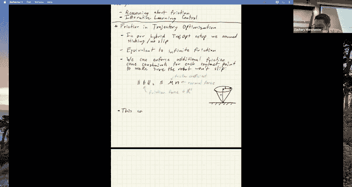

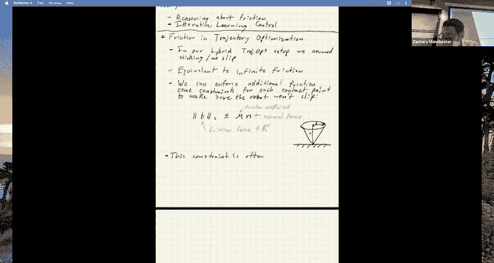

So i'll write it down we'll talk about a little bit basically Okay。

 so the standard move is to change that conic constraint or two norm flavored constraint on B to one that looks like this we do。

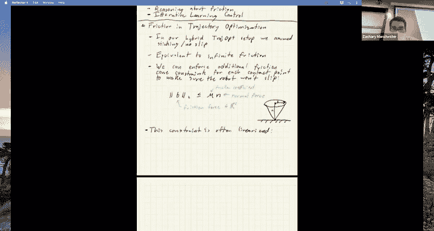

We introduced this new vector D。That is less than or equal to new N E here is a vector。

 So let me write this down。 So D is going to be。A 4D vector where B was a 2D vector。

And then E here is a vector of ones。And we have this guy， and then we introduce a new constraint。

 D greater than equal to zero。And we say B， the original friction vector is equal to。The following。

Thing。Where these guys are two by two identity matrices。嗯。

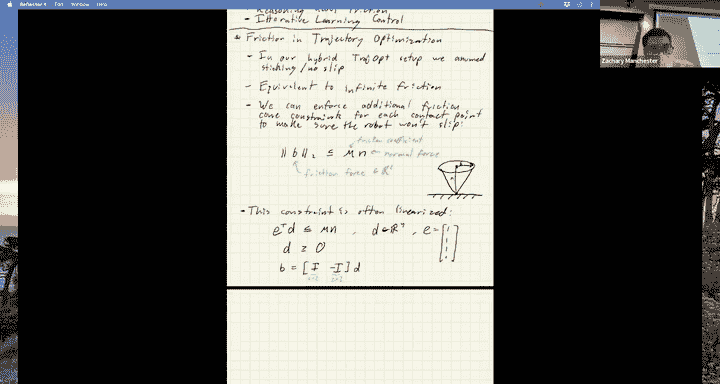

Okay， so can anyone see what this is doing or tell me what this is doing。

 so basically I double parameterized B。

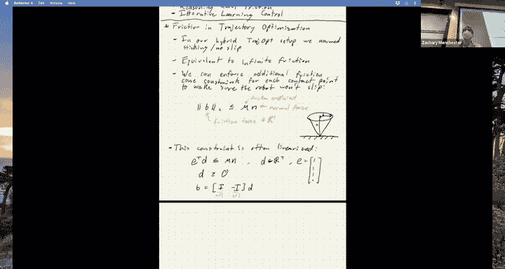

In this D vector right and what I did was split it into the first two elements of D correspond to the positive part of B and the last two components of D correspond to the negative part。

And I set it up such that all of D has to be positive。😡，And then if I want to reconstruct B。

 I basically just do the first two elements， minus the second two outputlet。

 so I can represent any B here， but I've done it in this way such as like twice as many elements。

 but they have to be positive。So。Does that make sense， everybody？So in that case。

 what is E transpose D doing？Can you tell me that？It'sSo e transpose D is just summing all the elements of D right so it's got to be positive right because those are all positive in terms of B the original friction vector。

 what is that thing？

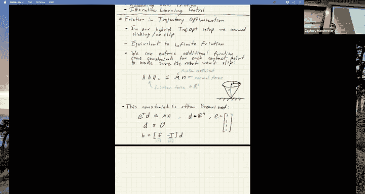

What norm？Yeah exactly so it's the sum of the absolute values。

 which is the L1 norm so what I've done by doing this is gone from the original setup with the friction cone was a two norm this is a one norm。

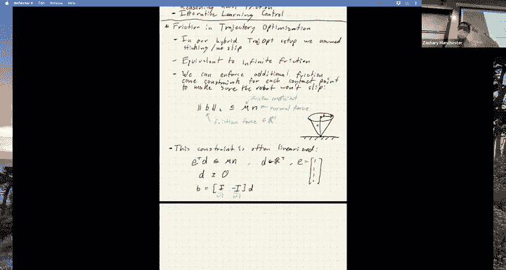

It just so happens that like this is by the way， kind of a standard trick。

 you can write down one norms as LPs as linear programs by basically like introducing slackck variables and like linear constraints like this you can make it sort of into a basically a set of linear inequalities can get you an L1 norm which is kind of cool so the reason we do this is really such that it can be written down as a linear。

Constraint， so this thing， let's write this down real quick。Equals。One norm of B。

 So what this is doing geometrically now is I went from my nice round cone。

 the original friction cone to this thing is basically giving me a friction pyramid。

 it's an inner approximation of the original cone that's sort of like a forightd pyramid。

So it looks like this now。

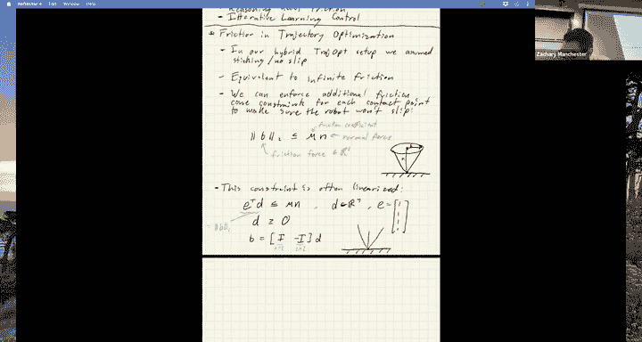

Something like vaguely like this， my drawing skills are subpar， so I apologize for that but。

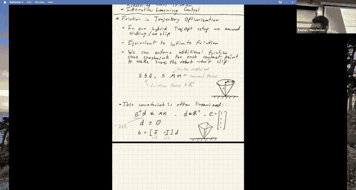

You get the idea。And then this would be like typically we set this up in inner approximation of the original cones it's a more conservative approximation right So if you satisfy this set of constraints。

 you're basically like being more conservative than the actual friction cone Yeah Okay。

 so the gist is what I'm want to do is I want to I want to linearize that round cone thing right so the nonlinear thing and there is the two norm。

I want to linearize this whole thing so it looks like a so I can put it in a QP with a linear constraints so what I did was。

It's this whole setup right with all these constraints， so I have this D vector。

 which is twice as big as the original B。And what I basically did was say D has to be positive。

 like all the elements of D has to be positive。😡，And I want to use it to represent the same friction vector。

 right？The last line there shows you basically what I did was set it up so all the elements are D are positive and then what I do is if the positive components of B will go in the first two elements the negative components of B will go in the last two elements and then I can just do first two minus the second two will reconstruct the original B right so now the cool thing about that is everything in D is positive。

So if I just sum the elements of D， that's giving me some of the absolute values of the original B。😡。

Which is the one norm。Does that make sense cool So it's basically a hack。

 It's like a clever trick for writing down a one norm without actually writing down the one norm explicitly right because the one norms is point the annoying thing with bad gradients。

 This is just a bunch of linear constraints it gives me the one norm of B So that whole thing is really just another wave writing one norm of B less than equal to mu but now I've done it with like a whole bunch of linear constraints So it's very clean and it can get stuff into a QP solver in like kind of a standard way and we do this because there's lots of nice QP solvers and it's very fast and very robust and we've kind of very used to using QP formpc So if I can write this thing is a set of linear constraints and stuff in a QP it's like a win and so people have been doing this for a long time like。

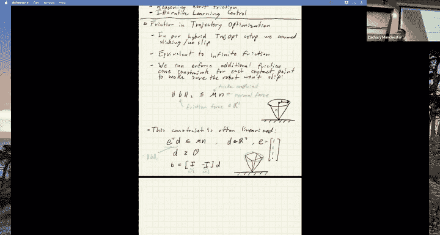

The original version of the friction cone is convex right so in principle you could just stick with that and not do this。

 but then you have to use you can't use a QP solver you'd to use a second or cone solver those are kind of newer and less sort of there's less sort of work on using those for MPC I mean recently there is like last five10 years but like it's a newer thing they're not as fast and robust and like there's fewer options。

So there's pretty much only one like decent open source SOCP solve it's called ECOOS。

 whereas there's a bajillion QP solvers and everyone's very used to using QPs for control then doing that for like decades right so this is like a pretty standard trick so that you can set this thing up as a QP basically。

Okay， yeah， thats。

So I mean that's basically I'm just telling you that's what that math is it's that's the picture for this it's like the original thing was a pyramid or it was a cone and this is like this pyramid thing I mean basically what you can think of it as is that's what the one norm looks like so one norm is like some of absolute if you draw like the unit ball for a one norm if you imagine like if I say one norm equals one in the plane it looks like this does that make sense it's sort of this pyramid shape。

It's kind of weird to think about。Oh yeah if I draw like you know absolute value of X sort of thing it's like that v shape this is basically the level set of that thing in the plane and 2d is like a diamond shape so a two norm is a circle right and this this cone is basically just sort of like extruding that two norm vertically so for a one norm if you imagine the level level curve of one norm is this diamond like level curve of an infinity norm is a box so for any norm you can draw this kind of level curve shape and then this basically just extruding it up。

If you like to think about it that way， I don't know。Does that help it all， okay， cool。Okay。

 anybody else questions on this yeah EcoOS ECs it's the one if we used it if we did an SOCP in class we would have used that it's in Julia you can do package add EcoOS so if you want to do any second order cone stuff MPC on anything that's basically the one to use。

So if you want to do rockets soft landing or any of this stuff。It's not as fast as OSQP。

But in principle， you could make an SSCP solvever that fast。啊。Yeah no this is a good question。

 you can in principle make that approximation as tight as you want so you can make eight sided pyramid 16。

TheYeah， so okay， so this is a bit weird this is called a convex combination。

 so like you basically I guess the。You can do it， I promise you can make it as many sides as you want and can you can look this up。

 there's like papers on how to do this。Yeah， so that's a good point So the reason typically we don't do that and we stop at four sides is that the more sort of the better you want to make that approximation。

 the more decision variables you have to add and the more constraints it makes a problem bigger and practically speaking like this is good enough for most robotics things like what we're trying to do here is just ensure that the controller is not going to exert so much torque that it slips so we're trying to be a bit conservative here anyway and usually when you do this youve used a mu that's like conservatively small to make sure you really don't avoid slipping so this is giving me an even more conservative inner approximation and that's usually this is kind of like a safety constraint type things you want to be safe if you really want to push the performance limits up to the edge then you maybe want to do something like you're saying or just do the original cone so that's the other thing like the other thing is that like at a certain point if you're making the QP bigger the performance win is not there anymore and you might as well just use the full original round cone right so in certain areas you do care a lot。

One example of where people do like want to push this right to the edge and get as much as they can is in driving there's a lot of work on like racing like aggressive fast driving and there the game is all about going as fast as you can and as hard as you can in the corners and the optimal things to push right up to the edge of this friction cone right so there you really want to know what the mu is and be very exact with this and really use the full thing so people who do racing use the original full cone and not the approximation but a lot of leg of robots people will use the approximate version。

Okay。With a lot of friction conversation， is everyone good now？Okay， excellent。Okay。

 so I will now write down exactly what I just said and learned several times。嗯。😊，So yeah。

 friction pyramid， easy to do with QP。嗯。And this is the sort of thing that's standard in like quadruped controllers now。

Yeah。To keep your foot from slipping what else， yeah， generally in a hybrid method。

 you're doing this to avoid slipping。嗯。So that's the game here we're trying to be safe。

 not slip if you want to model stick slip behavior and like take advantage of it explicitly in a hybrid setup you need to add more modes for that explicitly you'd have to add slip modes and it gets really nasty and people generally don't do that。

嗯。There's sort of other ways to get at that， but it's very messy in general。OhWhat else yeah。

 so friction is hard to model。

Just as a final sort of this whole thing is coulom friction。

 which is like a very kind of first order model of what real friction is。

 so all of this is still approximate right？

And yeah， typically in real applications where you don't want to slip use a。Conservatively small new。

Okay。I think that is all the。

Now。 Ill try to keep on that better。All right， cool。Okay， so I think that's it for that。

 that's pretty much the end of the discussion on like hybrid contact flavored stuff。

Kind of continuing from last time， any final thoughts， questions on this stuff？Pretty good yeah。我fi。

Sorry， said again。Yeah so like anisotroppic and anisotropy in the friction usually that's not a thing that's a very weird thing to happen so if you wanted to do that then like mu would become a matrix right not a scalar anymore。

😊，And this is a， yeah， do you have a specific application in mind where this happens？嗯。Yeah， yeah。

 notice this is very standard in like car models and things like this。

单机啊。Yeah， so I guess it's totally possible I've not seen people really do it before。

 but you could right like the next sort of version of this if you wanted to model that would be replace the scalar mu with a matrix mu that captures different friction in different directions and that would result in a friction sort of an like a elliptical cone right？

So， yeah。Like in application we're using an element where there more dimensions like it's known for like inducing more complexity in the solution since D is only two dimensional like does this not？

A more sparse like yeah moving more an accent so it does this which is a bug so this is in a process so what where that shows up here where that manifests itself in this context is if you're so in normal friction land right you're going to slide in whatever direction you push here what'll happen if I shove a brick say because of that sparsely inducing what that's saying here is basically this thing will peg itself in one of the corners。

Of the of that pyramid right which is physically wrong change your reference direction you could like you could imagine like trying to adapt that。

 but practically speaking like。At the end of the day。

 like usually when people are using this you don't want to slip right you're using it as a conservative inner approximation thing to say stay strictly in the interior and don't ever get to the edge but yeah if you just naively do this in a simulation to model cool on friction and say like my X axis is here and I push it like this the friction vector will peg into that corner and then your block will like do weird drift sideways kind of stuff that's totally unphysical So yeah。

 it's a good point that's sort of part of the it's not a great approximation story yeah。

There are lots of other fun like Lasso style L1 tricks you can use and control in general。

 this is a place where you don't want to you sit but it's sort of got some weird artifacts as a result。

All right， so。Changing gears， we are now going to talk about。Like what happens？

When your model is bad。And this is a big topic。So I want to sort of。You have a sort of high level。

 I don't know。Set of ideas here that like you might encounter you might hear about things to check out definitely not the full story。

 but like at a high level the way I think about it。

 I guess first off you know we're doing model based control here for the most part and models are always approximations is as an engineer right so there's always limits to what these things can do and like。

You should always be skeptical and always sort of。You know， never trust these things。All the way。

That's sort of the first philosophical。Point so then going on that right simpler models are often preferred in control。

 even if they're less accurate so like it's often the case like in principle。

 we could write down super accurate physics models that have tons of stuff in them that model everything really well get tons of accuracy but practically like those more complicated more nonlinear models are really unwieldy and hard to deal with right so usually in control like if we can get away with it we use linear models because they're really easy to work with we know what to do with them even if they're inaccurate like we still use them a lot so。

That's sort of the next thing to say。

So yeah， basically in general in control， you want to use the simplest model you can get away with。

And then like a lot of times we can get away with that because。Feedback。

Sort of inherently like corrects for some of these errors， right？

So like and a good example of this as we talked about before。

If you're trying to do reference tracking or stabilize a fixed point。

 like you linearize about that point， the model error gets bigger。

 the farther out you are from the fixed point that you linearize about but the control is pushing you back so it's kind of always keeping you in a region where the model is good and like in a lot of cases these feedback policies can mop up a lot of the error。

😡，Like you can think about the error in a lot of cases as a disturbance right the whatever the delta is between your simple model and the real system。

 like that's some could imagine that as some force on the right hand side of your model that's like a disturbance and the controller is going to try to compensate that right？

So you can get away with a lot of sort of sp in your model。But sometimes that's not good enough。

So like， for example。

Very tight constraints。Like critical safety stuff。That you can't violate or really sort of tough performance requirements。

Where you're really pushing the limits of your hardware。Stuff like that。Basically。

 if the model you have or the model you can easily write down is just not good enough。😡。

Here's some options to think about。So the first one is maybe the most classic and most obvious。

Is to do parameter estimation， classical system identification kind of stuff。Also known as。

Gray box models。So this would be sort of like。嗯。See called system I D。

And the idea is I have some model from physics or whatever that has some parameters in it like masses。

 lengths of things， inertias， whatever， that I don't know super well。

 and I'm going to go collect some data on the real system， do some experiments， whatever。

 and just go and fit the parameters of my model。

Okay， so things about this。First one is it's extremely data efficient so you can fit this with like really minimal experiments。

 right？

So very sample efficient。It generalizes in that like now I have a model for my system so I can do whatever I want with it and I can use this in all kinds of other controllers in different parts of the state space。

 all that kind of good stuff so that's nice。

But the downside is that it assumes。Fixed model structure。

 So examples of like this would be say so the quad rotor stuff we talked about right we wrote down this really simple rigid body quad rotor model so I could take that model。

 go fly the quad rotor around and fit like the mass inertia you know the lengths from the Cg to the propellers like all these parameters in that model but no matter what I do I'm never going capture the aerodynamic effects like lift and drag and weird propeller flapping stuff like all the weird a effects。

 there's just not in that model at all right so there's no way I can possibly capture those no matter how hard I try with something like this So there's inherent limitations to this approach right。

So， sort of。Assumes this model structure。And you're just never going to have you're never going to be able to capture stuff that wasn't in that model to begin with。

Okay， so then building on that like another idea is to do what's called black box system idea modeling。

And this would be kind of learning a model from scratch。Using a generic function approximator。嗯。

For like F of x， you say。So。I fit a generic。Actually proator to。The full dynamics。

Or maybe a residual。Function on your nominal model。This would be called classically。

 it's called black box。System ID。Okay， so。This and I should say to you。

 there's lots of in between and right， you can like do some mixture of these where you use a。

pararametric model and then add a you know sort of neural net thing to learn a residual or learn some part of that or something so there's ways to blend these together。

 but on this side sort of pros doesn't assume the model structure super generic right so in principle this can learn anything there is in the dynamics。

And similarly， it also generalizes。In the sense that like once you've got the model。

 you can do whatever you want with it， you can do different tasks with it。

The major downside of this is it's not sample efficient。

 It requires a ton of data to fit like in general， this very sort of very expressive function right with a lot of。

Free parameters。Okay， so that's。First two options。And I would say generally speaking。

 these two fall in the category of trying to improve your model right so there's sort of a couple of other options that we'll talk about。

Next， which fall into the general category of Zll's maybe。Okay。

 so those methods have the advantage of basically generalizing right， so the other options are to。

Forget out the model and just try to improve the control policy and there's a few options there。

 so continuing with like the number two theme。Stuff that I'm sure everyone's heard about。

 you can just go straight up， learn a control policy。

So this would be kind of the standard domain of reinforcement learning。So， like。Optimize a。

Function appator。For your feedback policy。So like， you know。

 policy gradient and all the fancier versions of this。So good things about this。

 number one is it makes very few assumptions on the system， on the model， et cetera。

So this can be very general downsides big one is it doesn't generalize so like basically when you do this what you get out is very specific to a particular system and a particular task right and then like if you want to do something else that's very hard to do。

And then the other one is it's not sample efficient。

And here this corresponds to rollouts or simulation runs or physical runs on the real hardware。

 right。Cool， okay。So then there's sort of this other thing in here that is what we're actually going to talk about today。

Which is sort of to。Improve a trajectory， so given like a nominal model and some optimal control stuff and like a trajectory that we generate out of doing trajectory optimization say。

We can go take that thing and do some iterative improvement on it using real data on a real system。

 real rollouts。And that's kind of this ILC idea。嗯。And so how that kind of works is。Assume we have。

A reference trajectory。Computed with a nominal model。That could be inaccurate。

Then you want to basically improve that。With with data from the real system。Okay。

 so kind of pros here makes few assumptions about the model or anything else。So pretty general。

Possible downsides， it assumes you have a decent model。

 so it doesn't have to be super good can be quite approximate。

 but you need a model that captures like some of the dynamics。A reasonable way。So not model free。

 similarly to the like learner policy stuff， it does not generalize， it is like one task。

 one system kind of stuff。And then the the other the major difference between this stuff and like classic policy gradient type stuff is that this stuff is really sample efficient so you can like。

Yet you can kind of like nail the tasks typically with like order five to 10 rollouts。

So it's very practical to do like sim dere transfer type stuff with this。嗯。In fact。

 you can also like。Actually learn from scratch with this stuff on hardware that's it's efficient enough to really do that。

 Okay， so this other category of stuff here。Its sort of。Improve the policy kind of stuff， right？So。

Kind of don't try to make the model better just。Take what you've got and then like try to just make the controller better。

Okay， questions about this like high level， I don't know。系咪。Sory to categorize these things。Yeah。

 so like generalizes like any of these for you collect data。I just that general。

Right it's interpolation you don't want to extrapolate you want to interpolate right so what I mean there though on the data driven step is that you can once you've got the model you can do a different task with it right so like these policy things in the I'll see things they're dialing in a controller for a very specific do this one task whereas the model based things like learning a model even if you're just know sort of only fitting it with some within some region of the state space I can do any task I want in that region of the state space right so I can totally change up the behavior and do something else with it if I want to pretty easily。

Without I'm going to go collect more data， okay， cool。All right， so let's do this ILC thing。

Who's heard of this， has anyone done this before？Not too many people， okay。K of cruel。

Let's do it so there's a few ways to think about this you can think about it from several perspectives。

 so like one way to think about this if if you're a machine learning person is it's a very like particular specialized version of like a policy gradient method for for a very specific policy class。

Which is the following。嗯。Yeah。So basically， if I have a control policy UK。

 that's a function of some reference U bar K reference open loop control。

 I want to think about that way where I've got a controller that looks like some reference control trajectory U bar and then maybe some feedback policy in here。

 but I don't really optimize this。This thing is just sitting here。

Can be any feedback controller you want。Like that's doing reference tracking。

So this could be LQR， NPC。Weird neural on that thing。

 anything you want what we're doing here is specifically looking at this as a function of this like reference trajectory。

And we're going to go and optimize that reference input trajectory， so it's like feed forward input。

To the system。Okay， cool， so there's that's one way to think about it。

Another way to think about it is as an SQP method， like a direct trajectory optimization type method where we're evaluating the right- hand side vector。

 when we go solve the KKT system on the real system so we can like compute the whole matrix you know。

 using our approximate models， all those Jacobianss， whatever， they're coming from our nominal model。

 yeah。Could you clarify the lettersOh sure， yeah， that so that's saying like you are like control inputs。

 right？Um， is so u your control like policy looks like some nominal U bar。

 some nominal feed forward reference， like which could be optimized offline with trajectoryor optimization。

 right？Plus， optionally， some feedback controller that's doing reference tracking。

So that K can be any tracking controller you want。Right so like this could easily so if that's you know if that k is a matrix and this is linear feedback that's like OQR can be time varying LQR can be some nonlinear feedback that's doing reference tracking on like phenomenaminl x bar reference。

 whatever you want right but the key thing is what we're going to update and optimize here is the U bar that feed forward control reference trajectory。

DoesThat makes sense？That's like those are the parameters we're optimizing we're going to leave the feedback controller alone we're not touching that we're also not touching the model。

We're just touching that like you bar in there， which is just a trajectory。Okay。

 so other way to think about this。Is as sort of an SQP method。

Where we get the right hand side vector。We get the big matrix from the nominal la。

 but we get the right hand side vector from a rollout on the rail system。

You can also think about it as like sort of like a single passive DP where you do the backward rikaati pass using the nominal model and get all your derivatives that way。

 and then you do a forward rollout。On the real system instead of in the simulation with the phenomenal model。

Like various flavors of this you could think about doing。Okay， so let's do it so assume。

That we have a reference trajectory。X bar， U bar。So the states and the controls like that we want to track。

Actually should there's various versions of this this is like。One version。

 a simple version for doing reference tracking as other flavors of this。

But kind of at the end of the day， what this is roughly doing is doing trajectory optimization with real rollouts in the loop。

In the optimizer。Okay， so we're going to do min over。X and U。In the usual way of this cost function。

 and we're going to assume a quadratic。Tracking cost。So very LQR flavored。So like x minus x bar。

Qudratic weights， whatever。And then control cost。嗯。Same stuff we're used to。And then terminal cost。

Okay， in general you can have any cost function right we're just going to do this for now because it's easy and convenient。

So。Doesn't have to be this and then subject to our dynamics。Like as usual。

Okay， so。Like we've done before and we did like direct methods and SQP。

 we're going to write down a KKT system for this thing。

And I'll write this down and I'm going to talk about a little bit。Okay。

 so here's this is going to look a little different than what we've seen before。嗯。But same idea。Yeah。

So you' got。Are。Well， let me write it and I'll talk about。Okay。

 so this is what we're going to deal with。Just defining some stuff。

 so the Z is going to be all of our states and controls stocked up like we did before。

The C function is our dynamics constraints so like for。

Most of the stuff we do would be something like， you know， F of X K。UK minus x plus1。

Sort of the classic。Direct transcription type of thing。The C matrix。

Here is the Jacobian of those dynamics constraints， partial C， partial Z。And then the H matrix。

Is our sort of standard Gaus Newton Hessian， so it's going to be sort of the cus and ours。

Stacked up in like this black diagonal kind of thing， zeros everywhere else。Okay。

Hopefully that's cool so now some questions so when I do this typically so we're basically writing down to Gaus Newton you know。

Thing here kick these system。So first question is in the top of this vector here。

 usually that's the gradient of the laggrangian， right？

When I do this and so there's some like woodronrange multiplier stuff in there and here instead of that。

 I've written down gradient of just the cost function， right？

So that's like a little different than we did before。

 and the other thing is that usually when I've done this in the past。

 I've written in the bottom of here。

When I do the Newton stuff I usually do deelta L right instead of here i've done the actual L not a delta update on the L so what's going on here is anyone have any thoughts like why can I do this。

 why is this legal。So both of these things are related。Thoughs， yeah， just's， what's the。Sorry。

 Lambda in the bottom this so basically usually I have Delta Lambda like Newton update on Lambda here I put just straight up lambmbda。

And instead of like grad L like gradient of the lagangian in the top right there。

 I have grad J just the cost function gradient right so does anyone know like what I'm doing there and why that's legal and stuff。

have any thoughts on this？到。No， okay， so the lagangian。

The standard like you know optimization lagre when we have the lagre multiplier and the constrain shouldcoing it's linear in the laggange multiplier right so it turns out when I do this I've got you know。

It's exact in that lagron multiplier term， so C transpose。

Times Lada coming from the top row of that matrix。 that's what's in the original lagrangian。

 So because it's linear in lambda， you can just write it like this。

 And then the nominal lagrrange multiplier term that shows up in the。On the right hand side vector。

 I don't need anymore because it's sort of all sitting there。So I'm doing this。

 this this is sort of standard， you can do this in SQP methods in general。

 we haven't done it this way before for a very specific reason。

UWhich does anyone have any？

H on why maybe I doing this way instead of the way we did it before。Okay。

 so the reason I'm doing it this way， unlike before is before we did the Delta lambda。

The reason is before when we're doing this in general for nonlinear problems。

 I need to regularize right and it turns out if I want to regularize the lagrangee multipliers。

 I want to do it the other way with the deelta lambda。

So I don't know。啊。So you can always do this。But you probably don't want to do this if you want to regularize the lagrange multiplierers。

I。e。 yeah， we've talked about this before。Okay， I don't know fun fact。

 random thing about nonlinear stuff， nonlinear programs， Okay， so a couple of observations here。So。

If do if I have a nominal trajectory and I'm like solving this problem。

 if I go do a rollout on the actual system， what is C of Z on that right hand side vector in my K atT system？

Though sorryrry no so those are the dynamics constraints right so let's say you know if I go do a rollout and like have this trajectory that's dynamically feasible that obeys the physics it has to be zero right so okay that's first fact I do a real rollout that C of Z thing that that dynamics constraint thing should always be zero。

嗯。That's assuming like for the true dynamics， right？

I might not be true for my approximate you know crappy dynamics model。

 but on the true dynamics that's going to be the case。

 so I'm going to go ahead and just set that equal to zero here。

 given a real dynamically feasible trajectory from the real system does somebody over there have a question。

Those are the dynamic constraints so that's saying like x k plus1 equals f of xk UK it's just saying like okay so if if I simulated this on the real system that's true by construction right like that's what my runaatta method is giving me or whatever so that whole vectors going to be zero those are the dynamics errors right if I do direct method normally I can do an infeasible start right where I give it a bad guess and those dynamics don't have to be satisfied so that could be non-ze in general for these methods but here I'm doing a rollout so that thing zero automatically。

Okay， so then the other thing is。Since we know the cost function。If like we wrote that down。

 we made it up， we can write down like grab J and that right hand side vector anytime we want to right like we just evaluate that。

So we can always compute that。嗯。对。So I can just。Do the rollout， get the trajectory from the rollout。

 plug it into the cost function， evaluate G J， right？

So now I have a recipe for computing that whole right hand side vector in the KKT system the graduate in the sea。

From any role that I do right so C's always zero by construction gra J。

 I can just plug it in the cost function。Cool。You also know the cost function。Sorry。

 we also know the H matrix， the hessian of the cost right that's just。Stock。

 we can always evaluate that， it might be constant for a quadratic cost it might not be you can but we can always evaluate it。

嗯。

Okay。So we can also then basically the only thing left。

That we don't know perfectly from doing the rollout are is the C matrix you know in those off diagonal blocks right and so basically the whole ILC game is we're just going to use the C matrix from the nominal model。

But everything else is going to be from the real system。Okay。

 so so you could do that and like that can work perfectly well。

 but what we're going to do today and what is kind of standard practice with this stuff is to instead。

Like if you're using this from scratch， if you were to try to do from scratch， you know。

 trajectory optimization on the real hardware， you'd probably view that and that can work。

Instead what we're going do， which is maybe more common is we're going to do this sort of offline online S tore transfer type of thing where we're going to say offline we're going to optimize the trajectory using just the nominal model using standard trajectory optimization stuff and what we really want is for the real system to perfectly execute that path track that trajectory whatever and so what we're going to do then is assuming that that offline optimize thing is pretty close to the right answer and then our model our nominal model is not too terrible I'm just going to compute the Kkt system offline once where I linearize it about the reference trajectory that I compute offline and then assuming that that model is not too bad when I go run it on the real system I shouldn't be too far off from the reference does that makes sense so therefore the linearizations from the reference computed offline should be kind of good enough and things should converge so this turns out to work pretty well。

And that's what we're going to do again， you don't have to do that， but it works a lot of the time。

No。Al。All right， so we complete this Jacobian thing once offline。Okay。

 now what we have to do is basically online， we do a rollout that gives us a new red hand side vector。

And then we just have to do a single linear system solve with that K E matrix that we've already evaluated。

And I already pre factorized in general， so it's really fast and cheap。

So we saw this thing for this deelta Z。

In that left hand side vector， I mean， in general Delta Z and Lambda， we don't care about the lambda。

 we're just going to take the deelta Z。We're going to update。Are you bar？

It's that Delta U and then repeat。On top of that basic setup。

 you can also easily add things like inequality constraints for torque limits and stuff like this。

 and instead of just solving this one linear system we just saw a QP is also pretty standard。

Yeah。不。

Okay。So questions about this， yeah。And repeat one。是吧。

Oh you do solve for it like you're going to solve that linear system and get Delta Z and Lambda。

 its just that we don't use it for anything。So I'm just trying here to update the use in the nominal trajectory so Im to I'm not going to use the deelta xs either。

I'm just going to solve this thing and then pull out the use from it and use that to update my use。

The rest of it's like baggage I don't necessarily care about。I don't know if that。

 does that make sense？Okay， anybody else yeah。Pround in the system like if we design our director using an F of x like function that was actually not correct correct yeah and then so how are we doing the rollouts that I count for so the idea here is I have some system。

 I have some model of the system that's F of x U。But the model is not correct。

 100% when we use to actually do the rollout。The real system yeah so this is like I have math for this thing that i'm going to use in the computer to like compute this stuff then I'm going to take the controls that I get from that go running on the real thing in real in the real world there's going to be some yeah exactly a large a bunch of data there'll be deviations from what I expected。

I'm going to say there's deviation and then feed him back into this。Do a correction。

And then try it again on the real hardware。 So this is like a way of basically like。

Polishing your solution on the real system。Given the sort of offline math that you did before using the approximate model so there's a lot of ways of thinking about this。

 you can think about it from a bunch of different perspectives。

 you can think about it from like a sort of RL perspective。

 you can think about it from like a I don't know SQP and direct trajectory optimization perspective you can also think about it from like I don't know almost linear feedback perspective。

 you can think about these updates as actually being like linear feedback that you're doing like sort of outside the loop on the feed forward use that's a I don't know weird thing anybody else or anything on this yeahmin。

拿是等一下。So no， like you mean this C vector that I'm defining here。

 no so this is like just the standard dynamics constraints that you would have in your trajectory optimization problem。

 right。Xk plus one equals f of x k UK right that is just the model， the nominal model。

 that whole thing is the nominal model。What I'm saying is black。

Like if I did offline trajectory optimization Go this trajectory this is what I would use right what i'm saying now is we're going to like take that go run it on the real system it won't perfectly match right and like it'll be deviations I'm going to take those errors I'm going stick them back in that right hand side vector and like resolve this to get a correction so it's using the real errors but the nominal crappy gradients basically。

To get a search direction to improve the errors， does that make sense？

Normally when I do this in a trajectory optimizeizer right the lefthand side and the right hand side are all coming from the nominal model right so normally like I have this model f of x blah。

 blah， blah and I'm using that f of x to compute the right hand side what I'm saying is and I'm using it to could be the left hand side what I'm saying now is if I do that and I get an answer cool I go run it on the real hardware and now I'm going to replace the right hand side vector with the real data from the real system but the left hand side of that equation stays the same and is is computed using the nominal model。

The mathematical model that you had before， does that make sense， everybody？Okay。

 any other questions about the basic idea？Yeah。So this is for that friend this， I don't know。

And not for。Imerfect。So it depends on what you mean by imperfect environment。

 so this is not doing like is not getting rid of like noise。

For for that like that standard feedback controller right the feedback controller will kind of like if you have just like white noise inputs。

 whatever that the standard feedback controller can deal with right this is like I was missing a term in my dynamics。

That like， really messes up the， the results， right， Like if I had some like， so I don't know。

 There's lots of examples where， I'll show you some。 But like one way to think about this。

 Let's say you're doing like。A really simple example would be like。

 let's say there's a quad rottor and you're trying to fly straight line across the room。

And there's a wind gust in there like there's there's a constant wind blowing say this way that you didn't account for in the model So now if I try to fly straight。

 you're going to do this and here're off course right if you do IL see thing it will correct for that and like figure out how to fly in the straight line。

In spite of the constant wind。Does that make sense。

Yeah so also for yes exactly that's exactly the example we're going to do in a second when I so it's not that's right yeah so it can handle like completely weird。

Model errors that are not sort of parametrically accounted for in your nominal model can be anything which is really cool right so you can handle like weird friction stuff that's unmoded that's hard to model like this can take care of it yeah which is exactly the example I'm going to do in a minute。

Yeah， so what were like solving forward at the end of but a new。you effort like。Not a new X。

Justin knew you。So what this is saying is like， there's some X that I want the robot to execute。

It's not doing that。And it's saying I want this like the tracking。

 I wrote down a tracking cost right， it's basically saying follow the X that I'm telling you to follow and this is trying to figure out the nominal likes trying to figure out the open loop U that should give me that X。

Ultimately is what it's doing， it's not changing the X， it's changing the use。

To try to get it to the actual system to execute the x's that you thought it was going to add first。

Sort of weird， I don't know， does that makes sense。Yeah。

So just quick to clarify the property actually。User data is in the C of these which。

That CZ vector is zero always， so we're not like yes， but like what's happening is。

That's the dynamics like errors right in a normal SQP method。

And I'm saying I that's basically if that vector is nonzero。

 it's telling you that like the dynamics are violated when I solve these things normally so remember when we did like IPOs direct allocationlocation and we did this like infeasible start thing where I drew a cartoon trajectory that didn't obey the physics and then I solved it and it was able to solve what's going on there when I draw the cartoon trajectory that C is nonzero the little c of z is non-zero because I'm violating the dynamics constraints all over the place and then the solver kind of figures it out right so what I'm saying here is。

I'm going to go run the trajectory on the real hardware and then log the data， whatever。

 get this track like trajectory data。Basically， by definition， that rollout is dynamically feasible。

Because I did it on the hardware and it's obeying the physics because I actually did it in the real world。

 so like by definition basically that C of Z has to be zero。On the true physics， right。

 not necessarily my crappy model。So I'm going to set it to zero。

And then I'm going to use the data to evaluate the cost ra。On the right hand side as well。对啊。Sorry。

 makes sense。'm youre using Yeah， so Gr J for sure right so I'm plugging in the real XU and evaluating the cost gradient。

And then， also， potentially。In the like also potentially in the KKT matrix， like I could do that。

 I could use it to evaluate H if it's not a quadratic cost。

 and I could use it to also evaluate the Cs。But I'm saying like basically， usually when you use this。

 you're pretty close。And so you can just like keep those content in and not update them in a lot of context。

 which is what we're going to do today and I'll show you that。

 but yeah in general you would use it basically everywhere and you just evaluate all these things along that nominal trajectory I'm saying you can get away with some more tricks basically that you can leave the matrix alone。

What you're really doing here is updating the right hand side vector build data。Yeah。

 this you will control one really is one updating its those taxes in the。

啊，这。对。And the use。第一420。The use will be whatever you actually whatever control you actually yeah。

 okay， so there's a lot of control in ways it should be very close to what your use yout right no。

That's kind of the whole point of this this is potentially finding some quite different use than what your reference was in order to track the X's that your reference trajectoryy had in it。

Yeah， but。When we go into the we take our data and put it into the of J。

 that is the dating class both X and。Yeah。Okay。I think this might be more clear if we just do it so we're going to do it and I'll give you credit and it's on the homework too。

 but yeah， the gist of it is。Like。Stuff on the left comes from the model like standard trajectory optimization。

 right hand side vector comes from real rollout and you plug that together and get like a correction thing you can actually do this like fully on the hardware from scratch if you want to。

In which case you probably want to evaluate all the stuff on the left right and then do Roettes like another way to think about this is it's basically like doing DP or ILQR。

Where I do the forward rollout part on a real hardware system。

 and then I do the backward pass for Kati stuff using the nominal models。Graadance。

Does that make sense？The ordering actually is ambiguous there right。

 but like so you can imagine like I could start with some random guests all zeros。

 maybe run it on the real hardware， get some trajectory。😊。

Now I'm going to do a backward rikati pass using Jacobians and gradients from the nominal stuff that's going to get me an update and I'm going to go instead of rolling that out in the simulator using the nominal dynamics model I'm going to roll it on the real hardware。

And get some trajectory and then I'll do backward Rikati using the approximations right that's sort of the same thing actually。

 it's basically equivalent to what this is。This is just the kind of a more normal way that people do it as that makes sense。

 So you're basically doing Tra with the real hardware in the。In the Newton step somewhere。

 it's kind of the gist of it Someone over there have a question。Yeah。

 can you get any like interesting information about your wrong concept processing or is it little is it kind of very that's a good question you probably can I haven't thought about that too much yeah I don't know I don't have a good answer for。

Okay， yeah。Okay。Can you see what is。It's pretty generic so it's a very black boxy thing there's not like any real like basically the assumption here。

 at least the way I've done it is that those errors are kind of smallishh in some sense。

 and we can make that a little more formal， but yeah basically it's making some assumptions that the models the true model is not too far away from the nominal one。

The modeling error is big， but you might still be able to adjust your use。Yeah， I mean， like。

It's not it's hard to say anything super formalal about this。

 but basically like you could imagine like proving convergence of this under some like bounds on the model error。

 basically the assumption， the key assumption here is that the nominal model is sort of like an okay approximation for the true model such as getting you in the ballpar and sort of roughly speaking get generating。

Roughly good。Descent steps on this cost function like it's giving you okay gradient information that's basically what you're assuming here right so like if the model's really terrible it could be pointing you in completely those gradients could be pointing you in totally the wrong direction and things will be bad for you right but like in generally it's not making any sense about like the structure of the errors or where they show up or what kind of they are or that they're smooth or any of that it's just saying that they're not too too big。

Okay， anything else。

Ba ran out of time now， so。I guess we'll finish this next time yeah I think that's probably。

Plant until Thursday at this point because we're we're today happy to talk about other things if you want unless see work Oh sure。

 yeah。Let's do it。If you want to hang out， I'm always welcome like you're always welcome to hang out longer day。

Let's do it。But yeah， I'll do this next time for sure， so if you guys have to go。

And take off that is cool。Blah， blah， blah， so this is a cartpo and what we're going to do is first off I'm going to just solve the nominal problem offline with Alro our lab solver in 20 milliseconds which is pretty awesome thank you Brian。

This is a cardpole。Yeah， I'm going to show you that now， Okay， so so here's like。

Nominal dynamics with RK4 for just just cardppo， I think like the parameters are over here like。

I don't know yeah so mass and whatever， but here's what i'm going to do so this is the nominal dynamics Here's the true dynamics what i'm going to do is perturb the masses of the cart in the pole just stuff I made up that seems like vaguely reasonable。

And then i'm going to put some like five millimeters of air on the length of the pendulum like this kind of stuff right this is all like parametric air which is like maybe of a more benign flavor then what I'm going to do is also go in and put in nonlinear friction。

On the on both of these guys actually so what this is is like this is approximating like coulum friction or fictionction kind of stuff super non nonlinear and like not in the original model in any way right so you wouldn't get this from a parameter estimation exactly so this is very weird I could throw anything I want in here in principle right but this is just trying to make this like realistic ish right stuff that you would probably see in practice so this like can weirdo friction thing。

Now we're going to。I'm going to generate an al cute so let's do this first so this i'm just going to roll it out I'm going to take the reference trajectory from that I compute it with U just run it open loop on the hardware and quite obviously it's not going to work right This is a carppo doing a swing up right so here's like carppo swing up。

And you can see obviously like it fails to reach the top people at point cool and this is just open loops or whatever so let's do some more stuff so what I can do here right like I can add an LQR tracking controller to this。

tryry to track it better， let's try that so just how you are。

Yeah so that actually does really well so you can see just with vanilla LqR it swings up here's the problem here's my open loop view here's you with the LqR controller so it's actually violating the torque limits so if I actually go enforce those torque limits。

Here by just clamping the use coming out of the LQR controller it's going to fail So this is basically so now you can see if I clip the use it just can't succeed because there's no more you know room for LQR to do its thing right Okay so now we're going to do is this ILC thing so I'm going to get rid of the LQR controller now。

you're going to do this some homework too with some other stuff so okay。

 back to what we had before what I'm going to do now is set up a QP。

I'm going to do the ILC thing so I'm going to have a tracking cost in here with like what I'm going to do is I don't care about the position tracking very much so I'm going to put a low cost on that I care a lot about the theta tracking right so i'm putting a relatively big because I wanted to swing out today so big cost on theta small cost on X I don't really care too much about the R's the use so whatever so that's this is what we just talked about right so that's quadratic cost here's the gradient calculation。

啊八八瓜。What else？The dynamics constraints are like kind of the standard linear thing that we did before so this looks a lot like the QP based NPC thing and then i'm going to stick in here the only difference when we did in the right up was I'm adding upper and lower bounds on you as constraints to this thing to account for the torque limits I'm going to go ahead and solve this with thoseQP。

I'm going to pull out the Delta u and I'm going to go update the trajectory。

 you know like in the standard way with the Delta u cool so that's one round of ILC yeah Sure sure okay so U Tra is the is the real thing that's getting executed and then like X Tra is the real X。

So here's where the real data shows up， so this is in the gradients。

So this is the grad J on the right hand side vector and then the C on the bottom is zeros that's it in this case。

Yep， that's right and then what else here and then the U Tra shows up in these these constraints right because I'm updating it so that u plus deelta u right has to be within the short limits。

That makes sense cool， so that's also in the right hand side stuff yeah。嗯。Do so。

Yeah so here's what we're going to do so I just solved it once right and i'm going to go do another rollout so on the real dynamics so here that is and you can see like maybe thought a little better maybe not I don't know that didn't look super great actually so i'm just going to do this a handful of times and what we should see is it gets。

Closer and closer to the swing of succeeding so not so great so far。

 whatever we'll do is a handful of times。

And what you'll see is within like five to10 trials of this。

 it's going to like start doing a lot better so you can see it's starting to get closer to the goal right。

 it's always obeying the torque limits。不知道。So if I do this a handful more times， it's going to。

Nowil it basically， so yeah now it's basically there this is like four times。Maybe like five times。

So I don't know， we're pretty much there now where it's succeeding in this wing of task。Yeah。

 so like， you know， there's still a little bit of track here。

 but it's swinging up and hitting the goal state， right。

 which is what I mostly weighted in my cost function。

I can keep doing this a handful more times maybe it'll get marginally better but yeah so now it's like almost exactly mailing what you wanted but so that was like I don't know six seven times of like you can think about a six seven rolos on the real system right and then this kind of update on the use and thenm this is running open loop also there's no feedback on this right。

Okay。