# CMU《最优控制和强化学习｜16-745： Optimal Control and Reinforcement Learning》中英字幕deepseek - P19：[19]Lecture 18_ Stochastic Optimal Control and LQG.zh_en - GPT中英字幕课程资源 - BV1qHwke1EBX

就。What do we do last time？嗯。So we talked a bit about friction， right？

And then we got into iterative learning control。Her ILC。

And Con of ran out of time last time for the last couple little nuggets on that stuff that I wanted to do。

 so we'll do that real quick today。To finish up， I think that's a really cool algorithm that people did some really awesome stuff with there about 10 years ago and then it's one of the like many other topics in this field like basically fell out of fashion as soon as people got into DRL and forgot about the rest of control theory。

 but it's I think it's cool I think there's still some interesting things to do with that。嗯。

So what else， Okay， so today we'll finish up， I'll see。嗯。

And then we're going to talk a bit about stochastic optimal control so last time you know we kind of talk about what if you have model errors today we're going to talk about like stochastic systems。

 noise， how to deal with that at a high level like a little bit of the theory and then we're going to get specifically into the famous LQG problem so this is basically theQ the stochastic version of LQR that we've talked a bunch about and at the end of this the answer is LQR plus a coman filter which many of you might know but there's some really cool little theoretical nuggets in there namely the certainty equivalence principle and the separation principles as anyone heard of this stuff before。

So this is kind of fun these are like really interesting results in the linear quadratic case that hold that basically say you can write down a state estimator separately from your controller and that that's still optimal but that result is not true in the more general nonlinearar setting but we still do it all the time so it's like a kind of interesting things we're going to do that today hopefully as long as we have time。

These are like super classic results that are I don't know， the breadren butter of control theory。

 so this stuff and then LQG problem。Okay， cool， any questions on any of that？All right。

 let's do it so just to kind of finish off from last time。

I'm going to go ahead and like summarize what we did on the ILC stuff。

 we'll write down the ILC algorithm kind of at a pseudocode level and then talk about a little bit about why this should work。

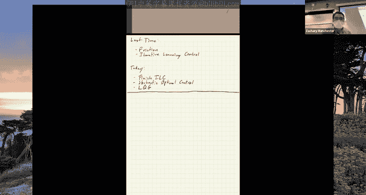

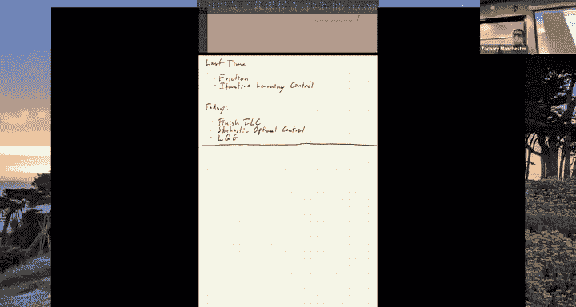

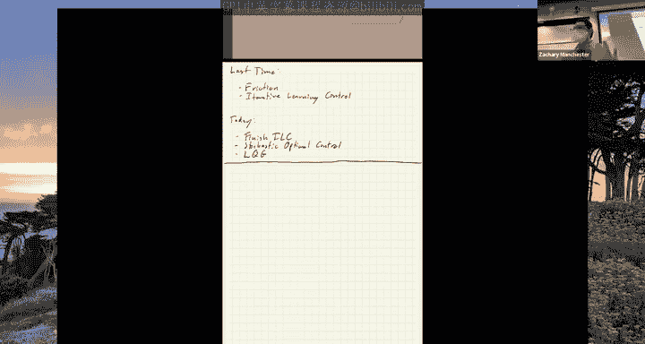

So to summarize last time and I'm not going to write out all the details。嗯。

There are in the notes from last time right， but essentially what what you want to do here is。嗯。

So given a nominal trajectory。X bar U bar。

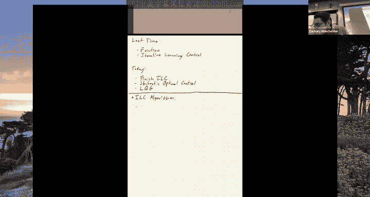

We have some X bar， U bar。Computed with a。A nominal model。

What we want to do is use rollouts on the real system to compute an update to the Us。

 so like a Delta U such that the true system achieves the X bar trajectory。

 attracts the X bar trajectory。对。嗯。

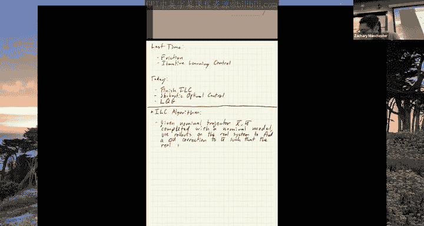

Okay。That's what we're trying to do。And sort of at a high level。

 the algorithm looks like the following thing， so we're going to first do a rollout。

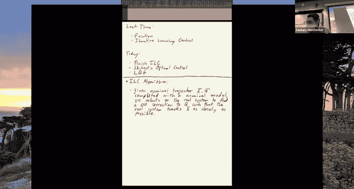

So we'll say like X， K， UK。At a given iteration is coming from a rollout on the real system。

Of the like sort of x bar U bar stuff， basically we're going to roll out from X not bar。

Using the open loop controls you bought， right？And this is on the real system。

Then we're going to solve the following optimization problem。 We're going to compute a。

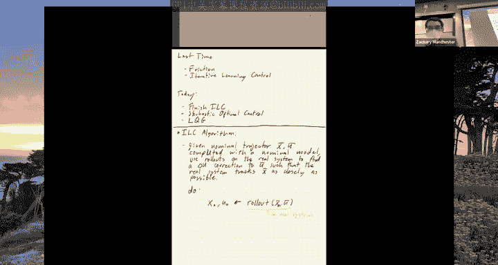

Delta X， Delta U。

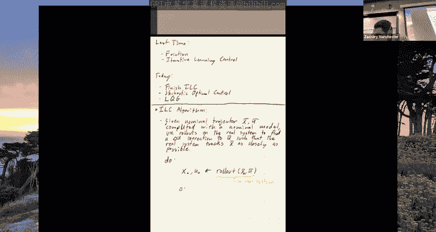

Based on solving the following sort of local optimal control problem。

And there's lots of flavors of this as we kind of talked about。

 this is the one we did where we got this thing to look like a QP。So we wrote down like this。

Cost function that was quadratic in the update in the deelta X delta and you get that by basically tailor roughly what you're doing here is Taylor expanding this thing about the reference then plugging in the errors from the actual rollout So we have this subject to。

The dynamics， the linearized dynamics。Computed using the nominal model。And then also you know。

 possibly subject to other constraints rights， you can put torque limits on this in particular or really kind of any other constraints you might。

YouMight care about you can enforce constraints in here。

This is why you want to do it as a QP and not that sort of straight up new update that we talked about。

At first。Okay， so this thing。

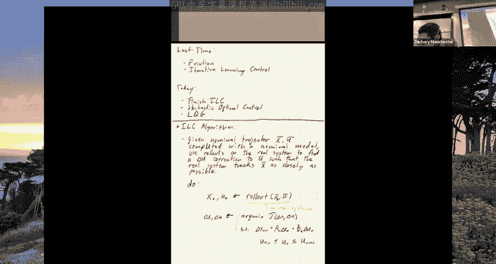

This is a QP if you basically expand J to second order in delta x delta u。

 and then you have the linear dynamics， right？

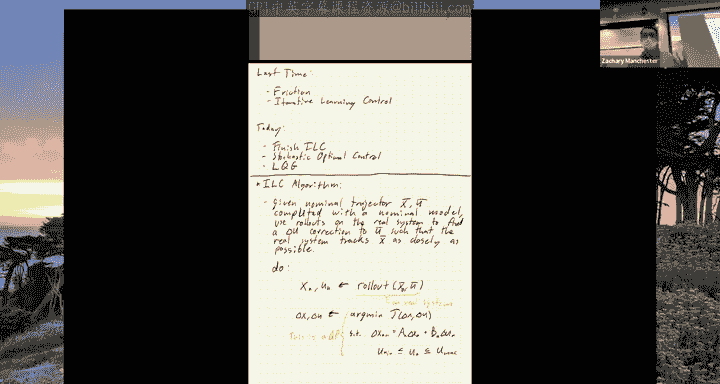

And then once we've solved that problem for Delta x deelta U， we're going to just update U bar。

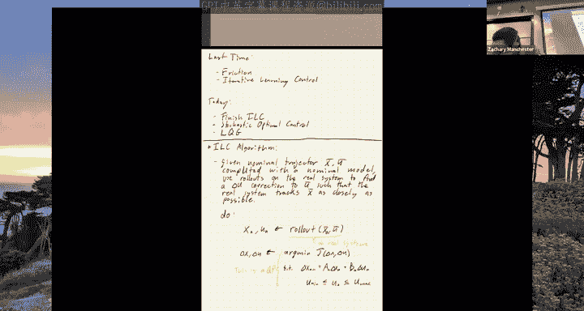

And we're going to do this whole loop。While we have some error。

 you know that that's bigger than we want。 so while this sort of x K minus x bar K。

Kind of thing is greater than some tolerance。So this really looks exactly like SQP。

 as I've written it down here， the only difference is the rollout step。

Is the real stuff on a real hardware system as opposed to。

In simulation using some dynamics model right and not in fact， you can solve this with SQP。

 you can also solve this with DP right you can solve this using any of the trajectory optimization methods we talk about。

 the key difference is you're replacing the dynamics model with the real hardware rollout and then you're solving the Newton thing or the backward rikati thing using the sort of mathematical model that you have the nominal model。

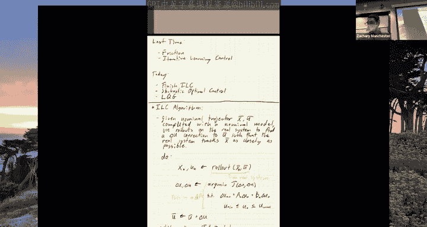

Okay， yeah the。で。So it it is so the rollouts obviously feasible， the original reference trajectory。

 the X bar probably isn't feasible on the real system right because it's coming from that nominal model so if that model has a bunch of error in it the X bar is not really going to be feasible right so ultimately you're not going be able to get that tracking cost to be exactly zero so you can wait it however you want right so in the swing up task for example。

 we can put a huge penalty weight on the terminal state to achieve a swing up and say we don't really care about what happens so much along the trajectory we just care about getting up to the top so we're willing to tolerate some error right and you can kind of you can wait that thing at the bottom if you want to differently right to say what you care about that answer question。

So do you have to use a like reference？Respect to the no level， or could you do this part？

Yeah that's a good question yeah so in theory you could do the cartoony thing here I mean in general you could just straight up do this from scratch instead of SQP right you could start from nothing like no nominal trajectory and just do SQP with this in the loop。

And theory right and like that would be kind of the same thing or imagine Dp where the rollouts are on the real hardware instead of on the SIim so you could totally do from scratch it's just that you know you're now talking about doing maybe dozens or even hundreds of trials instead of a couple right so this is basically like a recipe for doing Sim to real transfer when you're you know SIim model is bad so you do the initial traop using theminl model all in SIim so you can do that in seconds right and then I can take that and transfer to the hardware in like five six trials instead of if I had to do the whole thing in the hardware it might take hours right。

That makes sense。All of this is way more efficient than doing like black box RL is kind of the other points to make here so like all right so any other questions about this？

Very good Okay， so I'm going to go we'll go do this in a sec I just wanted to sort of like。

A little kind of aside on like why this should converge and why this is like maybe a reasonable thing to do in general that may be interesting to people。

So in particular right， we're using this nominal model that we know is wrong to compute all the Jacobians and stuff。

 right？

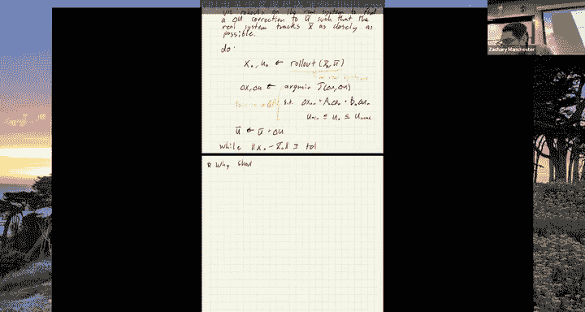

So why should that still work？And the answer is basically that。

Newton's methods still works in general even if the stuff in the KgaT matrix is off by quite a bit actually and this is kind of the theory behind if anyone's sort of quasi Newton methods or like BFGS LBFGS these kind of things that's it's the same idea like those things are all approximating the Hessian in various ways they don't get the same convergence rate as full Newton with exact derivatives but they can still achieve pretty fast in fact super linear convergence right they're still better than gradient descent they still do quite well even if there's quite large errors in the Jacobbians so that's kind of what's going on here。

So to sort of formalize this。You've already seen， you know。Various approximations to Newton。

In particular， we've done Gaust Newton， right， which is already an approximation to the Hessian。啊。

And there's lots more things like that。So Gas Newton。

And the other thing we did right at the very beginning。

 we did this regularization stuff where we' were messing with the Hessian。

 so obviously there the hessian' is not exact either。So you know， based on that experience。

 obviously Newton can still work with like inexact stuff。So in general。

 there's a whole family of methods you can do。There's。嗯。So called inexact Newton methods。

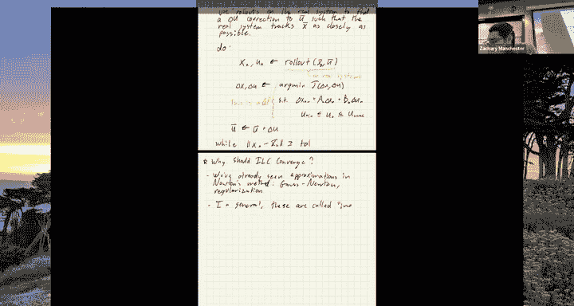

W。And there's also so called quasi Newton methods， these aren't exactly the same thing。

So does anyone know what these are does everyone know what the difference here is anyone done this stuff before yeah？

I actually I think lazy Newton would probably I never heard of that term。

 but I'm like you only do the you only do your and then you just use okay no that's a different thing so yeah。

 that is a common thing that usually you do at the end of the solve and usually we call that like。

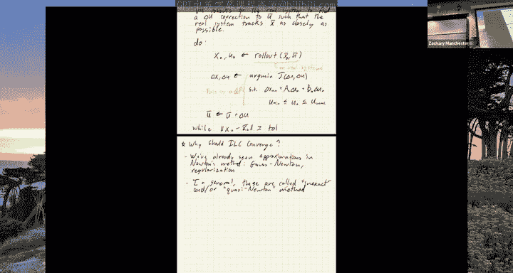

Polishing or something So no these are different things So quasi Newton methods are things like BFGS where you do that。

 but then you do rank one updates on the matrix as you go basically you do like finite difference updates based on your history of gradients you can update the matrix and then inex Newton methods are where you have a giant matrix that you don't actually want to factorize and form and memory So what you do instead in the to solve that linear system you use matrix free methods or iterative linear algebra methods like Cg this kind of thing to solve the linear system without ever explicitly forming the K matrix so those are both these methods they both like kind of approximate the Newton step in various ways and the reason for these things is so you can solve really huge problems without like so that you can scale it and not have to solve that linear system which can be quite expensive。

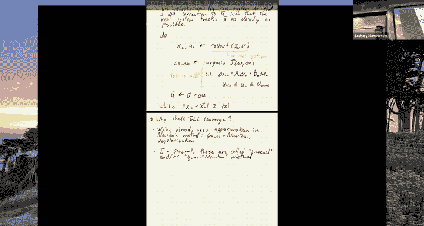

There's lots of versions of this。The most common ones， as I just kind of said， would be。BfgS。Broden。

 if anyone heard of Broden， Anderson accelerations another version of this that maybe is popular now。

And then also Newton Cg is another one。

So use conjugate gradient to solve the KkT system。

And these things have a well developed theory， there's like you can prove convergence of these things and all kinds of good stuff。

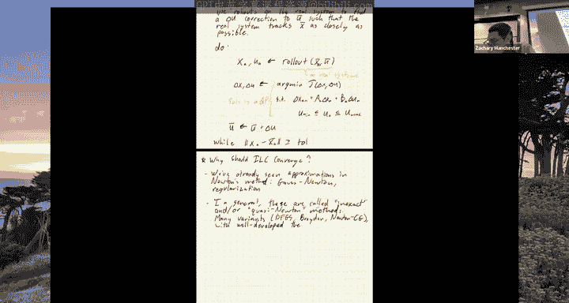

So approximating nothing thing is fine and that's exactly what we're doing and we're kind of doing the lazy mutant thing here right more or less Okay。

 so for a generic root finding problem。

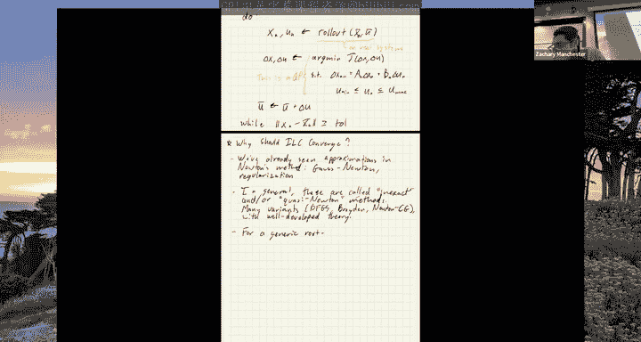

So the stuff we've talked about a bunch right， where we kind of tailor expand this thing to first order。

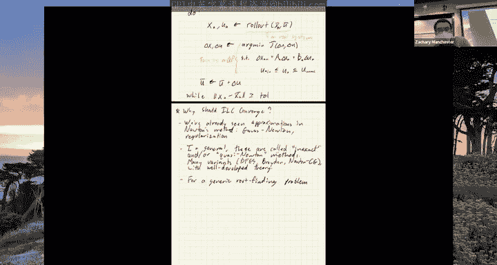

Set this Taylor expansion to zero and solve， right， this is the exact Newton step。

We solve this thing。And there's an kind of trivial inequality that you can write down。

As long as the deelta x you get from whatever you're doing。

 whatever quasi new and approximate thing you're doing。Satisfies。嗯。The following thing。

Should write this down on the other one。So as long as it satisfies this。This thing。

 basically the deelta x step satisfies。The inequality that it's that things less than。诶。

Some eight at times the original value。For some8da less than one。And。An exact。Newton method。

Will converge。It's basically saying as long as you can get a descent step that's like got this sort of geometric factor eta out front。

Which is basically your convergence rate， this will work。And in general。

 this is slower than real Full up Newton。

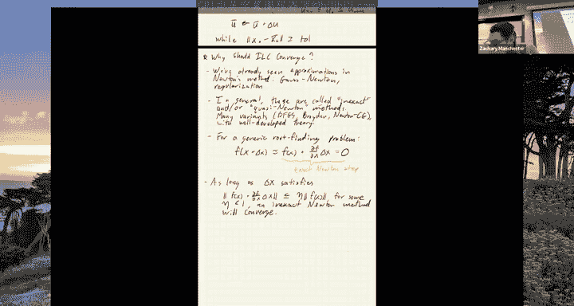

But it's still in general， pretty good。And this means we can。

Use some like J that approximates the real Jacobbian in here。To compute。

The deelta x right and you can imagine right if you have if you know a lot about the problem。

 you can kind of like say this in your approximation。

 you can bound everything and actually compute the Eta for simple problems and。

And have like pretty sharp theoretical results of this should work。 Okay。

 so that was just like a yeah。Could you explain the partner。

my industrial right needs to be less than that times absolute。Yeah二。先下。

I'm saying that you can approximate the Newton step and it'll still work。It's not better than。

 it's worse。Right so like in general these approximate newton thats will have worse convergence rate et cetera。

 et cetera， right， but what this is saying is like it's okay to approximate this thing。

 it'll still probably converge as long as your approximation is not super terrible。And that in fact。

 the convergence rates is not that terrible either。

 it still works really well so basically this is saying in the ILC algorithm。

We're using this nominal approximate model that isn't matching the real system， right？

And it's saying and we're using that to compute the KKT matrix。

And then we're using like the real stuff on the right hand side。

 this is saying basically as long as that nominal model is kind of in the ballpark。

 the Newton step you're computing with ILC will still give you a disscent direction。

And still like actually converge as long as the models not so far off right。

 So even though it's an approximate model that's not exactly matching a real system。

 this result is basically saying， yeah， that's okay， you'll still converge。

As long as the air is kind of bounded。That makes sense。Yeah。What's this。食几个。This does not no。

 this is not talking about context， this is just generic root findings。

Problem right so no assumptions on anything here other than really here smoothness right so you can take these derivatives So this would be assuming like C2 F right but not so this is a what I just wrote down is a root finding problem to be clear not a minimization problem right just this very generic like find F of x equals zero easing Newton's method and like that's the result。

Does that make sense， yeah， convexity is like a whole different beast that is specifically for minimization problems right where you're minimizing a scalar function。

Okay， yeah，Yeah that's a really good question so the we didn't do this。

 but generally speaking in the theory of ILC you assume you really want a deterministic system because you're doing these you need to be reproducible right so you can show that it'll still converge with like additive white Gaussian noise reasonably well but if there's like weird stuff that's you know non- Gaussian biased blah。

 blah， blah that's happening it's probably not going to be great。Yeah。

 this is we did all this right in the deterministic setting so far right。

 and you can generalize it to the like sort of。SSttochastic Gaussian case。

 which is basically like a small noise assumption right So as long as the noise isn't big isn't pushing around too much and is not biased。

 this will work great If you have some weirder， very stochastic setting。

 this is probably not what you want That said， in general。

 most of the robot sort of problems that we deal with at least in control are pretty deterministic right like。

Definitely all the industrial robot stuff。 most of the legged stuff flying like in general。

 this stuff is pretty deterministic and like， you know， there are you know。

 you can imagine things where there is stochasticity for real like wind gusts on a flying thing or something。

 Yeah， but that's kind of a different story right This would be like I'm trying to。That said。

 you know if you have a constant wind， this will work great。

 in fact I'll show you a video of this in assessment。Okay， so any stuff on this？Okay。

 so we I did this last time at the end， but in the interest of not， you know。Sort of。

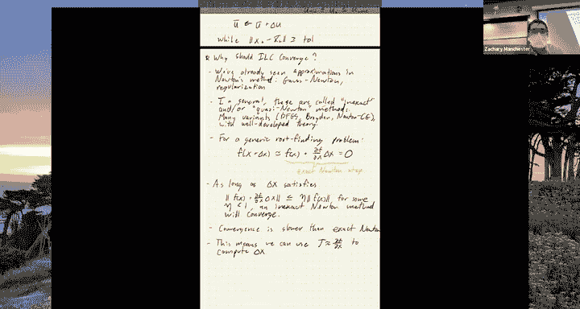

Going you know past time on people who can't stay， let's do this again real quick。

 so who was around last time who didn't see this last time。Yeah， so let's see this real quick。

 I'll be a little fast about it， so this is IL see on a carppo。

Same carpo bug demo we've been doing so what i'm going to do first is solve a swing up problem with offline trajectory optimization on a nominal carppool model this is with Uro the solver from my lab converges you know in like I don't know with this tag 25 milliseconds that's pretty good。

So what we're going to do now is we're going to write down a bad model So we just did this with like the perfect nominal model right now we're going to write down like a true model so this true dynamics and what I'm going to do is perturb a bunch of stuff So i'm changing the mass of the cart the mass of the pole by a little bit kind of random stuff changing the length of a pendulum and then so that's all kind of in the same model class right and then i'm also going to add in a really gross nonlinear friction term which is this is intended to approximate cool and friction so there's weird tan function stuff it's kind of gross right。

So okay， so that's our true dynamics model and this is intended to be kind of realistic。

So there's like St， that kind of stuff。We're going to do compute some linearization stuff here。

 we're going to compute an LQR controller that I'll use in a second now we're going to roll it out on the true dynamics。

And see how we do， so obviously this does not swing up successfully， right？So。

This is just plotting everything's open loop， what I can do now is I can throw an LQR tracking controller on it。

 try this again。So you can see with LQR feedback this looks really good。

 it swings up but the catch is it's violating the torque limits on the actuator and this is kind of obvious right because I put I made it heavier and I put friction on it so it needs more torque to swing up right so this is kind of bad though so if I go in here and I enforce the torque limits in the simulation so that it's clipping now it's going to fail again right？

And LQR， because LQR can't have access to that extra torque。Okay。

 so now we're going to do ILC I'm going to take the LQR controller out。

 we'll just run and open loop a bunch， so we'll go and do that again right it falls down here's the ILC part so I'm going to solve the QP。

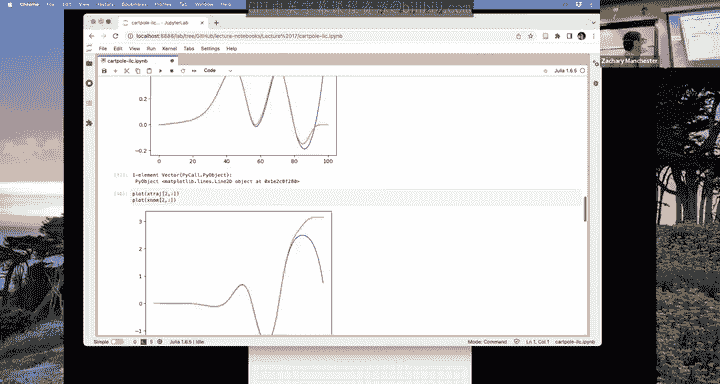

I'm writing down a tracking cost and in particular the tracking cost is weighting the theta state really heavily and saying I don't really care about the cart position and then yeah some nominal cost on the controls whatever here i'm computing that gradient vector on the right hand side from last time and you can see this is the nominal trajectories showing up a here right so this is getting updated at every time through the loop。

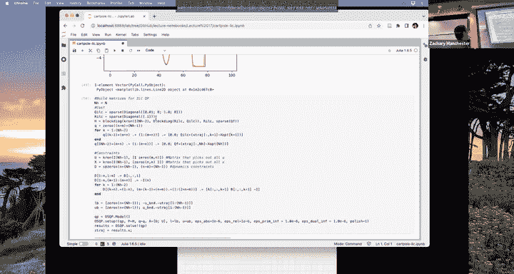

Also going to write down so here's the dynamics constraints just like before right aim minusB and that big Jacobbian and then also over here these are my upper lower bound torque limit constraints and here the nominal trajectoryject showing up in here right because I'm enforcing the torque limits on Delta U that's inside this QP so I have to sort of adjust that every time based on the nominal thing I'm going to go ahead and solve this with thoseqP。

And then I'm going to update just like we wrote down。

Go I'm pulling the use out and updating you now I'm going to go back and run this again on the true dynamics。

And we should do a little better。 That's not spectacular。

 but we're going to run this a handful more times。 And you'll see pretty quickly。

 So that's like one trial。Two trials getting a little better， right？嗯。Retrials getting better。

And now like a couple more times and it'll nail it this is like five times right it's basically there now on the swing up。

Do a couple more， so six rounds， basically there， do one more， maybe。

And this is like seventh trial right it's basically there maybe you'll do one more for fun。

And you'll see that like basically this thing nails it。Yeah。

 so now it's like perfectly hitting the end state it has eight trials on the on the no like if you were doing this on real hardware。

 right， this would be like。You know， whatever weirdo no nonlinear friction is in there。

 whatever model in this match， like under 10 rollouts on the real hardware and it's basically nailing it perfectly。

 right？Okay， so that's， I'll see working， any questions about that？

So here we we kind of set the problem to make up traffic fail because we said that we may have your subscription。

 So is。Yeah， how about is it to the sector limits and。

Yeah that yeah so this is like a classic move right so you would conservatively set those control limits in the offline optimization well below the actual ones to give your tracking controller a little breathing room the other similar thing that's super common is if you give have obstacles you do obstacle inflation so yeah this is a classic like you know practical solution of this problem that people absolutely do I guess the the counterarment to that you're always giving up some performance right whereas here you can like basically like adapt and dial it in you know perfectly yeah I don't know they're different I mean and you can obviously engineer situations but in which those solutions will also fail。

So， is there a class of problems where it's better to use ILC over trying to give ourselves a bit of new waves that traveling？

Yeah， so there's definitely situations where。That kind of approach will still do poorly so actually the wind the constant wind quad rotor example is a pretty good one if I have like some big know crosswind that's like constant where it's reproducible and I do a bunch of rolllos you can throw LqR in there even if it's well within the tor limits it's going blow sideways a whole bunch and have a huge final tracking air so whereas if you do a handful of ILC trials it'll just nail it perfectly and it'll figure out how to compensate for the wind the other way to do that would be there is online adaptation strategies where you try to estimate the wind you know and like cancel it out in your controller So there's other solutions to this stuff right but like。

Yeah， that strategy of like giving yourself some room on the constraints is a very classic move that's pretty standard and I mean almost always when you're enforcing inequality constraints in these problems。

 you want to be conservative and use like inner inner approximations of the true bound right because you don't really know often super well what's going happen the other example thats like friction cones for like a locomotion you almost always want to do an inner approximation and not go right up to the limit because you know if your knowledge of where the limit actually is is not so great then you know bad things going happen so that's a good point yeah that's a very standard move。

Yeah是 just是23。How do you save real robot？Would the move be to the initial lab some reference that like that we that on so these round are like plan cloud nanos right。

 So you going need to like five iterations this will converge pretty wrong way。

So we run another 10 hertz fish。I think。Like， would you do this at every。

tennis no no no so this is like a one time thing so like I have some nominal like think of this as like there's a task I want the robot to perform right and it can be whatever it can be like a long complex thing that like some industrial robots doing right whatever as long as that task is like repeatable and deterministic。

If I have some tracking error right I can basically go do this a handful of times you know five to10 times and just nail the tracking performance to be perfect and then as long as the model doesn't change as long as the hardware is consistent it's good to go you can just do it forever after that where this might need to get done again in that example right if there's like wear and tear on the stuff and you get like know bearings wearing and different friction properties over time stuff like that then you'll start to get more drift maybe and then you may want to do this again right and there's various flavors that you could call like online learning where you'd kind of constantly be doing this right all the time and updating。

So you can do that right there's a lot of flavors of this you can imagine doing it's a it's a very general idea this is like one particular flavor of it that I want to show you guys。

😊，So before we like leave this topic， I'm going to find the video that I had up before for last time that I now lost。

So give me one sec to pull it up。Some YouTube。Where to go？Wayt too much。Garbage YouTube。

 so I've got my essay。 and I've been working on it for about a week。

 So now I'm going to show you how I use grammar。 Okay， here we go。

 So this is from about 10 years ago from Rafty Njas group at E T H Zuric。

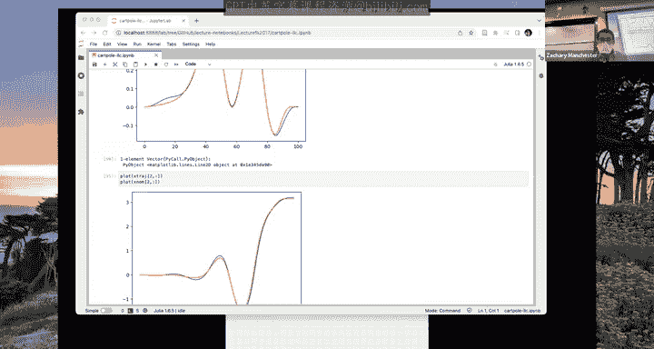

And this is them doing exactly the algorithm we just did on quadators to do really awesome tracking stuff。

So。🎼I should say too these guys are using the cartoon rigid body model of the quad rottor that we did and then they're executing these really aggressive aerobatic things that have all the weird aerodynamic and you know motor stuff going on that's unmodttleled and basically they get it you know perfect in a handful of trials these guys have wrapped there did a TED talk a few years after this so they did like insane demos of aerobatic crazy stuff and like kind a demo where they put a wine glass on top of the quad and split around and without spilling and all of it's done with this basically you can see how bad that is。

30 trials， you know， fire trials like really good。This is the wind gust thing we just talked about。

 so they guess it's working， they turn on the fan。Then it's bad。

 but it's a constant bad right that's the key thing so obviously that's garbage now you can rerun this few times。

And we get perfect tracking again with the win。Yeah。Oh yeah， pretty cool， super effective。

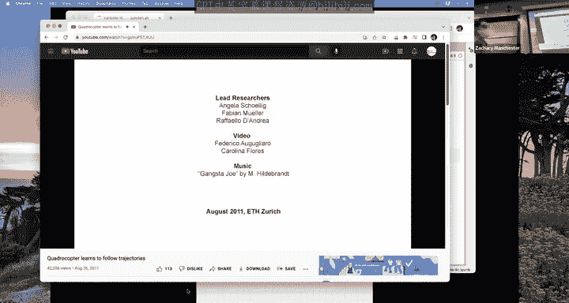

Cheap to do。Works。Yeah， we haven't talk about the last time， but is there any way to like。

Reconstruct the actual model so no I mean this is very explicitly not trying to do that and like that's there's a reason for that right so like actually constructing the full dynamics model it's sort of ill posed and it's also like a much bigger problem right like trying to have so just this one trajectory doesn't really tell me a lot about the dynamics right I need to like have enough samples over enough region of the state space even just locally around this trajectory。

 I need a bunch of samples in the neighborhood right to fit some kind of dynamics model that's gonna to be reasonably accurate in the neighborhood of that nominal trajectory and it also like even a linear model right you think about it that linear model is telling you if I pertturb the state in all these different directions around that nominal trajectory has to tell me what's got to happen right so just having the one trajectory data point is like way insufficient I would need like roughly speaking a sample point you know a trajectory sample in like every possible。

direction around that nominal trajectory to get enough information to just fit a linear model。

That makes sense， and then if you're talking about doing a more general nonlinear model。

 the situation is， you know， maybe arbitrary like if you wanted to like learn a neural network model for the dynamics right。

 that would take thousands of rollouts to get enough data even to fit like a kind of reasonable local model。

In some region， does that make sense？So because here we're really just trying to update this one sort of U trajectory we're not trying to fit very much right it's like you're trying to fit less stuff to the data right and the more like the more parameters you're trying to fit the more data you need kind of obviously right so fitting one U trajectory versus fitting an entire dynamics model that might be parameterized by like some crazy number of neural network weights or whatever is a way simpler problem right。

If you have a parametric model。So let's say in the carppo example you knew everything really well except for say like one mass number right one scalar mass that you could do really effectively really quickly right so if you have only a couple parameters that you need to fit then you can do it really efficiently but if it's like some generic function appximator kind of thing then you need a ton of data。

Does that answer the question？Cool， yeah， you didn't have any disturbance added you it would be bad again it would have to relearn yeah I mean。

 because this thing right it's like it's basically adapting this open loop trajectory right and so yeah if you change anything。

 it's going to be bad again yeah， get yeah， yeah， as long as it's consistent from trial to trial this will learn what to do。

Is there like a case for we just make sure is just like what we do。I mean this is really good。

 it works really well， as long as you're doing a like deterministic repeated task right as long as it's that kind of thing。

 this is like probably the thing to do。Yeah系。I'm trying to think of get absolutely so that phenomena is like a more general problem with these just optimization in general it's like these are all local methods right so the word for which you just the fancy math word for that is that these trajectories line different homomotope classes have you heard that word before。

Basically means that they be like that means that they can be like continuously deformed。

 you know between each other and basically have an obstacle in a way you can't like deformed through the obstacle right in a feasible way so like that's a general problem like with most like SQP style method like this if you're just doing offline trajectory optimization if you see it with an initial guess that goes around the obstacle to the left。

If there's like a really nice low cost trajectory that goes around to the right it will never find it there's ways you can make that happen。

 but they kind of in the in the like machine learning lingo that corresponds to like exploration strategies you have to like do something to like get the thing to try out multiple passs so in this kind of old school control like trajectory optimization context you could imagine doing various flavors of like random restarts right like sampling random initial guesses and stuff like this and just trying a whole lot of which is a very common move。

For really hard problems like that， but usually right these things work great if you have a reasonable guess if you have some intuition for the system you can cartoon something this will like nail it in so but yeah that's like absolutely a real thing that's more more general than this。

Yeah， I mean it basically comes down to like the local basin of attraction idea right like you're going to go towards whatever that is and obstacles like you know like basically brick walls in that sort of landscape that you can't cross right so you never will。

Okay。Anybody else？Okay。Switching gears， so that's， oh yeah sure。So。

So is like it's it's like it's same category I mean， you can consider this。Policy。

 this is basically like a particular， you you can absolutely consider this like a policy gradient method。

Where the policy class like the function class， the policy that you're optimizing is that U bar trajectory that open up U trajectory right if that's your policy and those are like like literally U bar subK is your are your thetas in your policy right these are the policy parameters that you're optimizing so you can totally consider it like it's a very simple sort of really really like bare bones policy gradient method。

O。Yeah I mean like what's a policy gradient method right you do rollouts。

 collect some errors and then like do some kind of descent step on your your policy weights right so if you' if your policy is open loop U trajectory and your weights are just the elements of that that matrix like that this is it this is policy gradient。

This is actually doing Newton rather than， you know or quasi Newton rather than gradient descent。

 right， which is why you get really fast convergence。

 but it's in spirit like really a policy gradientding method。这个这样。Yeah。

 I feel like your convergence with your pan to on。Like if you wanted like your your degree。

 you must want or something。If you having a bad model or if you have content like if your disturbservance is too high in the that like data that yeah absolutely right。

 so this is kind of assuming like that aid is going to totally depend on the quality of your linearized model right and how far off it is from the real thing。

Yeah。Okay， anybody else？All right， so we're going to totally switch gears now。

 we're going to talk about stochastic optimal control stuff。There it is。

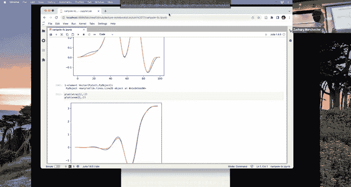

嗯。嗯。Okay， cool， so we'll see how far we got on this story。So stochastic。😔。

Control just as a show like who here like if I say like multivariate Gaussian just cool with everybody。

 is anyone not done like basic statistics probability stuff here？Everyone's good Okay。

 well we'll review a little bit， but I'm going to start to run around that kind of language。

 so hopefully that's。All right， with everybody。 Okay， so so far we。You've assumed that basically。

We know。The systems so you know we talked about ILC is relaxing you know perfect knowledge of the systems model right This is kind of a different thing This is just saying you know even in the ILC context right when we're doing these rollouts we're still assuming that we have perfect knowledge of the system state right so like I assume when I roll it out I get this you know state and control trajectory that I'm using when I feed it back that I'm assuming is perfectly known right and so that's the assumption we're going to relax now。

So obviously in general， like we can't even directly measure the state in a lot of situations right you get like noisy measurements of things related to the state。

 but like not necessarily the whole thing so。The question is。

 what happens to like everything we've talked about？When all we have。Our noisy measurements。Of。

Not even state but just。Quantities related to unless I say related to in the statistical sense I mean correlated with。

嗯。Okay， so what happens So so we get measurements of these things Y that we assume are functions G of x right So assume there is some state X。

 we don't have direct access to it。 All we have access to are these y's that are functions of x right So classically this is like simple examples of this is if I go fly a drone around an emotion capture arena。

 which is a pretty benign setting， I'm only getting direct measurements of the pose like the position and orientation position not the velocities right So I have to come up with some way of computing the velocities and we can do fancy versions or dumb versions of that。

 but that's an an example of this right Okay so in general， what's going on here is。

We've been living in this deterministic setting。Where we have a state vector x and we just compute things on x。

 right， trajectories， feedback policies， whatever。Now we're going to go to this new setting。

Stochastic setting where there's noise on a bunch of stuff and the best thing we can get we can't get this state we can get instead the probability distribution over the state conditioned on the measurements that we can actually get right this notation makes sense everybody's seen this I thing before。

So， this is the。PDf。Probably down the function of the state。Condition on the measurements。

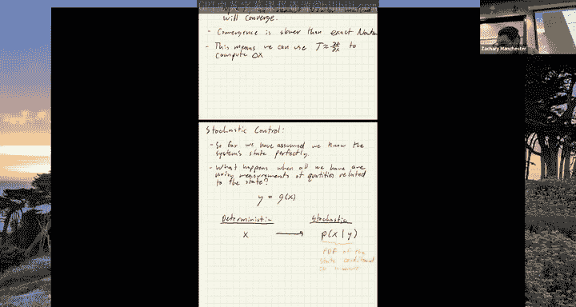

And yeah， I think probably a lot of you have done like RL flavor things before。

 so this is kind of the typical setting of RL。

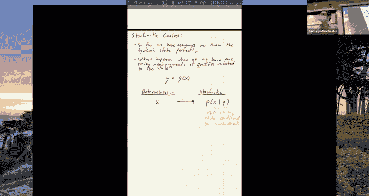

Okay， so what we can do now。

Is write down basically the stochastic generalization of the optimal control problems that we've been solving。

Which look like， you know essentially all we do is everything we've done so far。

 wrap it in an expectation， that's it and that's the stochastic version of the problem。So you know。

 basically what we're trying to solve is。Men over you of like the expected value of the cost。Right。

Almost the same thing。Okay， so in principle。In theory。嗯。

We can just solve this with dynamic programming like we've been doing。

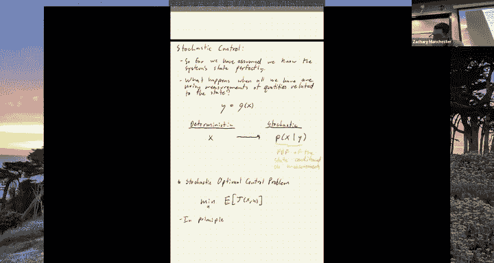

But in general， this is very hard and impossible exactly。

 right this is the classic cursive dimensionality that kind of we all probably have heard of before。

不是。

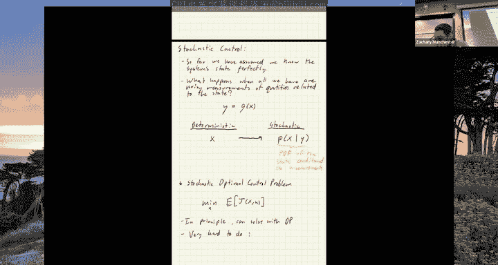

Okay， so。

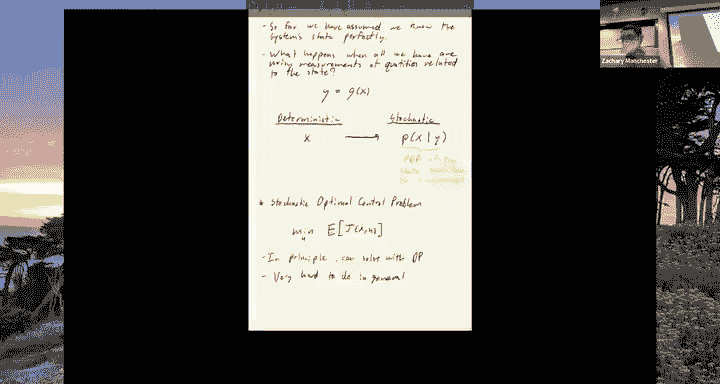

Questions about this。嗯，对 what的 yeah。WhatProbability density function so probability distribution right so like what we're going to do next is a Gaussian so just think about a normal distribution right over the state。

For today， yeah， it's the expected value of the cost function。Yeah， makes sense。

 we're like x and U are random variables now basically。Interestingly you right。

 what is the so this is maybe a little subtle and weird and not consistent and super consistent that the solution to a deterministic optimal control problem right what we solved before is an open loop trajectory。

 right？

What's the solution of this problem？Thank you。Yeah， and sorry， yeah。

 so so it would be like here would be a distribution if you're solving it like this or like in general。

 it's a feedback policy。

Not a。So it'd be like， you the probability。density function of U conditioned on the state right was basically the answer to this。

 which is really a feedback policy。This is like kind of the usual home for playground of RL like this setting or this stochastic setting。

Which arguably isn't really what you need for most robotics problems， just throwing that out there。

 but it's definitely interesting there' a lot of cool things in here。Okay。

 so we're going to talk now is LQG， who's seen this before。Holple people okay。

 cool so this is a very special case of the stocast。

 the general stochastic problem that we can actually solve in closed form。Okay， so we have L for。

Linear dynamics。Q for。Qudratic cost。And G here is for。嗯。Gausian noise。Okay， so。

This is basically the stochastic version of the LQR problem that we've already done and has some fun twists and turns in the。

In the story， so we're going to。Sort of dig in as a little bit。 So the dynamics here are。

 we're going to do discrete time like before。

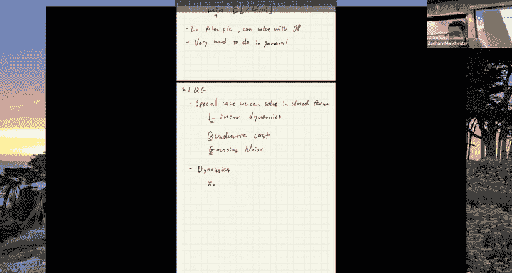

And it looks almost the same。And we'll do time andvariant just for simplicity。

 but it generalizes in the sort of obvious usual way that we did last time and we did LQR so this is the deterministic dynamics that we had last time now we're going to add noise to the story so we get this noise。

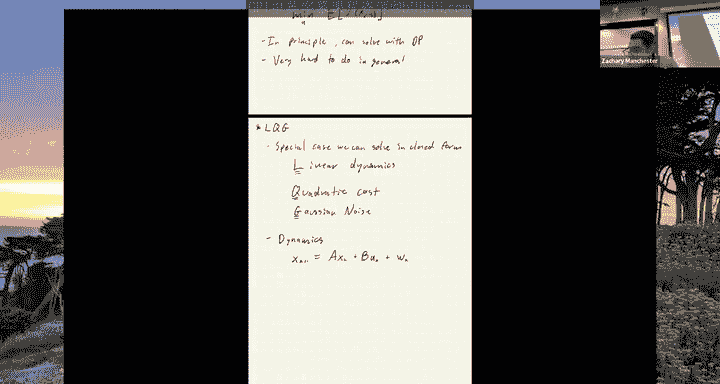

Added on here， and this is called process noise。

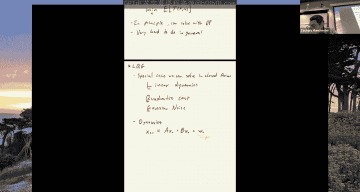

So this is you know， noise in the dynamics， we're saying the dynamics themselves are stochastic。

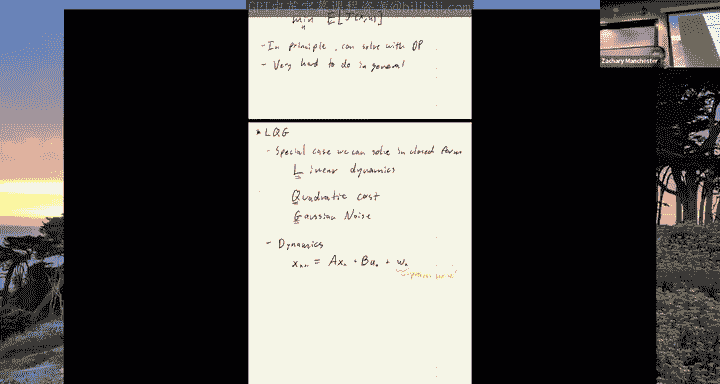

Not just the measurements， but the underlying like physics is noisy。And sort of unknowable。

In the classical way we like。Then we have a measurement model like so we wrote down the generic nonlinear version before here we're going to assume a linear measurement model。

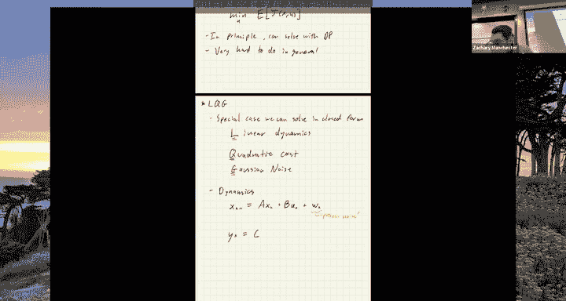

we're doing the LQG thing。 So here we assume that the measurements Y are linear functions of the state。

 So here like the obvious version is like if I have a particle you know double intetor or whatever where the state's position and velocity。

 let's say only have measurements of the position right so then the C matrix would be like an identity block and a zero block that just pulls out the positions so that's kind of。

Simple example is， and we assume also the measurements are noisy as well。

 So here we're going to have this VK added on。And we call this measurement noise。

Okay， and then the Gaussian part comes in here， we say that both of those noise processes， so the Ws。

The noise at each time step， so WK at each K。Is drawn from a normal distribution or Gaussian with zero mean and covariance big W。

And again， you can make all of these things time vary right so the A's and B's can be subcases at each time step so can the noise covariance so that big W can also be a function of the time step and the derivation still works。

And then the VK， similarly。That says zero， yeah， zero so have you seen this notation before this is like this means drawn from that squiggle so it says Wk is drawn from a normal distribution with zero mean covariance matrix W that's what that notation is I'll write then。

Just kind of， yeah， this is stuff we haven't done yet， like in terms of math， so okay， so this says。

W is drawn from。Normal。Distribution， Gaussian。And that the first thing in here is the mean。

And then the second thing and here's the covariance。O。Cool， okay， so yeah， just to yeah。

 make sure we're all on the same page because I think usually there's some varying backgrounds on this stuff I'll write out like the details for this multivariate Gaussian distribution。

I'm expecting a lot of you have seen this before， but yeah， just in case you haven't。

This is what these things look like。So。Probability density function P of x。

 which is giving you the probability you know of at a particular x， right？

So for a general n dimensional Gaussian looks like this。

 so you have this normalization constant out front。

Which is just there to make everything integrate up to one so that you know。

Integrated over all space， you have probability one looks like this。Where in is the dimension。

And this is the determinant and P big P heres the covariance matrix。

 and then it's the exponential of。

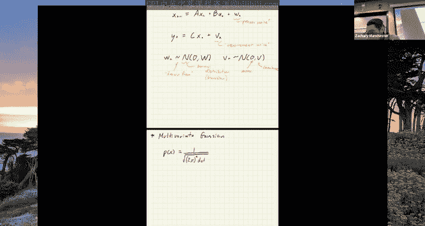

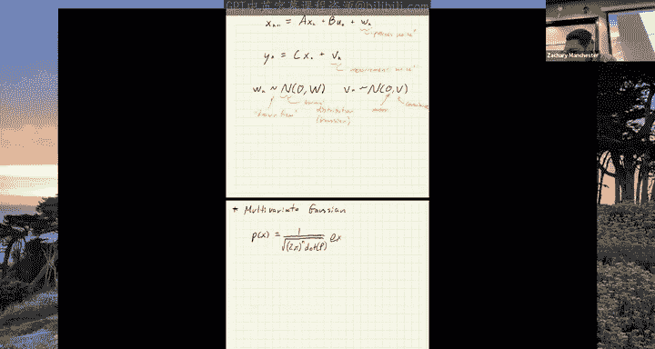

Minus1 half。X minus mu or mus the mean。Transpose P inverse x minus mu。And sort of intuitively。

 also write some step down so mean here。The mean of the distribution is mu。And this is also。

Probably lot I've seen this notation， this is the expectation of x， right？And this is a vector in RN。

And then the covariance。Is this matrix P sometimes also a capital sigma is common for this。

And this is the expectation。Of。X minus mu times x minus mu transpose。

And this thing is an end by N symmetric， positive definite matrix。 So the way we write that is。S。

N plus plus。Okay， let's see and then what else。Oh yeah。

 so expectation right everyone's seen expectation before， hopefully so this is。

The definition of that that expectation thing， so if I have the expectation of any function I want。

 it's equal to the integral of over sort of all space。诶。

Of the that F of x times the probability density。Integraterated up。So that's。

I think this is all the statistics one last statistics thing。诶。So let's see yeah。

 the last thing we need to know for this is what uncorrelated means in the statistical sense。

And this means that。一议。If I have two random variables， it means they're cross covariance。

 so if I do this covariance thing。Is zero。 They're not correlated at all。

 and where these the hat means mean。Maybe I should write that up here。嗯。This is a common notation。

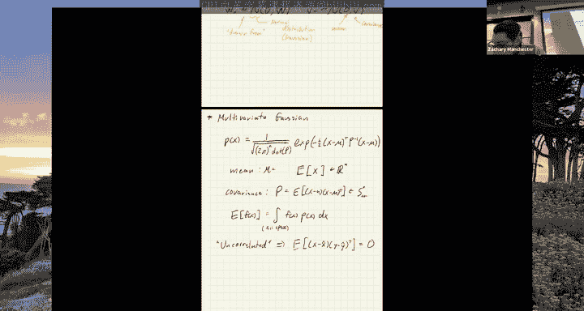

That's hot for me。ok。That was whirlwind crash Co。Gashian statistics。

 we're not going to lean too hard on this or like if you haven't seen this stuff before and you're little nervous about this。

 don't don't stress， isn't like a super。

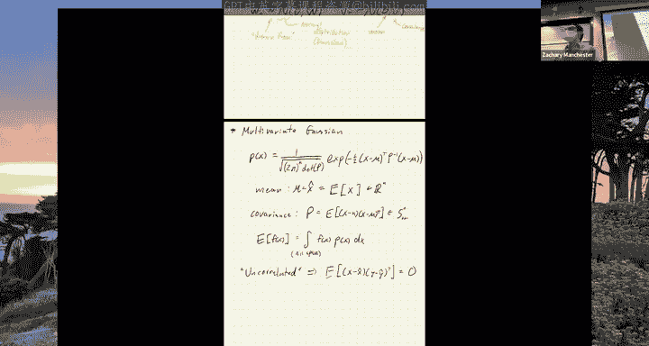

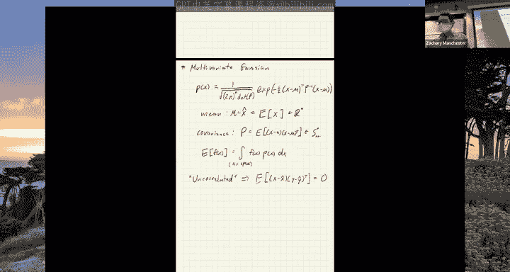

It'uper big thing， but this is definitely stuff you will encounter in your life if you do this stuff so like you' probably get to know about it so if you haven't seen this you might want to like look into it a little bit more。

Okay， questions regarding that。Standard staff definitions， cool。 Okay， so we're now going to go do。

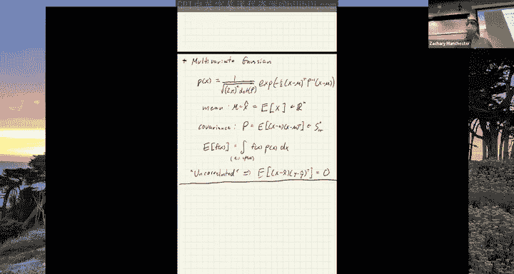

dynamicynamic programming to solve that LQG problem。

 and it's going to look exactly like the dynamic program we've done before。

 but we're going to wrap everything in expectations。

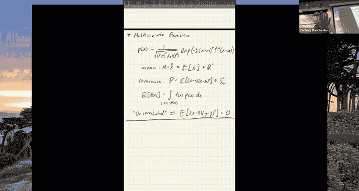

Okay， so first up， cost function。So the cost function is just like before just wrapped in an expectation。

 so this is our J。This is going to be expectation of the sort of standard LQR cost thing。

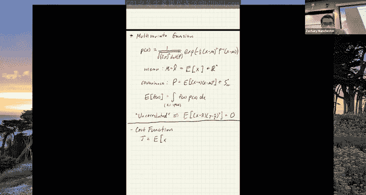

And I should probably put one half on stuff， but I'm going to skip it because it's going to be。

This is going to get a little gnarly。In terms of notation， so。Beear with me。Okay。

 so we got Xk transpose Q。Okay。Okay， so that's the standard LQR cost I just written wrapped in an expectation。

Everyone happy with that。So next move is we're going to now do。

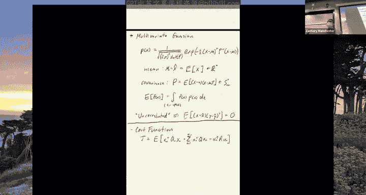

The bellman backup right， the one step， you know， where so we're going to write down like VN。

And then we're going to try to go backwards。This is exactly like the stuff we did before with DP。

 it's just got these extra expectation wrappers on everything。Okay， so the terminal cost here。

 this is like the。

This guy is。Just expectation of。Xn。Okay。Just like before with LQR。

 and then we're going to call that QN RPN like before。Cool。

 so now we're going to try to write down Vn minus one just like before and then kind of bootstrap our way to the like rikaati recursion type of thing。

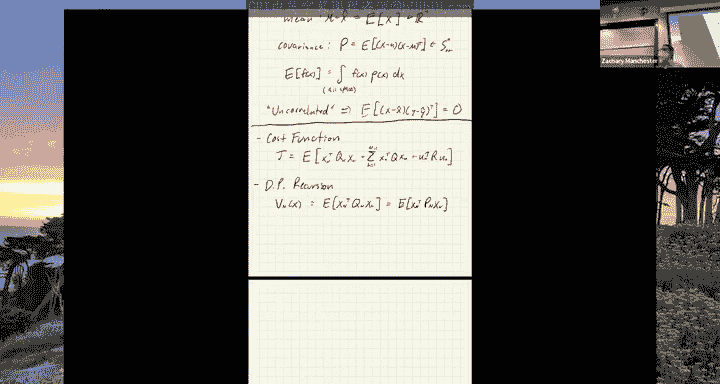

So。Let's write down Vn minus1。

So is。Min over you。And we're going to just plug in all this stuff like before。

 but we've got this expectation stuff now so。There it goes。要奶茶。Okay。

 so that stuff now we're going to get plug the dynamic， yeah。

So if the cost function is that the sumation of can it include the Q and theR terms， yes。

Yeah， so。Is that better？Okay。Okay， here we go。 Okay。

 so we got this term and we've got the dynamics term so that looks like。

AX K X n minus1 plus B U N minus1 now remember our dynamics for stochastic we have that process noise in there right so we got to put the process noise in。

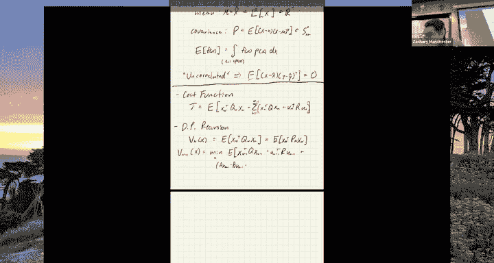

Plus W and minus1。And that goes， you know， kind of into the。The p thing there。嗯。Okay。

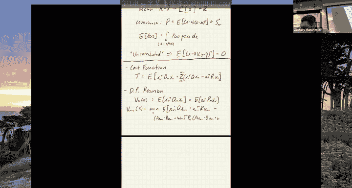

All good， I think I did that right。Okay。Now we're going to expand this thing out a little bit。

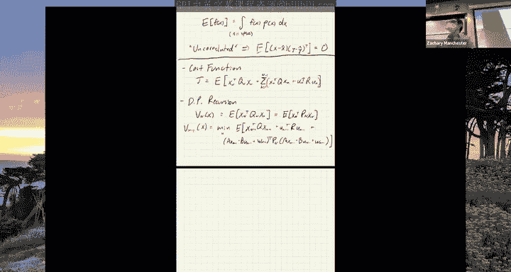

So I'm going to split this into two pieces， I'm going to split out the stuff that we know from classic LQR and then I'm going to separate out the new stuff that's new in this stochastic version。

 so let's do that。So if I do this split up thing。We end up with。This stuff that we saw before。

And the dynamics， right？嗯。Times。

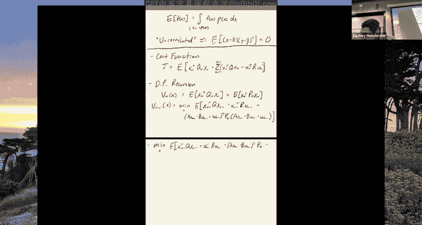

ok。So， this is。Standard LQR stuff。And then I'm going to pull out the new terms。

That have noise in them basically right so everyone knows expectation is a linear operator right so I can pull stuff in and out like so I can split this expectation into two expectations right。

嗯。So the noise terms look like this。Okay， here we go that's the whole thing。

 so these are our noise terms。Okay。Now， here's the fun part。Okay。

 let's look at these two terms over here， the first two terms in this thing。This guy and this guy。

Okay， so we the reason we talked about this whole uncorrelated thing is okay。

 so now I'm thinking about this is a random process right。

 So the W's are's some random noise drawn from a Gaussian distribution Does that W。

Have anything to do with the state or the control from like that time step。

No right it's drawn from a random normal distribution totally uncorrelated right and this thing right here right this is the this looks exactly like the definition of cross correlation right？

U here。It's an outer producty thing right okay， so these the messages。These things are uncorrelated。

So these terms go to zero in the expectation。So if you haven't done a lot of this stuff。

 this might seem weird and fuzzy and I don't know， not super satisfying， I guess。

Those of you who have played these games before hopefully this makes some sense。

 the gist of it is that basically these the noise doesn't have anything to do with the state there right the current state the current noise is drawn at that time step they don't have any sort of thing to do with each other so they're uncorrelated yeah。

that。老一自己。

Yeah， but so that's absolutely true we' that's because we assumed up here in the definition of W that it's zero mean right so you're absolutely at expectation of W by itself zero totally true。

Here， yeah， that's exactly right。 So the stuff is basically a constant。

 effectively a constant times that thing。 So it comes out and it's zero， right。

 So that's exactly right。 So now， though， what about this term。

What's that terms expectation？Is it zero？Anybody have thoughts on this？因为。

。It's not zero， it's very closely related to the big W。

 but not exactly right so big W is little W times little W transpose right so this has the P sound so they're very closely related。

 but not exactly the same thing。

So in particular this is a scalar right it's a scalar inner product you can write this in terms of big W it's related to the trace of the big W Do you actually do you know the trace trick？

It'sKd of fun。 Okay， now， So this is actually， if you wanted to write this down。

 It's trace of big W times P， which is fun， fun facts。 I don't know if anyone cares。 Okay。

 we'll actually， we'll talk about the trick。 The trace trick is fun。 That's a good one。

 So the point is， this thing's a constant。😊，Okay， so the punchline from this entire exercise is that when I add noise to the LQR problem。

I get all the standard LQR stuff， then I get a bunch of noise terms that either cancel out to zero or is it constant。

 So what this is telling you is that none of the noise terms affect the answer。

All it's doing is making the entire cost higher by some term that just depends on the size of W so the more noise the more the cost is going to go up on average。

 but I can't really do anything about it in the controller this is saying to you that the controller has no is not impacted at all by the noise and the answer to this problem is this standard LQR controller。

Does that make sense to everybody？야 cool。呃。I have a question， about that。

Yeah sure so W like the the covariance can be state dependent right of like little W in general， yes。

 in which case those things would not be uncorrelated and that the answer would not hold okay so we're assuming that it's not state dependent。

Absolutely yeah， that was like sort of baked in at the beginning here so it could be time vary it can't be state dependent for this to hold if it is state dependent it's not an LQG problem and yeah in general things will be correlated and the controller will be sort of dependent on things right Okay。

 yeah Okay so the punchline is from this whole thing is。noise。嗯。Terms。

Have no。Impact on。你。Controller。嗯。You just get a higher cost。Okay。That's fun。yeah。

Just a good question。 How would you deal with。就 have那个。

St depending on observation I guess。NoYeah so。In general， you can't do it optimally。

Right because that's basically the ultimate answer to all of this is that this is what's called the palm DP partially observed mark opposition process solving those in like you know continuous state in action spaces is like awful and terrible and intractable and you have to do approximate things right so the practical answer to your question is you would like write down an EKF or something and like do same things the other answer to that is if it's really low dimensionional you basically could grid the space。

Or use function appximators and try to solve approximate dynamic programming， you know。

 which is super expensive and super hard and generally not worth it。

Unless I mean there are problems where you have to do that right。

 but like for most control problems like we can get away with， you know。

 the stuff I'm about to tell you basically， yeah， stuff is not zero enough bias。

That's right exactly yeah， basically yeah， what you end up doing is like augmenting the state or like wrapping that in somewhere else so that it fits this basically the LQG problem。

 that is the definition， there's lots of games you can play to take a problem that doesn't exactly fit that setup and transform it such that it does the classic examples of this or yeah state augmentation et cetera。

 et cetera， yeah to make it fit this set of assumptions。

🎼Okay， anybody else yeah。Here it does。For this all to hold， it does。嗯。

Sorry we assumed it up front at the beginning and here， I mean。

 you can probably relax some of these things right here for linear systems。

I think the only thing we're really assuming here is that the distribution has。

Zero mean and known covariance。 So I like strictly speaking。

 it could be some non Gaussian distribution as long as it's。Has those first and second moments。

 I guess。啊。Yeah， I think that's true。There's some other places where it will have to be Gausian。

 but we haven't seen it yet。Yeah， any other questions about this？Yeah。

 so basically what we're saying is like if you have a system such that， you know。

 is there a Gaussian noise and the measurement？However else like you just saw the exactly and you are yeah。

Basically， what this is saying， we'll get to this。 Yeah。

 I'm going write it down now because we're like saying this multiple times。

 So here's two things that come out of what we just did that are interesting and worth knowing about。

 So the first one is called the。

Certainty equivalence principle， these are like classic classic control theory results that like you know you should get in an optimal control class so here you go。

So here's what we were going to talk about， certainly Holman principle says the optimal LQG controller is just an LQR controller where you replace X with expectation of x。

Simple enough right that's basically what that result says right then so that's called certain equivalents and this thing related result called the separation principle says that for LQG we can design an optimal controller and the answer to that is LQR。

😊，And then we can design an optimal estimator separately that gets us expectation of x。

To plug in we hook those together and that's our feedback policy for the stochastic problem and that is the optimal answer so what it's saying is basically in this case the optimal policy is you can actually split into two pieces the estimator and the feedback controller hook together and the only thing that matters there is the expectation right that has the pass back and forth neither of these results holds in the general nonlinear setting so you have nonlinear dynamics non Gaussian noise whatever it breaks both of these results。

But in spite of that， in practice， we almost always， at least in classical control settings。

 we almost always still do this right， so like almost every robot you'll ever see。

 you have a state estimator that's taking all your sensor measurements in and trying to get you a state estimate。

 which is basically that expectation of X。 then you have some kind of feedback controller that's taking that。

X， which is really an expectation right or some kind of mean or maximum likelihood estimate and assuming that's the true state and then making all your control moves based on that right so that works great as long as your your state estimate is really good right and your noise is unimotal and stuff like that where this really starts to break down in practice is if you have non-unimotal state distribution right so if you have a state distribution where you could be in a couple different places and you're not really sure。

Then you have to reason about the whole distribution in your control policy and like your estimator and your controller can become like very coupled。

So you can imagine right in the more general case what this is kind of getting at is that you can have coupling between your actions and your measurements such that in order to actually observe the state you have to do certain control moves to make things observable and so your estimator and your controller are like intrinsically linked and can't be separated right that's kind of kind of the idea。

