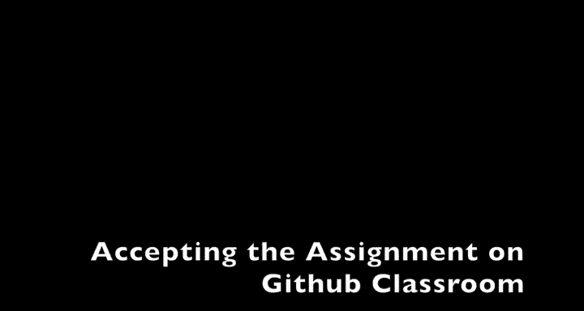
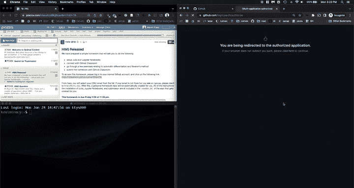
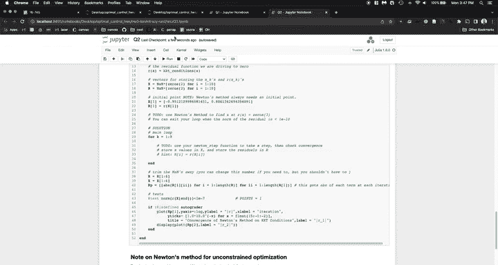
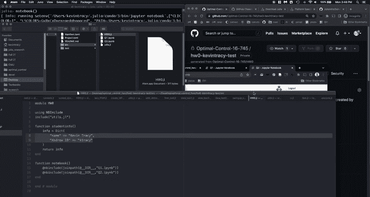
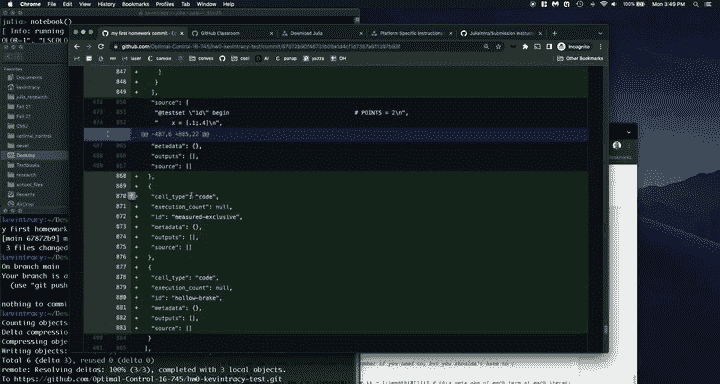
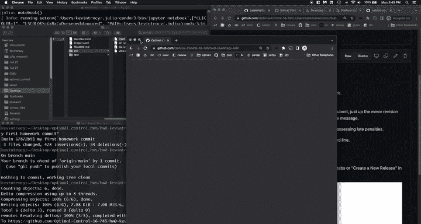

# CMU《最优控制和强化学习｜16-745： Optimal Control and Reinforcement Learning》中英字幕deepseek - P1：[01]HW0 Walkthrough.zh_en - GPT中英字幕课程资源 - BV1qHwke1EBX

I'm Kevin and I'm going to go through how we set up the GitHub classroom for homework zero and so right here I have everything we need。

 I have Piazza open on the top left， terminal bottom left and then here I have where I am about to sign into my test GitHub account。

So first thing we'll do is we'll assign to GitHub。And then next we're going to go to the post homework zero released。

Here you'll see a GitHub classroom link。So just copy this link， put it in your browser。

 assuming your browser is logged into the Gitthub account that you want to link it to。

And they's going to ask us if we give it permission， say yes。

And then here we're going to find our name from this roster right here。

 so this roster was imported from Canvas。And since I can't import myself。

 I have imported my friend Swwami， so I go and I find Swami's account。Select it。 I say。

 are you sure you want to choose this identifier and just be super sure that this is your email。Prs。

 okay。And then now we have our chance to accept the assignment。

 so what this does is that it's me saying that I accept this homework assignment and it's going to create a repo with the name of the homework assignment and then my GiHub name at the end of it。

So accept this assignment。It should says it takes a few minutes。

 it happens a little quicker than that。So looks like we're ready to go so we can go check out our repo with this link right here。

And so we are underneath the class organization， which is control。

 and then we have our own private repo， which is the name of the homework assignment and then our name right here。

We are going to go through the steps to set up Julia for the first time。

 so this is assuming that you do not have Julia installed my do on my computer so I won't have to do every step you do。

 but I will talk about everything that has to get done。

So the instructions we're not going to follow are in the Readme of our repo。

 so remember this is the repo that we just created with GitHub Class and then in this ReadM are the instructions we're about to follow。

So the first thing we do is that we download Julialia 1。6。5 from the Julia website。

And this version is important so the current version is 1。7。1 we are not going to use 1。7。

1 instead we're going to use the LTS 1。6。5 so if things are like working kind of weird one of the first things we're going to ask is that are you using 1。

6。5 so here you go and you choose whatever system you're on。

And because I haven't installed that author to do it。

And then one way to do it is we can then add the extracted binaries into the bin folder on our system path。

 or you can just follow these platforms specific instructions。So like for me， I'm on Mac。

So I go down to the Mac OS OS thing and we're going to download this file， so where it says 1。7。

1 Rs will be 1。6。5 that Ota and the Julia 1。6 app， and we installed this the same as we would for any application on Mac。

And then all we do here is that this is us creating a sim link between the Juliat binaries that we have downloaded。

 so remember this is a P 1。7 it be 1。6 for us and we're going to simlink it to our user local bin。

Use your local bin， Julia。So all the instructionss you need to actually install Julia are all going to be right here。

And then from there， you can。All these instructions began to Run Julia。

 So here I have everything set up over here。Um，I opened up Julia。

 I called mine Julia6 just because I have multiple different versions。

And so what we have here is that here is our reapal or and we can kind of do。

All the normal things you'd expect to do， just like Bthon or malab。

And then now let's talk about how we actually get things going for the homework。

 so if we go back to our repo。We did number one， we installed Julia， we extracted the binaries。

 put them where they're supposed to be by following these platform specific instructions。

So now we are going to clone the repo that we've created onto our local machine。

 so for people that haven't used G before， I'm going to start out with in my case on Mac on the desktop and I'm going to set up some folder that I want to put all my homeworks into。

Let'll just call this optimal。Control homeworks。So all I did is I just made a folder on my desktop。

And then what I do is I'm going to go into the terminal and I'm going to move into this folder。

Desktop。Opttimal control so now I'm inside of this new folder I created。

I'm going to go back to Gitthub over here。Code。I'm going to copy this right here。I do get。Clown。

That and what that does is that clones this whole repo into the folder that I'm currently in so currently in the optimal control homework folder I just created and it just cloned our homework zero。

 So now if we look over back and finder。Our homework serial， Kevin Tracy Test。

Is full of everything that we need right here。Now we're going to start Julia ripipple in our terminal using Julia。

 so this is our did up here， I called mine Juliaus 6 you can call yours whatever you want to。

And then what I have to do is I have to install the I Julia package， so this is me pressing。

This button。So I pressed that。And I do add hi， Julia。

And it says no changes for me because I've already installed it。

 but what I'm installing this to is my home 1。6 environment。So just to clarify。

 I can do this without using。That command， by just doing。

This is another way I can do the same thing I just did。

Then what I can do is I'm going to using I Julia。And notebook。And what this does is this opens up。

An instance of Jupyter notebook in my browser。So I'm just going to bring this over here now。

And I go to where I created my folder， which is optical control homeworks， going zero test。

 and then now the two things that I actually have to fill out for this homework are three things actually one of them is。

SRC homework0。 and this you'll edit with like a text editor and then Q1 and Q2 these are Jupiter notebooks so now I'm going to go through how to actually use these Jupyter notebooks your notebooks loaded up right here so I'm going to go through and fill them out。

Run them。But here I have some tos everywhere it says to do。

 you have to go through and actually do that part of it and then I'll test to see if you did it in these test cells。

So I did not change anything， so these tests are going to fail。I I going just make a change here。

 I'll say。Age equals。Test is still failing， so I'm going to go through。

 do everything of these notebooks。Run every cell。Question two， do the same thing。

 run all these notebooks， go through every cell， or should make a quick change here。

And I'm making these changes just so we can see in our Gi status when we go to commit this that I actually have updated all the notebooks。

 you go through it you run every cell on this until all the tests are passing。And then。

 you're going to go。

Back over to our terminal over here。Good status。And we'll see that we have edited homework0。j。

 Q1 and Q2 Jupyter notebooks， and so to edit the homework0。

j openness with whatever text editor you want， I use Adam。

And go here and just fill out the student info， the default name is going to be Bryant's and Bryan's Andrew ID。

 so we'll just go through and fill that out with what yours is。

So your git should look exactly like this， you should have modifications on homework zero and then on both the cheaper notebooks。

Going to。Good status to make sure everything was so good。Get add all。

Get commit and this is just me adding a commit message。My first homework commit。Good status。Get push。

So now I push it domain。And so then if I go over here to my actual repo and I reload this。

What you'll see is that I just had my first commit over here。My first his homework commit。

 I click on it and it shows me like what actually changed so I updated homework here。jL。

 it was Brian's name filled in my name， and then I made the changes that I needed to actually do the homework itself in Q1 and Q2。

And the unfortunately， the dis for Jupyter notebooks are kind of bad， so this is not that meaningful。

 but。

I did change both of them。So me go back into our repo。

And so say that we're done with the homework say everything。

 all the tests are passing in Q1 and Q2 and we updated homework 0。

gL and now they want to actually go and submit this thing so under the section in the Read me is submitting your homework。

 Brian has created these really good instructions for creating the actual release。

So we just follow these instructions。Push your go to the main branch。 This is what we just did。

And then9 number two is tag your final submission as V 1。0。So we can do is that let's just open up。

Another。

Window。With this thing over。Now let's just follow these instructions， create a release。C new release。

Then choose a tag and we're going to make our own tag， which can be V lowercase V 1。0。

Create a new tag。Whats title submission？Final submission。

And then we're going to do is that we're going to publish the release。And now we're good。

 so if we go back to our repo， what we see over here is submission latest。

 so we just released this V 1。0 submission。They're all good。

