# CMU《最优控制和强化学习｜16-745： Optimal Control and Reinforcement Learning》中英字幕deepseek - P20：[20]Lecture 19_ Kalman Filters and Duality.zh_en - GPT中英字幕课程资源 - BV1qHwke1EBX

Yeah， so。

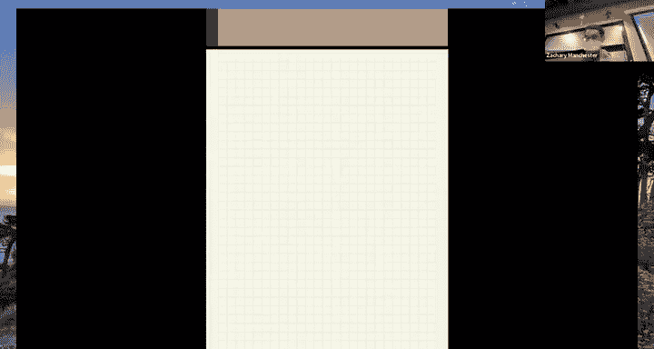

Last time。嗯。

What do we do last time， I think we talked we talked about like the general。

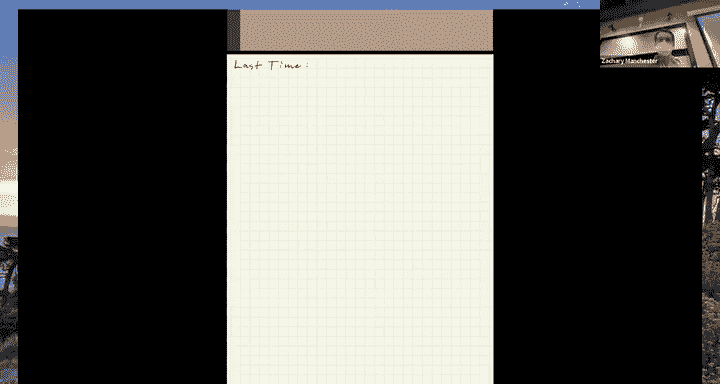

Stoch a optimal control problem。 Do we finish off ILC last time my brain is fuzzy So we did。 Yeah。

 we finished off。

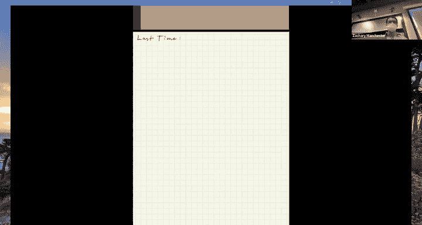

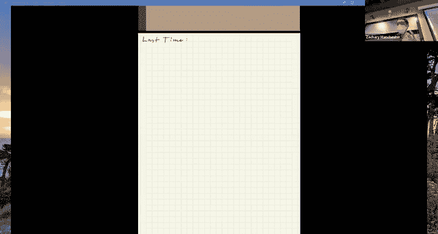

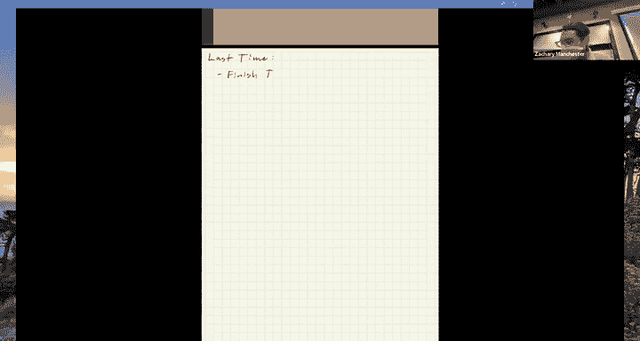

We did some finishing stuff on ILC， then we got into like stochastic optimal control。

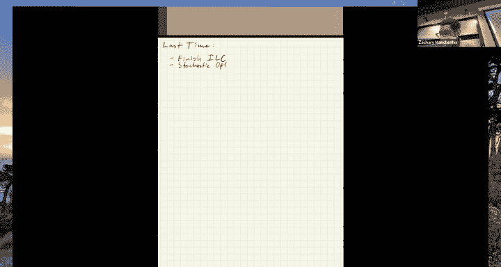

刚才。Yeah， right， and we talked about the LQG problem。

At a high level， so today we're going to basically do the second half of the LQG problem。

 which is sort of the callman filter optimal estimation story and how those things connect together and then also maybe a little bit about like duality ideas you guys heard of this。

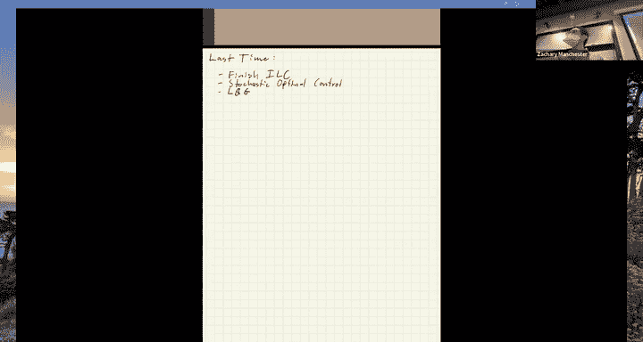

It's just fun， this like idea of like Calman filter and LQR being dual in some sense。

嗯。Yeah， I'd like a bit of a spin on that to talk about。Oh， and then yeah， we'll see how far we get。

So kind of finishing the LQG story。And then the next thing I want to talk about。

 we'll see if we get there today is sort of。

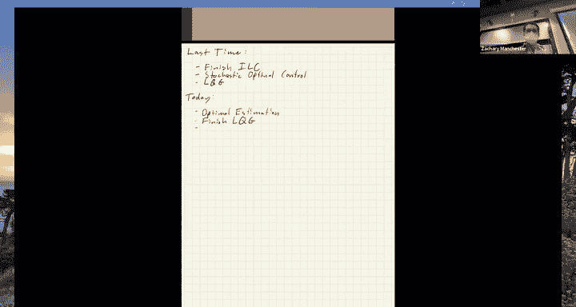

We're a little bit about robust control。

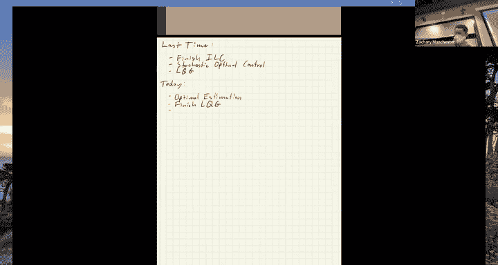

Which is a fun topic that's like related to what we've been talking about。

I can't spell。

Okay， cool， any questions on any of that stuff？If don' get。

Okay， so。To like summarize the the situation last time， right right。

 we ended up with these kind of like pair of related results。

嗯。好。That sort of worse， we said they're special to the LQG setting。

 but they're very commonly applied in practice and these are the certainty equivalence principle。

And then also the separation principle。

嗯。

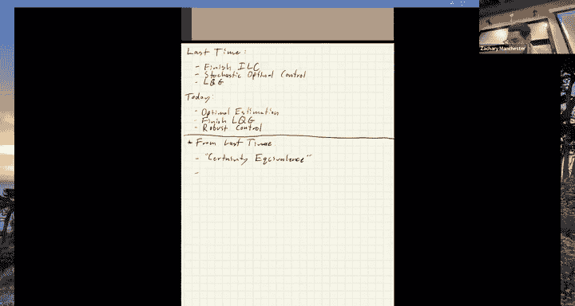

And the sort of takeaway message from that whole discussion was that in the LQG case。

 you can split the controller in the estimator apart。

 design them separately and then just put them together where you take the mean or maximum likelihood state out of your estimator and just feed that into your controller and if that's kind of the optimal thing to do we said you know even in the nonlinear setting we still do this all the time and there's kind of good reasons for this actually so similar reasoning to the fact that we apply LQr to all kinds of nonlinear systems right by arguing that it' it's actually the local approximation to the optimal policy in some sense right so if you're not too far off from the optimum and you just want to track and stay close it's a really good approximation in fact it's pretty much optimal as long as they're not too far away for really kind of similar reasons this LQG thing with the separation principle and all this stuff in the like small noise。

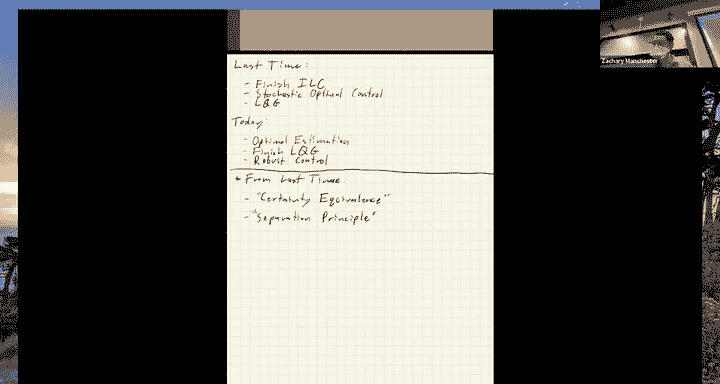

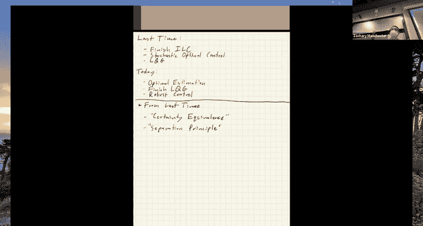

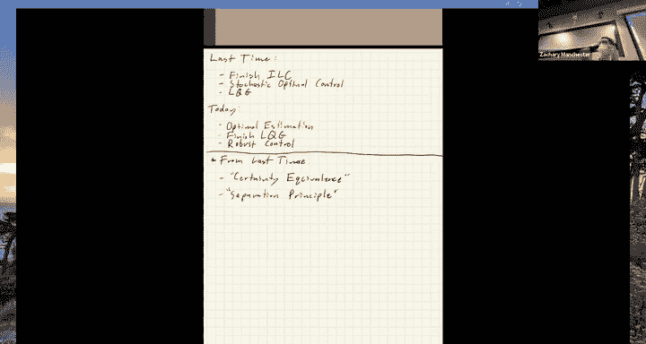

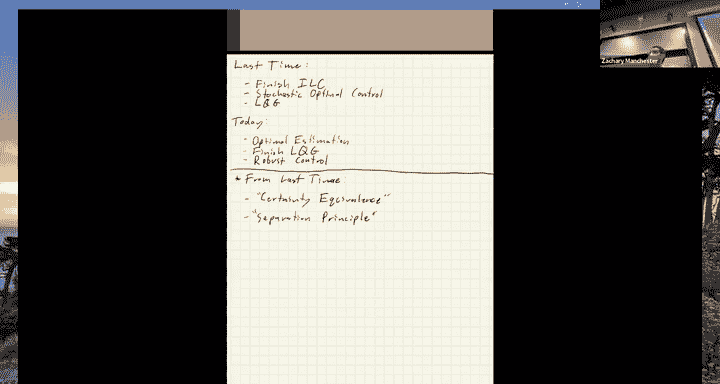

You're pretty close to the you know desired equilibrium point or trajectory kind of setting this is again the local approximation to the optimal thing so when this stuff works it's pretty close to optimal as long as you're not super far away where you're getting into sort of non nonlinear or non Gasian territory if you're close even on a nonlinear system the stuff still is pretty close to the right thing。

Okay， cool。不是。

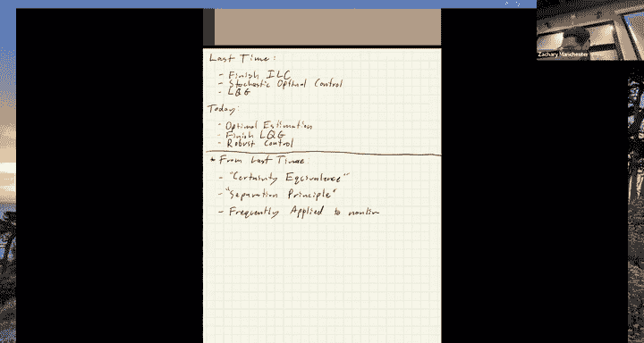

So today I want to just talk about。The other half of this problem。

 So last time we basically said we argued that this separation thing applies and that you can design these things separately then we talked about how this was just LQR with this maximum likelihood state estimate plugged into it so today we're going to talk about how to get that maximum likelihood state estimate so the name of the game here is optimal estimation and this is a huge field basically there are other courses in this that you should consider taking if you're into this sort of thing but I want to sort of go at it from a sort of optimal control standpoint and how many people in here have seen the call and filter drive before guessing good number of you okay so we're going to do it in maybe you know more or less under than I want to want to show you some interesting connections to the stuff we've been doing and maybe some things you might not have seen regarding like this kind of duality stuff so。

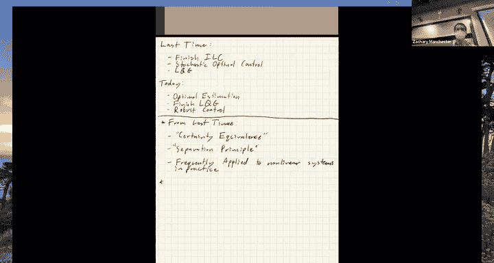

Let's do that。

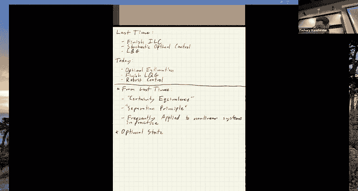

So more stochasticky things for today， and then we'll kind of get back to you。

Tministic stuff so the first question is， when I do optimal state estimation。

 there's this question of what should I actually optimize， and I'll show you what I mean by this。

Okay， so I mean， anyone have any thoughts on this， what am I actually optimizing in this setting？

你把其他就。不s。Likelihood of the。

Something， something conditioned on the measurements kind of there's like a bunch of things you could optimize。

 I guess is what I'm getting at right so you could do that you can maximize likelihood。

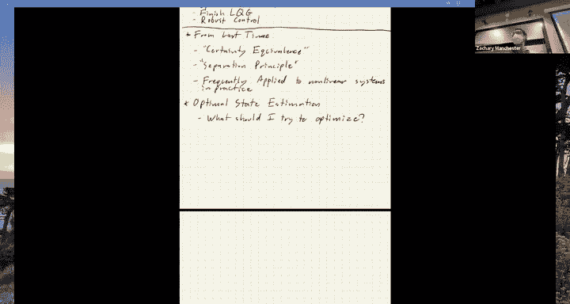

You could also。Minimize the sum of the squares of the errors right these are like kind of there's multiple like objectives you could write down to optimize here right so let's write down a couple of these things。

So here I'm going to write down a probability distribution。

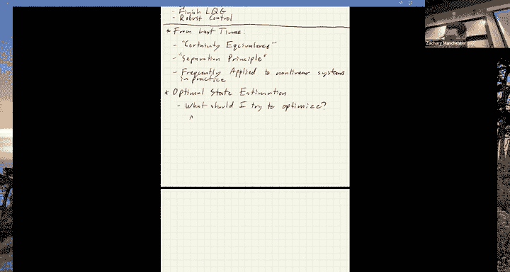

And then you tell me what you think we should optimize。 So I'm going to draw a weird one。

 So let's like say we have a distribution that looks kind of like this。

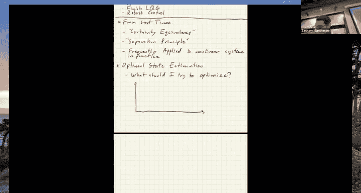

So like non gausing for sure。In this setting， like so this is like P of x， say this is x。

If I did the minimum mean squared error kind of estimate。

Where would I land to make this even more dramatic if I had something that looked like this。

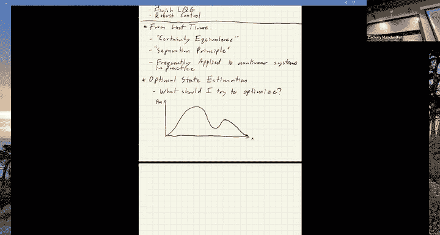

好。So like if I did， you know least squares basically right， minimum mean squared error。

 what in this picture is like going to be roughly the minimum mean squared error thing？

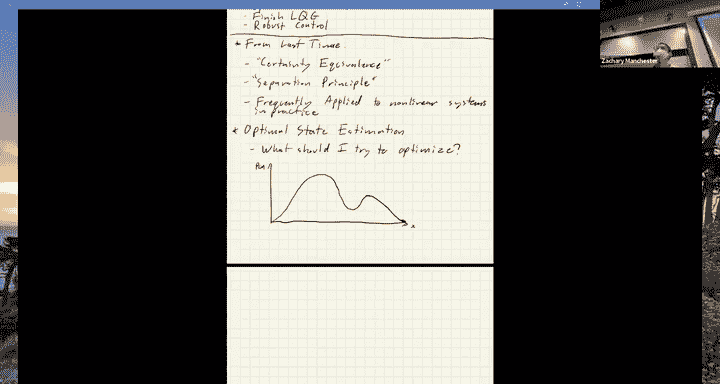

Any dont have any thoughts？这个根据。It's going to be sort of in that low probability thing over here right。

 it's going to be somewhere in this area probably right。

 So this would be sort of what we call minimum mean squared error。

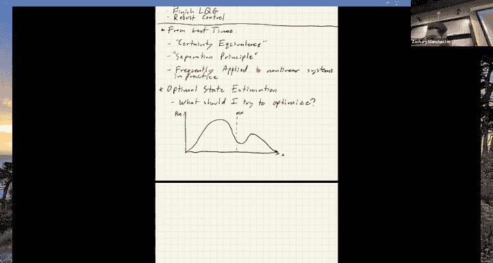

And so this is like the argument is this is probably not a very good state estimate in this case。

 right it's actually got very low probability。

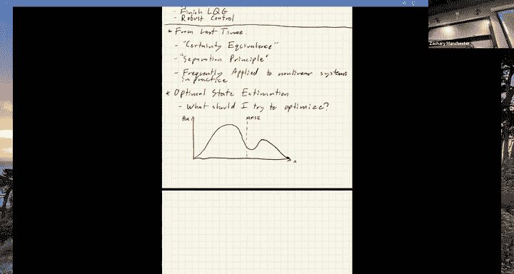

And then the other ones is kind of maximum likelihood or what's sometimes called the maximum a posterior or math estimate。

 what would that be？

Yeah， that's the peak right of the distribution， so this would be sort of here probably。

And so the argument is like。Depending on the situation。You know。

 you might want to do one of these or the other or just the fact that it gets weird in general for nonlinear。

Non Gaussian， you know distributions。 It's actually kind of ambiguous what you should be doing here。

 And this is why this is going back to the whole like separation principle thing again。

 this is why in the more general context， you can't generally split the estimator in the controller and like in this more general setting。

 you actually need to develop controllers that are reasoning about the whole probability distribution So you can imagine in this setting。

 if you have something multimodal like this， if you have a controller that sees the whole distribution and reasons over the whole distribution。

 one thing you might consider doing is driving the system in a certain way with your actuators to try to collapse that probability mass into a single mode that's like a thing you might be able to do with the dynamics and the sensor that you have。

 So this is like the sort of thing you might do in the general setting that you can't do in this separation sort of context right Okay so let's say the last question is this map and MMc thing。

 what happens in the case of a Gaussian。

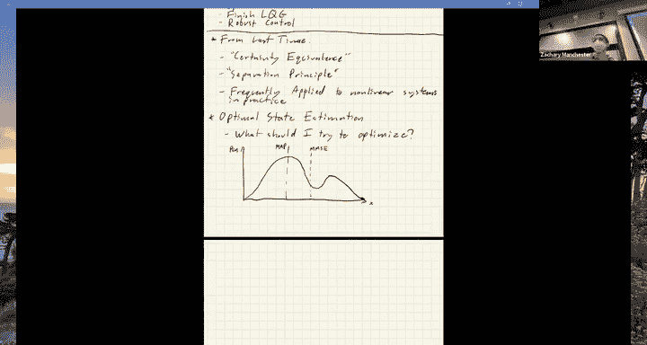

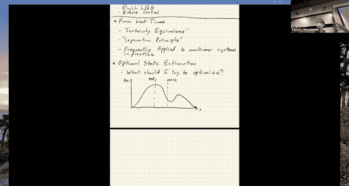

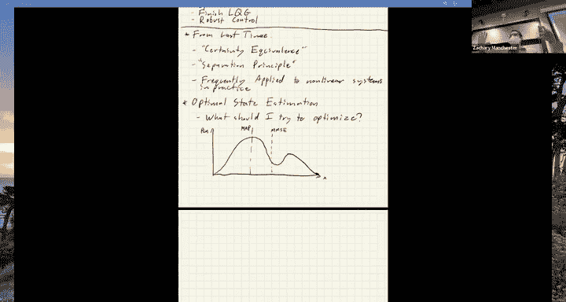

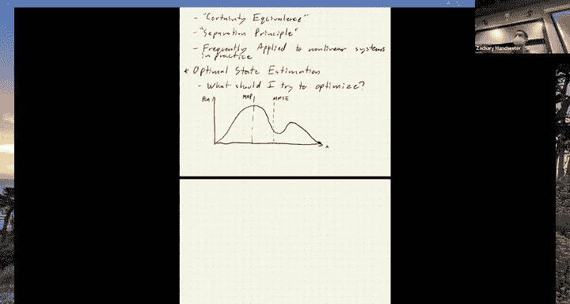

They coincide right so we're going to stick with that setting。

 which is the callman filter LQG thing right gasline distribution in which case these things are the same and we're actually going to stick with the their equivalent we're going to stick with the minimum mean squared error。

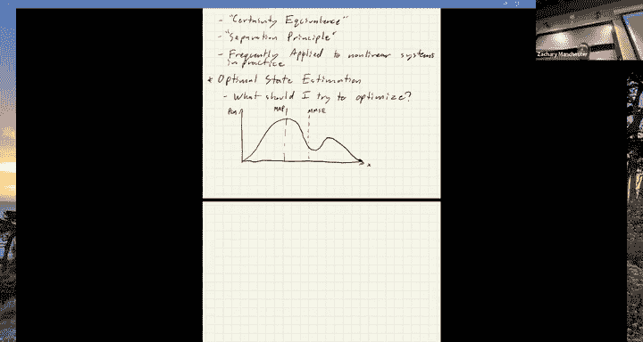

Derrvation because it's clean and pretty straightforward。

 You can also derive the common filter from a map， like maximize the。Um。

Find the peak of the distribution perspective。

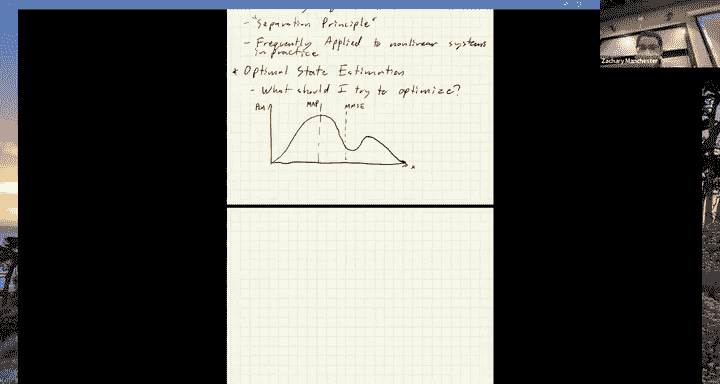

So let's see。Let'sTite that out。So。

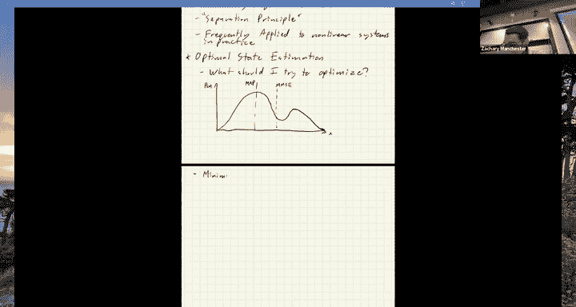

Minimum。面。Squared。Hello。So this is。If I have my distribution。

 what I want to do is take the arg min over x of the expectation of。X minus mean。Sorry。

 this should be， I'm actually minimizing over。Ex hard。

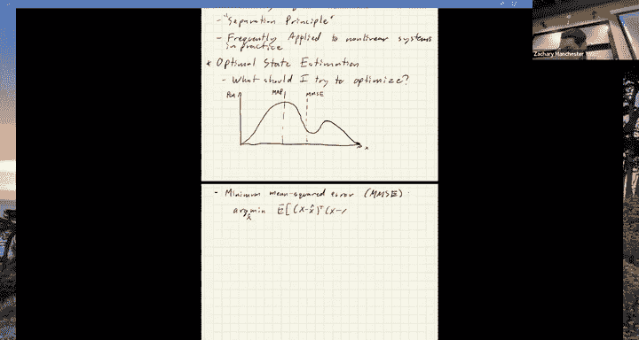

So， this is。Same as least squares or another way of looking at this is also like a minimum variance。

 right， that's kind of what we're doing。These're kind of all the same thing。

So this is like the cost function we're going to optimize， right？ let's see。

Okay so and then I mentioned last time that we didn't actually do it this thing called the trace trick I don't know any other name for this it's a cool trick it's how I told you last time that that like w transpose pW thing if you actually want to compute that it's trace of big w times p this is how you know that so。

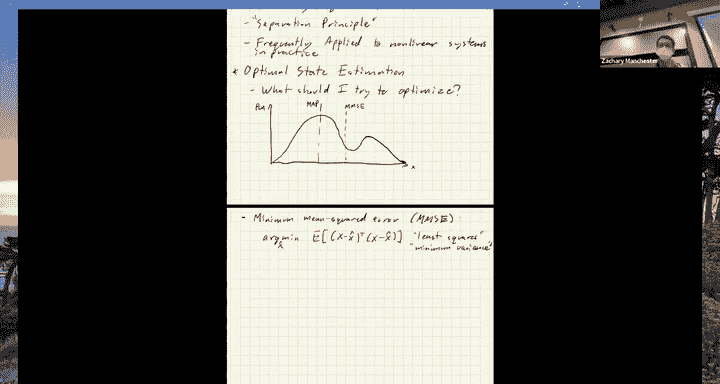

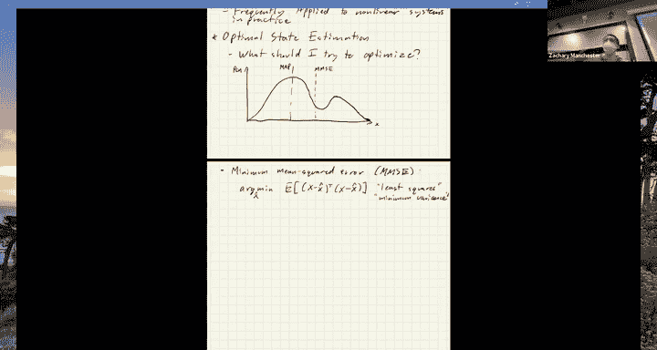

U。I can do。

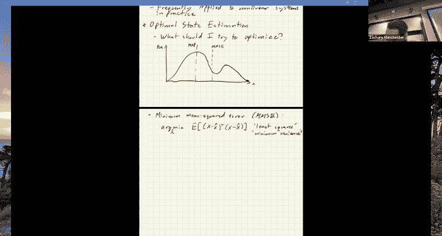

I can take the stuff inside， the stuff inside is a scalar， right？

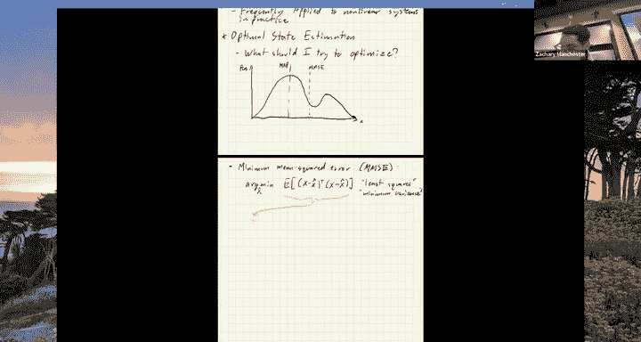

So I can do the following thing。

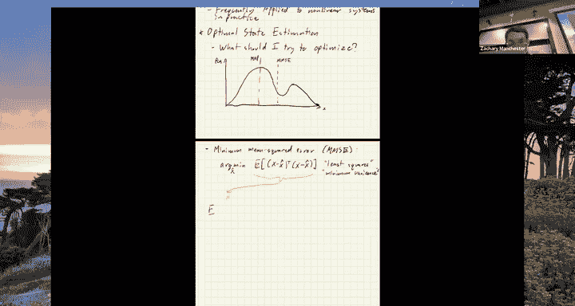

I can wrap the stuff inside in a trace so I can write it like this。嗯。And sort of trivially。

 this is true because the thing insides a scalar。It turnsur out when I take a trace。

 I can cyclically permute the stuff inside the trace as anyone' heard this before。

 so I have like trace of ABC。That's equal to trace of BA， C， you get the idea， right。

 So this is equal to I can switch the ordering。

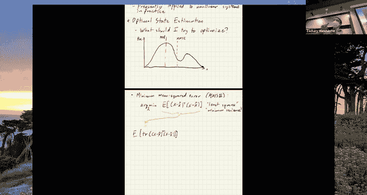

And now this is equal to trace of。X minus x hat times x minus x hat transpose。What's that？

From yesterday or last time。Yeah， or it's the covariance right， so in this case it's if it's X。

 it would be the covariance。So this is equal to。Thrace of covariance matrix。证人随个。

I did that so basically inside the tray I'm allowed to switch the ordering of the matrices。

 so I go ahead and do that and I flip this inner product into an outer product。

And that outer product is the definition of a covariance。

 So now I'm saying like this is just the trace of the covariance。

 Yeah inside So I can take the trace of a scalar。 It's like the same number spit back right It doesn't change anything So that's legal I'm saying then I can actually take that thing inside and mess with the order because that's invariant under a trace So I go do that now it's the outer product and say the inner product that makes this matrix's also trivially right the thing the inner product it's the sum of the squares right if I make the outer product that's giving me every squared term possible product and the diagonal of that matrix is going to be you know the squares of the individual elements of the original vector right you can think about it that way too yeah。

😊，呃Did。

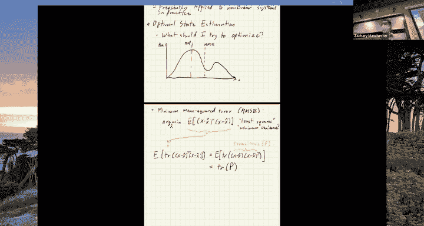

So through the same the。No， I got rid of the expectation， yes。

 so the expectation of x minus x hat times x minus x hat transpose is the covariance， right？

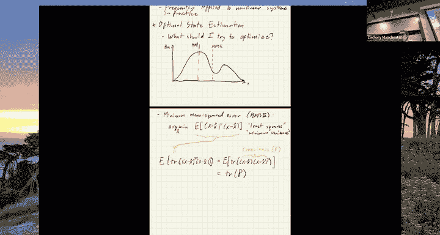

Trace and expectation of a linear operator so I can。

Flip the order of those two so maybe I should be more sort of pedanttic about this。

 So this i'm allowed so the legal moves to go all the way here if I'm being like extra。

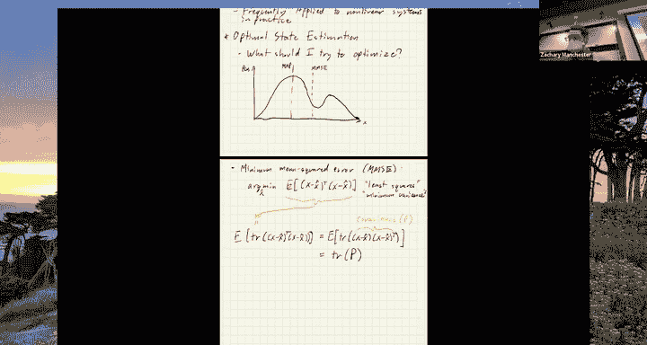

You know， detailed about this would be this then is equal to。

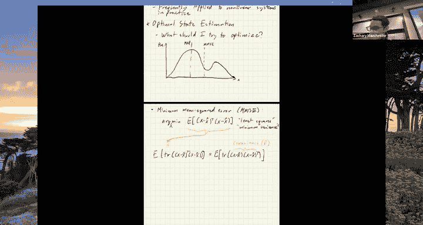

Trace of the expectation。

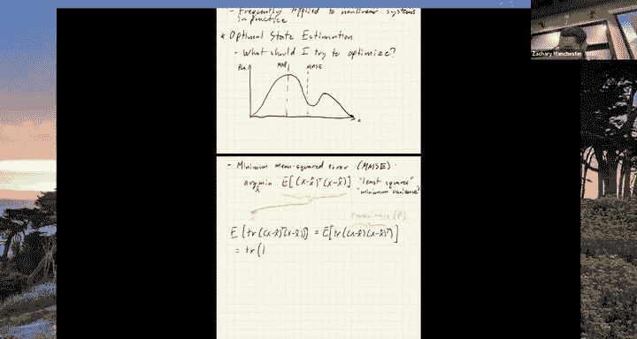

Of。X minus x hat。X minus x hat。Transpose。And that's equal to now。Trace of the covariance。

Does that make sense？YeahOkay， yeah， I I skipped a move， sorry。But yeah。

 so basically there's a bunch of like linear operator kind of assumptions in here。

 which is like why I can flip trace and expectationification and then the trace trick specifically is this idea that you can permute anything inside of a trace and it's legal and it givesy the same answer。

Okay， cool， so this is going to show up a bunch it's also like kind of a fun trick that's generally useful it's worth knowing about。

Full of good linear algebra tricks。Okay， so that's this and then the other one that we talked about is the map we'll just write that down we're not going to do it this way。

 but this is one of the other things you might think about doing and you can also derive everything this way to for a column folder。

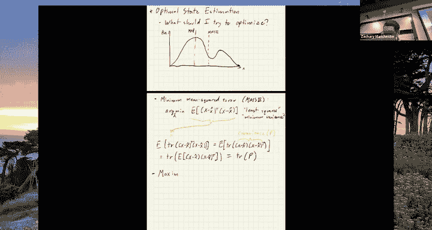

So this is called maximum。

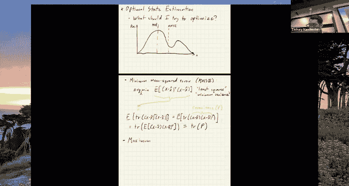

诶。Posterii or map。And this is just what we did there， right this is AG Max。X of。

So this would be like what we talk about right， so if you take the probability distribution of the state condition on the measurements。

嗯。Condition on the measurements。This is going to give you like and they just maximize that right this is like the maximum likelihood kind of kind of idea and then last thing we said was this is the same thing for E Gaussian。

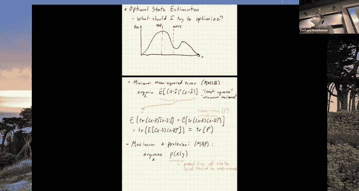

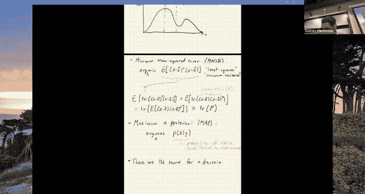

Okay， any other questions about this？Good， all right。

 so now we're going to do the commonman filter thing。

 and there's actually like super deep connections between this stuff and the。And the LQR controller。

 and these are like very， very similar problems。We're going to kind of I'm going to do this and I'll explain some of the the overlap and connection so we'll go through it first in a very stock like。

Classic statistics way of drivingr this。Yeah。And then I'll talk about how you can maybe think about doing this in some of the ways we talk about in class。

And where those connections are so first off， we're going to do it from the following standpoint we're going to drive this as a recursive。

Meaning you update it online or， you update the estimate as new measurements come in recursive linear。

A minimum mean squared error。Estimate estimate matterter。

You can do this other ways to your you can do the mapway。

 so here's the ingredients we're going to assume that we have an initial state estimate。

That includes all measurements up to the current time。So like that。

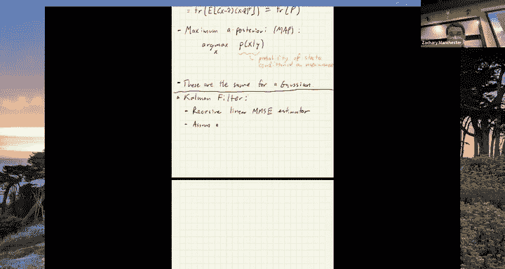

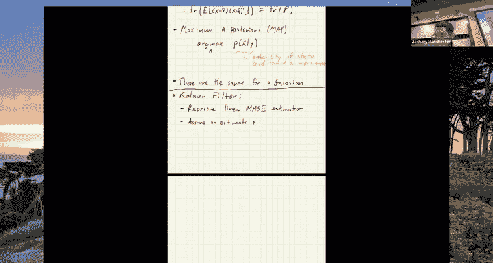

And this， we're going to write。Like this， so this would we're going to call this。

 we're going to use hat to denote estimate。And then we're going to write underneath this is X hat at time K。

Conditioned on all the measurements up to time K， that's how we're going to write this。

And then this is equal to the expectation of xk conditioned on all the measurements y from time1 through k。

That cool with everybody so it's basically all the measurements i've gotten so far up to now are sort of sooed into this data estimate that's what i'm using for this。

Okay。Yeah， so these are something that you other mark on。We are。

 so we're assuming the linear dynamics， blah， blah blah the LKG setup that we talked about last time。

 which is Markov。Yeah， so we only need what we're saying here is that everything there is to know about the state is summed up in this X hatt K given K and then at the next time step we're going to bootstrap on this and update it and it's all going to be。

 but yeah so it is Markov， we are assuming this very much yeah。

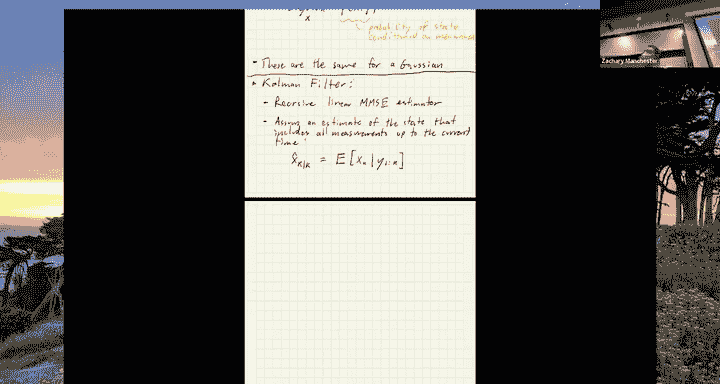

Okay， so I mean， this is kind of saying that basically so this is saying you don't need to worry about y1 through k that's already smushed into everything you need to know about those measurements is smed into this X hat。

Okay， so we have that and then we also have。嗯。The covariance on this state。嗯。

That looks like the following we're going to call this， I guess。

Will you hate me if I use P for this covariance？Ors that going to be should we use sigmas。

 what do you guys think？He is okay。Sigmas， we want these segmentsma。 Okay， we'll go with Sigma。Yeah。

 that's a good move， I made this mistake last time。Apologies， okay。

 so we're going to call this big sigma。This is the expectation of。Xk。Minus x hat k， given K。Okay。

 and specifically right that exha， that's the。Current， right estimate， and then this xk。

Is the actual state right， so saying the error I。e。 you know the truth minus the estimate。

mIs distributed like this covari like a Gaussian with this covariance。

And then the move here that we do with the Kleman filter is we want to be able to update X hat and big Sigma。

To include a new measurement at T cable1 and then if we can do that。

 now we've bootstrarappped this whole thing， we just do this for all time， right this is recursive。

So that's what we're going to figure out how to do。Okay， that's the game。

诶。Also definitely yell at me if I use P instead of sigma， this is likely going to have it。

Apologies in advance， okay， so here's how we're going to do this。So the common filter can be。

 we can break this into two steps。对。And we're going to kind of we're going to bake in a lot of sort of prior knowledge of what this things should look like based on the fact that it's linear and it's an MME estimator and then we're going gonna just go figure out what the details should be later so the first thing is I want to predict the state so that means what I want to do is find X hat at time K plus1 given the measurements up to time K this is why it's called prediction I'm using X hat K given K to produce a prediction of what it should be at K plus1 but not including any new measurements right in make sense that's what that subscript notation means so this is the expectation。

If I only know you know this stuff up to time， okay。

 another way to write this would be I can plug in my dynamics。

And I've got the noise on there right this is from last time the stochastic dynamics。

 this conditioned on measurements1 through K。

And because of linearity， blah， blah， blah， I can actually just pull this out。

And say this is going to be。So in particular right taking the expectation over the state。

 the expectation of w on its own remember is zero is it zero mean so I can pull this all out and this has just been expectation of。

X hat。K given K because it's a is a linear operator expectation of xk is just X hat K given K here and then the BU term is a constant and this is just going to add on。

Here。Cool。mean， yeah， that's the estimate a time K given measurements up to time K。

So and then like the X hat K plus one given K。Is the estimate at time K plus1 only including measurements up to time K？

Meaning I took my previous estimate and just propagated it forward one time step through the dynamics without having a new measurement yet。

And the game here is going to be to calculate X hat K plus one given measurements up to K plus one。

 I'm going to incorporate the new measurement y K plus one does that make sense。Cool。

 there's I mean there's a bunch of ways of writing and I think this is the clearest the other common notation for this is hats and tildas。

Where like hats are the updated ones until ts are the。

Predictions and stuff and I find that way more annoying and way less clear so hence this notation you see hats and siggles that's the other way to go not a fan of the hats and squiggles personally so。

Okay， so this is the state prediction， the next thing we need is the covariance prediction。

So this same deal。What is and I did it already， Sigma。I call myself though， okay。

 so sigma K plus one given measurements up to time K， so we're going to do the exact same thing。😊。

We're going to write down the definition。Of this thing with sort of the dynamic。

 and we're going to plug in the dynamic。 So this thing is。

The expectation of x k plus 1 minus x hat k plus 1 given k。

So this is definition of the covariance just at the next time step blah， blah blah。

 the predicted state right so I going to I'm going to go ahead and plug in the dynamics。

And I'll use a little shorthand here because it's sort of annoying， so I'll plug in。

 so I'm going to write everything down， I'll just do it and then we talk about it。

So this thing times the same stuff transpose， right？嗯。Okay， so。The next thing to talk about is。你啊。

We're going to get rid of all the constant stuff。So like these guys。

So does everyone see that those cancel out， right？One's got a plus one's got a minus and they're not。

And there are constants， right with respect to expectations， so those go away。

And I'm going to group these things。And also I can pull out the A's。

 right the A's are linear expectations linear I can pull the A out front of the expectation。

So this is going to look like a times expectation of。X K minus x hat K given K。A transpose。

 and then I'm going to get a new term。With the Ws in it， so this is expectation of WK， WK transpo。

Okay， so the first thing here， the thing inside the A's。This is just our last covariance。PK and Nk。

And then this thing over here， what's this？这个。2。I'm sorry it's like mental block I can't help myself this is I always use peas for this in my normal life and it's it's challenging。

Okay， so that's what this thing is。What's the other thing on the right？The WW transluter。Yeah。

 it's the process noise covariance， which last time we call big W。Cool， so in conclusion from this。

This thing is equal to a times the last。Covariance。Let' say transpose。

Plus， the。Process noise。 So this is like super intuitive。 I mean。

 really what this is doing is taking the previous time step covariance。

 mapping it through the linear dynamics。And then adding on the process noise from the dynamics at that time separateever。

一。So for whom though'll be。What what exactly is in that vector is it really just like what we expect to see like might like if we if we take what we expect to see least to。

I iss it just like the difference between like the actual state and the expected state so little W like the setup here is we're assuming the dynamics the actual dynamics are stochastic like that there's inherent noise in the dynamics that you have like a dynamic process driven by white noise。

So this is like not often like the case in a robotic system like examples of where this would literally be true are like wind gusts where you like really have no prior information about what these things are going to do So if I go fly a quadro or airplane or something outside and there's wind I'm really not you know I have no way of knowing's I mean there may be some constant wind but on top of that there's gonna be gusts right that josy you around like this and those are truly random in the sense that they're not predictable they're not something I can put into a model they're really random right so that's what this is about it's that kind of like actually random stochastic stuff that's happening that you can't model。

There are tons of examples of this， but there's also like usually in robotic systems like we care about like you're kind of alluding to。

A lot of times they're pretty much deterministic and the true noise is really， really small。

 the true like process noise is very， very small， but a lot of times when we implement filters like this。

 we use this noise term as basically a place to throw any modeling errors and like mop up model errors it's not supposed to be for that this isn't a common sort of thing to do it's kind of wrong from a strictly statistical perspective but it's a super common move in practice to use that process noise to like inflate that process noise term as a catch all for any model error that you've got。

If that makes any sense。Yeah， I think so hopefully this will be clear we're going to do this in code also where and literally in the code what's going on is you have your dynamics x plus BU plus a w that's at each time step is sampled from a Gaussian。

 it's actual noise， Gaussian white noise that you're feeding into the dynamics at each time step。

So every rollouts different right like you've always got this noise added on and it's part of the dynamics you're basically saying like the system is not 100% deterministically predictable。

 there's some noise in there that's inherent to the dynamics that's there all the time。And yeah。

 think think like wind gusts， I think is like maybe the clearest example of this where it's going to be different every time you roll it out。

It's sort of inherently random。好 yeah。UR model， could you also tell also them out right filter just actually on the end of the。

Yeah， so you can basically smooush anything you want into W。

 I'll give you an example of that in a second， essentially like what you're talking about。

 you just take whatever it was and smush it between some Bs and it would like look like this still or you can come up with the equivalent W sort of like any anything like that that you would like to have。

So we're going to do this for like a random walk process where it's like actually acceleration noise。

But I can in discrete time， I can like convert that to one of these ws pretty easily with like some matrix math and I'll show you an example of this。

Anybody else。Okay， cool， so that's how you do the prediction stuff。Easy enough。

So the next step is a lot harder and this is called the measurement update so we predicted we've got what we think it's going to be at the next time step now we get a real measurement from our sensors we try to fuse that in to update our estimate at the new time step。

 right？

So this is how you do that。啊。

And I didn't actually write that this was the prediction step。That， bad Z。

Okay， next。Where did this little peak come from？

Did I mess up when I drag this？

Oh yeah， thanks， how did I do that？😀ふふ。😊，Thank you。

Okay。measurementeasurement update。

嗯。

Okay， this is kind of the tricky part。We're going to take some shortcuts。

 but okay so the first thing we're going to do some of this will seem weird and arbitrary。

 but it'll hopefully make sense at the end so the first move is we're going to define this thing called the innovation。

嗯。And this is literally the error in your between your prediction and your actual measurement。

 so what it is we're going to call it Z。This is， I take my real measurement， why。

It's the difference between the real measurement y and the predicted measurement from the state prediction。

 so I'm going to take my state prediction X hat。K plus one given K。

 and I'm going to run it through my measurement model， which is here it's linear it's a C matrix。

 So it's literally like my expected y is C times that state prediction right I'm going to take the error between that prediction and the real measurement。

And we're going to then。What is this？Oh， right。So if I expand this。

This is equal to I'm going to plug the dynamics and like。What this should be right， so this is why。嗯。

So assuming I know the true state， this thing would be c of x。

C times x K plus1 plus my measurement noise V。嗯。And then。Minus this guy。

This is going to be useful in a second。Just clear everybody yeah this is okay， yeah。

 I probably should have done a little summary at the beginning we're assuming a dynamics model。

Here， let's like write this out somewhere。

I'll put this here and then we can talk through。

Okay， so。Like the LQG model。That we're using， which we talked about last time， but yeah。

 it would be good we're assuming the dynamics look like this。And we have this noise input。

And we're assuming the measurements look like this。

And that。

WK is drawn from a Gaussian distribution with zero mean and covariance big W。

 and VK is drawn from a Gaussian distribution with zero mean and covariance big V。

So we did this last time a little bit right just as a refresher so everything zeroing Gaussian on the noises and then we're assuming linear dynamics like we've been the whole time。

 but they have this process noise out it on and then a linear measurement model and by measurement model I mean a function that maps the state into what the sensor should see so an example of this for us that's linear like this would be let's say only have let's say I have something you know that's driving around like 2D car or a double integrator model and I have only position measurements right so that C would just pick out the first part of the state vector that has the positions and not the part that's got the veloc and that's pretty standard kind of thing that you would see right and you can imagine pretty much any kind of sensor you can imagine you can make a potentially non nonlinear but you can make a measurement function that looks like this that says given a state here's what I would get out of this sensor so in IMU you can do this like pretty much anything you can take a state and predict what the sensor will see from that right that makes sense everybody。

Okay， so back to this。So the next thing we need is。This is the innovation right。

 so this is the error on the measurement given the prediction。

We need to calculate the innovation covariance sort of unsurprisingly。So this we're going to call S。

K plus one。And it's the expectation on Z。sorry， the covariance of Z。So it looks like this。

And now we're going to do the kind of unsurprising thing and expand this and figure out what it should be。

 so I'm going to plug in that line above。So it says C times the true state。Plus the noise。Minus。啊。

The prediction。And then like this thing times itself transpo。

And now I'm going to play the same games as before and pull these out。The move。

 there's like a couple tricks in here， the one is that I can pull out the C's just like I did with the A's before because they're linear。

And the other one is that V， well let maybe I write this down before I do it。V K+1。

 which is the sensor noise right， and x K plus1， which is the state at time K plus1。

 these are uncorrelated。Does that make make sense everybody。

 like it have basic sense like the sensor， the noise on my camera or whatever。

 we're assuming here that it's not correlated with the state。

That like the noise you see in your sensor is independent of your of your state in some nonlinear settings that might not be true right you can imagine how if you have a camera。

 you might have more noise on your pixels if it's pointed at the sun or something like this right so that maybe there is a correlation but here in the LQG setting we're assuming these are uncorrelated so saying no matter where you are you're getting the same noise on your sensors that everyone clear with that。

And so specifically what that means， as we talked about last time， is that。

The cross covariance between them is zero， so there's no。

 I don't have to worry about the cross terms between those guys in the expectation。

And so then that tells me I can do the following thing。I'm going to pull the Cs out。

And the stuff inside is going to be。This。😊。

啊。Okay， so what's the first thing？可。Yeah， big sigma。Yeah， now you're doing it。It's terrible。Okay。

 so this thing in the expectation up here is just our state covariance， right？The predicted one。

 right K plus 1 given K。And then this thing， what's the second term？可以。Yeah big V。

 the measurement noise covariance cool So then from this whole thing we know that the innovation covariance is equal to C times I was about to write a P。

Terrible。Sorry。😔，C transpose plus V。So it's a lot like the other stuff right Okay。

 so the reason we did all this is innovation is the error on the sensor measurement right so innovation is the actual thing that we're going to feed back in the estimator that's what the feedback is on。

In a sense of like a feedback controller， right？

So that's why we did this。

Okay， so now we're going to write out。

The whole thing， so let me see if I can。

What if I like get rid of for now and I'll throw back in later。

Slash it's in last time's notes if you need it Okay so's。The state update。In the filter looks like。

X hat k plus1 given K plus1 right so the updated state with the new measurement。Is equal to。

The predicted。State， so K plus1 given K。Plus。A feedback term on the innovation。 So L。

I's going to be our feedback game。LK plus one。Times Z K plus one， so it sort of looks very much like。

 you know， like LQR feedback， right？It's kind of the idea。

This L here is you'll often see this thing called K。

 you'll also see a called L you'll see it called K for Kman。

 you'll also see it called L for Luenberger， an owner of Luenberger is like another famous name in this area。

We're going to call it L so we don't confuse it with the LQRK。Incidentally。

 Coleman did both the Calman filter and LQR right？Fun fact okay so that's the recipe that's how we do this the only thing we're missing now is well actually question said the only thing we're missing now is the recipe for computing L。

Right so there's an optimal l and that's what we're going to figure out I missed one more thing we actually have to also update the covariance so I spoke too soon so this is the state update we also have to do a covariance update。

Which is not hard， we'll do that real quick。It's very much along the same lines as the stuff we've been doing。

Here's what it is。K I P。Okay， sigma K plus1， given K plus1。Is rather the definition， expectation of。

X K plus1 minus x hat。K plus1， given K plus1。Kinds itself transpose。

And so I'm just going to plug in the update equation。

Into this and we're going to expand it out the same way we've been doing。So this is expectation of。

Xk plus1。Minus。X hat。K plus1， given K minus。L。Okay plus one times this is going to be a little messy。

 We'll go quickly。 I'm not going to bore you with all the details of this。

 I'm now going to plug in the definition of Z。 So this should be a Z， right， So this is。C， X。

 K plus1 plus V K plus1 minus C X hat。K plus one given K。Okay， this times itself transpose blah。

 blah， blah， again。Mo this over。So this times dot dot dot transpo。Okay。

You just foil this whole thing and soll I'll kind of go quick here。 There's one more trick in here。

 which is that similar to before V K plus one and。Xk plus1 are uncorrelated。Okay。

 so I'm going to do a bunch of。Foil， blah， blah， blah。

 simplify it down and this is what comes out of this if you actually do add all the algebra。

It's not worth。You know， sortr of doing the details I feel like so。Here it is。嗯。Okay。

Has anyone seen this thing before？Has anyone seen this look different before is the other question？

So there's like three or four different versions of this particular equation floating out around out there。

 this one has a name actually。This is called the Joseph form of the Callman filter update or whatever。

And this is the best one。So in particular， the reason this is the best one is this one is symmetric。

TheThe other ones are not symmetric and this one also only adds symmetric terms。

 so this one basically guarantees that。The sigma at the next time step is symmetric positive definite even in the presence of numerical roundoff there which the other versions don't so this is from a numerical you know sort of finite precision arithmetic perspective this is the best one to use they're all mathematically equivalent and like infinite precision but on a computer this one's not going to sort of give you stupid asymmetric。

Indefinite covarience matrices。It found off error。So I don't know fun fact Okay。

 so this is the whole recipe for the filter again the piece we're missing now is how to compute L so now we're going to do the how to compute L story。

😊，So this is called the Coleman game。And this is not so terrible， it can be terrible。

 but we're going hopefully do it in a way that's not so terrible and sort of hand wavy so here you go so this MME thing。

That we talked about， this is saying that what we really want to do here is minimize。Expectation of。

X K minus x hat K given K。

挂了八。Oh， I put the transpose we're going to use the trace trick again， that's sort of foreshadowing。

 I guess Okay， so that's the thing we want to minimize。This， as we argued before。

Is just the trace of。sigma k given k。Right。On the tray trick。

 So here's how we're going to get this thing。 We're going to。

Take the derivative。Of this thing。With respect to L above。

Right， so up here in this equation for。

In this update equation up here， actually。So we just wrote down this Joseph Form thing。

 that expression， right？

That's got a nail in it and it's got a signal in it right I'm going to take that whole thing。

Take a derivative with respect to L and set the derivative equal to0。

And this is sort of nasty because it's。And then solve for L。So let's look at that real quick。

 what kind of function is that thing in L？

Yeah it's qua adratic L it's convex in L right so if I take its partial derivative respect to L i'm going to get a linear function in L right and it actually looks exactly like the LQR how you find the game matrix and LqR basically take this case derivative respect to L that equals zero I'll get a nice linear function in L I can solve for L that's the recipe。

It's not hard to do i'm just going to tell you the punch behind you can do it yourself if you want to try it's just like a bunch of algebra here's the the answer is。

。O。So we're taking a little shortcut yeah。Thank you。

So there's basically three lines to get to this of algebra， it's not terrible， but like I don't know。

 we've done enough of this already， so that's how you do it。

Okay， so to summarize the whole algorithm。So first we。Start with。X hat。

Like this kind of at time zero， whatever initial thing and sigma。

Initial covariance and we know the W and the V， the covariance is on the noise， right。

 so that's all the stuff we need。Then next we're going to do a prediction。

So we got x hat k plus1 given K is a。X plus B in the usual way。

And we do the covariance prediction up， I did it again。食吗？K plus one， okay。This is the。

Sigma sandwich。Plus the。Process noise。

Next move is we're going to calculate the innovation。And the innovation。Covariance。

And this looks like got Z。

Is actual measurement。Minus prediction。And then the covariance on that。Is another。Matrix sandwich。

Plus e。Measurement covariance。Next， we calculate the callleman game。That looks like。This。I did it。

I can't help myself。

It looks like that and then lastly， we update。诶。State and covariance。With that new measurement。

So that looks like this， we feed everything back in， right？And then the covariance of sigma。Yeah。你家个。

我讲你先。Sorry， where？Yeah， SN。Oh， did I mess that up Yeah， sorry， my dad。

Okay， and then。Then after this， you repeat， you go to to。Okay。

 that's the whole algorithm I think a lot of youve done this before as show of hands indicated。

 so questions and we're going to go do this and hook it together with all QR in a sec。

WWhatch should we said here， there's the first kind of question before we go and do it。

Actually， let's go do it and then we'll talk about it。Okay。Please don't die on me computer。

So here's the full LQG setup。What are we doing all right， so we've got。The double integrator in 1D。

 so like really simple system discrete time 0。1 Hertz。And now we've also got this。

Measurement model C， and that's just picking out the first state。

 which is the position right so we got status position and velocity。

Input is the acceleration effectively or forced。And we get to observe the positions。

 Here's the noise。 So we've got a。Process noise and what I wanted here is I want to make this look like a random walk which is equivalent to having noise on the accelerations or equivalent here to having noise on the inputs like you just said so that's how I do that I take some noise some noise on the input map it through B in the usual kind of matrix sandwich type of way。

I'm going to make these kind of small at first just and then I've got measurement noise。

 so these are the noises on my position measurements。So this is where you're saying， this is the。

How I would map and input noise through， right？Okay， cool， so this is just bookkeeping。My LQR。

Cost weights， cost function， we might look at that in a sec， I'm going to compute an LQR controller。

Standard Infin Horizon OQR stuff。Initial conditions for the true state and then initial conditions for the filter state。

 so I'm going to actually put a pretty big error on this thing I'm going to start it at the origin and the you know filter and then like an identity covariance。

But the true system is going to start out at like shifted over a meter to the right。Okay。

 this is setup stuff I'm going to keep track of a whole bunch of things。

And here's what the actual loop looks like So what I'm actually doing here is like。

Just the measurement update at the initial time。啊。Without doing it a prediction step。

 I'm assuming I'm there I've already got this like X hat not。

 but I have a new measurement why not right so I'm just going to do the measurement update part。

So that's what this is， innovation， covariance，lah blah， common gain。

 and then exactly stuff we just wrote down， right？All the good seven I use sigma in here go me and then i'm going to take this X hat and use this X hat inside my LQR controller that's kind of the full recipe and then as we were talking about before right here's my these are my true stochastic dynamic so i'm evaluating A X plus B and then i've got this random white noise drawn from a Gaussian with covariance W added on。

Does that make sense？Does know why I have a square root on the W？So the W remember is the covariance。

 so it looks like noise it's the outer product right it's x times x transpose or Ww transpose。

 so if I actually want to get a sample with that covariance。

I need to take a square root and multiply it on by like unit Gaussian noise sample basically it's the difference between standard deviation and variance right so like the square root of w is like the standard deviation does that make sense so that has units of whatever the original noise step was this is yeah yeah。

t De， could you do the same thing but？You， you do have。Arror in your measurements。

 but you don't necessarily have to type sastic yeah， you totally can yeah。

 so in here in these stuff I just did if I just sent W to zero。

That's what that what would get right that makes sense yeah so there's some issues with that numerically in the commonman shelter basically what will happen is your over time your state covariance is going to collapse to zero which will cause numerical problems but theoretically yeah you can absolutely do it there are other types of estimators that are deterministic that don't make these stochastic assumptions。

Specifically， it's called one called the Luenberger Ob。

 which is where the Al for Luenberger came from。 That's the deterministic version of the linear estimator that you could write down So yeah you can write down deterministic versions。

 you can set the covariance in there to zero if you want to it'll work actually like you can just try this out You try it with the code later which you'll find out though is like in some settings it's gonna cause numerical problems because like some matrices will go singular and stuff like that in certain circumstances but you can definitely get away with it for a little while Okay so this is the initial time so you can see right like I started out with an initial estimate of 00 after just doing the first measurement update it actually gets this kind to write。

But the velocities are terrible right because I only have position information now I'm just going to run this for。

 So this is the whole simulation。I'm going to generate a measurement using my true state and then adding on measurement noise is the same idea。

 randomly sampling from a Gasian multiplyied it by the standard D basically。Cllman filter stuff。

 so this is the same stuff this is the state prediction and then covariance prediction that we talked about exactly we wrote down。

Calculate innovation， innovation covariance， common and gain。

Now I do the commons update on the state and covariance now i'm going to run my LqR controller using the X hat from the estimator。

 the state est from the estimator and I'm going to run that on the true system true states with this noisy。

Dynamics with the process noise added on so let's go look I put on a pretty small amount of noise and so this looks pretty reasonable like what you'd expect right it's driving the system to the origin。

It's a little wigggly， a little noisy。 This is the true state dynamics。

 and then this is the what the filter's internal estimate of the state was。

 You can see it's like a little bit noisier。

嗯。Let's see。 Let's do first， let me crank up the noise。 So this was pretty small noise， right。

 I crank this up kind of a lot more。 Let's look at what happens。

Actually， yeah， maybe we should do a couple more things for no。Let me do that。Okay。

 so like point one instead of point。时间。So you can see a lot noisier， a lot more wiggles， blah， blah。

 blah， we can also play around with like if I dial the let's say I dial back the process noise and just have measurement noise if you want to do that。

 you can set this equal to some really small number。

It's still kind of bad because of the measurement noise， right？

The measurement estimates are pretty bad。What else can we do？

Yeah， so that's kind of the deal of one thing I wanted to show you。

 this is maybe foreshadowing of some other stuff， so we'll go back to like something reasonableish。

These are the elements of the covariance matrix， so I saved all the covariance matrices as I went forward in this algorithm。

What's happening to the covariance matrix？It's sort of converging to steady state values， right？

Does this remind us of anything？Sorry。Sorry， yeah it looks like In rise and LQR right so what's going on here this is a linear time invariant system and just like in the LQR case。

The covariant and the coalman gain are both going to converge to steady state values on and。

Lar time invariance system just like LQR and this is getting at the duality thing and so in particular here right just like it with LQR I could actually precompute the columnman gain。

 the steady state value of the columnman gain here and just run with that and not even need to keep track of the covariance。

That makes sense， right if I was planning on doing some like long horizon thing for this linear time andvari system。

Anyone may try anything else， any questions about this？

Good。Okay。Its a fact。

Say some things。Let's see。

So first comment is， how do we do this on nonlinear systems？

嗯。Anyone have thoughts on that？You both have gone this before？There's the simplest delay。

 which is the extended columnman filter， which is where you just linearize everything about the current state estimate and do this。

Anyone else have any other ideas？sNo it's almost exactly the same it's a sample based version of this where instead of linearizing the dynamics you just pump samples through。

So it's almost it's like this is not exactly the right way to think it's almost like a finite approximation of this stuff it's not exactly what it is。

 but like basically it' the equations are actually exactly the same it's just that you compute the basically you compute that innovation covariance。

By using pumping sample points through the dynamics instead of linearizing the dynamics。

 but the rest of is exactly the same all those equations the same you get a commonman gain， blah。

 blah， blah， so it's like a sample based version of this。

嗯。😊，In fact， a couple years ago， we wrote a paper called unscented dynamicynamic programminging where we used that exact same uncented sampling trick and use this duality between LQR and commonman filter to do unscented like DP。

Sample based D where you in that context you sample from the cost to go hessian。

 you draw like level set samples from that， run them through the backwards dynamics and the backwards path and you can get an algorithm that looks exactly like the UF but like the duall of that for D which kind of fun。

Let's see。There's lots of other generalizations has anyone heard of receding horizon horizon or sliding window estimator？

This is somewhat common， okay， so I want to show you something interesting there。

 basically where that idea comes from， which is kind of fun。Okay， so。

Here's this like。嗯。So the the minimum mean squared error or map the estimation problem we just solved with the columnman filter。

 I can actually write that down as an equivalent trajectory optimization problem so there's like。

And a trajectory optimization problem that is exactly the same as the filtering problem we just wrote down。

 and it looks like this。嗯。嗯。So if I do like a min over。The states。

And it turns out it's going to be the double use。Of the following cost function。It's going to be。

So I'll write down what this is in a second， so the y of the measurements。

 G is a more general nonlinear measurement model instead of the C matrix that we had。And this is。

Our covariance。

Measurement noise covariance。

Plus。Process noise。Process nice covariance。And I guess we have one2s。

 this is in almost like an LQR cost function。Subject to a dynamics constraint。It looks like this。

So the idea here is we have。A quadt so the。You want to think about the Ws as the controls here。

Is the idea？And states are still the x's。This thing is a kind of funky nonlinear state cost right so this is a weird version of you know like our x transpose QX type cost from LQR。

In the case where the measurement model is linear and G of x equals C times x。

 this is actually a quadratic cost on the state now again， right， so it is exactly an OQR cost。

 and then this thing is。So。State cost。And then this thing is just like our U transpose ourU thing that we're used to。

 right？Ieclar everybody just maps into like a pretty standard form trajectory optimization problem。

 I can solve this trajectory optimization problem using all the standard methods we've learned so I could do like dynamic programming stuff I could use SQP whatever I want and this is going to give me。

The sort of you know nonlinear bachelor squares estimate for this problem if I do the nonlinear thing if I linearize G and F in here I get like an LQR problem and that LQR problem is the duall of the common filter that we just arrived yeah so this is basically saying process。

InSt to traffic。Yeah， exactly， yeah， so if I have a bunch of measurements taken over time。

And I plug them in here for the wise or fixed right and then what this is saying is find me the X's that best match。

You know， through the measurement model， best match those ys， right？Okay， it turns out， yeah。

 so if I if I linear for linear FMG， this is an LQR problem， so weird slightly weird LQR problem。

 but that if you go through that and derive the LQR controller。

 it will be the column until they're basically is kind of weird。And interesting。

 so this is kind of where that duality thing comes from。

🎼，🎼Yeah。嗯。2。What else？嗯。So another family of algorithms for solving these is basically so if I do LQR on this problem I'll get the callman filter right。

 but if I do， let's say I do NPC on this or some flavor of nonlinearar NPC that's basically what sliding window or receding horizon horizon estimators are they're the like duall of anmpC controller applied to this equivalent estimation problem that makes sense。

Cool， okay， any other questions about this stuff？Okay。

 there are deep and interesting connections between the estimation stuff and the control stuff it's definitely something I've got a lot of mileage out of and it's like maybe worth exploring。

All right。The next topic。Is this sort of。I'm on the fence about。

Going to the next thing because we have like nine minutes left maybe like kind of。

Do I want to do this now or should we？Just punt。I think I might pun until next time on the next stuff that it's a whole new topic and I don't want to like start giving you the background now and then like。

Have to restart， so I think we might call it a day there， is that okay for everybody？

And I'll hang out and we can chat about。Homework and projects if you want。Yeah。对于。I of wait。嗯哼。😊。

Sigma language， we still have equal reading metrics for the innovation。

So we cannot exactly。这块话这。

You can actually yeah yeah， so so the whole thing converges to a steady save value yeah。

 it turns out。If you work through this， you can like。

You can see that like the Sigmas will and also so will the s is basically everything will converge to steady state and then you can just find a steady state L just like a steady state of QR game。

So this is like sort of like as if I were doing。Like the other thing that's weird about this。

 right that's different from the control context in the control context。

 we have a terminal condition and we for the cost to go。

And we go backwards here we have an initial condition on the covariance and we go forward So this is going forward in time instead of backward in time So in the like DP context whatever I can't actually do like here I'm computing this covariance online and I'm only able to do that because I had an initial condition for it I'm going forward whereas in the control context I have a final terminal condition on the cost to go and it goes backwards and so starting at teaser I can't I don't know what that thing is right I don't have initial conditions on it so I kind of can't do it this way right so in the LQR context I have to like precompute those gains and use them I could also precompute them and use them here right and in general if it's an LTI system you can actually just kind of precompute the infinite horizon。

L， and just use that and not worry about the covariances at all。

And that's sort of okay and in that case you got there its that would be called a Luenberger Ob actually。

 so the the Luenberger Ob is where you have just like a fixed gain on the innovation and you just use that。

And like basically the callman filter is like just like you could use any fixed like PD feedback gains。

 but the callman gain， the LQR gain matrix is like the optimal PD gains。

Here it's the same deal like the Luenberger observeds I just write down any L I want like some gains on the innovation if I optimize those gains and find the optimal ones with respect to this LTG problem。

 that's the common gain and that's like the common filter。

So like common F is a special case of Luenberger Observ in the same sense that LQR is like a special case of a PD controller。

I don't know if that helped yeah so what kind of problems are here？Lo so in general。

 the way to think about it is LTI is what you get when you have a fixed reference that you want to stabilize at。

And time varying is what you get when you want to track a trajectory。That makes sense。

 right so we did time so time invari LQR would be like， you know。

 balance the pendulum or something like this。Time varying would be do a swing up right and I want to track the whole swing up trajectory so then I'm going to get。

A bunch of A's and B's along that trajectory and have a time varying gain along the trajectory right sorry the linear yeah yeah it's assuming you're using A X plus B dynamics right and the time andvari part means that a is constant and B is constant and if you do time varying like it was a swing up trajectory you get a different A and B at every point along the trajectory right？

Yeah呃 silly slide。But for the innovation Z， that's the difference between your actual veteran。Yeah。

 doesn require not。Yeah。So it's it's like。Here's where I think my state is。The noise is in there。

 it's in the covariance on that prediction。DoesThat makes sense so like what i'm really trying to do here is keep track of a Gaussian distribution and the X hat is the mean of the distribution so that's why I think it's going to be but i'm not sure and the not sure part is reflected in the innovation covariance right so it's like。

Here I expect the measurement to be somewhere in the neighborhood of this prediction and how far off it is I expect to be like。

 you know sort of expect it to be distributed according to this Gaussian right that makes sense So like another way if you can talk about this in in the language of like beliefs right like I have a Gaussian belief over these things and there's a mean in the covariance and like。

This is how I propagate the mean right when I do that innovation thing right what that innovation thing is saying is I expect my measurement to have like a certain mean and a certain covariance。

And that's my belief and like sort the mean just propagates like that。

 the covariance propagates like that matrix sandwich thing and the V that's added on there that's where the noise is right Did that make sense that's where it shows up it doesn't show up in the mean prediction。

If I were to try to like simulate this， I would draw random samples from a Gaussian and like apply that random noise right and roll out。

Yeah， are there any like communication should probably break it， but are there any multi。So yes。

 so yeah， definitely multimodality bad we don't like that and inherently in like a robotic setting if your state distribution is multimodal。

 you really don't know where you are which is a bad thing and then it's like I need to control myself but I could be over here I could be over here this is a bad situation you don't want to be in that situation so generally the answer to that is to add more sensors and or better sensors until you do not have a multimodal state distribution but there are real situations in practical settings where you do have to do this a classic one is like terrain relative navigation you're like solving like a lost in space problem and you only you have a map and you're like camera or lidar data and you're trying to register that data to a map and figure out where you are like if you totally lost you're like a uniform distribution if you just start getting like liar data say and trying to match that up to your terrain map like you could be in a whole bunch of spots just knowing like so that's a situation where given really limited data you could be in a lot of places in the map where you。

Maybe actually want to keep track of that multimodal distribution and then as you move around and collect more data you can hone it in better right so that's a setting where you do truly have multimodality and it is important to keep track of it so the standard approach in that setting。

There's lots， but the standard most general approach is a particle filter where you actually just sample from that giant multimodal nasty thing and keep track of a sample distribution。

 There are multimodal extensions of the EKF the idea there is these are called Gaussian mixture models which you do is basically say I have this multimodal distribution I'm going basically fit a sum of Gaussians to it right so each bump in that multimodal distribution get a Gaussian fit to it and then what you basically do is run a whole bank of EKfs in parallel to keep track of each Gaussian mixand in that you know bunch of you basically run a separate EF for each bump in themodal distribution and then there's some bookkeeping on the outside of those to sort of like combine them in a smart way but yeah you can do that too generally speaking that's like。

Sort of if you right， like you basically don't want to do that。

You only want to do that if there's a few modes and you just keep track of the modes individually right if that sort of if there's lots of modes that kind of blows up on you and it's not great and in that case you just want to use a particle filter probably yeah。

Yeah。