# CMU《最优控制和强化学习｜16-745： Optimal Control and Reinforcement Learning》中英字幕deepseek - P21：[21]Lecture 20_ Robust Control and Minimax Optimization.zh_en - GPT中英字幕课程资源 - BV1qHwke1EBX

What did we talk about last time？

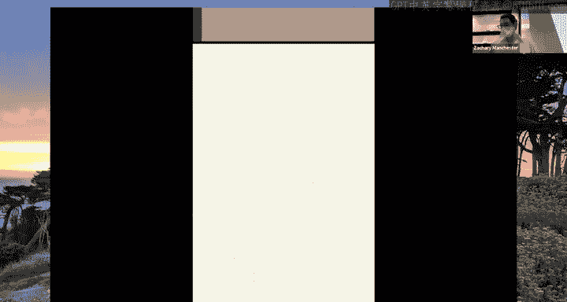

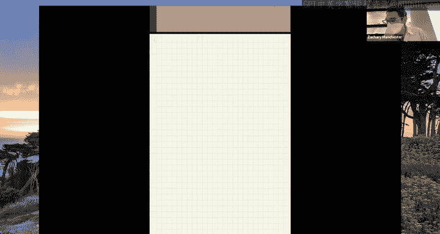

Oops。Oh also yeah so homework was due last night right and this is the the last homework should be coming out soon what's the Brian what how are we you looking on that Okay yeah I mean we can make it Friday we'll give you guys two weeks Friday or whatever as on it。

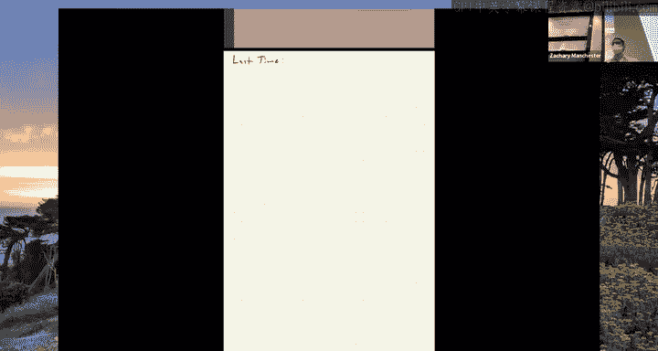

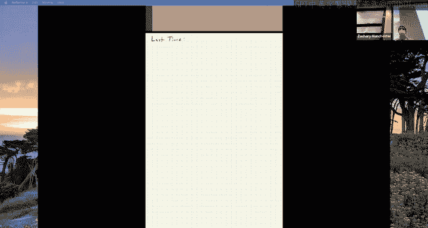

嗯。And then yeah we should talkgg about logistics for like the class project presentation stuff to at some point we can pointt on that for now just if it is we're going to use the last probably the last two classes so the last week of class to do sort of lightning talk presentations basically so it'll be like five minutes ish per group and you do like a little lightning talk you do not have to have the write up done until the end of finals week basically I will give you a final deadline on that when it gets closer here I'm basically going to just back up two or three days from when I have to submit grade which is the very very end of finals so I will give you guys as much time as I can basically。

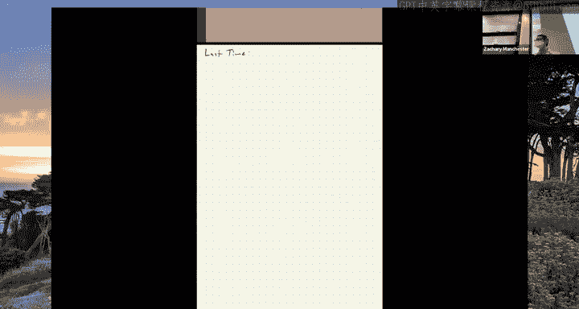

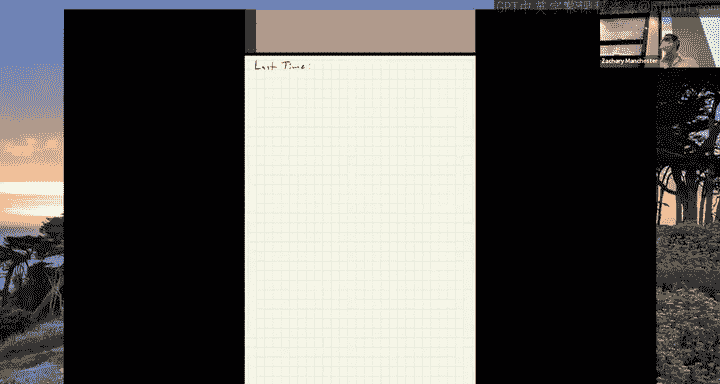

To get the final reports and we talked about this right but so the final reports are going to be like in the style of like an Icrcra conference paper or something like this。

 so it's like six page two column you know format， the usual deal。Cool， yeah。

 any other questions about any of that stuff？

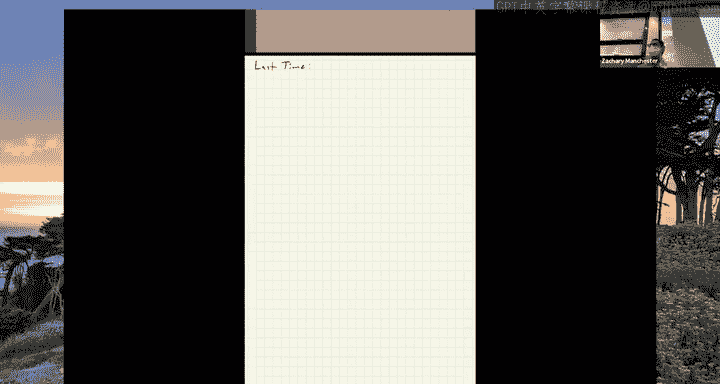

Okay。All right， let's do it。 So last time we talked about。Kind of finishing up the LQG story。

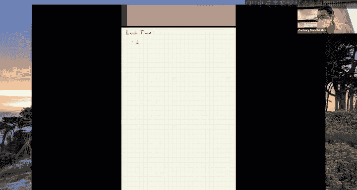

And the common filter。对。Half of that story and then we did so we did the whole LQG controller altogether with the column filter hooked up to the LQR controller and then we talked at the end a bit about this idea of duality between control and estimation and how you can write down the state estimation problem as an equivalent optimal control problem and sort of you know their very closely related things。

And that's a cool generally an interesting topic to talk about like there's a lot more to that if you're into it kind of recommend checking it out Okay。

 so today。I'm going to talk about sort of another weirdo direction to go off of the classic kind of deterministic。

Assume we know everything optimal control setup today we're going to talk a bit about robust control。

Which is a whole field and you could you know do a whole class on so we're going to give like only the very。

Kind of briefest of overviews on this similar to the estimation story we did last time and in particular we're going to talk about one algorithm that slots nicely into our conversation about other things that we've done so far。

 which is called minimax。DDP。So it's a kind of extension of VP to the robust case this paper is actually from our own Chris Ason who from a little while ago。

 which is。Sorry， was there。Cool。Yeah。Yeah。Okay。All right， cool。

 so I guess we'll start out with like a little bit of backstory and history here so。

Context so the first thing to say is right so last time we talked about stochastic optimal control and like the LQP story and stochastic methods assume that you have randomness in the system like random noise on your inputs and observations and things like this。

 right？

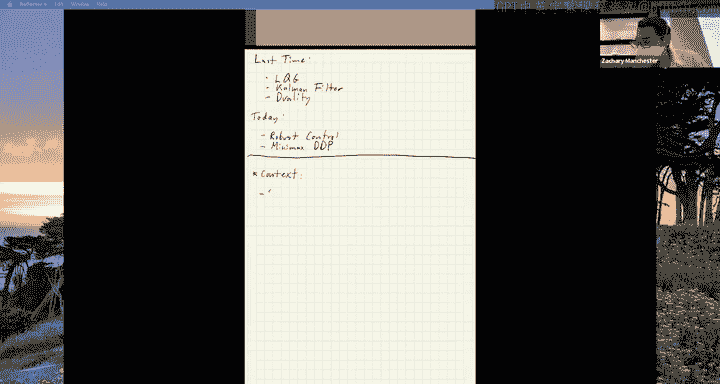

So this robustness is a different thing， robustness is not about noise。😡。

That's the first thing to say。And the other thing that's really common in these stochastic setting that we talked about last time。

 even in more general context is to assume that these noise is zero mean or unbiased in some way。

 so a lot of those those LQG things a lot of similar methods， they assume you know if there's noise。

 they still assume that it's like unbiased zero mean kind of noise such that you know if there is a disturbance。

Over you know some time it kind of averages up to zero， so even if it's banging you around。

 it's not like pushing you way to one direction or biasing things。

And that turns out to be kind of a big assumption in particular that like those LQG assumptions of like zero mean noise are a really bad model for parametric uncertainties or unmodled dynamics right so you can imagine I can make things you know with LQG I can make them tolerate actually really large noise right so think about the wind gust example again on the quadadtor that's not going to kill my controller right like if I've gust blowing around left right I'm going to wiggle around a bunch but I'm still kind of whereas if I had a parametric uncertainty so let's say I had like you know the mass wrong。

That's going to have a big effect if I had like the gains between my left and right side propellers wrong or something like this it's going to make me potentially like fly sideways and crash and do really badly right so those kind of parametric uncertainties can be LQG is not robust to those things inherently。

嗯。Yeah。So that's the first comment， then the other stuff we talked about here previously for dealing with like this kind of parametric uncertainty you know case would be or unmoded dynamics right so we're saying LQG is bad at parametric uncertainty uned dynamics。

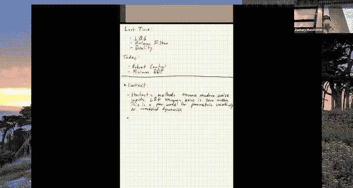

We talked about another class of sort of algorithms previously that that does deal with those and that was ILC right the iterative learning control stuff so that's great at dealing with parametric uncertainty or un model dynamics you just do a handful of rollouts and you kind of dial things in。

And let's say so that that's sort of a different category。

 so I'll see would kind of I would call I would place in the general category of adaptive controls。

 the idea is theres there's some system that you don't completely understand you're going to go do some stuff on the system to try to better understand it right and kind of fix the things you don't understand to achieve high performance right over over some trials or whatever by interacting。

So that's kind of adaptive control。

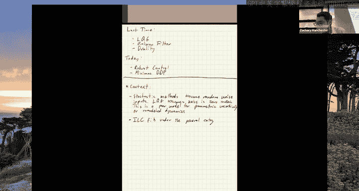

So the idea is， you know， try to。Learn or adapt。To the unknown。Model parameters。Generally， online。

Is what adaptive control is all about you could argue ILC is more of an offline thing。

 you could use it online as well， but that's kind of the gist。

So you're trying to online figure out what the unknown stuff is in some way to achieve。

Optimmal performance。In some sense， whatever optimal is in this particular context。

 right so that that's kind of the I see adaptive thing。

So robust control is a completely different idea from either of these it's not dealing with noise and it's not trying to learn parameters and adapt online instead it's a very conservative offline thing the idea with robust control is that what you're trying to do at the end of the day to say I don't know everything about the system。

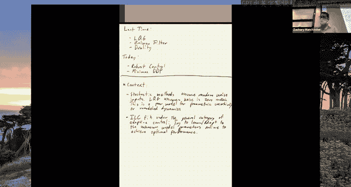

I think I can kind of bound what I don't know though or estimate the range of uncertainty and offline。

 I want to do a bunch of control design work to design a single control policy that's guaranteed to work to stabilize a system to not face plant etc。

 over any model that could happen you know， that could show up that it could be faced with。

Online right does that make sense everybody so you don't adapt it's a fixed control policy and you're not assuming noise it could be parametric。

 whatever if you're assuming that like you have you could have any system from some set and you want one controller that could work over all those systems。

七次。Is there anything else to say about this so inherently like the big idea here is when you do that。

 you're pretty much always giving up some performance。

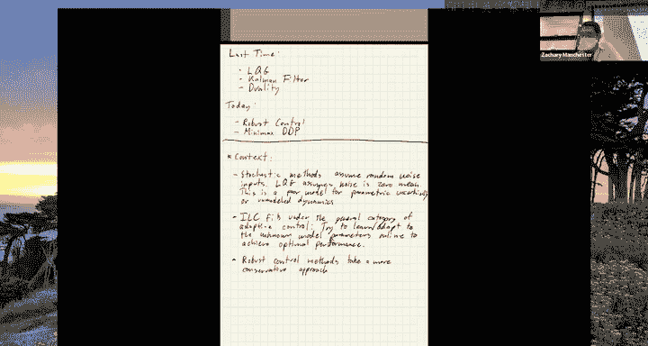

In exchange for that robustness right so we say robustness。

 we mean that the controller is still going to work， even if the model， the true dynamics。

 whatever are quite different from what。

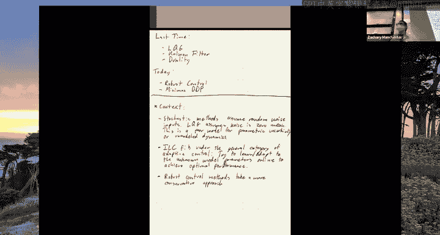

You know， we expect maybe， but you're never going to you're trading like you're not exploiting all of the hardware capabilities or knowledge of the dynamics in that case。

 right you're backing off a little bit on performance。So try to design a controller。

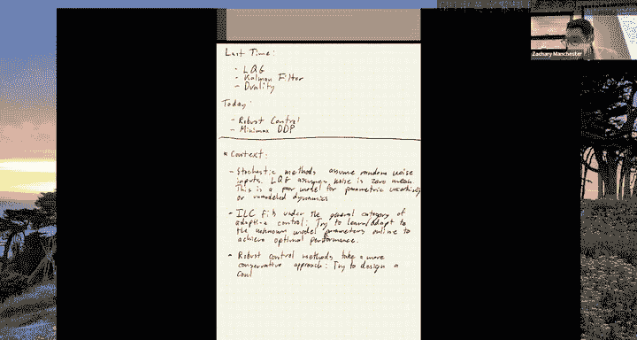

Offline。That will still work。On a range of different。Possible models。So yeah， then。Generally。

 you're sacrificing。Some performance。For these kind of safety。

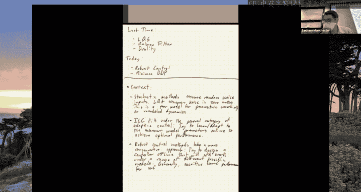

Slash robustness。Garantees and typically this whole robustness game is about guaranteeing that things are going to be stable。

 et cetera。Under these sort of bounds on the uncertainty and stuff like this。

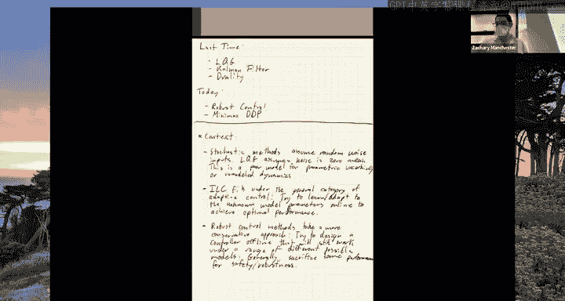

So historically where this stuff came from i'll show you the the paper which is kind of awesome I think i've mentioned this before early work on LqR when after LqR was invented in the late 60s people looked at these kind of robustness questions for linear systems with LqR and they found that。

LQR actually has quite good robustness。 It turns out LQR is somewhat naturally robust to uncertainty in like your A and B matrices。

 which is kind of cool。 So people thought that it was sort of naturally but robust and we didn't really have to worry about this stuff but then kind of a little bit later it was discovered that LQG with the column and filter plus the LQR controller hooked together like we talked about last time turns out LQG is not robust is the opposite of robust and you can make systems that basically arbitrarily small like infinitesimal perturbations and like the ABC matrices will lead to that thing barfing and going unstable for extremely small perturbations。

 So the paper which I think I。Talked about at one point。

 this is a total classic in the history of control。John Doyle。

Guaranteed margins for LTG regulators abstract there are none amazing so good so classic so yeah and basically the paper it's a two page note and he just points out like this little counter example it's like here's this random system super simple linear system and like shows that for the tiniest little perturbation the closed loop system will go unstable I think it's not even a full page in the two columns it's like a column and a half it's kind of insane。

😊，So but yeah， this thing's super famous， I think he was a grad student we did this too is like。

His first like paper and that was it， it's it's， you know。Eic anyway。

 total classic so he did this in the 70s， late 70s I think and literally that paper just pointing that out spawned entire field of robust control and this was like really hot in the 80s into the 90s linear robust control theory so basically people developed methods to design robust closed loop controllers。

Such that you could guarantee you know things not going onstable under these kind of perturbations。

 so that's kind of the backstory。So。嗯。Yeah， cool， I think that's about others to say about this。是。

Okay， so any questions about that stuff？That's the back story so then yeah basically for I don't know 20 years or so yeah what is it。

啊。It's subtle It's basically the fact that like。嗯。哦。

I don't know if there's a good intuitive explanation for this。

It's kind of it has to do with the fact that you have partial state observations and like。

The estimator can fail。At reconstructing the state and therefore really like inherently right if we kind of argue that LqR is super robust on its own if you have full state feedback the problem is really with the estimator that I think is a good way to say it oh yeah I mean this the linear case is the most benign case right so like。

A common and filter on a linear system is bad is kind of the so like EKFs on non nonlinear systems can be really bad。

And are very hard to tune actually in practice， I don't know if you've done this。

 but it is yeah that has nothing to do with this robustness thing though yeah so this is a complete like so give me a linear system and like yeah the columnman filter is the optimal thing to do as in it will give you the best state estimate you can have on that linear system but if you give me a linear system that has like 10% uncertainty in the A and B matrices depending on how you perturb those things you can like construct adversarial examples of linear system matrices such that the callman filter will totally barf yeah so thats that's life unfortunately。

Yeah， so it's that true for the common filter on its own like yes yeah yeah yeah。

 I think I think so like yeah， you can do quite badly and I think like。

What this is getting at is it in some sense like that problem's harder。

 you can imagine like I could have a big state with like oh。You know。

 short fat C matrix such that I have really sparse observations so that such a reconstructing the state is quite a hard problem right from those measurements and like if you have a bad model and you have very sparse measurements and you're relying on the model to sort of fill in the gaps between which your sensors are're giving you in the full state。

 that's kind of a hard problem right。You could argue the dual would be a like， you know。

 problem with only like one or two control inputs with a big state vector that get stabilized。

 but I don't know yeah， like it's。seemsms like the filtering problem is somewhat harder， I guess。

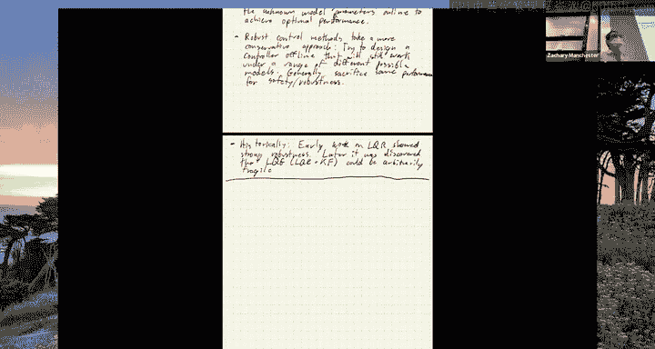

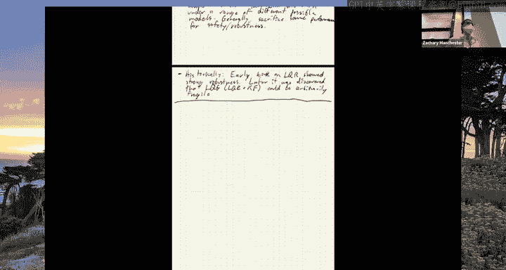

Anyway。Okay， any other questions on this？All right， so let's dig into。Yeah。

So we're going to define a robust control problem。 There's a lot of ways of doing this。

 This is kind of I would say。Pretty much this is a pretty broad definition that I think covers most of the the versions of this。

 so we're going to do is assume。A system that looks like the following。So we've got。

Our usual F of x u， now we're going to add in a third input that we're going to call W。

And this is the， we're going to call this W the disturbance。So unlike in the common filter。

That we talked about last time there， right， we had W showing up as this additive。

Gauian noise zero mean blah blah bh， we all these assumptions on W right was added on on the outside and had all these statistical properties here we're not making any assumptions W could be a fixed vector that's like just you know a number for all time it could be nois。

 it could bounce around it can do anything right so we're not saying anything about the statistics in this case。

It could represent parametric uncertainty right like this could be tweaking the masses and lengths of the robot model right it could show up in any way inside the model。

So this is super general。呃。Cost and parameter。Offets。It could be time varying。Or non smooth stuff。

Could be bounds on。The prediction error of your model kind of thing。

 like you could basically say I have a nominal model， you know。

 if you can bound the prediction error， you know， for say some learn model。

 say you could kind of throw that in there。嗯。So literally anything。

And then the typical move here is to assume some bounds on the Ws。嗯。

And like there's a whole bunch of options here。You can assume W is drawn from some set。

 you can assume the norm is bounded。And usually these bounds or whatever restrictions are chosen for mathematical convenience in the theory。

 but that's kind of the general idea。So I mean and kind of in some sense you have to do something like this to get anywhere right like at the end of the day。

 if this can be arbitrarily huge and what good is the model to begin with right so what you're kind of arguing here is I have some model it's mostly right but it has some chunk that I don't know well but you know if w is too huge and basically there's no predictive power in that model right so you say okay this thing's got to be bounded somehow。

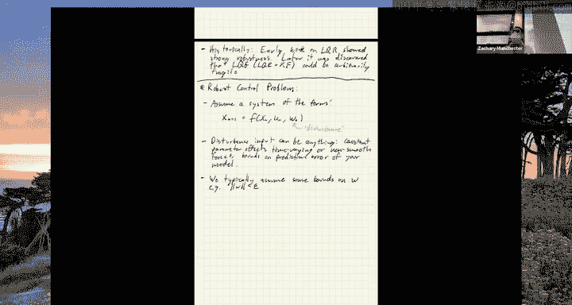

And now the optimal control problem looks like this。对。嗯。

So we're going to minimize as usual with respect to the x's。

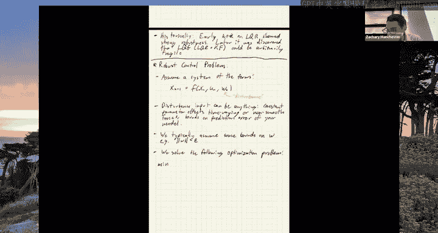

And the use。And then we're going to maximize with respect to the Ws。So what we're saying is。

I want to find the controller that does the best under the worst case possible W。嗯。

Of my cost function。Subject to those dynamics。

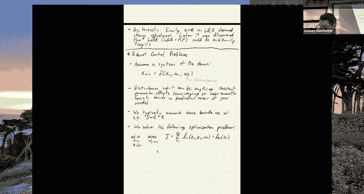

And then you can have， you know， the usual stuff。

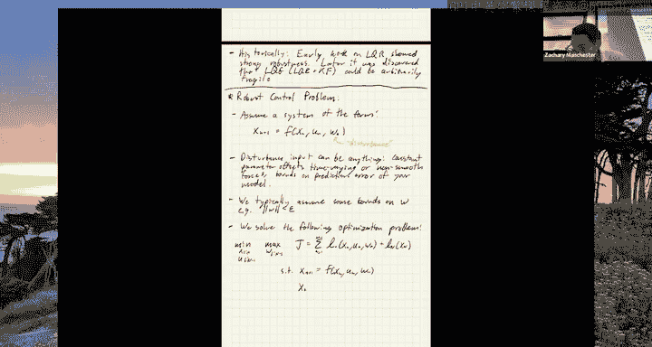

Constraints on the states。Constraints on the controls and constraints on the Ws。 So this would be。

 you know saying here you would this is where you would put in that， you know， the bounds on the W。

The set that it's drawn from whatever， right？Okay， so what kind of problem is this now from an optimization standpoint？

Yeah， it's a mini it's mini Max or also the local optimum we're trying to find。

Is not a minimum anymore。What is it。

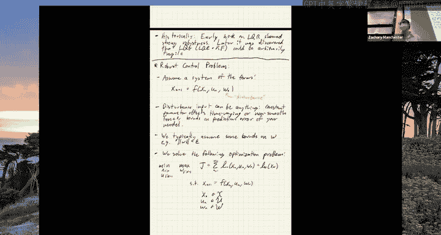

That's the saddle point， right， yeah。

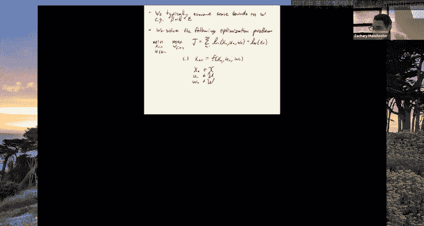

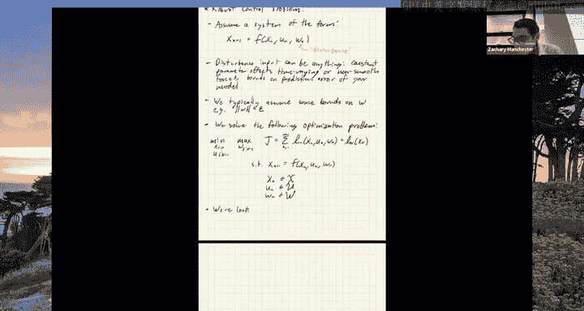

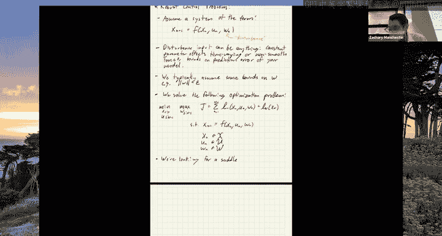

嗯。

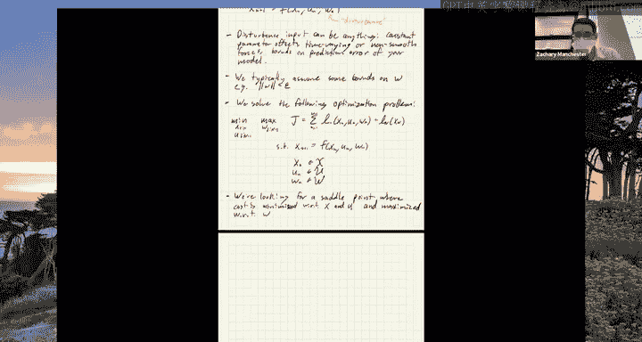

Cool。嗯。This is called a mini Max。Optimization。Problem。Has anyone seen one of these before？Yes。

 where have you seen these before in what context？好，有这。Oh yeah。

 that's like basically this idea put in you know， machine learning land， I suppose， yeah， I mean。

 yeah， the G idea is literally like this basically right just with lots of。

Different language and you know， stochastic everything or whatever yeah。电子。It does， yeah。

 yeah in case there any depends depends。So what do you think？

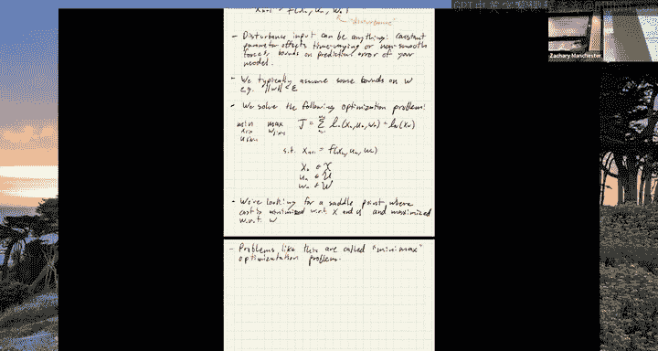

出认。这该是的。So there's a case in which it doesn't matter， which is very special。打仗呢。

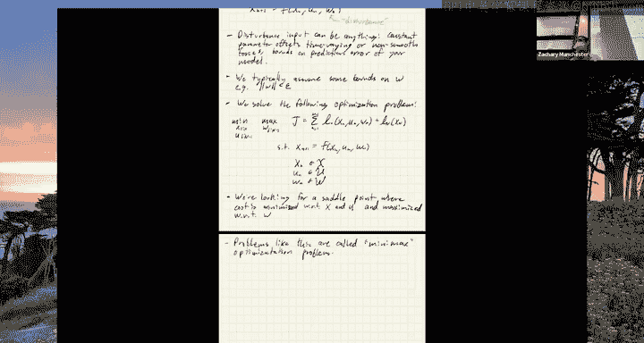

So it turns out in the。Linear case。It doesn't matter。And you can switch。

 but basically in any online context， you can't switch them。This has been your case。

As in like an LQR type problem， like if if you know linear dynamics quadra cost， et cetera。

 there's some cases where you can flip。And basically that corresponds to things that are sort of convex in X U and concave and W already。

Right so basically where there's already you know there's only a single local optimum and it doesn't matter there's basically in that case there's only one saddle point right so it doesn't matter what order you do but in the more general case you can't flip the order yeah and this is like actually going back to like straight up convex optimization right strong convexity is like you can flip the order right of the min and the max over the axis and the lambdas it's that kind of idea right so in sort of like robust linear control case you can you can flip and it's okay but usually you can't。

Yeah， yeah， that's actually what I was just about to say。

So this is actually equivalent to a two player game。

Right so you can imagine like as I wrote this right here。

 W looks like another control input right so I've got a U control input and a W control input and I've like this one system with one state。

 you can interpret this as a two player game where a U player who's trying to minimize the cost and a W player who's trying to maximize the cost at every turn right？

And then what you find if you solve this problem， the saddle point is like the equilibrium and the game theoretic sense between the two players right。

 does that makes sense？Yeah， yeah。are we maximizingSo W is the disturbance right it's like the bad thing and if I want this system to be as robust as possible to disturb to like you know disturbance forces model error etc。

 I want to be able to tolerate the biggest disturbance right the bigger the disturbance that I can successfully you know still stabilize still work the more robust the controller is right？

So like also in general， right， like so here I'm saying， you know。

 like ws from some set right and I'm saying， you know。

 usually we put a norm in there or something like this。

The bigger I make that you know allow w to be the harder this problem is to solve right and at a certain point it might not be hesable anymore like I might not be able to find a controller that can stabilize that thing with a huge possible disturbance right so there's this inherent tradeoff there's basically always a tradeoff between robustness and performance right so here I'm saying it make W really big。

😡，I'm going to have a way higher cost right， and I'm going to do worse in general。

 but the idea is you're trading performance for robustness， the bigger you can make the W year。

 the more you'll be able to like tolerate and not fail right with your controller。对。

Is this the same stuff feels like when people say H2 control so H2 is actually standard LQR stuff。

 H infinity。Is the robust stuff？And this is exactly- so age infinity corresponds to a particular choice of set on W here in this problem and then trying to optimize like a linear feedback gain matrix allla LQR so in the yeah basically in the linear quadratic case with a particular choice of W set。

 that's what that age infinity control is。Yeah that makes sense yeah so this is like kind of the general setup and yeah for specific choices in here。

 you can derive age infinity things。Yeah， so you mentioned that we kind of like performance and robust comes。

哎，非常方。系你先播放少年语。是的。开始。It's news we did if we have not。Yeah， basically， if there is no W in here。

 if it's no disturbance。Then I have like the optimal thing right by sticking this W in here and saying you still have to work even with this。

 you know， adversarial setup where someone's fighting you。

You're going to not do as well as if you didn't have the， I mean， it's kind of common sense， right？

Yes， but see you the final solution。So爱。In W is0 then we can same solution you talking to。No， yeah。

 so like were here we're designing a controller with a like。Such that you can tolerate some W， right？

The controller you get with that， you know sort of consider this adversarial W thing is qualitatively different than the nominal controller would have been with no W and in general。

 even if there's zero w when you go run it online it's going to have a higher cost because you designed it from the outset to tolerate the W does that makes sense。

Okay， cool， so yeah。There is going to be like one double we that's the maximum double。

 right so you're kind of design。So not really actually， so this is time vary right。

 and so like W can change per time step。

And so at a different time step， like different choices of W can be worse or better， right？

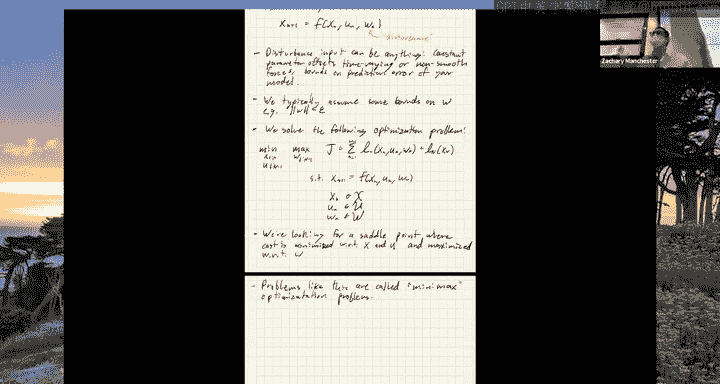

So what this is doing is along the whole trajectory， it's saying。

 find me the worst W drawn from that set of possible Ws at every single time step。

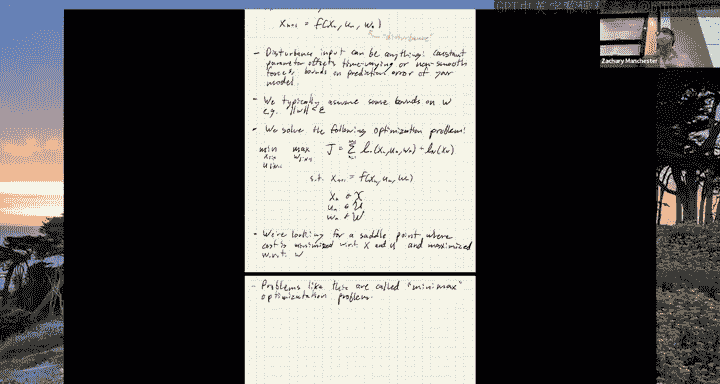

So like like example this might be like if I had an uncertain mass in like my cardpo or something right when it's like。

 I don't know some at some point in the trajectory。

 like having a lighter mass is probably you know going to mess you up worse ats some other points in the trajectory having a heavier mass probably going to mess you up worse right in the real system that mass is fixed for the whole trajectory right。

 even if it's uncertain there is a mass， you know you might not know it here if I go optimize this it's going to find a time varying mass over the whole trajectory that like makes the cost function the highest。

But the idea is that that's the worst possible thing。And so whatever the mass actually is。You know。

 youre assuming it's fixed to the whole thing， like the controller can deal with that。

Because it's going to be strictly not as bad as this weird or worst case time varying mass that you solve for with this problem？

あるてです。So like the idea here is you're also finding， so the other thing about the robust thing。

This I wrote this down as an open loop trajectory， you know， thing， but generally speaking。

 you're solving for a feedback policy here。So that feedback policy， like online， you've got feedback。

 you'll like， but the idea is if you do this and optimize a feedback policy。

That feedback policy will still successfully stabilize， et cetera， for anything。

 any W that you pick from that set。Is what this is trying to do。

Usually a lot of this is about finding optimal feedback policies that are robust like this and most of the theory like most theory things is for linear systems and that's this H infinity optimal control stuff this was basically the 80s and 90s of control theory were all about this this was like the big topic okay so let me write some of this down。

I just settled this stuff out loud as you guys asked me the questions。

 so now I get to right of town I guess。嗯。Yeah， so this is kind of cool。

 This has deep connections to game theory。 it's actually a stacklebi game。

 if anyone knows what that is。😊，Where is I say worthy they。You have a U player。诶。And W player。

Let's see， yeah， so there's that and then the other thing to say about this is you know， in general。

 these problems are really hard to solve。

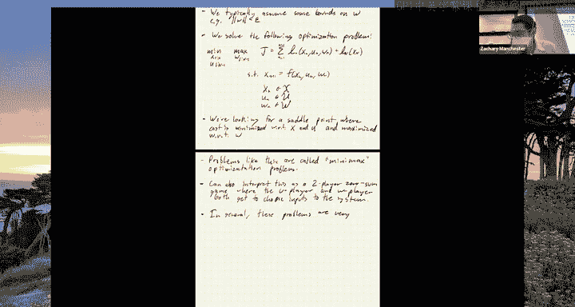

They're like strictly more difficult than the original optimal control problem。

For linear systems， we can solve them most of the time。There's a whole theory。嗯。In the 80s。

 it's the 90s。嗯。And usually we talk about this as H infinity。

Control that's basically a generalization of LQG to this robust problem。

And it's like at this point well established is basically like a solved thing and there're to the extent that there's a MAlab toolbox for it。

 so if there's a MAlab toolbox， you know it's not。It's not really a research area anymore， I can say。

Yeah， and this stuff， I mean it is actually kind of powerful right so one of the big ideas there is if that W can be anything。

One of the things that lets you do is use like if you have a linear model for a nonlinear system。

It lets you use that linear model。Bound the error on the linearization between the linear system you know linearized system and the true nonlinear system and use this stuff kind of guarantee that your linear controller will work on the nonlinear system within some range right so it's kind of a powerful thing and like lets you get some guarantees and still use linear control design techniques。

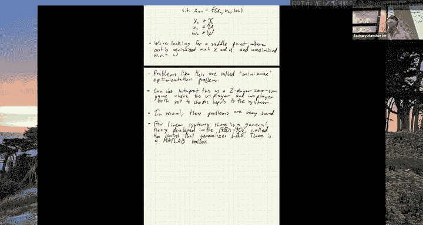

So that。Okay， so that's kind of the whole like big picture story if you're interested in want to do this stuff you know。

 on a linear system there's this whole H infinity thing there's books about it there's a MAlab toolbox we're not really going to spend any time on it but it's the gist of it is solving that LQR problem with the disturbance with bounds on it。

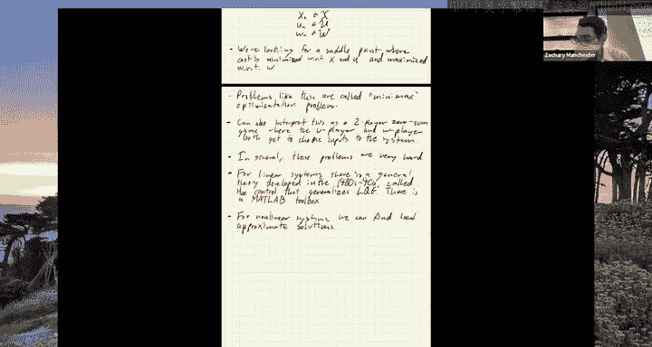

What we are going to do is。This thing that。From the early 2000s from Chris Hason called Minimax DP and it's basically extending D to this problem right so we get in then in this case right we're going to get both a nominal trajectory and a robust linear tracking controller right for that system out of doing this。

So it's kind of cool。😊，Kind of interesting。So the idea is we're going to use local。

Linear sort of slash。Adratic。Taylor expansion。跳。😔。

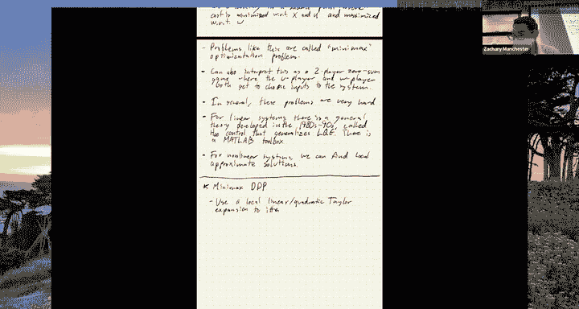

Iteratively find a local optimum。Okay， so it looks a lot like DP I'm basically going to focus on the new parts since we've already done a lot of DP stuff in here。

 I'm going to show you where all the tweaks are and like what the differences are and try to avoid doing all of the math math again。

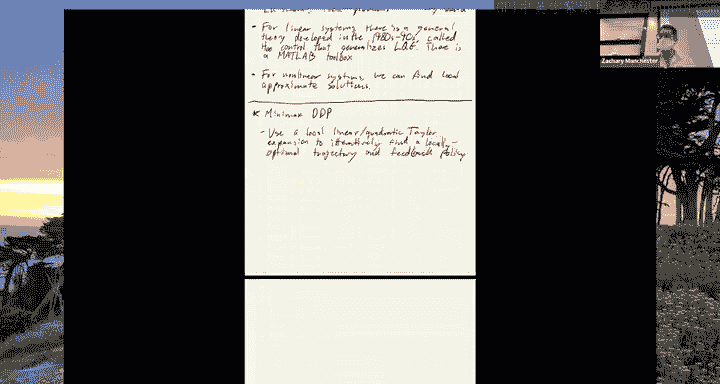

For the stuff that we've already seen so here we go， so first thing is we expand the dynamics。

We have。In general。Something like x plus deelta x， you know， u plus Delta U and now also the W。

And this is。A nominal value plus we're going to have。Like a deelta x。B Delta U。

 and we'll call this thing D， I guess， because C is already the。Observation thing。

So that's the dynamics expansion， and we basically get a a new Jacobian matrix thing for the disturbance。

And then the next thing to do is expand the the action value function so we're going to expand the Q function gradient and hessian like before we're just going to get these new W terms I'm going to call that action value function G again instead of Q。

Which is annoying， sorry。对。Okay， so this thing looks like。Or what are that yeah。

 we're going to call this S and then the the gradient and hessing are going to be G matrices so the same deal。

This thing is a function of now， it was originally X and U and now is also a function of W。And。

A gradient。Is going be。So x， u W。

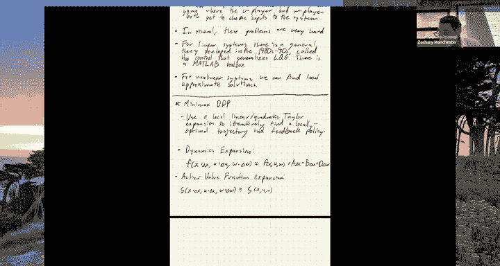

Here's the gradient term。 we're going to have G X， G U， G W。Time's the deltas。

Then we're going to get a hessian term。

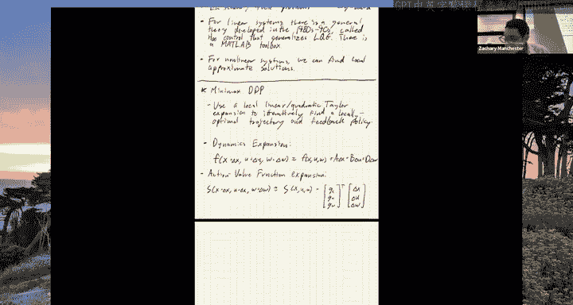

Down here， so this thing is。We're just going to label the blocks， none of this is surprising。

So essentially you add all these ws in and turn the crank on this just like you would have for the original DP。

And you'll get a few extra things in the feedback games and stuff so we'll。

Hopefully try to get at this in the least painful way possible。

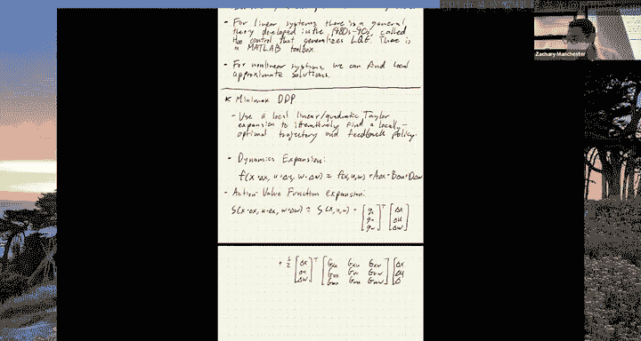

Okay， so there's that。Now。We do the Bellllman backup thing。So。

The the value function cost to go function thing。Still a function of just the state。So we got this。

Just the state and unexpectedly we're going to minimize over Delta u and maximize over delta w right so this gives it even more the flavor of like this two player game thing right it's like we have two control inputs a U and a W from two players and they're fighting each other right。

So min over Delta u。Max over Delta W， and I guess I'll write this thing out。The whole expansion。

Which is annoying。In terrible。然后。Then what else？Okay。

I get them all I think I got them all okay that's the whole thing so now we're going to take this exactly the same as in the standard case we did before。

 we're going to take the partial derivatives with respect to U and x instead of equal to zero right。

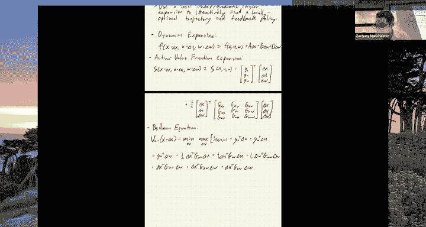

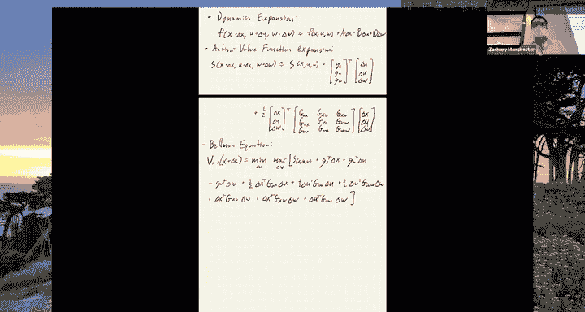

So let's do that。I guess partial of this thing with respect to you。

So if I set the partial respect to u equal to zero， I get the following thing。

And I do the same thing again。The W。Okay， cool， so the the main sort of takeaway at this point is what we're trying to do right is we're ultimately trying to find a feedback gain。

And a few for a correction， what you see here unsurprisingly is that the U's and the Ws are coupled。

 so like what the U does depends on what the W does and vice versa， right？So。Oh yeah。

 there's one other thing to point out here in this first order necessary condition stuff I just wrote down right gradienting equals zero。

 is there anything in there to tell me if this is a Min max？It back to like the first week of class。

啊。Yeah we gotta remember the definite is stuff on the hesian jet so so we we want to be minimizing over deelta u so therefore Gu the hessian in respect to U needs to be positive definite we want to maximize over W to be maximizing I need the opposite I need the Gww hessian to be。

Negative definite， right all negative eigenvalues。 so that's kind of。So unsurprisingly。

 like in that sort of in the standard way， just like we talk about with KKT systems。

 which are also saddle points， we might have to regularize these things right to get them to do the right thing on a nonlinear problem。

So GUU positive definite。G WW negative definite。Okay。

 so if I go and solve so I can go and solve these right each for for the other thing if I want to。

So the gist of how you make the next move here is I'm going to solve for one in terms of the other and plug them into each other to eliminate。

And get the feedback in so like if I。For example， I can take the first equation and solve it for Delta U。

And then plug that into the second one。So eliminate all the use' and vice versa I can solve the second one for deelta W。

 plug into the first one and get just the U' right so I can eliminate them that way。So if I do that。

I get， you know， this kind of thing。

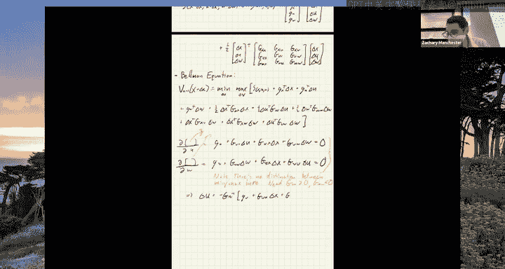

And。This thing， right for the other one。Now I plug these into， yeah。We do that。

 I'm going to probably I will write this out once on the next page for the sole reason that I want to show you basically it looks like LQR plus some extra terms that are kind of the robust of flying terms。

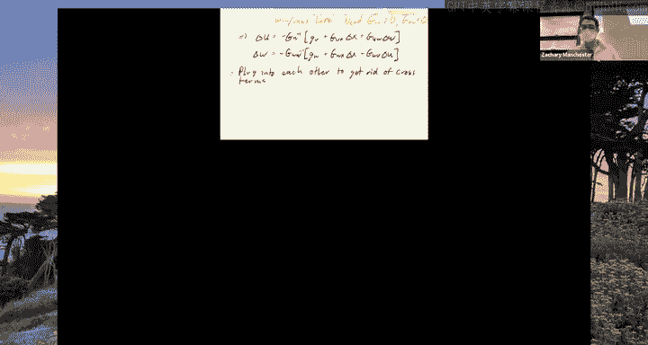

And so as of this looks， let's see。So if I do that whole mess。

 I'm going to get something that looks like this Delta U equals。

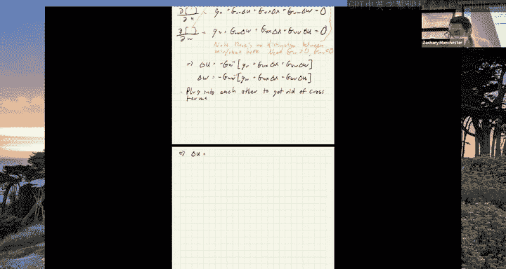

Like we had before we get a feed forward term and a feedback term。And you get。

D that looks like the following thing， let me write this。D is。呃。I can't re on handwriting now。

 which is is terrible。Okay， so that。And then we get a K matrix。That looks like this。😔，嗯。嗯。

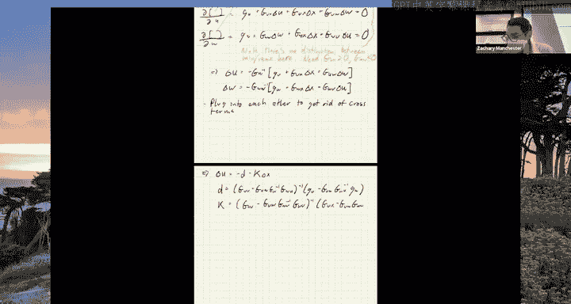

对。嗯。Okay， so here's what's going on there's so these the things in green。Our original LQR stuff。

And the things in red are new things that came from the。The W stuff， the robust stuff。

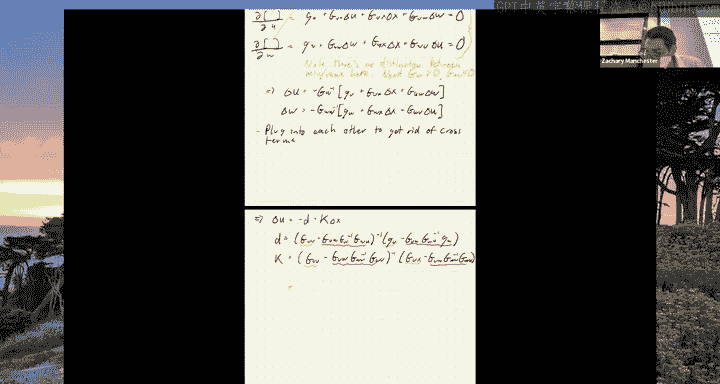

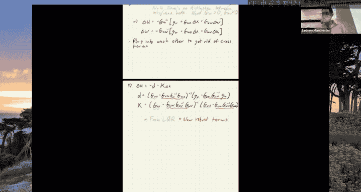

Cool so yeah， so you can think about this as like it's robustifying the LQR policy it's tweaking both the feed forward stuff so you're getting a different trajectory。

 a different nominal trajectory than you would have before and it's also tweaking the feedback gains you're getting a different feedback policy than you would have before also。

Yeah。Yeah， it's kind of terrible， sorry， the best move honestly is probably for you to just go get it out of the paper。

 which I will show you。UmApologies for terrible， like are you guys actually writing down all of my terrible scribbles because you really shouldn't be。

That's why I give you the notes。So you don't have to sit here and write down my terrible scribblels and then also I will send you this。

 So this is the original paper。

Um， on this algorithm where you can find it， you know， written out with cus instead of s's like。

 you know， maybe you like。And yeah here it's all here this is fine you can look at this this is better don't write my scribbles down so yeah these guys I mean so this is from like now almost 20 years ago which is insane to think about but yeah they the original application was they did this on a legged robot and tried to optimize it to be robust to you know parameter errors and walk while not face planting and so that you you know the punchline is they done some handoon PD stuff they did some DP stuff it fell over and then this minim setup could walk a lot farther before it phase planted。

Because it was robust kind of cool that was a long time ago， but yeah。

 i'll send you guys this paper on the I'll post it yeah。Sorry， can you explain what you mean？

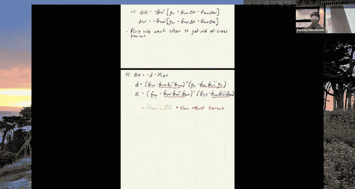

Well， we minimized only over the use。嗯。RightSo like the whole thing we're doing dynamic programming right so you're solving for this value function thing at each sort of backup step you've got this action value thing it's a function of x and U right and you minimize it over the Us so that you get just a function of x the value function then you go back another time step plug the dynamics the one step cost and now you get a function over X and U again minimizem over U back again you're always minimizing over you right in the standard flavored version and you're maintaining this like value function cost to go function thing over the states here same kind of thing but I think the two player game interpretation is really nice here so you're still getting a value function over the states which are're getting basically two feedback policies and you're optimizing over two different inputs corresponding these two players at each backup step now which gives it this two player game flavor and that's kind of way to think about it sort of adversarial thing where you assume that you have like an adversarial player choosing the worst possible disturbance at every time。

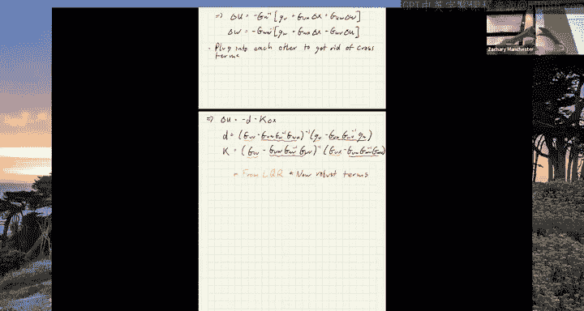

right and then the control player the u player has to deal with that right and that's actually part of the min Max thing the min Max here to go back to your question has to do with the ordering of the players so here basically like the W player gets to move make the first move and then the u player has to respond to that move right that's sort of。

嗯。Go you that right Yeah the max is inside the max goes first the W goes first Yeah yes。

 it's a stackleberg game that's exactly right because it has that inherent ordering right whereas in a Nash game it wouldn't have the ordering necessarily right so the Nsh problem looks actually a bit different the first order necessary conditions for Nash equilibrium look different because there's symmetry between the players right here that there's an asymmetry like one player goes first and then the other player respond which is stackleberg。

Yep， can you flip the order and say for a minimum？What's the maximumYou could do that yeah。

 but you would get a different answer in general yeah。In the linear quadratic case。

 I think the solution ends up being the same， but in this DP setup it wouldn't be the same right because this is like we're doing newdeton the nonlinear thing。

 but yeah， I think for a linear game it does end up being the same。Okay。

Oh yeah outside of the control for like moving things can you use this and like design optimization where you're trying to like minimize mass maximize like stiffness for product or something like that so in general like you could write that optimization problem down and it would be a mini mass optimization problem for sure it wouldn't have so that the special thing here is this like dynamic programming flavor like。

That comes from that control problem structure like the time sort of structure of it right where you can do dynamic programming through time right on the like the beman thing So in that structure optimization problem。

 if you're just optimizing a static thing right there's no notion of time there's no notion of trajectory there's no dynamics really right these are just like there's some cost function。

 you know that has a mass and a stiffness and you want to do the best you can So yeah you can absolutely write it down as a minimax optimization problem go solve it it doesn't have like the same structure as this necessarily so like you know like you don't have a feedback policy there anyway right there's no trajectory but yeah in principle like some of this carries over yeah。

Like the mini max flavor carries over for sure and part of that is like。These are weird problems。

 I guess at one level like so minimax problems are not kind of standard optimization problems in a lot of ways and you kind of can't use kind of stock off the shelf optimization solvers just solve these problems either because of this saddle point minimax flavor like I can't go use like IP opts on this problem right because those are finding minimizers always they're designed to minimize right and this has some weird stuff going on that a bunch of the assumptions baked into IP opt won't like in particular right like here we have to regularize in weird ways to handle the。

The miniac stuff and like we're finding a saddle。 So all the standard armmiho line search stuff won't work on this right。

 so you actually need sort of a custom solver for this stuff。

 which is partly why I'm writing it out in the DP context， not the direct。You know。

 kind of kind of context。It's a weird problem。Okay， what was I doing before I got distracted？Okay。

 yeah， so you have this thing it looks like LQR， but with a bunch of little tweaks kind of interesting and then you also get。

嗯。Sort of weirdly you also get a deelta W so like w there's a symmetry here right like W is also a player that's like doing control that you're kind of like fighting。

And so we'll write this guy out too this this is a whole new thing right so W same way has a feed forward and a feedback term。

And。You don't get this at all in LQR this I guess I don't know how to think about this other than it's like。

This is how the math works out and you have to like keep track of the you're also optimizing something for the W player so you get like a corresponding sort of。

嗯。Symsymmetric looking， and I'll try to write better， by the way。

诶。Sort of feedback thing， feed feedback thing。For this player where you get a feed forward and a feedback game matrix。

Let's see， iss there anything else fun to talk about here I think there might be so does anyone recognize these like sandwichy matrix things going on like the red underlying terms。

Or， similarly down here where you can maybe read it better because I wrote S。S recognize that thing？

Like the thing in the parentheses basically is actually a thing you might have seen before。

 especially if you're in my lab。I heard of。对。我是。No。It's something called a sure complement。

 anyone haven't heard of a sugar compliment。We talked about that in here， probably not， I don't know。

 fun fact。Weirdly those show up all over the place。

 it's also how you marginalize a Gaussian distribution。I don't know， it's a thing。

 maybe if no one's heard about it， then maybe maybe it's not a thing。Okay。

 so then you know the just just to finish off the algorithm。

 the idea right so we've got these Delta to U Delta W things。

We can plug Delta U and Delta W back into S。Just like before， right with standard GDP。

To get the new cost to go or value function。What else is there to say about this？Yeah， I mean。

 so we can do that， I guess it's not particularly interesting。So you'd get like the little P。

And on the big P。Hsian。And you can write out what those things look like if you care。So once again。

 it's like an LQR like term and then a new robust definedifying W term。Same thing here。

And interestingly， if we look at this。I guess I'll write it first before I say anything。嗯。Can you。

Can we say anything about what the UNW players are doing to the cost from this？

I really maybe so like the W player， if this guy's negative definite。

 is always making the cost worse。

Basically， right？Okay， so the rest of this looks exactly the same as standard EP。

 so I don't think it's like super worth。You know， blaoring that。Okay。

 what else do you say about this？Yeah， I don't think we need to rip that stuff out。

Yeah， so the biggest， so practical stuff。If you go try to code this up the biggest difference。

Versus standard GDP。Is that。The action value hessian is now quasi definite。

 just like the KKT stuff we talked about before， where it's going to have some strictly positive eigenvalues associated with the min and some strictly negative eigenvalues associated with the max for that saddle point structure。

 right？嗯。So it should have how many positive ones。dimensionimmenion x plus dimension u， right？对。

And then。Dimenssion W。Negative eigenvalues。嗯。

Yeah， so you've got a sort of like when you write down the cost function for this thing。

You've got to write it down such that basically if you write down a quadratic cost for like。

 you know X UW。The quadratic cost term corresponding the W has to have a negative definite。

Sort of fashion。It was a little weird。

嗯。So write this down and talk about a sec。See， so cost function might look like。

Like your standard sort of X。Transpose QX thing。You transpose are you and then a。A W term。

 which which should I use， let's go with I don't know， from yesterday。

 maybe we can use a capital W amount of ideas。And then， you know maybe terminal cost。

So you'd have here。Q， Q， N， and R。Positive definite。

 and then you'd want this W to be negative definite。So similarly， if I need to regularize this thing。

 which I typically would， right？

You'd want to do something like we talked about before。

With the K at T stuff where you'd do like a alpha I。Minus alpha I。

So you want to push the positive ones more positive。

 the negative ones more negative and keep the eigenvalue spectrum kind of the right way。

And then looking at this thing。What should I do if I want to make the system more robust？

Like what here in this setup corresponds to you like？You know， making the system super robust。

So super robust means。

Large Ws， right， how do I encourage large Ws in this setup？对。

Lower cost for W right so I make like norm of that big W hessian small right so low penalty on the Ws right？

And then similarly， if I make that。Have a large norm。Penalizes these guys。Then I get less robust。

Behavior。And then so okay， so is there like what's the limit where I'd recover sort of standard LQR？

With this setup。capital。Positive infinity or negative in， right yeah。Okay， oh， sorry， not LQR。D d p。

In this case， right？So yeah， this is a little weird and maybe not so this this mini Maxax DP thing the this is basically what's in that original paper in that paper。

 they're doing vanilla D with no constraints。So this cost thing is basically all you can do so it's a bit weird to like think about what that that cost weight associated with the disturbance should be and that's not typically how we like to think about this a more standard robust control kind of approach if you kind of read about this if more is usually to。

Put a constraint on the W so it's like bounded norm or from some set or something like that。

 so I don't know if anyone's done this actually if no one's done this， we should probably do it。

So like this mean Max DP thing with constraints such that you could actually put like a you know draw W from a ball or a box or something like this and have it actually correspond to system parameters you could say like you know I don't know the math is bounded plus or minus is 10% like whatever other parameters of the robot the wind gusts are bounded plus or minus whatever stick that in there and then solve this problem right and then it has some physical meaning so I'd say like my main criticism of this paper and this existing setup is that it doesn't really like this soft cost on W thing doesn't really give you the ability to like give those kind of guarantees on meaningful system parameters you're kind of like throwing this in there and seeing what comes out and like in general it will be more robust than the nominal case and yeah basically。

I think that's sort of。Sort of it So this is the I'll send this out to you guys。 But yeah。

 this is kind of cool that when they originally did this， they did this on this legged robot。

 this walker and like， you know got it to walk。

Farther than the best handted controller and better than kind of the standard DEP stuff which is kind of cool and I think they have some stuff some language in here about the tuning but I think I mostly did this because it's similar to the stuff we've done before and so it's like easy to kind of write down let's say this isn't that common though in the robust control world like they typically do this stuff with bounds and it's usually about that h infinity linear robust control stuff。

Yeah， okay， I think that's actually about all I want to talk about today and unfortunately I did not code this up and I don't have a cool software demo for you because I ran out of time and went to sleep。

So maybe next year， maybe maybe I'll get super motivated tonight and do it。

Or maybe one of you got super motivated to do it。So just a good question that why is it the Yeah so it's got to be negative definite。

 as we said for it to have a saddle equilibrium point right so if it weren't negative definite remember you're maximizing right so if it's positive definite and what that's saying is I can make that go to infinity you know arbitrarily positive right so that's why it has to be negative definite it's basically saying that you have a saddle point like that there is a peak right otherwise you drive to infinity。

 so that's why it has to be that way and then the idea is if I make it。

Super super big what it's doing is penalizing large ws right and in the infinite limit you're like penalizing the Ws effectively down to zero so you have no disturbance right？

That makes sense。Cool。All right。I think that's about it。

