# CMU《最优控制和强化学习｜16-745： Optimal Control and Reinforcement Learning》中英字幕deepseek - P22：[22]Lecture 21_ Convex Relaxation and Landing Rockets.zh_en - GPT中英字幕课程资源 - BV1qHwke1EBX

Everybody， how's it going。啊。So let's see， it's getting close to the end here've got like。

We have four more lectures left so logistics wise I wanted to just kind of touch based on a couple things so the first one is class presentations。

 I worked the math out on this this morning and I think in the interest of having round numbers each group gets four minutes for your lightning talk and we're going to spread them over the last two lectures so I'm going post a Google spreadsheet tonight with slots and basically like you guys get to sign up there will be enough slots for everyone and I think that's about it there'll be some margin so let's push them a little bit and we might like make them give you like。

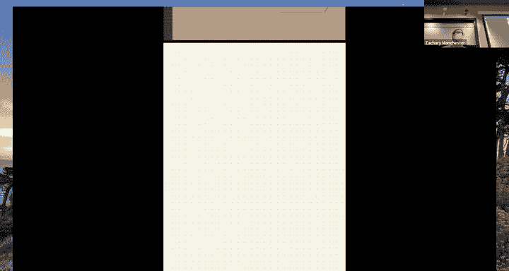

There's enough room theoretically to have like a little bit of legal room there。

 but it's basically we're going to try to keep you to four minutes， so plan on four minutes。

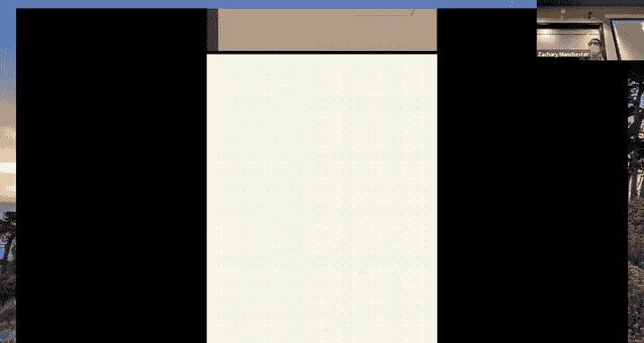

You know， lightning talk style format。Ideally， like you know。

 everyone in the group would get a chance to talk about some piece of it。 So like in principle。

 you all have to show up if it's a remote situation， we can work out a zoom thing I may forcibly。

Stack all of the Zoom presentations towards one end of the lecture。

 so we're not switching back and forth。TBD on that。

 but in principle like keep an eye on Piazza for an announcement like tonight for sign up slots for presentations。

 the idea again is that this is like not I don't expect you to have everything done at this point it's just like a computer kind of preliminary it's and then you'll have like another couple weeks like through the end of finals more or less to write up the full report four reports again it's like standard kind of IRA IRA style conference paper idea with like a six page two column format standard you know get the latex template from the conference website type of deal Any questions about any of that project stuff presentation stuff。

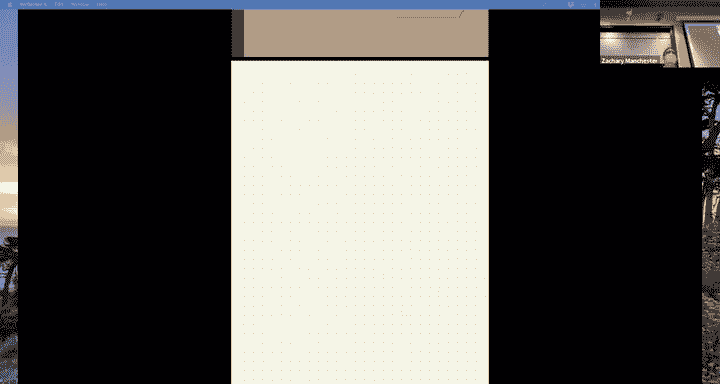

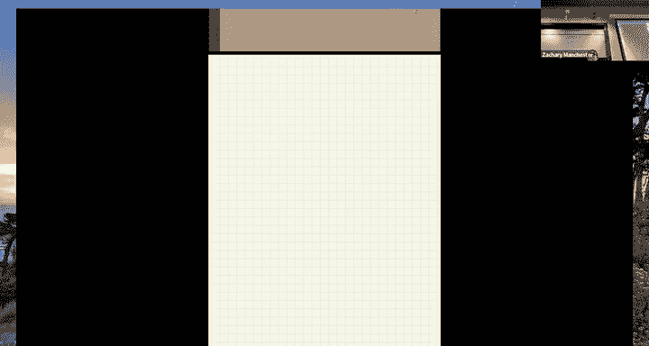

Expectations about that。Give us a four minute pitch for why your thing is cool。

 show us something cool， you know， hopefully have some early stage results that are working at that point。

But if you don't， that's kind of okay as long as you get something cool happening by the end of the report deadline。

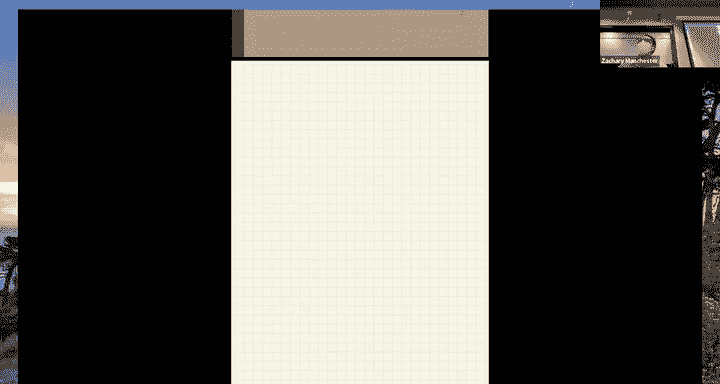

Right。Re cool with that？Okay， excellent， so yeah， keeping out for Piazza tonight for that。

And then yeah in terms of the the rest of the lectures I think we have like four more lectures left Thursday is a university holiday so we have no lecture Thursday this week I think after that we've got like only three or four more so the game plan that I had in mind was to do like kind of interesting case studies so we're going to start doing the first one of those today I also going to try to do like a。

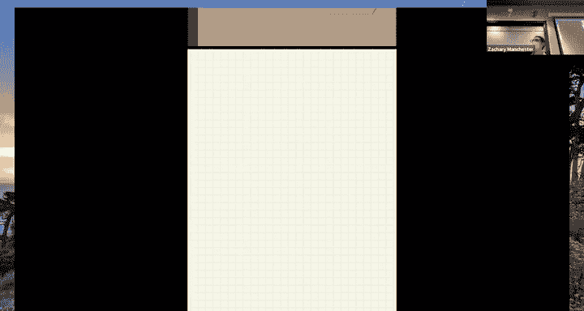

Sort of tips and tricks and like kind of like。Interesting， you know。

 open problems in like kind of Rl intersection of Rl control kind of thing for one of those。

 So I think roughly speaking we're going to do like three case study lectures。

 So today's the first one is going to be on like rocket landing stuff we're going to do one on legged locomotion stuff kind of how the state of the art legged robot and PC controllers work and then one on autonomous driving and like how how that stuff is on the control side at least if anyone has any like。

Other suggestions for like stuff you'd be interested in for case studies i'm down to do a different one if you guys those are the ones that I like picked out that I thought were cool but open to suggestions if anyone has like a burning desire to hear about something else from you know let me know and then yeah some kind of like wrap it up like。

Tips and tricks for practically implementing these things and like kind of where the open problems are。

 where like the interesting research directions are and kind of intersections between control and RL。

 anyone have any thoughts on that？

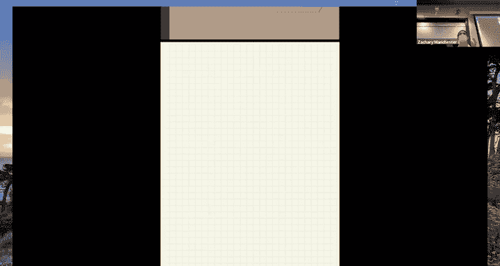

That's the next couple weeks game plan。Oh cool is that okay， and then the last week is presentations。

All right， awesome。Let's get into it then everything working， I think everything's working。

 which is rare。Okay， so last time we talked about。Andd of robust control in general。Buolded it。

 and then we talked about minimax DP。As like a particular instance of some of these ideas。

 and I also， yeah， I posted the stuff last night， including the original paper from Chris Atkinson's group。

I like 2003， I think， I'm the one I showed in class。Look。

 if you want to also not suffer through my terrible handwriting and like look at the details of the little subs on everything。

That might not be a bad idea。 Okay， so today。

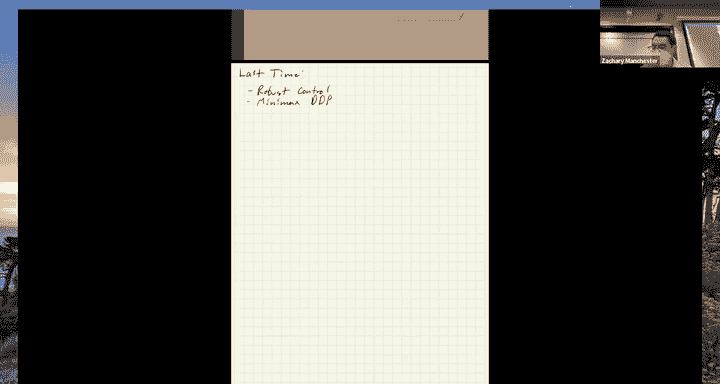

We're going to talk all about。

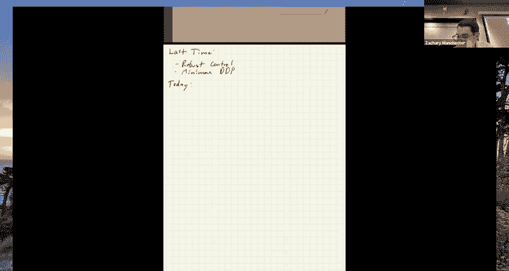

How to land a spaceship？Which is super fun。

So。This is one of the like major kind of cool advances in control in like the aerospace field in the last decade。

 I would say， and to sort of set the stage for for this whole discussion。

 I'm going to watch some cool YouTube videos。

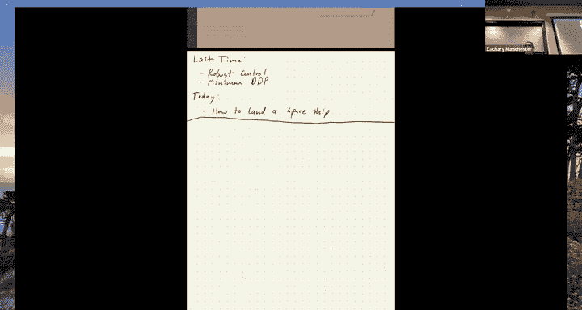

Co why not？So let's see fun things。 So I'm sure you've all seen some of this stuff。

 but examples of what we're talking about would be SpaceX。 So this is starship。

This was last this is the last starship I just went and looked up the most recent ones。

 this is the last one which is actually almost a year ago。We have ignition。

Stcarship heading back to the lands。到。So that's pretty cool。So SpaceX stuff and other kind of just。

 you know， recent example to be， here's the cartoonian version。This is the。

Perseverance landing on Mars。version， I'll show you the real video。

So this is like separating from the aeroshe from the parachute this part。

 this is called powered descent。So this is the part we're going to talk about today and I'm sure you guys know there's a lot of CMU connections to this actually so this used terrain relative navigation so use vision to sort of not land on boulders and things like that and all that technology was originally developed at CMU。

The control part of it is what we'll do specifically today， because this is pretty awesome。

 obviously。Sky Crane。And then this like flyaway phase after they disconnect where they basically just。

They just literally throw it several hundred meters away and crash it into the ground。

 so it's not anywhere near the rover。That's pretty cool and then the amazing amazing thing is like that's fit。

 but this is the real footage from the real thing they had you know real like 4K video on board and you could actually like watch this happening this is the real video from the real thing it's pretty incredible from some Hollywoodwood basement right what they want you to believe storm So I think the dust storm stuff is very seasonal and I think they generally plan these things to get there when it's not dust storm season you can see obviously like that's dust blowing around and you can see I mean that's the you know there's a south the dust blow around is from the thrust like tens of meters off the ground interestingly like all of this this whole power example happening is like it starts up only a few hundred meters off the ground so they like cut the parachutes turn the engines on。

The whole power design part is really fast and there's the flyway。Yeah。

 so that's the real video like it's just mind blowing that you get like 4K video from Mars like。来得信啊。

Actually， one of my good friends from undergrad is。

One of the crazy looking people jumping up and downs he's the EDL lead now for this stuff Okay cool so that's like the awesome video footage of things like this。

😊。

This is the 60th anniversary。And we're going to mostly focus on stuff from I'll send this out later。

 but this paper which is kind of this is from 2013 I was sort of a landmark paper in this general area and the lead authors so three guys of Betett Chick Ma he's a professor now at University of Washington and Lars Blackmore is now the sort of GNC controls lead at SpaceX yeah was these guys were all at JPL though previously so this work was done at JPL and then Betett is now professor and Lars is now at SpaceX and John Carson still at NASA。

Anyway， so this is basically laying out the whole control strategy we'll talk about this。

 I'm basically going to walk you through like how this works and then I'll post the paper after might refer back to some of this stuff。

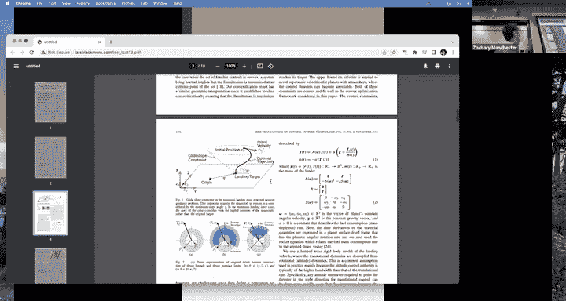

So that's the game plan， so let's do it。

Yeah， also I'm an aerospace nerd so like for me this stuff is like， you know。

 super super fun and cool Okay so this is called the rocket soft landing problem。😊。

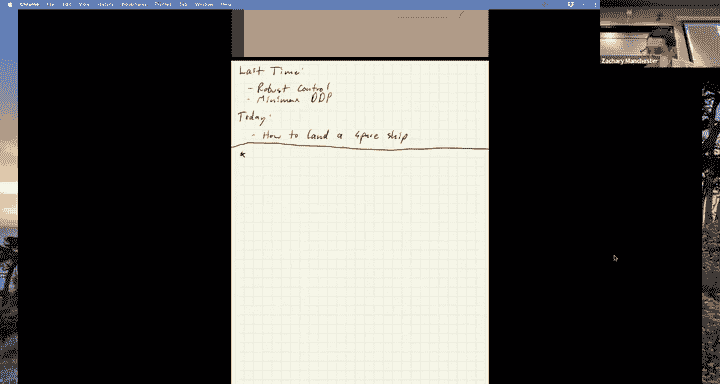

And it's been actually like a benchmark optimal control problem for decades。The problem is。

To go from。Some initial state。Excellent， so position and velocity。

 right some initial position velocity。To some final position。We'll call it like our final with。

Zero altitudes， we'll call that z final equals zero。And zero velocity。

The z final equals zero is the lamb part and the v final equals0 is the soft part。Right。Okay。

 cool and then generally so these are the this are really the initial and terminal conditions right so these final conditions are constraints then the cost is varies and like people will do different things there's different examples in the literature。

 but generally speaking what you're trying to do is minimize。😊。

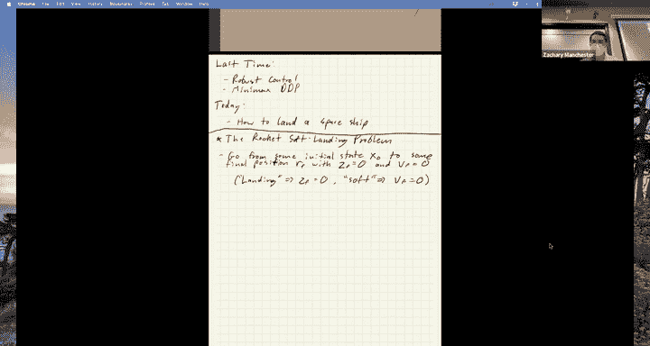

Some combination of fuel consumption and landing position error。

 you might have some desired landing spot that you want to stick， right？Okay。嗯。So this might be like。

 you know， some like。Mineus like our goal in like the X Y plan rate。

And then other constraints that you have to worry about， they're always kind of。

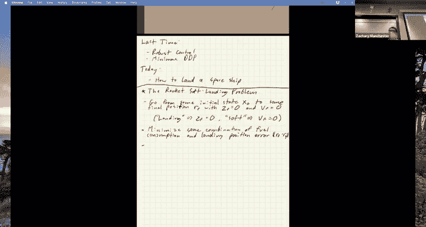

Thrust limit constraints so there's limits on you know obviously the thrust magnitude and then also what we call the gimbal angle so generally speaking a is's a big engine。

With some thrust magnitude and then also it's gimbled like you can turn the engine nozzle right around to point the thrust factor in different directions。

And then there's often safety constraints like the biggest safety constraint is don't go through the ground so like actually if you just pose this problem in a naiveively it's very easy for solvers to spit out solutions where like the rocket will like go through the ground and come back out to the landing spot which is obviously not what you want。

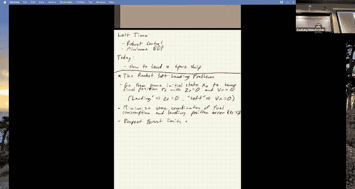

So you have to put in some additional constraints in general to get sameane looking trajectories。

And so examples of this like we kind of just saw。

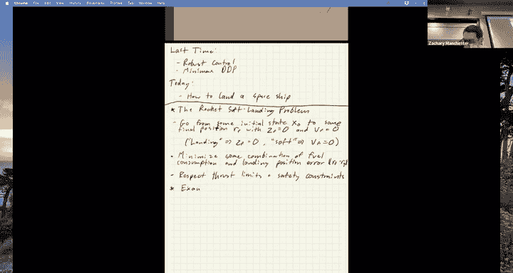

啊啲啊。NAA Curioity and perseverance stuff did this。So the last two。

Mars landingnings both use this stuff。ItThe sky crane。From 2012。SpaceX， stuff， Falcon9。

And Starship that we just saw。So circa， I don't know， like 2015 to now。Perseverance。

 which we just saw， did this with the terrain relative navigation。For state estimation。

That was last year。See， and then I guess the the overall kind of like takeaway well we're going to talk through like kind of how the whole stack works here。

 it takes lots of tricks to make this work in practice and I'm going to show you some of the tricks。

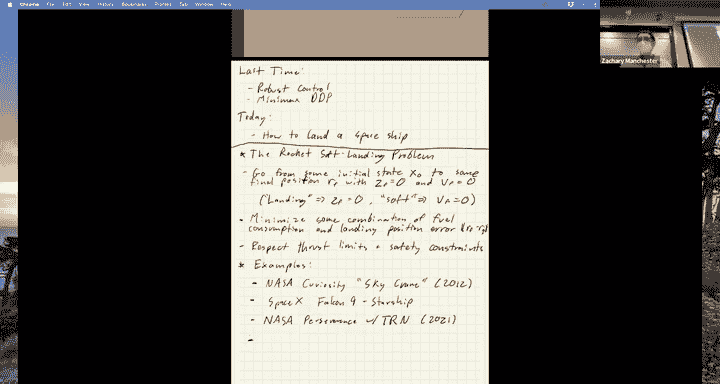

。And so like what i'm hoping to get across here is like in principle right we could write down some dynamics model constraints。

 whatever and do the same stuff we've talked about in class very easily to do this like offline right in like simulator I'm going to try to hopefully show you some of the like。

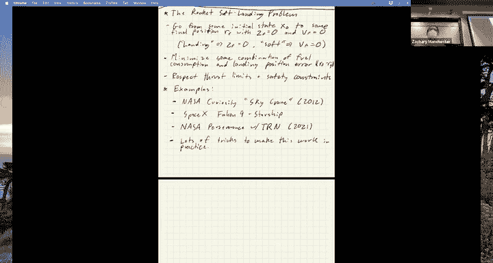

I don't know， the more in the weed stuff that people do in practice to make this stuff really work like in an online sort of full stack setting。

So to that end， here's kind of the setup for this kind of stuff。

 so this would be like the full stack。Control， state estimation， et cetera for one of these systems。

嗯。So。The first thing to say is that like the standard approach which you guys people who haveve done like aerial robotic stuff like quadators you might be familiar with this sort of general set of ideas the standard approach here is to decouple the control loop so you end up with a position sort of loop and a attitude tracking loop is a standard practice with a lot of other systems and the reason you do this is that so number one is the attitude part is where all the nonlinearity is position stuff tends to be simpler also the attitude dynamics tend to be much faster than the position dynamics so you can have a fast attitude loop and then a slowmpC controller that's doing the position stuff and that's kind of a very common trick in a lot of like aerial systems。

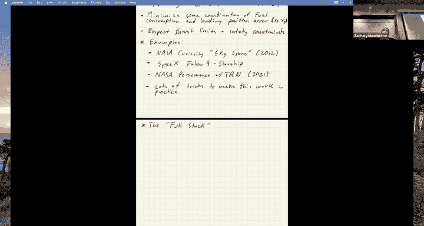

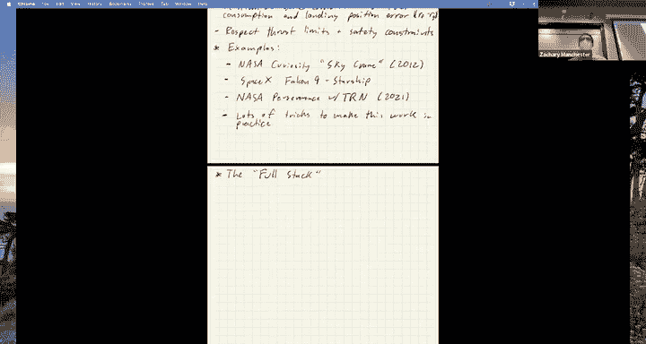

So。That was weird here's kind of the idea。 here's a we sort of。You have a position controller？

And this is generating basically desired。

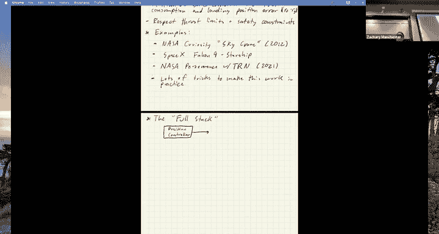

Accelations。And those get fed into an attitude。 And I say acceleration， I mean linear accelerations。

Those get fed into an attitude。Conroller。It's basically figuring out how to like lean the vehicle to produce the desired linear accelerations。

And this thing is spitting out the actual thrust and gimbal commands。

 so we'll call these T and theta。And then this goes out and runs on the rocket。Then we have。

Down here we have a state estimator of some kind。And this is providing the attitude controller with sort of。

Quernion and angular velocity stuff， and then it's providing the position controller with position and velocity。

Stuff。So to kind of fill in the gaps here a little bit we've got。嗯。Position and velocity。He's got。诶。

Linear acceleration。God。

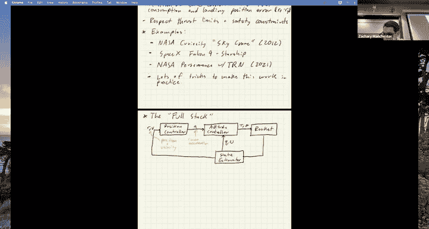

Thrust and by that I mean the magnitude and then theta is the gimbal angle。

 sort of like the thrust vector angle like directions。And then the stuff is。As anyngular velocity。

 oh， I think that's that story。So。Let's see some other stuff in here。

How do we do state estimation for this stuff？嗯。So in the SpaceX case， it's pretty vanilla。Basically。

 GPS and IMU， and it's like any other system you know you'd be used to working with probably。嗯。

Basically like with good GPS and inertial filtering you can get like super good position and velocity stuff you can get like submeterter accuracy pretty easily on the positions and like better than you know centimeter per second stuff and by the way you can also do attitude estimation with GPS I don't know how that works。

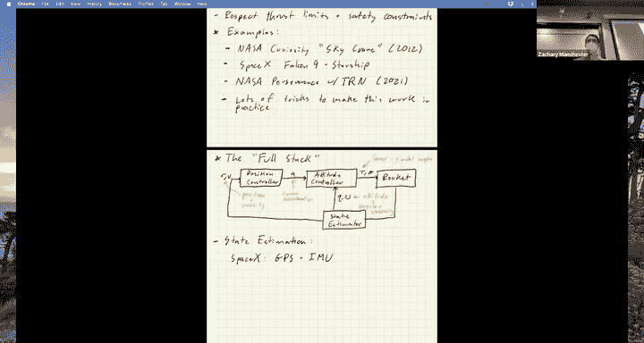

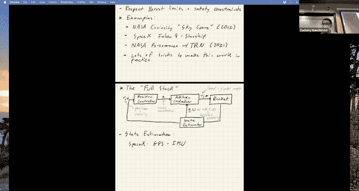

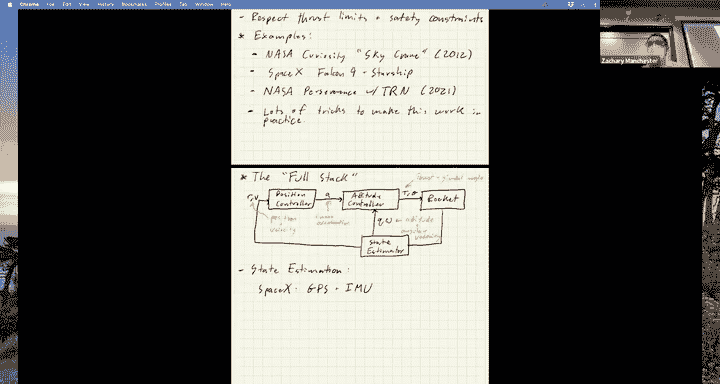

上线咩。

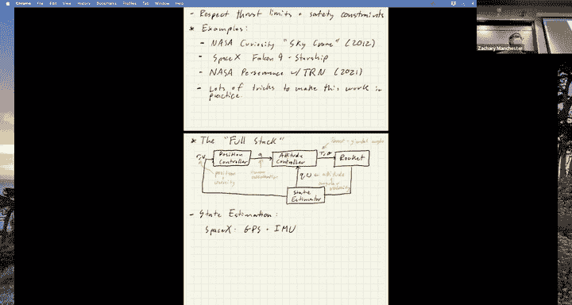

How many you need three it turns out yeah so this is you can basically have multiple GPS antennas and by essentially diing the positions of the antennas you get multiple vectors in the body frame and you can back out the the attitude from having like three at least three GPS antennas on the vehicle spaced apart it does yeah so there's some it turns out you can do better than you might expect though because like if you were naively just computing like the world framed positions of the antennas。

 you know it's only good to like several meters but it turns out by like。

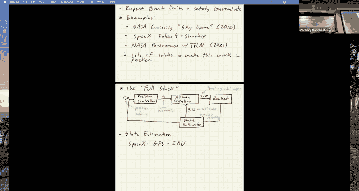

Doing fancy inertial filtering with the raw GPS observables you can do way better than that Basically you can look at the differential phase in the GPS signal between the antennas。

 which can give you actually like uber fine resolution of the relative positions of the antennas yeah there might be one GPS Yeah this is why I was going to talk about the Mars case is quite different and a lot harder So yeah with this basically with good filtering。

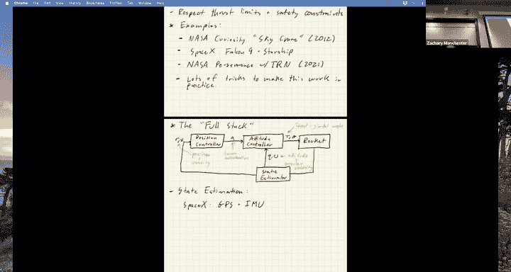

Like callleman filter stuff， right？You can get。Super accurate， like。

So better than one meter for sure positions。You can get way better than one centimeter per second。

不 city。Noimeter per second， actually。And actually， yeah， better than one degree。

Attitude from this as well。And this is basically how they do precision landing like it's literally just GPS for all the really awesome SpaceX stuff you see。

Why would you use GPS over。90 paraco for。Oh， use both， so and I knew doesn't give you full attitude。

Knowledge。It gives you angular velocity which you can integrate up and dead reckon。

 but it doesn't give you like full attitudes just like think of it as like giving you velocity measurements right knowing a velocity I can like dead reckon my position if I know the initial position。

 but I'm going to drift over time and stuff similar ideas you need actual vector attitude measurements to produce an attitude so for GPS works like we if you have mobile antennas other common ways of doing it are basically vision in fact it goes way back in the aerospace world like back to like the 60s even like the earliest spacecraft did star Ters and various other flavors of essentially use a camera look for stars match it up to a map of the star field and figure out some reference vectors and back out your pose very classic estimation problem called wva's problem that is the problem of taking a bunch of vector measurements。

In the body frame and in the like you know known inertial frame and then computing the rotation between them in all like least squares kind of sense。

So yeah， I don't know that was so attitude estimation is a whole thing it's sort of like a weird group theory S3 kind of thing that gets kind of fun。

Yeah， yeah。make assumptions I can measure the and stuff like that yeah。Yeah。

 I mean so there you're basically assuming that you're not moving very much right and that the accelerations are kind of close to zero so that gravity is dominating here that's definitely not true right and you're in free fall for a lot of it and crazy things are happening so yeah you don't want to do that necessarily in this setup that sort of stuff can go into a filter。

 but you still really need some absolute like sort of attitude references to get your your attitude knowledge down to a to a good level to do precision land and kind of stuff。

Okay， so that's like what you do at Earth and that's like relatively straightforward it's much。

 much harder at Mars， as you can imagine， so obviously no GPS。So what they do is basically I am you。

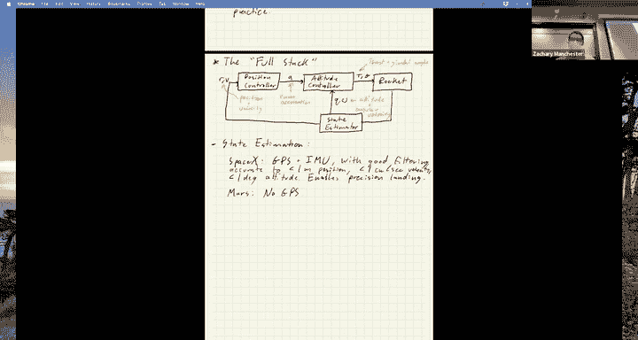

Which is again velocity acceleration stuff right for dead reckoning。

 it turns out basically they have navigation information in space。Then when you hit the atmosphere。

 you get ionmospheric blackout right if everyone remembers like Apollo 13 fireball so you can't actually talk over radio for a while and you're going through the atmosphere so they literally dead reckon with the IMU the entire way through the atmosphere until the parachute pops so it's totally dead reckoning it turns out they have incredibly good IMU so they are able to get accuracy at the like one degree level on the attitude still after several minutes。

 the positions I don't know what the position drift looks like。

 but they dead reckon through the atmosphere， then once the parachute pops。

 you get a radar altimeter。

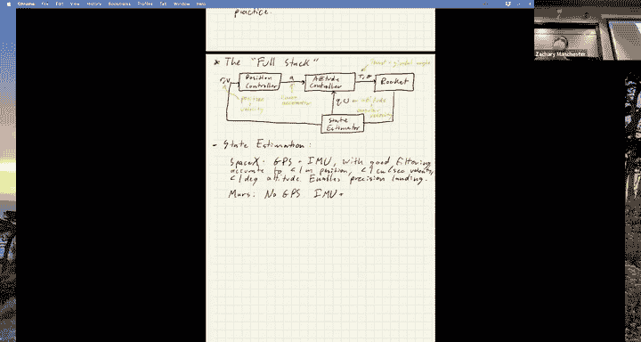

So that's telling you how far you are off the ground。And then the last piece of it is vision now。

 like the most recent Mars Laming uses this terrain relative navigation stuff。

And so that basically they look for terrain features and you know kind of do all this standard machine vision stuff and again yeah a lot of that was done here like 10 years ago like the original stuff was。

Let's here which is pretty awesome， this is I think the current TRN system that JPL is flying is about 30 meter accuracy。

And basically， what they use this for is to avoid landing on top of boulders。When they land。

 which gives them a lot more flexibility in where they can go。

So yeah this is not pinpoint landing and this 30 meter accuracy thing this is the TN system the actual accuracy of the entry part where your fireball mode to where the parachute pops out that's like 20 kilometers so basically when the parachute pops you don't know where you are to better than like 10 or 20 kilometers and at that point what you're doing is you you use the TRN system to basically like look at the ground right now while you're still falling at hundreds of meters per second you only have so much fuel to like slow down and a maneuver you're basically just looking for a clear enough landing spot where there are no boulders in the immediate vicinity to land like a minute from now that's basically what the system does so it's not doing any kind of pinpoint landing at a desired site it's literally just like a safety thing and this lets them basically target areas that are maybe a little bit more hazardous than then they might have you know previously done like previously because of the giant uncertainty eipse in the landing site they would target places that were extremely smooth and devoid of like major boulders craters rocks that kind of。

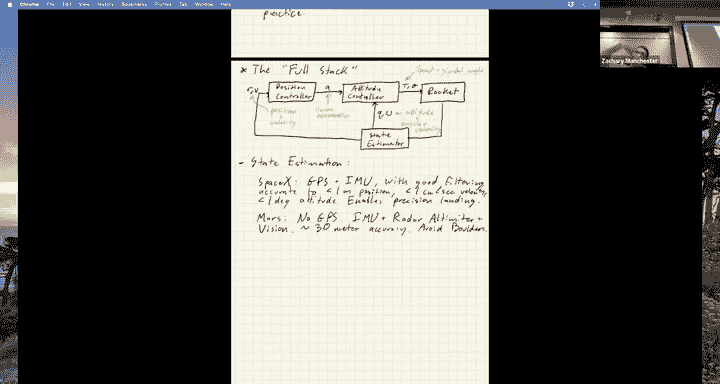

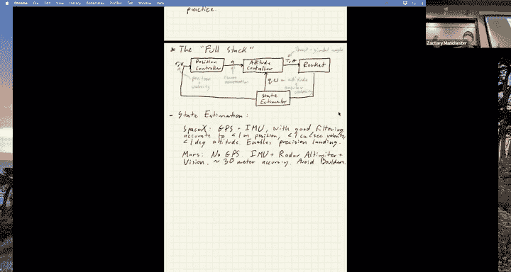

Stuff which ultimately means they they have to drive a really long time to get to interesting places so this lets you like land in areas that might be like boulder fields and more you know gnarly yeah terrain relative navigation that's like division based navigation stuff yeah。

So this might be jumping a bit but obviously get these multimillion dollar things how do they test and do they just rely on their simulation no no no no no so this tier end system was like in development for like over a decade and they did a lot of testing on helicopters and drones like out in the desert in California and places like this right you go out and find a place that looks vaguely Mars like in the desert and you like put it on a helicopter and go fly you know simulated stuff yeah。

Let some backups I'm not familiar with to what extent do we have pictures of Mars from satellite Yeah。

 how much of Mars can be seen without Yeah no there are orbiters around there have been for decades so we actually have pretty good like I don't know what the resolution is it's probably you know。

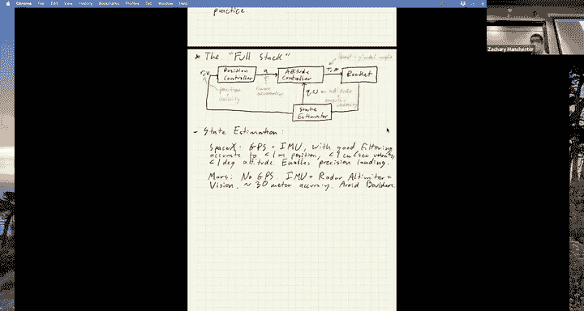

10 meters or ish， but we have like basically global maps of Mars。

 like global imagery over collected over many years from various orbiters。Yeah。

 do you know if the vision is purely with cameras or they use like Instagram？

I think it's just cameras， I know they have the radar altimemeter。

 I think it's basically radar altimemeter， IMU and camera。

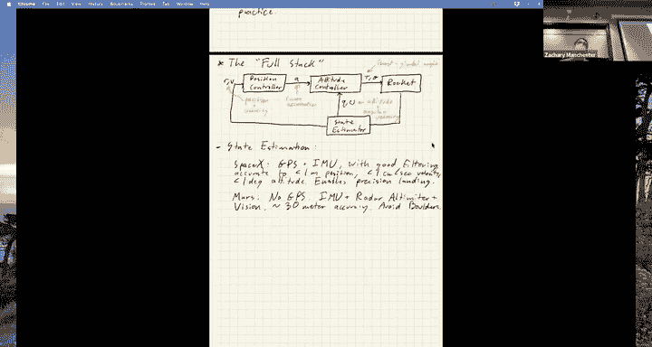

And there's a whole other side of this， which is like these things are billions of dollars to pull off so like there's a lot of testing and。

Everything has to be like Uber fault tolerant and work in radiation environments on really bad compute hardware actually like this stuff runs on a computer called the RAD 750 if anyone's heard of this it's the it's what a power Mac G3 was back in the 90s like before Apple switch processors twice so that's like the current like flight computer the JPL flies or really bad I think it runs it like 400 beherz it's like the equivalent of what was in like the old like candy colored im max when I was in middle school。

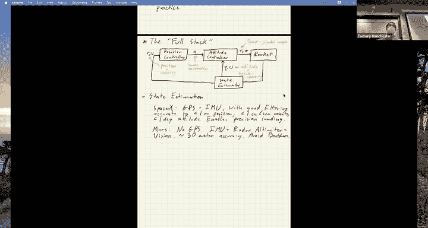

I think you guys are probably too young to remember these。

Anyway because they're radiation hardened so they'll work in like insane radiation environments where like stock terrestrial processors will have single event upsets and do weird things that's the main reason honestly yeah you can get away with cots electronics in space they's just like risk of various upsets and things from radiation and they don't trust you know in a mission critical thing like landing like this you just don't trust anything else so they have these like super hardened processes that are built on like custom fabrication processes with like super fat feature sizes and stuff like this that are really really robust。

But really old， they're like， you know， 25 year old， you know， basically process technology。

So they're very compute limited。Anybody else？

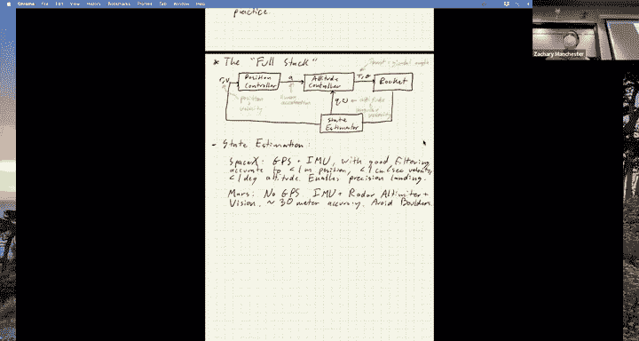

Okay， onward。So that's that story Okay， so that's the state estimation part so like let's talk about the control loop little bit where my mouse go okay so。

We talk about this decoupling thing。嗯。So。Yeah， I guess I should yeah so my lab does work on the entry guidance part of this problem。

 so like the fireball part back control problem we don't do the power dissense stuff。

So I know something about this？Okay， so there's sort of this two level thing。

 I guess we talked about so you have like we'll call it high level position controller。

And this is the part we're going to focus on today where there has been like kind of。

 really interesting work in the last decade or so。So this is really just a point mass like double integrator kind of model。

And this is reasoning about。Um。Safety。Constraints so there's usually like the don't go through the ground sort of obvious thing and there's also often glide slope constraints there can also be other constraints for the vision system such that you guarantee you have enough features that're that are always in view stuff like this。

Your reason about thrust limit sort of constraints on this thing and then fuel。Constraints as well。

And then this thing generates。Acceleration。Slash thrust。Commands。And these run it like order hurts。

 because it's actually a fairly slow loop。So this might run at like five or 10 hertz。

And then underneath this， we mentioned there's this lower level attitude tracking loop。嗯我去睇先。Okay。

Is there。😊，Yeah， somebody on Zoom。Yeah you mentioned like for really good attitude measurements you need like a vector type measurement could you expand on that a little bit Yeah so basically what you need the questions about attitude determination so what you need are vectors to like known like reference features in the environment so what you kind of want is vectors where you know what the vector is in the inertial frame say in the world frame。

And then you measure the same vector in the body frame so now you know like you basically have pairs of vectors where you know them in the body and inertial frame and you can write down a least squares problem now to like figure out what the best fit rotation matrix or linear transformation is between those pairs of vectors。

 does that makes sense。Yeah， that makes sense。Yeah， so like for example， right like if I know。

 if I know my robots like center mass position and I know the position of something in the environment。

 right？From that information， I can compute like in the inertial frame。

 like the unit vector that points from the robot center mass to the environment feature， right？

Then I can measure it with a camera and figure out what it is in the body frame now I have a pair of features right I just do this for a handful of things and now I can write down the three squares problem。

Okay， add a controller。So this is reasoning about。Unsurprisingly， attitude。

But in addition if this gets kind of weird and complicated this is this is voodoo so like the position stuff there's really nice provable guaranteed convex stuff we're going to talk about the attitude tracking controllers are still very vooooy so what goes in here so this is kind of trying to say okay if I want this thrust I need to be you know tilted this much whatever but also it does a lot to reason about flexible modes。

So for rockets。They actually are surprisingly floppy aerospace systems in general like large aerospace systems they're built to be super lightweight and so if you have a large thing that's very lightweight it's inherently going to be flexible so it turns out large rockets typically have bending modes in the single digit hertz range so like you can very easily have a control loop that's running faster than your first bending mode of your rocket structure and so like you don't want to excite that basically right you can easily drive the controller in such a way that you're like exciting like a big bending mode of the rocket and you can just shake the rocket apart。

Which is terrifying so there's all kinds of weird vooooy tricks for dealing with this。

 the standard approach in like theerospace industry is to use like CAD or vibration testing to figure out what those modes are and any of those modes that are kind of in the control bandwidth you notch filter them so you basically tell the controller it's not allowed to do anything at the frequencies associated with those modes。

And because if you do， you can very easily end up in very scary situations where there's like essentially positive feedback between what the controller is doing and what the flexing mode of the block body is doing and it just blows up。

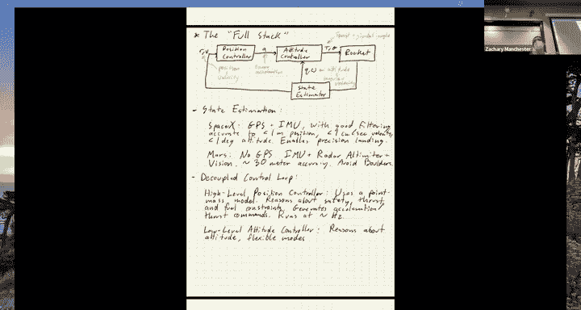

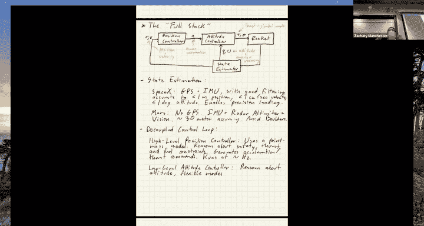

This happened in the early days of rockets and that's why one of the reasons lots of them exploded。

It was a flexible mode， the other kind of weirdo blue thing is fluid slosh。

 which maybe maybe we'll talk a little bit about but。Yeah。

 rocketets are full of lots of fuel that's actually a huge fraction of their overall mass and these tanks。

 you know， there's liquid in them and not liquid and fluid moving around and that does some very scary things also。

So you have to think about that at some level。And then these things kind of generate。嗯。

Thrust in gimbal commands for the engine。To track the desired acceleration。And this maybe runs。

 I don't know， in a typical， you know， rocket thing this might be running at like tens of hers。

Also as an aside， it always am me like how similar these things are to you like。Like。

I don't know quad rotors and even like quadrupeds like legged quadrupeds do shockingly similar things in terms of like NPC and state estimation where you like turn it into a rigid body and then like abstract away all the thruster leg stuff basically this is like the same kind of things we do on quadrupeds where we like treat it as a rigid body and then like abstract away what like the legs or the thrusters right at the high level here is like basically the same as we do on a quadruped which is kind of nuts。

Okay， any questions aboutll ask high level yeah little。开。Depends on the vehicle。 So large rockets。

 the dynamics are actually slow， right？ So you don't need to run super fast。 But basically。

 the smaller the vehicle， right， the faster the dynamics are。

 and then the faster the controller has to run。 But for like a large rocket thing， like yeah。

 it's like 20 Hz，50 Hz is like enough。Yeah， little quad rots actually have to run much much faster right controller loops for example for this stuff so typically not I would say yeah like we're going to do the high level control of today' see what that looks like and the general assumption here that lets you do this decoupling is that the low level dynamics are just much faster so that means like basically that low level attitude tracking controller like has very high bandwidth and and like those dynamics are just way faster like an order of magnitude faster say then the position dynamics and that's what lets you do this right if so if they're not if that's not true like if the if they're on the same sort of time scale then you can't separate them like this right。

Yes， yeah， are there other stability issues besides。Yes， yeah。

So fluid flush is another really big one and we'll talk a little bit about that there's also one of the things we haven't talked about at all here is aerodynamics turns out that does also some weird stuff that you mostly ignore like as with the quadator stuff we mostly ignore the aerodynamics but it can be weird stuff that sometimes you also have to think about。

Which we're not going to talk about today because it's gross and complicated。Also。

 maybe I'm not supposed to talk about it， I'm not sure about that。对嗯。

Do these like your rockets are like landinging Googles have also have like the8x like spinning mass systems for satellites too or are those like two weeks for like they they do not know this is all thrusters Yeah Yeah。

 those like spinning ADCS systems， Yeah those are like。

Basically those are a thing because you don't want to expend propellant over the long run here the whole thing's happening in a minute so you're going to just use all your propellant therere actually even spacecraft that don't have reaction wheel type actuators。

 if basically if the mission drain is really short and you have lots of fuel then like you just use thrusters。

Yeah， is there a ratio between the frequency at which you control position versus action or does it kind of end in the system？

It really depends on the system， I would say， yeah， like I don't think there's any。

Rule like hard rule about this， I think the main rule here that lets you do this decoupling is that let's say like ha wy you want like them to be separated by like a decade in the frequency domain or something it needs to be like big separation of these things in the frequency domain such that you can basically assume that whatever you're commanding and the high level thing is just going to happen。

In the attitude tracking loop， like much faster than the rate at which the high level control is running。

All right， cool， so let's talk a little bit about rocket dynamics。

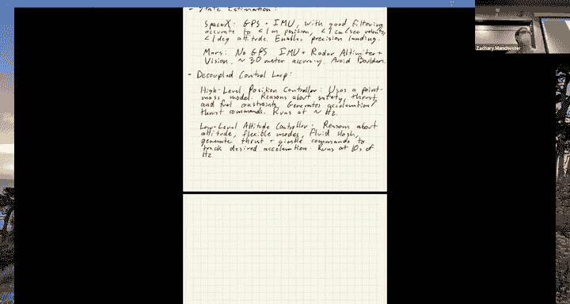

And like the models that get used for this stuff。

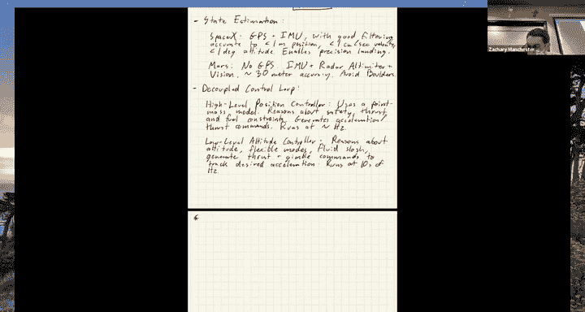

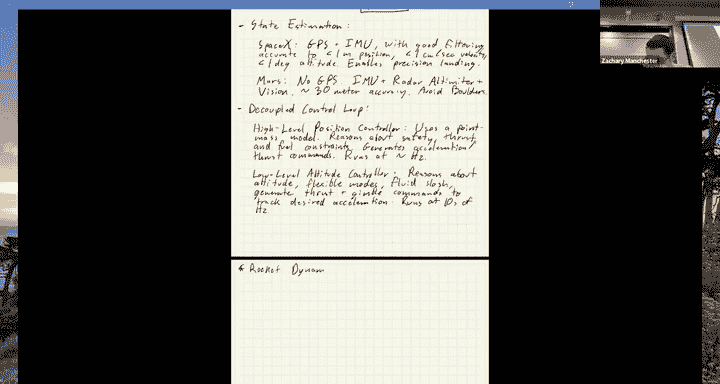

So essentially， it's a rigid body model。

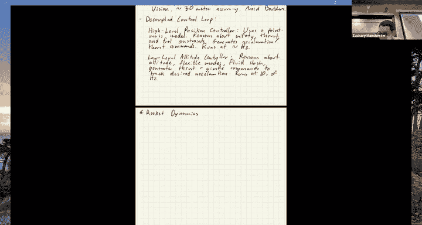

Like we've been using for lots of things， same stuff to use for like quad rotors， quadrupeds。

You know， all kinds of， I'm going to draw a terrible cartoon rocket。And okay， so we've got。

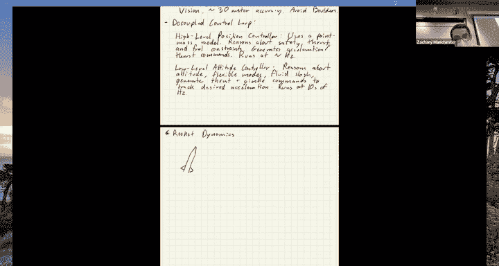

Let's see， so maybe center of mass somewhere in here。We've got a fuel tank in here。With。Fuelel in it。

 maybe halfway up。Something like this。We've got。Maybe some like offset in the position of the engine from the center of mass。

it's called L， say。Then we have our thrust vector pointed some direction here， T。嗯。

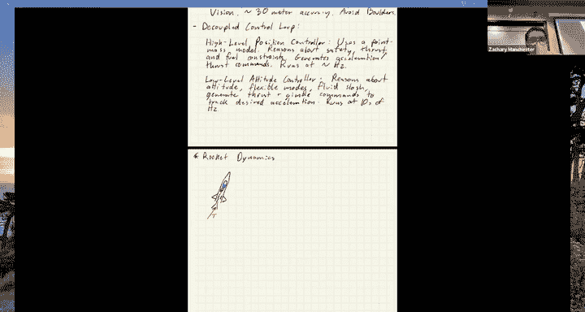

Cool。And basically it's new oiler dynamics like we're used to seeing， so it'd be something like。

 you know。V dot equals minus G plus here sort of thrust over mass。Then we've got。

Very importantly here， something you may not have had to think about before is that。

This has time varying mass， the fuel is like a huge portion of the overall mass。

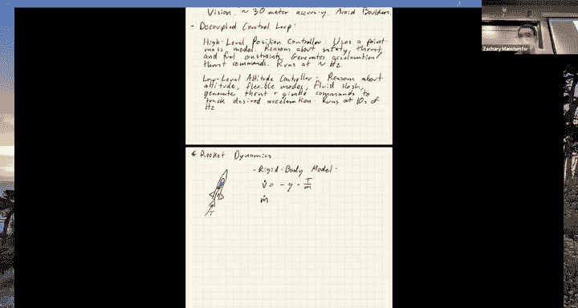

And as you go， you're burning fuel so you have something that looks like this。

So account for fuel burn。就好似。Poin mask。Dynamics。Fuel burn dynamics。This whole thing is。

What the position controller looks at。And we're saying these are kind of slow。Relatively speaking。

 and then we also have attitude dynamics， which we've seen before as well。

 so this is like ohs equation， the usual stuff。Like we saw at a quad rottor。

And this last term right this is like the torque generated by the thrust vector， right？嗯哦哦。Yeah。

 yeah， this is very true。I have not seen models that like dig into this and and like so if you were building a like good simulator。

 you would totally account for this， I don't know how much people actually worry about this in the control design I think。

The the fuel burn stuff definitely shows up in the position controlling stuff we're going to talk about these attitude control loops the models are bad in general like because you've got these flexible modes going on and you've got these like fluid slash dynamics it's very weird so the control design for this attitude traction and control tends to be like actually super old school like robust linear control stuff like age infinity stuff or just like even just straight up like pole placement techniques where people like handt crazy notch filters and all kinds of stuff using like Boy and root Locus kind of design techniques。

Like that's the stuff I've seen in industry for this， which is slightly terrifying， to be honest。啊，呀。

Where is theome That's or there's equation。 That's just the dynamics of a rigid body。

 So we did this with a quad rottor。 Yeah， I mean， this is like the attitude dynamics of a rigid body。

 Like the first half of that before the equal sign is like。

You know stuff and then the right hand side of the applied torques。

 this is f equals NA for for attitude basically。Okay， attitude stuff。And then this is sort of。

This is what the attitude controller is going to deal with。Okay， so yeah。

 the fluid stuff is really actually quite serious。嗯。At launch， this is like the majority of the mask。

 right so like。Like say， 80 plus percent。Of the initial vehicle mass is actually fuel。啊。

And so like and even during landing， it's a lot。So you might be looking at like2 to5 x change in total mass。

 and you have to account for this， you can't ignore it。Let's see， the other thing we talked about。

 yeah， fluid slash， this is super terrible。嗯。Um。So basically， yeah， in short， it's highly nonlinear。

And very hard to model。This is actually a great place for data driven。You know。

 kind of modeling techniques。It's even hard to get this data， though，You would kind of like。

 you know， maybe think about doing， you know fluid dynamic like cD simulation computationally。

 but it's unsteady flow with all kinds of weird boundary stuff and like。

Terrible to even just try simulating it so people do experiments actually in drop towers for this stuff so like there's places that have you know like 10 story high towers so you can drop stuff to get like short duration like0 g so people actually like run experiments that' like spin up a tank with a fluid in it and drop it and get like a few seconds of zero G time and like you know instrument it up and try to see what's going on。

It's pretty pretty bad， actually， so the standard model。

It gets used in simulation and for light control design is the following thing you basically have your rocket。

And you model the fluid as a pendulum。Inside the rocket。It can move around。And。

You like basically fit the length and mass of the pendulum to data。

And it kind of gets that in like a first order way what's going on right the fluid can kind of move side to side in there in response to the vehicle motion right so you've read this like weirdo coupled pendulum thing so this is it this is basically what people do so it's a nice low- order parametric model it kind of gets at the qualitative idea and if you design a robust controller with this model in mind you can imagine if you do the robust stuff and you're robust to uncertain parameters in that pendulum like that's going to get you you know a robust enough controller that it should work on the real thing and it's good enough for SpaceX apparently so this is kind of what people do。

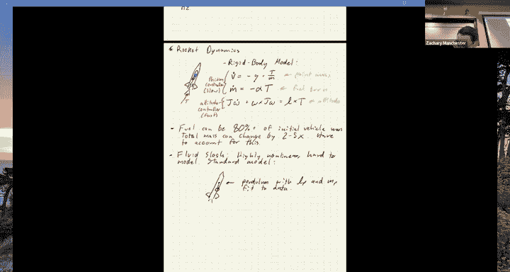

And then lastly， yeah， the flexible mode stuff。我去看看 talk to他呗。So yeah， rockets are very light。So。

Means， you know， inherently kind of not stiff。Which means you end up with low frequency bending modes。

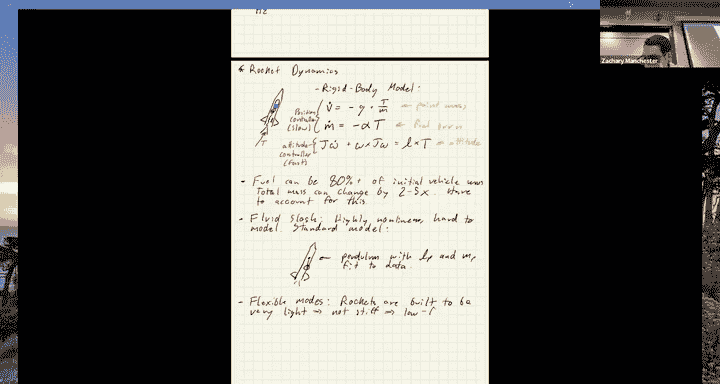

不。嗯。So yeah， like the lowest frequency bending mode for these things can be like in the herdtz range。

Which you definitely need to worry about。I don't know， have I done this in here。

 so what does anyone know what the definition of a rigid body is for like practical purposes。

 like when can you afford to model something as a rigid body？

Like when is that a legal approximation from like an engineering standpoint？

two points the distanceYeah， that's like a nice mathematical definition。

 but like the kind of like hacker practical engineer definition is。

The natural frequencies of the thing， like any structural frequencies are much higher than like。

Anything you're trying to do with your controller so in this case you know if the bending mo that you know a few hurts that's not true right so like there's going to be coupling between the controller and the and the bending and stuff。

And so the hacky solution to this is to add notch filters to the AddU controller in the frequency domain。

Which is pretty gross。But。Thatts of people there。冇知。

So this is like in the frequency domain man you can like stick a filter in that like will like filter out stuff at a particular frequency right and like try to be very notch filter of course。

 but like means you it's a very narrow frequency band that you're trying to filter out right so you do that right around the structural modes。

い要バ発。Yeah， a damn cut。Yeah， exactly， yeah。With the Lewis Washington。

would you ever try to deal with that by doing like getting funky with your like the fuel portion of your cost function for your controller so like you want to end up with as little fuel as possible towards the end or something I've never seen anyone do this but like in principle yeah it's like a knob you have to turn there so maybe I've never seen anything like this so we played around in our lab with this problem a bit too where we we had some like robust control stuff where we basically threw the pendulum model in there and like did robust stuff on the pendulum parameters and came up with like a robust feedback controller that like would stick the landing with all this stuff when like standard LQR failed so you can do stuff like that this more model base I would say but no one that I know of in the actual aerospace does that that just do this kind of notchville3 stuff。

嗯。Yeah。So， yeah。Basically， notch filter around the bending modes so you don't excite them。Then yeah。

 other stuff that we've ignored briefly mentioned， there's no aerodynamics in there， right？

Surprising how far you can go with that。Most ignored。And I mean at Mars。

 they really don't matter because the Martian atmosphere is so thin for SpaceX stuff it does probably。

 but I really don't know what they do， but one way of sort of like making sure they don't matter too much is to add velocity constraints to the position controller so that if you limit the velocities like then you're kind of inherently limiting the arrowero forces right because they tend to go to like veloc squared so for small velocities。

 they're not going to matter too much。And then yeah， lastley， lots of model uncertainty in here。

 believe that's clear。And yeah， the sort of stock go to techniques in this area for like that attitude loop and all that stuff are like linear robust control ideas。

So like we briefly mentioned last time， like H infinity methods。

 the sort of techniques in there that are kind of common or called H infinity loop shaping。

 anyone's heard of that。Which are basically modern like multi input。

 multi output generalizations of like old school Mypls Boy， like frequency domain kind of techniques。

And like sort of along the lines of the stuff we talked about last time。Okay。

 any questions about this？Cool， so that's like roughly speaking with rocket models look like。

They were kind of cartoony。But yeah the other thing I want to get across here too is like there's a bit of an art to doing modeling for control like you want to use the simplest models you can get away with that capture like essential features of the dynamics right like you just need to get it qualitatively right so like that pendulum fuel slash thing right it's very cartoon but like sort of qualitatively captures what's going on and that's good enough for doing like a robust control design。

Okay， so the meat of this paper that we're going to get into now is super fun。

 so we we did a bunch of discussion about convex stuff here you know a while ago we did NPC this is very much in that vein and drawing on that stuff。

So we're going to。Reach back into that sort of set of ideas a little bit here and we're going to talk about something called convex relaxation。

Which I think I mentioned a little bit when we talked about conVx MC。So here's kind of the。

The high level idea is sometimes we can have a non convex constraint。

That can be expressed as the boundary of a larger convex set。So let me write this down。

 I'll draw a picture and explain like a good example of this。anyone can think of an example of this？

On writing。No ideas。How about a circle？十。Make sense to anybody。So here's like an example， right。

 so a circle。If I need to be on the circle， so it to be like x squared plus y squared equals one。

 say something like this， right？That's a non convex set right if I pick two points on the circle draw line I'm going to cross the interior region right and that's illegal。

 but if I include the interior， so if I turn it from x squared plus y squared equals1 to x squared plus y squared less than equal one so I include the interior now。

And I have a disk。Dis is convex， right？Okay。Original set。Theres S1 circle right the enlarged set。

 so yeah like write down what we mean here， this is X。Such that。Norm of x is equal to1， say， right？

Then if we go with this like enlarge set instead。嗯。It includes the interior。So we'll call this S2。

And I should like draw the wines in red， I guess。Okay， so this would be like。

S2 is you know x such that。Norm x is less than equal to1 instead of equal to one， right？

And so we can say like formal fancy notation， you could say something like S1 is the。

Boundary of S2 you haven't seen that notation before。Okay。

The idea is like if we just take our original problem where I need the， you know。

 I need x to be on the circle all I'm doing is taking that equality and turning it into an inequality right so that that is called。

A convex relaxation。So we just replace the like original。Constraint。With the larger convex one。

So that's what a convex relaxation is。So far so good。Okay， so。In general。

 right you're not going to get the same answer if I just do this right。

 but sometimes if the cost function is particularly nice。

You can prove that you'll still recover the exact same answer as the original problem when you solve the relaxed problem Can anyone tell me when that might happen？

That's yeah。questions。Yeah， so if your cost function always pushes you onto the constraint boundary。

So you you can prove that the solution always lies on the boundary。

 then you're back to the original you know feasible set right okay。

 any think of a can you think of a cost function that would do this in this case？Yeah。Not expired。

Well maybe but so generically the ones you want for this happen are linear cost functions so just a gradient right which is going to push you in just one direction to hit the constraint right so linear cost functions is pretty much always do this for you there's some other ones that work too but in general like you can maybe if your cost function is benign enough this you can prove that this this still holds exactly。

嗯。So yeah， the the cartoon example would be if I'm doing something like min of C transpose X right subject to。

Norm x equals one。 And I turn this into。Normax。Less than equals to one。

 it's the cartoon picture we just drew。 And so the idea is， if I have like， you know。

The circle and C。Let's say this is C。You know， the solution to this is going to be always。

This point here， right？And so yeah， linear cost guarantees you're going to push up to the constraint boundary。

Okay， so when this happens when I can get provably get the answer to the original problem by solving the convex relaxation。

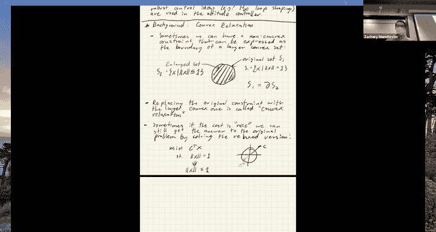

This we call this a tight relaxation。

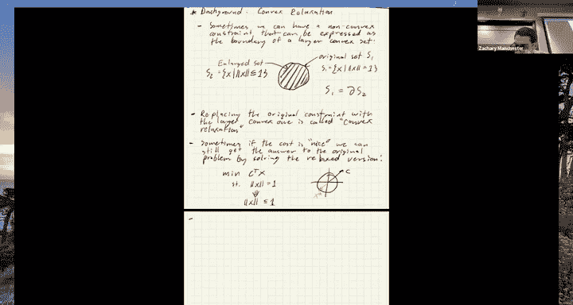

哦。

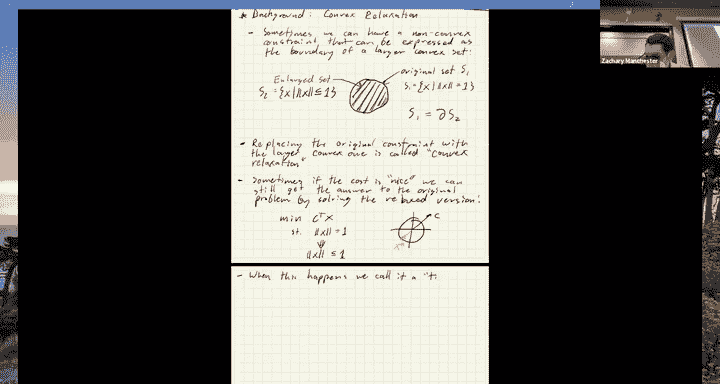

Go。Okay， cool， so any questions about this？

This idea is like pretty cool and actually comes up in a lot of random places。

And is sometimes you get really lucky a way of like getting sort of guaranteed solutions to nonlinear problems。

 which is kind of awesome yeah so。

typicallyNo no if you have to do that you're basically on a lock like basically the only way this works is when like the original problem ends up looking like this when you transform it somehow and you can like I mean a lot of control problems we get to make up the cost function right so like sometimes this can be a bit of a game of like reverse engineering。

 the original problem formulation that results in the tight convex relaxation and that's actually a bit of a story here on the rocket problem it turns out for certain cost functions you can do this for others you can't right。

Okay， so。Let's bring this back to the rocket problem。

So what we're specifically going to look at is convex。Relaxation of thrust constraints。

Okay， so here's the constraints that show up in this the position controller at the point mass dynamics。

 so those are linear right that's f equals M and that's no problem。

But the thrust constraints ends up being a little weird。 so there's a couple different ones。

 so we've got a maximum。Thrust constraint， a thrust limit， that's easy。

So this one is we have a thrust vector in R3。And we just put a norm constraint on it。

So something like， you know。This thing is less than some T max。So that's， you know， a ball。

So that's convex。嗯。

That's cool。Okay， so that's number one。Okay， number two is the the gimbal limits。

 so this would be like the thrust， you know， gimbal limits on your your your actual like。

Eine。So here's a thrust angle constraint， so like a way to write this down that's pretty simple would be something like the following。

So I took the thrust unit vector， right T over norm T， and I take its dot product with the。

Say like。The vector， I guess， like down the axis of the rocket or whatever。

And we say this has to be less than equal to。Coast of like this this angle。So the picture there is。

 you know， have like some cone。I have this M。Unit vector and then you the thrust has to live inside the cone。

Does that make sense to everybody？So this is a comic constraint。

 we've talked about cone'es convex all good， right so this is also convex。So that's no problem， Okay。

 so where is the problem？In this whole thing， the problem is that in addition to maximum thrust constraints。

These rocket engines also have a very big dead band。

 so they have a minimum thrust constraint as well， so you can only throttle them up or down maybe like 20% and then below that there's just like it's either there or off。

So this is a huge problem。嗯。嗯。Okay， so what this looks like now is I have some team min。

And then I have the T Max from before。 And if I think about this as like the the sphere picture。

 right， this is saying like。That T has to live in between。

The surfaces of like two spheres right it's just like spherical shell situation。

 so the feasible set is like this region here。And again， this is like in 3D， right？

So it's like a sphere with a hole in the middle that I'm not allowed to go in。

So that's the big problem。So everyone't see that so this is definitely non convex right it's got a hole in the middle I can easily pick two points draw a line and like definitely non convex okay so。

Here's the magic trick。

So。The first part is we're going to add a slackck variable。

 so this is optimization word for who's anyone heard this word before， Slack variable。

 it's an optimization word for just adding a new variable into the problem that wasn't there originally that you constrained to you know do something useful。

😊，So here we go。So we're going to do this we're going to call this capital gamma and it's a scalar。

And we're going to set this thing。Equal to the thrust magnitude。So here's how that's going to look。

We're going to have the following setup。 So we've got。A new。Equality constraint where we set gamma。

Equal to norm of the thrust vector。Then we've got。Our previous constraints we have like。

Team in now we can do this right use gamma in there。

So we still have the same setup as before otherwise。

And just everywhere we had a norm T before we're going to put gamma。Okay， so this is clear。

 this is exactly the same set of constraints I had before I just put this new gamma in。

And now it should be clear， like these guys。Are convex。Right down here， these are linear constraints。

This one， now， what's this one？Service， yeah， exactly。 So this is the。

Norm equals something thing this is on the surface of the sphere so this is exactly the setup we had before where like surface the boundary of a convex set right so this is now gamut is on the boundary of the sphere。

So what do you think we're going to do？We're going to turn that equality into an inequality。

 just like we did before at the circle situation。G see see how this worked out。呀。万。看。Just。

Which one second？Yeah， second and third are now convex， right？

So before the number two up above was non convex， right？Number two is this red guy here。Right before。

 so that's bad we don't want that right， oh this should be norm。Soorrry。Right。Sorry， okay， so yeah。

 this would be like you know， T has to be in here somewhere。送要人多。嗯。So well， T is a vector。

Like there's no way to remove the norm。Like， it's， yeah。公さ。Yes， yeah yeah。我发。所以说。Yeah， yeah yeah。

 exactly， so two and three are good。They're linear or aine number one here is bad right number one is a non convex constraint。

But it's now clear like this is exactly the same case we had before with the circle example where I can turn take that equally relax it into an inequality and now it includes the interior of the sphere now it's a convex constraint right so I can the recipe here for going to the convex relaxation hopefully should be clear based on a last conversation just making sense tell me if this doesn't make sense。

Okay。So， the。The trick is。I just replaced， I set up this new constraint with this new scalar variable。

 set it equal to norm T， I've ever had a norm T before I put the gemmma instead。

And I just have this one constraint that's non convex now。

 and now it's clear to relax that I can change it to in inequality and make it convex。

So I don't know if want to talk more about it later I'll keep trucking for now and then we can talk about it some more Okay。

 so yeah now we're in exactly the situation before。So we can convexify。

Constraints by relaxing that number one。So basically now we have。The following stuff。

And now this is all conves。

Okay， so。That's the key idea。And then obviously there's this whole condition like we said before where you need the cost function to be sort of nice to you in the sense that it pushes you up against the constraint boundary turns out for particular choices of cost function that are relevant to this rocket soft landing problem that happens the proof that that happens is in the paper that I showed a second ago and we can like maybe walk through that a little bit。

 but basically what they do。Is they use Pontregon's minimum principles that we talked about at the very beginning to go through that trajectory optimization and prove that the relaxation is tight for this problem。

嗯。And it turns out， yeah it's tight for certain value certain cost functions yeah the idea that the optimal policy。

It's not exactly， but it's like similar sort of flavor I mean this is really a much simpler idea than that is just that like if I have a linear cost function。

Like this， so basically this is this is related to the fact that for like LPs。😡。

The constraint is always on on an active constraint or sorry the solution。

 the optimal solution is always on an active constraint， right？

For any any problem that has a linear cost function for it to have a finite you know like feasible solution has to be on up against a contrain right otherwise that gradient will just pursue your infinity so that's it right like that's really and this is kind of a fact of like。

Of of like linear programming and also a general more general convex programming。

 if you have a linear objective， you're going to end up to the constrain boundary or is's infeas。

So it's even a simpler idea than the bang bang idea。

 but it's not unrelated totally those are actually。More related than you might think。

We can talk more about this if you want。 So it turns out there's a way of。

You can can convexify so minimum time problems are always non convex turns out you can convexify them using this trick。

Which is wild yeah， so for linear。Minimum time problem， linear dynamics， minimum time problems。

 turns out you can do a convex relaxation of those that's like not too far off from this idea。

Tns out L1 norm costs on the states and the controls produce minimum time solutions for linear dynamics。

 which is maybe kind of obvious if you think about it， but proving that is like。

Go through some of these gymnastics， so there is a connection there。So the intuition is not bad。

But this is a simpler situation Yeah what is so the ones I use are like minimum norm sort of things flavored things like。

Let's see if we can pull up the paper。Where did it go。Sorry， I lost the paper， let's blow it up。

Okay， there it is。Yes。So they set up the whole thing， where is this？These are dynamic。 so yeah。

 this stuff， by the way， is they're doing this in a rotating frame， so this is like a。

Turns out a planet if you're doing like， you know。This kind of stuff。

 the planet frame is not an inertial reference frame because the planet is rotating if you're thinking about it as like coming in from space。

 so this is the omega here or the rotation of the planet。

It's a rotating reference frame if you really think about it right so yeah。

 this is some of the that we talk about gl slope constraints blah， blah blah。😊。

This is trying to give you some geometric intuition into that relaxation trick we just played。

Which is I don't know， I don't find it very intuitive personally。

 but that's what it is and then here's sort of。The original problem。

 so they're minimizing the landing error， the norm of the landing error， does that makes sense。

And there's a couple different flavors of this。 They've done like， several。There's lots。

 they had a whole series of papers on this stuff where they tried different things and implemented different yeah different cost functions et cetera。

 yeah the norm landing error isn't a wind function。It's not linear， but it turns out in this case。

 this still works， yeah。I don't think it depends on the norm here， but yeah。

There's some more details in that that are slightly complicated， but in general。

 the intuition is that like it's always true for linear costs。And。

There are some other costs that do this。Norms sometimes do so like I mentioned that that L1 norm trick for minimum time like the L1 norm。

Is not right so it's a norm but it turns out you can reformulate that as a linear cost so that's kind of maybe yeah I might have told you about this trick for the friction cone stuff yeah so that's how you turn a one norm into a linear constraint so there maybe then it's kind of obvious that that should be true right because it is a linear cost。

So yeah， there's some other flavors of this problem， but it looks like this。This version。

 they are doing this like minimum land in their cost function。But yeah。

 there's some other versions out there too that do other things。

This is like trying to do weirdo for the visualization of the relaxation trick。诶。Yeah。

 and they call this a lossless convex ofification。I guess。Is there word for it。

 but the optimization word for this is tight convex relaxation。

I think that's probably all all there is to say about this but if you want to look at the detail the gory details of a proof like this is where they walk you through this ponregen stuff。

That is a little messy and I don't think super informative， but that's how they do it。

I think you have enough tools to understand what they're doing， so if you want to go try to parse it。

 it's not terrible。It's just very formal and know proofy。Anyway。

 I think that's don have any other questions about this stuff。哎。Cool， yeah， I'll hang out for a bit。

